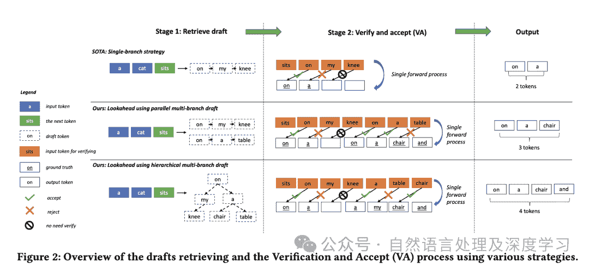
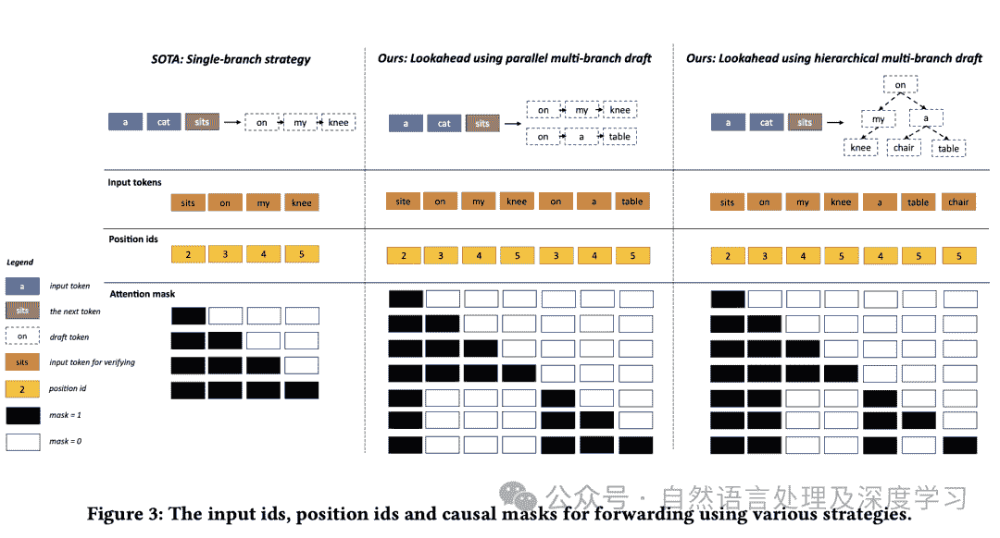
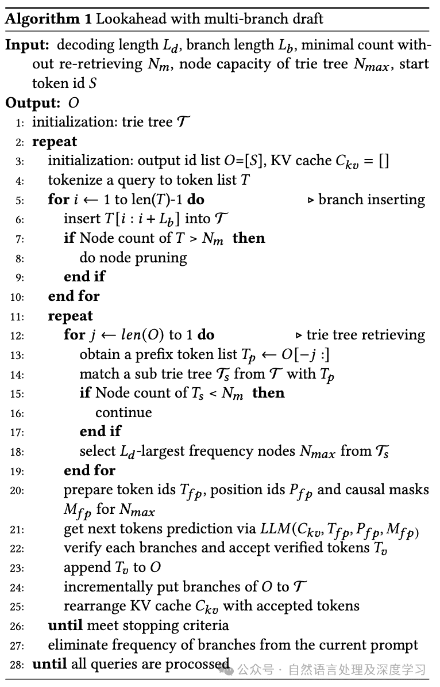

# 【LLM推理】Lookahead：一种无损推理加速机制

> 来源：[https://geekbang.feishu.cn/docx/MBawdLxXWoMdrFxVuGgcPq41n3X](https://geekbang.feishu.cn/docx/MBawdLxXWoMdrFxVuGgcPq41n3X)

> 👨🏻 作者：余俊晖

> 📃 作者介绍：一名NLP炼丹师，NLP算法竞赛TOP选手

> 🛖 👸号：大模型自然语言处理

> ⏰ 收录时间：2024-05-28 17:09:42

> 🔗 原文链接：h[ttps://mp.weixin.q](https://mp.weixin.qq.com/s?__biz=Mzg4NjI0NDg0Ng==&mid=2247484475&idx=1&sn=e351c2394f0456fd7452405a778d73e2&chksm=cf9dd0baf8ea59ac8af6494c20847c965cc420a95d65adc6f6b84b94575d3acde7e5c8cf677b#rd)q.com/s?__biz=Mz...


关注作者👸号，获取更多AI知识

##  **引言 **

现有LLMs的实际应用面临着推理速度慢的问题，现有优化推理方法如：量化（int8、GPTQ、KV Cache INT**8等）、稀**疏化、**剪枝、知识**蒸馏**和张量分解等操作来减**少LLMs的大小和降低推理速度。但这些技术往往会牺牲模型的准确性，既 有损优化 。而 无损优化 ，常见的优化手段主要集中在推理框架和推理引擎端，如：vLLM、TGI等推理框架，集成PagedAttention、FlashAttention等优化算法降低推理速度。理论分析发现 IO带宽是主要瓶颈 ：LLMs推理延迟的主要瓶颈是输入输出（IO）带宽，而不是与硬件计算能力相关的浮点运算（FLOPs）。这意味着，尽管LLMs在计算能力上可能很强大，但由于IO限制，它们的推理速度仍然受到限制。

本文介绍了Lookahead框架，这是一个通用的推理加速框架，主要针对RAG场景，旨在通过多分支策略和Trie树结构来提高推理速度，同时保持生成结果的准确性。

##  **一、RAG **

概述：介绍Lookahead之前，先说下RAG的思想，RAG通过结合检索（Retrieval）和生成（Generation）来增强模型的输出质量。通过检索最准确和最新的信息来增强LLMs的生成能力。从生成策略上来讲，RAG通常依赖于检索到的文档或信息片段来辅助生成过程。在生成策略中，假如在采样时也能猜测Token序列，那么便可以避免生成待验证的Token的过程，基于此，设计了Lookahead方法。

##  二、Lookahead  二、展望未来

###  2.1 METHODS  2.1 方法

1.  **多token策略 **：

+   Lookahead框架允许模型同时生成多个可能的token序列（分支），而不是传统的单步生成。这种方法可以并行处理多个token，从而在每个推理步骤中生成更多的token，提高整体的推理速度。

1.  **Trie树数据结构 **：

+   Trie树用于高效地存储和检索与输入上下文相关的多个token。每个节点代表一个token，从根节点到叶节点的路径代表一个完整的token序列。Trie树的结构使得模型能够快速找到与当前上下文匹配的token序列。

1.  token序列的插入、消除和修剪 ：

+   为了维护Trie树的效率，Lookahead框架实现了分支插入、分支消除和节点修剪策略。这些策略有助于保持Trie树的合理大小，避免内存消耗过大，并提高检索性能。

1.  **验证和接受（VA）过程 **：

+   在每个推理步骤中，Lookahead框架会从Trie树中检索到的草案进行验证。验证过程会确定每个草案中最长的正确子序列，并将这些子序列作为最终输出的一部分。

核心思想就是验证token的来源，与单token序列相比，多token序列可以提升接受率，token前缀树可进一步降低成本。如图：



在图中，使用并行的多分支token序列，验证6个token只接受了3个token，但使用前缀树建模的分层多分支token序列，接受了4个token，表明了有效性。

下图描述了Mask策略实现一次验证多个token序列或token前缀树。下节将详细介绍前缀树的构建过程。



###  **2.2 Trie树 **

1.  **Trie树的定义 **：Lookahead框架中，Trie树的每个节点代表一个标记ID，从根节点到叶节点的路径代表一个分支token序列。这种结构使得模型能够快速检索到与给定上下文相关的多个token序列。

1.  **Trie树的更新 **：为了维护Trie树的效率和大小，Lookahead框架实现了分支插入、分支消除和节点修剪等更新策略。这些策略有助于保持Trie树的适度大小，避免内存消耗过大和检索性能下降。

+   **分支插入 **：在处理输入提示（prompt）或输出时，Lookahead框架会将提示或输出转换为分支token序列，并将其插入到Trie树中。这有助于利用上下文信息来生成相关的token序列。

+   **分支消除 **：当对某个提示的回答生成完成后，与该提示相关的分支token序列会被从Trie树中移除，因为这些分支可能不再适用于其他提示的生成。

+   **节点修剪 **：为了控制Trie树的大小，当树的大小超过预设阈值时，会动态移除最不频繁的节点。这样可以优化内存消耗并提高检索性能。

1.  **Trie树的检索 **：Lookahead框架通过提供前缀（一系列Token）来从Trie树中检索多个分支token序列。Token前缀的长度会影响检索到的分支数量和相关性。较短的Token前缀会检索到更多的分支，而较长的前缀则更具体，检索到的分支与输入上下文的相关性更高。

在Lookahead的工作流程中，Trie树在每个推理步骤前后都会被更新。在token序列检索阶段，Trie树用于提供候选分支；在验证和接受（VA）阶段，这些分支会被验证，以确定最终的输出。

算法流程：



##  **三、插拔实践 **

+    **qwen  秦文 **

```
import os
import sys
import time
import torch
from transformers import AutoTokenizer
from transformers.generation import GenerationConfig

from pia.lookahead.models.qwen.modeling_qwen import QWenLMHeadModel
from pia.lookahead.models.qwen.tokenization_qwen import QWenTokenizer
from pia.lookahead.examples import local_path_dict

model_dir = local_path_dict.get(&#x27;qwen&#x27;, &#x27;your/model/path&#x27;)

dtype = torch.float16 if torch.cuda.is_available() else torch.float32
device = &#x27;cuda:0&#x27; if torch.cuda.is_available() else &#x27;cpu&#x27;
model = QWenLMHeadModel.from_pretrained(model_dir
                                       , cache_dir=&#x27;../&#x27;
                                       , torch_dtype=torch.float32
                                       , fp32=True
                                       , low_cpu_mem_usage=True
                                       , device_map={&quot;&quot;: device}
                                       ).float().cuda().eval()
model.generation_config = GenerationConfig.from_pretrained(model_dir, trust_remote_code=True)

tokenizer = QWenTokenizer.from_pretrained(model_dir)
stop_words = [tokenizer.encode(x)[0] for x in [&#x27;,&#x27;, &#x27;.&#x27;, &#x27; &#x27;, &#x27;，&#x27;,&#x27;。&#x27;]]


prompt = &quot;杭州在哪里？&quot;
# prompt = &quot;编一个200字左右的儿童故事&quot;

for use_lookahead in [False, False, True, True]:
    decoding_length = 64
    branch_length = 12
    debug_lookahead = False
    max_new_tokens = 256
    decoding_kwargs = {&quot;use_lookahead&quot;: use_lookahead,
                       &quot;debug_lookahead&quot;: debug_lookahead,
                       &quot;decoding_length&quot;: decoding_length,
                       &quot;branch_length&quot;: branch_length,
                       &quot;stop_words&quot;: stop_words,
                       &quot;tokenizer&quot;: tokenizer}
    model.generation_config.decoding_kwargs=decoding_kwargs
    model.generation_config.do_sample=False  # default is True for qwen, result in different responses in every generation
    ts = time.time()
    response, history = model.chat(tokenizer, prompt, history=None, eos_token_id=151645)
    te = time.time()
    token_count = len(tokenizer.encode(response))
    print(f&#x27;lookahead:{use_lookahead} time:{te - ts:.3f}s speed:{token_count/(te-ts):.1f}token/s response:\n{response}\n&#x27;)
```

+    chatglm3  查特格拉姆3

```
import sys
import time
import torch

from pia.lookahead.models.chatglm.tokenization_chatglm_3 import ChatGLMTokenizer
from pia.lookahead.models.chatglm.modeling_chatglm import ChatGLMForConditionalGeneration
from pia.lookahead.examples import local_path_dict

model_dir = local_path_dict.get(&#x27;chatglm3&#x27;, &#x27;your/model/path&#x27;) 

tokenizer = ChatGLMTokenizer.from_pretrained(model_dir)
model = ChatGLMForConditionalGeneration.from_pretrained(model_dir
                                                                , cache_dir=&#x27;./&#x27;
                                                                , torch_dtype=torch.float16
                                                                , low_cpu_mem_usage=True
                                                                , device_map={&quot;&quot;:&quot;cuda:0&quot;}
                                                                )
stop_words = set(tokenizer.convert_tokens_to_ids([&#x27;,&#x27;, &#x27;.&#x27;, &#x27; &#x27;]))

# prompt = &quot;Hello, I&#x27;m am conscious and&quot;
prompt = &quot;杭州在哪里？&quot;

inputs = tokenizer.build_chat_input(prompt, history=[])
input_ids = inputs.input_ids.cuda()
attention_mask = inputs.attention_mask.cuda()
position_ids = None

eos_token_id = [tokenizer.eos_token_id, tokenizer.get_command(&quot;&lt;|user|&gt;&quot;),
                        tokenizer.get_command(&quot;&lt;|observation|&gt;&quot;)]

device = model.device
debug_lookahead = False
decoding_length = 64
branch_length = 12
max_new_tokens = 128


for use_lookahead in [False,False,True,True]:
    ts = time.time()
    decoding_kwargs = {&quot;use_lookahead&quot;: use_lookahead,
                       &quot;debug_lookahead&quot;: debug_lookahead,
                       &quot;decoding_mode&quot;: &#x27;hier&#x27;,
                       &quot;decoding_length&quot;: decoding_length,
                       &quot;branch_length&quot;: branch_length,
                       &quot;stop_words&quot;: stop_words}
                       
    outputs = model.generate(input_ids=input_ids,
                             attention_mask=attention_mask,
                             position_ids=position_ids,
                             pad_token_id=tokenizer.eos_token_id,
                             eos_token_id=eos_token_id,
                             use_cache=True,
                             max_new_tokens=max_new_tokens,
                             repetition_penalty=1.0,
                             do_sample=False,
                             decoding_kwargs=decoding_kwargs
                             )
    output_ids = outputs
    input_length = input_ids.size(-1)
    output_ids = output_ids[:, input_length:].tolist()
    # output_ids = output_ids.tolist()
    output_texts = []
    output_id_list = []
    for token_ids in output_ids:
        output_id_list.append(token_ids)
        text = tokenizer.decode(token_ids)
        output_texts.append(text)
    input_id_list = input_ids.tolist()
    te = time.time()
    print(f&#x27;use_lookahead:{use_lookahead} time:{te - ts:.3f} output:{output_texts}&#x27;)
```

##  **总结 **

Lookahead框架的核心思想是利用多分支策略和Trie树结构来加速推理过程：

多分支策略：传统的自回归模型逐个生成下一个词，而Lookahead框架通过并行生成多个分支（即多个可能的词序列），然后通过验证和接受（Verification and Accept, VA）过程来确定最终的输出。这种方法允许模型在每个推理步骤中生成更多的词，从而提高整体的推理速度。

Trie树：在Lookahead框架中，Trie树用于记录输入和输出的词列表，使得模型能够基于上下文预测多条路径。通过优化Trie树的更新和检索过程，框架能够在保持内存和计算效率的同时，实现快速的推理。

##  **参考文献 **

1.Lookahead: An Inference Acceleration Framework for Large Language Model with Lossless Generation Accuracy，https://arxiv.org/abs/2312.12728 2.https://github.com/alipay/PainlessInferenceAcceleration

1.Lookahead： An Inference Acceleration Framework for Large Language Model with Lossless Generation Accuracy，https：//arxiv.org/abs/2312.12728 2.https：//github.com/alipay/PainlessInferenceAcceleration