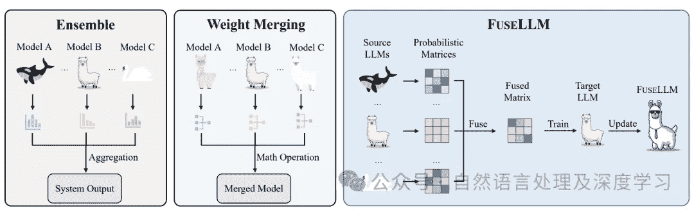
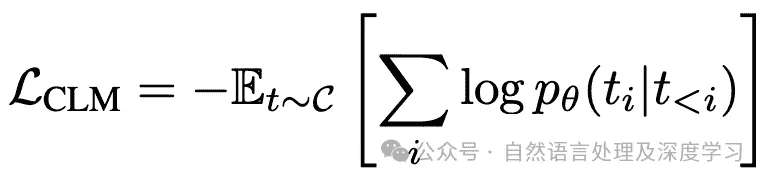
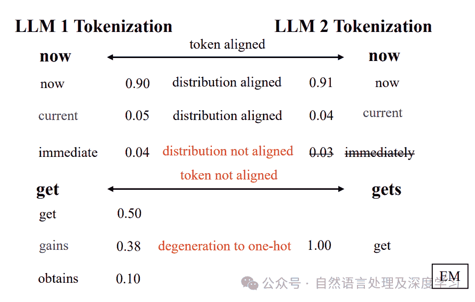
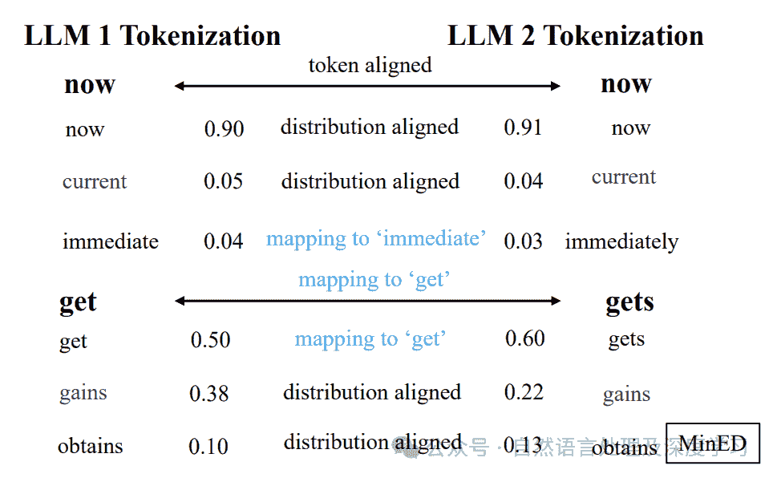
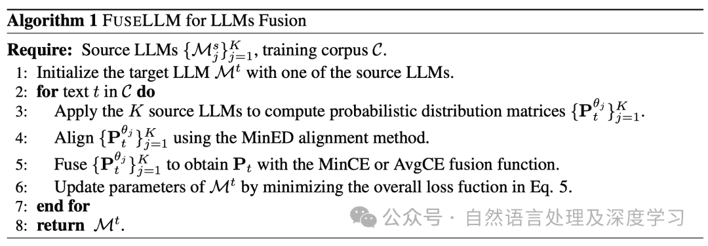

# 【LLM】FuseLLM：大模型融合trick-知识融合LLMs

> 来源：[https://geekbang.feishu.cn/docx/T34UdjGimoq10oxIgYZcypy5n9f](https://geekbang.feishu.cn/docx/T34UdjGimoq10oxIgYZcypy5n9f)

> 👨🏻 作者：余俊晖

> 📃 作者介绍：一名NLP炼丹师，NLP算法竞赛TOP选手

> 🛖 👸号：大模型自然语言处理

> ⏰ 收录时间：2024-05-28 17:09:42

> 🔗 原文链接：h[ttps://mp.weixin.q](https://mp.weixin.qq.com/s?__biz=Mzg4NjI0NDg0Ng==&mid=2247484455&idx=1&sn=8c0e5a0e56f06e69c816491cb14ecc68&chksm=cf9dd0a6f8ea59b0fe17b6553725d67f4c26cffe148b8e1ce6fb352c56338efabc08e2ff4c13#rd)q.com/s?__biz=Mz...

关注作者👸号，获取更多AI知识

##  **前言 **

传统的模型融合方法分为集成的方法和权重合并的方法，这两种方法在以往的NLP的比赛中非常常见，是一种提分手段。然而，上述两种方法都需要预训练或者微调相应的模型。在大模型场景下，对每个源模型都进行初始化成本太高，为了减少初始化源LLM的成本，使集成后的模型受益于所有源LLMs的优势。因此，本文介绍了一种知识融合的方法用来进行大模型的融合。

##  **1 背景与概念 **

###  **1.1因果语言建模（Causal Lang**uage Modeling, CLM）

因果语言建模是训练语言模型的一种目标，它旨在最小化模型预测下一个词的负对数似然。在传统的语言模型训练中，这个目标是通过比较模型生成的词概率分布与实际文本中的词（以one-hot编码表示）来实现的。CLM训练目标可以表示为：

是模型参数  下第 i 个词  给定前一个词  的预测概率。

###  **1.2 概率分布矩阵 **

为了更一般地看待语言模型，将序列预测转换为概率分布矩阵。对于给定的文本序列  ，模型会生成一个概率分布矩阵  ，其中每一行  代表模型对第  个词的预测分布。这个矩阵可以看作是模型对词汇表  中每个词的概率预测。

CLM的训练目标可以重写为概率分布矩阵的形式：

这里  是两个矩阵之间的差异度量，使用KL散度来实现。  是一个one-hot编码的标签矩阵，其中每一行对应于文本序列中的一个词。

**小结 **：从知识融合的角度看，不同LLMs生成的概率分布矩阵可以反映它们对文本的理解和知识。因此，通过比较和融合这些概率分布矩阵，可以提取和整合多个模型的知识，从而提升目标模型的性能。

##  **2 LLMs融合 **

###  **2.1 知识外化 **

不同的LLMs对同一文本生成的不同概率分布矩阵可以代表这些模型嵌**入的多**样化知识。FUSELLM方法通过概率建模来融合这些源LLMs的概率分布， 目的 是创建一个统一的LLM，这个新模型能够超越任何单一的源LLM。

###  **2.2 训练 **

为了实现上述目标，FUSELLM在与预训练数据集相似的原始文本语料库上对目标LLM进行轻量级持续训练。在训练过程中，FUSELLM不仅依赖于因果语言建模（CLM）目标，还强调最小化目标LLM的概率分布与源LLMs的概率分布之间的差异。

+   融合损失

+   整体损失

###  **2.3 概率分布矩阵对齐 **

由于不同源LLMs可能使用不同的分词器，它们生成的概率分布矩阵可能在词**汇表和token上存在对齐问**题。为了解决这个问题，FUSELLM采用了一种基于 最小编辑距离（MinED） 的策略来对齐这些矩阵，确保不同模型之间的分布矩阵可以正确对齐。

Token Alignment的重要性 ：在LLMs融合的过程中，确保不同模型生成的标记对齐是至关重要的，因为这直接影响到概率分布矩阵的对齐和后续的知识融合效果。如果标记没有正确对齐，那么即使模型在理解文本方面有优势，也无法有效地将这些优势转移到目标模型中。

Tok**en Al****ignment的**维度 **：在 文本**维度 上，需要确保两个模型生**成的标记序列在** 文本顺序上对齐 ；在 分布维度 上，需要确保来自不同模型的 分布值也对齐 ，即使它们可能对应不同的标记。

因此有两种对齐策略，该文使用的是MinED：

+   **动态规划对齐（EM）策略**

+   文章提到了一种基于动规划的方法来实现标记对齐。这种方法通过递归地最小化编辑序列的成本来对齐两个标记序列。编辑操作包括插入、删除和替换标记。如果两个标记相同，它们可以直接对齐；如果不同，则需要通过编辑操作来找到最佳的对齐方式。

+

+   **最小编辑距离（MinED）策略**

+   为了提高对齐的成功率并保留更多的有用信息，文章提出了一种基于最小编辑距离（MinED）的策略。这种方法相对于传统的精确匹配（Exact Matching, EM）策略，能够更灵活地处理标记之间的差异。MinED策略通过计算两个标记之间的编辑距离来确定它们是否可以对齐，这通常比直接匹配更加宽松，因此能够减少对齐过程中的信息损失。

+

**小结 **：标记对齐是FUSELLM方法中的关键步骤，它确保了不同模型生成的概率分布矩阵可以正确地融合在一起，从而实现有效的知识转移。MinED策略提供了一种灵活的对齐方法，能够在保持信息完整性的同时，处理不同模型生成的标记差异。

###  **2.4 融合策略 **

在对齐概率分布矩阵后，FUSELLM采用两种融合策略来整合源LLMs的知识：

+   **MinCE **：选择具有最小交叉熵的分布矩阵。这种方法倾向于选择预测最准确的模型的分布。

+   **AvgCE **：基于交叉熵得分的加权平均。这种方法为每个源模型的分布赋予不同的权重，权重由模型在预测时的交叉熵得分决定。

###  **2.5 融合算法 **

步骤概述：

1.  初始化目标LLM，可以选择其中一个源LLM作为起点。

1.  对于训练语料库中的每个文本，应用所有源LLM来计算概率分布矩阵。

1.  使用MinED对齐这些概率分布矩阵。

1.  使用MinCE或AvgCE融合策略来融合这些对齐后的矩阵。

1.  更新目标LLM的参数，以最小化整体损失函数。

##  **总结 **

FUSELLM提供了一种LLMs的集成方法，为大模型融合提供了一个trick，或许未来LLM比赛爆发的时候，最后大家涨分涨不动了，可以考虑下试一试这个trick。

##  **参考文献 **

1.Knowledge Fusion of Large Language Models，https://arxiv.org/abs/2401.10491v1