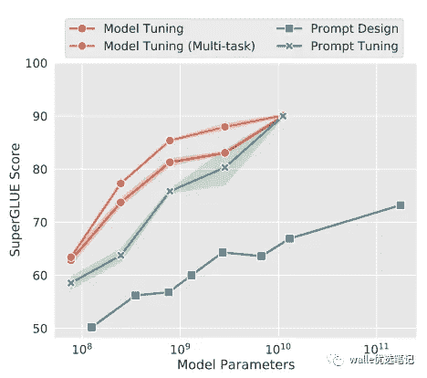
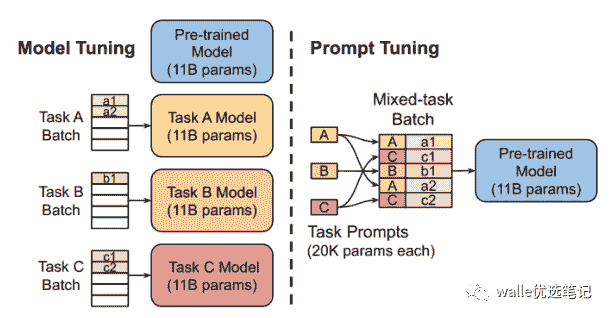
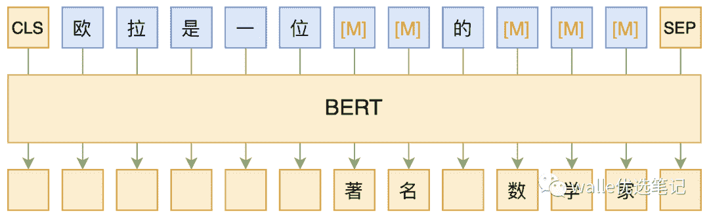
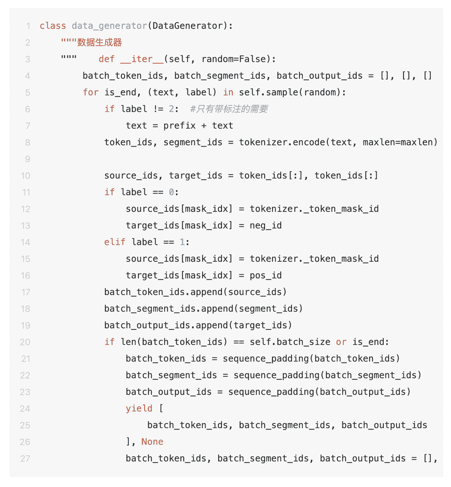

# 大模型微调实践——Prompt tuning、PET、Prefix tuning、P-tuning的原理、区别与代码解析(一)

> 来源：[https://geekbang.feishu.cn/docx/MnRzdMtY0opTnLxL21gchelnnUh](https://geekbang.feishu.cn/docx/MnRzdMtY0opTnLxL21gchelnnUh)

> 👨🏻 作者：喜欢卷卷的瓦力

> 📃 作者介绍：985海归硕士、计算机专业，前AI大厂研究院高级算法研究员，前国企研究院算法专家，现外企top10上市集团人工智能研究员，算法研究与开发经历6年，深度参与头部大模型产品研发上线，在大模型/语音识别/视觉等领域有丰富的项目经验

> ⏰ 收录时间：2024-05-23 11:28:42

> 🔗 原文链接：https://mp.weixin.qq.com/s/re7-qUmBHCsPqLylb2schg


关注作者👸号，获取更多AI知识

本文针对易混淆的Prompt learning、PET做详细原理阐释，并列出其区别，最后附简易版实现代码。

这几天在复现关于大模型各种微调方法的代码，被各种P字母开头的微调方法绕的有些眼花缭乱，所以整理一下相关概念、区别以及实现代码。

这个系列目录如下：

+   prompt tuning

+   一个人工构建模板的实例：PET（Pattern-Exploiting Training）

+   prefix tuning

+   P-tuning

+   P-tuning v2

具体每个部分会分为论文、原理、实现细节以及对应关键代码进行详细介绍。

由于涉及到的内容非常多，本篇就主要讲Prompt Tuning，并以其中比较重要的PET为例，具体介绍其实现原理，后面的系列文再具体介绍prefix tuning、P-tuning、P-tuning v2，最后会做一个总结。

# **论文**

Prompt tuning 里程碑式的作品：

The Power of Scale for Parameter-Efficient Prompt Tuning

这里只介绍一下论文中最精华部分的翻译，并附上这张经典的图。



这篇论文主要解答的问题： Prompt Tuning比Fine-tuning在哪些情况下表现更好？

结论很简单： 离散的Prompt Tuning（Prompt Design）基本不能达到fine-tuning的效果；Soft Prompt Tuning在模型增大时可以达到接近fine-tuning的效果，并且有进一步超越fine-tuning的趋势。

# **原理**

Prompt tuning 其实是一个比较范围比较广的概念，主要通过调整模板来实现对模型的微调。



具体在论文中，给每个任务定义了自己的Prompt**，然后拼接到数据上作**为输入，但 只在输入层加入prompt tokens ，并且 不需要加入 MLP 进行调整来解决难训练的问题。

# **具体实现**

这里我们来举一个 通过人工构建的模版与BERT的MLM模型结合，在零样本、小样本乃至半监督下取得非常好的效果的例子 —— PET（Pattern-Exploiting Training）

对应论文是 It's Not Just Size That Matters: Small Language Models Are Also Few-Shot Learners

**1. MLM简介**

MLM，全称“Masked Language Model”，可以翻译为“掩码语言模型”，实际上就是一个完形填空任务，随机Mask掉文本中的某些字词，然后要模型去预测被Mask的字词，示意图如下：



其中被Mask掉的部分，可以是直接随机选择的Token，也可以是随机选择连续的能组成一整个词的Token，后者称为WWM（Whole Word Masking）。

2. MLM在微调任务中的应用：将任务转为完形填空

MLM通过模板设计，将任务转为完形填空，可以用于小样本学习或半监督学习，某些场景下甚至能做到零样本学习，并达到很好效果。

怎么将我们要做的任务跟MLM结合起来呢？很简单， 给任务一个文本描述，然后转换为完形填空问题即可 。举个例子，假如给定句子“这趟北京之旅我感觉很不错。”，那么我们补充个描述，构建如下的完形填空：


我们限制空位处只能填一个“很”或“不”，问题就很清晰了，就是要我们根据上下文一致性判断是否满意，如果“很”的概率大于“不”的概率，说明是正面情感倾向，否则就是负面的，这样我们就将情感分类问题转换为一个完形填空问题了。

上述问题可以用MLM模型给出预测结果，而MLM模型的训练可以不需要监督数据，因此理论上这能够实现零样本学习了。

上面是二分类的例子，再举一个多分类的例子，比如新闻分类。


理论上，一个好的MLM模型应当能预测出“体育”二字来。

3. 模板的设计（Pattern-Exploiting）

那么其实我们可以总结一些规律了，就是 给输入的文本增加一个前缀或者后缀描述，并且Mask掉某些Token，转换为完形填空问题 ，这样的转换在原论文中称为 Pattern ，这个转换要尽可能与原来的句子组成一句自然的话，不能过于生硬，因为预训练的MLM模型就是在自然语言上进行的。

我们需要构建预测Token的候选空间，并且建立Token到实际类别的映射，这在原论文中称为Verbalizer，比如情感分类的例子，我们的候选空间是 {很,不} ，映射关系是 很→正面，不→负面 ，候选空间与实际类别之间不一定是一一映射，比如我们还可以加入“挺”、“太”、“难”字，并且认为 {很,挺,太}→正面 以及 {不,难}→负面 ，等等。

不少NLP任务都有可能进行这种转换，但显然这种转换一般只适用于候选空间有限的任务，说白了就是只用来做选择题，常见任务的就是文本分类。

那么我们再用比较书面的话来重新阐述总结一下，PVP的概念就变得比较容易理解了。下面这段摘自这篇很出名的五万字综述 [Prompt-Tuning：深度解读一种新的微调范式]

PET详细地设计了Prompt-Tuning的重要组件——Pattern-Verbalizer-Pair（PVP），并描述了Prompt-tuning如何实现Few-shot/Zero-shot Learning，如何应用在全监督和半监督场景（iPET）。

PET设计了两个很重要的组件：

+   Pattern（Template） ：也叫Template，其为额外添加的带有`[mask]`标记的短文本，通常一个样本只有一个Pattern（因为我们希望只有1个让模型预测的`[mask]`标记）。上文也提到，不同的任务、不同的样本可能会有其更加合适的pattern，因此 如何构建合适的pattern是Prompt-Tuning的研究点之一 ；

+   **Verbalizer **：标签词的映射，对于具体的分类任务，需要选择指定的标签词（label word）。例如情感分析中，我们期望Verbalizer可能是positive和negative是类标签。同样，不同的任务有其相应的label word，但需要注意的是，Verbalizer的构建需要取决于对应的Pattern。因此， 如何构建Verbalizer是另一个研究挑战 。

上述两个组件被称为Pattern-Verbalizer-Pair（PVP），一般记作 ，在后续的大多数研究中均采用这种PVP组件。

**4. 论文微调方法**

由于同一个任务可以有多种不同的Pattern，原论文是这样处理的

```
1、对于每种Pattern，单独用训练集Finetune一个MLM模型出来；
2、然后将不同Pattern对应的模型进行集成，得到融合模型；
3、用融合模型预测未标注数据的伪标签；
4、用伪标签数据Finetune一个常规的（非MLM的）模型
```

# **代码详解**

因为PET主要是人工来构建模板，所以核心是模板怎么构建、以及训练数据如何构造。这里就借苏神的代码来讲解一下。

**1. 模板设计**

首先来构造实验模板，我们采用一个固定前缀 满意 ，其中空位处候选词语都为 很 和 不 ：

```
P：____满意。
构造示例：__满意。这趟北京之旅我感觉很不错。
```

对应代码：

```
# 对应的任务描述  
# 为什么mask_idx是1，因为第0位是&#x27;[CLS]&#x27;标记，这里的mask_id为1就是替换&#x27;很满意。&#x27;中的第一个字符&#x27;很&#x27;  
prefix = u&#x27;很满意。&#x27;  
mask_idx = 1                           
pos_id = tokenizer.token_to_id(u&#x27;很&#x27;)  
neg_id = tokenizer.token_to_id(u&#x27;不&#x27;)
```

**2. 数据构造**



完整实现代码及相关数据集可以直接去苏神的github下载：

https://github.com/bojone/Pattern-Exploiting-Training/tree/master

# **引申**

Prompt tuning确实是一个很宽泛的概念，因为在PVP这一块有很多可探索的空间，因此学术界已经涌现出一批基于Prompt-Tuning的方案试图探索如何自动构建PVP。

这里主要总结几种成熟的Pattern（Template）构建方法。可以罗列为如下几点：

+   **人工构建 **（Manual Template）：类似于PET；

+   **启发式法 **（Heuristic-based Template）：通过规则、启发式搜索等方法构建合适的模板；

+   **生成 **（Generation）：根据给定的任务训练数据（通常是小样本场景），生成出合适的模板；

+   **词向量微调 **（Word Embedding）：显式地定义离散字符的模板，但在训练时这些模板字符的词向量参与梯度下降，初始定义的离散字符用于作为向量的初始化；

+   **伪标记 **（Pseudo Token）：不显式地定义离散的模板，而是将模板作为可训练的参数；

前面3种也被称为 **离散的模板构建法 **（记作 Hard Template 、 Hard Prompt 、 Di**screte **Template 、 **Discrete Prompt ）**，其旨在直接与原**始文本拼接显式离散的字符，**且在训练中 始终保持不变 。这里的保持不变是指 这些离散字符的词向量（Word Embedding）在训练过程中保持固定 。通常情况下， 离散法不需要引入任何参数 。

后面2种则被称为 **连续的模板构建 法 **（记作 Soft Template 、 Soft Prompt 、 Continuous Template 、 Continuous Prompt ），其旨在让模型在训练过程中根据具体的上下文语义和任务目标对模板参数进行连续可调。这套方案的动机则是认为离散不变的模板无法参与模型的训练环节，容易陷入局部最优，而如果将模板变为可训练的参数，那么不同的样本都可以在连续的向量空间中寻找合适的伪标记，同时也增加模型的泛化能力。因此， 连续法需要引入少量的参数并让模型在训练时进行参数更新 。

其实我们后面具体介绍的 prefix tuning、P-tuning、P-tuning v2都属于连续的模板构建， 通过把传统人工设计模版中的真实token替换成可微的virtual token，转换为模型中可以学习的参数进行更新 ，只是他们之间存在细微差别，具体原理与区别、代码详解我们将在下一篇系列文中阐述。

参考文献

[1] 苏剑林. (Sep. 27, 2020). 《必须要GPT3吗？不，BERT的MLM模型也能小样本学习 》[Blog post]. Retrieved from [https://kexue.fm/archives/7764]

[2] 王嘉宁 《Prompt-Tuning：深度解读一种新的微调范式》Retrieved from [https://wjn1996.blog.csdn.net/article/details/120607050]