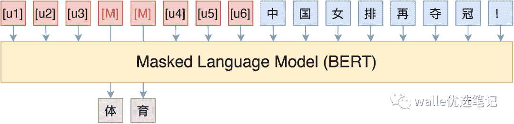
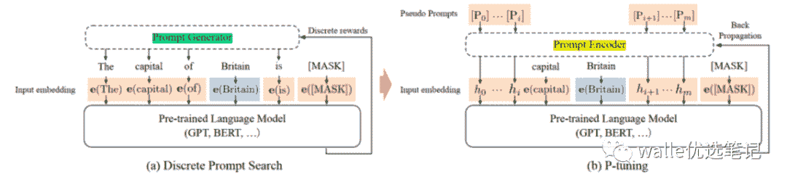
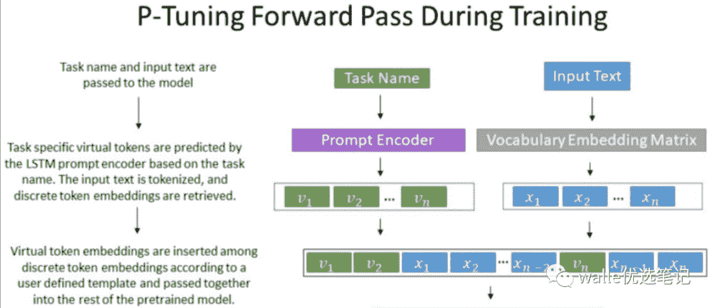
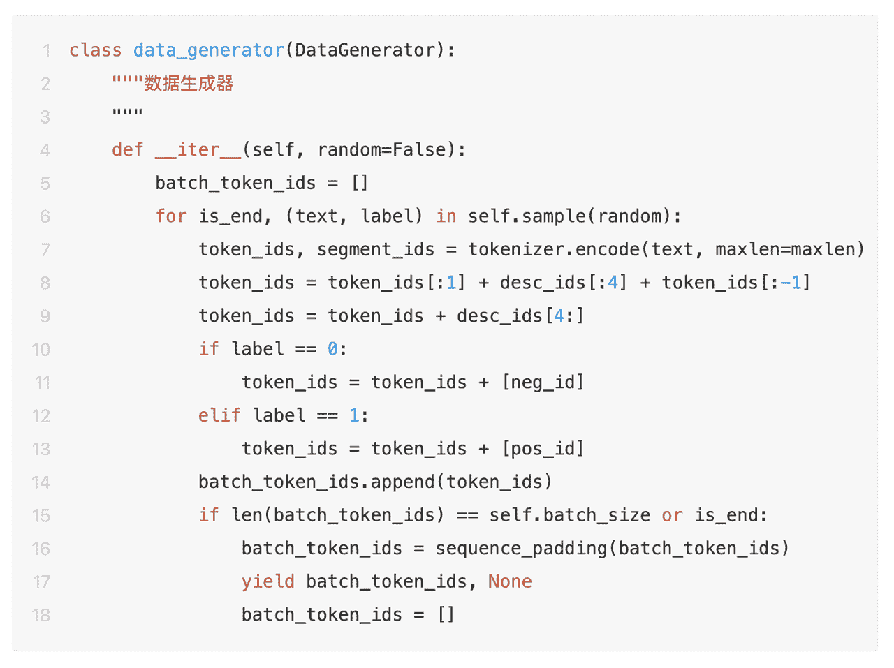
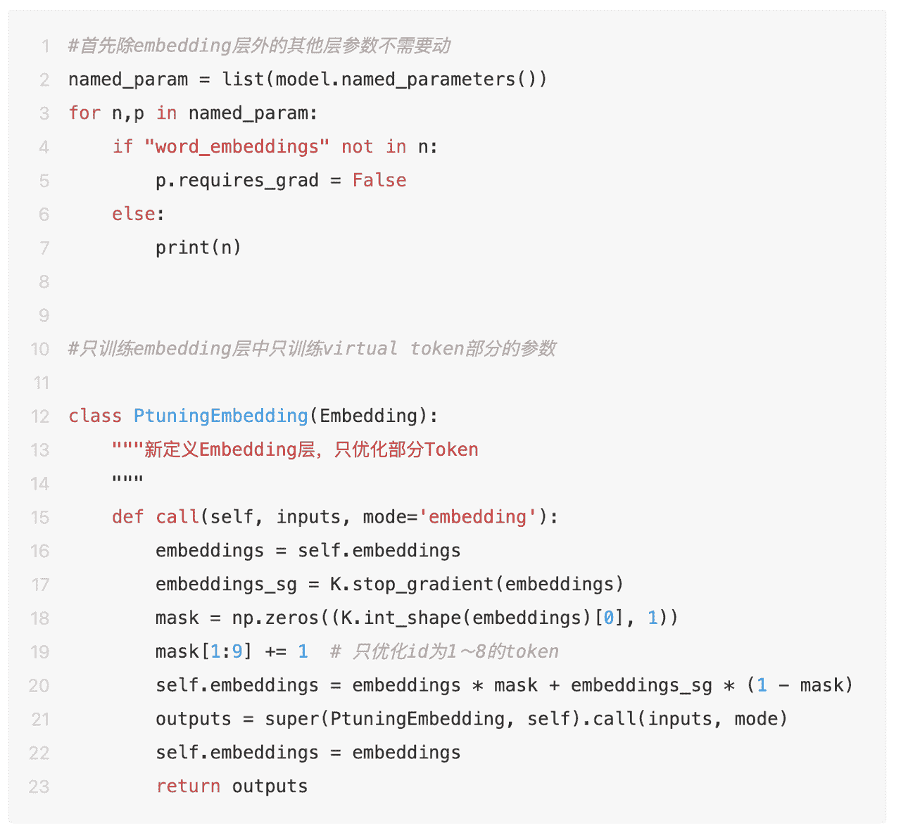
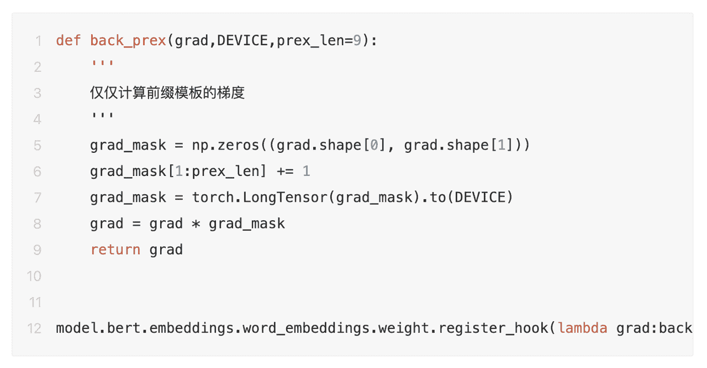
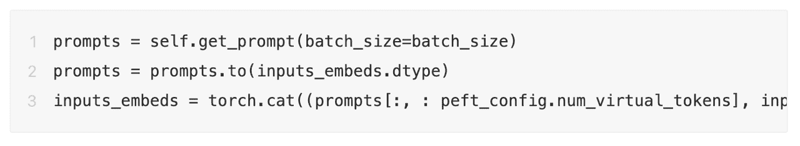
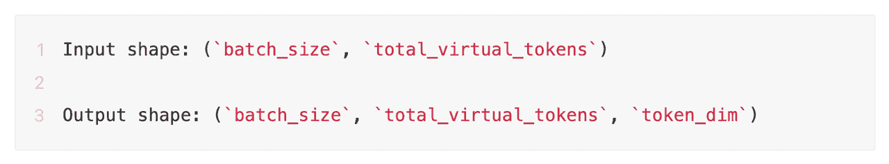
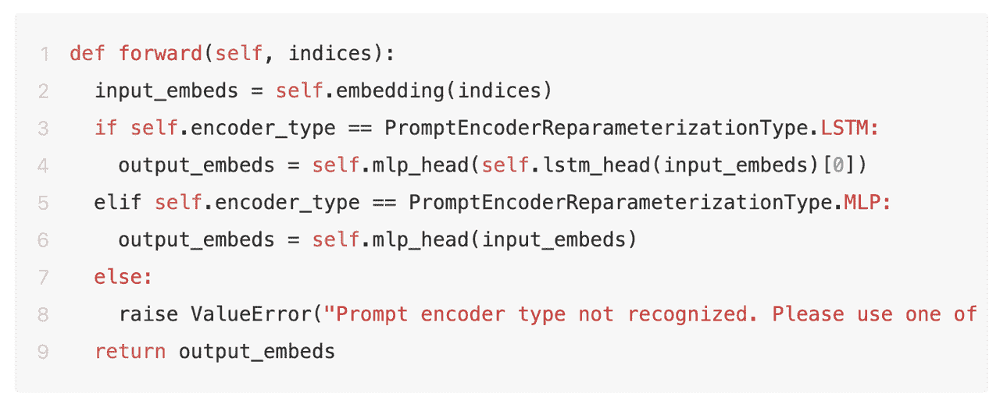
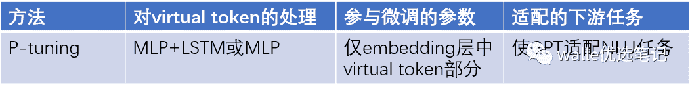

# 大模型微调实践——Prompt tuning、PET、Prefix tuning、P-tuning的原理、区别与代码解析(二)

> 来源：[https://geekbang.feishu.cn/docx/O8k5dYsamoOr1YxH2mKcwCf4nbo](https://geekbang.feishu.cn/docx/O8k5dYsamoOr1YxH2mKcwCf4nbo)

> 👨🏻 作者：喜欢卷卷的瓦力

> 📃 作者介绍：985海归硕士、计算机专业，前AI大厂研究院高级算法研究员，前国企研究院算法专家，现外企top10上市集团人工智能研究员，算法研究与开发经历6年，深度参与头部大模型产品研发上线，在大模型/语音识别/视觉等领域有丰富的项目经验

> ⏰ 收录时间：2024-05-23 11:28:42

> 🔗 原文链接：h[ttps://mp.weixin.q](https://mp.weixin.qq.com/s/hvOxd4uuotKVOYJJs-kL4g)q.com/s/hvOxd4uu...


关注作者👸号，获取更多AI知识

本文承接上文prompt模板由人工到自动构建的转变，针对P-tuning做详细原理阐释，并列出其区别，最后附简易版实现代码。

[本](http://mp.weixin.qq.com/s?__biz=Mzg4MTkwMTQ4NA==&mid=2247484100&idx=1&sn=9a16611524c7953361717769284e7802&chksm=cf5fa807f8282111d1c8912ce305072f3e5558506d45b4d634d8e315cb84bdb7b5d92a7747c6&scene=21#wechat_redirect)篇来继续讲述P字母开头的一系列大模型微调技术，在之前的文章 大模型微调实践——Prompt tuning、PET、Prefix tuning、P-tuning的原理、区别与代码解析(一) 中，我们介绍了prompt里程碑式的论文、概念并详细介绍了Pattern-Exploiting Training（PET）的方法与代码。

然而，人工构建这样的模版有时候也是比较困难的，而且不同的模版效果差别也很大，如果能够通过少量样本来自动构建模版，也是非常有价值的。

因此，本篇开始介绍实现了模板自动构建的方法以及P-tuning；由于prefix tuning和P-tuning v2非常相似，所以放到一起最后讲。

每种方法下具体还是会分为论文、原理、实现细节以及对应关键代码进行详细介绍。

本篇 简易目录如下：

+   模板的反思：人工—自动构建

+   P-tuning

# **模板的转变：人工—>自动构建**

这里我们阐释模型由人工构造到自动构建的转变，这也是token从离散到连续的转变，这里连续指的是不刻意追求token的可读含义，直接将它当作参数来优化。

**一、模板的反思**

首先，我们来想一下“ 什么是模版 ”。直观来看，模版就是由自然语言构成的前缀/后缀，通过这些模版我们使得下游任务跟预训练任务一致，这样才能更加充分地利用原始预训练模型，起到更好的零样本、小样本学习效果。

那么，我们真的在乎模版是不是“自然语言”构成的吗？

并不是。本质上来说，我们并不关心模版长什么样，我们只需要知道模版由哪些token组成，该插入到哪里，插入后能不能完成我们的下游任务，输出的候选空间是什么。模版是不是自然语言组成的，对我们根本没影响， “自然语言”的要求，只是为了更好地实现“一致性”，但不是必须的 。

于是，我们考虑了如下形式的模版：



这里的[u1]～[u6]，代表BERT词表里边的[unused1]～[unused6]，也就是用几个从未见过的token来构成模板，这里的token数目是一个超参数，放在前面还是后面也可以调整。接着，为了让“模版”发挥作用，我们用标注数据来求出这个模板。

**二、优化方法**

根据标注数据量的多少，我们分两种情况讨论。

**第一种，标注数据比较少。**

这种情况下，我们固定整个模型的权重，只优化 [unused1]～[unused6] 这几个token的Embedding，换句话说，其实我们就是要学6个新的Embedding，使得它起到了模版的作用。由于权重几乎都被固定住了，训练起来很快，而且因为要学习的参数很少，因此哪怕标注样本很少，也能把模版学出来，不容易过拟合。

**第二种，标注数据很充足。**

这时候如果还按照第一种的方案来，就会出现过拟合的情况，因为只有6个token的可优化参数实在是太少了，不足以记下全部训练集的标签。那么其实可以放开所有权重微调。

那么最终解决方案也可以分为这两种情况讨论：

1、 在标注数据比较少的时候，人工来选定适当的目标token效果往往更好些 ；

2、 **在**标注数据很充足的情况下，目标token用[unused*]效果更好些，因为这时候模型的优化空间更大一些 。

**三、掩码的选择**

另外，苏神通过实际实验测试，在训练下游任务的时候，不仅仅预测下游任务的目标token（前面例子中的“很”、“新闻”），还应该同时做其他token的预测：

+   如果是MLM模型，那么也随机mask掉其他的一些token来预测；

+   如果是LM模型，则预测完整的序列，而不单单是目标词。

这样做的理由是：因为我们的MLM/LM都是经过自然语言预训练的，那么能够很好完成重构的序列必然也是接近于自然语言的，因此这样增加训练目标，也能起到让模型更贴近自然语言的效果，相比单纯优化下游任务的目标，确实提升了效果。

那么通过上述内容，我们总结一下自动构建模板微调模型的关键点：

1. **对virtual token的处理：随机**初始化或者基于一个可训练学习的模型编码；

2. 需要参与微调的参数：某一层、全量或者其他选择；

3. **调整适配下游任务的方式。**

下面所讲的P-tuning、prefix tuning、P-tuning v2也主要是在这三个方面略有差别；同样，由于涉及的内容和代码过多，本篇着重讲P-tuning。

# **P-tuning**

**一、论文**

GPT Understands, Too

论文出发点实际就是 把传统人工设计模版中的真实token替换成可微的virtual toke n；该方法 将 Prompt 转换为可以学习的 Embedding 层，并用MLP+LSTM的方式来对Prompt Embedding进行一层处理 。

需要注意：P-tuning只限于embedding层，也就是输入层，没有在每一层都加；另外，virtual token的位置也不一定是前缀，插入的位置是可选的。



那么，根据我们前面所说的三个关键点，P-tuning实际上重点在两个方向做了优化：

+   需要被MASK的token如何选择： P-tuning中通过MLP或者LSTM选择

+   需要参与微调的参数量级： **P-tuning中仅更新embedding**层中virtual token的部分参数

**二、原理**

那么为什么P-tuning要先经过MLP或者LSTM选择virtual token呢？

论文提到，经过预训练的LM的词嵌入已经变得高度离散，如果随机初始化**virtua**l token，容易优化到局部最优值。因此，作者通过实验发现用一个 提示编码器 （即用一个LSTM+MLP去编码这些virtual token以后，再输入到模型）来编码会收敛更快，效果更好。



**三、具体实现与代码详解**

这里讲两个版本的实现代码，一个是简易版本的，另一个是huggingface官方版本怎么实现的。

+   简易版本

简易版本的继续用苏神的代码来举例，这里只列出关键代码。

1. 模板设计

这里用[unused]进行占位。

```
desc = [&#x27;[unused%s]&#x27; % i for i in range(1, 9)]
desc_ids = [tokenizer.token_to_id(t) for t in desc]
pos_id = tokenizer.token_to_id(u&#x27;很&#x27;)
neg_id = tokenizer.token_to_id(u&#x27;不&#x27;)
```

2. 数据构造

这里decs_ids就是模板，拼到token_ids中去，这里其实怎么拼都可以，苏神的代码中是前后各拼接一部分。



3. 实现只训练embedding中virtual token部分的权重

注意这里有两个关键点：

+   一个是需要freeze除embedding层外的其他层参数，这个比较简单；

+   另一个是在embedding层中只训练virtual token部分的参数。



类 PtuningEmbedding 中，变量经过 stop_gradient 算子后，在反向传播的时候梯度为0，但是前向传播不变，因此在上述代码中，前向传播的结果不会有变化，但是反向传播求梯度的时候，梯度不为0的token由 mask 变量控制，其余token的梯度都为零。

完整实现代码及相关数据集可以直接去苏神的github下载：

https://github.com/bojone/P-tuning/blob/main/

备注：这里还有一种方法实现只训练embedding层中只训练virtual token部分的参数，基本原理都是一样的，但是实现有小区别。



+   Huggingface 官方版本

由于官方库封装的比较好，这里就只展示核心代码，主要是数据构造部分和prompt encoder部分。

1. 数据构造

将virtual token和输入连接。



2. prompt encoder部分

首先我们关注整个prompt encoder的输入、输出维度，只与virtual tokens的数量有关，跟其他token关系不大，那么更新参数的时候只需要训练prompt encoder部分的参数就可以了，非常方便。



接下来，我们忽略怎么定义LSTM或MLP的部分，只看forward；可以看到官方库提供了两种重参数化的形式，一种是MLP接LSTM还有一种是只用MLP。



大家还可以去github看一下源码：

https://github.com/huggingface/peft/blob/main/src/peft/tuners/p_tuning/

最后来总结一下，根据前文所述的自动构建模板微调模型的关键点，并根据P-tuning的特点，可以用一个表格直接表示。



参考文献

[1] 苏剑林. (Apr. 03, 2021). 《P-tuning：自动构建模版，释放语言模型潜能 》[Blog post]. Retrieved from [https://kexue.fm/archives/8295]

[2] Liu, Xiao , et al. (2021) "GPT Understands, Too." . Retrieved from [https://arxiv.org/abs/2103.10385v1]