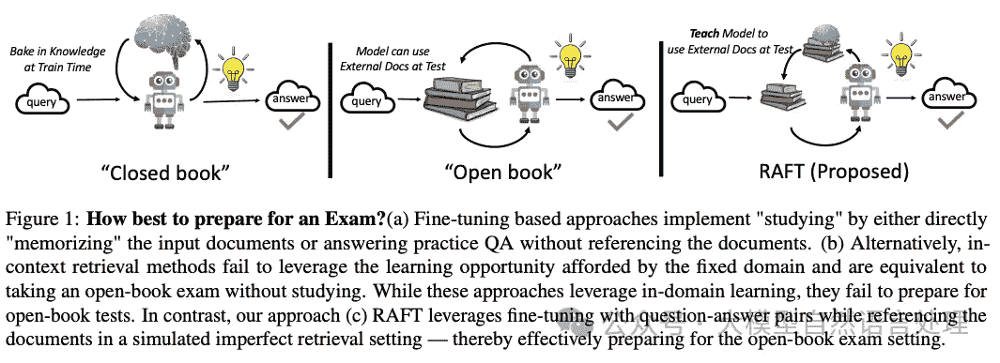
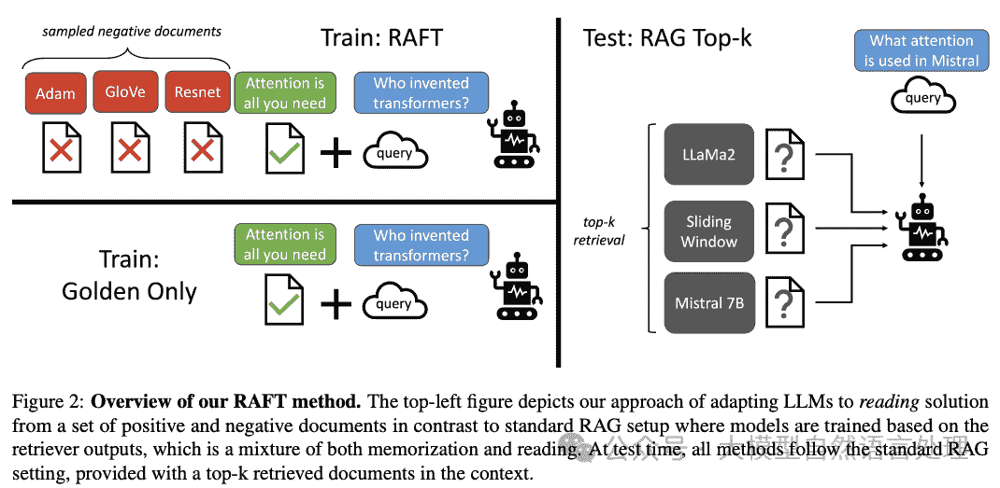
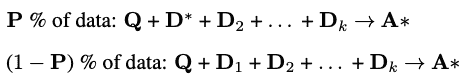
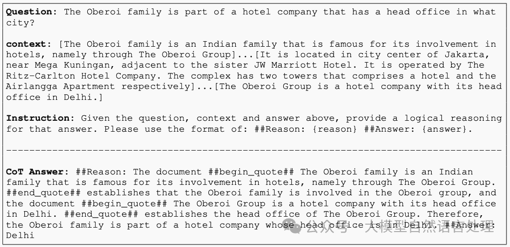
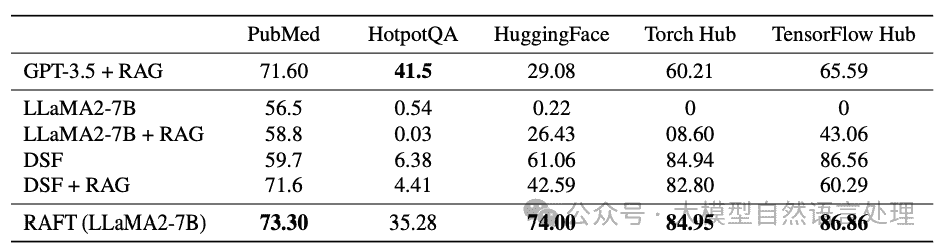
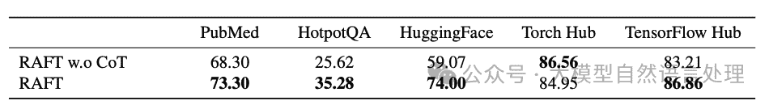
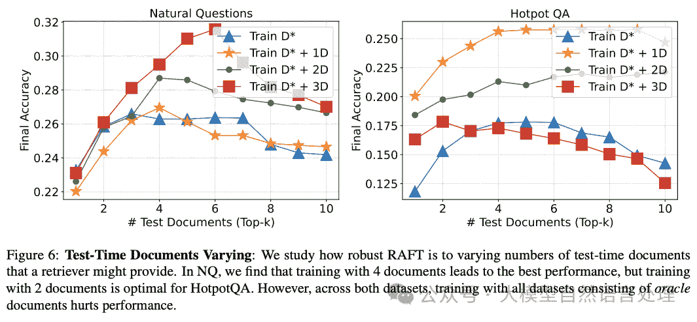

# 【LLM & RAG】RAFT：垂域知识微调LLM提升RAG表现

> 来源：[https://geekbang.feishu.cn/docx/Da8ud2tSsoBimwxMEFGc1aa1nif](https://geekbang.feishu.cn/docx/Da8ud2tSsoBimwxMEFGc1aa1nif)

> 👨🏻 作者：余俊晖

> 📃 作者介绍：一名NLP炼丹师，NLP算法竞赛TOP选手

> 🛖 👸号：大模型自然语言处理

> ⏰ 收录时间：2024-05-28 17:09:42

> 🔗 原文链接：h[ttps://mp.weixin.q](https://mp.weixin.qq.com/s?__biz=Mzg4NjI0NDg0Ng==&mid=2247484768&idx=1&sn=894bd5e072603d19fb66e710ed407439&chksm=cf9dd1e1f8ea58f70b09bcdba53f969b7a47fa333cdf72d494b7f81ea217300e683a881ba570#rd)q.com/s?__biz=Mz...


关注作者👸号，获取更多AI知识

##  **动机 **



1.  **传统考试与开放书本考试 **：

+   **闭卷考试 **：在闭卷考试中，学生不能参考任何外部资料，必须依靠自己的记忆和学习来回答问题。在语言模型的情境中，这相当于模型仅依赖于预训练阶段学习到的知识来生成回答，而不访问额外的信息。

+   **开放书本考试 **：在开放书本考试中，学生可以查阅特定的书籍或资料来帮助回答问题。在语言模型的情境中，这相当于模型在回答问题时可以访问和引用相关的外部文档或资料。

1.  **类比中的两种学习方法 **：

+   **无准备的开放书本考试 **：如果学生在考试前没有学习或准备，即使可以在考试时查阅资料，也可能无法有效找到和利用正确的信息来回答问题。在语言模型的情境中，这相当于模型虽然可以访问外部文档，但因为没有适当的训练，无法有效地从文档中提取和利用相关信息。

+   **通过学习准备的开放书本考试 **：如果学生在考试前通过学习和练习（例如，通过解决类似问题和阅读相关资料）来准备考试，他们将更有可能在考试中找到并利用正确的信息。在语言模型的情境中，这相当于模型通过RAFT训练方法，学习如何有效地利用检索到的文档来生成准确的回答。

##  **RAFT  筏 **

**RAFT方法的核心 **：

+   **结合检索和生成 **：RAFT方法训练模型不仅要学会如何从检索到的文档中找到相关信息，还要学会如何将这些信息整合到生成的回答中。

+   **处理干扰信息 **：在开放书本考试的类比中，干扰文档相当于考试时可能与问题无关的资料。RAFT训练模型识别并忽略这些干扰信息，只关注对回答问题有帮助的文档。

+   **链式推理 **：RAFT还强调生成包含推理过程的回答，这类似于学生在解答问题时展示他们的思考过程和如何从资料中得出结论。

因此**，提出了一**种新的训练策略，通过在训练数据中引入“干扰文档”（distractor documents），训练模型忽略那些对回答问题没有帮助的文档。RAFT通过引用相关文档中的 确切序列 来帮助回答问题，并结合“思维链”（chain-of-thought）风格的响应来提高模型的推理能力。



其他不赘述，总结就是微调一个垂域的LLM做RAG。主要看下训练数据的构造步骤。

###  **训练数据构造步骤 **

1.  文档切分成chunks；

1.  使用 OpenAIEmbeddings 将文本分成指定数量的 doc 块：

```
def get_chunks(
    file_path: str, 
    doctype: DocType = &quot;pdf&quot;, 
    chunk_size: int = 512, 
    openai_key: str | None = None
) -&gt; list[str]:
    &quot;&quot;&quot;
    Takes in a `file_path` and `doctype`, retrieves the document, breaks it down into chunks of size
    `chunk_size`, and returns the chunks.
    &quot;&quot;&quot;
    chunks = []
    
    if doctype == &quot;api&quot;:
        with open(file_path) as f:
            api_docs_json = json.load(f)
        chunks = list(api_docs_json)
        chunks = [str(api_doc_json) for api_doc_json in api_docs_json]

        for field in [&quot;user_name&quot;, &quot;api_name&quot;, &quot;api_call&quot;, &quot;api_version&quot;, &quot;api_arguments&quot;, &quot;functionality&quot;]:
            if field not in chunks[0]:
                raise TypeError(f&quot;API documentation is not in the format specified by the Gorilla API Store: Missing field `{field}`&quot;)

    else:
        if doctype == &quot;json&quot;:
            with open(file_path, &#x27;r&#x27;) as f:
                data = json.load(f)
            text = data[&quot;text&quot;]
        elif doctype == &quot;pdf&quot;:
            text = &quot;&quot;
            with open(file_path, &#x27;rb&#x27;) as file:
                reader = PyPDF2.PdfReader(file)
                num_pages = len(reader.pages)
                for page_num in range(num_pages):
                    page = reader.pages[page_num]
                    text += page.extract_text()
        elif doctype == &quot;txt&quot;:
            with open(file_path, &#x27;r&#x27;) as file:
                data = file.read()
            text = str(data)
        else:
            raise TypeError(&quot;Document is not one of the accepted types: api, pdf, json, txt&quot;)
        
        num_chunks = len(text) / chunk_size 
        text_splitter = SemanticChunker(OpenAIEmbeddings(openai_api_key=OPENAPI_API_KEY), number_of_chunks=num_chunks)
        chunks = text_splitter.create_documents([text])
        chunks = [chunk.page_content for chunk in chunks]
            
    return chunks
```

1.  使用gpt4为每个chunk生成query：

```
def generate_instructions_gen(chunk: Any, x: int = 5) -&gt; list[str]:
    &quot;&quot;&quot;
    Generates `x` questions / use cases for `chunk`. Used when the input document is of general types 
    `pdf`, `json`, or `txt`.
    &quot;&quot;&quot;
    response = client.chat.completions.create(
        model=&quot;gpt-4&quot;,
        messages=[
            {&quot;role&quot;: &quot;system&quot;, &quot;content&quot;: &quot;You are a synthetic question-answer pair generator. Given a chunk of context about some topic(s), generate %s example questions a user could ask and would be answered using information from the chunk. For example, if the given context was a Wikipedia paragraph about the United States, an example question could be &#x27;How many states are in the United States?&#x27;&quot; % (x)},
            {&quot;role&quot;: &quot;system&quot;, &quot;content&quot;: &quot;The questions should be able to be answered in a few words or less. Include only the questions in your response.&quot;},
            {&quot;role&quot;: &quot;user&quot;, &quot;content&quot;: str(chunk)}
        ]
    )

    queries = response.choices[0].message.content.split(&#x27;\n&#x27;)
    queries = [strip_str(q) for q in queries]
    queries = [q for q in queries if any(c.isalpha() for c in q)]

    return queries 
```

1.  答案生成

1.  对于每个问题，从“oracle”文档中提取出回答问题所需的信息，并生成一个详细且准确的答案（A∗）。这个答案不仅包括最终的回答，还包括一个链式思考（Chain-of-Thought）的过程，展示如何从文档中提取信息并推导出答案。在生成答案时，使用特定的格式来明确指出答案的推理过程和引用的文档内容。例如，使用 ##begin_quote## 和 ##end_quote## 标记来引用文档中的相关内容，并提供基于这些引用得出结论的详细解释。

```
def encode_question_gen(question, chunk) -&gt; list[str]:
    &quot;&quot;&quot;
    Encode multiple prompt instructions into a single string for the general case (`pdf`, `json`, or `txt`).
    &quot;&quot;&quot;
    
    prompts = []
        
    prompt = &quot;&quot;&quot;
        Question: {question}\nContext: {context}\n
        Answer this question using the information given in the context above. Here is things to pay attention to: 
        - First provide step-by-step reasoning on how to answer the question. 
        - In the reasoning, if you need to copy paste some sentences from the context, include them in ##begin_quote## and ##end_quote##. This would mean that things outside of ##begin_quote## and ##end_quote## are not directly copy paste from the context. 
        - End your response with final answer in the form &lt;ANSWER&gt;: $answer, the answer should be succint.
    &quot;&quot;&quot;.format(question=question, context=str(chunk))
    prompts.append({&quot;role&quot;: &quot;system&quot;, &quot;content&quot;: &quot;You are a helpful question answerer who can provide an answer given a question and relevant context.&quot;})
    prompts.append({&quot;role&quot;: &quot;user&quot;, &quot;content&quot;: prompt})
    return prompts
```

1.  训练数据

1.  选择query和chunk（doc）：从特定领域的数据集中选择一个问题（  ）和一组相关的文档（  ）。这些文档包括“oracle”文档（  ），即包含回答问题所需信息的文档，以及“干扰”文档（  ），即不包含相关信息的文档。

1.  构造策略如下：



1.  对于数据集中的一部分问题（P%），保留“oracle”文档和干扰文档一起作为训练数据。而对于剩余的问题（1-P%），则只包含干扰文档。这种设置迫使模型学习在有和没有正确文档的情况下都能生成准确的答案。

1.  训练数据格式：



##  **性能 **

+   对比传统RAG实验



+

+   COT的影响实验



+

+   训练数据的上下文包含不相关文档的数量对效果的影响实验



+

##  **总结 **

本文主要记录了RAFT方法如何构造训练数据，微调LLM提高对垂域知识的适应性，为大型语言模型在特定领域内的应用提供了一种有效的提升途径。

##  **参考文献 **

【1】RAFT: Adapting Language Model to Domain Specific RAG，https://arxiv.org/pdf/2403.10131.pdf

【1】RAFT：将语言模型适配到特定领域的 RAG，https：//arxiv.org/pdf/2403.10131.pdf

【2】https://github.com/ShishirPatil/gorilla/blob/main/raft/raft.py