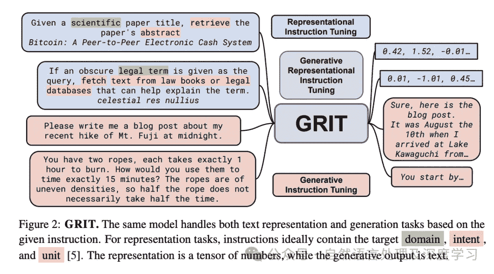
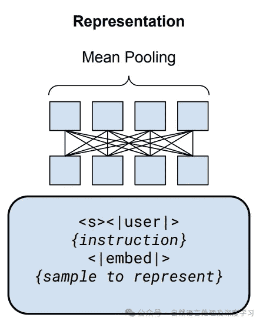
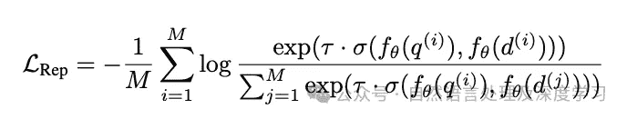
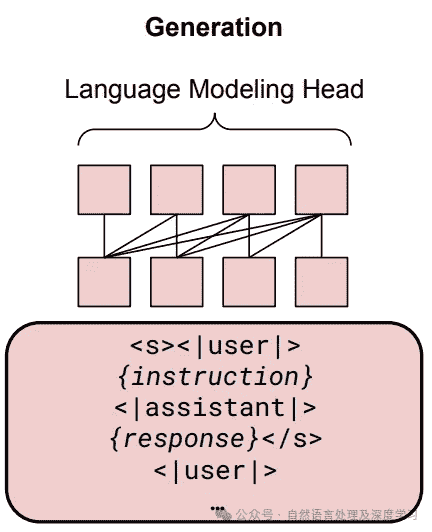
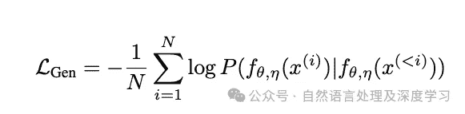
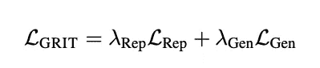
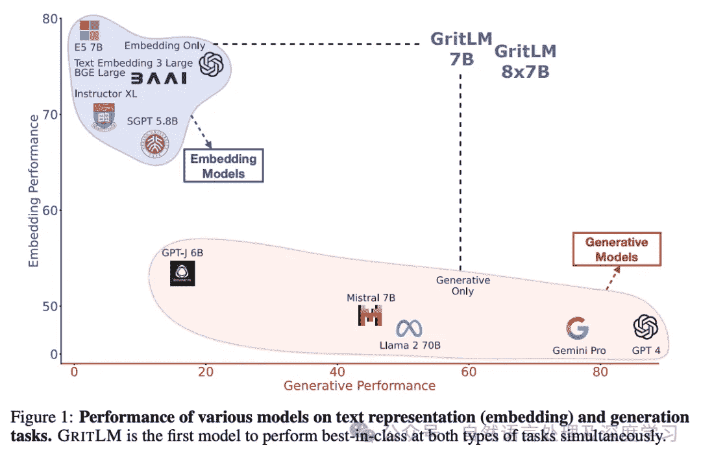
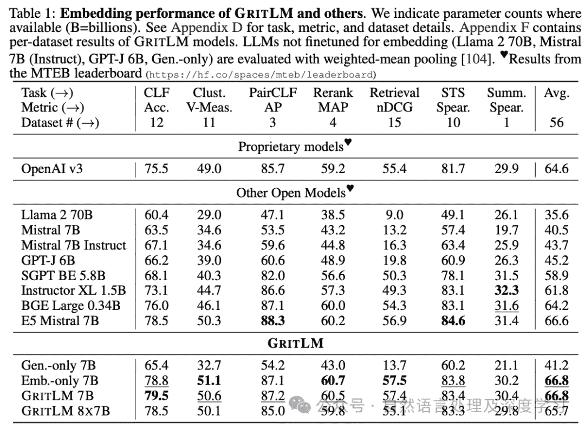
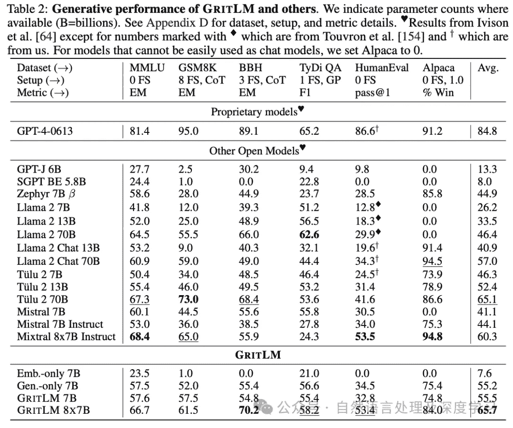
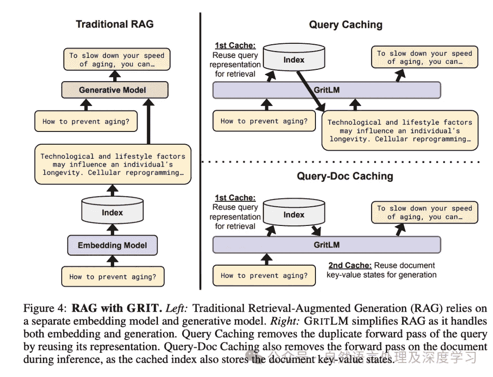

# 【LLM & RAG】GritLM：统一嵌入和生成的大语言模型浅谈

> 来源：[https://geekbang.feishu.cn/docx/XxjkdWaC6oOuvYxCKWWcLXzBntd](https://geekbang.feishu.cn/docx/XxjkdWaC6oOuvYxCKWWcLXzBntd)

> 👨🏻 作者：余俊晖

> 📃 作者介绍：一名NLP炼丹师，NLP算法竞赛TOP选手

> 🛖 👸号：大模型自然语言处理

> ⏰ 收录时间：2024-05-28 17:09:42

> 🔗 原文链接：h[ttps://mp.weixin.q](https://mp.weixin.qq.com/s?__biz=Mzg4NjI0NDg0Ng==&mid=2247484698&idx=1&sn=a1047cbbc98636eaaa791b52f83a2d74&chksm=cf9dd19bf8ea588d60cad31dd972f0e1383ab5703580b4aed577ea9f5d71cdf2d01aa2e95f2e#rd)q.com/s?__biz=Mz...


关注作者👸号，获取更多AI知识

##  **前言 **

目前，所有基于文本的语言问题都可以归结为生成问题，并通过单一的LLM来处理。然而，使用嵌入的任务（如聚类或检索）在这种视角下往往被忽视了。文本嵌入在许多关键的实际应用中扮演着重要角色。如RAG，在向量表征时，通过一些表征模型如：BGE、BCE等进行嵌入。因此，当前的方法在处理生成任务和嵌入任务时通常是分开的，这导致了效率和性能的损失。GRIT（Generative Representational Instruction Tuning），这是一种统一嵌入和生成任务的方法。GRIT通过指令区分这两种任务，使得模型能够根据给定的指令执行相应的任务。这种方法在保持生成和嵌入任务性能的同时，实现了两者的统一。



模型架构

##  **GRITLM架构 **



Representation  表示法

+   GRITLM 在处理嵌入任务时使用双向注意力机制来处理输入。在嵌入任务中，对最终隐藏状态进行平均池化（Mean Pooling），以产生最终的表示。该任务使用 contrastive objective 和 in-batch negatives 来计算损失。损失函数如下：





+   Generation  代

+   GRITLM 在处理生成任务时使用因果注意力机制。在隐藏状态之上，Language Modeling Head，用于预测下一个标记的损失，即图中的“{response}< /s>”部分。该格式支持多轮对话（用“...”表示）。因此其损失函数为预测 token 和真实 token 之间的交叉熵：



该架构是一个多任务学习的框架，因此，总体损失函数表示如下：



##  **实验结果 **



1.  嵌入性能

1.  比较了GRITLM 7B和GRITLM 8X7B与现有的生成和嵌入模型的性能。他们发现，GRITLM 7B在MTEB上的表现优于所有先前的开放模型，并且在生成任务上也优于所有参数规模相当的模型。GRITLM 8X7B在所有开放的生成语言模型中表现最佳，同时在嵌入任务上也表现出色。



1.  生成性能

1.  GRITLM在多个生成任务上的性能超过了其他模型，包括Llama 2 7B和Mistral 7B等。



##  **简化RAG **

在传统的RAG设置中，通常需要两个独立的模型：一个用于检索（检索模型），另一个用于生成（生成模型）。这要求将用户查询传递给两个模型，并且在生成阶段，还需要将检索到的上下文传递给生成模型。

GRIT方法通过统一嵌入和生成任务，简化了RAG。由于GRITLM能够处理两种任务，它可以在不需要单独检索模型的情况下，直接在生成过程中利用检索到的上下文。



传统RAG（左）和简化RAG（右）

提出了几种缓存策略来提高RAG的效率，这些策略包括查询缓存（Query Caching）、文档缓存（Doc Caching）、 查询-文档缓存（Query-Doc Caching） 、 文档-查询缓存（Doc-Query Caching） 。

+   **查询缓存 **：在这种方法中，检索阶段计算的查询表示被缓存，并在生成阶段重用，避免了对查询的重复前向传递。

+   **文档缓存 **：在这种方法中，检索阶段计算的文档表示被缓存，并在生成阶段直接使用，避免了对文档的重复前向传递。

+   查询-文档缓存（Query-Doc Caching） 和 文档-查询缓存（Doc-Query Caching） 结合了查询缓存和文档缓存。它们在缓存策略上有所不同，但都是为了进一步减少在生成阶段所需的计算量。

##  **推理代码 **

开箱即用

```
pip install gritlm
```

1.  basic  基本

```
from gritlm import GritLM

# Loads the model for both capabilities; If you only need embedding pass `mode=&quot;embedding&quot;` to save memory (no lm head)
model = GritLM(&quot;GritLM/GritLM-7B&quot;, torch_dtype=&quot;auto&quot;)
# To load the 8x7B you will likely need multiple GPUs.
# All the kwargs are passed to HF from_pretrained so you can just do the below to load on multiple GPUs:
# model = GritLM(&quot;GritLM/GritLM-8x7B&quot;, torch_dtype=&quot;auto&quot;, device_map=&quot;auto&quot;)
# You can also load other models e.g.
# model = GritLM(&quot;Muennighoff/SGPT-125M-weightedmean-nli-bitfit&quot;, pooling_method=&quot;weighted_mean&quot;, attn=None)
# model = GritLM(&quot;hkunlp/instructor-base&quot;, pooling_method=&quot;mean&quot;, attn=None)

### Embedding/Representation ###
instruction = &quot;Given a scientific paper title, retrieve the paper&#x27;s abstract&quot;
queries = [&#x27;Bitcoin: A Peer-to-Peer Electronic Cash System&#x27;, &#x27;Generative Representational Instruction Tuning&#x27;]
documents = [
    &quot;A purely peer-to-peer version of electronic cash would allow online payments to be sent directly from one party to another without going through a financial institution. Digital signatures provide part of the solution, but the main benefits are lost if a trusted third party is still required to prevent double-spending. We propose a solution to the double-spending problem using a peer-to-peer network. The network timestamps transactions by hashing them into an ongoing chain of hash-based proof-of-work, forming a record that cannot be changed without redoing the proof-of-work. The longest chain not only serves as proof of the sequence of events witnessed, but proof that it came from the largest pool of CPU power. As long as a majority of CPU power is controlled by nodes that are not cooperating to attack the network, they&#x27;ll generate the longest chain and outpace attackers. The network itself requires minimal structure. Messages are broadcast on a best effort basis, and nodes can leave and rejoin the network at will, accepting the longest proof-of-work chain as proof of what happened while they were gone.&quot;,
    &quot;All text-based language problems can be reduced to either generation or embedding. Current models only perform well at one or the other. We introduce generative representational instruction tuning (GRIT) whereby a large language model is trained to handle both generative and embedding tasks by distinguishing between them through instructions. Compared to other open models, our resulting GritLM 7B sets a new state of the art on the Massive Text Embedding Benchmark (MTEB) and outperforms all models up to its size on a range of generative tasks. By scaling up further, GritLM 8X7B outperforms all open generative language models that we tried while still being among the best embedding models. Notably, we find that GRIT matches training on only generative or embedding data, thus we can unify both at no performance loss. Among other benefits, the unification via GRIT speeds up Retrieval-Augmented Generation (RAG) by &gt; 60% for long documents, by no longer requiring separate retrieval and generation models. Models, code, etc. are freely available at https://github.com/ContextualAI/gritlm.&quot;
]

def gritlm_instruction(instruction):
    return &quot;&lt;|user|&gt;\n&quot; + instruction + &quot;\n&lt;|embed|&gt;\n&quot; if instruction else &quot;&lt;|embed|&gt;\n&quot;

# No need to add instruction for retrieval documents
d_rep = model.encode(documents, instruction=gritlm_instruction(&quot;&quot;))
q_rep = model.encode(queries, instruction=gritlm_instruction(instruction))

from scipy.spatial.distance import cosine
cosine_sim_q0_d0 = 1 - cosine(q_rep[0], d_rep[0])
cosine_sim_q0_d1 = 1 - cosine(q_rep[0], d_rep[1])
cosine_sim_q1_d0 = 1 - cosine(q_rep[1], d_rep[0])
cosine_sim_q1_d1 = 1 - cosine(q_rep[1], d_rep[1])

print(&quot;Cosine similarity between \&quot;%s\&quot; and \&quot;%s\&quot; is: %.3f&quot; % (queries[0][:15], documents[0][:15], cosine_sim_q0_d0))
# Cosine similarity between &quot;Bitcoin: A Peer&quot; and &quot;A purely peer-t&quot; is: 0.608
print(&quot;Cosine similarity between \&quot;%s\&quot; and \&quot;%s\&quot; is: %.3f&quot; % (queries[0][:15], documents[1][:15], cosine_sim_q0_d1))
# Cosine similarity between &quot;Bitcoin: A Peer&quot; and &quot;All text-based &quot; is: 0.101
print(&quot;Cosine similarity between \&quot;%s\&quot; and \&quot;%s\&quot; is: %.3f&quot; % (queries[1][:15], documents[0][:15], cosine_sim_q1_d0))
# Cosine similarity between &quot;Generative Repr&quot; and &quot;A purely peer-t&quot; is: 0.120
print(&quot;Cosine similarity between \&quot;%s\&quot; and \&quot;%s\&quot; is: %.3f&quot; % (queries[1][:15], documents[1][:15], cosine_sim_q1_d1))
# Cosine similarity between &quot;Generative Repr&quot; and &quot;All text-based &quot; is: 0.533

### Generation ###
# We did not finetune GritLM models with system prompts, as you can just include system-like instructions together with your user instruction
messages = [
    {&quot;role&quot;: &quot;user&quot;, &quot;content&quot;: &quot;Please write me a poem about my recent hike of Mt. Fuji at midnight in the style of Shakespeare.&quot;},
]
encoded = model.tokenizer.apply_chat_template(messages, add_generation_prompt=True, return_tensors=&quot;pt&quot;)
encoded = encoded.to(model.device)
gen = model.generate(encoded, max_new_tokens=256, do_sample=False)
decoded = model.tokenizer.batch_decode(gen)
print(decoded[0])
&quot;&quot;&quot;
&lt;s&gt; &lt;|user|&gt;
Please write me a poem about my recent hike of Mt. Fuji at midnight in the style of Shakespeare.
&lt;|assistant|&gt;
Oh, Mt. Fuji, mountain grand,
A sight to see, a climb to command,
At midnight, in the dark of night,
I climbed your slopes, with all my might.

The stars above, they shone so bright,
A beacon in the darkness, guiding light,
The wind did blow, with a gentle sigh,
As I climbed higher, with a steady eye.

The path was steep, the climb was tough,
But I pressed on, with a steadfast rough,
For the summit, I longed to see,
The view from the top, a sight to be.

At last, I reached the peak, and stood,
With awe and wonder, I gazed aloud,
The world below, a sight to see,
A view that&#x27;s worth the climb, you&#x27;ll agree.

Mt. Fuji, mountain grand,
A sight to see, a climb to command,
At midnight, in the dark of night,
I climbed your slopes, with all my might.&lt;/s&gt;
&quot;&quot;&quot;
```

1.  Caching  缓存

```
import numpy as np
import torch
from gritlm import GritLM

# Loads the model for both capabilities; If you only need embedding pass `mode=&quot;embedding&quot;` to save memory (no lm head)
model = GritLM(&quot;GritLM/GritLM-7B&quot;, torch_dtype=&quot;auto&quot;)
# To load the 8x7B you will likely need multiple GPUs.
# All the kwargs are passed to HF from_pretrained so you can just do the below to load on multiple GPUs:
# model = GritLM(&quot;GritLM/GritLM-8x7B&quot;, torch_dtype=&quot;auto&quot;, device_map=&quot;auto&quot;)
# You can also load other models e.g.
# model = GritLM(&quot;Muennighoff/SGPT-125M-weightedmean-nli-bitfit&quot;, pooling_method=&quot;weighted_mean&quot;, attn=None)
# model = GritLM(&quot;hkunlp/instructor-base&quot;, pooling_method=&quot;mean&quot;, attn=None)

queries = [&#x27;Please explain to me how Bitcoin works.&#x27;, &#x27;What is &quot;Generative Representational Instruction Tuning&quot;?&#x27;]
documents = [
    &quot;A purely peer-to-peer version of electronic cash would allow online payments to be sent directly from one party to another without going through a financial institution. Digital signatures provide part of the solution, but the main benefits are lost if a trusted third party is still required to prevent double-spending. We propose a solution to the double-spending problem using a peer-to-peer network. The network timestamps transactions by hashing them into an ongoing chain of hash-based proof-of-work, forming a record that cannot be changed without redoing the proof-of-work. The longest chain not only serves as proof of the sequence of events witnessed, but proof that it came from the largest pool of CPU power. As long as a majority of CPU power is controlled by nodes that are not cooperating to attack the network, they&#x27;ll generate the longest chain and outpace attackers. The network itself requires minimal structure. Messages are broadcast on a best effort basis, and nodes can leave and rejoin the network at will, accepting the longest proof-of-work chain as proof of what happened while they were gone.&quot;,
    &quot;All text-based language problems can be reduced to either generation or embedding. Current models only perform well at one or the other. We introduce generative representational instruction tuning (GRIT) whereby a large language model is trained to handle both generative and embedding tasks by distinguishing between them through instructions. Compared to other open models, our resulting GritLM 7B sets a new state of the art on the Massive Text Embedding Benchmark (MTEB) and outperforms all models up to its size on a range of generative tasks. By scaling up further, GritLM 8X7B outperforms all open generative language models that we tried while still being among the best embedding models. Notably, we find that GRIT matches training on only generative or embedding data, thus we can unify both at no performance loss. Among other benefits, the unification via GRIT speeds up Retrieval-Augmented Generation (RAG) by &gt; 60% for long documents, by no longer requiring separate retrieval and generation models. Models, code, etc. are freely available at https://github.com/ContextualAI/gritlm.&quot;
]

CACHE_FORMAT_DOC = &quot;\n&lt;|user|&gt;\n{query}\n\nAnswer the prior query while optionally using the context prior to it\n&lt;|assistant|&gt;\n&quot;
CACHE_FORMAT_QUERY = &quot;\n&lt;|user|&gt;\n{doc}\n\nOptionally using the prior context answer the query prior to it\n&lt;|assistant|&gt;\n&quot;
CACHE_FORMAT_QUERY_DOC = &quot;\n&lt;|user|&gt;\nOptionally using the prior context answer the query prior to it\n&lt;|assistant|&gt;\n&quot;
CACHE_FORMAT_DOC_QUERY = &quot;\n&lt;|user|&gt;\nAnswer the prior query while optionally using the context prior to it\n&lt;|assistant|&gt;\n&quot;

def gritlm_instruction(instruction):
    return &quot;&lt;|user|&gt;\n&quot; + instruction + &quot;\n&lt;|embed|&gt;\n&quot; if instruction else &quot;&lt;|embed|&gt;\n&quot;

### GRIT DOC CACHING ###
# cache: Tuple of `tuple(torch.FloatTensor)` of length `config.n_layers`, with each tuple having 2 tensors of shape `(batch_size, num_heads, sequence_length, embed_size_per_head)`
d_rep, d_cache = model.encode(documents, instruction=gritlm_instruction(&quot;&quot;), get_cache=True)
q_rep = model.encode(queries, instruction=gritlm_instruction(&quot;&quot;))

from scipy.spatial.distance import cosine
sims = {q: [1 - cosine(q_rep[i], d_rep[j]) for j in range(len(d_rep))] for i, q in enumerate(queries)}

for q, q_sims in sims.items():
    sim_idx = np.argmax(q_sims)
    cache = tuple([
        (d_cache[i][0][sim_idx:sim_idx+1], d_cache[i][1][sim_idx:sim_idx+1]) for i, c in enumerate(d_cache)
    ])
    # BOS is already in the cache
    inputs = model.tokenizer(CACHE_FORMAT_DOC.format(query=q), return_tensors=&quot;pt&quot;, add_special_tokens=False).to(model.device)
    inputs[&quot;use_cache&quot;] = True
    # Attend to the cache too
    inputs[&quot;attention_mask&quot;] = torch.cat((
        torch.ones((cache[0][0].shape[0], cache[0][0].shape[2]), dtype=torch.long, device=inputs[&quot;attention_mask&quot;].device),
        inputs[&quot;attention_mask&quot;],
    ), dim=1)
    generation = model.generate(**inputs, max_new_tokens=256, past_key_values=cache, do_sample=False)
    decoded = model.tokenizer.batch_decode(generation)
    print(decoded[0])

&quot;&quot;&quot;
&lt;|user|&gt;
What is &quot;Generative Representational Instruction Tuning&quot;?

Answer the prior query while optionally using the context prior to it
&lt;|assistant|&gt;
Generative Representational Instruction Tuning (GRIT) is a method for training language models that can perform both generative and embedding tasks. It involves training a large language model to handle both types of tasks by distinguishing between them through instructions. GRIT is designed to improve the performance of language models on both generative and embedding tasks, and it can be used to unify both types of tasks at no performance loss.&lt;/s&gt;
&quot;&quot;&quot;


### GRIT QUERY CACHING ###
# cache: Tuple of `tuple(torch.FloatTensor)` of length `config.n_layers`, with each tuple having 2 tensors of shape `(batch_size, num_heads, sequence_length, embed_size_per_head)`
d_rep = model.encode(documents, instruction=gritlm_instruction(&quot;&quot;))
q_rep, q_cache = model.encode(queries, instruction=gritlm_instruction(&quot;&quot;), get_cache=True)

from scipy.spatial.distance import cosine
sims = {d: [1 - cosine(q_rep[i], d_rep[j]) for j in range(len(d_rep))] for i, d in enumerate(documents)}

for d, d_sims in sims.items():
    sim_idx = np.argmax(d_sims)
    cache = tuple([
        (q_cache[i][0][sim_idx:sim_idx+1], q_cache[i][1][sim_idx:sim_idx+1]) for i, c in enumerate(q_cache)
    ])
    # BOS is already in the cache
    inputs = model.tokenizer(CACHE_FORMAT_QUERY.format(doc=d), return_tensors=&quot;pt&quot;, add_special_tokens=False).to(model.device)
    inputs[&quot;use_cache&quot;] = True
    # Attend to the cache too
    inputs[&quot;attention_mask&quot;] = torch.cat((
        torch.ones((cache[0][0].shape[0], cache[0][0].shape[2]), dtype=torch.long, device=inputs[&quot;attention_mask&quot;].device),
        inputs[&quot;attention_mask&quot;],
    ), dim=1)
    generation = model.generate(**inputs, max_new_tokens=256, past_key_values=cache, do_sample=False)
    decoded = model.tokenizer.batch_decode(generation)
    print(decoded[0])

&quot;&quot;&quot;
&lt;|user|&gt;
All text-based language problems can be reduced to either generation or embedding. Current models only perform well at one or the other. We introduce generative representational instruction tuning (GRIT) whereby a large language model is trained to handle both generative and embedding tasks by distinguishing between them through instructions. Compared to other open models, our resulting GritLM 7B sets a new state of the art on the Massive Text Embedding Benchmark (MTEB) and outperforms all models up to its size on a range of generative tasks. By scaling up further, GritLM 8X7B outperforms all open generative language models that we tried while still being among the best embedding models. Notably, we find that GRIT matches training on only generative or embedding data, thus we can unify both at no performance loss. Among other benefits, the unification via GRIT speeds up Retrieval-Augmented Generation (RAG) by &gt; 60% for long documents, by no longer requiring separate retrieval and generation models. Models, code, etc. are freely available at https://github.com/ContextualAI/gritlm.

Optionally using the prior context answer the query prior to it
&lt;|assistant|&gt;
GRIT stands for generative representational instruction tuning. It is a method for training large language models to handle both generative and embedding tasks by distinguishing between them through instructions. GritLM is a large language model trained using GRIT that sets a new state of the art on the Massive Text Embedding Benchmark (MTEB) and outperforms all models up to its size on a range of generative tasks. GritLM 8X7B is a larger version of GritLM that outperforms all open generative language models that were tried while still being among the best embedding models. GRIT matches training on only generative or embedding data, thus unifying both at no performance loss. This unification via GRIT speeds up Retrieval-Augmented Generation (RAG) by &gt; 60% for long documents, by no longer requiring separate retrieval and generation models. Models, code, etc. are freely available at &lt;https://github.com/ContextualAI/gritlm&gt;.&lt;/s&gt;
&quot;&quot;&quot;


### GRIT QUERY-DOC CACHING ###
# cache: Tuple of `tuple(torch.FloatTensor)` of length `config.n_layers`, with each tuple having 2 tensors of shape `(batch_size, num_heads, sequence_length, embed_size_per_head)`
d_rep, d_cache = model.encode(documents, instruction=gritlm_instruction(&quot;&quot;), get_cache=True, add_special_tokens=False)
q_rep, q_cache = model.encode(queries, instruction=gritlm_instruction(&quot;&quot;), get_cache=True)

from scipy.spatial.distance import cosine
sims = {q: [1 - cosine(q_rep[i], d_rep[j]) for j in range(len(d_rep))] for i, q in enumerate(queries)}

for i, (q, q_sims) in enumerate(sims.items()):
    sim_idx = np.argmax(q_sims)
    cache_query = tuple([
        (q_cache[j][0][i:i+1], q_cache[j][1][i:i+1]) for j, c in enumerate(q_cache)
    ])
    cache_doc = tuple([
        (d_cache[j][0][sim_idx:sim_idx+1], d_cache[j][1][sim_idx:sim_idx+1]) for j, c in enumerate(d_cache)
    ])
    # For DOC-QUERY simply swap the order of the cache, change the format to CACHE_FORMAT_DOC_QUERY &amp; set add_special_tokens=True in the `model.encode(..` above
    cache = [(
        torch.cat((layer[0], cache_doc[i][0]), dim=2),
        torch.cat((layer[1], cache_doc[i][1]), dim=2),
    ) for i, layer in enumerate(cache_query)]
    # BOS is already in the cache
    inputs = model.tokenizer(CACHE_FORMAT_QUERY_DOC, return_tensors=&quot;pt&quot;, add_special_tokens=False).to(model.device)
    inputs[&quot;use_cache&quot;] = True
    # Attend to the cache too
    inputs[&quot;attention_mask&quot;] = torch.cat((
        torch.ones((cache[0][0].shape[0], cache[0][0].shape[2]), dtype=torch.long, device=inputs[&quot;attention_mask&quot;].device),
        inputs[&quot;attention_mask&quot;],
    ), dim=1)
    generation = model.generate(**inputs, max_new_tokens=256, past_key_values=cache, do_sample=False)
    decoded = model.tokenizer.batch_decode(generation)
    print(decoded[0])

&quot;&quot;&quot;
&lt;|user|&gt;
Optionally using the prior context answer the query prior to it
&lt;|assistant|&gt;
Sure, here&#x27;s an example of how the prior context could be used to answer a query:

Query: &quot;What is GRIT?&quot;

Prior context: &quot;We introduce generative representation instruction tuning (GRIT) whereby a large language model is trained to handle both generative and embedding tasks by distinguishing between them through instructions.&quot;

Answer: GRIT is a method for training language models to handle both generative and embedding tasks by distinguishing between them through instructions.&lt;/s&gt;
&quot;&quot;&quot;
```

##  **总结 **

本文主要介绍了一种新的统一架构，GRIT成功地将文本嵌入和生成任务统一到了一个单一的模型（GRITLM）中，并提出简化RAG的策略。为大模型多任务训练提供了一个方法论。

##  **参考文献 **

【1】Generative Representational Instruction Tuning，https://arxiv.org/abs/2402.09906

【1】生成表征指令调优，https：//arxiv.org/abs/2402.09906

【2】https://github.com/ContextualAI/gritlm/tree/main