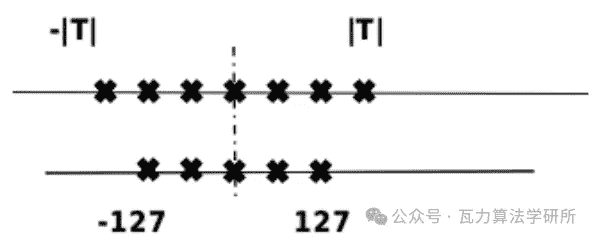
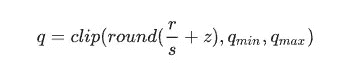

# 大模型目前量化方法有哪些？详细介绍实际落地中最常用方法

> 来源：[https://geekbang.feishu.cn/docx/VkcndE9RvoFJo7xHfd8cCWj6n4g](https://geekbang.feishu.cn/docx/VkcndE9RvoFJo7xHfd8cCWj6n4g)

> 👨🏻 作者：喜欢卷卷的瓦力

> 📃 作者介绍：985海归硕士、计算机专业，前AI大厂研究院高级算法研究员，前国企研究院算法专家，现外企top10上市集团人工智能研究员，算法研究与开发经历6年，深度参与头部大模型产品研发上线，在大模型/语音识别/视觉等领域有丰富的项目经验

> ⏰ 收录时间：2024-05-23 11:28:42

> 🔗 原文链接： h[ttps://mp.weixin.q](https://mp.weixin.qq.com/s/eTC3vloR8-csFJ1d9xLXUw)q.com/s/eTC3vloR...

关注作者👸号，获取更多AI知识

本文介绍了大模型量化目标、原理，量化对象以及形式，并对实际落地中最常见的QAT做了较详细的介绍。

大家都知道，现在大模型轻松突破上万亿规模参数，但各行各业现在都想部署上大模型，最近手机端也开始卷轻量级大模型研究。

因此大模型压缩技术现在也算是研究热点，需要降低模型部署的成本，并提升模型的推理性能。

大模型压缩主要分为如下几类:

剪枝(Pruning)

知识蒸馏(Knowledge Distillation)

量化(Quantization)

低秩分解(Low-Rank Factorization)

实际商业落地开发中，其实需要将上面的技术组合起来灵活应用的。

本文主要讲述大模型压缩部署最重要的技术模型量化的基本概念和当前大模型量化相关的一些工作。下面是一个快捷目录。

1. 量化的目标

2. 量化是什么

3. 量化对象包括哪些

4. 量化形式

5. 量化分类

6. 详细介绍一下QAT

**一、量化的目标**

一般场景是这样的，老板会提出一个运行条件要求，比如在特定环境下运存不超过200M，并保证效果差距不超过某指标，这个时候算法就需要开始考虑量化方案了。

首先来说明一下什么是运存。 **运存包括模型本身运行时所需参数本**身的大小和模型稳定运行后占用的运算资源 。参数占的大小很好运算，比如是float32，那么占4个字节，所占内存就是 参数规模*4/1024/1024/1024 ， 下面是一个不同类型数据所占内存的参考表格。

| dtype | 每10亿参数需要占内存 |
| --- | --- |
| float32 | 4G |
| fp16/bf16 | 2G |
| int8 | 1G |
| int4 | 0.5G |

至于模型稳定运行后占用的运算资源一般需要实测。

**二、量化是什么**

模型量化是 **指**以较低的推理精度损失将连续取值(通常为float32或者大量可能的离散值)的浮点型权重近似为有限多个离散值(通常为int8)的过程 。

通过以更少的位数表示浮点数据，模型量化可以减少模型尺寸，进而减少在推理时的内存消耗，并且在一些低精度运算较快的处理器上可以增加推理速度。具体如下图所示，[-T,T]是量化前的数据范围，[-127,127]是量化后的数据范围。

**三、量化对象**

量化的对象也就是模型的参数，主要按照模型运算中出现的参数来看，常见的是下面几种：

embedding : 词嵌入向量相关权重的量化

权重(weight): weiqht的量化是最常规也是最常见的。量化weight可达到减少模型大小内存和占用空间。

输入(input)：x

输出(output)：y

**四、量化形式**

这里主要指线性量化和非线性量化，根据量化**数据表示的原始数据范**围是否均匀来区分。 通常都是用线性量化 。下面详细介绍原理，假设r表示量化前的浮点数，量化后的整数q可以表示为：

上式中，round(·)和clip(·)分别表示取整和截断操作，qmin和qmax是量化后的最小值和最大值。s是数据量化的间隔（也可以叫标量），z是表示数据偏移的偏置，z为0的量化被称为对称(Symmetric)量化，不为0的量化称为非对称(Asymmetric)量化。通常z为0。

**五、量化分类**

根据应用量化压缩模型的阶段，可以将模型量化分为:

**1. 量化感知训练(Quantization **Aware Training,QAT)

在 **模型训练过程中加入伪量化算子通过训练时统计输入**输出的数据范围可以提升量化后模型的精度 ，适用于对模型精度要求较高的场景;其量化目标无缝地集成到模型的训练过程中。这种方法使LLM在训练过程中适应低精度表示，增强其处理由量化引起的精度损失的能力。这种适应旨在量化过程之后保持更高性能。

**2. 量化感知微调(Quantization-Awa**re Fine-tuning，QAF)

在微调过程中对LLM进行量化主要目标是确保经过微调的LLM在量化为较低位宽后仍保持性能，通过将量化感知整合到微调中，以在模型压缩和保持性能之间取得平衡。

**3. 训练后量化(Post Trainin**g Quantization,PTQ)

在LLM训练完成后对其参数进行量化，只需要少量校准数据，适用于追求高易用性和缺乏训练资源的场景。主要目标是减少LLM的存储和计算复杂性，而无需对LLM架构进行修改或进行重新训练。PTQ的主要优势在于其简单性和高效性。但PTQ可能会在量化过程中引入一定程度的精度损失。

**六、详细介绍一下QAT**

一般QAT是最常用的，量化感知训练是在训练过程中模拟量化，利用伪量化算子将量化带来的精度损失计入训练误差，使得优化器能在训练过程中尽量减少量化误差，得到更高的模型精度，量化感知训练的具体流程如下：

**初始化 **：设置权重和激活值的范围qmin和qmaz的初始值;

**构建模拟量化网络 **：在需要量化的权重和激活值后插入伪量化算子:

**量化训练 **：重复执行以下步骤直到网络收敛，计算量化网络层的权重和激活值的范围qmin和qmax，并根据该范围将量化损失带入到前向推理和后向参数更新的过程中:

**导出量化网络 **：获取qmin和qmax，并计算量化参数s和z;将量化参数代入量化公式中，转换网络中的权重为量化整数值;

**删除伪量化算子 **：在量化网络层前后分别插入量化和反量化算子。

最后再推荐大家去看一下 Training with Quantization Noise for Extreme Model Compression 这篇论文，以及经典的fairseq框架中对他的实现。如果需要自己落地实践的话，把这里吃透基本就可以实现出来了。

大模型轻量化在实际应用时，往往还会加入adaptive softmax等缩小词表运算、STE等算法优化，我们将在后续详细介绍大模型量化的具体方案与实践代码，欢迎大家持续关注。