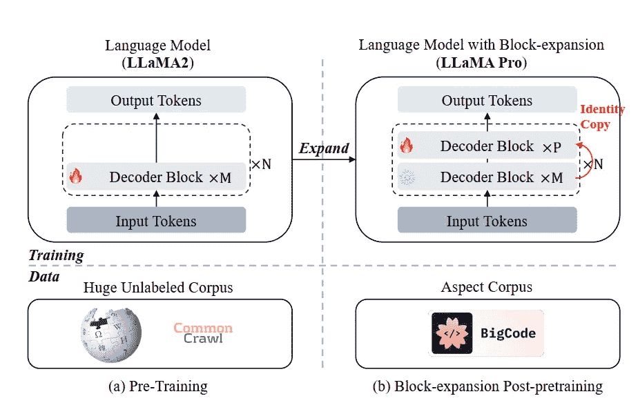
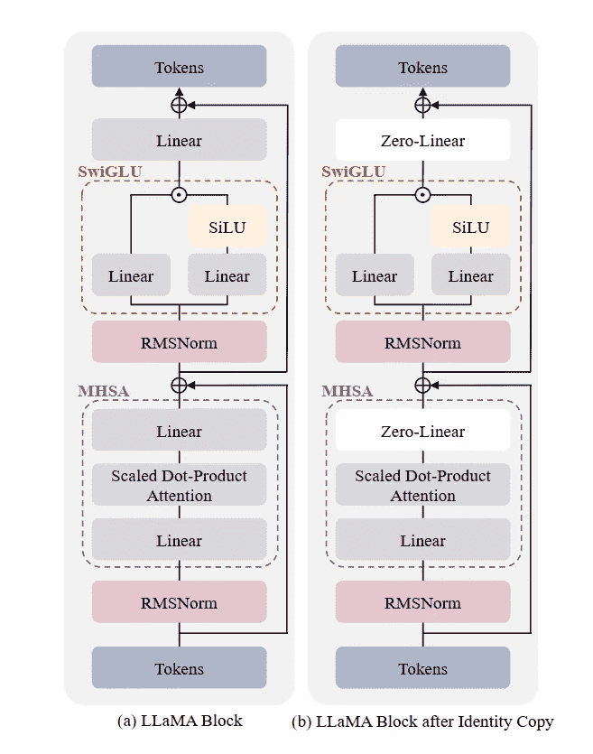
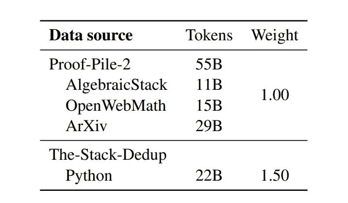
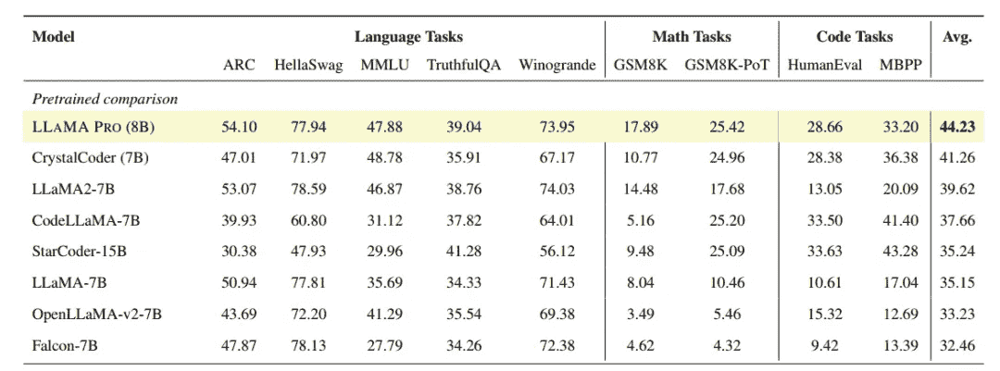
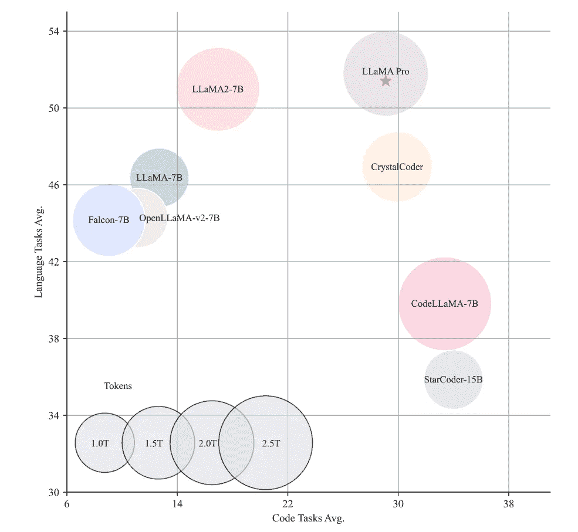
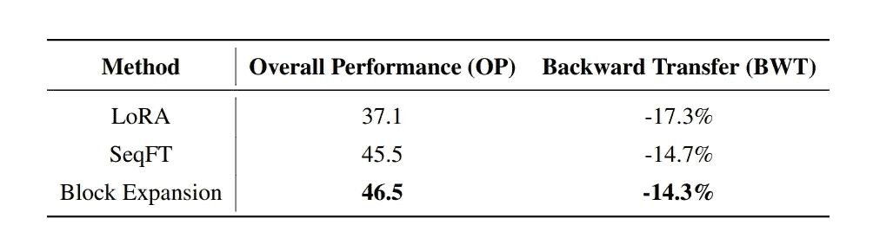
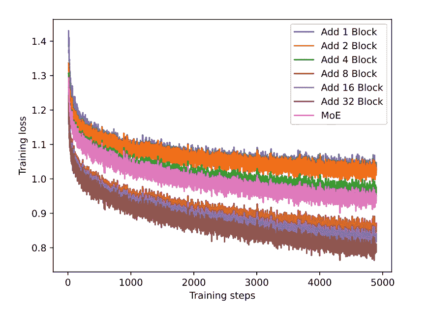
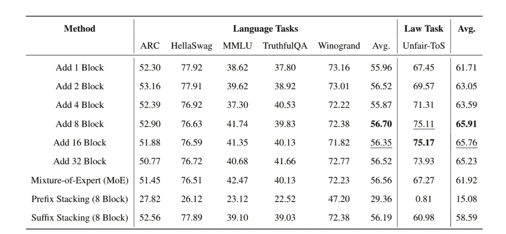

# 大模型增量预训练新技巧-解决灾难性遗忘

> 来源：[https://geekbang.feishu.cn/docx/S2rOd2SxOokAN7xPIKHcqztoncg](https://geekbang.feishu.cn/docx/S2rOd2SxOokAN7xPIKHcqztoncg)

> 👨🏻 作者：刘聪NLP

> 📃 作者介绍：AIGC前沿知识分享&落地经验总结

> 🛖 知乎主页：https://www.zhihu.com/people/LiuCongNLP

> ⏰ 收录时间：2024-05-23 11:28:42

> 🔗 原文链接：h[ttps://mp.weixin.q](https://mp.weixin.qq.com/s/IoCxatkaDeYhfWVuCQKnJw)q.com/s/IoCxatka...


关注作者公众号，获取更多AI知识

## **写在前面 **

大家好，我是刘聪NLP。

目前不少开源模型在通用领域具有不错的效果，但由于缺乏领域数据，往往在一些垂直领域中表现不理想，这时就需要增量预训练和微调等方法来提高模型的领域能力。

但在领域数据增量预训练或微调时，很容易出现灾难性遗忘现象，也就是学会了垂直领域知识，但忘记了通用领域知识，之前介绍过增量预训练以及领域大模型训练技巧，详见：

+   如何更好地继续预训练-Continue PreTraining

+   领域大模型-训练Trick&落地思考

今天给大家带来一篇增量预训练方法-Llama-Pro，对LLMs进行Transformer块扩展后，增量预训练过程中仅对新增块进行训练，有效地进行模型知识注入，并且极大程度地避免灾难性遗忘。



LLaMA Pro: Progressive LLaMA with Block Expansion

```
LLaMA Pro: Progressive LLaMA with Block Expansion
Paper: https://arxiv.org/abs/2401.02415
Github: https://github.com/TencentARC/LLaMA-Pro
```

##  **块扩展方法 **

块扩展，顾名思义，就是在原始模型中每个Transformer块或者某几个Transformer块后增加一个Transformer块，但为了保持扩展后的模型输出保持不变，需要增加的块为恒等块（输入输出相同），如下图所示。



在构建恒等块过程中，主要是将多头注意力层和FFN层中的最后一个线性层（Linear）权重置为0变成Zero-Linear，即可保持经过该块的输入输出一致。

PS：论文附录A中写了大段的推导公式来证明，在此不做过多介绍。

块的增加方式是，对原始模型的  个Transformer块分成  组，每组中包含  个Transformer块，对于每组后添加  个恒等块。代码实现具体如下：

```
model = AutoModelForCausalLM.from_pretrained(model_path, torch_dtype=torch.float16)
ckpt = model.state_dict()

# original_layers是模型原始层数，layers是模型最后达到层数
split = int(original_layers / (layers - original_layers))

layer_cnt = 0

output = {}
for i in range(original_layers):
    for k in ckpt:
        if (&#x27;layers.&#x27; + str(i) + &#x27;.&#x27;) in k:
            output[k.replace((&#x27;layers.&#x27; + str(i) + &#x27;.&#x27;), (&#x27;layers.&#x27; + str(layer_cnt) + &#x27;.&#x27;))] = ckpt[k]
    layer_cnt += 1
    if (i+1) % split == 0:
        for k in ckpt:
            if (&#x27;layers.&#x27; + str(i) + &#x27;.&#x27;) in k:
                if &#x27;down_proj&#x27; in k or &#x27;o_proj&#x27; in k:
                    output[k.replace((&#x27;layers.&#x27; + str(i) + &#x27;.&#x27;), (&#x27;layers.&#x27; + str(layer_cnt) + &#x27;.&#x27;))] = torch.zeros_like(ckpt[k])
                else:
                    output[k.replace((&#x27;layers.&#x27; + str(i) + &#x27;.&#x27;), (&#x27;layers.&#x27; + str(layer_cnt) + &#x27;.&#x27;))] = ckpt[k]
        layer_cnt += 1
    
assert layer_cnt==layers
for k in ckpt:
    if not &#x27;layers&#x27; in k:
        output[k] = ckpt[k]

torch.save(output, output_path)
```

##  **实验细节 **

数据由代码和数学组成，其中代码数据采用The-Stack-Dedup数据集中Python语言部分共22B Token，数学数据采用Proof-Pile-2数据集中AlgebraicStack、OpenWebMath和ArXiv部分共55B，详细如下表所示。



数据分布

基础模型为LLaMA2-7B模型，通过块扩展方法将32层模型扩展到40层，其中  、  、  ，每个组从4个Transformer块扩展到5个Transformer块。

对于代码和数学数据进行增量预训练，批量大小为1024，序列最大长度为4096，预热比率为6%，学习率为2e-4，采用余弦学习率调度器，BF16混合精度训练，权重衰减为0.1。使用16个NVIDIA H800 GPU进行了15900个步骤的训练，大约耗费2830个GPU/小时。

在ARC、HellaSwag、MMLU、TruthfulQA、Winogrande、GSM8K、GSM8K-PoT、HumanEval、MBPP等多个评测数据集中进行评测，可以看出，在保持通用任务能力不下降的情况下，数学和代码能力较原始LLaMA2-7B模型有很大提升。





##  **讨论分析 **

对比块扩展方法与正常训练和Lora方法之间的区别，采用TRACE基准利用总体性能（OP）和逆向转移（BWT）指标进行评估。，如下表所示，块扩展方法整体提升较大。



对比块个数对块扩展方法的影响，进行了不同个数块的实验，并且对比了MoE的方法，训练损失如下，MoE方法的损失下降程度与添加四个块相当。



在代码和法律（16.7B）领域数据下进行增量预训练，在通用任务以及领域任务上比较不同个数块之间的差异，同时比较扩展块全部添加到模型底部或顶部之间的差别，如下所示。可以发现块个数为8时效果最佳，并且不能直接将扩展块全部堆积在头部或尾部，需要分开插入。



##  **写在最后 **

该方法主要通过增加恒定块扩展模型层数，使模型在增量训练过程中仅训练新增层、冻结原始层，保持模型原有能力，防止模型出现灾难性遗忘现象。

但有两点存疑：

+   目前来说mistral要好于llama，为啥不用mistral进行实验

+   不用恒定块，性能会差多少