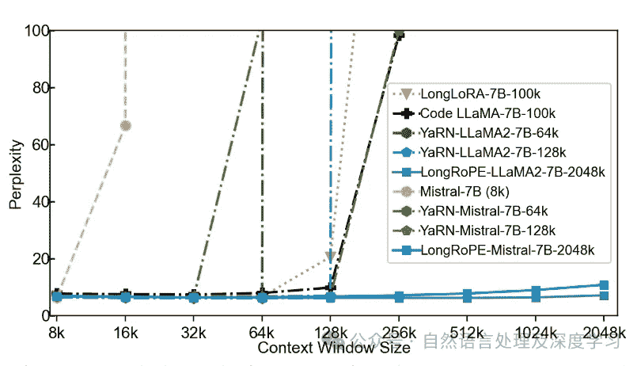
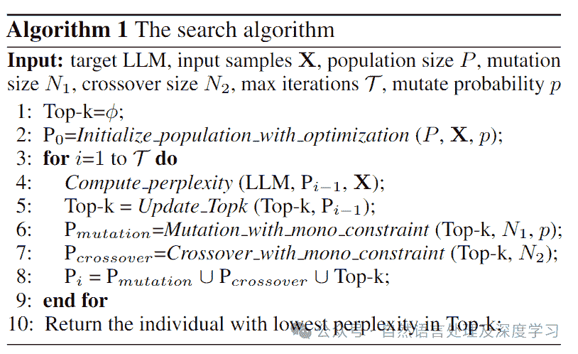

# 【LLM】LongRoPE：LLM上下文窗口扩展方法及非官方实现

> 来源：[https://geekbang.feishu.cn/docx/Lp0LdcMnJo7TNGxb4FIc5Shrnpb](https://geekbang.feishu.cn/docx/Lp0LdcMnJo7TNGxb4FIc5Shrnpb)

> 👨🏻 作者：余俊晖

> 📃 作者介绍：一名NLP炼丹师，NLP算法竞赛TOP选手

> 🛖 公众号：大模型自然语言处理

> ⏰ 收录时间：2024-05-28 17:09:42

> 🔗 原文链接：h[ttps://mp.weixin.q](https://mp.weixin.qq.com/s?__biz=Mzg4NjI0NDg0Ng==&mid=2247484730&idx=1&sn=65da13991e9e08e1bdf52a93dcb3683b&chksm=cf9dd1bbf8ea58ad4d83f543918f55d667d8e0e8d55eb0e33764031d579cd3d99bed6e1cce09#rd)q.com/s?__biz=Mz...


关注作者公众号，获取更多AI知识

##  **前言 **

目前，大多数LLMs的上下文窗口限制在4k个标记左右，这意味着模型在处理超过这个长度的文本时性能会下降。这种限制对于需要大量上下文信息的场景，虽然可以通过在更长的文本上进行微调来将预训练LLM的上下文窗口扩展上下文窗口，但要进一步扩展上下文窗口面临着三个主要挑战：

1.  新位置索引的未训练引入了许多灾难性值，导致分布外问题，使得微调难以收敛。

1.  微调通常需要相应长度的文本。然而，当前数据集中特别是超过1000k的长文本非常有限。此外，对超长文本进行训练计算成本高昂，需要大量的训练时间和GPU资源。

1.  当扩展到极长的上下文窗口时，注意力会变得分散，因为它需要在大量的标记位置上进行分配，这会降低模型在原始短上下文上的性能。



paper：LongRoPE: Extending LLM Context Window Beyond 2 Million Tokens

link：https://arxiv.org/abs/2402.13753

更多细节请参考原文

##  **LongRoPE **

###  **创新点 **

1.  通过有效搜索识别并利用了位置插值中的两种非均匀性，为微调提供了更好的初始化，并在非微调情况下实现了8倍的扩展。

1.  引入了一种渐进式扩展策略，首先对长度为256k的LLM进行微调，然后在微调后的扩展LLM上进行第二次位置插值，以实现2048k的上下文窗口。

1.  在8k长度上重新调整LongRoPE，以恢复短上下文窗口的性能。

###  **位置插值中的非均匀性问题 **

位置插值中的非均匀性问题是指在扩展大型语言模型（LLMs）的上下文窗口时，如何有效地为新增的token位置分配位置嵌入（positional embeddings），以便模型能够在更长的序列上保持或提升性能。在LongRoPE这篇文章中，作者们发现并利用了两种主要的非均匀性，以改进位置插值方法：

1.  **RoPE维度的非均匀性 **：

+   RoPE（Rotary Positional Embedding）是一种在Transformer架构中广泛使用的位置嵌入方法，它通过旋转角度来表示token的位置。

+   不同的RoPE维度具有不同的旋转频率，这意味着低维度（高频率）和高维度（低频率）在表示位置信息时的重要性和敏感性不同。

+   低维度对于位置信息的变化更敏感，因此在插值时应使用较小的缩放因子，以保持相邻位置token的区分度。

+   高维度可以承受更大的插值，因为它们对于位置信息的变化不那么敏感。

1.  **Token位置的非均匀性 **：

+   在输入序列的开始部分，token接收到的注意力分数较高，这些位置的token对于模型理解上下文尤为重要。

+   因此，序列初始的token位置应该使用较小的插值，或者不进行插值，以保留这些关键位置的原始RoPE信息。

+   随着序列位置的增加，可以应用更大的插值因子，因为远离序列开始的token对于模型理解上下文的重要性逐渐降低。

LongRoPE采用了以下方法解决这些非均匀性问题：

+   **有效的位置插值 **：通过进化搜索算法（evolutionary search）来寻找每个RoPE维度的最佳缩放因子（rescale factors），这些因子基于token位置进行调整。

+   **渐进式扩展策略 **：首先对长度为256k的LLM进行微调，然后在微调后的模型上进行第二次位置插值，以实现2048k的上下文窗口，而无需直接在极长文本上进行微调。

+   **短上下文窗口性能恢复 **：通过额外的进化搜索来调整RoPE缩放因子，以便在扩展到极长上下文窗口后，仍能保持在原始短上下文窗口内的高性能。

###  **搜索算法 **



##  **LongRoPE非官方实现 **

```
import torch
import torch.nn as nn
import torch.optim as optim
import random
import numpy as np
import gzip
import io


class RoPEPositionalEncoding(nn.Module):
    &quot;&quot;&quot;
    Rotary Position Encoding (RoPE) module.
    &quot;&quot;&quot;

    def __init__(self, d_model, max_len=5000, base=10000):
        super().__init__()
        self.d_model = d_model
        self.max_len = max_len
        self.base = base
        self.theta = torch.tensor(
            [base ** (-2 * (i // 2) / d_model) for i in range(d_model)]
        )

    def forward(self, positions):
        angles = positions.unsqueeze(-1) * self.theta
        return torch.stack([angles.cos(), angles.sin()], dim=-1).flatten(-2)


def non_uniform_interpolation(pos_embed, extension_ratio, lambda_factors, n_hat):
    &quot;&quot;&quot;
    Perform non-uniform interpolation on position embeddings.

    Args:
        pos_embed (torch.Tensor): Position embeddings.
        extension_ratio (float): Extension ratio for context window.
        lambda_factors (list): Lambda factors for interpolation.
        n_hat (int): Threshold for applying interpolation.

    Returns:
        torch.Tensor: Interpolated position embeddings.
    &quot;&quot;&quot;
    d_model = pos_embed.shape[-1]
    interpolated_pos = pos_embed.clone()

    for i in range(d_model // 2):
        mask = torch.arange(pos_embed.shape[-2]) &lt; n_hat
        scale = torch.where(
            mask, torch.ones_like(pos_embed[..., 0]), 1 / lambda_factors[i]
        )
        interpolated_pos[..., i * 2] *= scale
        interpolated_pos[..., i * 2 + 1] *= scale

    return interpolated_pos


def search_lambda_factors(
    model,
    data,
    extension_ratio,
    population_size,
    num_mutations,
    num_crossovers,
    max_iterations,
):
    &quot;&quot;&quot;
    Search for optimal lambda factors using evolutionary search.

    Args:
        model (nn.Module): LongRoPE model.
        data (list): List of input sequences.
        extension_ratio (float): Extension ratio for context window.
        population_size (int): Size of the population for evolutionary search.
        num_mutations (int): Number of mutations per iteration.
        num_crossovers (int): Number of crossovers per iteration.
        max_iterations (int): Maximum number of iterations for evolutionary search.

    Returns:
        list: Optimal lambda factors found by the search.
    &quot;&quot;&quot;
    population = initialize_population(population_size, extension_ratio)

    for i in range(max_iterations):
        perplexities = evaluate_population(model, data, population)
        parents = select_topk(population, perplexities, k=population_size // 2)
        population = mutate(parents, num_mutations) + crossover(parents, num_crossovers)

    return min(population, key=lambda x: evaluate_individual(model, data, x))


def progressive_extension(model, data, base_length, target_length):
    &quot;&quot;&quot;
    Progressively extend the context window of the model.

    Args:
        model (nn.Module): LongRoPE model.
        data (list): List of input sequences.
        base_length (int): Base context window length.
        target_length (int): Target context window length.

    Returns:
        tuple: (Extended model, lambda factors, base lambda factors)
    &quot;&quot;&quot;
    curr_model = model
    curr_length = base_length

    while curr_length &lt; target_length:
        lambda_factors, n_hat = search_lambda_factors(
            curr_model, data, curr_length / base_length
        )
        curr_model = fine_tune(curr_model, data, curr_length, lambda_factors, n_hat)
        curr_length *= 2

    lambda_factors_base, _ = search_lambda_factors(
        curr_model, data, curr_length / base_length, max_length=base_length
    )

    return curr_model, lambda_factors, lambda_factors_base


class LongRoPEModel(nn.Module):
    &quot;&quot;&quot;
    Long Range Rotary Position Encoding (LongRoPE) model.

    This model extends the context window of transformer-based models beyond the
    typical limit by using non-uniform interpolation of rotary position embeddings.
    It enables the model to handle longer input sequences while maintaining the
    ability to capture long-range dependencies.

    Attributes:
        d_model (int): Dimension of the model.
        n_heads (int): Number of attention heads.
        num_layers (int): Number of transformer layers.
        max_len (int): Maximum sequence length.
        rope (RoPEPositionalEncoding): Rotary Position Encoding (RoPE) module.
        transformers (nn.ModuleList): List of transformer encoder layers.
        lambda_factors (list): Lambda factors for non-uniform interpolation.
        lambda_factors_base (list): Lambda factors for the base model.
        extension_ratio (float): Extension ratio for the context window.
        n_hat (int): Threshold for applying interpolation.

    Methods:
        forward(input_ids):
            Perform forward pass on the input sequence.

            Args:
                input_ids (torch.Tensor): Input sequence tensor.

            Returns:
                torch.Tensor: Output embeddings from the model.

        extend_context(data_path, target_length, max_sequence_length, tokenizer):
            Extend the context window of the model.

            Args:
                data_path (str): Path to the input data file.
                target_length (int): Target context window length.
                max_sequence_length (int): Maximum sequence length for input data.
                tokenizer: Tokenizer object for encoding input data.

            Returns:
                LongRoPEModel: Extended LongRoPE model.
    &quot;&quot;&quot;

    def __init__(self, d_model, n_heads, num_layers, max_len=5000):
        super().__init__()
        self.d_model = d_model
        self.num_layers = num_layers
        self.rope = RoPEPositionalEncoding(d_model, max_len)
        self.transformers = nn.ModuleList(
            [
                nn.TransformerEncoderLayer(d_model=d_model, nhead=n_heads)
                for _ in range(num_layers)
            ]
        )
        self.lambda_factors = None
        self.lambda_factors_base = None

    def forward(self, input_ids):
        positions = torch.arange(input_ids.size(1), device=input_ids.device)
        pos_embeddings = self.rope(positions)

        if self.lambda_factors is not None:
            pos_embeddings = non_uniform_interpolation(
                pos_embeddings, self.extension_ratio, self.lambda_factors, self.n_hat
            )

        input_embeddings = input_ids + pos_embeddings

        for transformer in self.transformers:
            input_embeddings = transformer(input_embeddings)

        return input_embeddings

    def extend_context(self, data_path, target_length, max_sequence_length, tokenizer):
        &quot;&quot;&quot;
        Extend the context window of the model.

        Args:
            data_path (str): Path to the input data file.
            target_length (int): Target context window length.
            max_sequence_length (int): Maximum sequence length for input data.
            tokenizer: Tokenizer object for encoding input data.

        Returns:
            LongRoPEModel: Extended LongRoPE model.
        &quot;&quot;&quot;
        if tokenizer is None:
            raise ValueError(&quot;Tokenizer is required for extending context.&quot;)

        self.extension_ratio = target_length / self.rope.max_len

        data = load_data(data_path, tokenizer, max_sequence_length)
        model, lambda_factors, lambda_factors_base = progressive_extension(
            self, data, self.rope.max_len, target_length
        )

        self.lambda_factors = lambda_factors
        self.lambda_factors_base = lambda_factors_base
        self.n_hat = self.rope.max_len // 2

        return model


def load_data(data_path, tokenizer, max_sequence_length):
    &quot;&quot;&quot;
    Load and preprocess the input data.

    Args:
        data_path (str): Path to the input data file.
        tokenizer: Tokenizer object for encoding input data.
        max_sequence_length (int): Maximum sequence length for input data.

    Returns:
        list: List of preprocessed input sequences.
    &quot;&quot;&quot;
    if data_path is None or tokenizer is None:
        raise ValueError(&quot;Data path and tokenizer are required for loading data.&quot;)

    if data_path.endswith(&quot;.gz&quot;):
        with gzip.open(data_path, &quot;rt&quot;, encoding=&quot;utf-8&quot;) as file:
            text_data = file.read()
    else:
        with open(data_path, &quot;r&quot;, encoding=&quot;utf-8&quot;) as file:
            text_data = file.read()

    tokenized_data = tokenizer.encode(text_data)

    sequences = [
        tokenized_data[i : i + max_sequence_length]
        for i in range(0, len(tokenized_data), max_sequence_length)
    ]

    tensor_data = [torch.tensor(seq, dtype=torch.long) for seq in sequences]

    return tensor_data


def initialize_population(population_size, extension_ratio):
    &quot;&quot;&quot;
    Initialize the population for evolutionary search.

    Args:
        population_size (int): Size of the population.
        extension_ratio (float): Extension ratio for context window.

    Returns:
        list: Initialized population.
    &quot;&quot;&quot;
    population = []

    population.append(torch.ones(512) * extension_ratio)

    ntk_factors = torch.tensor([extension_ratio ** (2 * i / 512) for i in range(512)])
    population.append(ntk_factors)

    yarn_factors = torch.ones(512)
    yarn_factors[:128] = 1.0
    yarn_factors[128:256] = extension_ratio ** (1 / 3)
    yarn_factors[256:] = extension_ratio
    population.append(yarn_factors)

    for _ in range(population_size - 3):
        factors = torch.ones(512)
        for i in range(512):
            if random.random() &lt; 0.1:
                factors[i] = random.uniform(1, extension_ratio)
        population.append(factors)

    return population


def evaluate_individual(model, data, individual):
    &quot;&quot;&quot;
    Evaluate an individual lambda factor configuration.

    Args:
        model (nn.Module): LongRoPE model.
        data (list): List of input sequences.
        individual (list): Lambda factor configuration.

    Returns:
        float: Perplexity score for the individual.
    &quot;&quot;&quot;
    model.lambda_factors = individual
    perplexities = []

    for seq in data:
        input_ids = seq.unsqueeze(0)
        output = model(input_ids)
        perplexity = torch.exp(torch.mean(output))
        perplexities.append(perplexity.item())

    return np.mean(perplexities)


def evaluate_population(model, data, population):
    &quot;&quot;&quot;
    Evaluate the population of lambda factor configurations.

    Args:
        model (nn.Module): LongRoPE model.
        data (list): List of input sequences.
        population (list): Population of lambda factor configurations.

    Returns:
        list: Perplexity scores for each individual in the population.
    &quot;&quot;&quot;
    perplexities = []
    for individual in population:
        perplexity = evaluate_individual(model, data, individual)
        perplexities.append(perplexity)
    return perplexities


def select_topk(population, perplexities, k):
    &quot;&quot;&quot;
    Select the top-k individuals from the population based on perplexity scores.

    Args:
        population (list): Population of lambda factor configurations.
        perplexities (list): Perplexity scores for each individual in the population.
        k (int): Number of top individuals to select.

    Returns:
        list: Top-k individuals from the population.
    &quot;&quot;&quot;
    indices = np.argsort(perplexities)[:k]
    return [population[i] for i in indices]


def mutate(parents, num_mutations):
    &quot;&quot;&quot;
    Perform mutation on the parent population.

    Args:
        parents (list): Parent population.
        num_mutations (int): Number of mutations to perform.

    Returns:
        list: Mutated population.
    &quot;&quot;&quot;
    mutated_population = []
    for _ in range(num_mutations):
        parent = random.choice(parents)
        child = parent.clone()
        for i in range(512):
            if random.random() &lt; 0.1:
                child[i] *= random.uniform(0.8, 1.2)
        mutated_population.append(child)
    return mutated_population


def crossover(parents, num_crossovers):
    &quot;&quot;&quot;
    Perform crossover on the parent population.

    Args:
        parents (list): Parent population.
        num_crossovers (int): Number of crossovers to perform.

    Returns:
        list: Crossover population.
    &quot;&quot;&quot;
    crossover_population = []
    for _ in range(num_crossovers):
        parent1, parent2 = random.sample(parents, 2)
        child = parent1.clone()
        for i in range(512):
            if random.random() &lt; 0.5:
                child[i] = parent2[i]
        crossover_population.append(child)
    return crossover_population


def fine_tune(model, data, target_length, lambda_factors, n_hat, num_epochs=3):
    &quot;&quot;&quot;
    Fine-tune the LongRoPE model.

    Args:
        model (nn.Module): LongRoPE model.
        data (list): List of input sequences.
        target_length (int): Target context window length.
        lambda_factors (list): Lambda factors for interpolation.
        n_hat (int): Threshold for applying interpolation.
        num_epochs (int, optional): Number of fine-tuning epochs. Defaults to 3.

    Returns:
        nn.Module: Fine-tuned LongRoPE model.
    &quot;&quot;&quot;
    model.lambda_factors = lambda_factors
    model.n_hat = n_hat
    optimizer = optim.Adam(model.parameters(), lr=1e-4)

    for epoch in range(num_epochs):
        for seq in data:
            optimizer.zero_grad()

            seq_len = seq.size(0)
            if seq_len &lt;= target_length:
                input_ids = seq.unsqueeze(0)
            else:
                start_idx = random.randint(0, seq_len - target_length)
                input_ids = seq[start_idx : start_idx + target_length].unsqueeze(0)

            output = model(input_ids)
            loss = torch.mean(output)

            loss.backward()
            optimizer.step()

    return model


# Example usage
data_path = &quot;path/to/your/dataset&quot;
d_model = 512
n_heads = 8
num_layers = 6
base_length = 4096
target_length = 2048 * 1024

data = load_data(data_path)
model = LongRoPEModel(d_model, n_heads, num_layers, base_length)
model = model.extend_context(data, target_length)

input_ids = torch.randn(2, target_length, d_model)
output = model(input_ids)
print(output.shape)  # Expected shape: (batch_size, target_length, d_model)
```