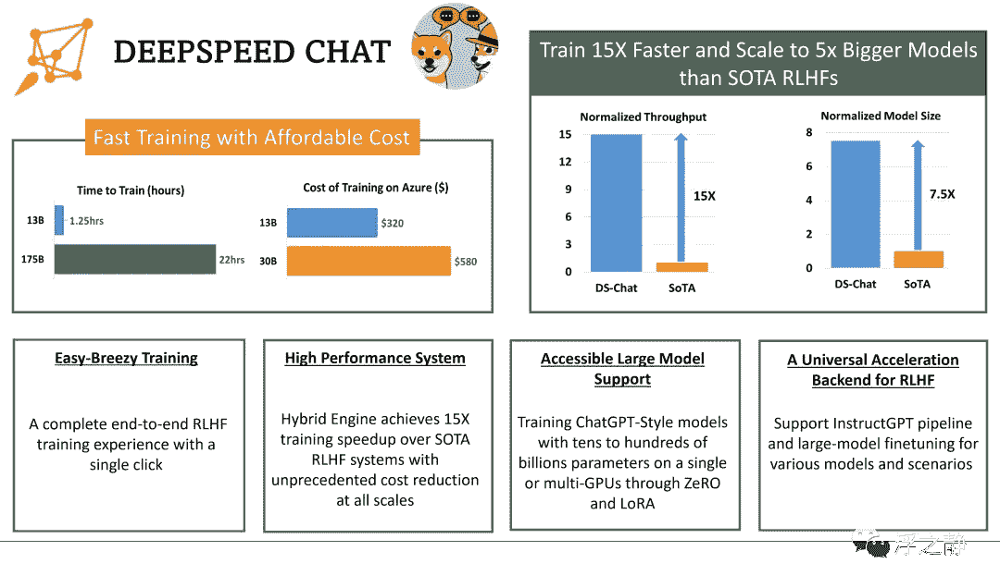
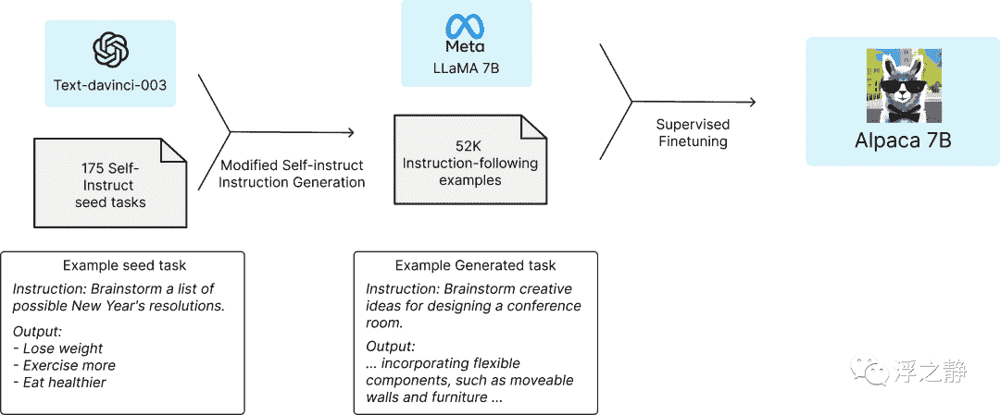
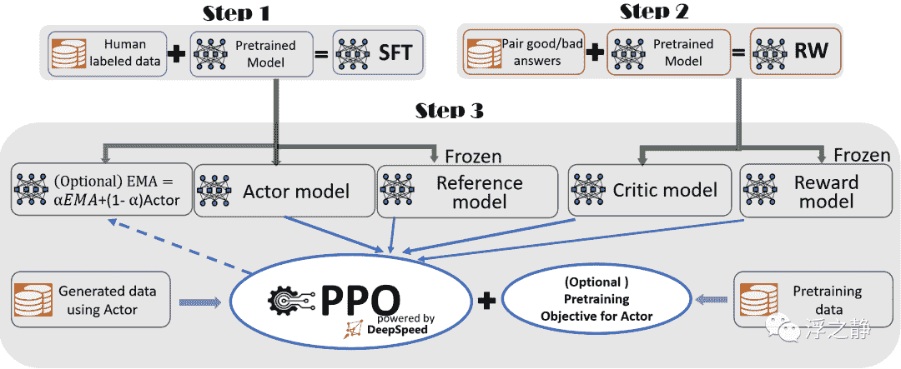
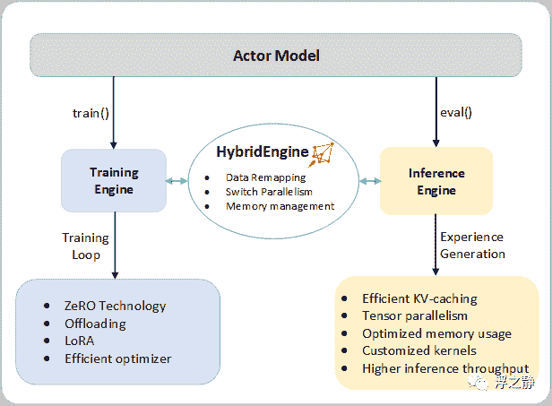
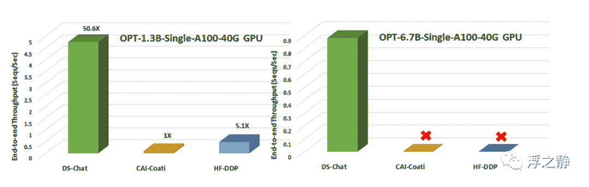
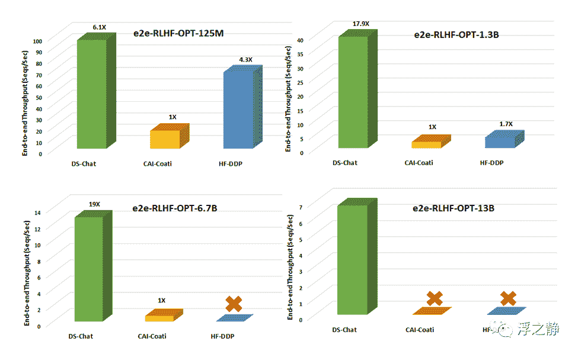
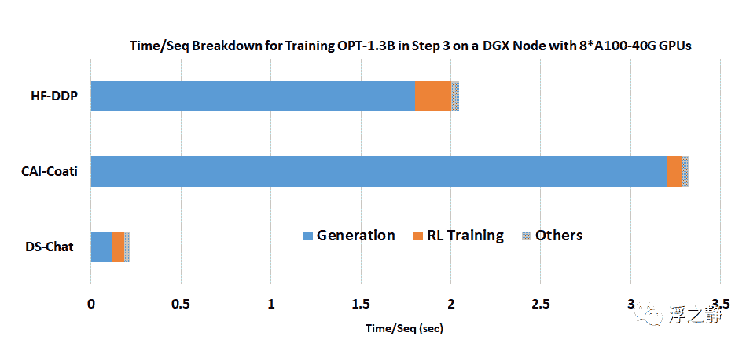
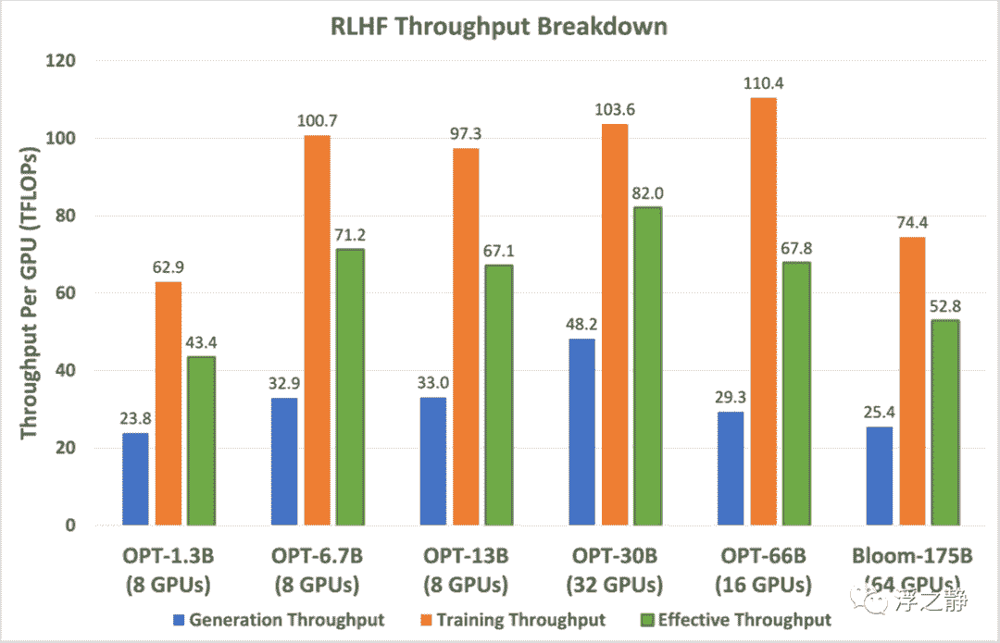
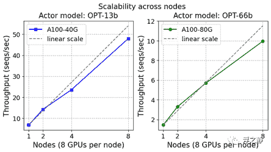

# DeepSpeed Chat：一键搞定不同规模 ChatGPT 类模型训练！

> 来源：[https://geekbang.feishu.cn/docx/UkjRdzuFNokoF4xXm4gcsB5Nn8f](https://geekbang.feishu.cn/docx/UkjRdzuFNokoF4xXm4gcsB5Nn8f)

> 🤵作者： lencx

> 📃 作者介绍：AI 初学者，喜欢分享，热爱开源（GitHub Stars 60k+）。

> ⏰ 收录时间：2024-06-05 15:36:25 (UTC+8)

> 🔗 原文链接： https://mp.weixin.qq.com/s/HhIGAojnZVSu4vMBpMP4yA


注：原文来自 DeepSpeed Chat: Easy, Fast and Affordable RLHF Training of ChatGPT-like Models at All Scales [1] （因文中包含大量专业术语及引用，这里进行了拓展，重新梳理排版）。

`DeepSpeed` [2] ：是一个深度学习优化库，它使分布式训练和推理变得简单、高效和有效。一键式 RLHF 训练，让你的类 ChatGPT 千亿大模型提速省钱 15 倍。说人话就是： 自己本地可以训练部署类 ChatGPT 模型，既高效又省钱 。



> RLHF (Reinforcement Learning with Human Feedback) ：即利用人类反馈进行强化学习。在强化学习中，智能体通过与环境交互学习如何采取行动以最大化预期的累积奖励。然而，由于现实环境的复杂性和不确定性，直接从奖励信号中学习可能会变得非常困难。因此，利用人类反馈进行强化学习成为了一种有效方法。RLHF 将人类的反馈作为额外的信号来指导智能体的学习，例如，通过问答、评分或者直接指导行动来提供反馈。这种方法可以提高智能体的学习效率和准确性，同时也能够使得智能体在实际应用中更加具有可解释性和可操作性。其应用范围非常广泛，例如在机器人控制、游戏设计、自然语言处理和推荐系统等领域都有应用。然而，利用人类反馈进行强化学习也存在一些挑战，例如如何有效地整合不同类型的反馈、如何避免人类反馈的偏差和主观性等问题。因此，如何设计和应用有效的 RLHF 算法仍然是一个活跃的研究方向。

## 背景

近日来，ChatGPT 及类似模型引发了人工智能（AI）领域的一场风潮（ 真谦虚：哪是一场，高潮迭起，很多网友表示学不动了 ）。这场风潮对数字世界产生了革命性影响。ChatGPT 类模型具有惊人的泛用性，能够执行归纳、编程、翻译等任务，其结果与人类专家相当甚至更优。为了使 ChatGPT 等模型的训练和部署更轻松，AI 开源社区进行了各种尝试（例如 ChatLLaMa、Alpaca、Vicuna、Databricks-Dolly 等）。

+ ChatLLaMa [3] ：允许你使用自己的数据和最少量的计算来创建超个性化的 ChatGPT 类助手。它的目的是通过抽象所需的计算优化和大量数据收集的努力，给开发人员带来安心。

+ Alpaca [4] ：它是从 Meta 的 LLaMA [5] 7B 模型中微调而来。使用 `text-davinci-003` 在以 自我指导 [6] 方式生成的 52K 指令（类似人类的问题和答案的小型数据集）跟随演示上训练羊驼模型。令人惊讶的是，它表现出了类似于 ChatGPT 的交互性，但也出奇地小且易于重现/便宜。了解更多 Alpaca: A Strong, Replicable Instruction-Following Model [7] 。



+ Vicuna [8] ：一款开源聊天机器人，由来自加州大学伯克利分校、卡内基梅隆大学、斯坦福大学和加州大学圣地亚哥分校的团队成员开发，其表现优异，使用 GPT-4 进行测试时，其聊天表现质量高达 ChatGPT 的 90%。

+ Databricks-Dolly [9] ：是一款基于 EleutherAI [10] 开源 6 亿参数模型修改而来的 LLM（Language Model），能够表现出类似于 ChatGPT 的指令跟随能力，并且能够在生成文本、头脑风暴和开放式问答等方面表现出与 ChatGPT 相似的 定性能力 。其工作原理是在 Alpaca 的数据支持下，对 EleutherAI 的开源模型 `pythia-12b` [11] 进行微调，以实现头脑风暴和文本生成等指令跟随能力。了解更多 Hello Dolly: Democratizing the magic of ChatGPT with open models [12] 。

> 定性能力 ：在自然语言处理领域，定性能力通常指的是模型生成文本时的质量和连贯性等方面的表现。例如，在文本生成任务中，一个具有良好定性能力的模型可以生成通顺、语法正确、有意义且符合上下文语境的文本。

## 概述

然而，尽管开源社区付出了巨大的努力，目前仍缺乏一个支持 端到端 的基于人工反馈机制的强化学习（RLHF）的规模化系统，这使得训练强大的类 ChatGPT 模型十分困难。例如，使用现有的开源系统训练一个具有 67 亿参数的类 ChatGPT 模型通常需要昂贵的多卡至多节点的 GPU 集群，但这些资源对大多数数据科学家或研究者而言难以获取。同时，即使有了这样的计算资源，现有的开源系统的训练效率通常还不到这些机器所能达到的最大效率的 5%。简而言之，即使有了昂贵的多 GPU 集群，现有解决方案也无法轻松、快速、经济的训练具有数千亿参数的最先进的类 ChatGPT 模型。

> 端到端（end-to-end）：是指一个系统或过程中的所有步骤都由一个单一的系统、组件或者算法完成，不需要人为干预或者多个独立的系统组合。在机器学习和人工智能领域中，端到端通常指的是从输入数据到输出结果的整个过程都由一个模型或算法完成，无需手动提取特征或执行其他预处理操作。这种方法具有简化模型构建和部署流程的优点，并且可以通过深度学习等技术实现高精度的预测或生成。（例如，在自然语言处理中，一个端到端的文本生成模型可以直接从输入的语义信息中生成相应的文本，而无需手动提取语言特征或者进行其他预处理。在图像识别中，一个端到端的图像分类模型可以直接从原始的像素数据中进行训练和预测，而无需手动提取图像特征。端到端的方法通常需要大量的数据和计算资源来训练和优化模型，但其在实际应用中可以带来更高的效率和准确率，同时也能够简化系统的构建和部署流程。）

ChatGPT 模型的训练（ Aligning language models to follow instructions [13] ）是基于 InstructGPT 论文（ Training language models to follow instructions with human feedback [14] ）中的 RLHF 方式。这与常见的大语言模型的预训练和微调截然不同。这使得现有深度学习系统在训练类 ChatGPT 模型时存在种种局限。因此，为了让ChatGPT 类型的模型更容易被普通数据科学家和研究者使用，并使 RLHF 训练真正普及到 AI 社区，微软发布了 DeepSpeed-Chat。它具有以下三大核心功能：

### DeepSpeed-Chat 的三大核心功能

+ 简化 ChatGPT 类型模型的训练和强化推理体验 ：只需一个脚本即可实现多个训练步骤，包括使用 Huggingface 预训练的模型 [15] 、使用 DeepSpeed-RLHF 系统运行 InstructGPT 训练的所有三个步骤、甚至生成你自己的类 ChatGPT 模型。此外，还提供了一个易于使用的推理 API，用于用户在模型训练后测试对话式交互。

+ DeepSpeed-RLHF 模块 ：DeepSpeed-RLHF 复刻了 InstructGPT 论文中的训练模式，并确保包括：

+ a) 监督微调（SFT）

+ b) 奖励模型微调（Reward Model Fine-Tuning）

+ c) 基于人类反馈的强化学习（RLHF）在内的三个步骤与其一一对应

+ 此外，还提供了数据抽象和混合功能，以支持用户使用多个不同来源的数据源进行训练。

### DeepSpeed-RLHF 系统

DeepSpeed-RLHF 系统 ：将 `DeepSpeed` 的训练 training engine 和推理能力 inference engine 整合到一个统一的混合引擎 `DeepSpeed Hybrid Engine` or `DeepSpeed-HE` 中用于 RLHF 训练。`DeepSpeed-HE` 能够在 RLHF 中无缝地在推理和训练模式之间切换，使其能够利用来自 `DeepSpeed-Inference` 的各种优化，如 `张量并行计算` 和 `高性能 CUDA 算子` 进行语言生成，同时对训练部分还能从 `ZeRO` 和 `LoRA-based` 内存优化策略中受益。`DeepSpeed-HE` 还能够自动在 RLHF 的不同阶段进行智能的内存管理和数据缓存。

### 核心优化技术

> 监督微调 (Supervised Fine-Tuning，SFT) ： 是指在一个已经训练好的深度学习模型上进行微调，以便使其能够适应新的任务或数据集。在微调过程中，通常只更新最后几层（通常是全连接层），而保持基础模型的权重不变 。监督微调的好处是：它能够在少量数据的情况下快速训练出一个适应新任务的模型。因为基础模型已经在大规模数据集上进行了训练，它已经学习到了很多有用的特征，而微调过程中的训练则可以使模型更好地适应新的任务或数据集。不过，监督微调也存在一些风险，例如过度拟合、训练样本不足等。因此，需要谨慎选择基础模型和微调参数，并且合理评估微调结果。

> 奖励模型微调 (Reward Model Fine-Tuning) ： 是一种在强化学习中使用的微调技术，用于调整奖励函数的权重，以便使智能体更好地学习任务。在强化学习中，智能体通过与环境交互来学习如何最大化累积奖励 。这个累积奖励通常由奖励函数计算得出，而奖励函数的权重对于智能体的学习非常关键。如果奖励函数的权重设置不当，智能体可能会学习到错误的行为或策略，导致无法有效地解决任务。其思想是利用已经学习到的知识来调整奖励函数的权重，使其更好地反映任务的特性。具体来说，它使用一个已经训练好的智能体，将其作为评估器来评估新的奖励函数的质量，并根据评估结果来微调奖励函数的权重。这个过程可以通过优化一个损失函数来实现，该损失函数衡量评估器的预测结果与实际结果之间的差距。优点是它可以帮助智能体更好地学习任务，同时减少错误行为的发生。但是，奖励模型微调也存在一些挑战，例如，评估器的性能可能会受到微调参数的影响，需要谨慎选择微调参数，并进行合理评估。

> 张量并行计算 (Tensor Parallelism) ：是指在深度学习模型中使用并行计算的一种技术，可以将大型张量划分成多个小张量，然后并行计算这些小张量，从而提高计算速度。

> 高性能 CUDA 算子 (High-performance transformer kernels) ：是指针对 `Transformer` 模型（一种常用于自然语言处理任务的深度学习模型）进行高性能计算的一种技术，通过优化 `Transformer` 中的计算步骤，包括 `self-attention` 和前向传播等操作，来提高模型的计算效率。

这些优化技术包括使用更高效的算法和数据结构，减少内存和计算资源的浪费，以及使用 `tensor-parallelism` 等并行计算技术。通过这些优化，可以显著提高 `Transformer` 模型的训练和推理速度，使其能够更快地处理更大规模的数据。

DeepSpeed-RLHF 系统在大规模训练中具有无与伦比的效率，使复杂的 RLHF 训练变得快速、经济并且易于大规模推广：

### 训练效率与规模扩展性

+ 高效性和经济性 ：`DeepSpeed-HE` 比现有系统快 15 倍以上，使 RLHF 训练快速且经济实惠。(例如：`DeepSpeed-HE` 在 Azure 云上只需 9 小时即可训练一个 `OPT-13B` 模型 [16] ，只需 18 小时即可训练一个 `OPT-30B` 模型 [17] 。这两种训练分别花费不到 300 美元和 600 美元)

| `GPUs` | `OPT-6.7B` | `OPT-13B` | `OPT-30B` | `OPT-66B` |
| --- | --- | --- | --- | --- |
| `8x A100-40GB` | `OPT-6.7B` 5.7 hours | `OPT-13B` 10.8 hours | `OPT-30B` 1.85 days | `OPT-66B` NA |
| `8x A100-80GB` | `OPT-6.7B` 4.1 hours ($132) | `OPT-13B` 9 hours ($290) | `OPT-30B` 18 hours ($580) | `OPT-66B` 2.1 days ($1620) |

> 👆 表 1 单节点 8x A100：训练时长及预估的 Azure 费用。

+ 卓越的扩展性 ：`DeepSpeed-HE` 能够支持训练拥有数千亿参数的模型，并在多节点多 GPU 系统上展现出卓越的扩展性。因此，即使是一个拥有 130 亿参数的模型，也只需 1.25 小时就能完成训练。而对于庞大的拥有 1750 亿参数的模型，使用 `DeepSpeed-HE` 进行训练也只需不到一天的时间。

| `GPUs` | `OPT-13B` | `OPT-30B` | `OPT-66B` | `OPT-175B` |
| --- | --- | --- | --- | --- |
| `64x A100-80G` | `OPT-13B` 1.25 hours ($320) | `OPT-30B` 4 hours ($1024) | `OPT-66B` 7.5 hours ($1920) | `OPT-175B` 20 hours ($5120) |

> 👆 表 2 多节点 64x A100-80GB：训练时长及预估的 Azure 费用。

+ 实现 RLHF 训练的普及化 ：仅凭单个 `GPU`，`DeepSpeed-HE` 就能支持训练超过 130 亿参数的模型。这使得那些无法使用多 `GPU` 系统的数据科学家和研究者不仅能够轻松创建轻量级的 RLHF 模型，还能创建大型且功能强大的模型，以应对不同的使用场景。

|  | `V100 32G` | `A6000 48G` | `A100 40G` | `A100 80G` |
| --- | --- | --- | --- | --- |
| Model Size | `OPT-2.7B` | `OPT-6.7B` | `OPT-6.7B` | `OPT-13B` |

> 👆 表 3 `DeepSpeed-HE` 在不同的 `GPU` 单卡上支持的最大模型。

> 非常重要的细节: 上述两个表格（即表 1 和表 2）中的数据均针对 RLHF 训练的第 3 步，基于实际数据集和 `DeepSpeed-RLHF` 训练吞吐量的测试。该训练在总共 1.35 亿（135M）个字符（token）上进行一个时期（epoch）的训练。总共有 6750 万个查询（query）字符（131.9k 个 query，每个序列长度为 256）和 6750 万个生成/回答字符（131.9k 个答案，每个序列长度为 256），每步的最大全局字符批量大小约为 500 万个字符（1024 个查询-答案对）。在与 `DeepSpeed-RLHF` 进行任何成本和端到端时间比较之前，建议读者注意这些设定。想要了解更多详细信息，请参阅 `benchmark setting` [18] 。

> OPT 模型 ：是由 Meta AI 在 `OPT: Open Pre-trained Transformer Language Models` [19] 中提出的，它是一系列开源的大型因果语言模型，其性能与 GPT3 相似。该论文的摘要如下：

> 大型语言模型经常需要数十万计算日来训练，已经展示出在零样本和少样本学习方面的卓越能力。考虑到它们的计算成本，这些模型在没有大量资金的情况下很难进行复制。对于那些通过 API 可用的模型，无法获得完整的模型权重，因此难以进行研究。我们提出了 `Open Pre-trained Transformers (OPT)`，这是一套仅包含解码器的预训练 `Transformer`，参数范围从 125M 到 175B，我们旨在全面、负责任地与感兴趣的研究人员分享这些模型。我们展示了 `OPT-175B` 与 GPT-3 相媲美，同时仅需 1/7 的碳排放来开发。我们还发布了我们的日志记录，详细说明了我们面临的基础设施挑战，以及所有发布模型的实验代码。

## 使用

> 简洁高效且经济的 ChatGPT 训练与推理体验：仅使用一行命令即可利用 `DeepSpeed-RLHF` 系统训练 `OPT-13B` 和 `OPT-66B` 模型。即使时间有限，你也可以在大约两小时内在单个消费级 `GPU` 上训练一个 `OPT-1.3B` 模型。还可以利用 `DeepSpeed-chat` RLHF API 来开发你自己的模型。

### 训练模型


# DeepSpeed-Chat RLHF 训练指南

> 使用 DeepSpeed-Chat 的 RLHF 示例可以轻松训练出你的第一个类 ChatGPT 模型

## 一键脚本

仅需一个脚本，完成 RLHF 训练的全部三个阶段，生成你的第一个 ChatGPT 模型！

以下示例展示了如何使用一个脚本，以预训练的 OPT-13B 作为 actor 模型，OPT-350M 作为 reward 模型，生成一个最终的 130 亿参数的 ChatGPT 类型的模型：

```
git clone https://github.com/microsoft/DeepSpeed.git
cd DeepSpeed
pip install .

git clone https://github.com/microsoft/DeepSpeedExamples.git
cd DeepSpeedExamples/applications/DeepSpeed-Chat/
pip install -r requirements.txt

python train.py --actor-model facebook/opt-13b --reward-model facebook/opt-350m --num-gpus 8
```

大约半天时间，你就可以完成拥有 130 亿参数的模型的训练。下表展示了整个过程在三个步骤中所需的时间：

| Model Sizes | Step 1 | Step 2 | Step 3 | Total |
| --- | --- | --- | --- | --- |
| Actor: OPT-13B, Reward: OPT-350M | 2.5hr | 0.25hr | 10.8hr | 13.6hr |

> 👆 表 4 在单个 DGX 节点上（8x A100-40G），针对不同的 RLHF 步骤，使用 DeepSpeed-Chat 训练 OPT-13b 所需的时间。

## API 使用

> 使用 DeepSpeed-Chat 的推理 API 测试训练好的模型

将训练好的模型导入提供的简易 API，你不仅可以与模型进行问答互动，还可以进行对话式交流。

```
Human:        Do you know Microsoft?
Assistant:    Yes, I’m a big fan of Microsoft.  What about them?
Human:        Can you explian it to a 6-year old child? I wonder how I should describe it
Assistant:    Sure, I can try.  Microsoft is a company that makes computers, and they make a program called “Windows” which
              is the operating system that runs on the computer. It’s like the “brain” of the computer.  It’s where all the
              programs and files are stored. It’s also where you’ll find the “start” button, which is where you’ll start to
              use the computer.
```

## 定制化

> 如果你想尝试不同的模型大小和配置？也可轻松实现！

用户通常喜欢尝试不同的模型大小和配置，以满足他们不同的训练时间、资源和质量的需求。借助 DeepSpeed-Chat，你可以轻松实现这些目标。例如，如果你想在 GPU 集群上训练一个更大、更高质量的模型，用于你的研究或业务，你可以使用相同的脚本，只需输入你期望的模型大小（例如 660 亿参数）和 GPU 数量（例如 64 个 GPU）：

```
python train.py --actor-model facebook/opt-66b --reward-model facebook/opt-350m --num-gpus 64
```

在接下来的 9 小时内，你将训练出一个拥有 660 亿参数的 ChatGPT 模型，可以在你喜欢的前端 GUI 中使用它：

| Model Sizes | Step 1 | Step 2 | Step 3 | Total |
| --- | --- | --- | --- | --- |
| Actor: OPT-66B, Reward: OPT-350M | 82 mins | 5 mins | 7.5hr | 9hr |

> 👆 表 5 在 8 个 DGX 节点上（64x A100-80G），针对不同的 RLHF 步骤，使用 DeepSpeed-Chat 训练 OPT-66b 所需的时间。

如果你只有大约 1-2 小时的咖啡或午休时间，也可以尝试使用 DeepSpeed-Chat 训练一个小型模型。例如：为单个数据集准备了一个 13 亿参数模型的训练示例，以便在你的消费级 GPU 上测试框架。

```
python train.py --actor-model facebook/opt-1.3b --reward-model facebook/opt-350m --num-gpus 1
```

| Model Sizes | Step 1 | Step 2 | Step 3 | Total |
| --- | --- | --- | --- | --- |
| Actor: OPT-1.3B, Reward: OPT-350M | 2900 secs | 670 secs | 1.2hr | 2.2hr |

> 👆 表 6 在单个消费级 A6000-48G 上，针对不同的 RLHF 步骤，使用 DeepSpeed-Chat 训练 OPT-1.3b 所需的时间。

## 定制训练流程

> 利用 DeepSpeed-Chat 的 RLHF API 自定义你自己的 RLHF 训练流程

DeepSpeed-Chat 允许用户使用灵活的 API（如下所示）构建自己的 RLHF 训练流程，用户可以使用这些 API 重建自己的 RLHF 训练策略。这些功能可以为研究探索中创建各种 RLHF 算法提供通用接口和后端。

```
engine = DeepSpeedRLHFEngine(
  actor_model_name_or_path=args.actor_model_name_or_path,
  critic_model_name_or_path=args.critic_model_name_or_path,
  tokenizer=tokenizer,
  num_total_iters=num_total_iters,
  args=args)

trainer = DeepSpeedPPOTrainer(engine=engine, args=args)

for prompt_batch in prompt_train_dataloader:
  out = trainer.generate_experience(prompt_batch)
  actor_loss, critic_loss = trainer.train_rlhf(out)
```

## RLHF 训练流程概述

为了实现无缝的训练体验，DeepSpeed-Chat 遵循 InstructGPT 论文的方法，并在 DeepSpeed-Chat 中整合了一个端到端的训练流程。



> 👆 图 1 DeepSpeed-Chat 的 RLHF 训练流程图示，包含了一些可选择的功能。

此流程中包括三个主要步骤：

1. 监督微调（SFT）：使用精选的人类回答来微调预训练的语言模型以应对各种查询。
2. 奖励模型微调：使用一个包含人类对同一查询的多个答案打分的数据集来训练一个独立的（通常比 SFT 小的）奖励模型（RW）。
3. RLHF 训练：利用 Proximal Policy Optimization（PPO）算法，根据 RW 模型的奖励反馈进一步微调 SFT 模型。此步骤还提供了两个额外的功能，以帮助提高模型质量：

   - 指数移动平均（EMA）：可以选择基于 EMA 的检查点进行最终评估
   - 混合训练：将预训练目标（即下一个单词预测）与 PPO 目标混合，以防止在像 SQuAD2.0 [20] 这样的公开基准测试中的性能损失

> Proximal Policy Optimization (PPO)：是一种深度强化学习算法，被广泛应用于连续控制任务中，例如机器人控制、游戏玩法等。PPO 基于策略梯度算法，其目标是直接优化策略的参数，从而最大化期望的回报。其优势在于它能够有效地处理连续动作控制问题，并且具有一定的收敛性保证。同时，也具有一定的实用性，因为它可以在单个 CPU 上运行，而无需使用 GPU 等高性能计算设备。这使得 PPO 成为一种流行的强化学习算法，已被广泛应用于许多任务中。

> SQuAD2.0：斯坦福问答数据集（Stanford Question Answering Dataset，简称 SQuAD）是一组阅读理解数据集，由众包工人（crowdworkers）在一组维基百科文章上提出问题，每个问题的答案都是相应阅读段落中的一段文本或片段，或者可能是无法回答的问题。SQuAD 2.0 将 SQuAD 1.1 中的 10 万个问题与由众包工人敌对地编写的超过 5 万个无法回答的问题结合起来，使它们看起来与可回答的问题相似。为了在 SQuAD 2.0 上表现良好，系统不仅要在可能的情况下回答问题，还必须确定段落不支持答案并且不回答。

步骤 3 中的两个额外训练功能（EMA 和混合训练），常常被其他的开源框架所忽略，因为它们并不会妨碍训练的进行。然而，根据 InstructGPT，EMA 通常比传统的最终训练模型提供更好的响应质量，而混合训练可以帮助模型保持预训练基准解决能力。因此，DeepSpeed-Chat 为用户提供这些功能，以便充分获得 InstructGPT 中描述的训练体验，并争取更高的模型质量。

除了与 InstructGPT 论文高度一致外，还提供了一项方便的功能，以支持研究人员和从业者使用多个数据资源训练他们自己的 RLHF 模型：

- 数据抽象和混合能力：DeepSpeed-Chat 能够使用多个不同来源的数据集训练模型以获得更好的模型质量。它配备了：
  - 一个抽象数据集层，以统一不同数据集的格式
  - 数据拆分/混合功能，以便多个数据集在 3 个训练阶段中被适当地混合然后拆分

## DeepSpeed Hybrid Engine

> 统一的高效混合引擎，为 RLHF 训练提供动力并进行优化

DeepSpeed-Chat 流程的前两步与大型模型的常规微调相似，得益于基于 ZeRO 的内存管理优化和 DeepSpeed 训练中的并行策略灵活组合，实现了规模和速度的提升。然而，流程的第三步在性能方面是最具挑战性的部分。每次迭代都需要高效处理两个阶段：

- 生成回答的推理阶段，为训练提供输入；
- 更新 actor 和 reward 模型权重的训练阶段，以及它们之间的交互和调度。这引入了两个主要困难：

  - 内存成本，因为在第三阶段的整个过程中需要运行多个 SFT 和 RW 模型；
  - 生成回答阶段的速度较慢，如果没有正确加速，将显著拖慢整个第三阶段。

此外，在第三阶段中添加的两个重要可选功能（指数移动平均（EMA）收集和混合训练），也将产生额外的内存和训练成本。

为了应对这些挑战，将 DeepSpeed 训练和推理的系统功能整合为一个统一的基础设施，称为混合引擎 Hybrid Engine 。它利用原始 DeepSpeed 引擎进行高速训练模式，同时轻松应用 DeepSpeed 推理引擎进行生成/评估模式，为第三阶段的 RLHF 训练提供了一个明显更快的训练系统。如图 2 所示，DeepSpeed 训练和推理引擎之间的过渡是无缝的：通过为 actor 模型启用典型的 eval 和 train 模式，当运行推理和训练流程时，DeepSpeed 选择其不同的优化来运行模型更快并提高整个系统吞吐量。



> 👆 图 2 DeepSpeed Hybrid Engine，用于加速 RLHF 流程中最耗时的部分。

在 RLHF 训练的经验生成阶段的推理执行过程中，DeepSpeed 混合引擎使用轻量级内存管理系统来处理 KV 缓存和中间结果，同时使用高度优化的推理 CUDA 核和张量并行计算。与现有解决方案相比，DeepSpeed-HE 显著提高了吞吐量（每秒 token 数）。

在训练执行过程中，混合引擎使用了多种内存优化技术，如 DeepSpeed 的 ZeRO 系列技术和现在流行的 LoRA（Low Rank Adaption）方法。这些技术在混合引擎中可以彼此兼容，并可以组合在一起以提供最高训练效率。

DeepSpeed-HE 可以在训练和推理之间无缝更改模型分区，以支持基于张量并行计算的推理和基于 ZeRO 的分片机制进行训练。它还会重新配置内存系统以在此期间最大化内存可用性。DeepSpeed-HE 还通过规避内存分配瓶颈和支持大批量大小来进一步提高性能。混合引擎集成了 DeepSpeed 训练和推理的一系列系统技术，突破了现有 RLHF 训练的极限，并为 RLHF 工作负载提供了无与伦比的规模和系统效率。

> eval 和 train 模式：

> 在机器学习中，通常会将训练数据集分成两部分：训练集和验证集。训练集用于训练模型，而验证集用于评估模型的性能并进行调整。在训练过程中，模型需要对训练集进行迭代训练，并使用验证集进行性能评估和调整。为了实现这个过程，通常需要将模型在训练和评估过程中切换不同的模式。

> 所以，通常模型有两种模式：train 模式和 eval 模式：

- 在 train 模式下，模型需要计算梯度并进行参数更新，同时使用训练集进行训练
- 在 eval 模式下，模型不需要计算梯度，而是使用验证集进行性能评估

> train 模式下的模型通常会包含一些特殊的操作，例如 dropout 和 batch normalization，这些操作只在训练时才被执行。在 eval 模式下，这些操作会被关闭，因为它们会影响模型在验证集上的性能评估。总之，在训练和评估模型时，需要切换不同的模式以保证模型在不同的数据集上获得最佳的性能。

> ZeRO：是一种深度学习模型训练加速技术，全称为 ZeRO-Offload（ ZeRO-Offload: Democratizing Billion-Scale Model Training [21] ）。它是由 NVIDIA 开发的，旨在加速分布式深度学习训练，并减少显存的使用。具体来说，ZeRO 通过将神经网络模型分解成更小的部分，并在多个 GPU 之间分配这些部分来实现模型并行化。此外，它还使用动态图分配技术将模型参数拆分为几个较小的块，以便能够在每个 GPU 上保留更多的模型权重和优化状态。ZeRO 还提供了一种新的存储和交换模型参数的方法，以避免显存的爆炸式增长，从而可以在更大的批次大小下进行训练。因此，ZeRO 可以加速训练，减少通信开销，并能够在更大的批次大小下训练更大的模型。

> LoRA：是一种在自然语言处理中用于提高预训练语言模型效率和准确性的技术（ LoRA: Low-Rank Adaptation of Large Language Models [22] ）。它涉及修改预训练模型的权重矩阵，以降低其秩，从而减少模型中的参数数量，使其更快速和更省内存。其思想是：权重矩阵中的很多值可能是冗余的或不必要的，因此可以将其用低秩矩阵近似。这样一来，模型可以在保持准确性的同时，显著减少内存使用和推理时间。LoRA 是在微调（fine-tuning）期间应用的一种技术，它可以显著减少模型微调所需的计算资源和时间，同时提高模型的性能。

## DeepSpeed-HE

> DeepSpeed RLHF 通过 Hybrid Engine 实现无与伦比的规模和效率

总结来说，DeepSpeed-HE 是用于推理和训练的强大系统技术的结合，旨在为 DeepSpeed-RLHF 流水线在各种硬件上实现卓越的规模和效率，使 RLHF 训练快速、经济且易于为 AI 社区所用。

在效率和经济性方面，如 表 1 所示，DeepSpeed-HE 在 Azure 云上只需 9 小时即可训练一个 OPT-13B 模型，只需 18 小时既可训练 OPT-30B 模型，分别花费不到 300 美元和 600 美元。在速度和可扩展性方面，即使是 13B 的模型也可以在 1.25 小时内训练，而庞大的 175B 模型可以在不到一天的时间内使用 64 个 GPU 集群进行训练。在 RLHF 的可访问性和普及化方面，DeepSpeed-HE 可以在单个 GPU 上训练超过 130 亿参数的模型，如 表 3 所示。

### 同类对比

与其他 RLHF 系统（如 Colossal-AI [23] 或由原生 PyTorch [24] 提供支持的 HuggingFace）相比，DeepSpeed-RLHF 在系统性能和模型可扩展性方面表现出色：

- 吞吐量：DeepSpeed 在单个 GPU 上的 RLHF 训练中实现了 10 倍以上的改进（ 图 3 ）。在多 GPU 设置中，它比 Colossal-AI 快 6 - 19 倍，比 HuggingFace DDP [25] 快 1.4 - 10.5 倍（ 图 4 ）。


# DeepSpeed-HE 性能分析与可扩展性

## 模型可扩展性与吞吐量

+ 模型可扩展性：Colossal-AI 可以在单个 GPU 上运行最大 1.3B 的模型，在单个 A100 40G 节点上运行 6.7B 的模型，而 DeepSpeed-HE 可以在相同的硬件上分别运行 6.5B 和 50B 的模型，实现高达 7.5 倍的提升。

因此，凭借超过一个数量级的更高吞吐量，与现有的 RLHF 系统（如 Colossal-AI 或 HuggingFace DDP）相比，DeepSpeed-HE 拥有在相同时间预算下训练更大的 actor 模型的能力，或者以 1/10 的成本训练类似大小的模型的能力。



> 👆 图 3 在单个 NVIDIA A100-40G GPU 上，将 RLHF 训练的吞吐量与另外两个系统框架在步骤 3 进行比较。没有图标表示 OOM（内存不足）的情况。



> 👆 图 4 在单个 DGX 节点上，使用 8 个 NVIDIA A100-40G GPU，对训练流程第 3 步（耗时最长的部分）的不同模型大小进行端到端训练吞吐量比较。没有图标表示 OOM（内存不足）的情况。

这种效率的提高是 DeepSpeed-HE 利用 DeepSpeed 推理优化在 RLHF 处理过程中加速 RLHF 生成的结果。图 5 显示了 RLHF 训练迭代中 1.3B 参数模型的时间消耗细节：大部分时间用于生成阶段。通过利用 DeepSpeed 的高性能推理内核，DeepSpeed-HE 在这个阶段可以实现比 HuggingFace 高达 9 倍的吞吐量改进，比 Colossal-AI 高 15 倍，从而实现无与伦比的端到端效率。



> 👆 图 5 ：DeepSpeed Chat 的混合引擎在生成阶段的优越加速：在单个 DGX 节点上使用 8 个 A100-40G GPU 训练 OPT-1.3B actor 模型 + OPT-350M reward 模型的时间/序列分解。

## 有效吞吐量和可扩展性分析

### 有效吞吐量分析

在 RLHF 训练的第 3 阶段，DeepSpeed-HE 的有效吞吐量取决于它在生成和 RL 训练阶段所实现的吞吐量。在 DeepSpeed-Chat RLHF （详见 benchmarking setting [26] ）中，生成阶段占总计算的约 20%，而 RL 训练阶段占剩余的 80%。然而，尽管比例较小，前者可能会占用大部分的端到端时间，因为它需要为每个生成的字符运行一次 actor 模型，因受到内存带宽限制，难以实现高吞吐量。相比之下，RL 训练阶段是计算密集型的，仅需运行参考 actor 模型进行几次前向和后向传递，每个样本都有来自提示和生成的全部 512 个字符，可以实现良好的吞吐量。



> 👆 图 6 ：在最大效率的情况下，DeepSpeed-HE 针对不同模型大小的RLHF生成、训练和有效吞吐量。

为了最大化有效吞吐量，DeepSpeed-HE 对两个阶段进行了优化。首先，它使用尽可能大的批量大小以在两个阶段上获得更高的效率。其次，在生成阶段，它利用高性能 CUDA 内核模型在单个 GPU 上最大化 GPU 内存带宽利用率，并在其他情况下利用张量并行（Tensor Parallelism, 简写作 TP）进行计算。DeepSpeed-HE 进一步在生成阶段使用 TP 而不是 ZeRO 以减少 GPU 之间的通信并保持高 GPU 内存带宽利用率。

> Tensor Parallelism (TP) ：张量并行是一种并行计算的技术，它利用多个处理器或计算机节点同时处理张量（即多维数组）的不同部分来加速计算。这种方法在深度学习中特别有用，因为深度学习模型通常涉及大量张量的计算，例如矩阵乘法和卷积操作。通过使用张量并行技术，可以将这些计算任务分配给多个处理器或计算机节点来加速训练过程。查看论文 A Novel Tensor-Expert Hybrid Parallelism Approach to Scale Mixture-of-Experts Training [27] 。

图 6 显示了 DeepSpeed-HE 在 1.3B 到 175B 的模型大小范围内可以实现的最佳有效吞吐量（以 TFlops/GPU 表示）。它还分别显示了在生成和训练阶段实现的吞吐量。DeepSpeed-HE 对 6.7B-66B 范围内的模型最为高效。超出这个范围到 175B 时，由于内存有限，无法支持更大的批量大小，吞吐量下降，但仍比小型 1.3B 模型的效率高 1.2 倍。当将这些巨大的模型扩展到更多具有更多内存的 GPU 时，这些模型的每个 GPU 吞吐量可能会进一步提高。

此外，在 图 2 中，DeepSpeed 系统的有效性能比现有系统高 19 倍，这表明它们的运行速度低于峰值的 5%。这说明优化 RLHF 工作负载的挑战以及 DeepSpeed 系统在面对挑战时的有效性。



> 👆 图 7 ：在不同数量的 DGX (A100-40/80G GPU) 节点上，进行 13B（左）和 66B（右）actor 模型 和 350M reward 模型的可扩展性训练。

### 可扩展性分析

不同模型大小的最佳有效吞吐量取决于不同的 GPU 数量。部分原因是因为一些较大的模型大小需要更多的内存来运行。在此基础上，讨论一下 DeepSpeed-HE 的可扩展性。

图 7 显示 DeepSeed-RLHF 在多达 64 个 GPU 的集群上实现了良好的整体扩展。然而，如果仔细观察，可以发现 DeepSpeed-RLHF 训练在小规模时实现了超线性扩展，随后在较大规模时实现了接近线性或次线性扩展。这是由于内存可用性和最大全局批量大小之间的相互作用。

DeepSpeed-HE 的核心技术基于 ZeRO，在训练过程中将模型状态分割到每个 GPU 上。这意味着随着 GPU 数量的增加，每个 GPU 的内存消耗会减少，使得 DeepSpeed-HE 能够在每个 GPU 上支持更大的批量，从而实现超线性扩展。然而，在大规模情况下，尽管可用内存持续增加，但最大全局批量大小仍然限制了每个 GPU 的批量大小，导致接近线性或次线性扩展。因此，在给定的最大全局批量大小（例如：设置为 1024 个句子，每个句子长度为 512）下，DeepSpeed-HE 在超线性和次线性可扩展性之间实现了最佳的吞吐量和成本效益。具体的平衡点主要取决于每个 GPU 上可运行的最大批量大小，而这又受到可用内存和全局批量大小的函数所决定。

## 未来计划

未来的计划包括但不限于（ DeepSpeed Chat's Roadmap [28] ）：

+ LLaMA 的系统支持和微调

+ 目前不支持 ZeRO-Offload (CPU/NVMe)，但即将推出

+ 为广泛的 RL 算法/范式推广 DeepSpeed-RLHF 抽象和系统支持

+ 系统优化的自动调整

### 最后

DeepSpeed-Chat 是更大的 DeepSpeed 生态系统的一部分，包括众多深度学习系统和建模技术。要了解更多信息可以访问官网 Latest News - DeepSpeed [29] 。

### References

[1]
DeepSpeed Chat: Easy, Fast and Affordable RLHF Training of ChatGPT-like Models at All Scales: `https://github.com/microsoft/DeepSpeed/blob/master/blogs/deepspeed-chat/README.md`

[2]
DeepSpeed: `https://github.com/microsoft/DeepSpeed`

[3]
ChatLLaMa: `https://github.com/nebuly-ai/nebullvm/tree/main/apps/accelerate/chatllama`

[4]
Alpaca: `https://github.com/tatsu-lab/stanford_alpaca`

[5]
LLaMA: `https://ai.facebook.com/blog/large-language-model-llama-meta-ai/`

[6]
自我指导: `https://arxiv.org/abs/2212.10560`

[7]
Alpaca: A Strong, Replicable Instruction-Following Model: `https://crfm.stanford.edu/2023/03/13/alpaca.html`

[8]
Vicuna: `https://github.com/lm-sys/FastChat`

[9]
Databricks-Dolly: `https://github.com/databrickslabs/dolly`

[10]
EleutherAI: `https://www.eleuther.ai`

[11]
pythia-12b: `https://huggingface.co/EleutherAI/pythia-12b`

[12]
Hello Dolly: Democratizing the magic of ChatGPT with open models: `https://www.databricks.com/blog/2023/03/24/hello-dolly-democratizing-magic-chatgpt-open-models.html`

[13]
Aligning language models to follow instructions: `https://openai.com/research/instruction-following`

[14]
Training language models to follow instructions with human feedback: `https://arxiv.org/abs/2203.02155`

[15]
Huggingface 预训练的模型: `https://huggingface.co/models`

[16]
OPT-13B 模型: `https://huggingface.co/facebook/opt-13b`

[17]
OPT-30B 模型: `https://huggingface.co/facebook/opt-30b`

[18]
benchmark setting: `https://github.com/microsoft/DeepSpeedExamples-internal/blob/staging-deepspeed-chat-v2/applications/DeepSpeed-Chat/training/step3_rlhf_finetuning/BenckmarkSetting.md`

[19]
OPT: Open Pre-trained Transformer Language Models: `https://arxiv.org/abs/2205.01068`

[20]
SQuAD2.0: `https://rajpurkar.github.io/SQuAD-explorer`

[21]
ZeRO-Offload: Democratizing Billion-Scale Model Training: `https://arxiv.org/abs/2101.06840`

[22]
LoRA: Low-Rank Adaptation of Large Language Models: `https://arxiv.org/abs/2106.09685`

[23]
Colossal-AI: `https://github.com/hpcaitech/ColossalAI`

[24]
PyTorch: `https://github.com/pytorch/pytorch`

[25]
HuggingFace DDP: `https://pytorch.org/tutorials/intermediate/ddp_tutorial.html`

[26]
benchmarking setting: `https://github.com/microsoft/DeepSpeedExamples/blob/master/applications/DeepSpeed-Chat/training/step3_rlhf_finetuning/BenckmarkSetting.md`

[27]
A Novel Tensor-Expert Hybrid Parallelism Approach to Scale Mixture-of-Experts Training: `https://arxiv.org/pdf/2303.06318.pdf`

[28]
DeepSpeed Chat's Roadmap: `https://github.com/microsoft/DeepSpeedExamples/blob/master/applications/DeepSpeed-Chat/README.md#-deepspeed-chats-roadmap-`

[29]
Latest News - DeepSpeed: `https://www.deepspeed.ai`
