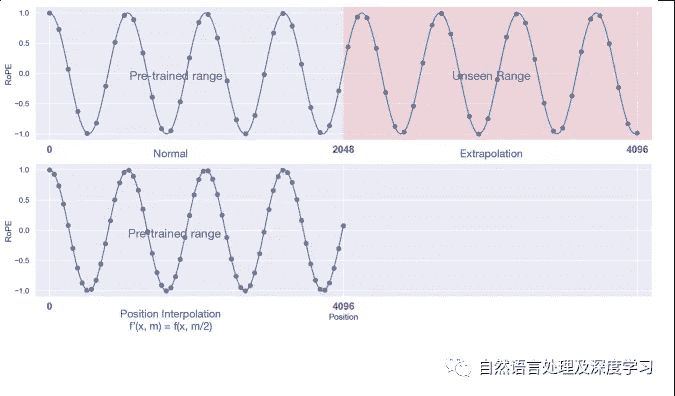

# LLaMA长度外推高性价比trick：线性插值法及相关改进源码阅读及相关记录

> 来源：[https://geekbang.feishu.cn/docx/IbLIdttBJobIr7xwUCVcThO3n11](https://geekbang.feishu.cn/docx/IbLIdttBJobIr7xwUCVcThO3n11)

> 👨🏻 作者：余俊晖

> 📃 作者介绍：一名NLP炼丹师，NLP算法竞赛TOP选手

> 🛖 公众号：大模型自然语言处理

> ⏰ 收录时间：2024-05-28 17:09:42

> 🔗 原文链接：h[ttps://mp.weixin.q](https://mp.weixin.qq.com/s?__biz=Mzg4NjI0NDg0Ng==&mid=2247484184&idx=1&sn=eb87aee81fa03247935202d758595891&chksm=cf9dd799f8ea5e8ffb8da01105c73dad4a4f341d8d2044411b271b64335f45890e778e174133#rd)q.com/s?__biz=Mz...


关注作者公众号，获取更多AI知识

## **前言 **

最近，开源了可商用的llama2，支持长度相比llama1的1024，拓展到了4096长度，然而，相比GPT-4、Claude-2等支持的长度，llama的长度外推显得尤为重要，本文记录了三种网络开源的RoPE改进方式及相关源码的阅读。

关于长度外推性：https://kexue.fm/archives/9431

关于RoPE：https://kexue.fm/archives/8265

关于RoPE：https：//kexue.fm/archives/8265

## **1、线性插值法 **

**论文 **：EXTENDING CONTEXT WINDOW OF LARGE LANGUAGE MODELS VIA POSITION INTERPOLATION

链接：https://arxiv.org/pdf/2306.15595.pdf

**思想 ****：不进行长度**外推，而是直接缩小位置索引。即：将4096的位置编码通过 线性插值法 压缩到2048内，这样只需在少量的4096长度的数据上继续预训练，便可达到不错的效果。



**源码阅读（附注释） **：

```
class LlamaLinearScaledRotaryEmbedding(torch.nn.Module):
    def __init__(self, dim, max_position_embeddings=2048, base=10000, scale=1, device=None):
        super().__init__()
        # 相比RoPE增加scale参数
        self.scale = scale
        # inv_freq为基值向量
        inv_freq = 1.0 / (base ** (torch.arange(0, dim, 2).float().to(device) / dim))
        self.register_buffer(&quot;inv_freq&quot;, inv_freq)

        # Build here to make `torch.jit.trace` work.
        self.max_seq_len_cached = max_position_embeddings
        # 构建max_seq_len_cached大小的张量t
        t = torch.arange(self.max_seq_len_cached, device=self.inv_freq.device, dtype=self.inv_freq.dtype)
        # 张量t归一化，RoPE没有这一步
        t /= self.scale
        # einsum计算频率矩阵
        # &#x27;i, j-&gt;i j’表示分别输入尺寸为[i]、[j]的向量，做笛卡尔运算得到尺寸为[i, j]的矩阵。
        freqs = torch.einsum(&quot;i,j-&gt;ij&quot;, t, self.inv_freq)
        # Different from paper, but it uses a different permutation in order to obtain the same calculation
        # 在-1维做一次拷贝、拼接
        emb = torch.cat((freqs, freqs), dim=-1)
        dtype = torch.get_default_dtype()
        # 注册为模型的缓冲区cos_cached和sin_cached
        self.register_buffer(&quot;cos_cached&quot;, emb.cos()[None, None, :, :].to(dtype), persistent=False)
        self.register_buffer(&quot;sin_cached&quot;, emb.sin()[None, None, :, :].to(dtype), persistent=False)

    def forward(self, x, seq_len=None):
        # x: [bs, num_attention_heads, seq_len, head_size]
        # This `if` block is unlikely to be run after we build sin/cos in `__init__`. Keep the logic here just in case.
        # seq_len为序列长度，seq_len大于max_seq_len_cached，则重新计算频率矩阵，并更新cos_cached和sin_cached的缓冲区
        if seq_len &gt; self.max_seq_len_cached:
            self.max_seq_len_cached = seq_len
            t = torch.arange(self.max_seq_len_cached, device=x.device, dtype=self.inv_freq.dtype)
            t /= self.scale
            freqs = torch.einsum(&quot;i,j-&gt;ij&quot;, t, self.inv_freq)
            # Different from paper, but it uses a different permutation in order to obtain the same calculation
            emb = torch.cat((freqs, freqs), dim=-1).to(x.device)
            self.register_buffer(&quot;cos_cached&quot;, emb.cos()[None, None, :, :].to(x.dtype), persistent=False)
            self.register_buffer(&quot;sin_cached&quot;, emb.sin()[None, None, :, :].to(x.dtype), persistent=False)
        # 长度裁剪：返回cos_cached和sin_cached中与seq_len（序列长度）
        return (
            self.cos_cached[:, :, :seq_len, ...].to(dtype=x.dtype),
            self.sin_cached[:, :, :seq_len, ...].to(dtype=x.dtype),
        )

```

**线性插值法的相关实验效果 **：https://lmsys.org/blog/2023-06-29-longchat/

## **2、NTK插值法 **

NTK插值改进llama中使用的RoPE插值方法，同样，对于RoPE代码改动更小，其他地方与线性插值法实现一致。

**reddit原帖 **：NTK-Aware Scaled RoPE allows LLaMA models to have extended (8k+) context size without any fine-tuning and minimal perplexity degradation

reddit原帖：NTK-Aware Scaled RoPE 允许 LLaMA 模型具有扩展的 （8k+） 上下文大小，而无需任何微调和最小的困惑度下降

**链接 **：https://www.reddit.com/r/LocalLLaMA/comments/14lz7j5/ntkaware_scaled_rope_allows_llama_models_to_have/?rdt=58346

**源码阅读：**

```
class LlamaNTKScaledRotaryEmbedding(torch.nn.Module):
    def __init__(self, dim, max_position_embeddings=2048, base=10000, alpha=1, device=None):
        super().__init__()
        # 与线性插值法相比，实现更简单，alpha仅用来改变base
        base = base * alpha ** (dim / (dim-2))
        inv_freq = 1.0 / (base ** (torch.arange(0, dim, 2).float().to(device) / dim))
        self.register_buffer(&quot;inv_freq&quot;, inv_freq)

        # Build here to make `torch.jit.trace` work.
        self.max_seq_len_cached = max_position_embeddings
        t = torch.arange(self.max_seq_len_cached, device=self.inv_freq.device, dtype=self.inv_freq.dtype)
        freqs = torch.einsum(&quot;i,j-&gt;ij&quot;, t, self.inv_freq)
        # Different from paper, but it uses a different permutation in order to obtain the same calculation
        emb = torch.cat((freqs, freqs), dim=-1)
        dtype = torch.get_default_dtype()
        self.register_buffer(&quot;cos_cached&quot;, emb.cos()[None, None, :, :].to(dtype), persistent=False)
        self.register_buffer(&quot;sin_cached&quot;, emb.sin()[None, None, :, :].to(dtype), persistent=False)

    def forward(self, x, seq_len=None):
        # x: [bs, num_attention_heads, seq_len, head_size]
        # This `if` block is unlikely to be run after we build sin/cos in `__init__`. Keep the logic here just in case.
        if seq_len &gt; self.max_seq_len_cached:
            self.max_seq_len_cached = seq_len
            t = torch.arange(self.max_seq_len_cached, device=x.device, dtype=self.inv_freq.dtype)
            freqs = torch.einsum(&quot;i,j-&gt;ij&quot;, t, self.inv_freq)
            # Different from paper, but it uses a different permutation in order to obtain the same calculation
            emb = torch.cat((freqs, freqs), dim=-1).to(x.device)
            self.register_buffer(&quot;cos_cached&quot;, emb.cos()[None, None, :, :].to(x.dtype), persistent=False)
            self.register_buffer(&quot;sin_cached&quot;, emb.sin()[None, None, :, :].to(x.dtype), persistent=False)
        return (
            self.cos_cached[:, :, :seq_len, ...].to(dtype=x.dtype),
            self.sin_cached[:, :, :seq_len, ...].to(dtype=x.dtype),
        )
```

## **3、动态插值法 **

动态插值法又是对NTK插值法和线性插值法的改进，可以看作是上述两者的一种结合思想，旨在减少困惑度损失并实现更大的缩放。

**reddit原帖 **：Dynamically Scaled RoPE further increases performance of long context LLaMA with zero fine-tuning

reddit原帖：动态扩展的 RoPE 在零微调的情况下进一步提高了长上下文 LLaMA 的性能

**链接 **：https://www.reddit.com/r/LocalLLaMA/comments/14mrgpr/dynamically_scaled_rope_further_increases/

**源码阅读 **：

```
class LlamaDynamicScaledRotaryEmbedding(torch.nn.Module):
    def __init__(self, dim, max_position_embeddings=2048, base=10000, ntk=False, device=None):
        super().__init__()
        # 是否开启NTK（Neural Tangent Kernel）
        self.ntk = ntk
        self.base = base
        self.dim = dim
        self.max_position_embeddings = max_position_embeddings
        # inv_freq为基值向量
        inv_freq = 1.0 / (base ** (torch.arange(0, dim, 2).float().to(device) / dim))
        self.register_buffer(&quot;inv_freq&quot;, inv_freq)

        # Build here to make `torch.jit.trace` work.
        self.max_seq_len_cached = max_position_embeddings
        t = torch.arange(self.max_seq_len_cached, device=self.inv_freq.device, dtype=self.inv_freq.dtype)
        freqs = torch.einsum(&quot;i,j-&gt;ij&quot;, t, self.inv_freq)
        # Different from paper, but it uses a different permutation in order to obtain the same calculation
        # emb：[max_seq_len_cached, dim]
        emb = torch.cat((freqs, freqs), dim=-1)
        dtype = torch.get_default_dtype()
        self.register_buffer(&quot;cos_cached&quot;, emb.cos()[None, None, :, :].to(dtype), persistent=False)
        self.register_buffer(&quot;sin_cached&quot;, emb.sin()[None, None, :, :].to(dtype), persistent=False)

    def forward(self, x, seq_len=None):
        # x: [bs, num_attention_heads, seq_len, head_size]
        # This `if` block is unlikely to be run after we build sin/cos in `__init__`. Keep the logic here just in case.
        if seq_len &gt; self.max_seq_len_cached:
            self.max_seq_len_cached = seq_len
            if self.ntk:
                base = self.base * ((self.ntk * seq_len / self.max_position_embeddings) - (self.ntk - 1)) ** (self.dim / (self.dim-2))
                # 计算新的inv_freq
                inv_freq = 1.0 / (base ** (torch.arange(0, self.dim, 2).float().to(x.device) / self.dim))
                self.register_buffer(&quot;inv_freq&quot;, inv_freq)
            t = torch.arange(self.max_seq_len_cached, device=x.device, dtype=self.inv_freq.dtype)
            if not self.ntk:
                # 缩放
                t *= self.max_position_embeddings / seq_len
            # 得到新的频率矩阵freqs
            freqs = torch.einsum(&quot;i,j-&gt;ij&quot;, t, self.inv_freq)
            # Different from paper, but it uses a different permutation in order to obtain the same calculation
            # freqs与自身拼接得到新的emb
            emb = torch.cat((freqs, freqs), dim=-1).to(x.device)
            # 注册为模型的缓冲区cos_cached和sin_cached
            self.register_buffer(&quot;cos_cached&quot;, emb.cos()[None, None, :, :].to(x.dtype), persistent=False)
            self.register_buffer(&quot;sin_cached&quot;, emb.sin()[None, None, :, :].to(x.dtype), persistent=False)

        # 长度裁剪
        return (
            self.cos_cached[:, :, :seq_len, ...].to(dtype=x.dtype),
            self.sin_cached[:, :, :seq_len, ...].to(dtype=x.dtype),
        )
```

网友对于困惑度的实验并取得了一定的效果：https://github.com/turboderp/exllama/pull/118

## **总结 **

本文介绍了llama通过线性插值法及相关改进方案进行长度外推的trcik，**并对相关源码阅读及网络资源进行**记录，个人粗浅认为，相比LongLLaMA，基于 线性插值法+Finetune 的方式，是一种高性价比的长度外推方案。

## **参考文献 **

【1】https://github.com/jquesnelle/scaled-rope

【2】 EXTENDING CONTEXT WINDOW OF LARGE LANGUAGE MODELS VIA POSITION INTERPOLATION

【2】通过位置插值扩展大型语言模型的上下文窗口

【3】 NTK-Aware Scaled RoPE allows LLaMA models to have extended (8k+) context size without any fine-tuning and minimal perplexity degradation

【3】NTK-Aware Scaled RoPE 允许 LLaMA 模型具有扩展的 （8k+） 上下文大小，而无需任何微调和最小的困惑度下降

【4】 Dynamically Scaled RoPE further increases performance of long context LLaMA with zero fine-tuning

【4】动态扩展的RoPE进一步提升了长上下文LLaMA的性能，无需微调

【5】 Transformer升级之路：2、博采众长的旋转式位置编码

【6】 RoFormer: Enhanced Transformer with Rotary Position Embedding

【6】RoFormer：带旋转位置嵌入的增强型变压器