# 大模型面经——大模型训练中出现loss突刺的原因和解决方法详解

> 来源：[https://geekbang.feishu.cn/docx/CGjYdW595o0HSBxIkRtci5vAnnf](https://geekbang.feishu.cn/docx/CGjYdW595o0HSBxIkRtci5vAnnf)

👨🏻 作者：喜欢卷卷的瓦力

📃 作者介绍：985海归硕士、计算机专业，前AI大厂研究院高级算法研究员，前国企研究院算法专家，现外企top10上市集团人工智能研究员，算法研究与开发经历6年，深度参与头部大模型产品研发上线，在大模型/语音识别/视觉等领域有丰富的项目经验

⏰ 收录时间：2024-05-23 11:28:42

🔗 原文链接：h[ttps://mp.weixin.q](https://mp.weixin.qq.com/s/pwE8KLG2kqSamaTuFriezw)q.com/s/pwE8KLG2...

关注作者👸号，获取更多AI知识

本篇主要介绍大模型训练时出现loss突刺（loss spike）的原因与解决方案。

需要先说明一下，其实在参数量级较少（6B~7B）的情况下出现小的loss波动是很正常的，这里的loss spike指的是大参数量级（100B以上）的大模型在预训练过程中loss暴涨的情况。

本篇是大模型训练微调实践经验最后一篇，该系列其他文小伙伴们也可以了解一下。

大模型面经——超细节大模型训练与微调实操经验总结（上）

大模型面经——大模型训练中超参数的设置与训练数据偏好

下面是本文的快捷目录。

一、大模型训练突刺是什么

二、大模型训练为什么会出现loss突刺

三、大模型训练出现loss 突刺怎么解决？

**一、大模型训练突刺是什么**

loss spike指的是大模型（100B以上）在预训练过程中出现的loss突然暴涨的情况。如下图

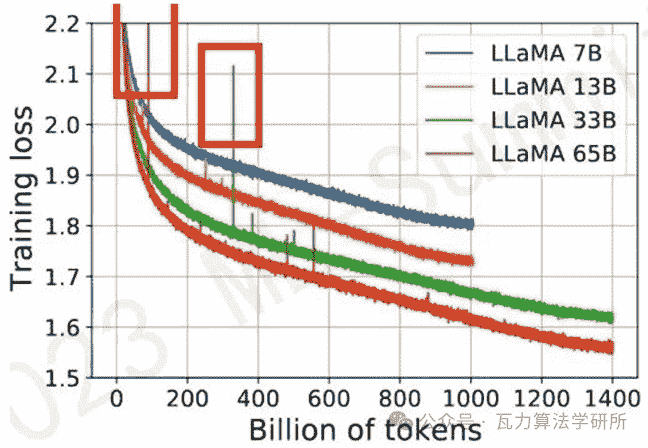

图中训练过程中红框中突然上涨的loss尖峰就是loss突刺（loss spike）；

当出现这种情况以后，模型需要很长时间才能再次回到spike之前的状态（论文中称为pre-explosion），更严重的情况就是loss 再也没办法回来了，即模型再也无法收敛。

PaLM和GLM130b之前的解决办法是找到loss spike之前最近的checkpoint，更换之后的训练样本来避免loss spike的出现。

二、大模型训练为什么会出现loss突刺

首先讲结论：

**loss spike的出现与梯度更新幅度，优化器中 ε **大小，batch大小这三个条件密切相关：

大模型训练中使用Adam优化器， 造成梯度变化与更新参数变化不满足独立性，浅层参数长时间不更新，并且大模型训练中batch太大，后期梯度更新又趋于平稳 导致的Loss spike。

下面具体来讲讲为什么。

**1. Adam优化器原理**

吴恩达老师说过，梯度下降（Gradient Descent）就好比一个人想从高山上奔跑到山谷最低点，用最快的方式（steepest）奔向最低的位置（minimum）。优化器就是让梯度下降走得更顺利最终达到我们期望的目的地的工具。

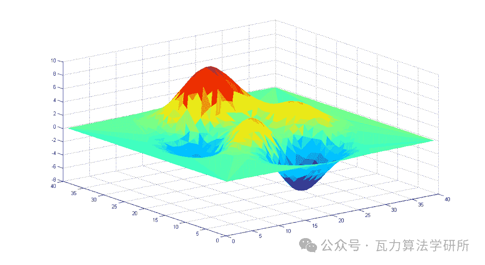

Adam优化器，结合AdaGrad和RMSProp两种优化器的优点。

其对梯度的一阶矩估计（First Moment Estimation，即梯度的均值）和二阶矩估计（Second Moment Estimation，即梯度的未中心化的方差）进行综合考虑，计算出更新步长。

我们来具体看一下更新规则。

已知t时间步的梯度为

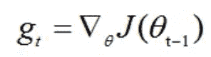

首先， **计算梯度的指数移动平均数 **，m0 初始化为0。

这里类似于Momentum算法，需要综合考虑之前时间步的梯度动量。

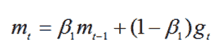

β1 系数为指数衰减率，控制权重分配（动量与当前梯度），通常取接近于1的值；默认为0.9。

下图简单展示出时间步1~20时，各个时间步的梯度随着时间的累积占比情况。

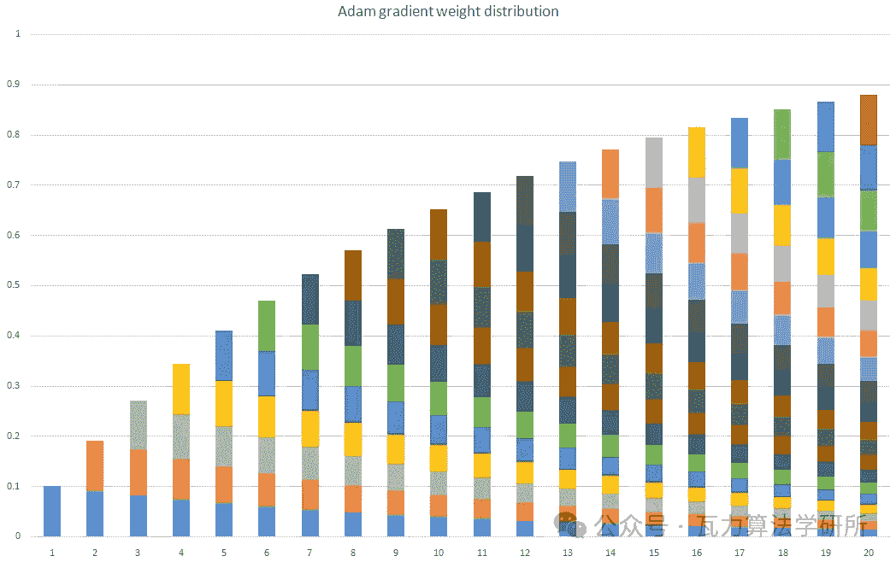

其 次， **计算梯度平方的指数移动平均数 **，v0初始化为0。

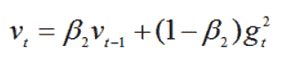

β2 系数为指数衰减率，控制之前的梯度平方的影响情况；类似于RMSProp算法，对梯度平方进行加权均值。默认为0.999。

第三， **对梯度均值mt进行偏差纠正**

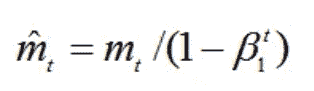

这里是由于m0初始化为0，在训练初期阶段会导致mt偏向于0；所以，此处需要对梯度均值mt进行偏差纠正，降低偏差对训练初期的影响。

第四，与m0 类似，因为v0初始化为0导致训练初始阶段vt 偏向0，对其进行纠正。

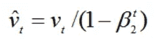

第五，更新参数， 初始的学习率α乘以梯度均值与梯度方差的平方根之比 。

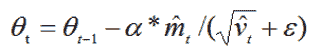

表达式中，默认学习率α=0.001，ε=10^-8，避免除数变为0。

由表达式可以看出，对更新的步长计算，能够从梯度均值及梯度平方两个角度进行自适应地调节，而不是直接由当前梯度决定。

**2. 原因解释**

可以看出来，Adam算法本质是牛顿下降法的一个迭代逼近。

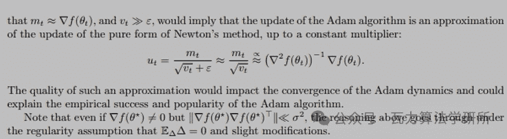

整个过程看上去是很优美的，但收敛过程并没有想象中顺利。

我们来预设一个理想的ut更新参数的变化趋势：

在t=1的初始状态时，u1集中在+1,-1附近；

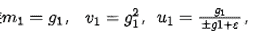

训练到最后时，模型会收敛到某个最优点，此时un集中在0附近。

也就是说，更新参数变化过程可以想象成一个两端（非稳态）向中间（稳态）收拢的过程。

实际观察到的现象也是如此，见下图

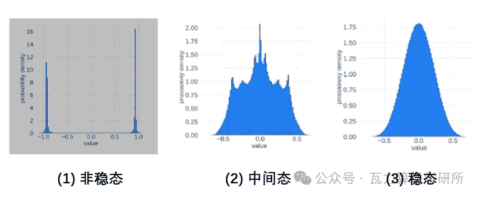

进入正态分布的稳态之后，理想的更新参数变化趋势应该是方差越来越小，所有更新参数逐渐向0靠近。

理论上应该是一个单向的过程，即稳定的单峰状态（unimodal）不会再次进入非稳定的双峰状态 (bimodal)，但事实并非如此，更新参数会再次进入非稳定的双峰状态。

理论总结： **从中心**极限定理（可以结合道尔顿板实验理解）出发，随机事件的叠加进入单峰的正态分布的必要条件之一是各个随机事件事件之间应该是相互独立的，但是梯度变化以及更新参数的变化并不能特别好的满足独立性这一条件，易导致更新参数振荡，loss spike出现以及loss 不收敛。

另外loss spike也跟模型训练时浅层参数长期不更新有关 ，下面我们对loss spike出现前后的模型变化进行分析：

1）当前模型处在稳态(健康状态)，即单峰的正态分布状态，并且梯度值 |gt|>>ε，此时loss平稳，训练过程正常；

2）模型浅层(embedding层)梯度|g|<<ε，这一般是由于训练一段时间之后，浅层的语义知识表示此时一般已经学习得较好。但此时深层网络(对应复杂任务)的梯度更新还是相对较大；

3）一段时间浅层(embedding层)梯度 |gt| << ε 之后会导致 |mt| << ε， ε。此时vt趋于0。因此导致浅层参数得不到更新(也对应于上述参数更新事件不独立的原因)

4）此时虽然浅层(embedding层)参数长时间不更新，但是深层的参数依然一直在更新。长时间这样的状态之后，batch之间的样本分布变化可能就会直接导致浅层(embedding层)再次出现较大的梯度变化，变成双峰的非稳定状态；

这里需要补充两个点：

**为什么小模型不会出现这种情况？**

小模型函数空间小，无法捕获样本的分布变化，越大规模的模型对样本之间不同维度的特征分布变化越敏感

为什么更换样本重新训练有可能会减少Loss spike的出现频率？

本质上就是选择分布变化较小的样本，减小浅层梯度变换幅度

5）这个阶段模型处于非稳态，梯度变化幅度较大，每一次的梯度变化和更新参数变化事件之间又出现了一定的独立性，因此经过一定的时间之后模型有可能再次进入稳态，loss再次回到之前的状态，也可能直接飞了再也无法收敛。

最后我们用比较简单的话总结一下，

loss spike本质原因是 梯度变化以及更新参数的变化并不能特别好的满足独立性 ，导致 随机事件的叠加难以按照理想状态进入单峰的正态分布 ；

表现出来就是 **浅**层网络参数突然进入到了之前长时间不在的状态；并与模型深层参数当前的状态形成了连锁反应造成了模型进入非稳态 ；一般情况即使出现loss spike也会自动回复到正常状态，但也有概率可能模型直接没法收敛。

三、大模型训练出现loss 突刺怎么解决？

这里给一些参考，大家也可以再自己发挥想一想。

1. **更换batch样本 **：常规方法，但是成本比较高

2. 减小learning rate ：治标不治本，对更新参数的非稳态没有做改进

3. **重新定义在vt=0时候的值**

根据公式

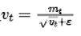

可以减小ε大小，或者直接设置ε为0，

4. 把浅层梯度直接乘一个缩放系数来减小浅层梯度更新值

参考文献

[1] A Theory on Adam Instability in Large-Scale Machine Learning

[2] GLM-130B: An Open Bilingual Pre-trained Model