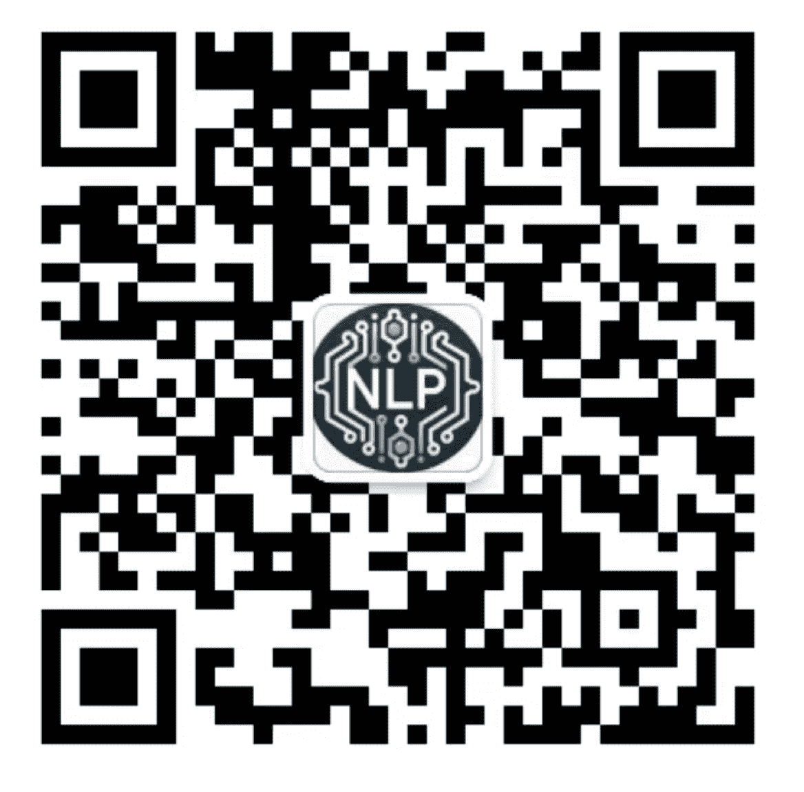
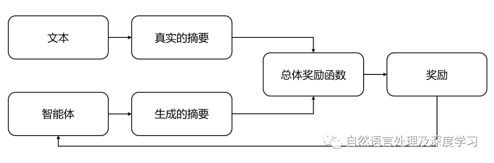
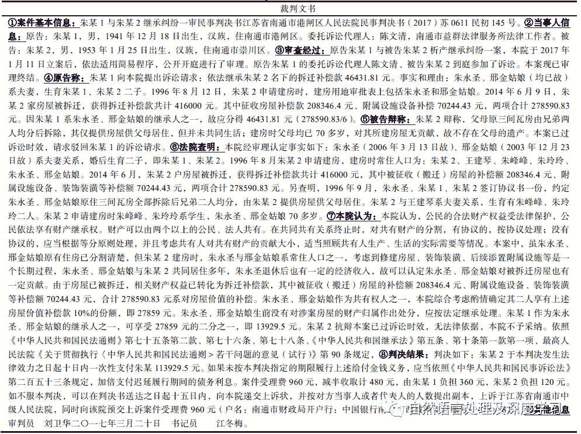
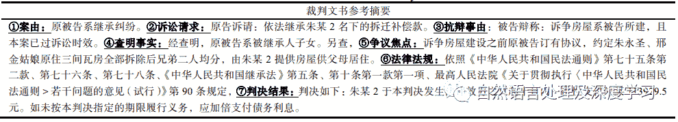
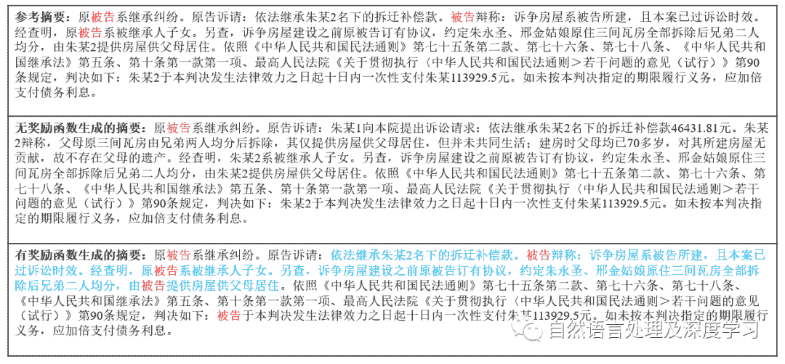

# 小试牛刀：应用深度强化学习优化文本摘要思路及在裁判文书摘要上的实践效果

> 来源：[https://geekbang.feishu.cn/docx/JkcXd3AtfoICqvxvvtmc7obpnId](https://geekbang.feishu.cn/docx/JkcXd3AtfoICqvxvvtmc7obpnId)

> 👨🏻 作者：余俊晖

> 📃 作者介绍：一名NLP炼丹师，NLP算法竞赛TOP选手

> 🛖 公众号：大模型自然语言处理

> ⏰ 收录时间：2024-05-28 17:09:42

> 🔗 原文链接：h[ttps://mp.weixin.q](https://mp.weixin.qq.com/s?__biz=Mzg4NjI0NDg0Ng==&mid=2247484137&idx=1&sn=552fd053550a55c841e148cbdd4049b0&chksm=cf9dd668f8ea5f7ed3f3b634f66f15c5e02c1a1174d1afc71bcbdca07fdc32ed8429f9572f96#rd)q.com/s?__biz=Mz...

关注作者公众号，获取更多AI知识

## ** ****一、引言 **

近期，随着大模型的出现，强化学习再一次的引起了本人的兴趣，本文将应用深度强化学习来优化文本摘要模型，使生成的摘要更加的流畅。在此之前，大家都采用了很多种方式训练摘要系统，例如：使用交叉熵来训练这些模型，以最大化ground truth的可能性摘要，在某些文本摘要数据集上显示出了比传统方法更好的性能。但是，文本摘要中存在的一个问题：学习目标和评估标准之间的不匹配，即基于ROUGE的自动摘要评价方法。尽管学习目标旨在最大限度地提高基本事实摘要的可能性，但ROUGE评分在很大程度上依赖于基本事实和候选摘要之间的词汇对应关系。

为了解决这个问题，本文使用强化学习（RL）来训练摘要模型。通过使用RL，可以设计互补的奖励方案，引导学习超越传统的似然最大化目标。本文重点关注了关键字级别的语义，以生成包含文档中关键字和短语的摘要。工作流程如图1所示，首先训练一个以深度学习模型为主干模型，使用正常的监督训练来预测来自原始文档的句子是否应该包含在摘要中。然后，使用强化学习和一个奖励模型对模型进行了微调，该模型将词汇、句子和关键字级别的语义平滑地集成到一个奖励函数中，整合了不同的视角，从而构建出一份优质的摘要。此外，为了确保一个稳定的微调过程，使用近端策略优化(PPO)，并通过使用Kullback-Leibler(KL)散度作为额外的中间奖励，使探索策略接近监督模型。

## ** ****二、解决方案 **

### ** 2.1、主干网络 **

BERT+LSTM+Sigmoid主干网络：

式中：  表示BERT编码后的第i个[CLS]。

### ** 2.2、PPO微调 **

在使用标准的交叉熵损失训练深度主干网络模型之后，考虑训练的主干网络模型作为初始策略，然后继续用强化学习完成策略。近端策略优化控制在每次迭代中更新的策略中的更改，以便策略不会移动太远，假设这有助于提取更好的摘要。对于KL 奖励，按照[1]和[2]等定义RL的奖励方案，设  表示有监督训练的主干网络模型，  表示用RL优化的主干模型，在时间步骤i计算报酬为：

其中，  是KL系数，n是与文档D中句子总数相对应的最后一个时间步。

对于中间时间步长，奖励仅为主干模型的输出分布与当前策略之间的负KL差异。它确保防止当前策略生成与主干模型的输出相差太大的输出。对于最后一个时间步骤i(i=n)，当模型获得整个摘要S时，设计了一个总体奖励项来衡量提取的候选摘要作为一个整体的质量。在第2.3节介绍了该奖励机制。

### ** 2.3、总体奖励函数设计 **

传统的使用ROUGE分数的奖励只考虑提取的摘要和参考摘要之间的n-grams重叠。它忽略了单词和句子层面的语义方面。笔者认为，奖励函数应该对语义进行编码，以引导摘要模型输出一个良好的摘要，从而达到人类的水平。为了利用语义方面，下面公式中引入了一个总体的奖励函数，该函数度量了一个优质摘要在不同层面的重要性。

其中  、  和  为权重系数，  是ROUGE评分函数，  考虑了关键词语义，  捕获序列的语义。奖励功能包括三个部分。ROUGE函数对提取的摘要和参考摘要之间的单词重叠进行编码，使用此函数直接强制主干模型提取与参考摘要类似的重要句子。  在语义上支持ROUGE函数。这是因为ROUGE函数只考虑n-grams重叠方面。在许多情况下，候选摘要和参考摘要的文字在字符层面是不同的，但它们具有相似的含义。因此，本文设计了  函数来解决这个问题。最后，  帮助主干模型提取与目标文本语义相似的序列。

### ** 2.4、关键字奖励函数 **

为了产生关键字奖励函数  ,首先使用BERT嵌入短语，并利用余弦函数计算嵌入向量之间的相似度。然后原始文档D和摘要S生成两组关键字  、  ，对于  中的每个关键字，在  中找到最相似的关键字。最后，通过所有相似性的平均值计算关键字奖励。

### ** 2.5、句子语义的奖励函数 **

由于  只鼓励摘要中出现类似的关键字，因此不能保证整个摘要的一致性。因此，本文定义了句子语义的奖励函数  以加强最终摘要和参考摘要之间的语义相似性(即语义距离d)，句子语义奖励函数定义为公式：

其中S为最终摘要，  为参考摘要，  ，避免除零。

### ** 2.6、训练与推理 **

主干网络模型经过训练以初始化策略，在RL训练过程中，采用PPO算法对策略进行优化。Adam优化器用于优化2.3节中的奖励函数。在推理时，模型选择训练策略预测概率最高的前m个句子最为候选摘要句子，以形成最终摘要。

## ** ****三、摘要效果 **

### ** 3.1、数据 **

实践数据来源于“中国法律智能评测（CAIL）”司法摘要赛道。

裁判文书样例：

参考摘要样例：

### ** 3.2、效果 **

从实验中选取了一个结果进行观察，初步验证了有效。

## **总结 **

该文是本人在研究强化学习时的突发奇想，初步验证了引入合适的奖励函数来优化抽取式摘要模型是有效的。 仅作记录。

## ** ****参考文献 **

[1] Stiennon N, Ouyang L, Wu J, et al. Learning to summarize from human feedback[J]. arXiv preprint arXiv:2009.01325, 2020.

[2] Ziegler D M, Stiennon N, Wu J, et al. Fine-tuning language models from human preferences[J]. arXiv preprint arXiv:1909.08593, 2019.