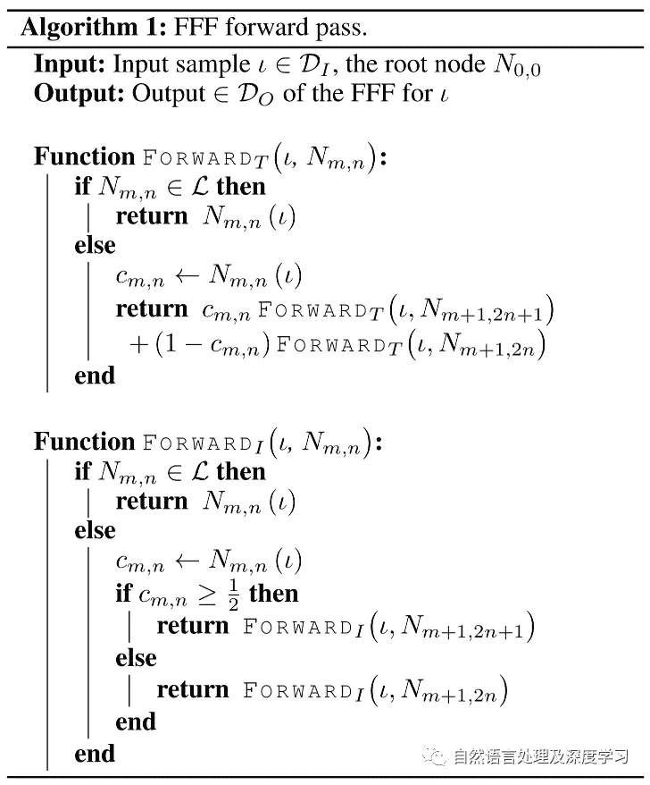
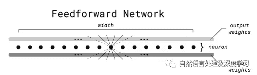
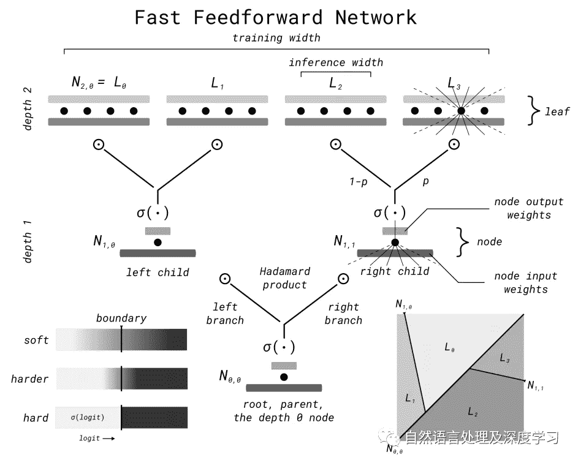
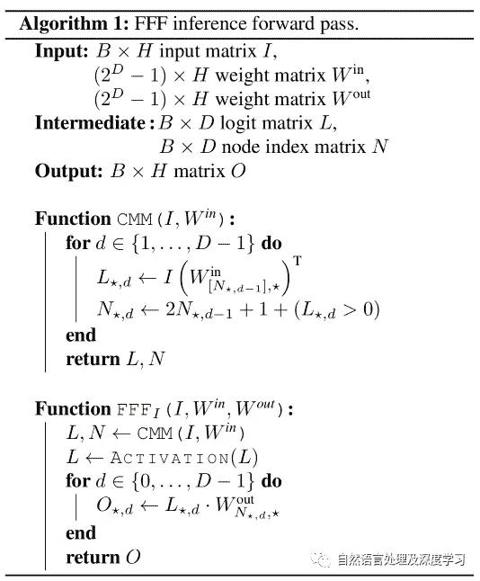
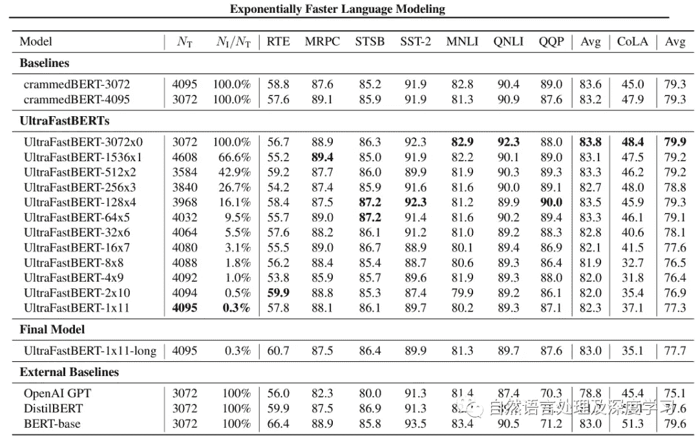

# 【LM、LLM】浅尝二叉树在前馈神经网络上的应用

> 来源：[https://geekbang.feishu.cn/docx/ANkEdyRtJodjn9xgITZcxeBvnrg](https://geekbang.feishu.cn/docx/ANkEdyRtJodjn9xgITZcxeBvnrg)

> 👨🏻 作者：余俊晖

> 📃 作者介绍：一名NLP炼丹师，NLP算法竞赛TOP选手

> 🛖 公众号：大模型自然语言处理

> ⏰ 收录时间：2024-05-28 17:09:42

> 🔗 原文链接：h[ttps://mp.weixin.q](https://mp.weixin.qq.com/s?__biz=Mzg4NjI0NDg0Ng==&mid=2247484395&idx=1&sn=488a180fb2dd0dc1cb4bb19b0940e614&chksm=cf9dd76af8ea5e7cdb0229ecabddfd589410d21b0835e016fa56f6fd305c6d98c2e2137fd774#rd)q.com/s?__biz=Mz...


关注作者公众号，获取更多AI知识

## **前言 **

随着大模型的发展，模型参数量暴涨，以Transformer的为组成成分的隐藏神经元数量增长的越来越多。因此，降低前馈层的推理成本逐渐进入视野。前段时间看到本文介绍的相关工作还是MNIST数据集上的实验，现在这个工作推进到BERT上面来了，再次引起兴趣记录一下。该工作将前馈神经基于二叉树结构进行改装，加速前向传播的速度，称为：快速前馈网络（FFF），然后应用FFF，取代BERT中的前馈网络（FF），实现12个神经元加速推理。

## **快速前馈网络算法概述 **

快速前馈网络（Fast Feedforward Network，FFF）是由两部分组成的：节点网络集合  和叶子网络集合  。

+   节点网络集合  包含了一组节点网络，每个节点网络都是一个  -前馈网络，并在输出上增加了一个 sigmoid 激活函数。这些节点网络按照平衡的可微分二叉树的形式排列，其中  和  是  的子节点。

+   叶子网络集合  包含了一组叶子网络，每个叶子网络都是一个  -前馈网络。叶子网络没有子节点，它们的输出直接作为 FFF 的输出。

前向传播过程由下面算法控制。



算法的输入包括一个输入样本  和根节点  ，输出为该样本在 FFF 中的输出。

算法定义了两个函数：  和  。其中，  函数用于计算节点的输出，而  函数用于计算节点的指示值（indicator value）。

+   在  函数中，如果当前节点是叶子节点，则直接调用该节点的前馈传播函数  来计算输出。否则，首先计算当前节点的输出  ，然后递归地调用  函数来计算当前节点的两个子节点的输出，并将它们加权相加作为当前节点的输出。

+   在  函数中，如果当前节点是叶子节点，则直接调用该节点的前馈传播函数  来计算输出。否则，首先计算当前节点的输出  ，然后根据输出值的大小决定选择哪个子节点进行递归计算。



传统前馈神经网络



快速前馈神经网络

与传统的前馈神经网络算法相比，该算法的主要区别在于引入了一个计算节点的指示值。指示值表示了当前节点的输出是否大于等于阈值（这里的阈值为0.5），根据指示值的大小来确定选择哪个子节点进行计算。这种方式可以大大减少计算量，提高前向传播的效率。同时，FFF 是一种具有平衡二叉树结构的前馈神经网络，其中节点网络和叶子网络分别用于处理中间层和输出层的计算。通过利用二叉树结构和递归计算，FFF 可以实现快速的前向传播。

## UltraFastBERT  超快速伯特

UltraFastBERT，一种BERT变体，在推理过程中使用0.3％的神经元，同时表现 与类似的BERT模型相当。UltraFastBERT选择性地使用4095个神经元中的12个（有选择的执行矩阵乘法（CMM））进行每层推理。这是通过用快速前馈网络(FFFs)取代前馈网络来实现的。



### **FFF_BMM代码**

```
import torch
from torch import nn
import math

class FFF(nn.Module):
 def __init__(self, input_width: int, depth: int, output_width: int, *args, **kwargs):
  super().__init__(*args, **kwargs)

  self.input_width = input_width
  self.depth = depth
  self.output_width = output_width

  self.n_nodes = 2 ** (depth + 1) - 1
  self.initialise_weights()

 def initialise_weights(self):
  init_factor_l1 = 1.0 / math.sqrt(self.input_width)
  init_factor_l2 = 1.0 / math.sqrt(self.depth + 1)
  self.w1s = nn.Parameter(torch.empty(self.n_nodes, self.input_width).uniform_(-init_factor_l1, +init_factor_l1), requires_grad=True)
  self.w2s = nn.Parameter(torch.empty(self.n_nodes, self.output_width).uniform_(-init_factor_l2, +init_factor_l2), requires_grad=True)

 def forward(self, x):
  # the shape of x is (batch_size, input_width)
  # retrieve the indices of the relevant elements
  batch_size = x.shape[0]
  current_nodes = torch.zeros((batch_size,), dtype=torch.long, device=x.device)
  all_nodes = torch.zeros(batch_size, self.depth+1, dtype=torch.long, device=x.device)
  all_logits = torch.empty((batch_size, self.depth+1), dtype=torch.float, device=x.device)

  for i in range(self.depth+1):
   all_nodes[:, i] = current_nodes
   plane_coeffs = self.w1s.index_select(dim=0, index=current_nodes)   # (batch_size, input_width)
   plane_coeff_score = torch.bmm(x.unsqueeze(1), plane_coeffs.unsqueeze(-1)) # (batch_size, 1, 1)
   plane_score = plane_coeff_score.squeeze(-1).squeeze(-1)      # (batch_size,)
   all_logits[:, i] = plane_score
   plane_choices = (plane_score &gt;= 0).long()         # (batch_size,)

   current_nodes = current_nodes * 2 + plane_choices + 1      # (batch_size,)

  # get the weights
  selected_w2s = self.w2s.index_select(0, index=all_nodes.flatten()) \
   .view(batch_size, self.depth+1, self.output_width) # (batch_size, depth+1, output_width)

  # forward pass
  mlp1 = torch.nn.functional.gelu(all_logits)    # (batch_size, depth+1)
  mlp2 = torch.bmm(mlp1.unsqueeze(1), selected_w2s)   # (batch_size, output_width)
  
  # done
  return mlp2
 
```

从代码可以看出，与传统的批矩阵乘法(BMM)不同的是，在forward中，基于二叉树的结构，通过迭代计算节点的索引和权重，使用激活函数(GeLU)对结果进行处理，并最终得到输出。

### **结果**

在推理过程中仅使用0.3％的神经元，同时表现与类似的BERT模型相当（下游任务没有降很多点）；实现78倍CPU加速，实现40倍PyTorch加速。



## **总结 **

该工作很有趣，将传统前馈神经网络定义成一棵二叉树，其叶子是小型神经网络，在每个非叶子节点处都有一个微小的神经网络（单个神经元也可以工作）来决定走哪条路径取决于在输入上。在训练期间，它们对所选路径进行加权平均值，从而得出树的所有叶子（在输入上评估为神经网络）的总加权平均值，但在推理过程中，它们可以只遵循投票最高的分支，从而得出建议的结果指数加速。并且，基于FFF的思想，将工作推到BERT这种语言模型上，初步证明了大模型的前馈层的神经元并不是都需要参与推理。

文章及公开的代码还介绍了条件矩阵乘法的详细细节，因此感兴趣可以深入研究一下。

## **参考文献 **

【1】paper：Exponentially Faster Language Modelling，https://arxiv.org/abs/2311.10770

【1】论文：指数级更快的语言建模，https：//arxiv.org/abs/2311.10770

【2】code：https://github.com/pbelcak/fastfeedforward

【2】代码：https：//github.com/pbelcak/fastfeedforward

【3】paper：Fast Feedforward Networks，https://arxiv.org/abs/2308.14711

【3】论文：快速前馈网络，https：//arxiv.org/abs/2308.14711

【4】code：https://github.com/pbelcak/UltraFastBERT

【4】代码：https：//github.com/pbelcak/UltraFastBERT

【5】model：https://huggingface.co/pbelcak/UltraFastBERT-1x11-long

【5】型号：https：//huggingface.co/pbelcak/UltraFastBERT-1x11-long