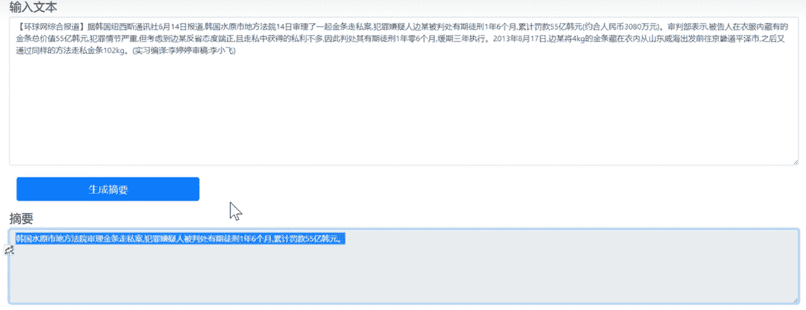

# BigBird：大鸟模型中文生成式长文本摘要实践

> 来源：[https://geekbang.feishu.cn/docx/NLffdA7vGoBhJWx9vwQchyPDn9b](https://geekbang.feishu.cn/docx/NLffdA7vGoBhJWx9vwQchyPDn9b)

> 👨🏻 作者：余俊晖

> 📃 作者介绍：一名NLP炼丹师，NLP算法竞赛TOP选手

> 🛖 👸号：大模型自然语言处理

> ⏰ 收录时间：2024-05-28 17:09:42

> 🔗 原文链接：https://mp.weixin.qq.com/s?__biz=Mzg4NjI0NDg0Ng==&mid=2247483959&idx=1&sn=4012ac2d4fc78bccd5d26d058c2e3195&chksm=cf9dd6b6f8ea5fa0302326059b0085b90fd8027897a9185d0493542153ff650e307ea3ef72e8#rd

关注作者👸号，获取更多AI知识

## 1、介绍

BigBird 是一种基于稀疏注意力的Transformer，可将基于Transformer的模型（例如 BERT）扩展到更长的序列。

论文：https://arxiv.org/abs/2007.14062

代码：https://github.com/google-research/bigbird

BigBird模型实现了三种注意力机制，分别为随机注意力、窗口注意力和全局注意力，这与LongFormer几乎相似，详细原理见论文。

## 2、中文Big Bird获取

目前没有好的BigBird开源权重，但是，通过实践，我们可以将开源的中文BART模型转换并得到 BigBird 的权重。

`bart-chinese-base`地址：https://huggingface.co/fnlp/bart-base-chinese

详细操作代码如下：

```python
#!/usr/bin/env python
# _*_coding:utf-8_*_
# Author   :    Junhui Yu
# Time     :    2023/2/27 14:47

import logging

from transformers import BigBirdPegasusConfig, BigBirdPegasusForConditionalGeneration, BertTokenizer
from transformers import BartForConditionalGeneration

logger = logging.getLogger("YUNLP")
logging.basicConfig(level=logging.INFO)

max_position_embeddings = 4096

led_config = BigBirdPegasusConfig(
    vocab_size=51271,
    max_position_embeddings=max_position_embeddings,
    encoder_layers=6,
    encoder_ffn_dim=3072,
    encoder_attention_heads=12,
    decoder_layers=6,
    decoder_ffn_dim=3072,
    decoder_attention_heads=12,
    encoder_layerdrop=0.0,
    decoder_layerdrop=0.0,
    use_cache=True,
    is_encoder_decoder=True,
    activation_function="gelu_new",
    d_model=768,
    dropout=0.1,
    attention_dropout=0.0,
    activation_dropout=0.0,
    init_std=0.02,
    decoder_start_token_id=102,
    classifier_dropout=0.0,
    scale_embedding=True,
    pad_token_id=0,
    bos_token_id=101,
    eos_token_id=102,
    attention_type="block_sparse",
    block_size=64,
    num_random_blocks=3,
    use_bias=False,
)
bigbirdpegasus_model = BigBirdPegasusForConditionalGeneration(led_config)
print(bigbirdpegasus_model)
model_path = '/remote-home/TCCI01/bert/bart-base-chinese'
bart_model = BartForConditionalGeneration.from_pretrained(model_path)
tokenizer = BertTokenizer.from_pretrained(model_path)

current_max_pos, embed_size = bart_model.model.encoder.embed_positions.weight.shape
new_encoder_pos_embed = bart_model.model.encoder.embed_positions.weight.new_empty(max_position_embeddings, embed_size)

k = 0
step = current_max_pos - 2
encoder_position_embeddings = bart_model.model.encoder.embed_positions.weight[2:]
while k < max_position_embeddings:
    new_encoder_pos_embed[k:(k + step)] = encoder_position_embeddings
    k += step
bigbirdpegasus_model.base_model.encoder.embed_positions.weight.data = new_encoder_pos_embed

current_max_pos, embed_size = bart_model.model.decoder.embed_positions.weight.shape
new_decoder_pos_embed = bart_model.model.decoder.embed_positions.weight.new_empty(max_position_embeddings, embed_size)

k = 0
step = current_max_pos - 2
decoder_position_embeddings = bart_model.model.decoder.embed_positions.weight[2:]
while k < max_position_embeddings:
    new_decoder_pos_embed[k:(k + step)] = decoder_position_embeddings
    k += step
bigbirdpegasus_model.base_model.decoder.embed_positions.weight.data = new_decoder_pos_embed

for i, (bart_encoder_layer, bigbirdpegasus_encoder_layer) in enumerate(
        zip(bart_model.model.encoder.layers, bigbirdpegasus_model.base_model.encoder.layers)):
    bigbirdpegasus_encoder_layer.self_attn.self.key.weight = bart_encoder_layer.self_attn.k_proj.weight
    bigbirdpegasus_encoder_layer.self_attn.self.query.weight = bart_encoder_layer.self_attn.q_proj.weight
    bigbirdpegasus_encoder_layer.self_attn.self.value.weight = bart_encoder_layer.self_attn.v_proj.weight
    bigbirdpegasus_encoder_layer.self_attn.output.weight = bart_encoder_layer.self_attn.out_proj.weight
    bigbirdpegasus_encoder_layer.self_attn_layer_norm = bart_encoder_layer.self_attn_layer_norm
    bigbirdpegasus_encoder_layer.fc1 = bart_encoder_layer.fc1
    bigbirdpegasus_encoder_layer.fc2 = bart_encoder_layer.fc2
    bigbirdpegasus_encoder_layer.final_layer_norm = bart_encoder_layer.final_layer_norm

for i, (bart_decoder_layer, bigbirdpegasus_decoder_layer) in enumerate(
        zip(bart_model.model.decoder.layers, bigbirdpegasus_model.base_model.decoder.layers)):
    bigbirdpegasus_decoder_layer.self_attn.k_proj.weight = bart_decoder_layer.self_attn.k_proj.weight
    bigbirdpegasus_decoder_layer.self_attn.q_proj.weight = bart_decoder_layer.self_attn.q_proj.weight
    bigbirdpegasus_decoder_layer.self_attn.v_proj.weight = bart_decoder_layer.self_attn.v_proj.weight
    bigbirdpegasus_decoder_layer.self_attn.out_proj.weight = bart_decoder_layer.self_attn.out_proj.weight
    bigbirdpegasus_decoder_layer.self_attn_layer_norm = bart_decoder_layer.self_attn_layer_norm
    bigbirdpegasus_decoder_layer.encoder_attn.k_proj.weight = bart_decoder_layer.encoder_attn.k_proj.weight
    bigbirdpegasus_decoder_layer.encoder_attn.q_proj.weight = bart_decoder_layer.encoder_attn.q_proj.weight
    bigbirdpegasus_decoder_layer.encoder_attn.v_proj.weight = bart_decoder_layer.encoder_attn.v_proj.weight
    bigbirdpegasus_decoder_layer.encoder_attn_layer_norm = bart_decoder_layer.encoder_attn_layer_norm

    bigbirdpegasus_decoder_layer.fc1 = bart_decoder_layer.fc1
    bigbirdpegasus_decoder_layer.fc2 = bart_decoder_layer.fc2
    bigbirdpegasus_decoder_layer.final_layer_norm = bart_decoder_layer.final_layer_norm

bigbirdpegasus_model.lm_head = bart_model.lm_head

logger.info("convert bart-base-chinese to bigbird success")
bigbirdpegasus_model.save_pretrained("./bigbird")
tokenizer.save_pretrained("./bigbird")
```

## 3、训练数据

长文本摘要数据集：NLPCC共50000条数据，`title`长度：最大长度128，最小长度17；`content`：最大长度 22312，最小长度52。

数据样例：

```json
[
  {
    "title": "知情人透露章子怡怀孕后,父母很高兴。章母已开始悉心照料。据悉,预产期大概是12月底",
    "content": "四海网讯,近日,有媒体报道称:章子怡真怀孕了!报道还援引知情人士消息称,“章子怡怀孕大概四五个月,预产期是年底前后,现在已经不接工作了。”这到底是怎么回事?消息是真是假?针对此消息,23日晚8时30分,华西都市报记者迅速联系上了与章子怡家里关系极好的知情人士,这位人士向华西都市报记者证实说:“子怡这次确实怀孕了。她已经36岁了,也该怀孕了。章子怡怀上汪峰的孩子后,子怡的父母亲十分高兴。子怡的母亲,已开始悉心照料女儿了。子怡的预产期大概是今年12月底。”当晚9时,华西都市报记者为了求证章子怡怀孕消息,又电话联系章子怡的亲哥哥章子男,但电话通了,一直没有人接听。有关章子怡怀孕的新闻自从2013年9月份章子怡和汪峰恋情以来,就被传N遍了!不过,时间跨入2015年,事情却发生着微妙的变化。2015年3月21日,章子怡担任制片人的电影《从天儿降》开机,在开机发布会上几张合影,让网友又燃起了好奇心:“章子怡真的怀孕了吗?”但后据证实,章子怡的“大肚照”只是影片宣传的噱头。过了四个月的7月22日,《太平轮》新一轮宣传,章子怡又被发现状态不佳,不时深呼吸,不自觉想捂住肚子,又觉得不妥。然后在8月的一天,章子怡和朋友吃饭,在酒店门口被风行工作室拍到了,疑似有孕在身!今年7月11日,汪峰本来在上海要举行演唱会,后来因为台风“灿鸿”取消了。而消息人士称,汪峰原来打算在演唱会上当着章子怡的面宣布重大消息,而且章子怡已经赴上海准备参加演唱会了,怎知遇到台风,只好延期,相信9月26日的演唱会应该还会有惊喜大白天下吧。"
  },
  ...
]
```

## 4、训练代码


```python
#!/usr/bin/env python
# _*_coding:utf-8_*_
# Author   :    Junhui Yu
# Time     :    2023/2/27 14:55

import os

os.environ['CUDA_LAUNCH_BLOCKING'] = '0'

import logging
import datasets
import numpy as np
import lawrouge
from transformers import (
    DataCollatorForSeq2Seq,
    Seq2SeqTrainingArguments,
    Seq2SeqTrainer,
    BigBirdPegasusForConditionalGeneration,
    BertTokenizer,
    BigBirdConfig
)

from datasets import load_dataset

logger = logging.getLogger("YUNLP")
logging.basicConfig(level=logging.INFO)

dataset = load_dataset('json', data_files="./data/nlpcc_data/nlpcc_data.json")
dataset = dataset.shuffle(seeds=42)

model_path = "./bigbird"

config = BigBirdConfig.from_pretrained(model_path)
tokenizer = BertTokenizer.from_pretrained(model_path)
model = BigBirdPegasusForConditionalGeneration.from_pretrained(model_path, config=config)


def flatten(example):
    return {
        "text": example["content"],
        "summary": example["title"],
    }


dataset = dataset["train"].map(flatten, remove_columns=["title", "content"])  # , remove_columns=["title", "content"]

max_input_length = 2048
max_target_length = 1024


def preprocess_function(examples):
    inputs = [doc for doc in examples["text"]]
    model_inputs = tokenizer(inputs, max_length=max_input_length, truncation=True)
    with tokenizer.as_target_tokenizer():
        labels = tokenizer(examples["summary"], max_length=max_target_length, truncation=True)
    model_inputs["labels"] = labels["input_ids"]
    return model_inputs


dataset = dataset.shuffle()

train_data_txt, validation_data_txt = dataset.train_test_split(test_size=0.1, shuffle=True, seed=42).values()
tokenized_datasets = datasets.DatasetDict({
    "train": train_data_txt,
    "validation": validation_data_txt
}).map(preprocess_function, batched=True)

args = Seq2SeqTrainingArguments(
    output_dir="./bigbird",
    num_train_epochs=5,
    do_train=True,
    do_eval=True,
    per_device_train_batch_size=16,
    per_device_eval_batch_size=16,
    learning_rate=2e-04,
    warmup_steps=1000,
    weight_decay=0.0001,
    label_smoothing_factor=0.15,
    predict_with_generate=True,
    logging_dir="logs",
    logging_strategy="epoch",
    logging_steps=1,
    save_total_limit=2,
    evaluation_strategy="epoch",
    eval_steps=500,
    gradient_accumulation_steps=1,
    generation_max_length=64,
    generation_num_beams=1,
)

data_collator = DataCollatorForSeq2Seq(tokenizer, model=model)


def compute_metrics(eval_pred):
    predictions, labels = eval_pred
    decoded_preds = tokenizer.batch_decode(predictions, skip_special_tokens=True)
    labels = np.where(labels != -100, labels, tokenizer.pad_token_id)
    decoded_labels = tokenizer.batch_decode(labels, skip_special_tokens=True)

    decoded_preds = ["".join(pred.replace(" ", "")) for pred in decoded_preds]
    decoded_labels = ["".join(label.replace(" ", "")) for label in decoded_labels]
    labels_lens = [np.count_nonzero(pred != tokenizer.pad_token_id) for pred in labels]

    for i, (pred, label) in enumerate(zip(decoded_preds, decoded_labels)):
        if pred == "":
            decoded_preds[i] = "decoding error,skipping..."
    rouge = lawrouge.Rouge()
    result = rouge.get_scores(decoded_preds, decoded_labels, avg=True)
    result = {'rouge-1': result['rouge-1']['f'], 'rouge-2': result['rouge-2']['f'], 'rouge-l': result['rouge-l']['f']}
    result = {key: value * 100 for key, value in result.items()}
    result["gen_len"] = np.mean(labels_lens)
    return result


trainer = Seq2SeqTrainer(
    model,
    args,
    train_dataset=tokenized_datasets["train"],
    eval_dataset=tokenized_datasets["validation"],
    data_collator=data_collator,
    tokenizer=tokenizer,
    compute_metrics=compute_metrics,
)

train_result = trainer.train()
print(train_result)
trainer.save_model()
metrics = train_result.metrics
trainer.log_metrics("train", metrics)
trainer.save_metrics("train", metrics)
trainer.save_state()
```

## 总结

本文介绍了一种用于中文长文本摘要的生成式模型-`BigBird`大鸟模型，通过实践将开源的中文生成预训练`bart-chinese-base`转换成可以用于`BigBird`中文权重并用于训练中文长文本生成式摘要,也通过实践验证了其可行性。

## 效果预览



## 参考文献

[1] https://arxiv.org/abs/2007.14062

[2] https://huggingface.co/fnlp/bart-base-chinese

[3] https://github.com/google-research/bigbird
