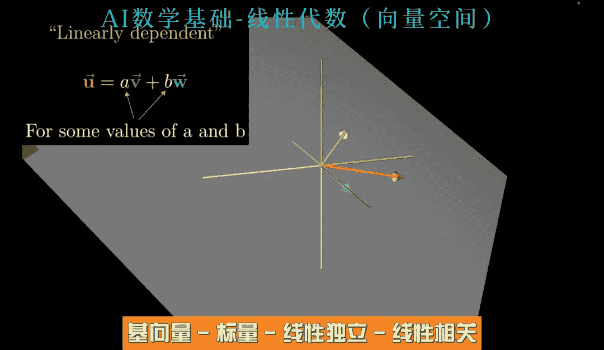
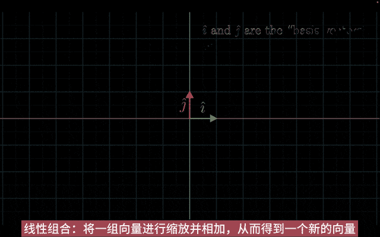
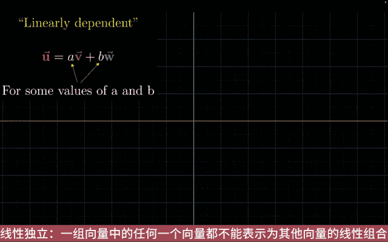
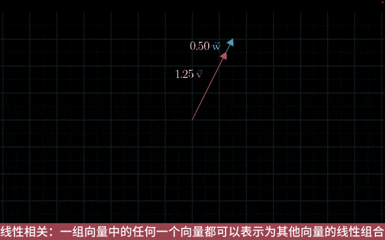

# AI数学基础动画讲解 - 线性代数（向量空间）

> 来源：[https://geekbang.feishu.cn/docx/WfVld0KgroeVq5x6GKvca6aPndc](https://geekbang.feishu.cn/docx/WfVld0KgroeVq5x6GKvca6aPndc)

> 👨🏻 作者：AllenTang

> 📃 作者介绍：分享人工智能，让所有人玩转AI

> 🛖 👸号：架构师带你玩转AI

> ⏰ 收录时间：2024-05-23 11:28:42

> 🔗 原文链接： h[ttps://mp.weixin.q](https://mp.weixin.qq.com/s/gVCNC0UkraZY77FbI_PK6w)q.com/s/gVCNC0Uk...

关注作者👸号，获取更多AI知识

**动画地址：查看原文，可看动画**

**向量空间 ： **向量空间，又称线性空间，是线性代数的中心内容和基本概念之一。

**向**量空间定义为带有加法和标量乘法的集合V。具体来说，向量空间中的元素称为向量，这些向量之间定义了加法和标量乘法两种运算，并满足一系列公理。

**线性代数（向量空间）**

**向量空间的公理详细列出如下：**

1.  加法封闭性 ： 向量空间中的任意两个向量相加的结果仍然属于该向量空间。

1.  符号表示：对于任意u, v ∈ V，u + v ∈ V。

1.  加法结合律 ： 向量空间中的任意三个向量u、v和w的和满足结合律。

1.  数学表达式：(u + v) + w = u + (v + w)。

1.  加法交换律 ： 向量空间中的任意两个向量u和v相加的结果与v和u相加的结果相等。

1.  数学表达式：u + v = v + u。

1.  存在零向量 ： 向量空间中存在一个特殊的向量0，它与任意向量u相加的结果等于u本 身。

1.  数学表达式：对于任意向量u，u + 0 = u。

1.  存在逆元（负向量） ： 向量空间中的任意向量u都存在一个对应的逆元-u（负向量），使得u与-u相加的结果为零向量。

1.  数学表达式：对于任意向量u，存在-u，使得u + (-u) = 0。

1.  标量乘法的结合性 ： 在向量空间中，任意标量k和l与向量u的乘积满足结合律。

1.  数学表达式：(kl)u = k(lu)。

1.  向量与标量的乘法分配律 ： 在向量空间中，任意标量k与向量u、v的乘积再进行加法运算，等于先对向量进行加法运算再进行标量乘法运算的结果。

1.  数学表达式：k(u + v) = ku + kv。

1.  标量与向量的乘法分配律 ： 在向量空间中，任意两个标量k和l与向量u的乘积再进行加法运算，等于先对标量进行加法运算再进行向量乘法运算的结果。

1.  数学表达式：(k + l)u = ku + lu。

**线性代数（向量空间）**

AI数学基础动画讲解 - 线性代数（向量）

**基**向量和标量： 基向量是构成向量空间的一组线性无关的向量，而标量是单一数值，用于表示大小、长度、角度等度量，不与方向关联。

**基向量和标量**

+   **基向量**： 在向量空间中，基（basis）是一组线性无关的向量，它们可以生成（或称为“张成”）整个向量空间。这些构成基的向量就被称为基向量（basis vectors）。 例如， 一个人的年龄、身高或体重，有三个特征维度， 可以将每个特征维度视为一个“基向量”。

+   **标**量： 标量（scalar）是只有大小、没有方向的量 。 例如，一个人的年龄、身高或体重，都是可以用一个具体的数值来表示的，即标量。

+   **线性组合： 线性组合是线性代数中的一个基本概念，它指的是将一组向量分别乘以**相应的标量系数，并将结果相加 （ 即缩放向量并相加 ） ，从而得到一个新的向量。

**线性组合**

**线性独立和 线性相关： ****线性独立和 线性相关是线性代数中的两个**核心概念，它们描述了向量之间的特定关系。

**线性独立**

+   **线性独立： 如果一组向量中的任何一个向量都不能表示为其他向量的线性组合**，则这组向量被称为线性独立的。 基向量都是线性独立，N个基向量张成N维向量空间。

+   **线**性相关：  在线性代数中，如果一组向量中的任何一个向量都可以表示为其他向量的线性组合（即乘以标量并相加），则这组向量被称为线性相关的。

**线性相关 **

****注释****

**线性代数动画素材来源于 3Blue1**Brown，想了解更多查看参考资料网址。

**3B**lue1Brown 是一个由 Grant Sanderson 创建的YouTube 频道。这个频道从独特的视觉角度解说高等数学，内容包括线性代数、微积分、人工神经网络、黎曼猜想、傅里叶变换以及四元数等。

**Grant Sanderson **毕业于斯坦福大学，并获得了数学学士学位。

**参考资料**

+   https://www.3blue1brown.com/