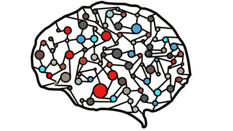
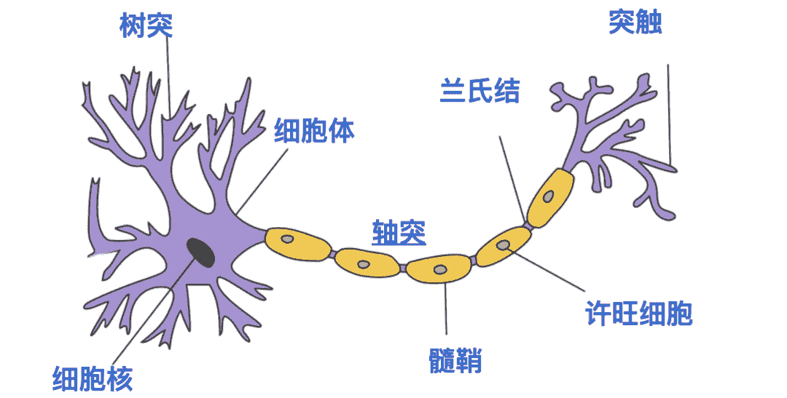
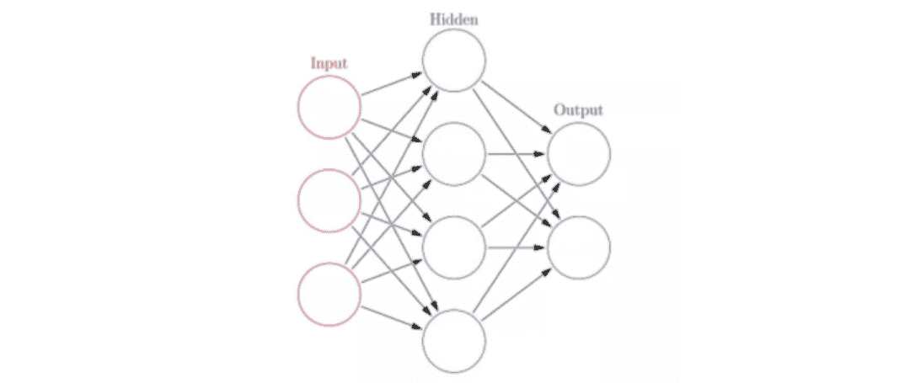

# 神经网络算法 - 一文搞懂ANN（人工神经网络）

> 来源：[https://geekbang.feishu.cn/docx/EaEwdIPAwokqkPxt7qXca4zen5d](https://geekbang.feishu.cn/docx/EaEwdIPAwokqkPxt7qXca4zen5d)

> 👨🏻 作者：AllenTang

> 📃 作者介绍：分享人工智能，让所有人玩转AI

> 🛖 公众号：架构师带你玩转AI

> ⏰ 收录时间：2024-05-23 11:28:42

> 🔗 原文链接：h[ttps://mp.weixin.q](https://mp.weixin.qq.com/s/uaGInYenoZc8wm-F527L0Q)q.com/s/uaGInYen...

关注作者公众号，获取更多AI知识

本文将从 生物神经网络、人工神经网络 、 神经网络训练 、分类与应用 四个方面 ，带 您一文搞懂人工 神经网络A NN 。

**一、 生物神经网络**

**基本定义：**

###

###

+   **百度百科： 生物神经网络 **（Biological Neural Networks）一般指 生物的大脑神经元，细胞，触点等组成的网络，用于产生生物的意识，帮助生物进行思考和行动。

+   **维基百**科：生物神经网络 （B iological Neural Networks ）是指生物体内一群由突触相互链接的特定神经元群体，其负责传递、执行一项特定功能，并与其他神经回路共同构筑大脑更高阶的神经网络，并产生个体的意识，协助生物进行思考和行动。

**大脑神经元：**

+   **输入整合 **：神经元整合来自其他神经元和外部刺激的信号。

+   **阈值触发 **：达到阈值时，神经元触发动作电位。

+   **权重调整 **：连接强度可学习调整。

+   **信息存储与传输 **：神经元负责存储和传输信息，支持生物的感知、思考和行为。

+   **神经网络组成 **：多个神经元以特定方式连接形成神经网络。

大脑神经 元结构

**二、 人工神经网络 **

**基本定义： **

+   **百度百科： 人工神经网络 **（Artificial Neural Network，即ANN ），是20世纪80 年代以来人工智能领域兴起的研究热点。它从信息处理角度对人脑神经元网络进行抽象， 建立某种简单模型，按不同的连接方式组成不同的网络。在工程与学术界也常直接简称为神经网络或类神经网络。

+   **维基百科**： 人工神经网络 （ artificial neural network ，ANN）简称 神经网络 （neural network，NN）或 类神经网络 ，在 机器学习 和 认知科学 领域，是一种 模仿生物神经网络 （动物的 中枢神经系统 ，特别是 大脑 ）的结构和功能的 数学模型 或 计算模型 ，用于对 函数 进行估计或近似。

**基本原理 ：**

人工神经网络结构

1.  **圆形节点与人工神经元 **：

+   在人工神经网络中，每个圆形节点代表一个人工神经元。

+   这些神经元通过特定的连接方式相互交互，模拟生物神经网络的工作原理。

1.  **连接与信号传递 **：

+   箭头表示从一个神经元的输出到另一个神经元的输入的连接。

+   通过这些连接，信号可以在网络中传递，从一个人工神经元传递到另一个。

1.  **权重与激励函数 **：

+   每个节点都代表一种特定的输出函数，称为激励函数。

+   每两个节点间的连接都有一个与之相关的权重值，表示前一个神经元对后一个神经元的影响程度。

1.  **网络输出 **：

+   网络的输出会根据网络的连接方式、权重值以及激励函数的不同而变化。

+   通过调整这些参数，人工神经网络能够学习和适应不同的输入模式，产生预期的输出结果。

**三、 神经网络训练**

**训练步骤：**

1.  **前向传播 **：

+   输入数据从输入层开始，逐层通过隐藏层传递。

+   每一层都使用激活函数进行非线性转换。

+   最终，输出层生成预测结果。

1.  **计算误差 **：

+   将预测结果与真实标签比较，计算误差（如均方误差或交叉熵损失）。

1.  **反向传播 **：

+   使用反向传播算法，将误差从输出层逐层反传至输入层。

+   在此过程中，计算每一层的梯度（误差对权重和偏置的偏导数）。

1.  **梯度下降 **：

+   根据计算得到的梯度，使用梯度下降或其他优化算法更新权重和偏置。

+   目标是最小化误差函数，通过逐步调整权重和偏置来改善网络性能。

1.  **迭代更新 **：

+   重复上述步骤，直到满足停止准则（如达到最大迭代次数或误差小于预设阈值）。

**核心算法： **

1.  **激活函数 **：

+   作用：决定神经元是否“激活”或“触发”。

+   常见类型：ReLU、Sigmoid、Tanh等。

+   重要性：增加网络的非线性，使其能学习复杂模式。

1.  **反向传播 **：

+   作用：神经网络中权重更新的核心算法。

+   过程：计算输出层与真实值之间的误差，并反向逐层传递误差，更新权重。

+   重要性：使网络能基于误差进行自我调整，逐渐逼近目标函数。

1.  **梯度下降 **：

+   作用：优化算法，用于在训练过程中最小化损失函数。

+   过程：计算损失函数的梯度，并沿梯度的反方向逐步更新网络参数。

+   重要性：使网络参数逐渐趋近于损失最小的点。

**四、 分类与应用 **

**算法分类 ： **

1.  **前馈神经网络 (Feedforward **Neural Networks，FNN)

+   特点：数据单向流动，从输入层到输出层。多层网络结构，每层神经元只接收前一层的输出作为输入。

+   应用：感知器、多层感知器、逻辑回归等。

1.  **循环神经网络 (Recurrent **Neural Networks，RNN)

+   特点：具有循环结构，能够处理序列数据和时序依赖关系。神经元的输出可以作为自身的输入，记忆先前状态的信息。

+   应用：文本生成、语音识别、机器翻译等。

1.  **卷积神经网络 (Convolutional **Neural Networks，CNN)

+   特点：适用于处理图像、视频等二维或三维数据。通过卷积层捕捉局部特征，池化层进行下采样，减少参数数量。

+   应用：图像识别、目标检测、图像生成等。

1.  **长短期记忆网络（Long Short-Term M**emory Networks，LSTM）

+   特点：解决长期依赖问题，通过引入记忆单元和门控机制来控制信息的流动。

+   应用：语音识别、文本生成、情感分析等。

1.  **生成对抗网络 (Generative Advers**arial Networks，GANs)

+   特点：结合了生成模型和判别模型的思想，用于生成新的、与真实数据相似的数据。

+   应用：图像生成、视频生成和语音合成等领域有所应用。

**实际应用 ： **

1.  **图像处理与识别 **

+   图像分类：使用卷积神经网络（如VGG、ResNet）对ImageNet等大型图像数据集进行分类，达到人类级别的准确度。

+   图像生成：GANs（生成对抗网络）用于生成逼真的人脸、风景等图像。

1.  **语音处理与识别**

+   语音识别：RNN和LSTM在语音到文本转换中的应用，如Google的语音识别技术。

+   语音合成：WaveNet等模型用于生成自然的人类语音。

1.   **自然语言处理**

+   文本分类：使用RNN或Transformer结构对文本进行情感分析、主题分类等。

+   机器翻译： Google NMT（神经机器翻译）使用Transformer结构进行高质量的文本翻译。