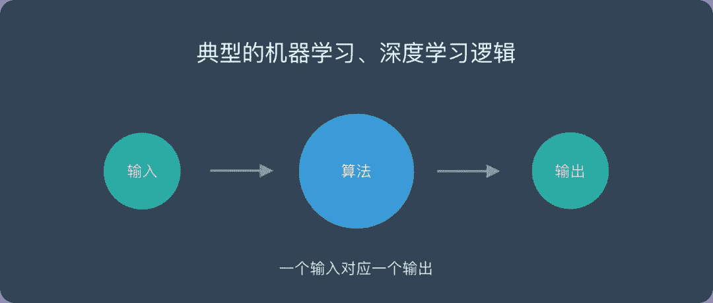
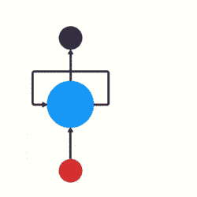
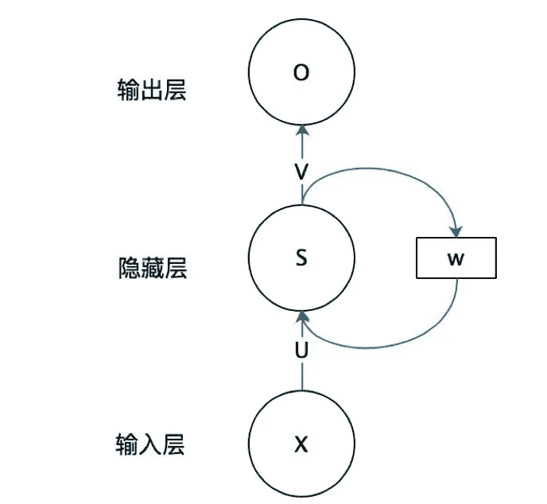
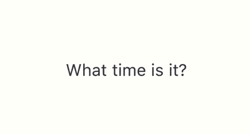
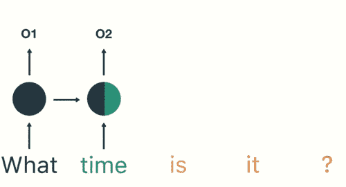
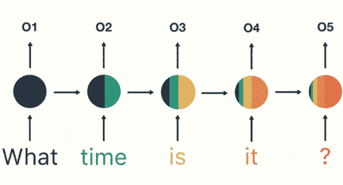
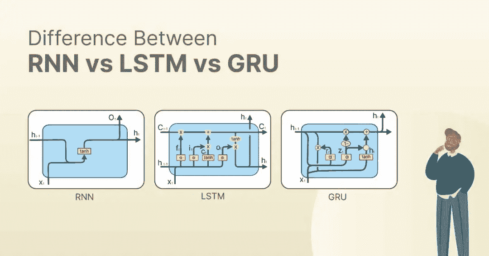
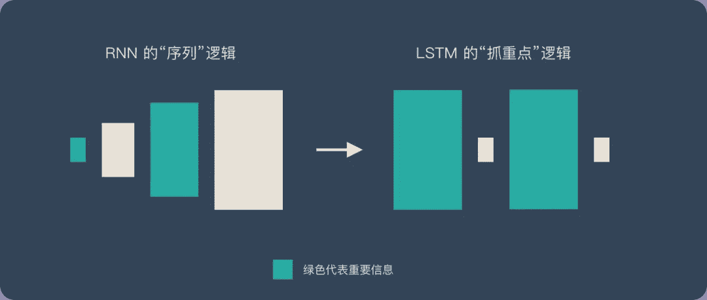
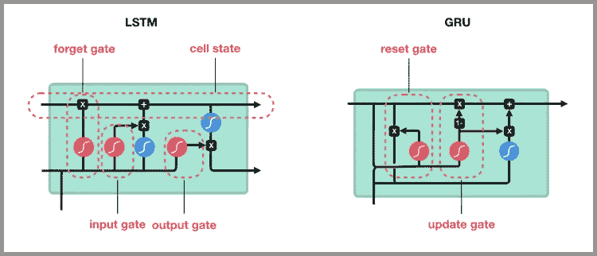

# 神经网络算法 - 一文搞懂RNN（循环神经网络）

> 来源：[https://geekbang.feishu.cn/docx/KSgJdXIrRoaoSxxRMVdccKWhnue](https://geekbang.feishu.cn/docx/KSgJdXIrRoaoSxxRMVdccKWhnue)

> 👨🏻 作者：AllenTang

> 📃 作者介绍：分享人工智能，让所有人玩转AI

> 🛖 公众号：架构师带你玩转AI

> ⏰ 收录时间：2024-05-23 11:28:42

> 🔗 原文链接：h[ttps://mp.weixin.q](https://mp.weixin.qq.com/s?__biz=MzkzMTEzMzI5Ng==&mid=2247485311&idx=1&sn=e0c1dc8d9035aabd1a3472436263f3fd&chksm=c26ee560f5196c76e4f509acff6c398a40077c0104d6fec4f2c93d50849f94ce68dc8a243062&scene=21#wechat_redirect)q.com/s?__biz=Mz...

关注作者公众号，获取更多AI知识

本文将从 **RNN解决了什么问题、 R NN的基本原理、RN**N 的优化算法 、 RNN的 应用场景 四个方面 ，带 您一文搞懂循环 神经网络R NN 。

**一、R NN解决了什么问题**

**传统神经网络算法存在局限：**

+

+   **输**入输出一一对应： 传统神经网络算法 通常是 一个输入对应一个输出 ，这种严格的对应关系限制了其在处理复杂任务时的灵活性。

+   **输入之间的独立性： ****在传统神经网络算法中，不同的**输入之间被视为相互独立的， 没有考虑到它们之间的关联性 。

**RNN解决问题：**

+   **序列数据处理 **： RNN能够处理 **多个输入对应多个输出 ****的情况，尤其适用于序列数据**，如时间序列、语音或文本，其中每个输出与 当前的及之前的输入都有关 。

+   **循环连接 ****：RNN中的循环连接使**得网络能够 捕捉输入之间的关联性 ，从而利用先前的输入信息来影响后续的输出。

**二、 R NN的基本原理**

**构成部分： **

+   **输入层 ****：接收输入数据，并将其传递**给隐藏层。输入不仅仅是静态的， 还包含着序列中的历史信息 。

+   **隐藏层 **： **核心部分，捕捉时序依赖性 ****。隐藏层的输出不仅取决于当前**的输入， 还取决于前一时刻的隐藏状态 。

+   **输出层 **：根据隐藏层的输出生成最终的预测结果。

输入层- 隐藏层 - 输出层

下面通过一个具体的案例来看看RNN的基本原理。例如，用户说了一句“what time is it? ”， 需要判断用户的说话意图，是问时间，还是问天气？

**基本原理 ：**

+   **输入层 **： 先对句子 “what time is it ?  ” 进行分词， 然后按照顺序输入。

对句子进行分词

+   **隐藏层 **： 在此过程中，我们注意到前面的所有输入都对后续的输出产生了影响。圆形隐藏层不仅考虑了当前的输入，还综合了之前所有的输入信息， 能够利用历史信息来影响未来的输出 。

前面所有的输入都对后续的输出产生了影响

+   **输出层 **： 生成 最终的预测结果： Asking for the time。

输出结果：Asking for the time

**三、 RNN 的优化算法 **

**从RNN到LSTM： **** **

+   **处理长序列数据 **： RNN在处理长序列数据时，很难记住很久之前的输入信息 。就像你试图回忆几年前的某件事情，可能会觉得很难。LSTM通过引入“细胞状态”这个概念，就像一个记事本，可以一直记住前面的信息，解决了这个问题。

+   **梯度消失和爆炸 **：想象一下，你正在爬楼梯，后面的楼梯突然消失了， 这就是**RNN在处理时间序列数据时面**临的问题 。LSTM通过引入“门控机制”，即 一种选择性记忆的方式 ， 保留重要信息并忽略不重要信息 。 说人话就是，敲黑板、划重点 。

RNN与LSTM对比

**从 LSTM 到 GRU ：**

1.  **结构和参数简化 **：GRU相比于LSTM，结构和参数都简化了。这意味着GRU需要的存储空间更小，计算速度更快。

1.  **计算效率提升 **： GRU相比于LSTM，计算 更高效。这在需要快速响应或计算资源有限的场景中非常有用。

LSTM与GRU对比

**四、 RNN的 应用场景**

**处理数据 ： **

+   **文本数据： **处理 文本中单词或字符的时序关系， 并进行文本的分类或翻译。

+   **语音数据： **处理语音信号中的时序信息，并将其转换为相应的文本。

+   **时间序列数据： **处理具有时间序列特征的数据，如股票价格、气候变化等。

+   **视频数据 **：处理视频帧序列，提取视频中的关键特征。

**实际应用 ： **

+   **文本生成： ****填充给定文本中的空格或预测**下一个单词。   典型场景： 对话生成。

+   **机器翻译 ****： 学习语言之间的转换规**则，并自动翻译。 典型场景：在线翻译 。

+   **语音识别 **： 将语音转换成文本 。 **典型场景：语音助手。**

+   **视频标记 ： ****将视频分解为一系列关键帧，**并为每个帧生成 内容匹配的文本 描述。 典型场景：生成视频摘要。