# 神经网络算法 - 一文搞懂LSTM（长短期记忆网络）

> 来源：[https://geekbang.feishu.cn/docx/NHwedu6a0oFvb0xQJX8czbZMn3f](https://geekbang.feishu.cn/docx/NHwedu6a0oFvb0xQJX8czbZMn3f)

> 👨🏻 作者：AllenTang

> 📃 作者介绍：分享人工智能，让所有人玩转AI

> 🛖 👸号：架构师带你玩转AI

> ⏰ 收录时间：2024-05-23 11:28:42

> 🔗 原文链接：h[ttps://mp.weixin.q](https://mp.weixin.qq.com/s?__biz=MzkzMTEzMzI5Ng==&mid=2247485606&idx=1&sn=8c70d3263d3749d5c06a676734c4164c&chksm=c26eeab9f51963af44abf80bd6e60192a597e4e1112e9c274d116e03300fa869b35bfb3c45dd&scene=21#wechat_redirect)q.com/s?__biz=Mz...

关注作者👸号，获取更多AI知识

本文将从 LSTM的本质、LSTM **的原理 、LSTM的应用 三个方面**，带 您一文搞懂 长短期记忆网络Long Short Term Memory | LSTM。

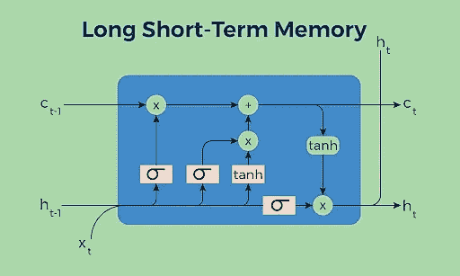

**一、 LSTM的本质 **

**R**NN 面临问题 ： RNN（递归神经网络）在处理长序列时面临的主要问题：短时记忆和梯度消失/梯度爆炸。

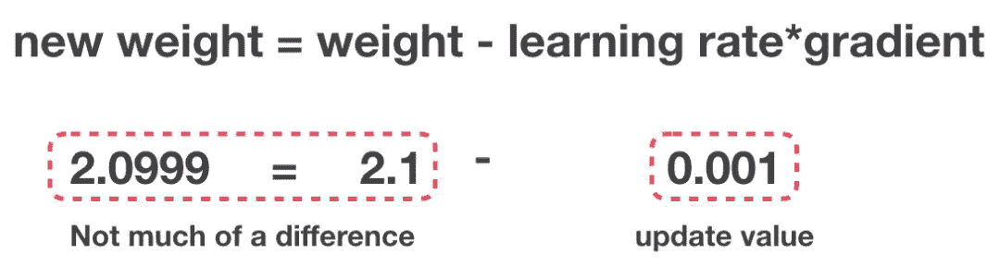

梯度更新规则

+   短时记忆

+   **问题描述 **：RNN在处理长序列时，由于信息的传递是通过隐藏状态进行的，随着时间的推移，较早时间步的信息可能会在传递到后面的时间步时逐渐消失或被覆盖。

+   **影响 **：这导致RNN难以捕捉和利用序列中的长期依赖关系，从而限制了其在处理复杂任务时的性能。

+   梯度消失/梯度爆炸

+   **问题描述 **：在RNN的反向传播过程中，梯度会随着时间步的推移而逐渐消失（变得非常小）或爆炸（变得非常大）。

+   **影响 **： 梯度消失使得RNN在训练时难以学习到长期依赖关系，因为较早时间步的梯度信息在反向传播到初始层时几乎为零。 梯度爆炸则可能导致训练过程不稳定，权重更新过大，甚至导致数值溢出。

**LSTM解决问题 ****： ****大脑**和LSTM在处理信息时都选择性地保留重要信息，忽略不相关细节，并据此进行后续处理。这种机制使它们能够高效地处理和输出关键信息，解决了 RNN（递归神经网络）在处理长序列时面临的问题。

**大脑记忆机制**

+   **大脑记忆机制： **当浏览评论时，大脑倾向于记住 **重要的关键词 **。无关紧要的词汇和内容容易被忽略。 回忆时，大脑提取并表达主要观点，忽略细节 。

+   **LSTM门控机制 **：LSTM 通过输入门、遗忘门和输出门选择性地保留或忘记信息， 使用保留的相关信息来进行预测，类似于大脑提取并表达主要观点。

**二、LSTM 的原理 **

**RNN 工作原理 ： 第一个词被转换成了机器可读**的向量，然后 RNN 逐个处理向量序列。

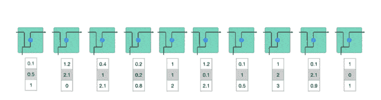

**逐一处理矢量序列 **

+   隐藏状态的传递

+   **过程描述 **：在处理序列数据时，RNN将前一时间步的隐藏状态传递给下一个时间步。

+   **作用 **：隐藏状态充当了神经网络的“记忆”，它包含了网络之前所见过的数据的相关信息。

+   **重要性 **：这种传递机制使得RNN能够捕捉序列中的时序依赖关系。

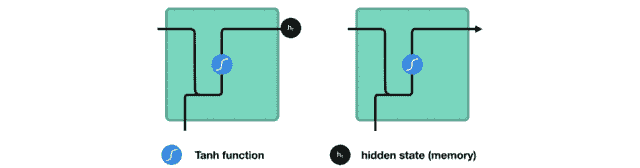

**将隐藏状态传递给下一个时间步**

+   隐藏状态的计算

+   **细胞结构 **：RNN的一个细胞接收当前时间步的输入和前一时间步的隐藏状态。

+   **组合方式 **：当前输入和先前隐藏状态被组合成一个向量，这个向量融合了当前和先前的信息。

+   **激活函数 **：组合后的向量经过一个tanh激活函数的处理，输出新的隐藏状态。这个新的隐藏状态既包含了当前输入的信息，也包含了之前所有输入的历史信息。

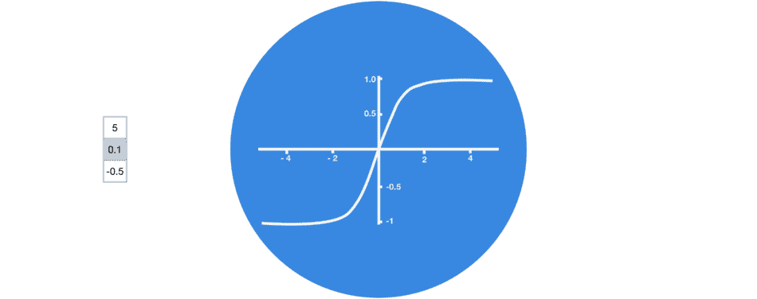

tanh 激活函数 （区间-1～1）

+   **输出 **：新的隐藏状态被输出，并被传递给下一个时间步，继续参与序列的处理过程。

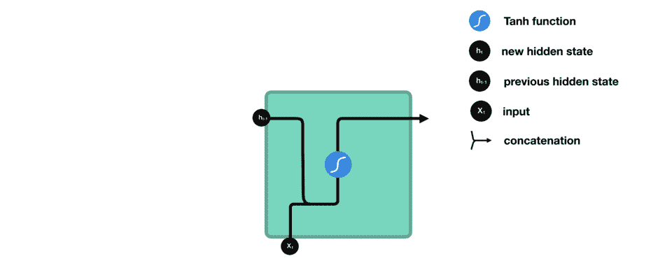

**RNN 的细胞结构和运算**

**LSTM工作原理 ：**

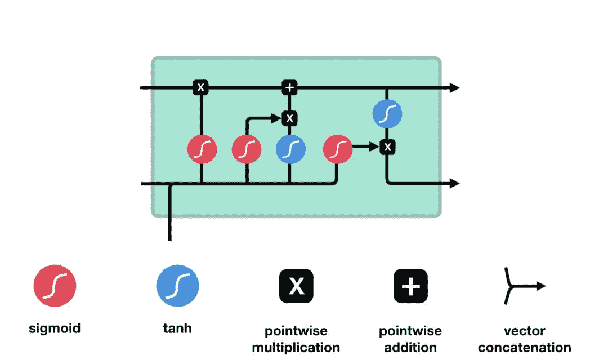

**LSTM的细胞结构和运算**

+   **输入门**

+   作用：决定哪些新信息应该被添加到记忆单元中。

+   组成：输入门由一个sigmoid激活函数和一个tanh激活函数组成。sigmoid函数决定哪些信息是重要的，而tanh函数则生成新的候选信息。

+   运算：输入门的输出与候选信息相乘，得到的结果将在记忆单元更新时被考虑。

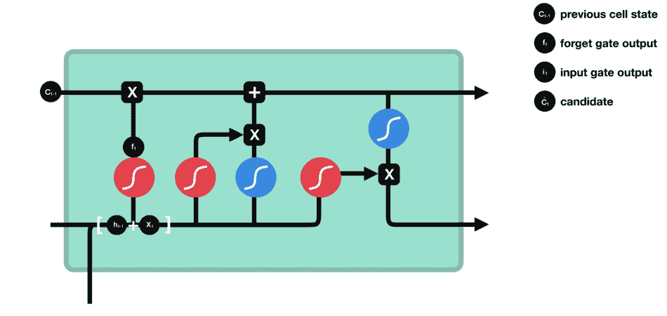

+   输入门（sigmoid激活函数 + t anh激活函数 ）

+   **遗忘门**

+   作用：决定哪些旧信息应该从记忆单元中遗忘或移除。

+   组成：遗忘门仅由一个sigmoid激活函数组成。

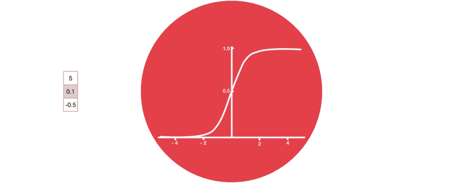

sigmoid 激活函数 （区间0～1）

+   运算：sigmoid函数的输出直接与记忆单元的当前状态相乘，用于决定哪些信息应该被保留，哪些应该被遗忘。输出值越接近1的信息将被保留，而输出值越接近0的信息将被遗忘。

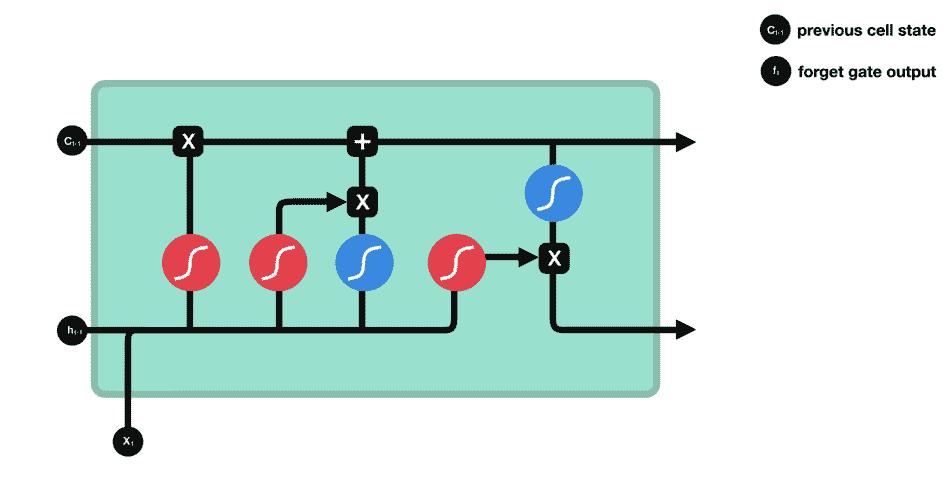

+   遗忘门（sigmoid激活函数）

+   **输出门**

+   作用：决定记忆单元中的哪些信息应该被输出到当前时间步的隐藏状态中。

+   组成：输出门同样由一个sigmoid激活函数和一个tanh激活函数组成。sigmoid函数决定哪些信息应该被输出，而tanh函数则处理记忆单元的状态以准备输出。

+   运算：sigmoid函数的输出与经过tanh函数处理的记忆单元状态相乘，得到的结果即为当前时间步的隐藏状态。

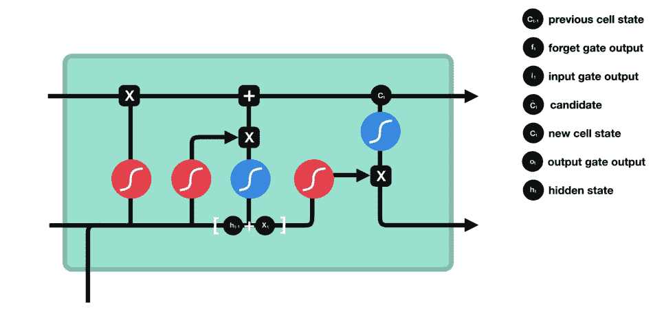

+   输出门（ sigmoid激活函数 + tanh激活函数 ）

**三、LSTM 的应用**

### **机器翻译：**

应用描述：LSTM在机器翻译中用于将源语言句子自动翻译成目标语言句子。

**关键组件 **：

+   **编码器（Encoder） **：一个LSTM网络，负责接收源语言句子并将其编码成一个固定长度的上下文向量。

+   **解码器（Decoder） **：另一个LSTM网络，根据上下文向量生成目标语言的翻译句子。

**流程 **：

1.  **源语言输入 **：将源语言句子分词并转换为词向量序列。

1.  **编码 **：使用编码器LSTM处理源语言词向量序列，输出上下文向量。

1.  **初始化解码器 **：将上下文向量作为解码器LSTM的初始隐藏状态。

1.  **解码 **：解码器LSTM逐步生成目标语言的词序列，直到生成完整的翻译句子。

1.  **目标语言输出 **：将解码器生成的词序列转换为目标语言句子。

**优化 **： 通过比较生成的翻译句子与真实目标句子，使用反向传播算法优化LSTM模型的参数，以提高翻译质量。

**情感分析：**

**应用描述：LSTM用于对文本进行情感分**析，判断其情感倾向（积极、消极或中立）。

**关键组件 **：

+   **LSTM网络 **：接收文本序列并提取情感特征。

+   **分类层 **：根据LSTM提取的特征进行情感分类。

**流程 **：

1.  **文本预处理 **：将文本分词、去除停用词等预处理操作。

1.  **文本表示 **：将预处理后的文本转换为词向量序列。

1.  **特征提取 **：使用LSTM网络处理词向量序列，提取文本中的情感特征。

1.  **情感分类 **：将LSTM提取的特征输入到分类层进行分类，得到情感倾向。

1.  **输出 **：输出文本的情感倾向（积极、消极或中立）。

**优化 **：通过比较预测的情感倾向与真实标签，使用反向传播算法优化LSTM模型的参数，以提高情感分析的准确性。