# 神经网络算法 - 一文搞懂FFNN（前馈神经网络）

> 来源：[https://geekbang.feishu.cn/docx/CFj5dTTq2oOeqWxNnrBcvqftnLc](https://geekbang.feishu.cn/docx/CFj5dTTq2oOeqWxNnrBcvqftnLc)

> 👨🏻 作者：AllenTang

> 📃 作者介绍：分享人工智能，让所有人玩转AI

> 🛖 👸号：架构师带你玩转AI

> ⏰ 收录时间：2024-05-23 11:28:42

> 🔗 原文链接：h[ttps://mp.weixin.q](https://mp.weixin.qq.com/s?__biz=MzkzMTEzMzI5Ng==&mid=2247487986&idx=1&sn=b0a5ee3a258672c679c50c8799ec56b0&chksm=c26ef3edf5197afb08294882bba88ad6b059266a7d9684b174b912c88a7a1fdc2beec11f0c01&scene=21#wechat_redirect)q.com/s?__biz=Mz...

关注作者👸号，获取更多AI知识

本文将从 FFNN的本质、FFNN的** 原理、FFNN的应用 三个方面，**带 您一文搞懂 Feed-forward Neural Network 前馈 神经网络 。

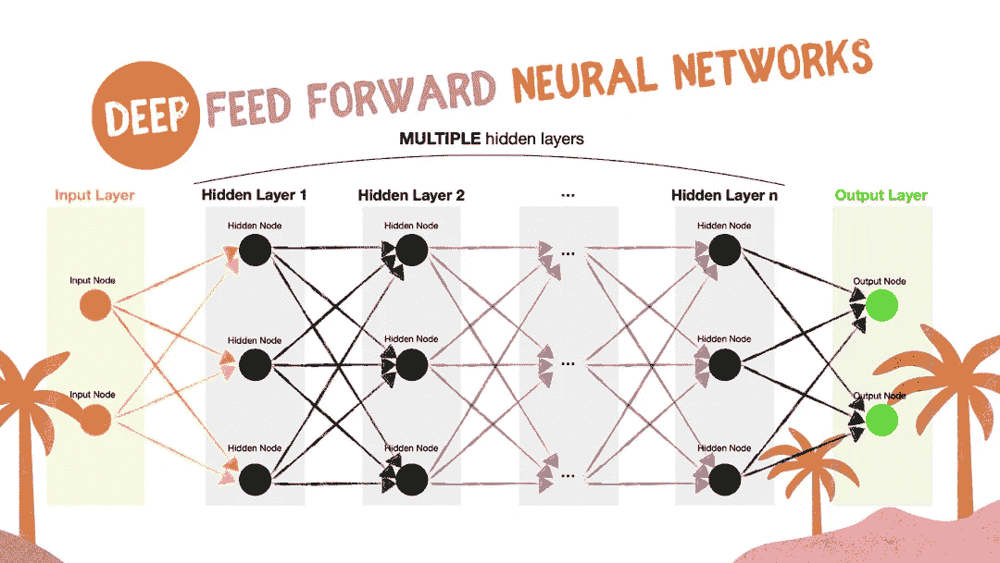

Feed-forward Neural Network

**一、FFNN的本质**

**前馈神经网络（FFNN）： ****又**名多层感知器 (MLP)，是神 经网络模型中最常见的一种。 各层神经元分层排列，每个神经元只与前一层的神经元相连，接收前一层的输出并传递给下一层，各层之前没有反馈。

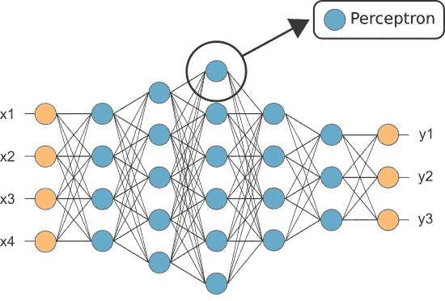

**前馈神经网络FFNN **

单层感知机（SLP）： 最早的人工神经网络之一，它仅由单个神经元组成。

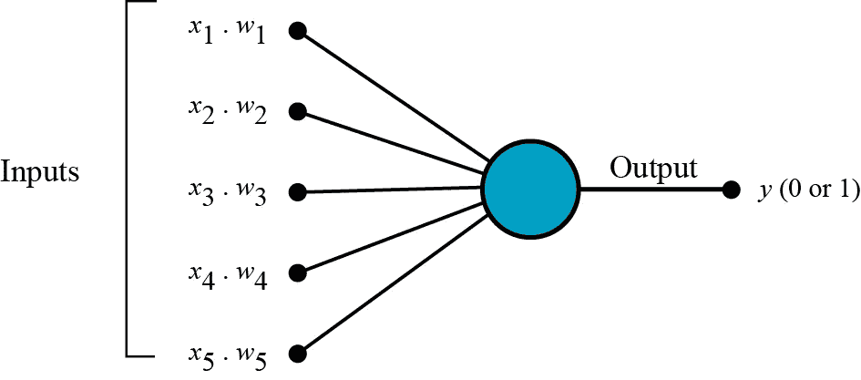

**单层感知机SLP**

多层感知机 （MLP）： 是一种前馈神经网络，其结构包含多个隐藏层。

** ****MLP的核心在于利用多个非线性的处理层来对****输**入数据进行分层的信息特征提取和转换。 每一层的输出都作为下一层的输入，直到得到最终的输出。这种层次化的结构使得MLP能够学习并逼近复杂的非线性函数。

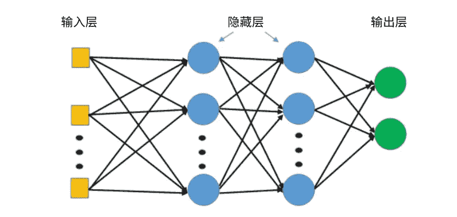

**多层感知机MLP**

**前馈神经网络（FFNN）的本质： 不是一个具体的神经网络模型，而是一类 **具有特定结构和处理方式的神经网络的总称。 其本质在于其信息的单向流动和处理机制。

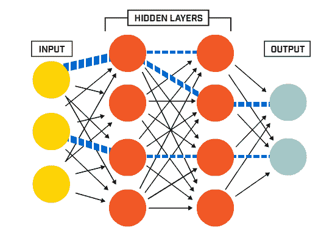

**前馈神经网络FFNN的本质**

**前馈神经网络（FFNN）的 目的： 通过构建一个多层次的神经网**络结构来学习和逼近复杂的函数或映射关系。

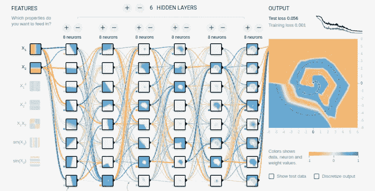

**前馈神经网络FFNN的目的**

**二、 FFNN的 原理**

**前****馈神经网络（FFNN）的网络结构： 包含多个隐**藏层，每个隐藏层由多个神经元组成，这些神经元接收来自前一层的输出，经过一定的加权和处理后，再传递给下一层。 网络结构的单 向流动使得前馈神经网络能够处理复杂的输入数据，并通过学习来逼近目标函数。

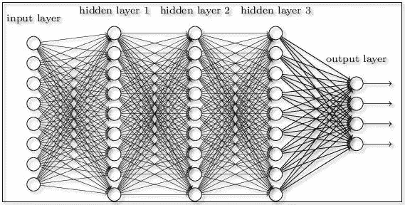

前馈神经网络 FFNN的网络结构

**单个神经元的工作原理： 通过加权输入、激活函数处理和**输出传递，实现信息的非线性转换与传递。

+   **输入加权： **每个输入信号都关联一个权重，反映了该输入对输出的重要性。 神经元接收输入时，会将输入值与对应权重相乘并求和，得到线性组合结果。

+   **激活函数处理： **** **神经元对线性组合结果应用激活函数， 将线性输出转换为非线性形式，以模拟现实世界中的复杂关系。

+   **输出传递： **** **经过激活函数处理后的输出值作为神经元的最终输出，可以传递给其他神经元。

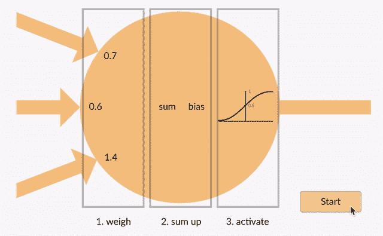

**单个神经元的工作原理 **

单层感知机（SLP）的工作原理： 唯一的神经元，它的输出充当最终预测，解决线性二分类问题。

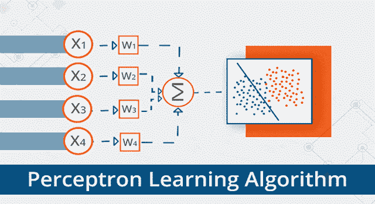

**单个感知机SLP的工作原理**

**为什么神经网络中需要那么多神经元： 单**个神经元只能解决线性二分类问题，而现实世界中的复杂问题都是非线性多分类问题。

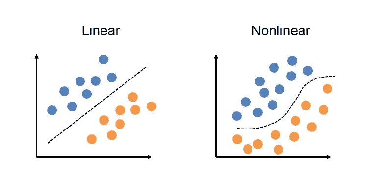

**线性和非线性**

**前馈神经网络（FFNN）的工作原理： 通过将神经元组合在一**起，前馈神经网络能够形成复杂的决策边界，进而处理现实世界中复杂的非线性问题。

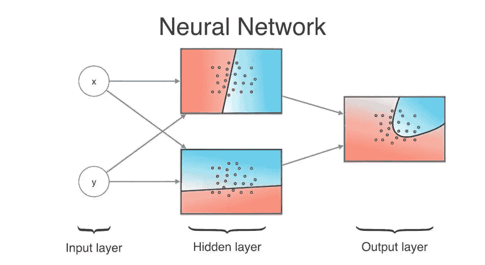

# **前馈神经网络FFNN的工作原理**

**三、 FFNN的应用 **

**T**ransformer架构应用FFNN： Transformer的编码器和解码器中的每一层都包含一个全连接的前馈神经网络。

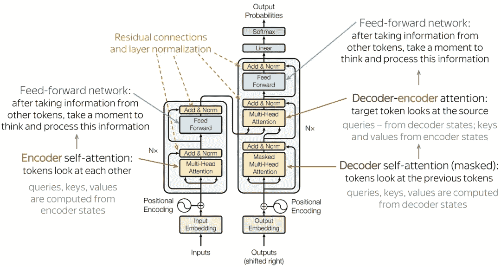

**Transformer架构**

详细了解Transformer： 神经网络算法 - 一文搞懂Transformer

**T**ransformer架构 中的FFNN： 通常包含两个线性变换 ，中间使用ReLU激活函数进行非线性处理。

**前馈神经网络（FFNN）的表达式为：FFN(x) = max**(0, xW1 + b1)W2 + b2

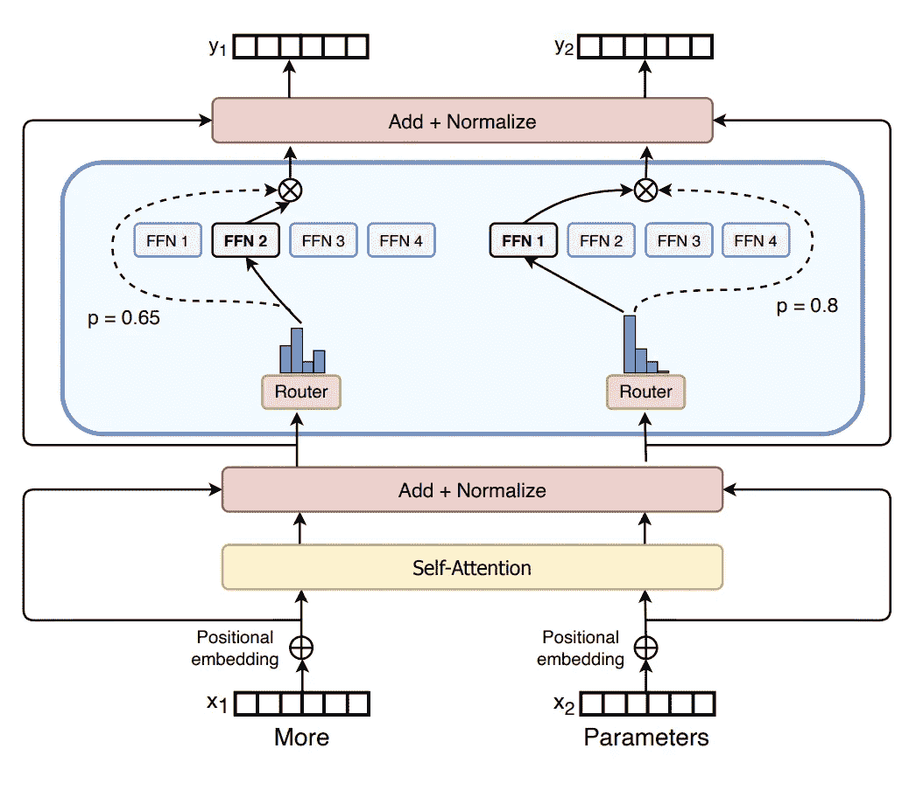

Transformer架构中的FFNN

**T**ransformer架构 中FFNN的目的： 对自注意力机制层的输出进行进一步的变换，使其能够学习更加复杂的函数关系。

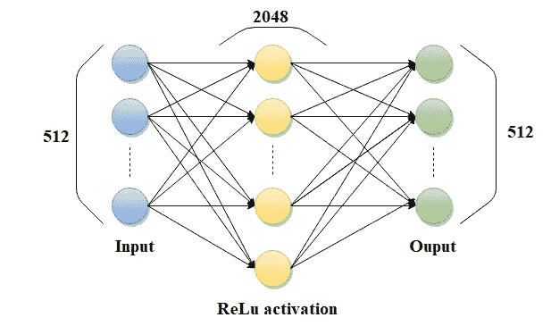

**FFNN的ReLu激活函数**

**通**过引入非线性能力和增加模型的表达能力， 帮助模型更好地理解序列数据中的局部和全局结构， 进一步提升处理序列数据的性能。