# 神经网络算法 - 一文搞懂U-Net（图像分割网络）

> 来源：[https://geekbang.feishu.cn/docx/GftfdSjB8oUWWpxVJ5Kc7jhNnm8](https://geekbang.feishu.cn/docx/GftfdSjB8oUWWpxVJ5Kc7jhNnm8)

> 👨🏻 作者：AllenTang

> 📃 作者介绍：分享人工智能，让所有人玩转AI

> 🛖 👸号：架构师带你玩转AI

> ⏰ 收录时间：2024-05-23 11:28:42

> 🔗 原文链接：h[ttps://mp.weixin.q](https://mp.weixin.qq.com/s?__biz=MzkzMTEzMzI5Ng==&mid=2247488539&idx=1&sn=39c808a93feff4a090dbdb3904a2845a&chksm=c26ef604f5197f123903ed69d6b9039d1e30f7746e2c63ff47c7614142ee5555918a4b73fc7d&scene=21#wechat_redirect)q.com/s?__biz=Mz...

关注作者👸号，获取更多AI知识

本文将从 U-Net的本质 、U-N**et 的原理 、U-Net **的应用 三个方面，带 您一文搞懂 图像分割网 络｜U-Net。

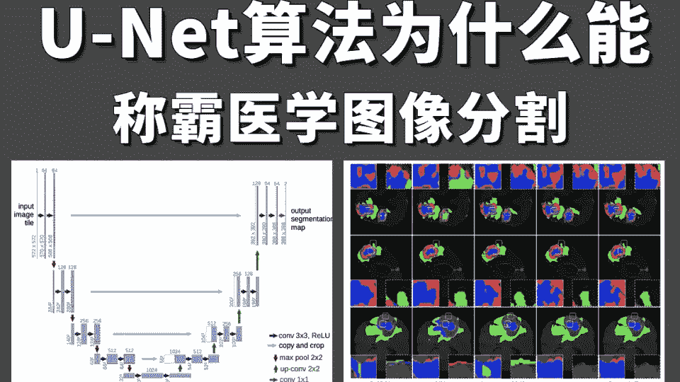

**U-Net**

**一、 U-Net 的本质**

**U-**Net的定义： 一个 基于深度学习的卷积神经网络 ，主要用于图像分割任务，特别是生物医学图像的分割。 它由编码器（下采样路径）和解码器（上采样路径）两部分组成，形状呈U型，因此得名U-Net。

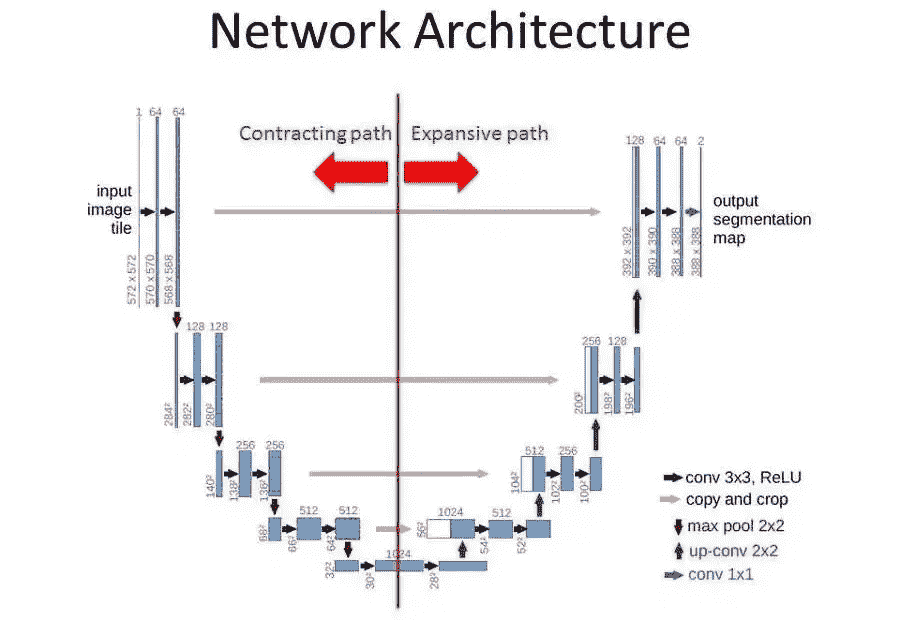

**U-Net的定义 **

**CN**N和U-Net分别是用于图像分类和生物医学图像分割的神经网络结构， 其中CNN专注于 全局图像特征的提取和分类 ，而U-Net则通过其编码器-解码器架构和跳跃连接实现 精确的像素级分类和分割。

### **卷积神经网络（CNN）**

+   **应用： **CNN通常被大规模应用于图像分类任务，例如识别图片中的物体类别（如猫、狗、汽车等）。

+   **输出： **CNN的输出是整个图像的类标签，即整个图像被归类为一个特定的类别。

+   **特点： **通过卷积层、池化层、全连接层等结构，CNN能够自动学习图像中的特征，并将其用于分类。

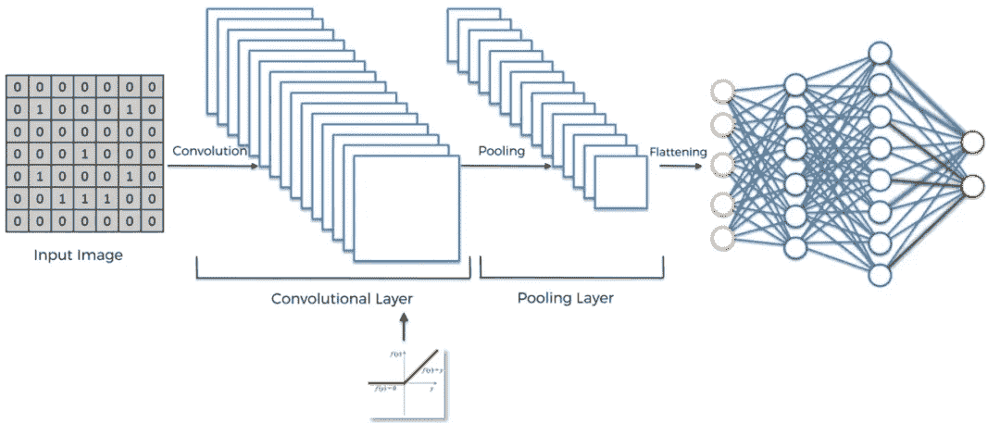

**CNN的网络结构**

### **UNet**

+   **应用： **UNet通常被用于生物医学图像的像素级分类任务， 例如图像分割（将图像中的特定结构或器官分割出来）。

+   **输出： **UNet的输出是每个像素点的类别，即每个像素都被赋予一个特定的类别标签。 这些标签通常以不同颜色在图像中显示，以便区分不同的类别。

+   **特点： **UNet采用编码器-解码器架构，通过跳跃连接（skip connections）将编码器中的特征图与解码器中的特征图相结合，以保留更多的空间信息并提高定位准确性。 这种结构使得UNet在生物医学图像分割任务中表现出色。

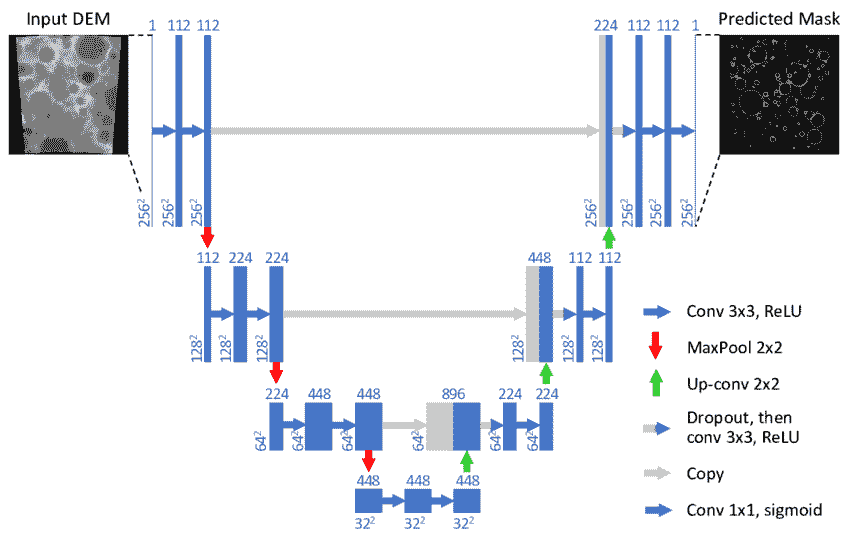

**U-Net的网络结构**

**U-Net的本质： 一个基于全卷积网络（Fully Convolutional Networ**k, FCN）的对称编解码结构（Encoder-Decoder）的图像分割网络。

+   **编码器-解码器结构 ****：**UNet采用了编码器-解码器结构， 其中编码器逐渐减小特征图的空间尺寸以捕获上下文信息，而解码器则逐渐恢复空间尺寸以精确定位每个像素的类别。

+   **跳跃连接 **：UNet中的跳跃连接（skip connections）将编码器的特征图直接传递给解码器，从而保留了更多的空间信息，有助于提高定位准确性。

+   **端到端训练 **：UNet可以直接对整个图像进行训练，而无需使用滑动窗口方法。这大大减少了计算量，提高了训练效率。

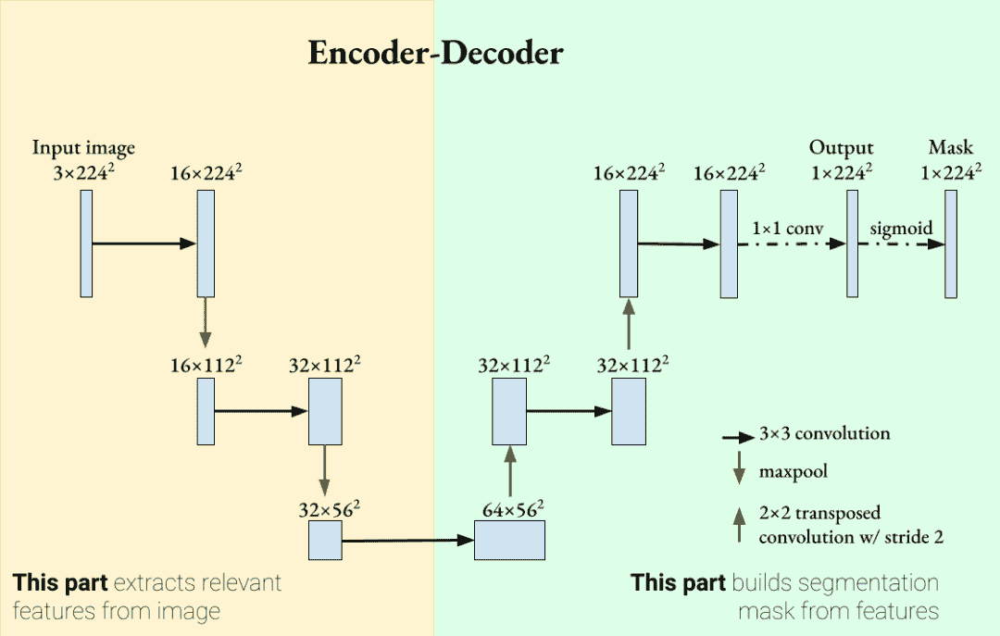

**U-Net的本质**

**二、 U-Net 的原理**

**U-Net的架构 ： ****一**个用于图像分割的编解码器结构网络，通过下采样路径捕获上下文信息，上采样路径恢复空间细节，并通过跳跃连接融合不同层级的特征。 如下图所示：

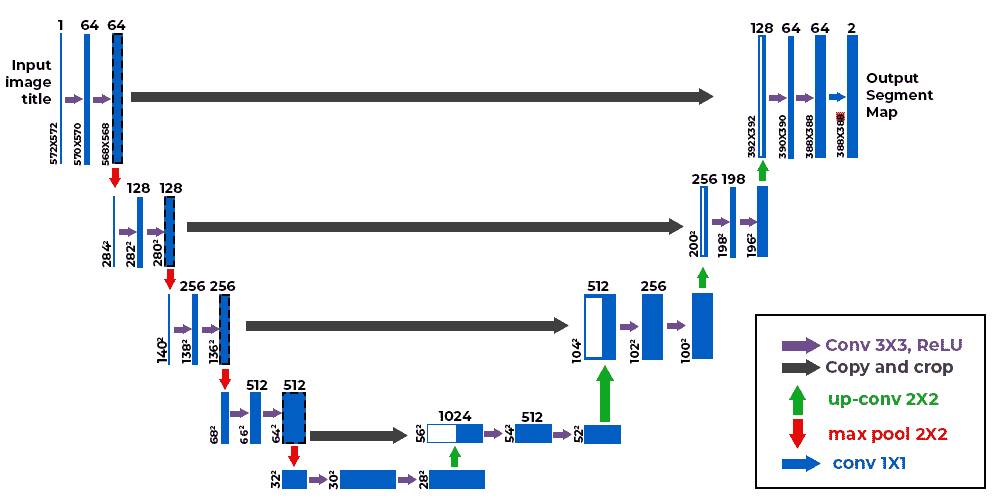

**U-Net的架构 **

**U-Net的核心组件 ： ****主要包括 ****Encoder、 ****Decoder 两个部 分，通过 Skip Con**nection 融合编码器中的低层特征（包含更多的空间信息）和解码器中的高层特征（包含更多的语义信息）。

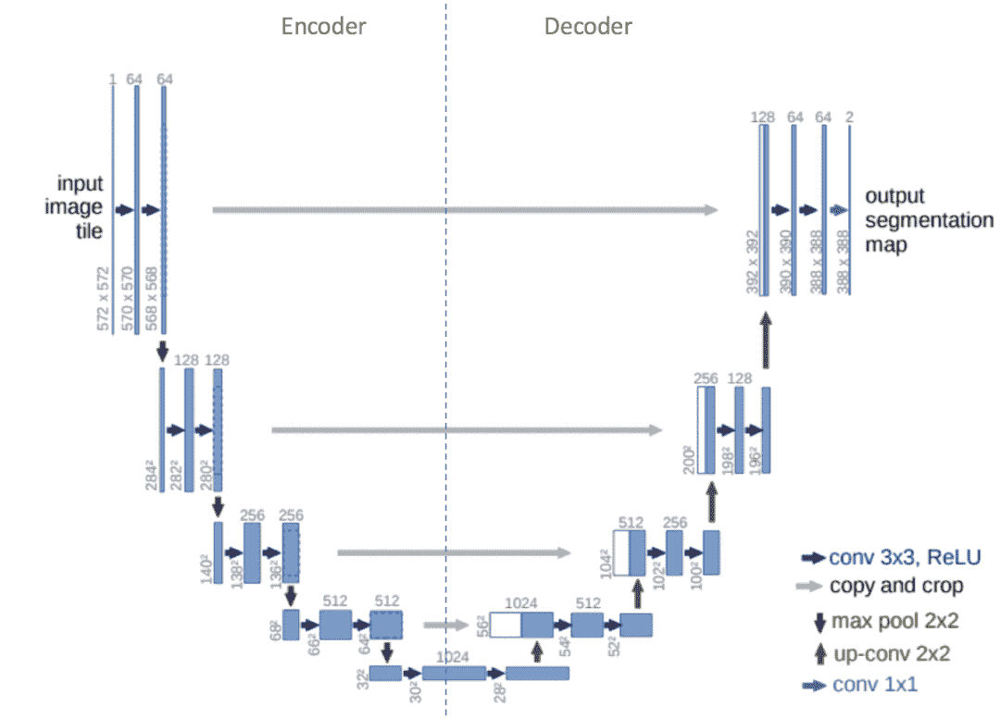

**U-Net的核心组件**

1.  **编码器（Encoder）： **也称为压缩路径或下采样路径，主要用来搭建深层网络结构，提取深层次的语义信息。它包括了多个程序块，每个程序块通常包括3x3的卷积（使用Relu激活函数）和步长为2的2x2的池化层（下采样）。经过每个程序块处理后，特征图的尺寸会逐渐减小。

1.  **解码器（Decoder）： **也称为扩展路径或上采样路径，与编码器部分对称。它也包括多个程序块，每个程序块通过步长为2的2x2的上采样操作增加特征图的尺寸，然后与编码器部分相应层级的特征图进行特征映射级联（Concatenate），即拼接。最后，通过两个3x3的卷积（Relu）进一步处理。

1.  跳跃连接（Skip Connection）： 位于编码器和解码器之间，通常包含两个3x3的卷积层。它的作用是进一步提取和融合特征，为解码器提供更有用的信息。

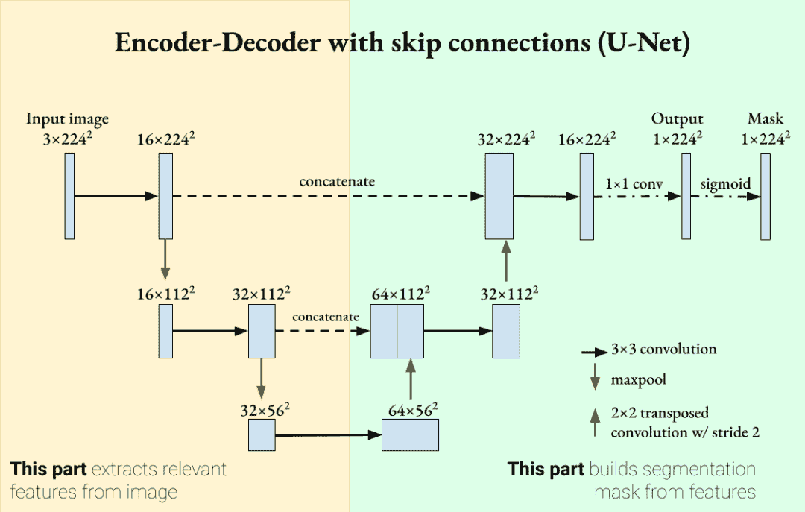

**U-Net的核心组件**

**U-Net的工作流程： 通过编码器和解码器的**对称结构以及跳跃连接，实现图像分割任务。

1.  **输入与预处理 **： 接收待分割的图像，并进行必要的预处理，如归一化、尺寸调整等，以便于网络处理。

1.  **编码器（下采样） **： 图像通过一系列的卷积层进行特征提取。 每一层都包含卷积、激活函数（如ReLU）和可能的池化操作。 随着网络的深入，特征图的尺寸逐渐减小 ，而特征通道的数量逐渐增加，从而提取到更高级别的语义信息。

1.  **解码器（上采样） **： 解码器从编码器接收的特征图开始， 通过上采样操作（如反卷积）逐步增加特征图的尺寸。 在每一步上采样后，通过跳跃连接将编码器相应层级的特征图与解码器当前层级的特征图进行拼接。

1.  **输出与图像分割 **：** 在解码器的最后一层，使用卷积操作将特征图映射到与类别**数相同数量的通道上。 每个通道代表一个类别在图像中的可能性分布。 应用softmax函数或其他分类器对每个像素进行分类，生成一个与输入图像尺寸相同的分割结果图。

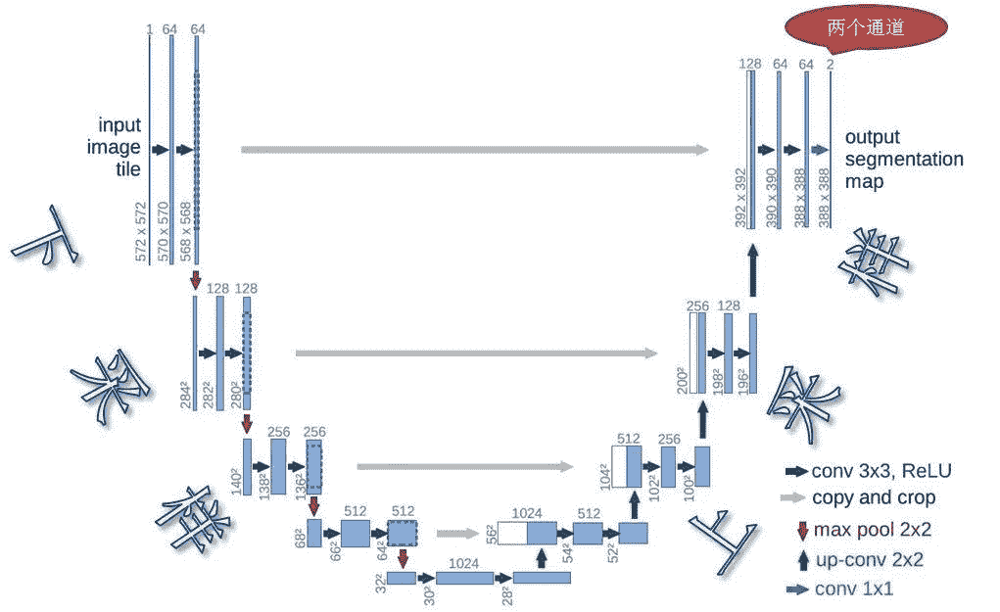

**U-Net的工作流程 **

**三、 U-Net 的应用  **

**医学图像分割： ****在**临床医疗或医学研究中，对成像中感兴趣的区域进行准确的勾画或标注，以实现定量测量和分析，是医学图像处理和分析的基础。

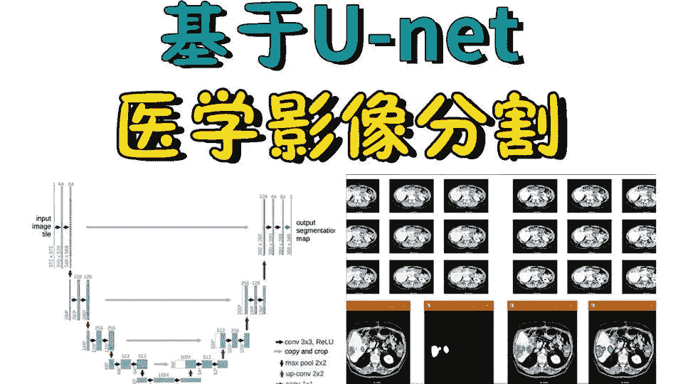

**医学图像分割 **

**论文《**Intelligently Quantifying the Entire Irregular Dental Structure》基于LU-Net模型开发了一种AI测量工具，能够全面量化不规则的牙齿结构，特别是PAB，以帮助临床医生迅速全面地掌握结构特征，提高临床效率和治疗成功率。

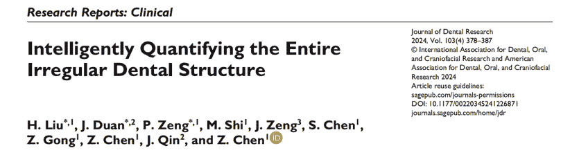

**智能量化整个不规则的牙齿结构**

基**于LU****-**Net定量分析工具的完整训练和应用工作流程：  通过 手动标记目标区域PAB（白色虚线）和辅助测量区域牙釉质（红色虚线） ，并裁剪图像以减少背景噪声，基于LU-Net的模型利用跳跃连接和轻量级参数学习图像特征，进而对验证和测试数据进行准确的分割预测。

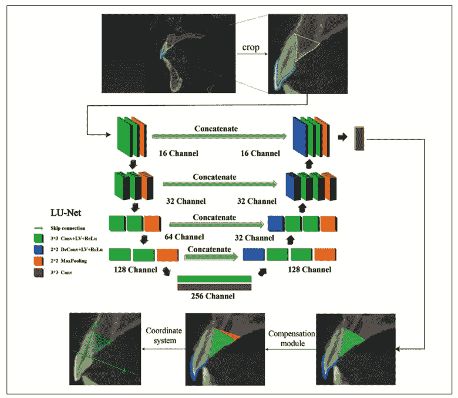

**基于LU-Net定量分析工具**

+   **数据准备 **：手动标记训练图像中的目标区域PAB和辅助测量区域牙釉质。

+   **图像裁剪 **：为了减少背景噪声对模型训练的影响，对标记后的图像进行裁剪。

+   **模型训练 **：使用裁剪后的训练图像和标记特征训练LU-Net模型。LU-Net通过跳跃连接在训练过程中学习并提取图像特征。

+   **边界补偿 **：设计一个补偿模块，用于解决确定PAB腭侧边界的困难，这通常是由于图像的复杂性或边界的模糊性造成的。

+   **分割预测 **：训练完成后，LU-Net模型对验证集和测试集进行分割预测，生成目标区域的分割结果。

+   **定量分析 **：基于分割结果，使用CEJ点和根尖点构建坐标系，进行整个定量分析。这可能包括计算面积、长度、角度等参数，以便对PAB和牙釉质进行量化评估。

**相关论文**

+   《U-Net: Convolutional Networks for Biomedical Image Segmentation 》

+   《Intelligently Quantifying the Entire Irregular Dental Structure》