# 神经网络算法 - 一文搞懂ResNet（残差神经网络）

> 来源：[https://geekbang.feishu.cn/docx/KVdadBwCyomkfmxqrVpcUQ8jn4b](https://geekbang.feishu.cn/docx/KVdadBwCyomkfmxqrVpcUQ8jn4b)

> 👨🏻 作者：AllenTang

> 📃 作者介绍：分享人工智能，让所有人玩转AI

> 🛖 👸号：架构师带你玩转AI

> ⏰ 收录时间：2024-05-23 11:28:42

> 🔗 原文链接： h[ttps://mp.weixin.q](https://mp.weixin.qq.com/s?__biz=MzkzMTEzMzI5Ng==&mid=2247488174&idx=1&sn=4f7031694ef396d8e4917248a312f0a9&chksm=c26ef0b1f51979a7ac33ee43bf17254ef5b24711c103c1870b29177b0731e170bcd0f442a9f1&scene=21#wechat_redirect)q.com/s?__biz=Mz...

关注作者👸号，获取更多AI知识

本文将从 ResNet的本质 、Re**sNet 的原理 、ResNet 的应用 **三个方面，带 您一文搞懂 残差神经网 络 Residual Neural Network｜ ResNet 。

**残差神经网络ResNet**

**一、 ResNet 的本质**

**ResNet的定义： **残差神经网络（ResNet）是一种深度卷积神经网络（CNN）的架构， 它通过引入“残差学习”来解决深度网络训练中的退化问题。

**通**过绕过某些中间层级，将层的激活值直接链接到后续层，从而创建一个残差块。这些残差块被堆叠起来以创建ResNet。

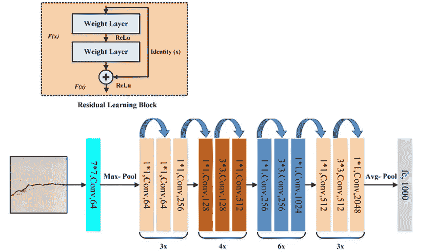

**残差神经网络ResNet34**

**退化问题 （Degradatio****n Problem） ： 随着**网络层数的增加，网络的性能并不是持续提升的，而是在达到一定深度后， 性能会趋于饱和，甚至出现下降。

**这种现象与直观相悖，因为一般来说，更多的层意味着网络有更强的学**习能力，应该能够学习到更复杂的函数映射。

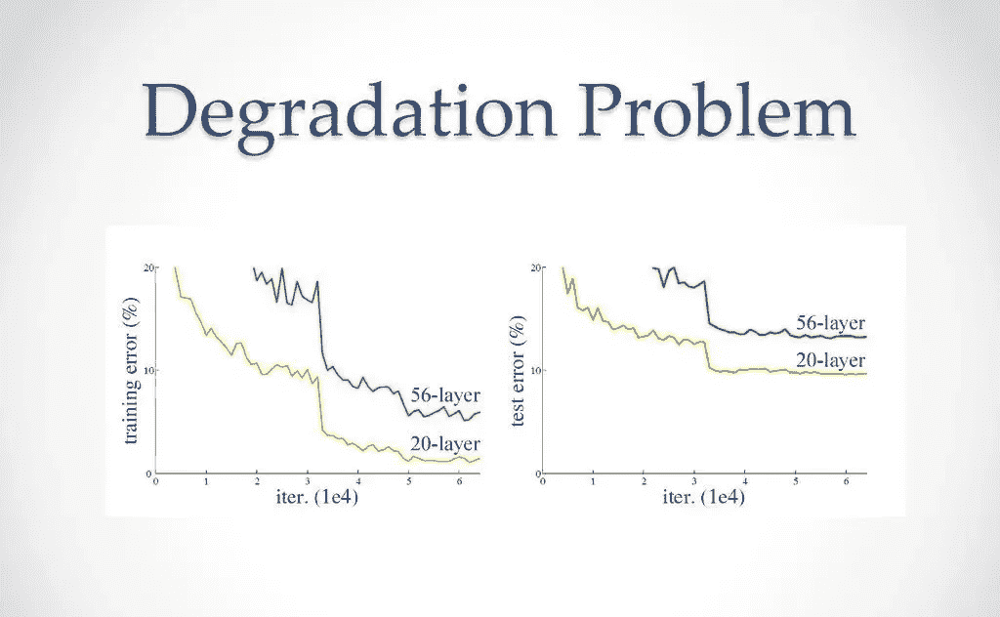

退化问题 （Degradation Problem）

**残差学****习 （Residual Le**arning） ： 它是 一种训练深度神经网络的技术 ，旨在解决随着网络深度增加而出现的退化问题。

** 在**ResNet中，残差学习通过引入“快捷连接”（shortcut connections）或“跳跃连接”（skip connections）来实现，这些连接允许从网络中较早的层直接传递输入到后面的层。

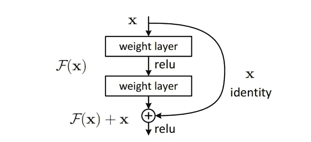

残差学习（Residual Learning）

**ResNet的本质： ****残差网络背后的策略是让网络去拟合****残差映射，而不是让层去学习底层的映射。 因此，网络**不是去拟合比如H(x)这样的初始映射，而是去拟合H(x) - x这样的残差映射。

**F****(**x) = H(x) - x，得出  H(x) = F(x) + x 。

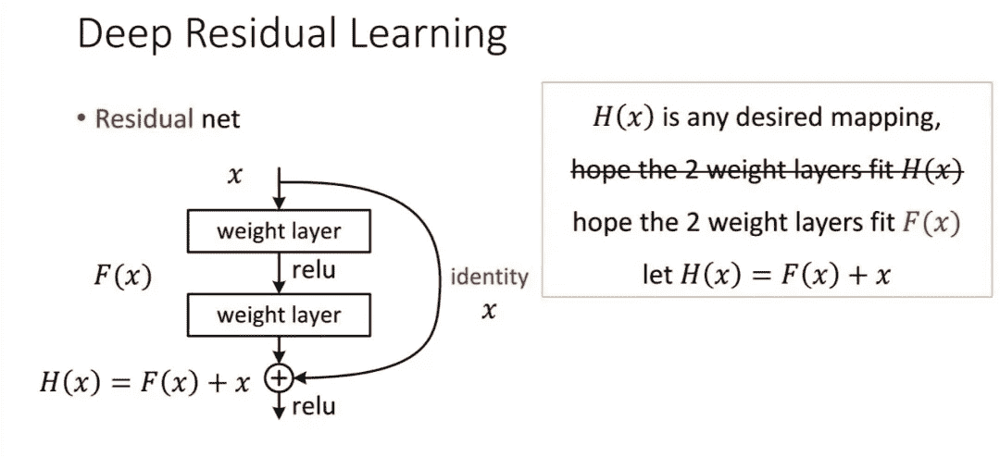

**ResNet的本质**

**二、 ResNet 的原理**

**ResNet的架构 ： ****ResNet34 使用的受 VGG-19 启发的 34 层普通网络架**构，随后添加了快捷连接。随后通过这些快捷连接将该架构转变为残差网络，如下图所示：

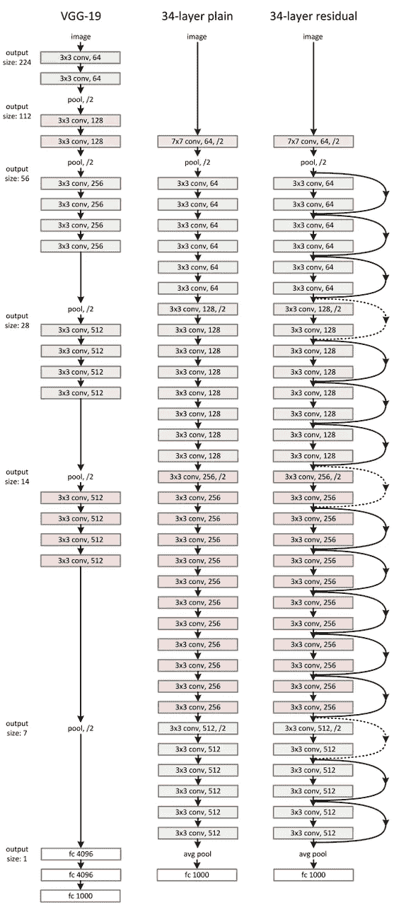

**ResNet34的架构**

**残**差块（Residual Block） ： 在ResNet（残差网络）架构中，多个残差学习块（Residual Learning Building Blocks）通常是串联在一起的。

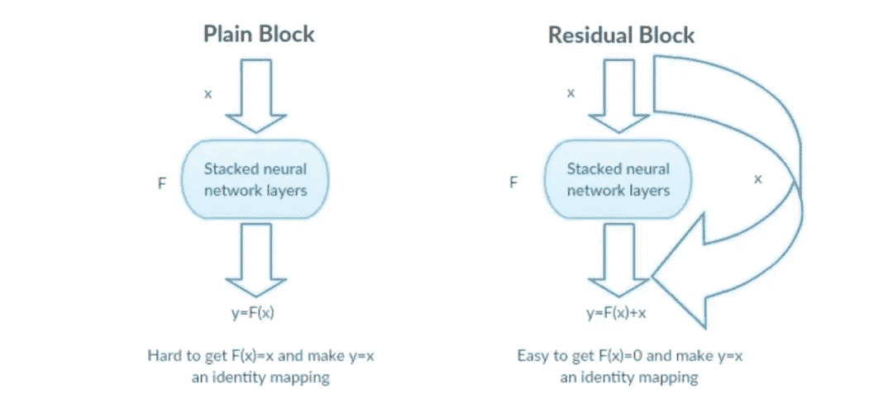

残差块（Residual Block）

**在ResNet的不同版本中，如ResNet18、ResNet34、ResNet50、 Re**sNet101、 ResNet152等， 残差块的数量是根据网络的总层数而定的。

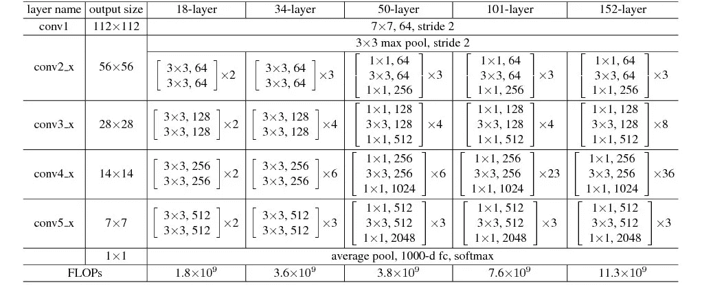

**ResNet不同版本**

**以R**esNet34为例，它包含34层，其中包括 一个7x7的卷积层（算作一层），然后是16个残差块（每个残差块包含两层卷积），最后连接上一个全连接层（最后一层），所以总层数为34层。

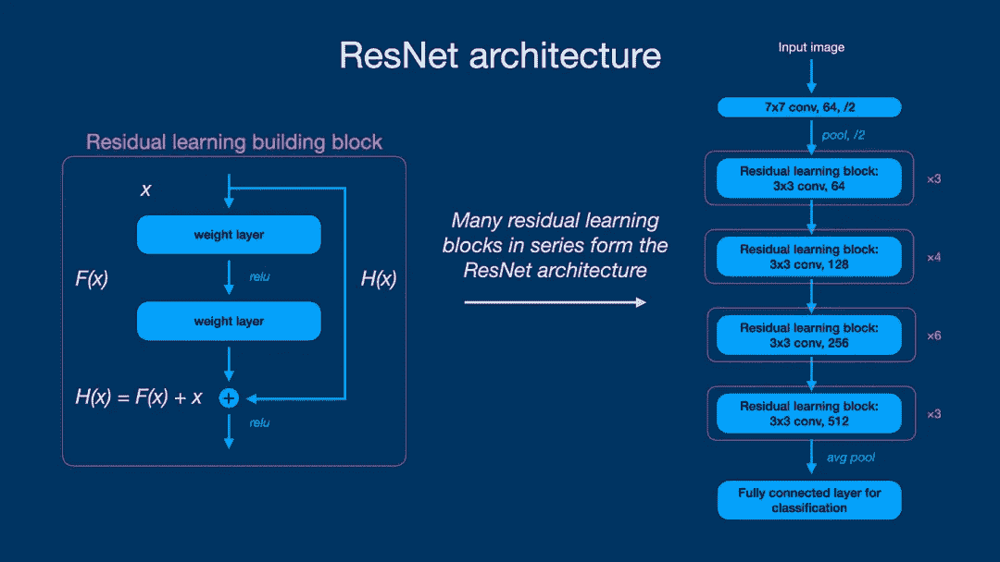

**ResNet34的架构**

**Re**sNet 的工作原理 ： ResNet 通过残差块和跳跃连接缓解梯度消失，利用降采样和全局池化提取关键特征，通过全连接层分类或回归，并借助批量归一化和ReLU加速训练和泛化。

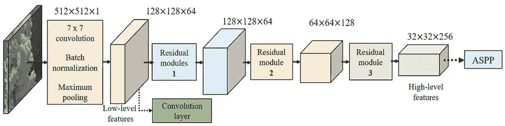

**ResNet34的工作原理**

ResNet34的工作流程可以简要概括如下：

1.  **输入层 **：首先，图像数据作为输入被送入ResNet34的第一个卷积层， 这通常是一个7x7的卷积层，用于初步提取图像特征。

1.  **残差块 ****：随后，图像数据通过一系列残差块（Residual Blocks）。 每个残差块都包含两层卷积**层，用于进一步提取图像特征。重要的是，每个残差块都通过跳跃连接（Skip Connection）实现， 这意味着每个残差块的输入都会直接加到其输出上。

1.  **降采样 **：在残差块之间，可能会通过改变卷积的步长或使用额外的卷积层来实现降采样操作，以减小特征图的尺寸并保留空间层次结构。

1.  **全连接层 **：在所有残差块之后， 全局平均池化层将特征图的空间维度减小到1x1，生成一个特征向量。 然后，这个特征向量被传递给一个或多个全连接层（也称为密集连接层或线性层），用于执行分类或回归任务。

1.  **输出 **：最后， **R**esNet34输出预测结果。对于分类任务，输出通常是一个概率分布向量，表示图像属于各个类别的概率；对于回归任务，输出则可能是具体的数值。

**在**整个工作流程中，批量归一化（Batch Norm）和ReLU激活函数通常被用于每个卷积层和全连接层之后，以加速训练并提高模型的泛化能力。

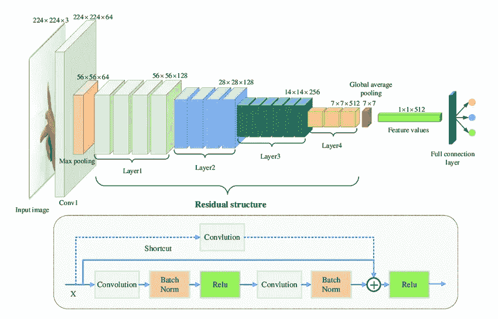

**ResNet34的工作流程**

**三、 ResNet 的应用  **

**计算**机视觉（Computer Vision） ：  一门研究如何使机器“看”的科学，更进一步地说，就是指用摄影机和计算机代替人眼对目标进行识别、跟踪和测量等机器视觉，并进一步做图像处理，用计算机处理成为更适合人眼观察或传送给仪器检测的图像。

计算机视觉（Computer Vision）

**R**esNet在计算机视觉领域的应用广泛且显著，特别是在 图像识别、目标检测和图像分割 等关键任务中展现出卓越性能。

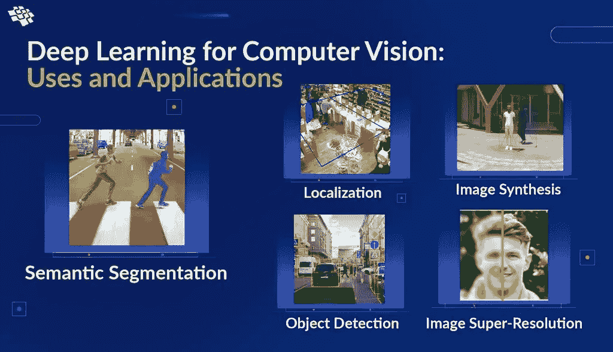

**ResNet应用计算机视觉 **

以下是ResNet在计算机视觉中的3个主要应用：

**图**像识别 （Image Recognition） ： ResNet通过其深度学习和残差学习机制，能够准确识别图像中的物体、场景或文字，为图像分类和识别任务提供了强有力的支持。

图像识别（Image Recognition）

**目**标检测 （Object Detection） ： 在目标检测任务中，ResNet能够有效地提取图像中的目标特征，并结合区域提议网络（RPN）等方法，实现对图像中多个目标的准确检测和定位。

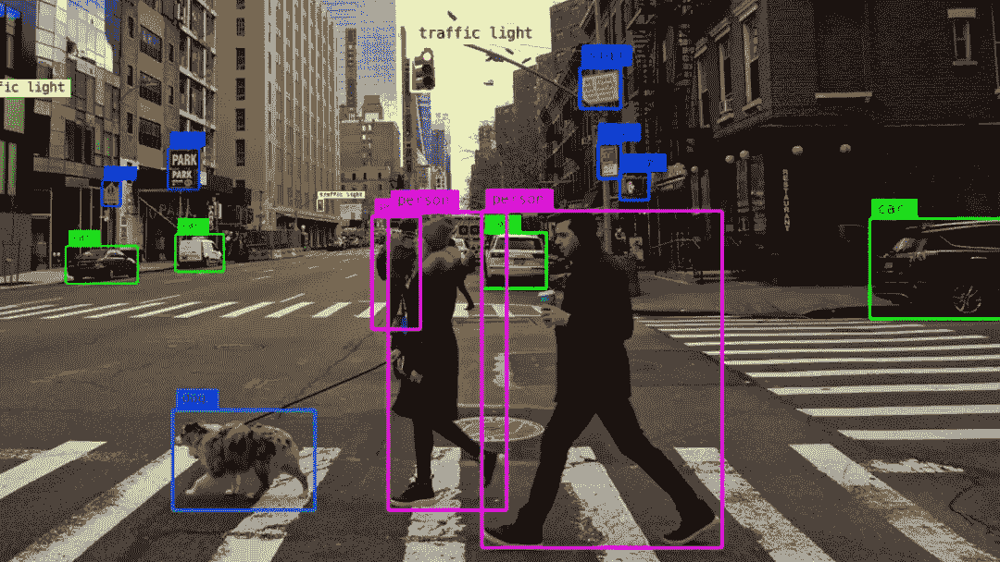

目标检测（Object Detection）

**图像分割（ Image Segmentation ） ： 对于图**像分割任务，ResNet通过其强大的特征提取能力，能够实现对图像中不同区域的精细分割，为医学影像分析、自动驾驶等领域的应用提供了重要支持。

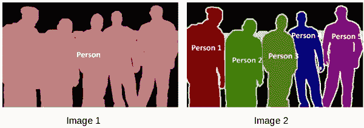

图像分割（Image Segmentation）