# 神经网络算法 - 一文搞懂GPT（Generative Pre-trained Transformer）

> 来源：[https://geekbang.feishu.cn/docx/LIQTdKTnWoxF1HxP19wc8OWLnVc](https://geekbang.feishu.cn/docx/LIQTdKTnWoxF1HxP19wc8OWLnVc)

> 👨🏻 作者：AllenTang

> 📃 作者介绍：分享人工智能，让所有人玩转AI

> 🛖 👸号：架构师带你玩转AI

> ⏰ 收录时间：2024-05-23 11:28:42

> 🔗 原文链接：h[ttps://mp.weixin.q](https://mp.weixin.qq.com/s?__biz=MzkzMTEzMzI5Ng==&mid=2247485795&idx=1&sn=1747ffba1fd36f80b536bc6019680a86&chksm=c26eeb7cf519626a9de3c849b6e9acf67aee9793216f844d0e94a5fd29c44431767e19906c9c&scene=21#wechat_redirect)q.com/s?__biz=Mz...

关注作者👸号，获取更多AI知识

本文将从 GPT的本质、GPT 的原**理 、 GPT架构改进 三个方面，带 您一**文搞懂 Generative Pre-trained Transformer | GPT。

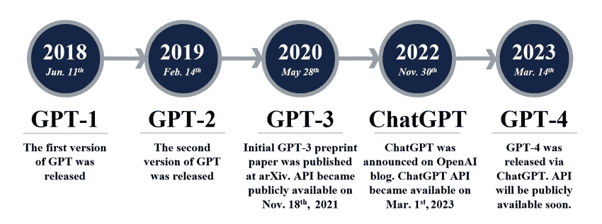

**一、 GPT 的本质 **

**GPT架构 ： 一种基于 **[**Transformer **](http://mp.weixin.qq.com/s?__biz=MzkzMTEzMzI5Ng==&mid=2247485629&idx=1&sn=71fdf59802e2025d9322548270c545c4&chksm=c26eeaa2f51963b49ecbd01ccf11e6fab7b7558338edc84beb1cb3193053f4cf6a089df1ecd6&scene=21#wechat_redirect)[**的预训练语言模型，它的最**](http://mp.weixin.qq.com/s?__biz=MzkzMTEzMzI5Ng==&mid=2247485629&idx=1&sn=71fdf59802e2025d9322548270c545c4&chksm=c26eeaa2f51963b49ecbd01ccf11e6fab7b7558338edc84beb1cb3193053f4cf6a089df1ecd6&scene=21#wechat_redirect)大创新之处在于使用了单向 Transformer 编码器，这使得模型可以更好地捕捉输入序列的上下文信息。

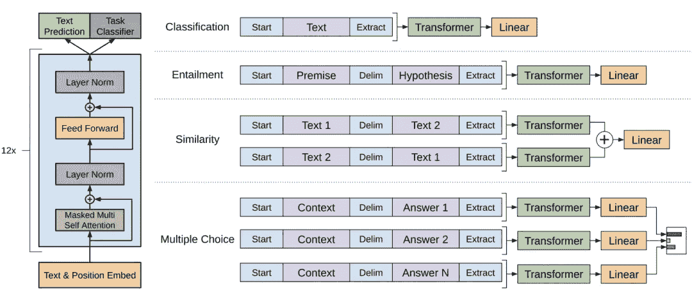

# **GPT架构 **

+   **一、总体架构 **：GPT是一个大型的 [Transformer ](http://mp.weixin.qq.com/s?__biz=MzkzMTEzMzI5Ng==&mid=2247485629&idx=1&sn=71fdf59802e2025d9322548270c545c4&chksm=c26eeaa2f51963b49ecbd01ccf11e6fab7b7558338edc84beb1cb3193053f4cf6a089df1ecd6&scene=21#wechat_redirect)解码器网络， **旨在处理序列到序列的生成任务 **。它采用了多层 [Transformer ](http://mp.weixin.qq.com/s?__biz=MzkzMTEzMzI5Ng==&mid=2247485629&idx=1&sn=71fdf59802e2025d9322548270c545c4&chksm=c26eeaa2f51963b49ecbd01ccf11e6fab7b7558338edc84beb1cb3193053f4cf6a089df1ecd6&scene=21#wechat_redirect)解码器堆叠而成， 以捕捉输入文本的长期依赖关系，并生成连贯的文本输出 。

+   **二、输入层 **：

+   **Tokenization **：文本输入首先经过分词处理， **将文本转换为Token序列 **。这通常涉及将文本分割成单词、子词或其他基本单位。

+   **Embedding ****：分词后的Token序列通**过Embedding层 转换为固定维度的向量表示 。Embedding层将每个Token映射到一个高维空间中，捕捉其语义信息。

+   三、Transformer解码器堆叠 ：GPT的核心是多个Transformer解码器的堆叠。每个解码器都包含以下几个关键组件：

+   **自注意力机制 **： 自注意力机制允许模型在处理序列时关注不同位置的Token 。通过计算Token之间的注意力权重，模型能够捕捉输入序列中的依赖关系，并为每个位置生成上下文相关的表示。

+   **前馈神经网络 **：除了自注意力机制外，每个解码器还包含一个前馈神经网络。该网**络对自注意力机制的输出**进行进一步转换， 以提取更高级别的特征 。

+   **残差连接和层归一化 **：为了提高模型的训练稳定性和效果，每个解码器都使用了残差连接和层归一化。这些技术 有助于缓解梯度消失和梯度爆炸问题 ，并加速模型的收敛。

+   **四、输出层 **：**经过多个Transformer解码器堆叠处理**后，最后一层的输出被用作生成文本的依据。对于每个位置，模型预测下一个Token的概率分布。 这通常通过一个线性层和一个Softmax激活函数来实现，将解码器的输出转换为概率值。

+   **五、预训练和微调 ****：
GPT架构**的训练过程分为两个阶段： 预训练和微调 。

+   **预训练 **：在预训练阶段，模型使用大规模的无标注文本数据进行训练，以学习语言的统计规律和生成能力。通过自回归的方式， 模型预测输入序列中的下一个Token，并最大化在训练数据上的似然性 。

+   **微调 **：在微调阶段， 模型使用特定任务的标注数据进行训练 ，以适应各种NLP任务。通过在模型的顶部添加适当的输出层，并使用任务特定的目标函数进行训练，模型能够学习将输入文本映射到特定任务的输出空间。

# **G**PT处理不同NLP任务： 对于GPT模型处理不同的NLP任务，可以采用特定的输入格式和微调策略来适应每种任务的特点。

+   文本分类 （Classification） ：

+   **任务描述 **： **将文本划分到预定义的类别中。**

+   **GPT策略 **：直接微调模型。在模型的输出层添加一个线性层，将GPT的输出转换为对应类别的概率分布。

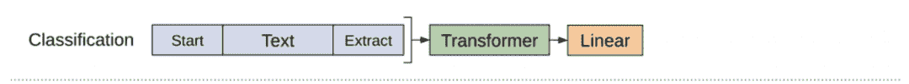

文本分类（Classification）

+   文本蕴含（Entailment） ：

+   **任务描述 **： 判断一个文本（前提）是否蕴含另一个文本（假设）的信息。

+   **GPT策略 **：将前提和假设连接起来，中间插入分隔符（如“$”）。微调模型以预测蕴含关系。

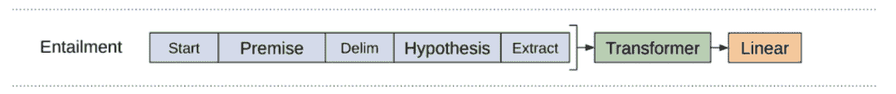

文本 蕴含 （Entailment）

+   相似性（Similarity） ：

+   **任务描述 **： **判断两个文本之间的相似性。**

+   **GPT策略 **：由于句子顺序不固定，处理时生成两种可能的句子顺序，并分别得到它们的表示。将这些表示相加后，输入到线性输出层中进行相似性判断。

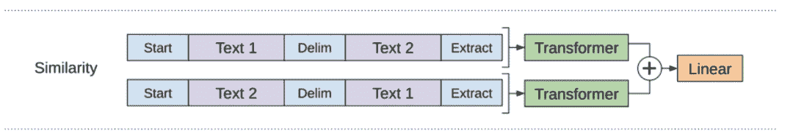

**相似性（Similarity）**

+   问答和常识推理（Multiple Choice） ：

+   **任务描述 **： 给定上下文、问题和一组候选答案，选择最合适的答案。

+   **GPT策略 **：将上下文、问题和每个候选答案连接起来，中间插入分隔符。分别处理这些序列，并通过softmax层生成答案的概率分布。选择概率最高的答案作为输出。

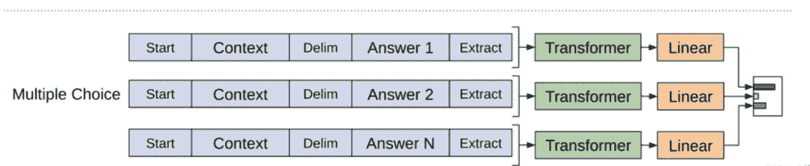

问答和常识推理（Multiple Choice）

**二、 GPT 的原理 **

**G**PT的工作原理是首先通过无监督预训练学习语言的统计规律，然后利用有监督微调将通用语言学知识与具体任务结合，提升模型性能。

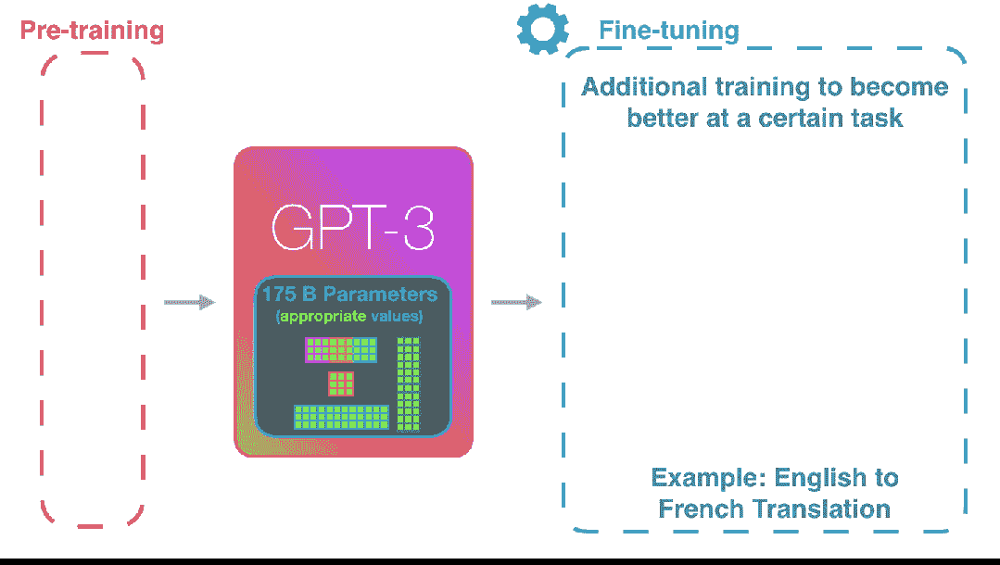

**GPT工作原理**

**无监督预训练 ： GPT无监督预训练旨在通过大型Transformer解码器和自回归**训练，利用未标注数据学习语言的统计规律，从而生成流利且符合真实语言模式的文本。

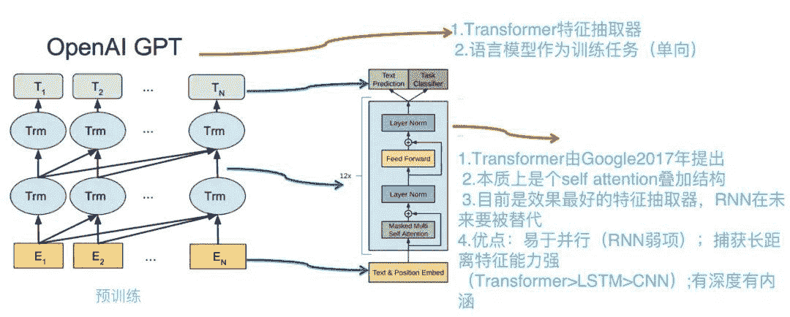

**无监督预训练 **

+   **一、 预训练 目的 **：

+   **学习语言统计规律 **：通过无监督学习， 使模型能够掌握自然语言中的统计信息 ，如词频、共现概率等。

+   **生成真实文本 **：基于学到的统计规律， 生成与真实世界数据分布相似的文本 。

+   **二、 预训练 方法 **：

+   使用多层Transformer解码器 ：

+   利用Transformer的自注意力机制捕获文本中的长期依赖 。

+   通过多层解码器堆叠，增强模型的表示能力。

+

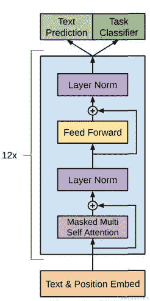

+

+   多层 Transformer解码器

+   **自回归训练 **：

+   以序列中的前一个或多个词作为输入，预测下一个词 。

+   这种预测模式使模型学习到词与词之间的时序关系。

+   **利用未标注数据 **：

+   从互联网、书籍等来源收集大量未标注文本 。

+   通过这些数据进行模型训练，无需人工标注，降低成本。

+   **三、 预训练 结果 **：

+   **生成流利文本 **： 模型能够生成语法正确、语义连贯的文本 。

**有监督微调 ： ****G**PT有监督微调通过统一网络结构、利用预训练参数初始化和针对任务进行Fine-tuning，将通用语言学知识与具体任务相结合，提升模型性能。

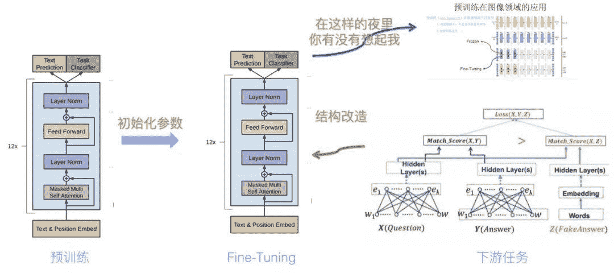

**有监督微调 **

+   **一、网络结构统一 **：

+   **原因 **：为了充分利用GPT预训练模型的潜力，确保模型在不同任务上的一致性。

+   **做法 **： 将下游任务的网络结构改造为与GPT相同的结构 。

+   **二、参数初始化 **：

+   **利用点 **：预训练阶段学到的语言学知识。

+   **目的 **：加速训练过程，提高下游任务性能。

+   **做法 **： 使用预训练好的GPT参数初始化网络 。

+   **三、Fine-tuning **：

+   **目的 **：使网络更适应特定任务，学习任务相关特征。

+   **做法 **： 使用下游任务数据进行训练，对网络参数进行微调 。

+   **结果 **：模型既保持通用语言学知识，又针对具体任务优化。

**三、 GPT架构改进 **

### **GPT-3  ： ****G**PT-3相较于GPT-2在模型规模、任务多样性、文本生成连贯性和语义理解深度等方面都有显著的提升，展现了更高级别的自然语言处理能力。

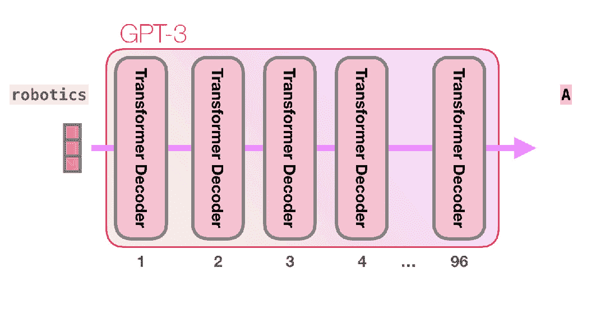

**GPT-3工作原理**

1.  **模型规模： ****GPT-3的模型规模远超GPT-2。 GPT-3拥**有1750亿个参数，而GPT-2的参数数量级较小，最大版本也只有15亿个参数 。这种规模的增加使得GPT-3能够处理更复杂的语言任务，并生成更丰富的文本内容。

1.  **任务能力： ****G**PT-3在任务能力上相较于GPT-2有了显著提升。 GPT-3不仅能够完成GPT-2所擅长的语言生成任务，还能够执行更多种类的自然语言处理任务，如文本分类、翻译、问答等。 GPT-3的灵活性更高，适应性更强，可以在更广泛的应用场景中发挥作用。

1.  **生成质量： ****GPT-3在生成文本的质量上相较于**GPT-2有了明显改进。 GPT-3生成的文本更加连贯、有逻辑，并且能够更好地保持上下文的一致性。 这使得GPT-3在对话系统、文章生成等领域中能够提供更自然、流畅的用户体验。

1.  **理解与交互： **GPT-3在语义理解和交互能力方面相较于GPT-2有了显著提升。 GPT-3能够更准确地理解用户的输入，并提供更相关、准确的回应。 这使得GPT-3在智能助手、聊天机器人等应用中能够更好地与用户进行交互和沟通。

**GPT-4： GPT-4相较于GPT-3在模型规模、多模态支持、文本生成**质量、语义理解与推理能力等方面都实现了显著提升，展现了更强大的自然语言处理能力。

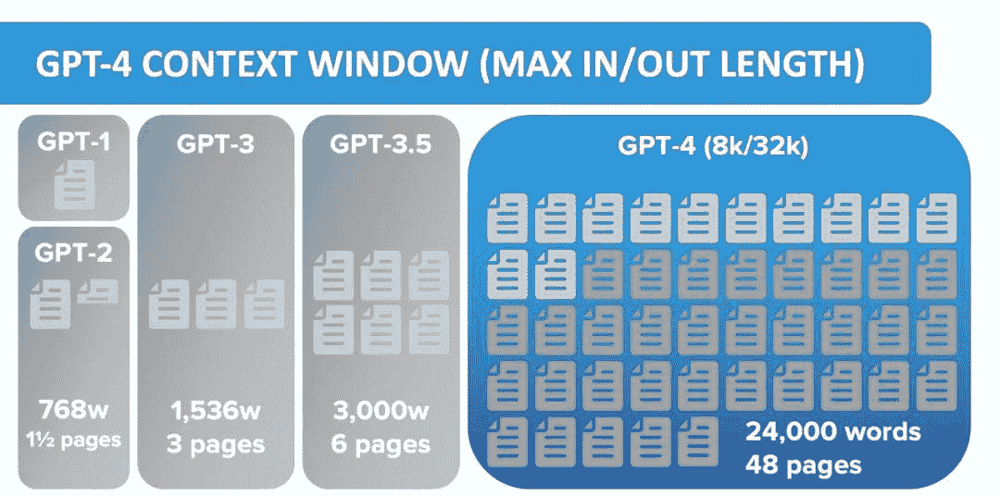

# **GPT演进之路 **

1.  **模型规模 **： **G**PT-4相较于GPT-3拥有更大的模型规模。GPT-4的参数数量预计将达到数万亿级别，远远超过GPT-3的1750亿个参数。 这种规模的增加使得GPT-4能够学习更复杂的语言模式和关系，并提供更强大的语言处理能力。

1.  **多模态支持 **： **G**PT-4相较于GPT-3的一个重要改进是其多模态支持能力。 GPT-4不仅能够处理文本输入，还能够接 收 图像输入，并生成相应的文本输出。  这种多模态支持使得GPT-4在更广泛的应用场景中发挥作用，例如图像描述、视觉问答等领域。

1.  **生成质量 ****：GPT-4在生成文本的质量上相较**于GPT-3有了进一步提升。 GPT-4生成的文本更加连贯、有逻辑，并且能够更好地保持上下文的一致性。 它还能够生成更富有创造性和多样性的内容，为用户提供更丰富、有趣的体验。

1.  **理解与推理能力 ****：GPT-4在语义理解和推理能力**方面相较于GPT-3有了显著提升。 GPT-4能够更深入地理解复杂的问题和语境，提供更准确、更相关的回答。 它还能够进行更高级别的推理和逻辑分析，解决更复杂的问题和任务。