# 神经网络算法 - 一文搞懂 Transformer（总体架构 & 三种注意力层）

> 来源：[https://geekbang.feishu.cn/docx/CLyLdW0IBouU5txnVXoczpXnn7d](https://geekbang.feishu.cn/docx/CLyLdW0IBouU5txnVXoczpXnn7d)

> 👨🏻 作者：AllenTang

> 📃 作者介绍：分享人工智能，让所有人玩转AI

> 🛖 公众号：架构师带你玩转AI

> ⏰ 收录时间：2024-05-23 11:28:42

> 🔗 原文链接：h[ttps://mp.weixin.q](https://mp.weixin.qq.com/s?__biz=MzkzMTEzMzI5Ng==&mid=2247488594&idx=1&sn=05e9b57c9538d6a6c5c358627e97279b&chksm=c26ef64df5197f5b57400417d2be68020464167192c5d98aa13af2fac99a9489c618132bbf27&scene=21#wechat_redirect)q.com/s?__biz=Mz...

关注作者公众号，获取更多AI知识

本文将从 **Transformer的本质、Transformer 的**原理 、 Transformer的应用 三个方面，带 您一文搞懂 Transformer（总体架构 & 三种注意力层）。

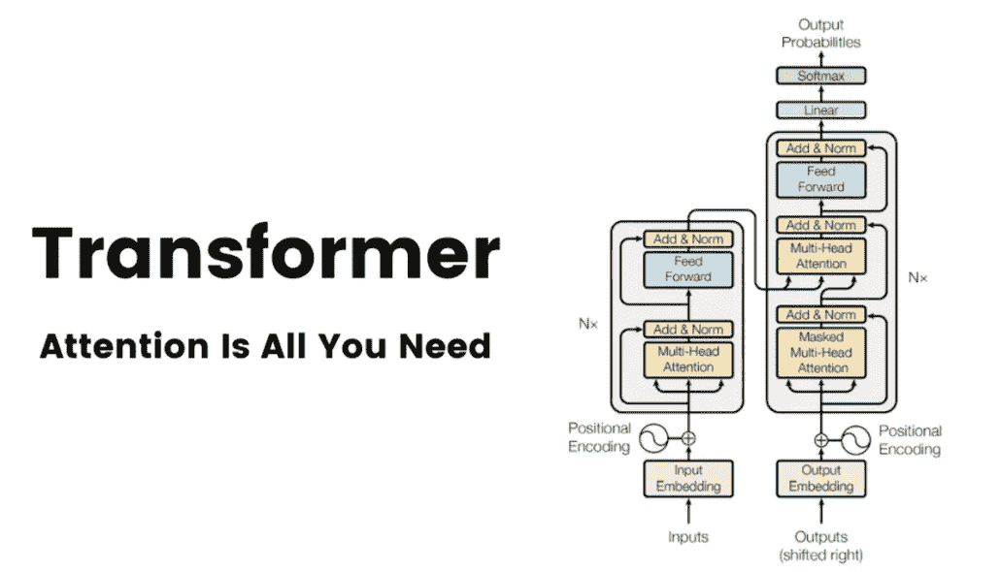

**Transformer**

一、 Transformer 的本质

**T**ransformer的起源： Google Brain 翻译团队通过论文《Attention is all you need》 提出了一种全新的简单网络架构—— Transformer，它完全基于注意力机制，摒弃了循环和卷积操作。

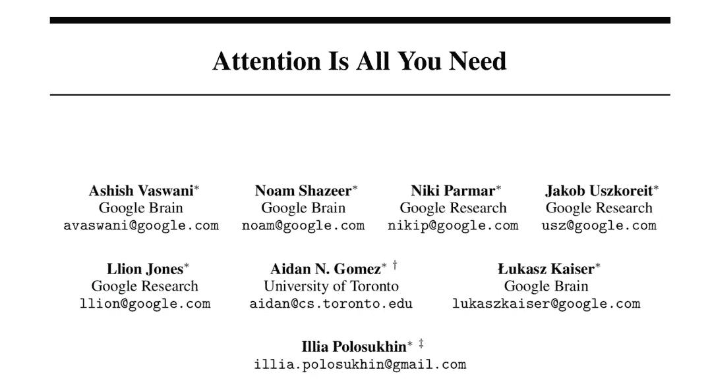

**注意力机制是全部所需**

**主流的序列转换模型RNN： ****Transformer出来之前，主流的序列转换模型都基于复杂的循环神经网络（RNN），包含编**码器和解码器两部分。当时表现最好的模型还通过注意力机制将编码器和解码器连接起来。

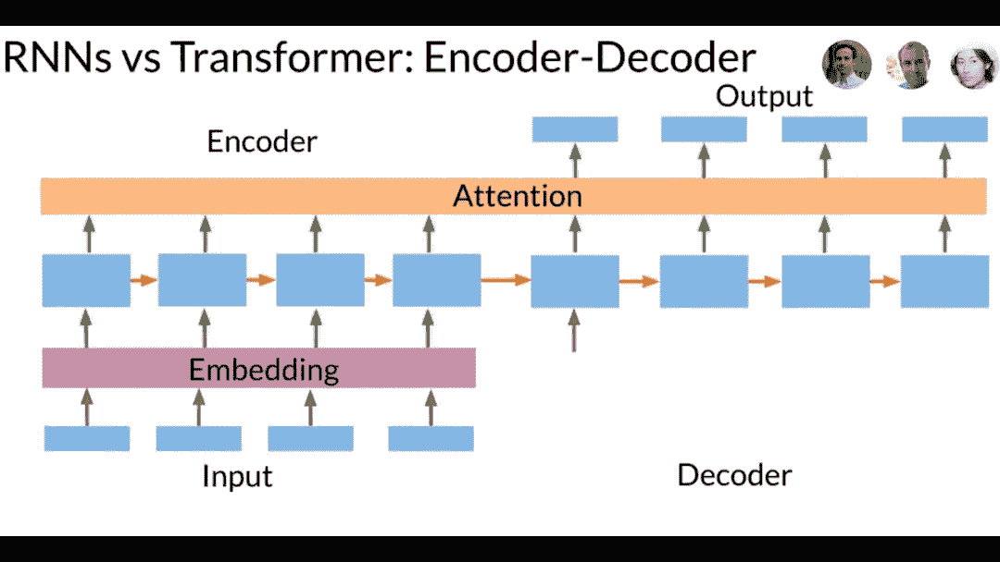

Transformer vs RNN

**循环**神经网络（RNN）、特别是长短时记忆网络（LSTM）和门控循环单元网络（GRU），已经在序列建模和转换问题中牢固确立了其作为最先进方法的地位，这些问题包括语言建模和机器翻译。

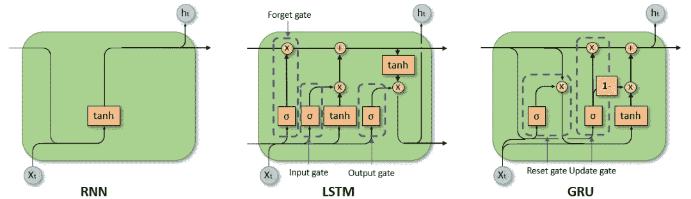

**RNN LSTM GRU **

**RNN编码器-解码器架构存在一个显**著的缺陷：处理长序列时，会存在信息丢失。

**编码器在转化序列 ****x1, x2, x3, x4**** 为单个向量 ****c**** **时，信息可能丢失。因为所有信息被压缩到这一个向量中，增加了信息损失的风险。解码器从这一向量中提取信息也很复杂。

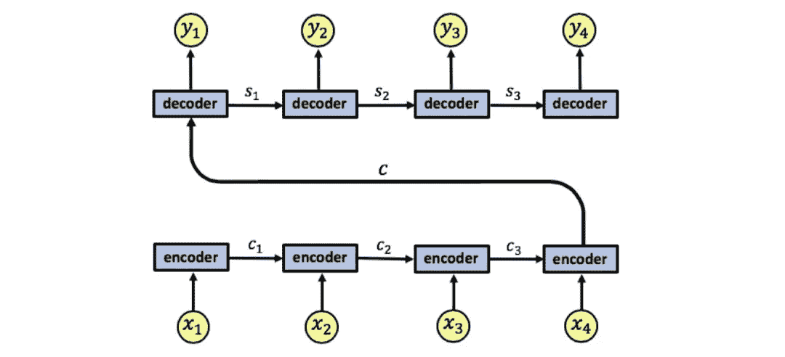

**RNN编码器-解码器架构**

**注意力机制： ****一**种允许模型在处理信息时专注于关键部分，忽略不相关信息，从而提高处理效率和准确性的机制。它模仿了人类视觉处理信息时选择性关注的特点。

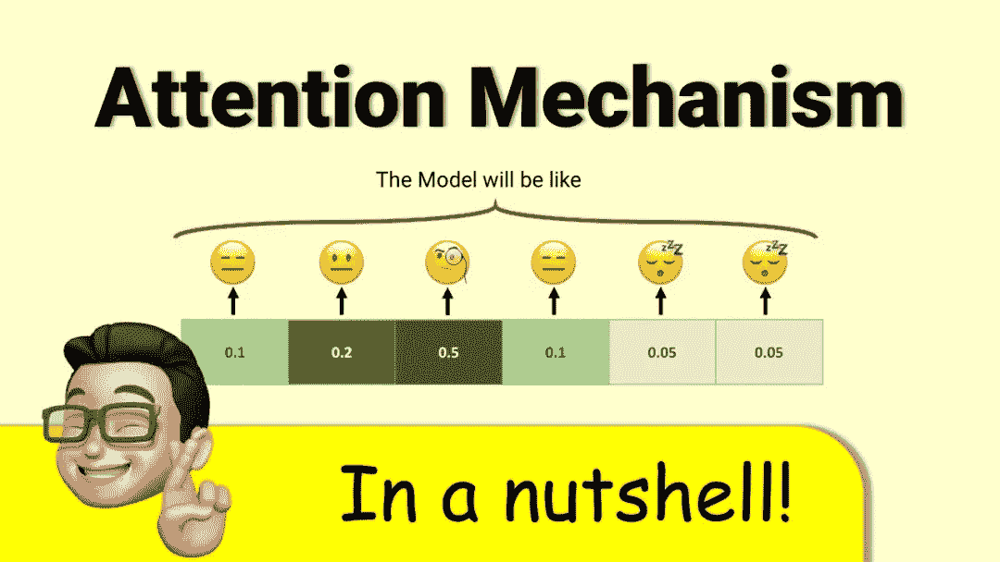

**注意力机制**

**当人类的视觉机制识别一个场景时，通常不会全面扫描整个场景，而是根据兴趣或需求集中关注特定的部分，如在这张图**中，我们首先会注意到动物的脸部，正如注意力图所示，颜色更深的区域通常是我们最先注意到的部分，从而初步判断这可能是一只狼。

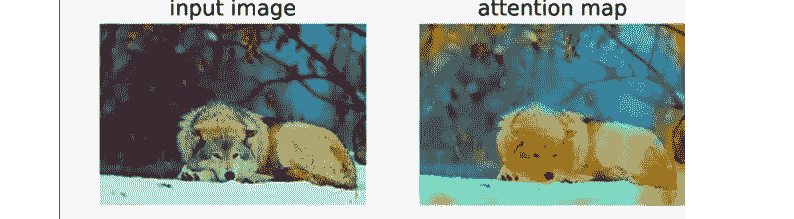

**注意力机制**

**Q、K、V： ****注**意力机制通过查询（Q）匹配键（K）计算注意力分数（向量点乘并调整），将分数转换为权重后加权值（V）矩阵，得到最终注意力向量。

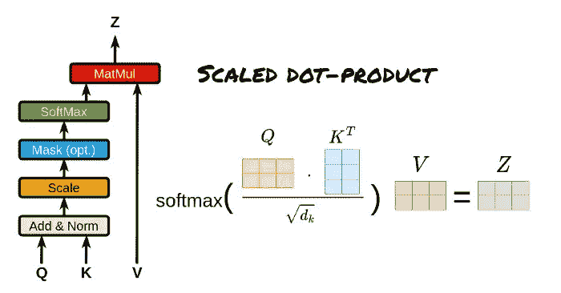

**Q、K、V计算注意力分数**

**注意力分数的价值： ****量化注意力机制中某一部分信息被关注的**程度，反映了信息在注意力机制中的重要性。

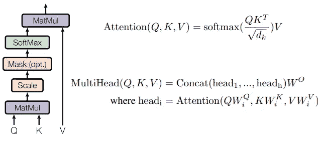

**注意力分数的价值**

**Transformer的本质： Transformer是一种基于自注意力**机制的深度学习模型，为了解决自然语言处理中的序列到序列（sequence-to-sequence）问题而设计的。

相较于RNN模型，Transformer模型具有2个显著的优势。

+   **优势一：处理长序列数据。 ****Transformer采用自注意力机制，能够同时处理序列中的所有位置，捕捉长距离依赖关系**，从而更准确地理解文本含义。而RNN模型则受限于其循环结构，难以处理长序列数据。

+   **优势二：实现并行化计算。 ****由**于RNN模型需要依次处理序列中的每个元素，其计算速度受到较大限制。而Transformer模型则可以同时处理整个序列，大大提高了计算效率。

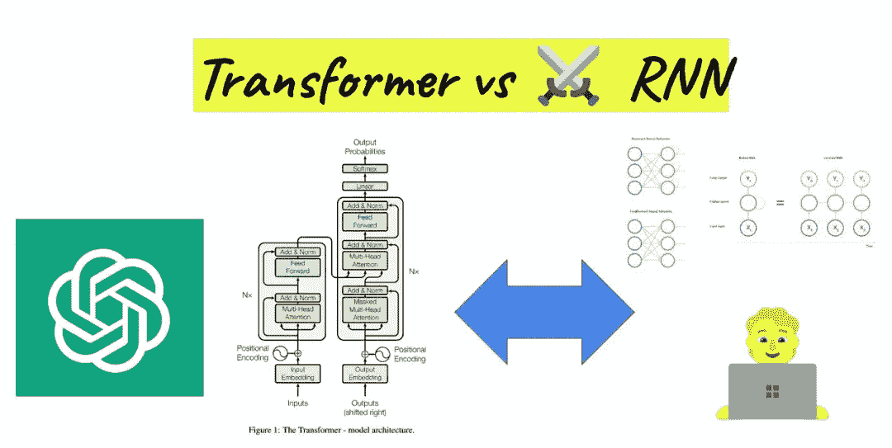

Transformer vs RNN

二、 Transformer 的原理

**编码器-解码器架构： ****E**ncoder-Decoder架构是自然语言处理（NLP）和其他序列到序列（Seq2Seq）转换任务中的一种常见框架。

**这种架构的核心思想是将输入序列编码成一个固定大小的向**量表示，然后利用这个向量来生成输出序列。

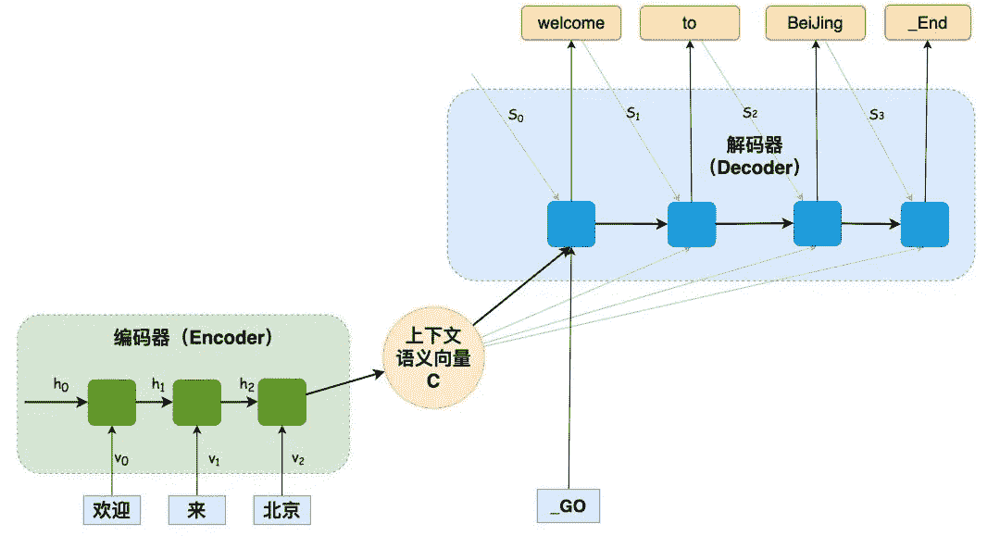

**RNN编码器-解码器架构**

**机器翻译： ****机**器翻译就是典型Seq2Seq模型，架构 包括编码器和解码器两部分。能实现从一个序列到另外一个序列的映射，而且两个序列的长度可以不相等。

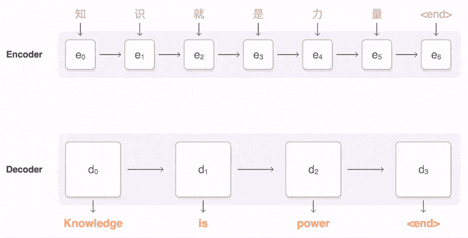

**机器翻译**

**Transformer的架构： Transformer也遵循编码器-解**码器总体架构，使用堆叠的自注意力机制和逐位置的全连接层，分别用于编码器和解码器，如图中的左半部分和右半部分所示。

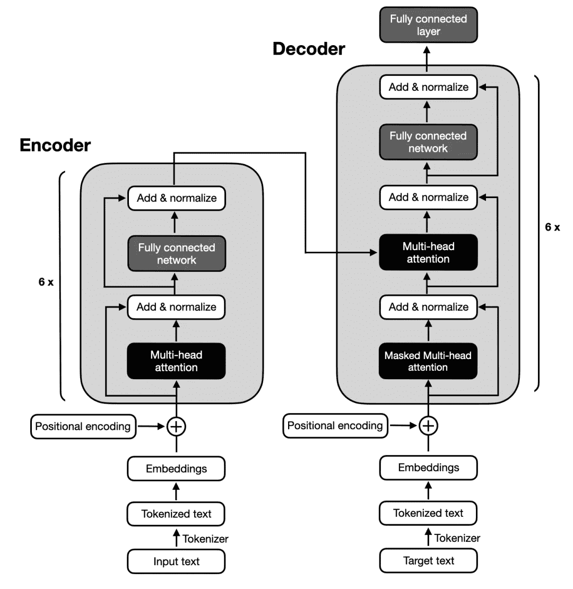

**Transformer的架构 **

+   **Encoder编码器 ：  **Transformer的编码器由6个相同的层组成，每个层包括两个子层：一个多头自注意力层和一个逐位置的前馈神经网络。 在每个子层之后，都会使用残差连接和层归一化操作，这些操作统称为Add&Norm。 这样的结构帮助编码器捕获输入序列中所有位置的依赖关系。

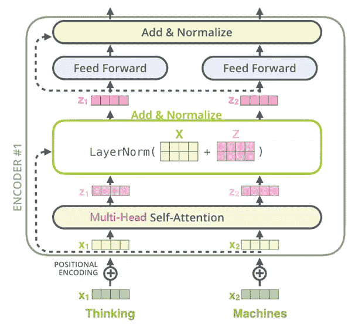

**Encoder（编码器）架构**

+   **Decoder解码器 ：  **Tr**ansformer的解码器由6个相同的**层组成，每层包含三个子层：掩蔽自注意力层、Encoder-Decoder注意力层和逐位置的前馈神经网络。每个子层后都有残差连接和层归一化操作，简称Add&Norm。 这样的结构确保解码器在生成序列时，能够考虑到之前的输出，并避免未来信息的影响。

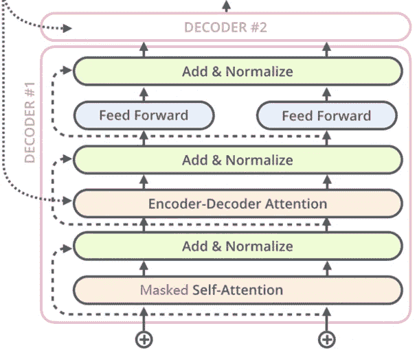

**Decoder（解码器）架构**

**编码器与解码器的本质区别：在于Sel**f-Attention的Mask机制。

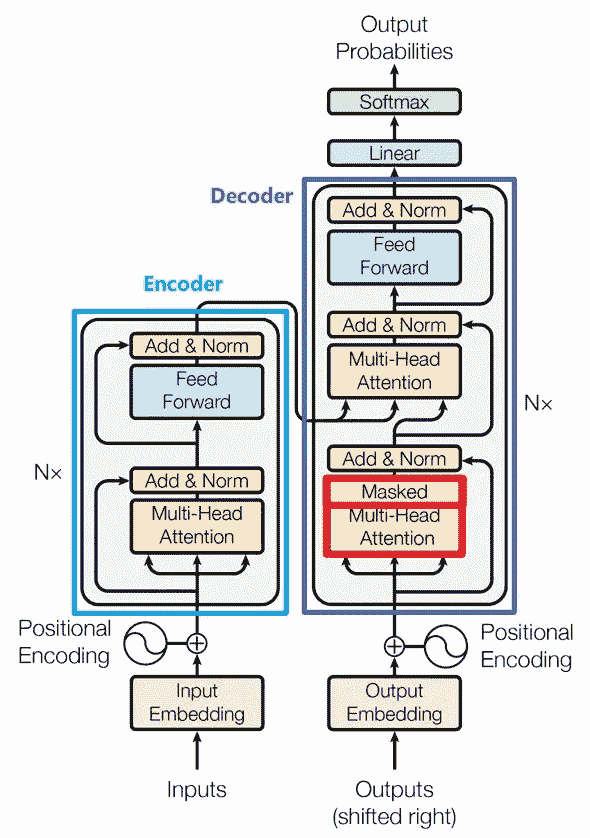

**编码器与解码器的本质区别**

**T**ransformer的核心组件： Transformer模型包含输入嵌入、位置编码、多头注意力、残差连接和层归一化、带掩码的多头注意力以及前馈网络等组件。

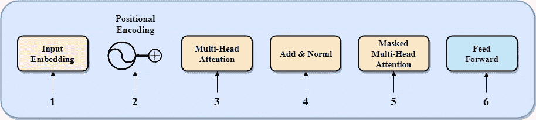

Transformer的核心组件

+   输入嵌入 ：将输入的文本转换为向量，便于模型处理。

+   **位置编码 ：给输入向量添加位置信息，因为Tran**sformer并行处理数据而不依赖顺序。

+   多头注意力 ：让模型同时关注输入序列的不同部分，捕获复杂的依赖关系。

+   **残差连接与层归一化 ：通过添加跨层连接和标准化**输出，帮助模型更好地训练，防止梯度问题。

+   **带掩码的多头注意力 ：在生成文本时，确保**模型只依赖已知的信息，而不是未来的内容。

+   前馈网络 ：对输入进行非线性变换，提取更高级别的特征。

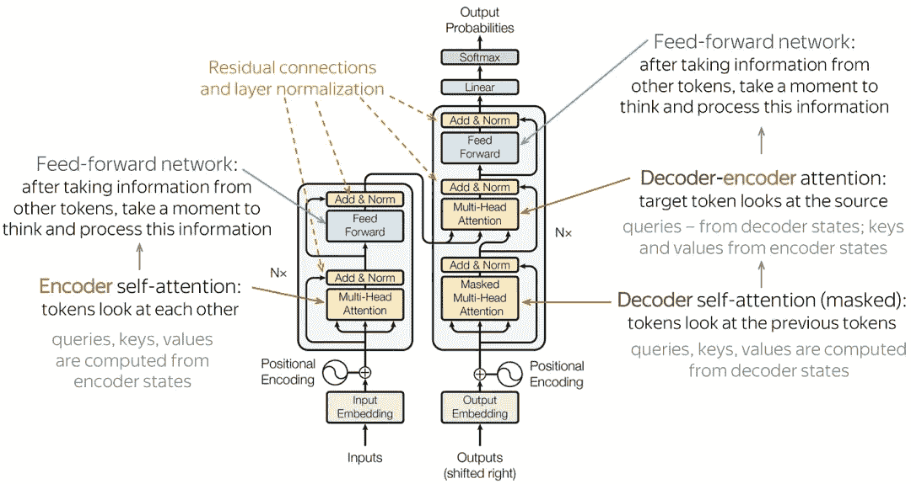

Transformer的核心组件

**Tr**ansformer的3种注意力层： 在Transformer架构中，有3种不同的注意力层（Self Attention自注意力、Cross Attention 交叉注意力、Causal Attention因果注意力）

+   **编码器中的自注意力层（Self Attention layer**）： 编码器输入序列通过Multi-Head Self Attention（多头自注意力）计算注意力权重。

+   **解码器中的交叉注意力层（Cros****s** Attention layer）： 编码器-解码器两个序列通过Multi-Head Cross Attention（多头交叉注意力）进行注意力转移。

+   **解码器中的因果自注意力层（Causa****l** Attention layer）： 解码器的单个序列通过Multi-Head Causal Self Attention（多头因果自注意力）进行注意力计算

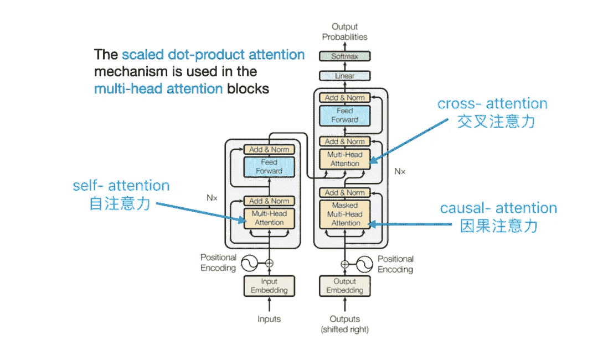

Transformer的3种注意力层

**先了解一些概念：Scaled Dot-Product Attention、 Self Attenti**on 、 Multi-Head Attention、 Cross Attention、 Causal Attention

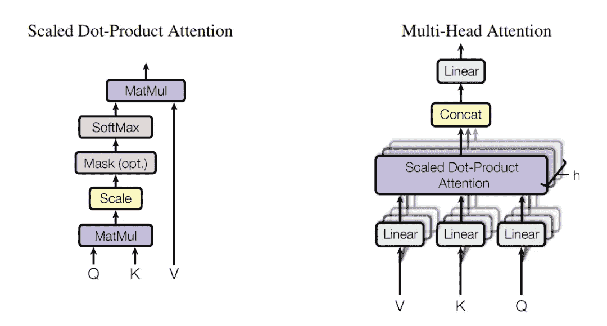

**Scaled Dot-Product Attention和M**ulti-Head Attention

**Scaled Dot-Product ****At**tention（缩放点积注意力）： 输入包括维度为dk的查询（queries）和键（keys），以及维度为dv的值（values）。我们计算查询与所有键的点积，每个点积结果都除以√dk，然后应用softmax函数，以得到注意力分数。

体现如何计算注意力分数，关注Q、K、V计算公式。

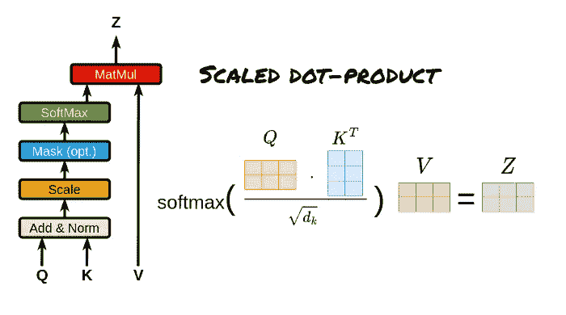

**Scaled Dot-Product** Attention（缩放点积注意力）

**S**elf Attention（自注意力）： 对同一个序列， 通过缩放点积注意力计算注意力分数， 最终对值向量进行加权求和，从而得到输入序列中每个位置的加权表示。

**表**达的是一种注意力机制， 如何使用 缩放点积注意力对 同一个序列 计算注意力分数， 从而得到同一序列中每个位置的注意力权重。

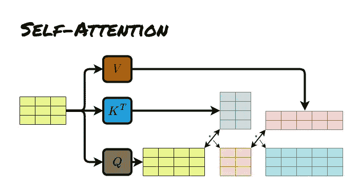

Self Attention（自注意力）

**Multi-Head Attention（多头注意力）： 多个**注意力头并行运行，每个头都会独立地计算注意力权重和输出，然后将所有头的输出拼接起来得到最终的输出。

**强调的是一种实操方法，实际操作中 我们并不会使用单个维度来执行单一的注意力**函数，而是通过h=8个头分别计算，然后加权平均 。这样 为了避免单个计算的误差。

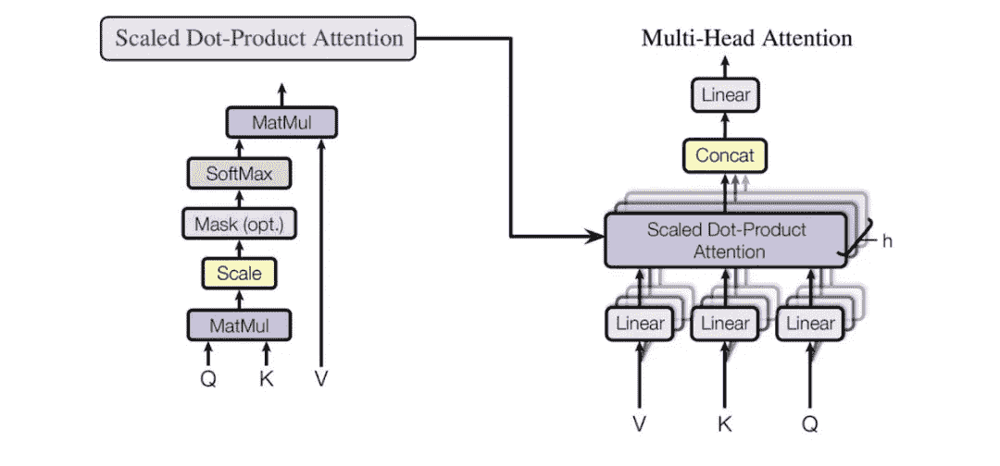

Multi-Head Attention （多头注意力）

**C**ross Attention（交叉注意力） ： 输入来自两个不同的序列， 一个序列用作查询（Q），另一个序列提供键（K）和值（V），实现跨序列的交互。

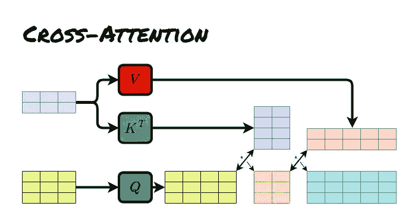

Cross Attention （交叉注意力）

**Causal Attention（因果注意力） ： 为了 确保模型在生成序列时，只依赖于之前的输**入信息，而不会受到未来信息的影响。Causal Attention通过掩盖（mask）未来的位置来实现这一点，使得模型在预测某个位置的输出时，只能看到该位置及其之前的输入。

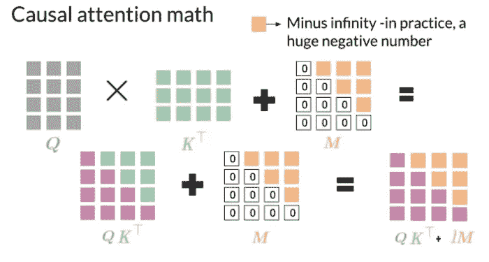

Causal Attention（因果注意力）

**疑**问一： 图中编码器明明写的是Multi-Head Attention，怎么就说是Self Attention？

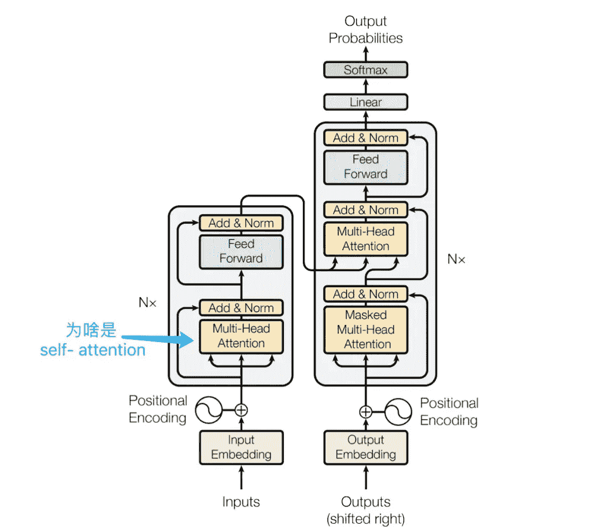

编码器的Self Attention

**疑问一解答 ： Scaled Dot-Product Attention、Self Attention、Multi-Head Attentio**n实际上说的是同一件事，从不同维度解答如何获取同一个序列中每个位置的注意力权重。 图上标注Multi-Head Attention强调需要多个头计算注意力权重。

**疑**问二： 图中编码器明明写的也是Multi-Head Attention，怎么就说是Cross Attention？

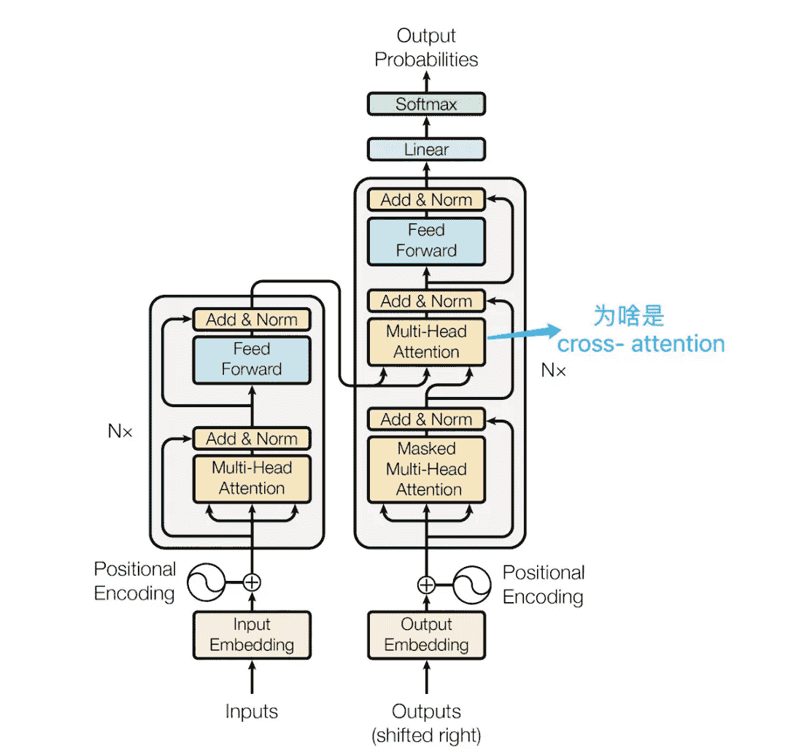

编码器-解码器的Cross Attention

**疑问二解答 ： Cross Attention、Multi-Head Attention实际上说的是也同一件事，从不同维度解答**两个不同序列之间如何进行注意力转移。 图上标注Multi-Head Attention强调需要多个头进行注意力转移计算。

**疑**问三： 图中编码器明明写的也是Masked Multi-Head Attention，怎么就说是Causal Attention？

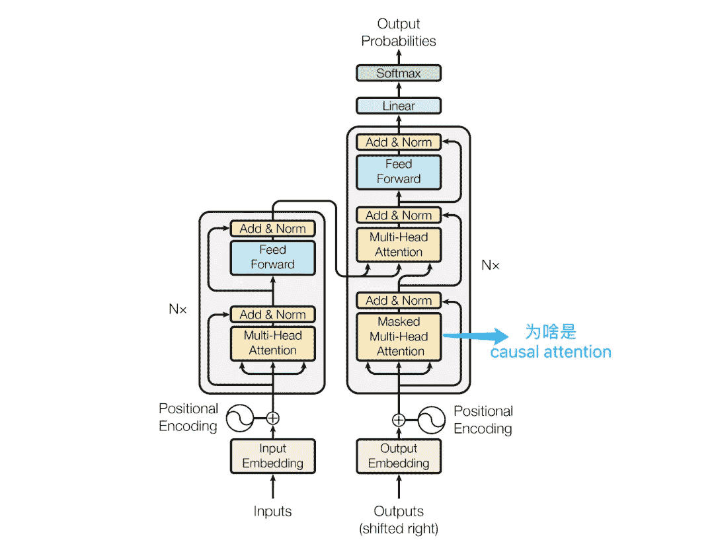

解码器的Causal Attention

**疑问三解答 ： Causal Attention、Mask Multi-Head Attention**实际上说的是也同一件事， 解码器中Self Attention如何结合Causal Attention来保持自回归属性。

**Mask Multi-Head Attention强调 使用了多个独立的注意力头，每个头都可以学习不同的注意力权重，从而**增强模型的表示能力。而Causal Attention则强调了模型在预测时只能依赖于已经生成的信息，不能看到未来的信息。

详细了解Transformer中的三种注意力机制： 神经网络算法 - 一文搞懂Transformer中的三种注意力机制

三、 Transformer 的应用

**Transformer应用NLP： 由于Transformer强**大的性能，Transformer模型及其变体已经被广泛应用于各种自然语言处理任务，如机器翻译、文本摘要、问答系统等。

+   **T**ransformer： Vaswani等人首次提出了基于注意力机制的Transformer，用于机器翻译和英语句法结构解析任务。

+   **BERT： Devlin等人介绍了一种新的语言表示模型BERT，该模型通过考虑每个单词的上下文。因为它**是双向的，在无标签文本上预训练了一个Transformer。当BERT发布时，它在11个NLP任务上取得了最先进的性能。

+   **GPT： Brown等人在一个包含45TB压缩纯文本数据的数据集上，使用1750亿个参数预训练了一个基于T**ransformer的庞大模型，称为GPT-3。它在不同类型的下游自然语言任务上取得了强大的性能，而无需进行任何微调。

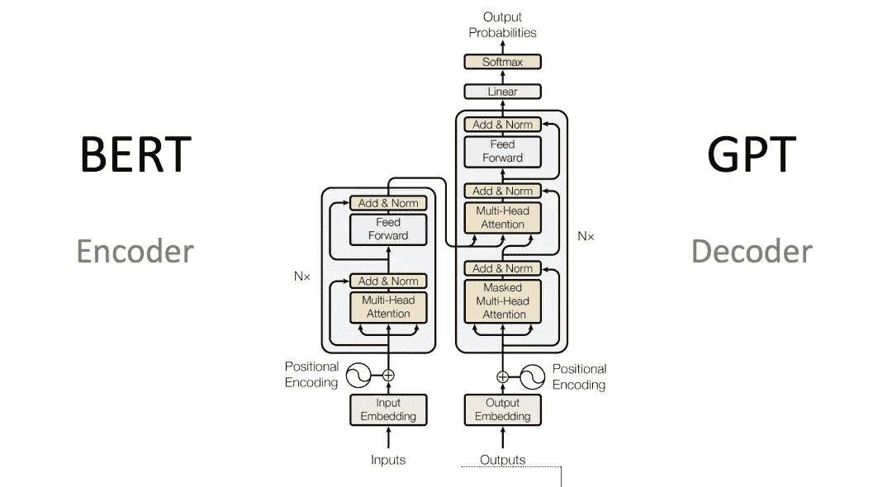

Transformer模型及其变体

**T**ransformer应用CV： Vision Transformer（ViT）是一种革命性的深度学习模型，它彻底改变了传统计算机视觉领域处理图像的方式。

+   ViT采用了Transformer模型中的自注意力机制来建模图像的特征，这与CNN通过卷积层和池化层来提取图像的局部特征的方式有所不同。

+   ViT模型主体的Block结构基于Transformer的Encoder结构，包含Multi-head Attention结构。

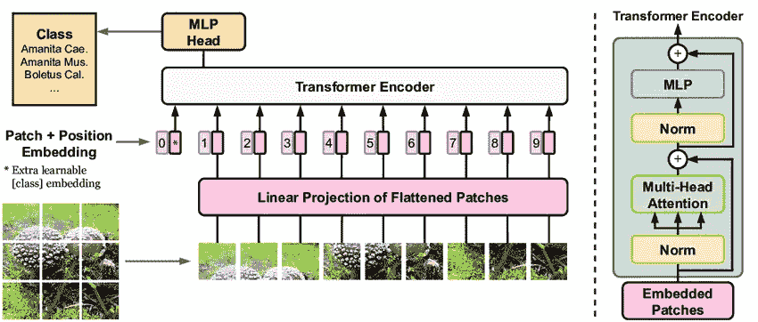

Vision Transformer

**ViT的本质： 将图像视为一系列的“视觉单词”或“令牌”**（tokens），而不是连续的像素数组。

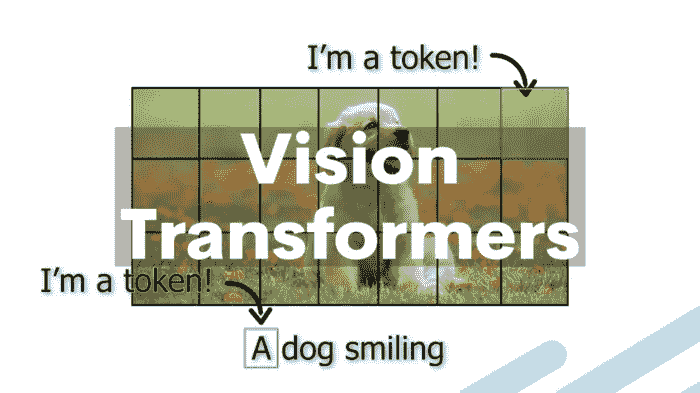

**ViT的本质**

**ViT的工作流程： 将图像分割为固定大小的图像块（patches），将其转换为Patch Embeddings，添加位置编码**信息，通过包含多头自注意力和前馈神经网络的Transformer编码器处理这些嵌入，最后利用分类标记进行图像分类等任务。

**ViT的工作流程**

[**详细了解ViT（Vision T**](http://mp.weixin.qq.com/s?__biz=MzkzMTEzMzI5Ng==&mid=2247488514&idx=1&sn=a5a1a1c0a39958e794f07383d7ed1725&chksm=c26ef61df5197f0bc9eae8b24d0b8f36d50710148fdc71a8845095609caae357e85454d975eb&scene=21#wechat_redirect)ransformer）： 神经网络算法 - 一文搞懂ViT（Vision Transformer）