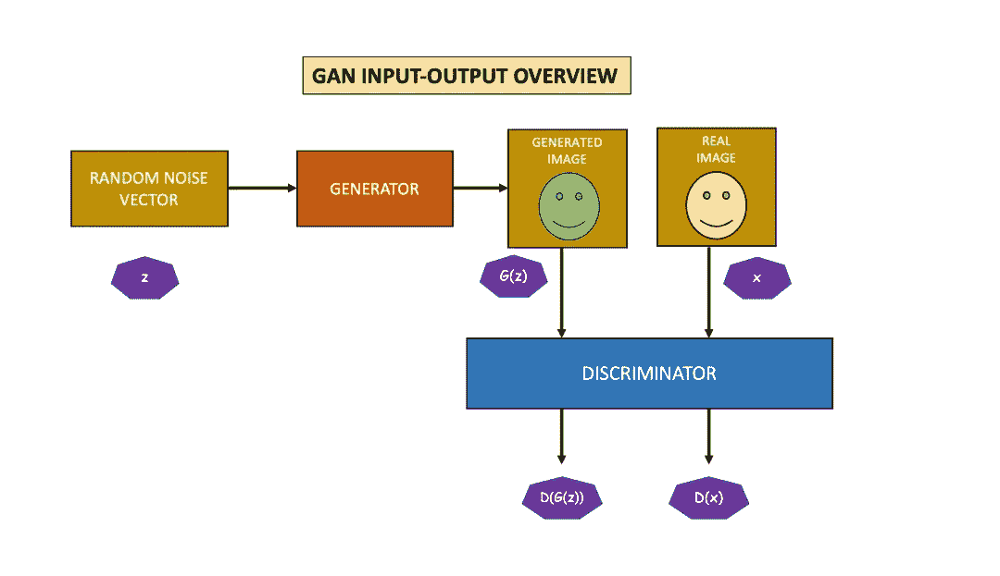
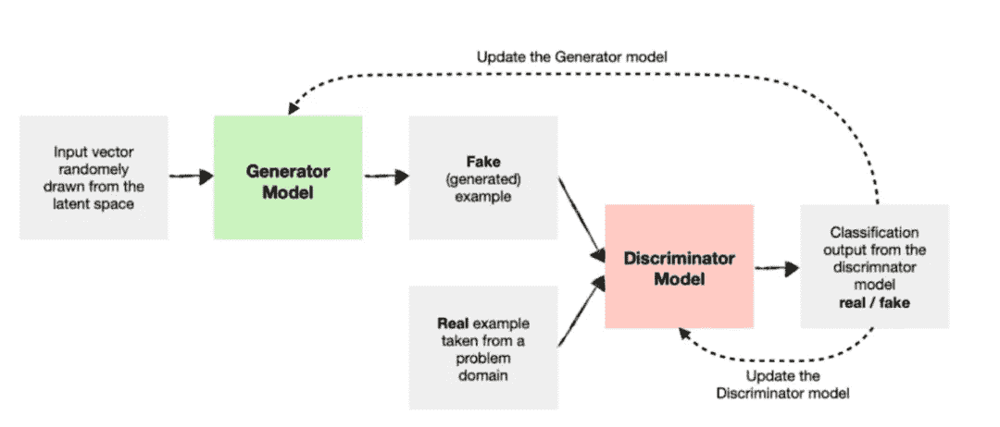
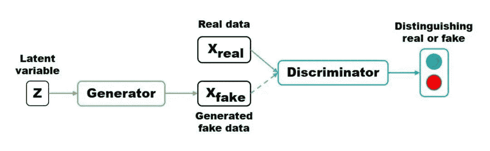
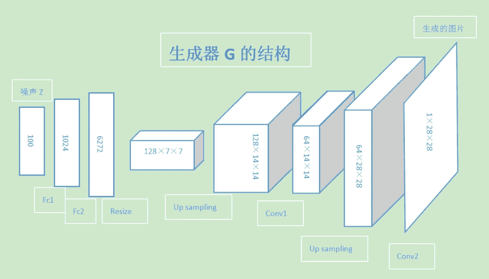
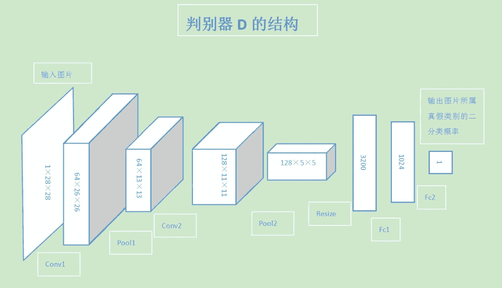
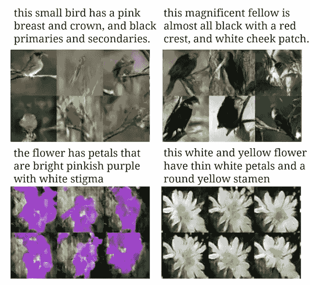
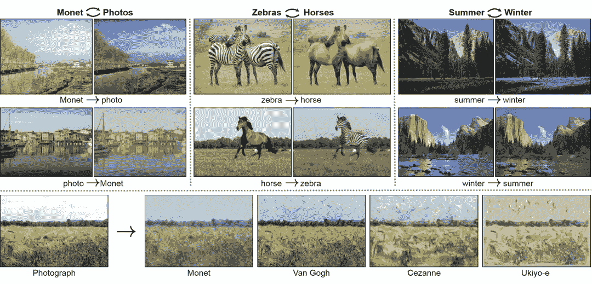

# 神经网络算法 - 一文搞懂GAN（生成对抗网络）

> 来源：[https://geekbang.feishu.cn/docx/HWNBdn1sGo06D0xr1Spc9Mn6nCf](https://geekbang.feishu.cn/docx/HWNBdn1sGo06D0xr1Spc9Mn6nCf)

> 👨🏻 作者：AllenTang

> 📃 作者介绍：分享人工智能，让所有人玩转AI

> 🛖 公众号：架构师带你玩转AI

> ⏰ 收录时间：2024-05-23 11:28:42

> 🔗 原文链接：h[ttps://mp.weixin.q](https://mp.weixin.qq.com/s?__biz=MzkzMTEzMzI5Ng==&mid=2247485815&idx=1&sn=fb0cb3b0af1d5ba42625581567fab85f&chksm=c26eeb68f519627e7f5b0c3bb3f374d84c2b408e557639ed25a98f43cb84ac80ca2294684d6f&scene=21#wechat_redirect)q.com/s?__biz=Mz...

关注作者公众号，获取更多AI知识

本文将从 GAN的本质、GAN 的原**理、 GAN架**构**改进 三个方面，带 您一文搞懂 生成**对抗网络  Generative Adversarial Networks | GAN。

**一、 GAN 的本质 **

**GAN架构 ： GAN（Generative Adversarial Networks，生成对抗网络）架构由 两个主要组件构成： 生成器**（Generator）和判别器（Discriminator）。 这两个组件在训练过程中相互对抗，共同提升，最终目标是使生成器能够生成与真实数据难以区分的新数据。

GAN架构

+   一、生成器（Generator）

+   **功能 **：负责生成新的数据样本。

+   **结构 **：通常是一个深度神经网络，输入为低维向量（如随机噪声），输出为高维向量（如图片、文本或语音）。

+   **训练目标 **：生成尽可能真实的数据，以欺骗判别器。

+   二、判别器（Discriminator）

+   **功能 **：负责区分输入的数据是真实数据还是由生成器生成的假数据。

+   **结构 **：同样是一个深度神经网络，输入为高维向量（如图片、文本或语音），输出为一个标量，表示输入数据的真实性概率。

+   **训练目标 **：尽可能准确地区分真实数据和生成数据。

+   **三、训练过程**

+   **对抗训练 **：生成器和判别器进行交替训练。在每次迭代中，先训练判别器以提高其区分能力，然后训练生成器以提高其生成能力。

+   **优化目标 **：生成器的优化目标是最大化判别器将其生成的数据误判为真实数据的概率；判别器的优化目标是最小化其误判的概率。

+   **收敛性 **：在理想情况下，随着训练的进行，生成器生成的数据分布将逐渐接近真实数据分布，判别器将无法准确区分两者。

**深度学习模型分类： ****生**成类模型通过学习数据的潜在分布来生成新样本，而判别类模型则专注于从输入数据中提取特征以进行分类或预测。

+   **一、生成类模型**

+   **概述 **：生成类模型在深度学习中关注于学习数据的潜在分布，并能够生成新的、与训练数据类似的数据样本。

+   **主要特点 **：

+   学习数据的整体分布，而不仅仅是决策边界。

+   能够生成新的、未见过的数据样本。

+   **常见模型 **：

+   生成对抗网络（GAN）

+   变分自编码器（VAE）

+   自回归模型（如 PixelRNN、PixelCNN）

+   流模型（如 Glow、RealNVP）

+   **应用场景 **：图像生成、文本生成、语音合成、数据增强等。

+   **二、判别类模型**

+   **概述 **：判别类模型主要关注于从输入数据中提取特征，并基于这些特征进行分类、回归或其他预测任务。

+   **主要特点 **：

+   学习数据的决策边界或条件概率分布。

+   通常不需要生成新的数据样本。

+   **常见模型 **：

+   卷积神经网络（CNN）

+   循环神经网络（RNN）及其变体（如 LSTM、GRU）

+   深度前馈网络（DNN）

+   决策树、支持向量机（SVM）等传统机器学习模型的深度版本

+   **应用场景 **：图像分类、目标检测、自然语言处理、语音识别、时间序列分析等。

**二、 GAN 的原理**

### **隐**变量 z 通过 Generator 生成 Xfake, 判别器负责判别输入的 data 是生成的样本 Xfake 还是真实样本 Xreal。

GAN工作原理

### **Generator（生成器）： 生成器在GAN中扮演创造者的角色，它接收随机噪声**作为灵感，通过深度神经网络的复杂变换，巧妙地生成出足以欺骗判别器的逼真数据样本。

+   **一、概述**

+   生成器是GAN（生成对抗网络）中的一个重要组成部分，它负责生成与真实数据相似的新数据样本。生成器通常是一个深度神经网络，通过对输入的低维向量（如随机噪声）进行变换和映射，输出高维的数据样本（如图像、文本等）。

+   **二、结构与组成**

+   **输入层 **：生成器的输入通常是一个低维的随机向量，也称为潜在向量或噪声向量。这个向量用于引入随机性，使得每次生成的数据样本都有所不同。

+   **隐藏层 **：生成器包含多个隐藏层，这些隐藏层通过对输入向量进行非线性变换和组合，逐渐提取和构建出数据的复杂特征。隐藏层的数量和结构可以根据具体任务和数据集进行调整。

+   **输出层 **：生成器的输出层负责将隐藏层的特征映射为最终的高维数据样本。对于图像生成任务，输出层通常是一个具有与真实图像相同维度和通道数的张量。

+   **三、训练与优化**

+   在GAN的训练过程中，生成器的目标是生成尽可能真实的数据样本，以欺骗判别器。生成器通过与判别器进行对抗训练，不断优化自身的参数，使得生成的数据分布逐渐接近真实数据分布。

+   生成器的优化通常使用梯度下降算法，通过计算损失函数对生成器参数的梯度，更新生成器的参数，以最小化判别器将生成样本识别为假样本的概率。

生成器G的结构

**Di**scriminator（判别器）： 判别器D在生成对抗网络（GAN）中扮演“评判者”或“鉴别者”的角色。 它的核心任务是区分输入数据是来自真实数据集还是由生成器G生成的假数据。

+   **一、概述**

+   判别器D是生成对抗网络（GAN）中的关键组件之一，与生成器G共同构成这一框架的两大支柱。判别器的主要任务是区分输入数据是来自真实的数据集还是由生成器生成的假数据。通过不断地与生成器进行对抗训练，判别器努力提升自己的判别能力，以更准确地识别真实和生成的样本。

+   **二、结构与组成**

+   **输入层 **：判别器的输入可以是任意形式的数据，如图像、音频片段或文本序列。这些数据要么是来自真实世界的样本，要么是由生成器生成的样本。

+   **隐藏层 **：判别器通过一系列隐藏层处理输入数据。这些隐藏层包含各种神经元和激活函数，用于提取输入数据的特征，并逐步抽象出其代表性信息。

+   **输出层 **：判别器的输出层通常是一个单一神经元或少数几个神经元，负责产生最终判断结果。在标准的GAN设置中，输出层使用sigmoid激活函数，输出一个介于0和1之间的标量，表示输入数据来自真实数据集的概率。

+   **三、工作原理**

+   判别器D通过监督学习的方式进行训练。在训练过程中，判别器接收到两类数据：标记为“真实”的数据（来自真实数据集）和标记为“生成”的数据（来自生成器G）。判别器的目标是最大化对真实数据的正确分类概率，同时最小化对生成数据的错误分类概率。

判别器D的结构

**三、 GAN架构改进**

**文**本到图像 ：  “Generative Adversarial Text to Image Synthesis”

文本到图像

+   **一、论文概述**

+   “Generative Adversarial Text to Image Synthesis”是一篇探讨文本到图像生成技术的论文。该论文提出了一种基于生成对抗网络（GAN）的方法，旨在将给定的文本描述转换为相应的图像。通过训练一个生成器和一个判别器，该方法能够生成与文本描述相符的高质量图像。

+   **二、方法与技术**

+   **文本编码器 **：首先，使用一个文本编码器将输入的文本描述转换为一种中间表示。这种表示能够捕捉到文本中的关键语义信息，并为后续的图像生成提供指导。

+   条件生成对抗网络（Conditional GAN） ：论文采用条件生成对抗网络作为基本的框架，其中生成器的任务是根据文本编码器的输出生成相应的图像，而判别器的任务则是判断生成的图像是否与给定的文本描述相符。

+   **对抗训练 **：通过同时训练生成器和判别器，使它们在对抗中相互提升。生成器努力生成更真实的图像以欺骗判别器，而判别器则努力区分生成的图像和真实图像。这种对抗训练有助于提高生成图像的质量和符合度。

+   **跨模态映射 **：为了将文本描述映射到图像空间，论文采用了一种跨模态映射策略。通过建立文本和图像之间的对应关系，并学习从文本到图像的映射函数，实现了文本到图像的转换。

+   **三、实验结果与评估**

+   该论文在多个数据集上进行了实验，并展示了生成的图像样例。实验结果表明，该方法能够生成与文本描述相符的高质量图像，并且在不同的数据集上都取得了良好的效果。此外，论文还采用了一些评估指标来量化生成图像的质量，如视觉质量评估和用户研究等。

+   **四、贡献与意义**

+   该论文的贡献在于提出了一种有效的文本到图像生成方法，并展示了其在不同数据集上的优越性能。该方法为文本到图像的转换提供了一种新的解决方案，并在计算机视觉和自然语言处理领域引起了广泛关注。

**图像**到图像：   “Unpaired Image-to-Image Translation using Cycle-Consistent Adversarial Networks”（CycleGAN）

图像到图像

+   **一、论文简介**

+   CycleGAN是一种用于非配对图像到图像转换的方法，它基于生成对抗网络（GAN）的架构，并引入了循环一致性的概念。该论文提出了一种新颖的网络结构，旨在解决图像转换任务中缺乏成对训练数据的问题。CycleGAN能够在没有直接对应关系的图像集合之间学习映射，从而实现将一类图像转换为另一类风格相似图像的能力。

+   **二、方法与技术**

+   **生成对抗网络（GAN） **：CycleGAN基于GAN的基本原理，包含生成器和判别器两个部分。生成器负责将源图像转换为目标风格的图像，而判别器则用于区分生成的图像和真实目标风格的图像。

+   **循环一致性损失 **：为了解决非配对图像转换的问题，CycleGAN引入了循环一致性的概念。它训练两个生成器，分别将图像从源域转换到目标域，以及从目标域转换回源域。通过确保原始图像和经过两次转换后的图像之间的差异最小化，CycleGAN能够在没有成对训练数据的情况下学习有效的映射。

+   **对抗性损失 **：除了循环一致性损失外，CycleGAN还使用了传统的对抗性损失。生成器尝试生成与目标风格相符的图像以欺骗判别器，而判别器则努力区分生成的图像和真实图像。这种对抗性训练有助于提高生成图像的质量和逼真度。

+   **三、实验结果与评估**

+   CycleGAN在多个图像转换任务上进行了实验，包括风格转换、物体变形和季节转换等。实验结果表明，CycleGAN能够生成高质量的目标风格图像，并且在保持源图像内容的同时实现风格转换。此外，通过与其他方法的比较，CycleGAN展示了在非配对图像转换任务中的优越性。

+   **四、贡献与意义**

+   CycleGAN的主要贡献在于解决了非配对图像转换的问题，为图像到图像的转换提供了一种新的方法。它打破了传统方法中对成对训练数据的依赖，扩展了图像转换任务的应用范围。