# 神经网络算法 - 一文搞懂GNN（图神经网络）

> 来源：[https://geekbang.feishu.cn/docx/M6D6dgVbjo0IVVxkIoMcpYeDnm9](https://geekbang.feishu.cn/docx/M6D6dgVbjo0IVVxkIoMcpYeDnm9)

> 👨🏻 作者：AllenTang

> 📃 作者介绍：分享人工智能，让所有人玩转AI

> 🛖 👸号：架构师带你玩转AI

> ⏰ 收录时间：2024-05-23 11:28:42

> 🔗 原文链接：h[ttps://mp.weixin.q](https://mp.weixin.qq.com/s?__biz=MzkzMTEzMzI5Ng==&mid=2247488142&idx=1&sn=9cf39bddb3f7a2023575656a544dde4a&chksm=c26ef091f5197987c47ef0184e1f6fd15e93812cd34f7305177c4b49666b01eb89d26be1b200&scene=21#wechat_redirect)q.com/s?__biz=Mz...

关注作者👸号，获取更多AI知识

本文将从 GNN的本质 、GNN 的原理 、GNN 的应用 三个方面，带 您一文搞懂 图神经网络 Graph Neural Network｜ GNN 。

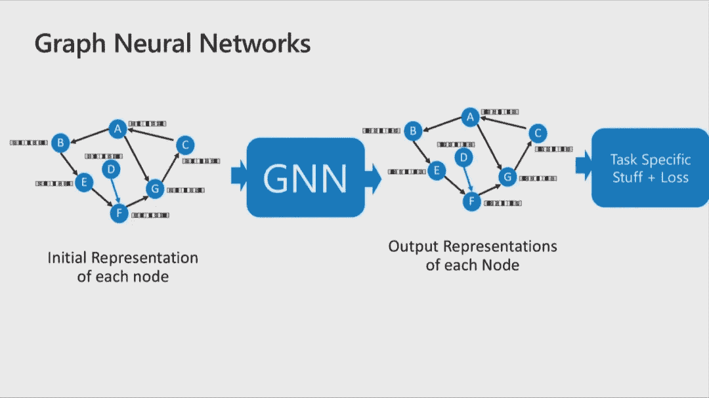

**图神经网络GNN**

**一、GNN 的本质**

**GNN的定义： ****G**NN，即图神经网络（Graph Neural Network），是一种基于图结构的深度学习模型，专门用于处理图数据。

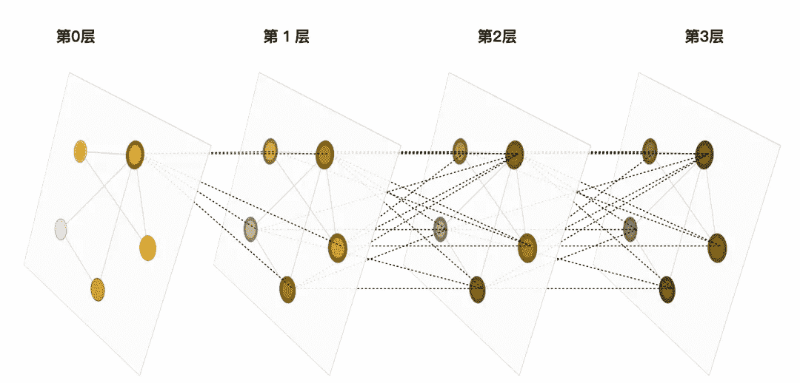

**图神经网络GNN**

**图的定义： ****图是由节点（或顶点）和边组成的数学结构，用于表示对象之间的关**系。节点代表实体，边表示节点之间的连接。

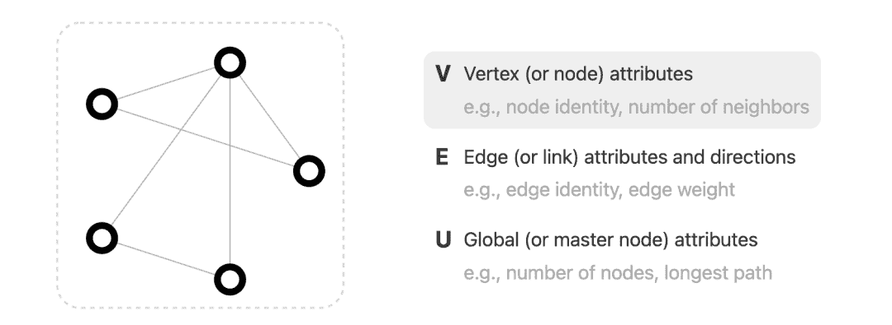

**图的定义**

**图的信息： ****为了更详细地描述图的节点、边或整体，我们可以在图的这些部分中存储相关信**息。节点可存储实体的属性，边可存储节点间关系的详细信息，而整个图可存储全局信息。

**这些信息有助于全面理解图的结构和含义，并为图分析和算法应用提供基础。在图神**经网络中，这些信息通常作为特征向量或权重矩阵输入模型，用于学习节点和图的表示。

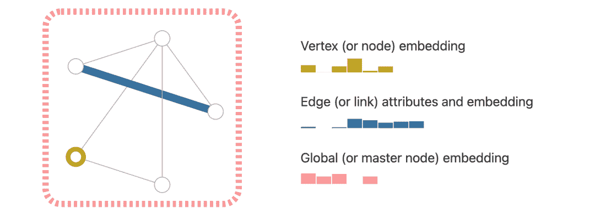

**图的信息**

**图的表示 ： ****图的邻接表和邻接矩阵是两种常用的表示图的数据结**构，用于描述图中各个顶点之间的连接关系。

**邻接表是图的一种链式存储结构。 图的顶点用一维数组存储，数组中**的每一个元素都是指向第一个邻接点的指针，便于用链表表示顶点的所有邻接点。

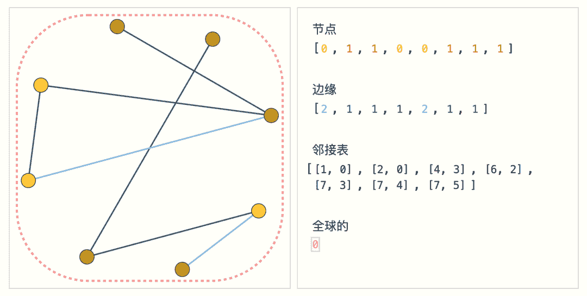

**邻接表**

**邻**接矩阵是图的一种矩阵表示法。 用一个二维数组表示图中各顶点之间的关系。矩阵的行和列分别对应图中的顶点，矩阵中的元素表示顶点之间的连接关系。

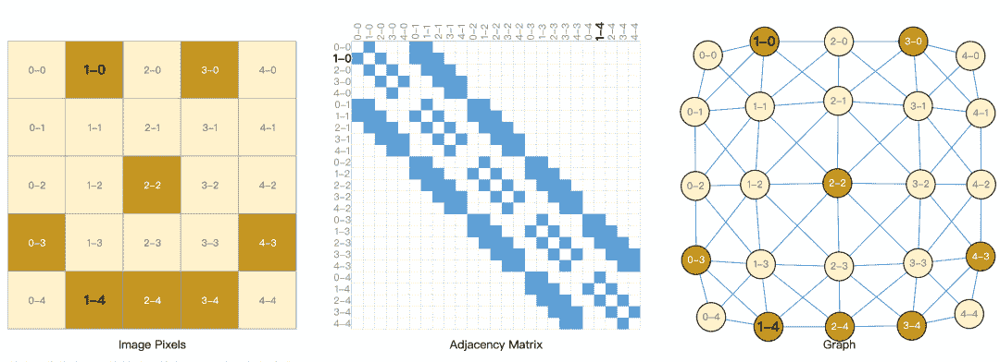

**邻接矩阵**

**二、GNN的原理**

**GNN的架构 ： ****GNN包含三个主要的函数， ****节****点函数（node function）、**边函数（edge function）和全局函数（global function）。 这些函数共同作用于图的各个组件（节点、边和全局上下文），以产生新的嵌入或输出。

1.  **节点函数 ****：负责更新节点的嵌入，通过聚合来自邻居节**点的消息。 节点函数可以是任何可微分的函数，如多层感知机（MLP）或循环神经网络（RNN）。

1.  **边函数 **：定义如何从边传递消息到相邻节点，**根据边的特性及两端节点的特征计算消息。 边函**数同样 可以是任何可微分的函数，如多层感知机（MLP）或循环神经网络（RNN）。

1.  **全局函数 **：基于所有节点和边的信息生成整个图的表示，用于图级别的预测任务。 全局函数 可以通过聚合所有节点的表示或应用某种形式的池化操作来实现。

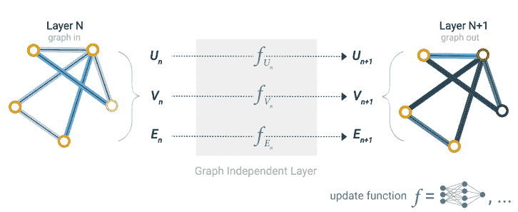

**GNN的架构**

**GNN的工作原理 ： GNN层中使用池化和消息传递机制，我们可以构建**出更复杂的GNN模型，这些模型能够捕获图的连接性和结构信息，以做出更准确的预测。

消息传递机制通常包括以下三个关键步骤：

1.  消息生成（Message Gener**a****t**ion） ：对于图中的每个节点，我们首先需要收集其所有相邻节点的信息（即“消息”）。 这通常是通过将相邻节点的嵌入（或特征）通过一个函数 g （例如一个线性变换或一个神经网络）来生成消息。 这些消息可以包含关于相邻节点特征的信息，以及它们与中心节点之间的关系。

1.  消**息聚合（Message Aggregati**on） ：接下来，我们需要将中心节点收到的所有消息聚合起来。这通常是通过一个聚合函数（如求和、平均、最大池化等）来完成的。 聚合函数的目的是将多个消息合并成一个单一的向量，这个向量将代表中心节点的邻域信息。

1.  节**点更新（Node Update） ：最后**，我们使用聚合后的消息来更新中心节点的嵌入。这通常是通过将聚合后的消息通过一个更新函数（如一个神经网络）来实现的。 更新函数的作用是结合中心节点当前的嵌入和邻域信息，以产生一个新的、更丰富的嵌入。

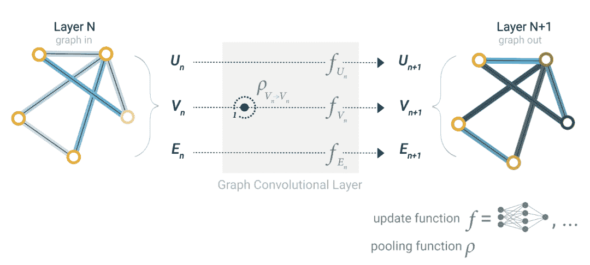

**GNN的工作原理**

**图注意力网络（GAT）： 图属性****之间传递信息的另一种方式是通过注意力。** GAT是一种在图神经网络（GNN）基础上引入注意力机制的模型。 这种机制允许模型在聚合邻居节点信息时，根据节点之间的关系动态地分配不同的权重。

对于每条边，都会计算、归一化交互分数并用于对节点嵌入进行加权 ， 从而帮助模型更好地理解和捕捉图结构中的信息。 Transformer 可以被视为具有注意力机制的 GNN。

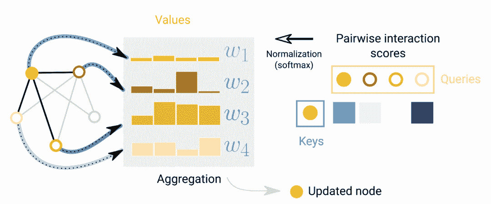

**图注意力网络GAT**

**三、GNN的应用  **

**社交网络分析： ****基**于信息学、数学、社会学、管理学、心理学等多学科的融合理论和方法，旨在理解人类各种社交关系的形成、行为特点分析以及信息传播的规律。

**社交网络分析**

**GNN作为一种可以处理图数据的新一代A**I模型， 具有独特的优势来处理社交网络中的非规则结构数据和提取隐含的社交网络结构和模式。

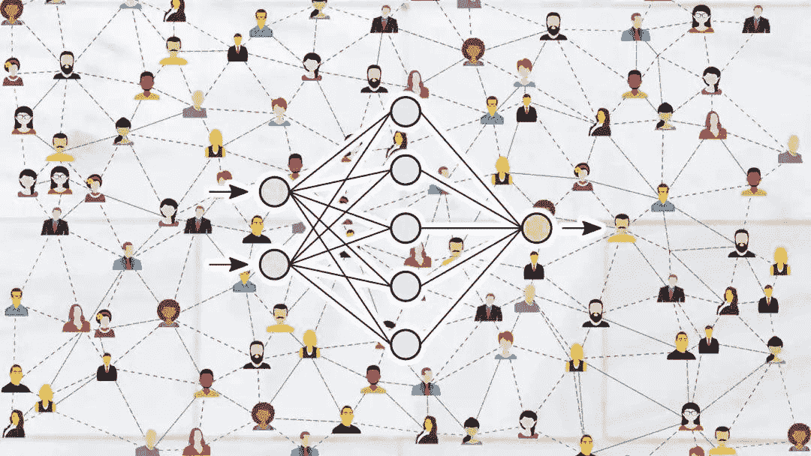

**GNN应用 社交网络分析**

以下是GNN在社交网络分析中的4个主要应用：

**社区发现： ****GNN通过学习节点间的连接和特征，可以发现隐藏在社交网络中的隐含社区结构。**通过对节点进行嵌入表示，GNN能够将相似节点聚集在一起，从而实现有效的社区发现。

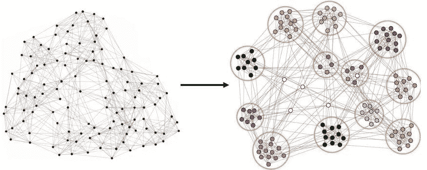

**社区发现**

**链接预测： ****在**社交网络中，链接预测可以用于推荐好友、预测用户行为等应用。通过对图结构的分析和建模，GNN可以提高链接预测的准确性和效果。

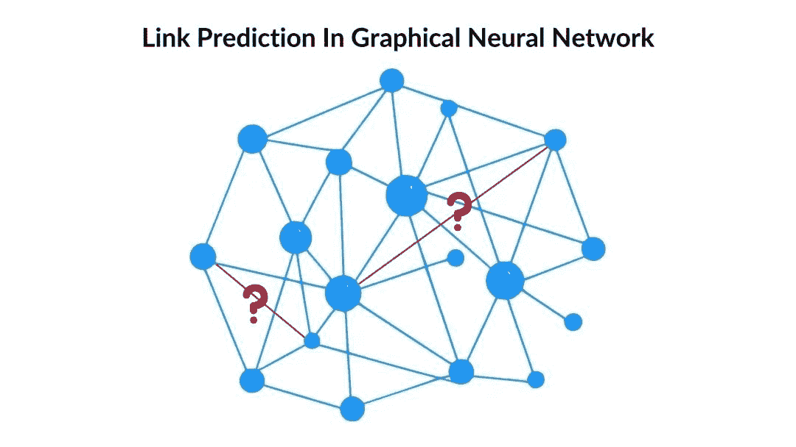

**链接预测**

**节点分类： ****GNN通过迭代更新节点的特征向量，从而获得节点的表示。然后，可以应用线性分类器**或其他机器学习模型来预测未标记节点的类别，从而对社交网络中的节点进行分类和分析。

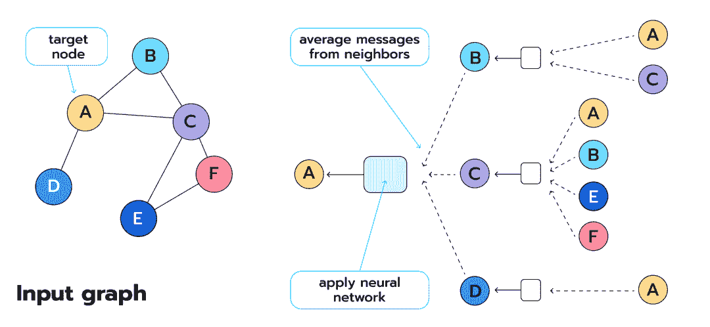

**节点分类**

**个性化推荐： ****G**NN可以挖掘用户关系，为用户推荐更符合他们需求和兴趣的内容。通过学习和分析用户之间的社交关系，GNN可以提供更精准的推荐服务。

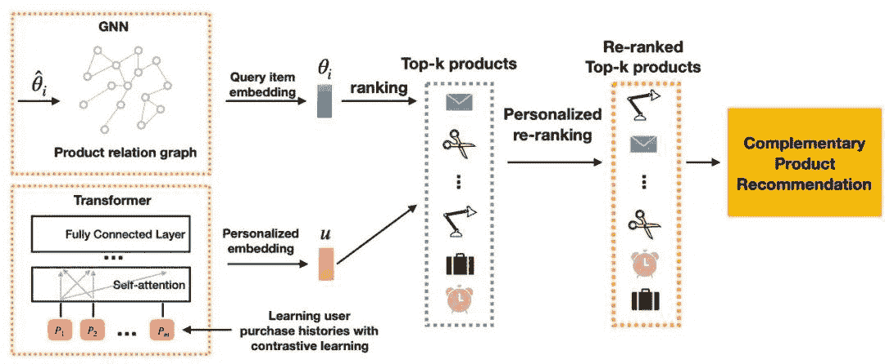

**个性化推荐**