# 神经网络算法 - 一文搞懂SNN（脉冲神经网络）

> 来源：[https://geekbang.feishu.cn/docx/PJsBd5B0XoP0D3x4bFvcngwInOP](https://geekbang.feishu.cn/docx/PJsBd5B0XoP0D3x4bFvcngwInOP)

> 👨🏻 作者：AllenTang

> 📃 作者介绍：分享人工智能，让所有人玩转AI

> 🛖 👸号：架构师带你玩转AI

> ⏰ 收录时间：2024-05-23 11:28:42

> 🔗 原文链接：h[ttps://mp.weixin.q](https://mp.weixin.qq.com/s?__biz=MzkzMTEzMzI5Ng==&mid=2247488344&idx=1&sn=4840ddc389a66ce41064593e93043067&chksm=c26ef147f5197851eb35026fb2b9fe22f32c8bbedd375f4cdfa327cb80597d54928f2a260019&scene=21#wechat_redirect)q.com/s?__biz=Mz...

关注作者👸号，获取更多AI知识

本文将从 SNN的本质 、SNN 的**原理 、SNN 的应用 三个方面**，带 您一文搞懂 脉冲神经网络 Spiking Neural Network｜ SNN 。

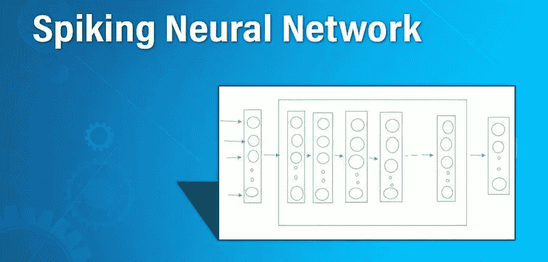

**脉冲神经网络SNN**

**一、 SNN 的本质**

**SNN的定义： 脉冲神经网络（SNN）是一种受生物神经元启发的新一代人工神经**网络模型， 其独特之处在于信息以脉冲的形式传递，每个脉冲都代表一个特定的信息。

**脉冲**神经网络 (SNN) 属于第三代神经网络模型，实现了更高级的生物神经模拟水平。除了神经元和突触状态之外，SNN 还将时间概念纳入了其操作之中，是一种模拟大脑神经元动力学的一类很有前途的模型。

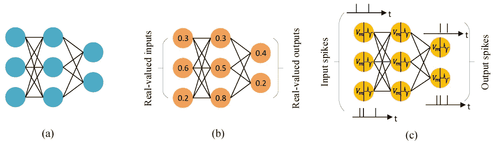

**SNN的定义**

第一代、第二代和第三代神经网络的概述：

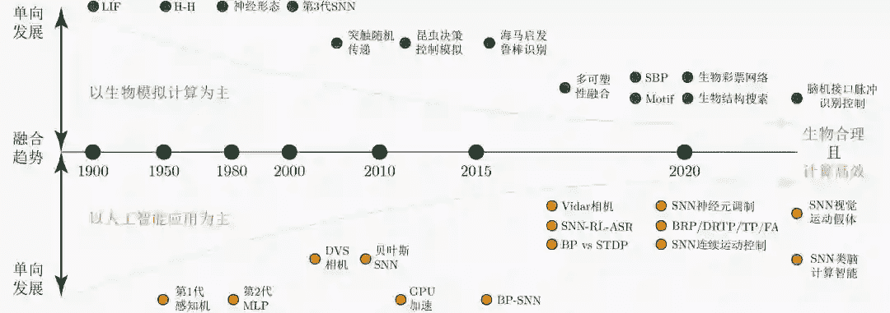

**SNN历史发展时间简表**

### **第一代神经网络：单层感知器（ Sing**le Layer Perceptron）

+   **定义 **：感知器是神经网络中最简单的形式，它只有两层神经元，一个输入层和一个输出层。

+   **特点 **：感知器主要用于解决二分类问题，并且是线性的。

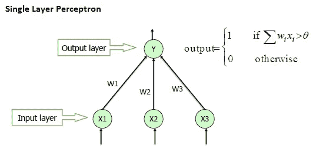

**单层感知器SLP**

### **第二代神经网络：BP神经网络（Backpropaga**tion Neural Network）

+   **定义 **：BP神经网络，也称为反向传播神经网络或多层感知器（**MLP），是包含多个隐藏层的神经网络。 它通过**反向传播算法来训练网络，该算法根据网络输出与期望输出之间的误差来调整网络的权重。

+   **特点 **：BP神经网络可以处理非线性问题，因为隐藏层中的神经元可以学习并提取输入数据的非线性特征。

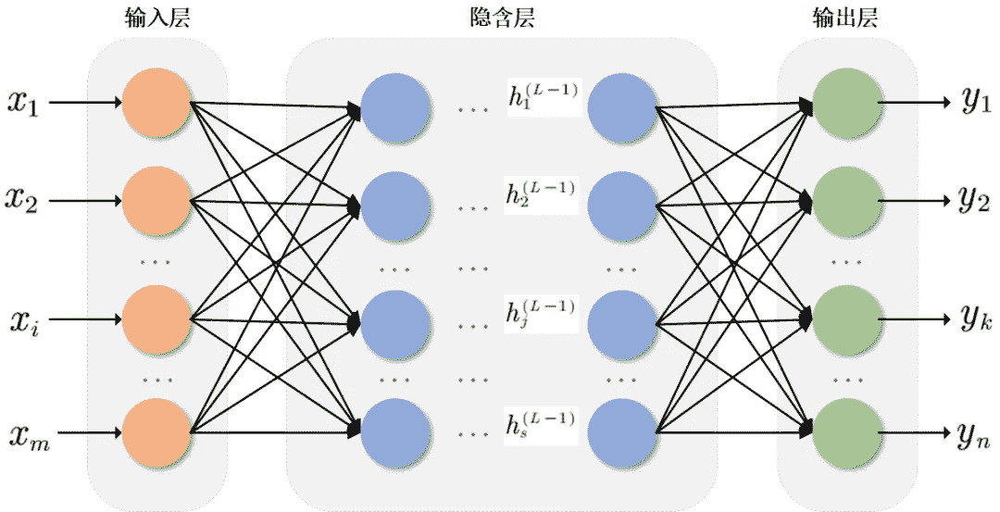

**BP神经网络**

### **第三代神经网络：脉冲神经网络（Spiking** Neural Network，SNN）

+   **定义 **：脉冲神经网络是一种模拟生物神经元脉冲发放和信息传递过程的神经网络。在SNN中，神经元通过发放脉冲来传递信息。

+   **特点 **：SNN与生物神经网络更加接近，因为它们使用脉冲而不是连续值来传递信息。

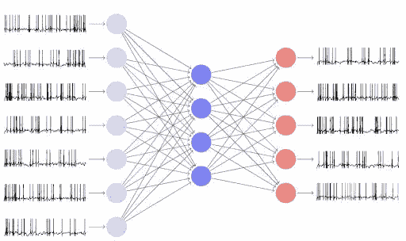

**脉冲神经网络SNN**

**SNN的本质： 模拟生物神经元的工作机制，以脉冲（spike）作为信息传递的基本单元。 这种**网络模型不仅追求在功能上与生物神经网络相似，更在结构上力求接近真实的生物神经元。

**人类大脑是一个非常复杂的系统，由大约900亿神经元组成，这些神经元通过万**亿计的突触进行结构性的连接。神经元间的信息通过电脉冲信号传递，称为Spikes。

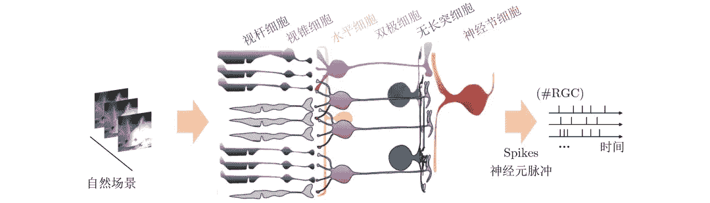

**神经元脉冲Spikes **

**二、 SNN 的原理**

**SNN的架构 ： ****模拟生物神经元通过脉冲传递信息的方式，包括神经元模**型、突触模型、网络结构， 如下图所示：

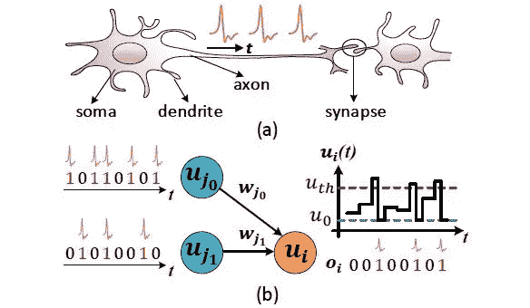

**SNN的架构**

1.  **神经元模型 **：SNN中的神经元模型用于模拟生物神经元的脉冲产生和传递过程。这些模型通常包括膜电位、阈值、脉冲发放等参数。

1.  **突触模型 **：突触是神经元之间连接的结构，负责传递信息。在SNN中，突触模型可以模拟不同类型的突触（如兴奋性突触和抑制性突触），以及突触的可塑性（即突触权重可以随着时间的推移而改变）。

1.  **网络结构 **：SNN的网络结构可以包括多层前馈网络、递归网络等。这些网络结构可以模拟生物神经系统中不同层次的神经元之间的连接关系

**SNN的训练算法 ： ****由**于SNN的脉冲传递方式与传统神经网络不同，因此需要开发专门的学习算法来训练SNN。 这些算法可以包括无监督学习、监督学习和强化学习等。

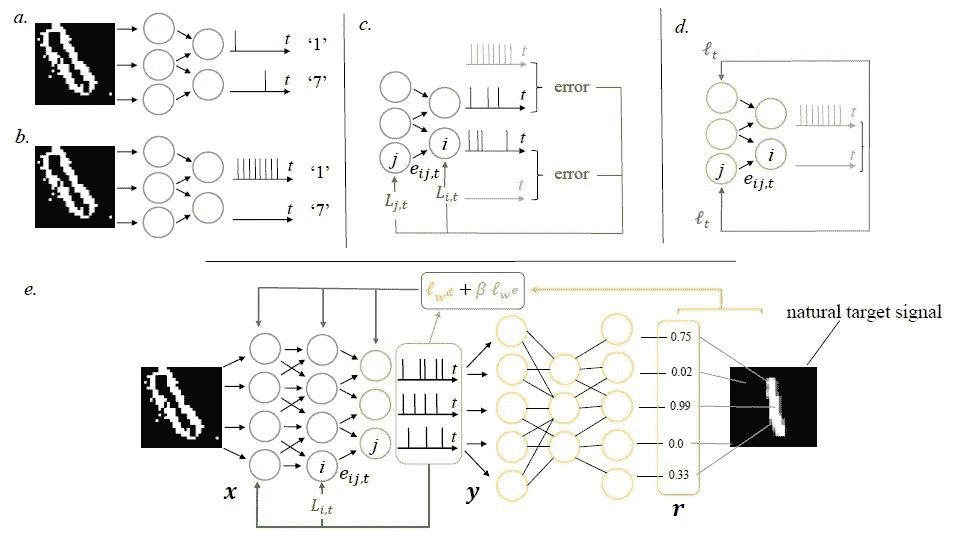

**SNN的训练算法**

1.  **无监督学习算法 Spike-Time-Dependent**** Plasticity (STDP)： 
无监督学习算**法Spike-Time-Dependent Plasticity （STDP）：

1.  它根据突触前和突触后神经元之间的脉冲时间差来调整突触权重。如果突触前脉冲先于突触后脉冲到达，则突触权重可能增加（长时程增强，LTP），反之则可能减少（长时程抑制，LTD）。

1.  监督学习算法 SpikeProp：

1.  SpikeProp 是一种基于梯度下降的算法，旨在最小化实际输出脉冲与期望输出脉冲之间的差异。它使用脉冲时间或脉冲序列来定义误差函数，并通过调整权重来优化这个函数。

1.  **强化学习算法 Spike-Based Rein**forcement Learning ：

1.  在这种方法中，SNN根据环境提供的奖励或惩罚信号来调整其权重。这通常涉及在特定行为（即脉冲序列）和结果之间的映射。

**神经**元的工作原理： 神经元过来的连续的激活值 (Pre-activation)，通过突触 (Synapse) 传递到树突的位置 (Dendrite)，并且最终由细胞体 (Soma) 来处理。

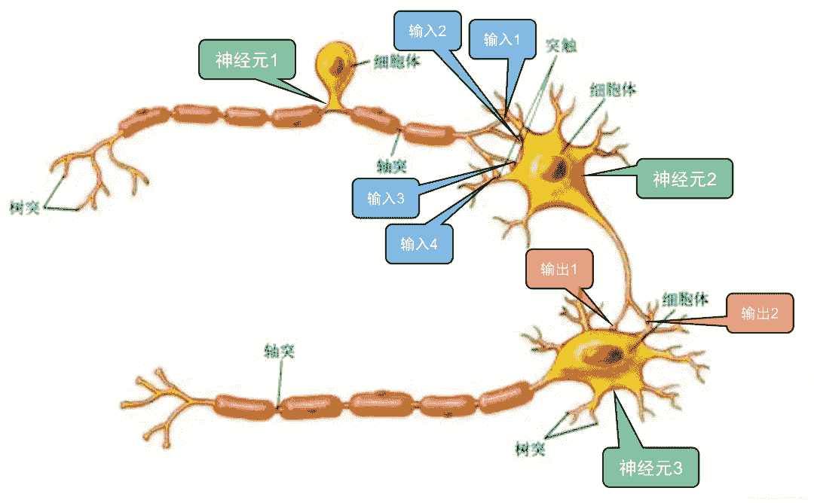

**神经元的工作原理**

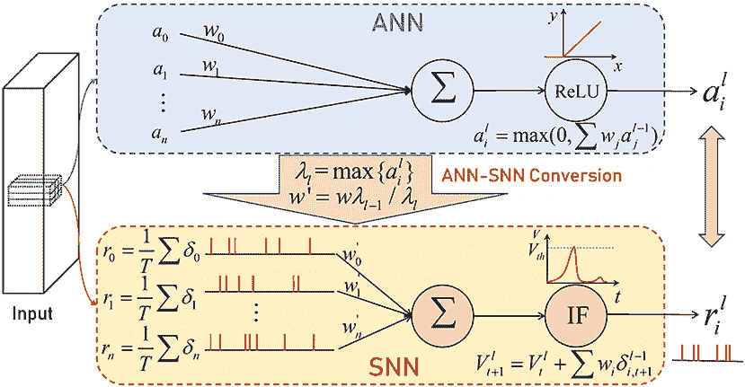

**ANN和SNN的工作原理**

**ANN神经元的工作原理： ****ANN 中的神经元 ****使**用激活函数（高精度和连续值编码的激活值）进行相互通信 ，并且只在空间域 (Spatial Domain，即 层与层之间 layer by layer ) 传播信息。 从下面的方程可以看出，输入和权重的相乘和累加是网络的主要操作。

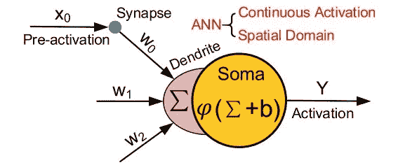

**ANN神经元的工作原理**

**ANN神经元的计算方程如下： **

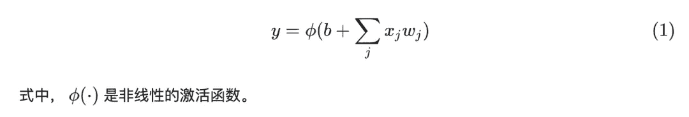

**ANN神经元的计算方程 **

**SNN神经元的工作原理 ： ****SNN 神经元之间的交流通过离散的脉冲（Binar**y Spike），而不是连续的激活值。

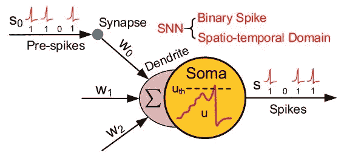

**SNN神经元的工作原理**

SNN神经元处理脉冲方式如下 ：

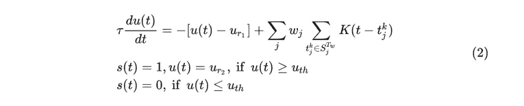

1.  **脉冲编码 ****：在SNN中，神经元之间的通信是通**过离散的脉冲序列来完成的。 当某个神经元的膜电位超过阈值时，它会发放一个脉冲，并将膜电位重置为初始值。

1.  **动态行为 **：SNN的神经元状态是随时间变化的，这使其能够处理时序数据。 在每个时间步，神经元的膜电位会根据其输入脉冲和突触权重进行更新。

**三、 SNN 的应用  **

**脑****机接口（ Brain-Machine Interface， Brain-Computer **Interface ） ： BMI或BCI是一种在人或动物大脑与外部设备之间创建直接连接的技术，实现脑与设备的信息交换。这种技术绕过外周神经和肌肉，直接在大脑与外部设备之间建立全新的通信与控制通道。

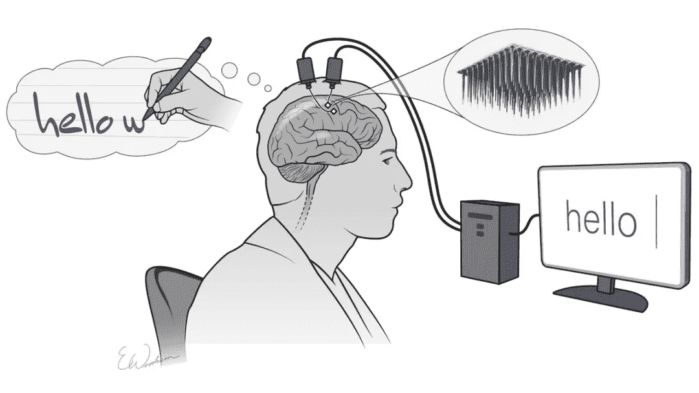

脑机接口（Brain-Computer Interface）

**在SNN中，信息以脉冲的形式传递，这与BCI中大脑产生的脉****冲信号（如脑电信号）具有高度的相似性。 因此，SNN可**以更有效地处理BCI中的脉冲信号，提取其中的有用信息，并减少噪声和干扰的影响。

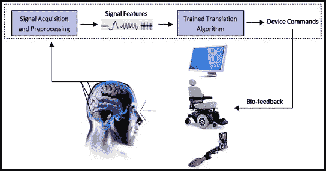

**SNN应用脑机接口**

SNN应用BMI论文： 一个用于可植入脑机接口的脉冲神经网络解码器。

**论文 《 ****A S****pi**king Neural Network Decoder for Implantable Brain Machine Interfaces and its Sparsity-aware Deployment on RISC-V Microcontrollers 》

论文《A Sprising Neural Network Decoder for Implantable Brain Machine Interfaces and its Sparsity-aware Deployment on RISC-V Microcontrollers》

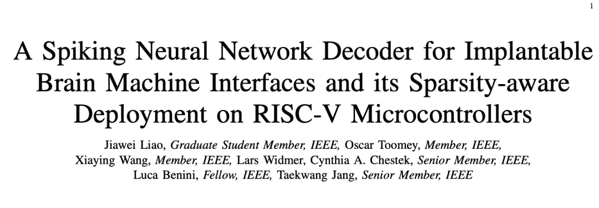

一个用于可植入脑机接口的脉冲神经网络解码器

**论文设计的应用场景： ****主要**集中在脑机接口（BCI）技术中，特别是关注从大脑的运动皮层区域获取神经信号，并在提取SBP（可能是某种特定神经信号特征）特征之前进行预处理。最终目标是利用这些信号来预测手指的运动速度。

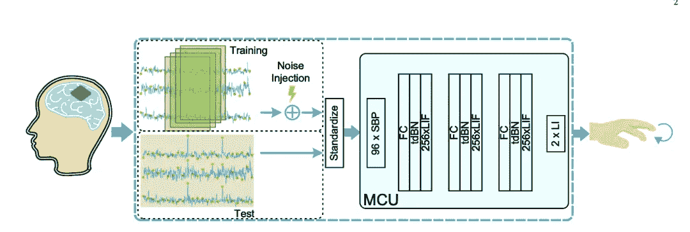

**论文设计的应用场景**

**论**文设计的数据流： 包括从大脑捕获神经信号，预处理后用于训练SNN预测手指速度，实时传输信号至MCU解码预测速度，并输出结果以控制设备或研究。

**训练阶段 **：

1.  **神经信号获取 **：从大脑的运动皮层区域捕获神经信号。

1.  **数据准备 **：使用滑动窗口方法来准备输入数据，每个窗口包含10个时间步长，并且相邻窗口之间有9个时间步长重叠。这种方法有助于捕捉神经信号的动态变化。

1.  **噪声注入 **：在数据归一化之前，向数据中加入噪声。这一步是为了模拟实际应用中可能存在的噪声环境，提高模型的鲁棒性。

1.  **数据归一化 **：对带有噪声的数据进行归一化处理，确保所有输入数据都在相同的尺度上，以便于神经网络进行学习和处理。

1.  **模型训练 **：将准备好的数据输入到脉冲神经网络（SNN）中进行训练，使模型能够学习从神经信号中预测手指速度的能力。

**测试阶段 **：

1.  **神经信号获取 **：继续从大脑的运动皮层区域捕获神经信号。

1.  **数据流传输 **：将捕获的神经信号实时传输到部署在微控制器（MCU）上的SNN神经解码器中。

1.  **手指速度预测 **：SNN神经解码器根据输入的神经信号实时预测手指的运动速度。

1.  **输出结果 **：将预测得到的手指速度作为输出结果，可以用于控制外部设备（如假肢、游戏角色等）的运动，或者作为研究手指运动神经机制的输入数据。

**相关论文**

+   《A Spiking Neural Network Decoder for Implantable Brain Machine Interfaces and its Sparsity-aware Deployment on RISC-V Microcontrollers》 
《一种用于植入式脑机接口的脉冲神经网络解码器及其在RISC-V微控制器上的稀疏感知部署》

+   《Deep Learning in Spiking Neural Networks》 
《脉冲神经网络中的深度学习》

+   《 Networks of Spiking Neurons: The Third Generation of Neural Network Models 》 
《脉冲神经元网络：第三代神经网络模型》