# 神经网络算法 - 一文搞懂扩散模型Diffusion Models

> 来源：[https://geekbang.feishu.cn/docx/D9RudaLYoorIEYxQUQ4c3H3ynyh](https://geekbang.feishu.cn/docx/D9RudaLYoorIEYxQUQ4c3H3ynyh)

> 👨🏻 作者：AllenTang

> 📃 作者介绍：分享人工智能，让所有人玩转AI

> 🛖 公众号：架构师带你玩转AI

> ⏰ 收录时间：2024-05-23 11:28:42

> 🔗 原文链接：h[ttps://mp.weixin.q](https://mp.weixin.qq.com/s?__biz=MzkzMTEzMzI5Ng==&mid=2247488113&idx=1&sn=91a3120c574e7a045829e8be7ae6542d&chksm=c26ef06ef51979784b7dcc4940dd1cc7f73a84e23de4ed0b2eff3f10613b45265de856c59259&scene=21#wechat_redirect)q.com/s?__biz=Mz...

关注作者公众号，获取更多AI知识

本文将从 扩散模型的本质 、扩散模型 的原理 、扩散模型 的应用 三个方面，带 您一文搞懂 扩散模型 Diffusion Models 。

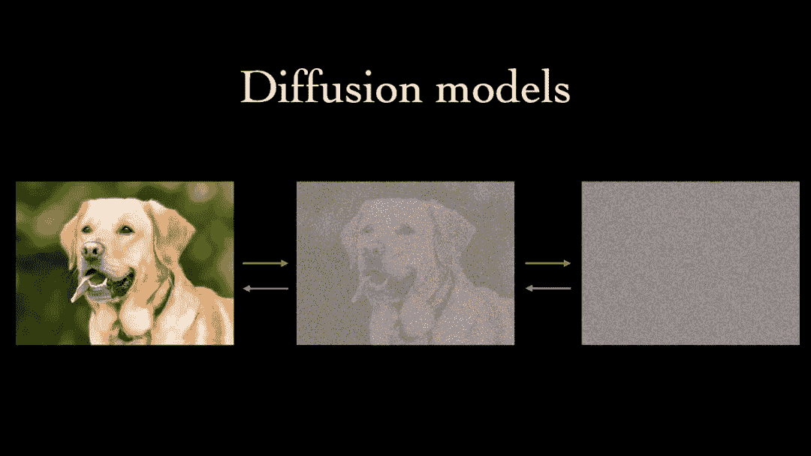

扩散模型Diffusion Models

**一、扩散模型 的本质**

**扩散模型的定义 ： Diffusion Models是 一种新型**的、先进的生成模型 ，用于生成与训练数据相似的数据，可 以生成各种高分辨率图像。

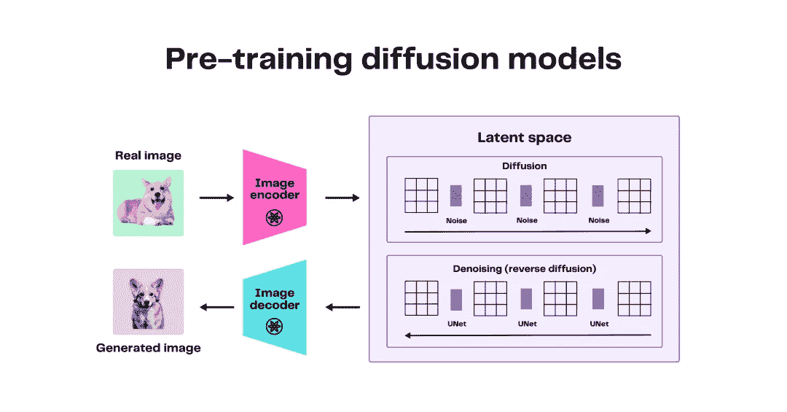

**扩散模型 的定义**

**扩散模型的核心思想： Diffusion Models**是 一种受到非平衡热力学启发的生成模型，其核心思想是 通过模拟扩散过程来逐步添加噪声到数据中，并随后学习反转这个过程以从噪声中构建出所需的数据样本。

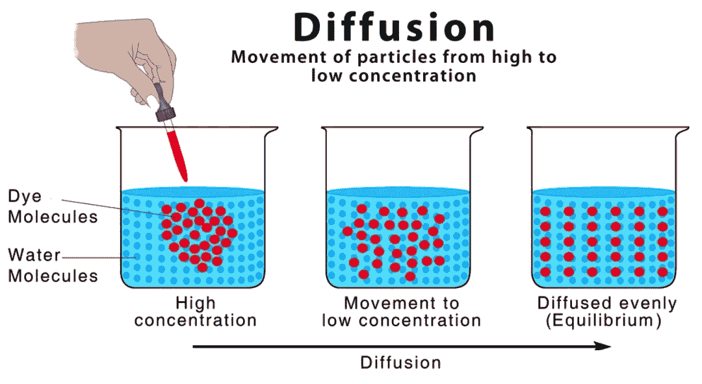

**扩散过程**

**扩散模型的本质： ****利用马尔可夫链来定义扩散步骤，通过每一步的状态转移来逐渐将数据“破坏”成纯噪声。 然后，通过**训练神经网络来逼近真实的反转扩散过程，扩散模型能够从纯噪声中逐步还原出原始数据。

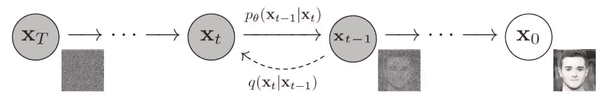

**扩散模型的本质**

**二、扩散模型的原理**

**扩散**模型的工作原理 ： Diffusion Models 通过连续添加高斯噪声来破坏训练数据，然后通过学习反转的去噪过程来恢复数据。 训练后，我们可以使用 Diffusion Model将随机采样的噪声传入模型中，通过学到的去噪过程来生成数据。

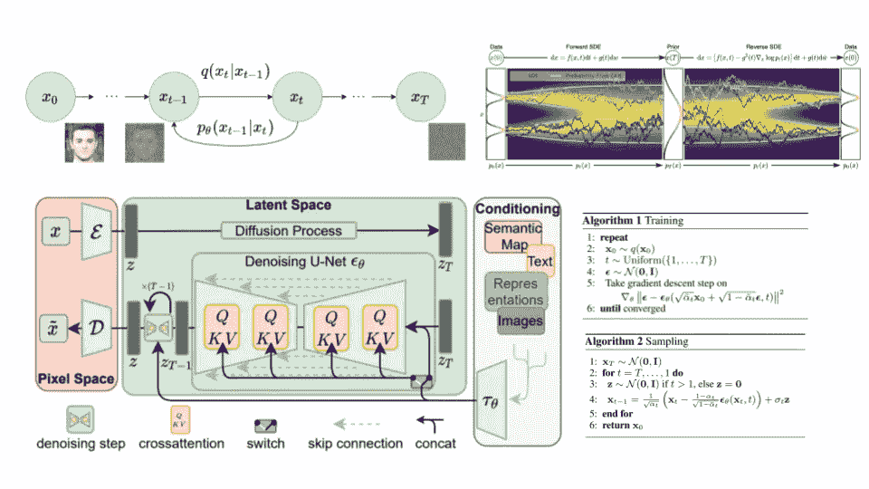

**扩散模型的工作原理**

**扩**散模型是一种隐变量模型，它使用马尔可夫链来映射到隐空间。这种映射使得模型能够在隐空间中捕捉数据的内在结构和模式。

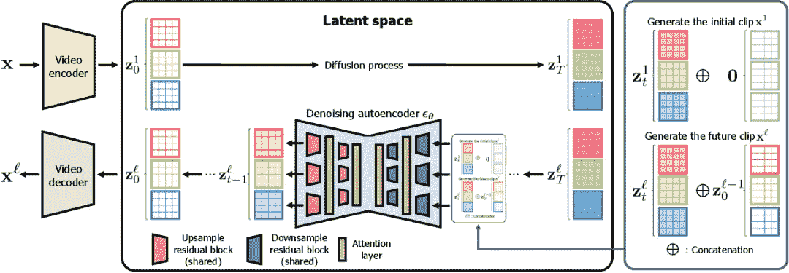

**扩散 模型的隐空间**

### **马尔可夫链 ： 无记忆的随机过程，具有马尔可夫**性质，即未来只与现在有关，而与过去无关。

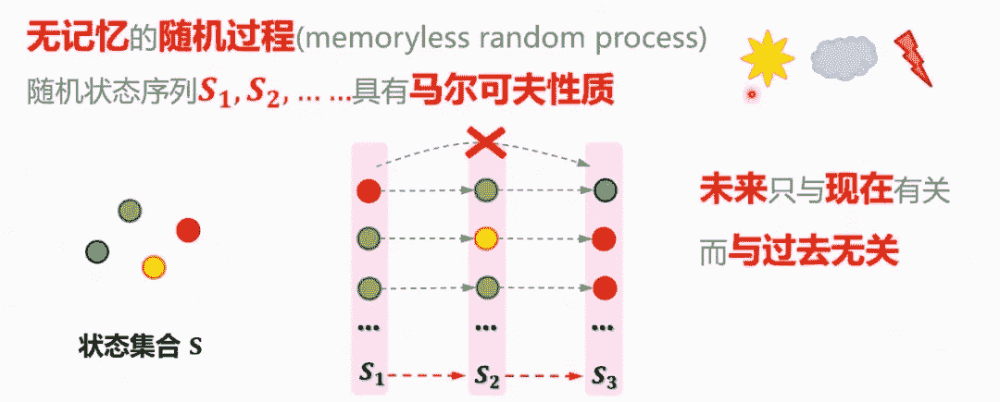

**马尔可夫链**

**详细了解马尔可夫链： **** ** 人工智能数学基础 - 马尔可夫链（Markov Chain）

扩散模型的组成部分： 扩散模型主要包含前向扩散和逆扩散两部分。

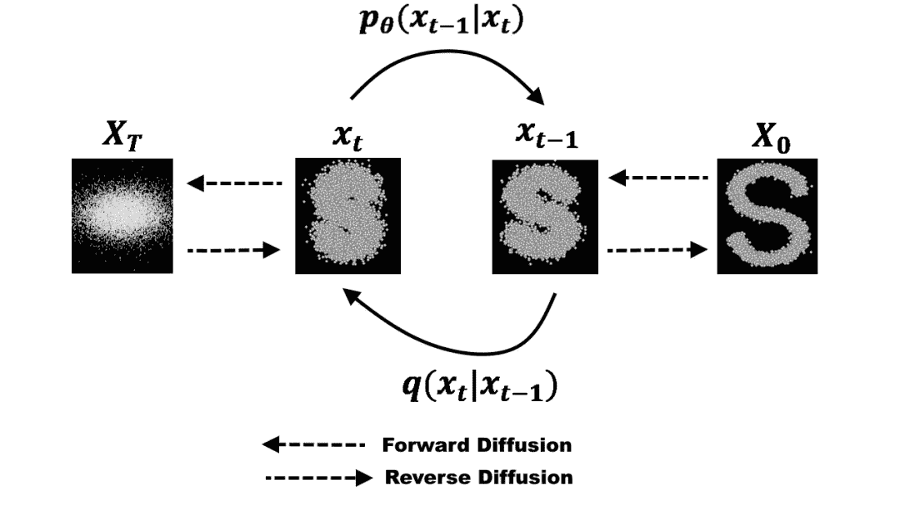

**前向扩散和逆扩散 **

**前向扩散： **向原始数据逐步添加噪声的过程，直到数据变为纯噪声。

**虽**然这个过程本身并不能直接生成图片，但它对于理解扩散模型的工作原理以及构建训练样本的目标（ground truth，简称GT）至关重要。

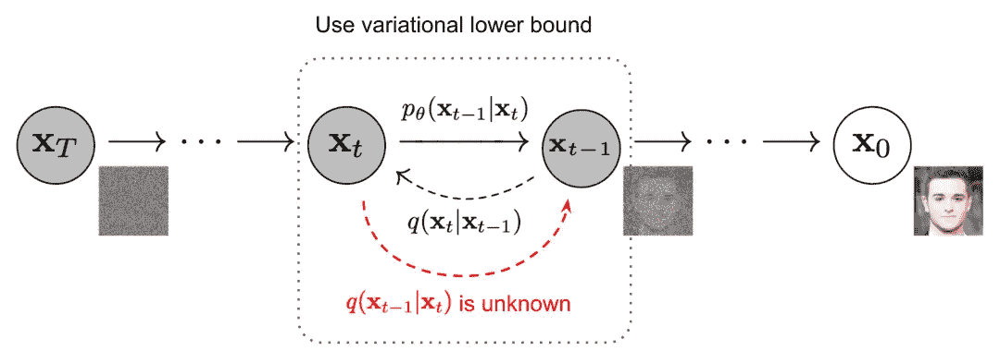

**前向扩散**

**逆扩散： **前向扩散的逆操作，从纯噪声开始，逐步去除噪声以还原出原始数据。

**这**个过程依赖于模型学习到的如何从噪声中恢复出原始数据的模式。模型通过神经网络学习逆扩散过程，从而能够生成与原始数据相似的样本。

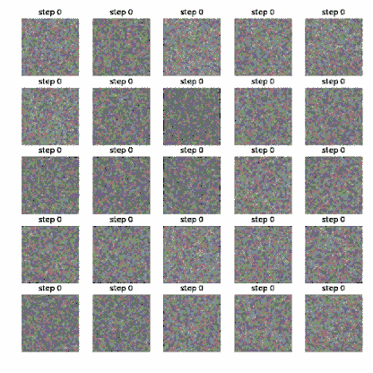

**逆扩散**

**三、扩散模型的应用  **

**稳**定扩散模型（Stable Diffusion）： Stable Diffusion 是 Diffusion 扩散模型中最先进的模式。 它采用了更加稳定、可控和高效的方法来生成高质量图像。

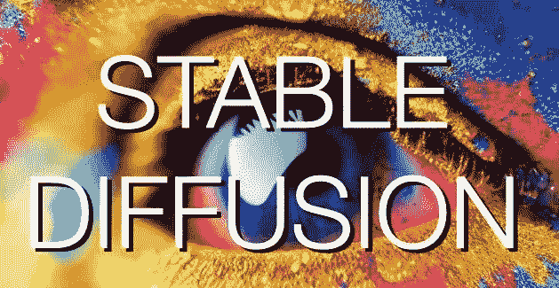

**稳定扩散模型**

**Sta**ble Diffusion模型在2022年8月由CompVis、Stability AI和LAION的研究人员推出，其核心技术来源于AI视频剪辑技术创业公司Runway的首席研究科学家Patrick Esser，以及慕尼黑大学机器视觉学习组的Robin Rombach。

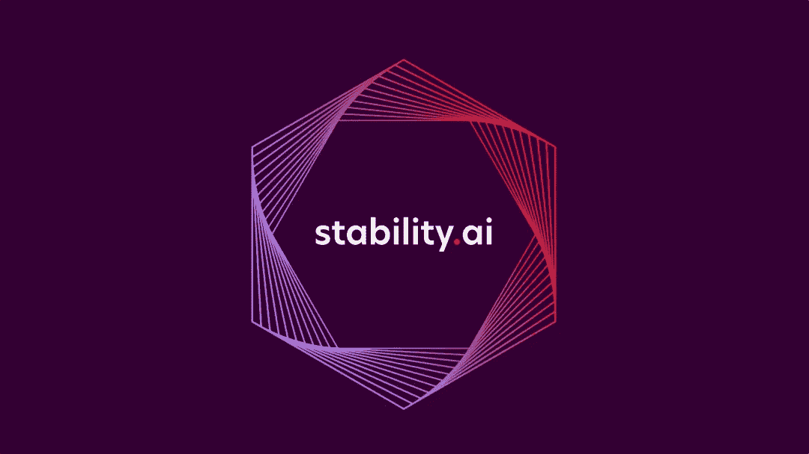

**stability.ai**

**DALL-E 2： ****由 OpenAI 开发，以基于文**本描述的高度详细且富有创意的图像而闻名。

**DALL-E 2**

**它使用先进的扩散技术来生成既富有想象力又逼真的图**像，使其成为创意和艺术应用中的流行工具。

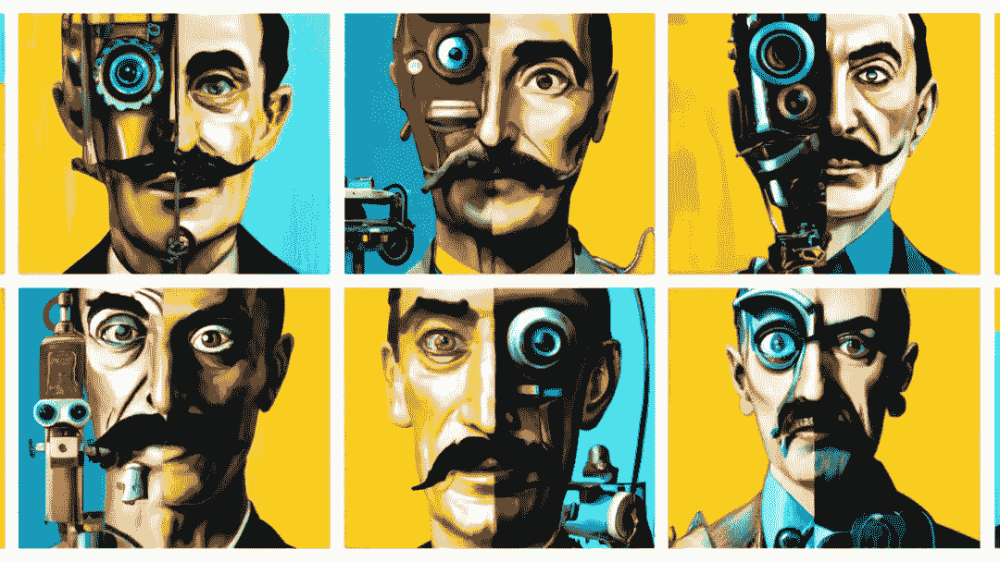