# 神经网络算法 - 一文搞懂ViT（Vision Transformer）

> 来源：[https://geekbang.feishu.cn/docx/LheMdm5hcosR7Ax2feecctpan2e](https://geekbang.feishu.cn/docx/LheMdm5hcosR7Ax2feecctpan2e)

> 👨🏻 作者：AllenTang

> 📃 作者介绍：分享人工智能，让所有人玩转AI

> 🛖 公众号：架构师带你玩转AI

> ⏰ 收录时间：2024-05-23 11:28:42

> 🔗 原文链接：h[ttps://mp.weixin.q](https://mp.weixin.qq.com/s?__biz=MzkzMTEzMzI5Ng==&mid=2247488514&idx=1&sn=a5a1a1c0a39958e794f07383d7ed1725&chksm=c26ef61df5197f0bc9eae8b24d0b8f36d50710148fdc71a8845095609caae357e85454d975eb&scene=21#wechat_redirect)q.com/s?__biz=Mz...

关注作者公众号，获取更多AI知识

本文将从 ViT的本质 、ViT 的原理 、ViT 的应用 三个方面，带 您一文搞懂 Vision Transformer｜ ViT 。

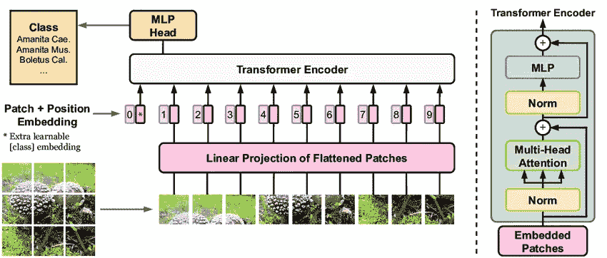

Vision Transformer（ViT）

**一、 ViT 的本质**

**V**iT的定义： ViT将Transformer架构从自然语言处理领域引入到计算机视觉中，用于处理图像数据。

**在计算机视觉领域中，卷积神经网络（CNN）因其强大的局部特征提取能力而长期占据主导地位。然而，近年来，Visi**on Transformer（ViT）作为一种新兴的模型架构，已经开始在多个视觉任务中展现出与CNN相当甚至更好的性能。

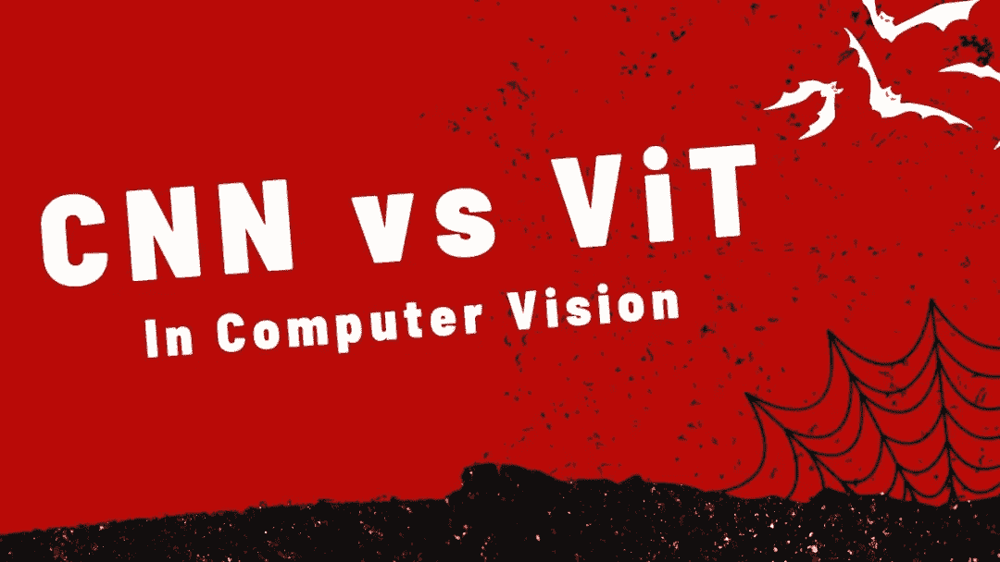

**CNN vs ViT **

**T**ransformer及其视觉变种Vision Transformer（ViT）发展历程中的关键节点如下，红色标记了与视觉任务相关的模型。

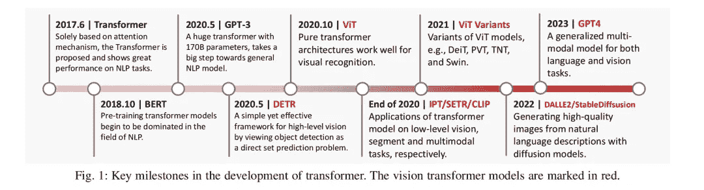

Transformer的发展历程

### **Transformer的起源：**

+   2017年，Google提出了Transformer模型，这是一种基于Seq2Seq结构的语言模型，它首次引入了Self-Attention机制，取代了基于RNN的模型结构。

+   Transformer的架构包括Encoder和Decoder两部分，通过Self-Attention机制实现了对全局信息的建模，从而能够解决RNN中的长距离依赖问题。

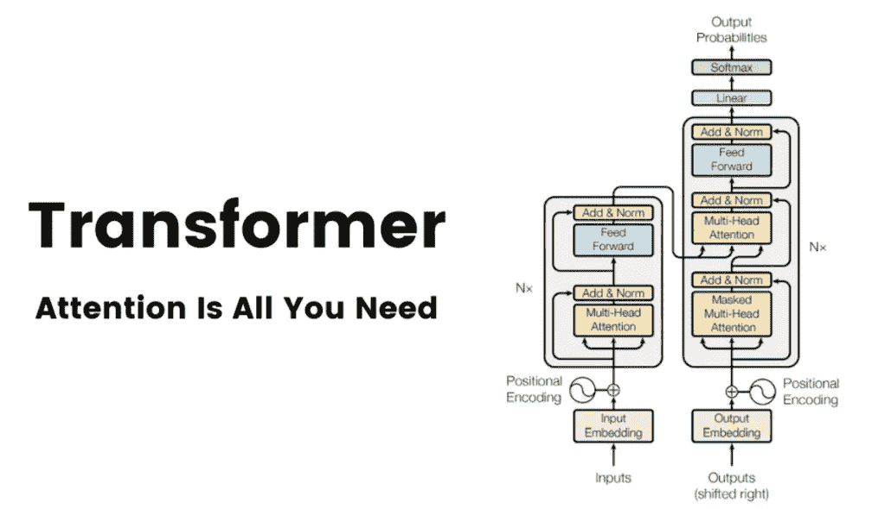

**Transformer**

### **ViT的出现：**

+   ViT采用了Transformer模型中的自注意力机制来建模图像的特征，这与CNN通过卷积层和池化层来提取图像的局部特征的方式有所不同。

+   ViT模型主体的Block结构基于Transformer的Encoder结构，包含Multi-head Attention结构。

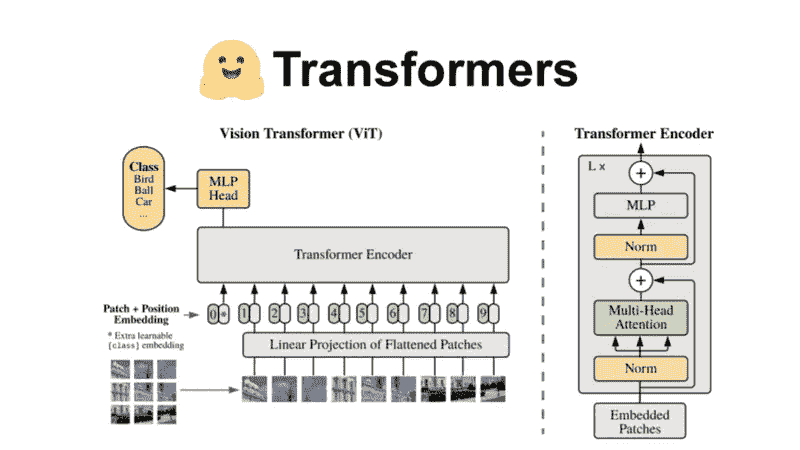

Vision Transformer（ViT）

### **ViT的进一步发展：**

+   随着研究的深入，ViT的架构和训练策略得到了进一步的优化和改进，使其在多个计算机视觉任务中都取得了与CNN相当甚至更好的性能。

+   目前，ViT已经成为计算机视觉领域的一个重要研究方向，并有望在未来进一步替代CNN成为主流方法。

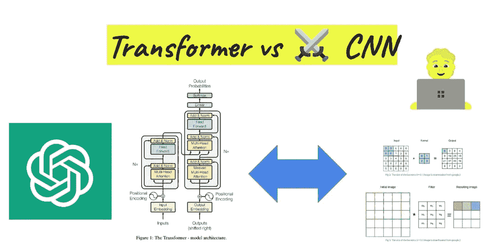

**ViT的进一步发展**

**ViT的本质： 将图像视为一系列的“视觉单词”或“令牌”**（tokens），而不是连续的像素数组。

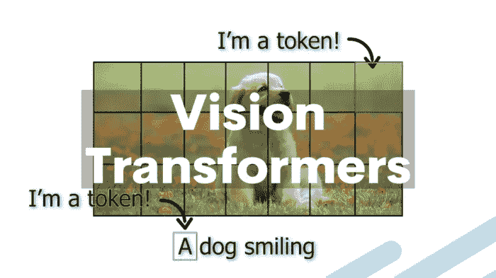

Vision Transformer

图像块（Image Patches）：

+   ViT首先将输入图像切分为多个固定大小的图像块（patches）。

+   这些图像块被线性嵌入到固定大小的向量中，类似于NLP中的单词嵌入。

+   每个图像块都被视为一个独立的“视觉单词”或“令牌”，并用于后续的Transformer层中进行处理。

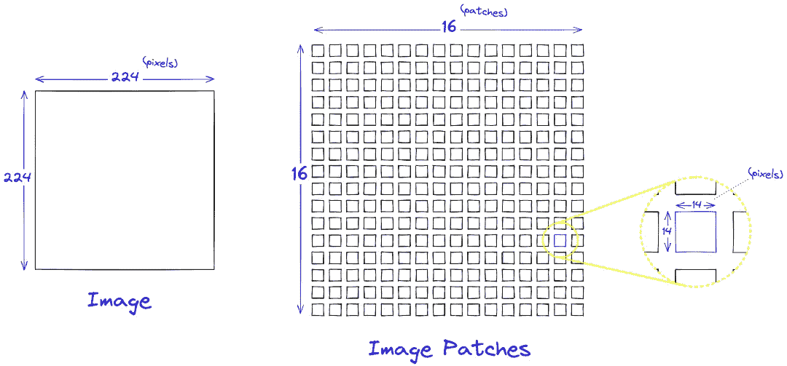

图像块（Image Patches）

**二、 ViT 的原理**

**ViT的架构 ： ****通过将图像分割成一系列小块（patches）并视为序列化的token输入到**Transformer编码器中，从而实现了图像特征的提取和分类。 如下图所示：

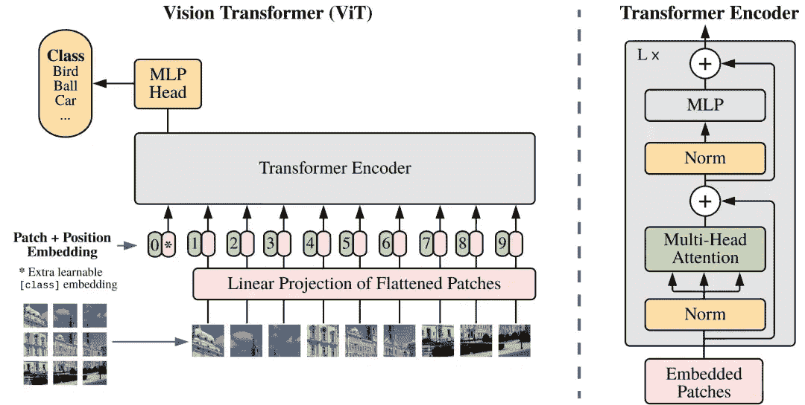

**ViT 的架构 **

**ViT的核心组件 ： ****Patch Embeddings，Position Embeddings，Classification Token， Li**near Projection of Flattened Patches， 以及Transformer Encoder。

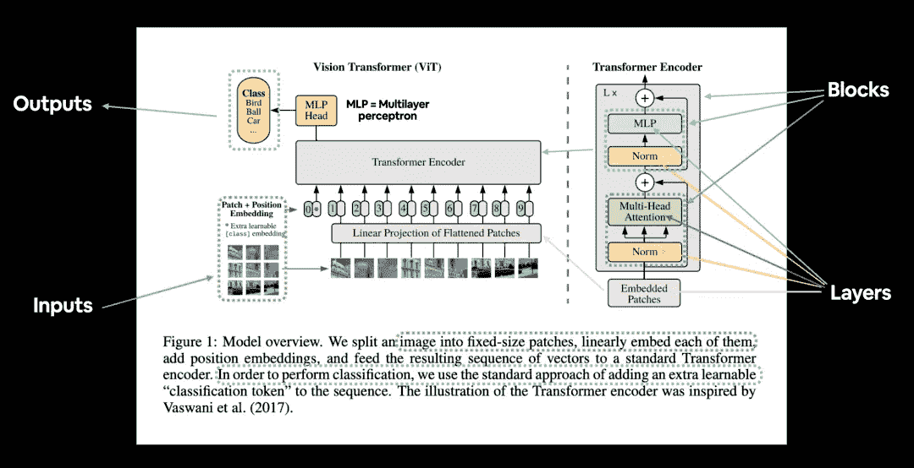

**ViT的核心组件**

1.  **Patch Embed**dings： 如上图虚线的左半部分，我们将图片分成固定大小的 图像块patches （如图左下9×9的图像），将它们线性展开。

1.  **Position Embeddi**ngs： Position embeddings加到图像块中是为了保留位置信息的。

1.  **Classification Token： 为了**完成分类任务，除了以上九个图像块，我们还在序列中添加了一个*的块0，叫额外的学习的 分类标记Classification Token。

1.   **Linear Projection of**** F**lattened Patches： 图像分割为固定大小的图像块（patches）后，将每个图像块展平（flatten）为一维向量，并通过一个线性变换（即线性投影层或嵌入层）将这些一维向量转换为固定维度的嵌入向量（patch embeddings）。

1.  **Transformer Encoder： 由多个堆叠的层组成，**每层包括多头自注意力机制（MSA）和全连接的前馈神经网络（MLP block）。

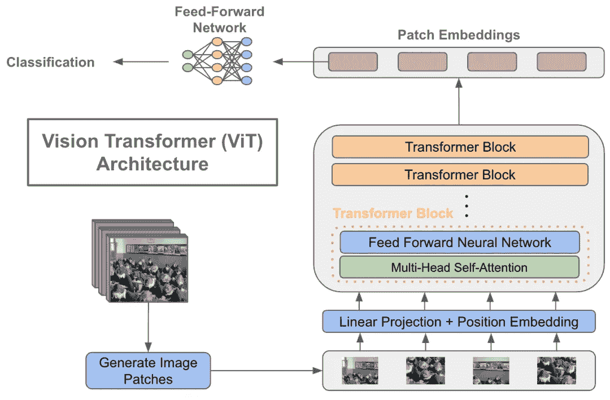

ViT的Transformer Encoder

**ViT的工作流程： 将图像分割为固定大小的图像块（patches），将其转换为Patch Embeddings，添加位置编码**信息，通过包含多头自注意力和前馈神经网络的Transformer编码器处理这些嵌入，最后利用分类标记进行图像分类等任务。

**ViT的工作流程 **

**三、 ViT 的应用  **

分割（Segmentation）： 涵盖了全景分割、实例分割、语义分割和医学图像分割等。

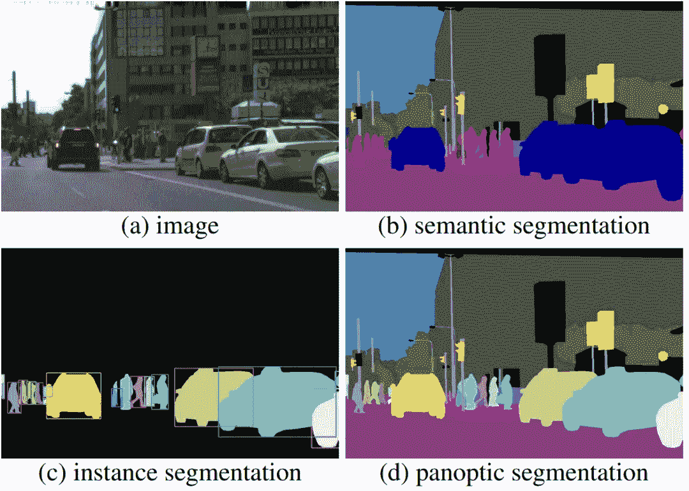

Segmentation四种分类

**Vision Transformer**在 Segmentation 的应用：

+   全景分割Transformer： 考虑了目标对象与全局图像上下文之间的关系，并通过并行方式直接输出最终的预测集合。这种架构能够同时处理多个对象实例和背景，从而实现全景分割任务的高效完成。

+   实例分割的Transformer： 将视频实例分割任务视为一个直接的端到端并行序列解码/预测问题。它通过预测视频中每个实例的掩码序列，实现了高效的实例分割。这种方法的优点在于其能够处理动态变化的视频内容，并实时输出每个实例的分割结果。

+   语义分割Transformer： 利用Transformer的自注意力机制来捕获全局上下文信息，从而提高了语义分割的性能。通过考虑图像中的全局信息，它能够更准确地识别不同区域所属的类别，并生成更精细的分割结果。

+   医学图像分割Transformer： 通过预测各个对象实例，Transformer提高了数据处理的实验信息产量，使得在线监测实验和闭环最佳实验设计变得可行。这对于医学诊断、治疗和研究都具有重要的意义。

**相关论文**

+   《 AN IMAGE IS WORTH 16X16 WORDS: TRANSFORMERS FOR IMAGE RECOGNITION AT SCALE 》