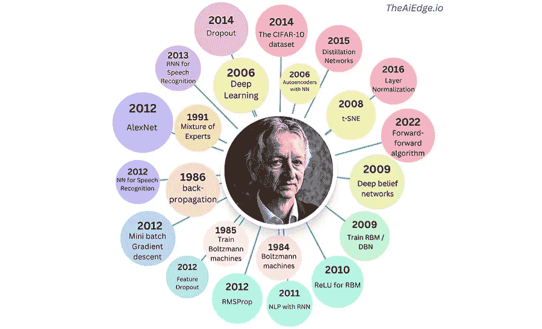
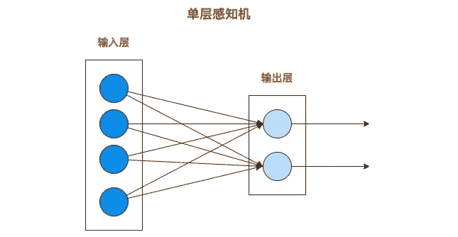
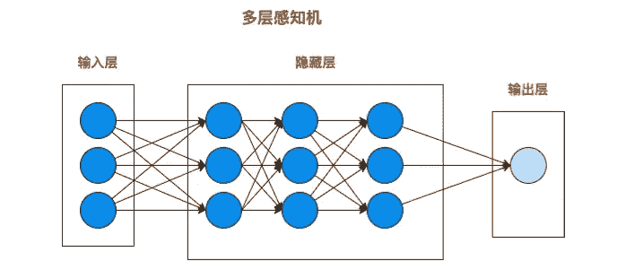
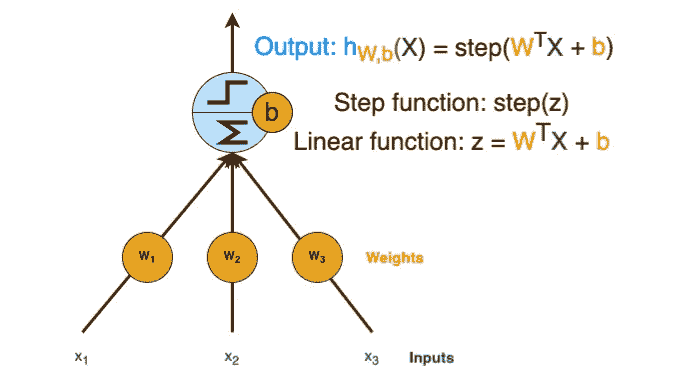
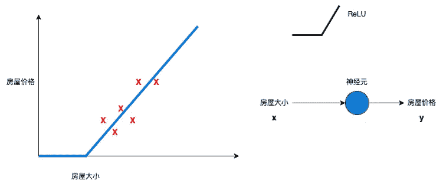
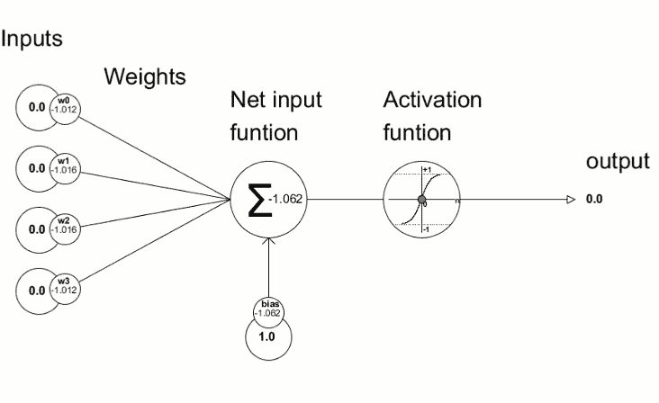
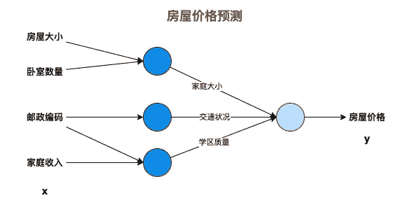
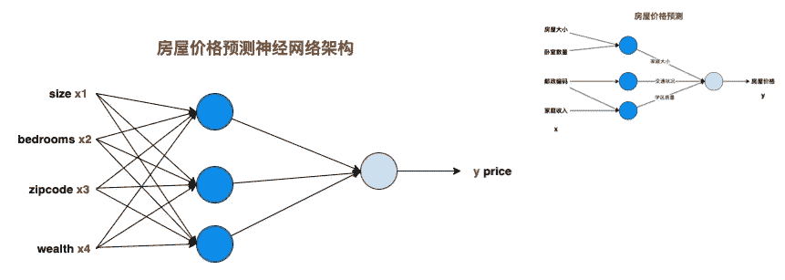
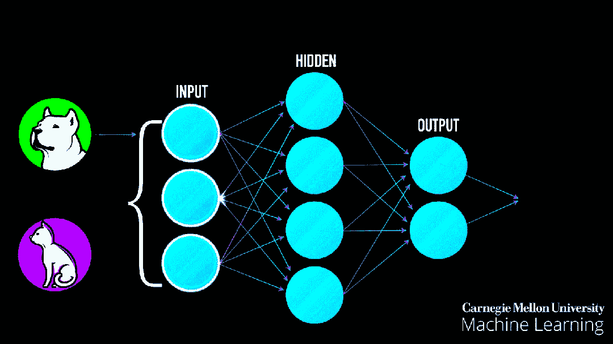

# 一文搞懂深度学习：神经网络基础

> 来源：[https://geekbang.feishu.cn/docx/XQlrdXbZFowzk3xi3sFciTjsnZb](https://geekbang.feishu.cn/docx/XQlrdXbZFowzk3xi3sFciTjsnZb)

> 👨🏻 作者：加里

> 📃 作者介绍：目前就职于金融银行AI部门，资深解决方案架构师。

> 🛖 👸号：AIWithGary

> ⏰ 收录时间：2024-05-27 11:20:58 (UTC+8)

> 🔗 原文链接：  h[ttps://mp.weixin.q](https://mp.weixin.qq.com/s?__biz=MzU3OTgyMjM3MA==&mid=2247485037&idx=1&sn=fbe7865e1a31c509acbd8a52a12f441c&chksm=fd617020ca16f9366fa938a21f420cf33b941ed7744edfd828acd33195f1219ac5d2866e54f8#rd)q.com/s?__biz=Mz...

关注作者，获取更多AI知识

欢迎来到本深度学习系列文章，本系列文章旨在详细介绍深度学习的基础理论与关键技术，从基本神经网络到复杂的算法应用；我们将探索监督学习，逻辑回归，激活函数，反向传播等核心主题；无论您是初学者还是专业人士，这个系列都将帮助您系统地理解并应用深度学习技术。

本文作为系列的开篇，旨在提供对神经网络的基本了解，它是人工智能和机器学习领域的基本概念之一。

我们将介绍神经网络的基本概念和结构，解释什么是深度学习，以及探讨深度学习的历史和它在现代技术中的角色。

目录

1. 神经网络定义

2. 深度学习定义

3. 深度学习历史

4. 基础神经网络

4.1 单层感知机

4.2 多层神经网络

5. 总结

# 01

神经网络定义

神经网络也称为人工神经网络 (ANN) 或模拟神经网络 (SNN)，是机器学习的子集，也是深度学习算法的支柱；被称为“神经”，是因为它模仿大脑中神经元相互发出信号；很多科学发明都是从大自然中获得了想法，比如飞机的发明是受鸟类的启发，神经网络是一种受人脑启发的机器学习算法，它是一个由互连节点或人工神经元组成的网络，可以学习识别数据中的模式。

在学术定义中，人工神经网络是受人脑生物神经网络结构和功能启发的计算模型，它由互连的节点或“神经元”组成，它们被组织成层，通过对输入进行加权，计算总和以及应用非线性激活函数，将输入数据转换为不同的表示形式，直到产生输出。

神经网络已经被广泛用于解决图像分类，推荐系统和语言到语言翻译等复杂的机器学习问题。

# 02

深度学习定义

深度学习是指训练神经网络，有时是非常大的神经网络。

它是基于人工神经网络的机器学习的一个子集，“深度”指的是这些神经网络中的多层；传统的机器学习算法仅限于相对简单的分析，深度学习可以从图像，文本和音频等大型复杂数据集中提取更丰富，更抽象的表示。

深度学习是当今计算机视觉，语音识别，自然语言处理和人工智能等领域快速发展的基础。

# 03

深度学习历史

第一个人工神经网络于1944年提出，但近年来变得非常流行；深度学习于50年代初引入，但近年来由于面向人工智能的应用程序和公司生成的数据的增加而变得流行；虽然经典的机器学习算法无法分析大数据，但人工神经网络在大数据上表现良好；深度学习的历史可以追溯到人工智能（AI）的早期，1943年，Warren McCulloch和Walter Pitts创建了大脑神经元的数学模型，这是第一个人工神经网络。

+   20世纪50年代，弗兰克·罗森布拉特 (Frank Rosenblatt) 开发了感知机，这是一种简单的两层神经网络，可以经过训练来识别模式。然而感知机存在局限性，直到20世纪80年代神经网络才开始得到更广泛的应用。

+   20世纪80年代，Geoffrey Hinton等人开发了一种新型神经网络，称为反向传播算法， 反向传播使神经网络能够学习更复杂的模式，并引发了人们对神经网络的新兴趣 。

+   20世纪90年代，深度学习研究仍在继续，但它仍然是一个相对小众的领域，一直到2000年代初，出现了一些突破，导致人们对深度学习的兴趣重新燃起。

+   最重要的突破之一是卷积神经网络（CNN）的发展，它是一种专门为图像处理而设计的神经网络，已被用于在各种图像识别任务中取得最先进的结果，例如人脸识别和物体检测。

+   另一个重要突破是循环神经网络（RNN）的发展。它是一种专门用于处理顺序数据的神经网络，已被用于在各种自然语言处理任务中取得最先进的结果，例如机器翻译和语音识别。

+   在过去的十年中，深度学习在图像识别，自然语言处理，语音识别和机器翻译等多种任务中取得了重大进展，它现在是人工智能最活跃和最有前途的研究领域之一。

以下是深度学习发展的一些主要里程碑：

+   1943年：Warren McCulloch和Walter Pitts创建了大脑神经元的数学模型。

+   1958年：Frank Rosenblatt开发了感知机，这是一种简单的两层神经网络，可以训练来识别模式。

+   1986年：Geoffrey Hinton等人开发了反向传播算法，该算法允许神经网络学习更复杂的模式。

+   1998年：Yann LeCun等人。开发了LeNet-5 CNN，在手写数字识别方面取得了最先进的结果。

+   2006年：杰弗里·辛顿等人开发了深度置信网络，这是一种可以对大量未标记数据进行预训练的神经网络。

+   2012：亚历克斯·克里热夫斯基等人开发了AlexNet CNN，它在图像分类方面取得了最先进的结果。

+   2014年：伊利亚·苏茨克弗 (Ilya Sutskever) 等人开发了Transformer，这是一种专为自然语言处理任务而设计的新型神经网络。

欢迎阅读我的关于Transformer系列文章。

+   2015年：谷歌翻译利用深度学习在机器翻译方面实现了人类水平的性能。

+   2016年：AlphaGo使用深度学习击败了职业围棋选手。

# 04

基础神经网络

单层感知机

感知机是一种使神经元从给定信息中学习的算法，它有两种类型，单层感知机不包含隐藏层；而多层感知机包含一个或多个隐藏层；单层感知机是人工神经网络 (ANN) 最简单的形式。

单层神经网络是只有一层神经元的神经网络，这种类型的网络也称为感知机，它是最简单的神经网络类型，可用于解决简单的问题；该架构由Frank Rosenblatt于1957年开发。

/ / 单层神经网络示例

我们从房价预测的例子开始，假设有一个包含六栋房屋（上图中的6个红点坐标）的数据集，知道房屋的大小（以平方米为单位）和房屋的价格，然后我们要拟合一个函数来预测房屋的价格。

如果熟悉线性回归，对这些数据画一条直线，这样就得到了一条这样的直线（如图所示），由于价格永远不会是负数，因此，我们不要使用最终会变成负值的直线拟合，所以这里的结果就是零，如上图中坐标左下角底部所示，这条粗蓝线就是最终根据房屋大小预测房屋价格的函数。

可以将拟合房价的这个函数视为一个非常简单的神经网络，它几乎是最简单的神经网络，如上图右边所示。

将房子的大小作为神经网络的输入，称之为x，它进入这个节点（小圆圈），然后输出为y的价格；这个小圆圈是神经网络中的单个神经元，它实现了我们在左侧绘制的直线拟合函数；神经元所做的就是输入房屋大小，计算线性函数，然后输出估计价格。

另外，在神经网络中，我们经常会看到上图中右上角的函数，这个函数有时会变为零，然后它会变成一条直线，它称为ReLU函数，代表修正线性单元，纠正的含义是取最大值0，这就是为什么你会得到这样的函数形状；目前如果您不了解ReLU单元，请不用担心，本序列文章后面会详细解释；它是一个单神经元的神经网络，是一个很小的神经网络，通过将多个神经元堆叠在一起，就可以形成一个更大的神经网络；如果你认为这个神经元就像一块乐高积木，那么可以通过将许多乐高积木堆叠在一起来获得更大的神经网络。

多层神经网络

在上面房屋价格预测的例子中，设想不只是根据房屋的面积来预测价格，还有一些其他特征，例如，房屋的卧室数量，你可能会认为家庭大小是影响房价的一个重要因素，对吧？这个房子能否适合三口之家、四口之家或五口之家？实际上，这取决于房屋的大小和卧室数量；然后，你可能了解到了房屋的邮政编码，它可以告诉你该地区的交通便利性，例如是否能轻松步行到超市或学校，或者是否需要开车；此外，邮政编码和家庭收入状况也能反映附近学区质量，图中的小圆圈都可以是一个修正线性单元（ReLU）或其他非线性函数；基于房屋的大小和卧室数量，可以估算家庭大小，根据邮政编码可以评估交通便利性，以及根据邮政编码和家庭收入状况估算学区质量；最后，人们在决定支付房屋价格时，会考虑对他们真正重要的因素，如家庭大小，交通便利性和学区质量，这些都有助于预测房价。

在这个例子里，x包括了这四个输入变量，y则是我们要预测的价格；我们可以通过组合上图中介绍的几个单一神经元或基础预测模型，构建一个更大的神经网络；训练这样的神经网络时，你只需要在实现时给定训练集中多个样本的输入x和输出y，神经网络会自动处理所有中间过程；所以实际上需要实现的是如下具有四个输入的神经网络模型。

输入特征可能是房屋的大小、卧室数、邮政编码和邻里的经济状况，有了这些输入特征后，神经网络的工作就是预测价格y；请注意，网络中的这些圆圈被称为隐藏单元，每个单元都利用了所有四个输入特征；例如，不要单纯将第一个节点定义为家庭大小，也不局限于只依赖特征X1和X2，神经网络自行决定每个节点的作用，并提供全部四个输入特征供其计算，我们称这是输入层，而神经网络中间的层则是密集连接的，每个输入特征都与这些中间的单元相连；神经网络的显著特点是，只要有足够的数据和足够的包含x和y的训练样本，它们就能非常有效地找出从x到y的准确映射函数，这就是一个基础的神经网络；实际上，当你构建自己的神经网络时，你会发现在监督学习中，尤其是像我们刚看到的房价预测这样的任务中，它们非常有用和强大，因为你需要将输入x映射到输出y。

# 05

总结

本文讲解了神经网络和深度学习的基本概念，历史和应用的全面介绍。

神经网络受到人脑结构的启发，它由互连的神经元组成，并通过多层结构处理复杂的模式识别任务。

深度学习作为神经网络的一个分支，利用多层神经网络来处理和解释大数据集中的信息，使其能够在图像识别，语言处理等领域实现突破。

历史上，从最初的感知机到现代的复杂网络架构，深度学习已成为AI技术中最关键的进展之一。