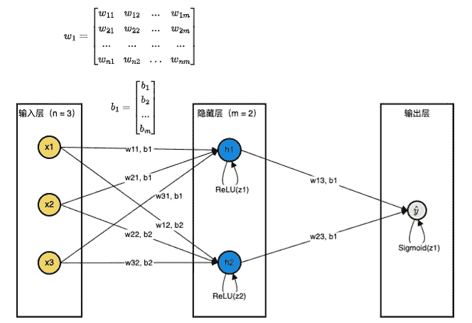
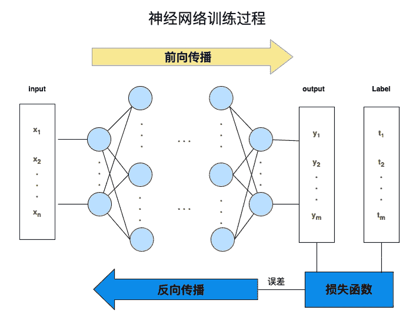
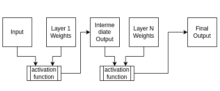
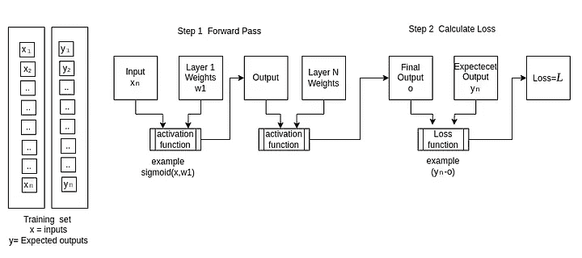
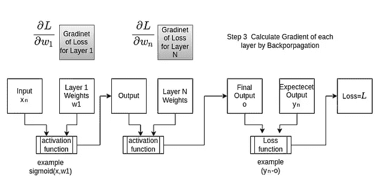
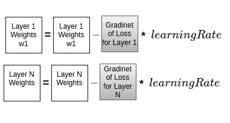

# 一文搞懂深度学习：神经网络原理详解

> 来源：[https://geekbang.feishu.cn/docx/EO6mdfZxtofjdBxpaPzcAYA1nEb](https://geekbang.feishu.cn/docx/EO6mdfZxtofjdBxpaPzcAYA1nEb)

> 👨🏻 作者：加里

> 📃 作者介绍：目前就职于金融银行AI部门，资深解决方案架构师。

> 🛖 公众号：AIWithGary

> ⏰ 收录时间：2024-05-27 11:20:58 (UTC+8)

> 🔗 原文链接： h[ttps://mp.weixin.q](https://mp.weixin.qq.com/s?__biz=MzU3OTgyMjM3MA==&mid=2247485170&idx=1&sn=57f83b00fe9177f877b63aeace0c0217&chksm=fd6170bfca16f9a91983223eddc4a428ec06b772dc03d54b1ec0fc4a96143bb96ea86fec20c4#rd)q.com/s?__biz=Mz...

关注作者，获取更多AI知识

本文是深度学习系列文章的第三篇，我们将通过逻辑回归这一经典例子，深入解析神经网络的核心概念和工作原理；逻辑回归虽然简单，但它蕴含了神经网络处理分类问题的基础思想；我们会从神经网络的结构组成讲起，详细探讨输入层，隐藏层和输出层的功能与重要性，并阐述神经网络的训练过程。

# 01

神经网络表示

输入层

在神经网络中，输入层是整个神经网络的起点，它接收来自外部的数据并将其传递到网络的下一层；输入层的每个节点（或称为神经元）代表一个输入特征，这些特征可以是任何形式的数据，例如图像的像素值，文本的词向量或传感器的读数；在输入层中，这些特征通常被表示为一个向量，记作：

其中 x_i 代表第 i 个输入特征。

输入层的主要功能是将原始数据传递给网络的下一层，即隐藏层；在这个过程中，输入层本身并不进行任何计算或变换，它只是简单地将输入数据传递给隐藏层的每个神经元；每个输入特征 x_i 都会连接到隐藏层中的每个神经元，这些连接被称为权重（weights），用 w_{ij} 表示，其中 i 表示输入特征的索引，j 表示隐藏层神经元的索引。

在输入层和隐藏层之间的连接中，每个输入特征 x_i 都会乘以一个权重 w_{ij}，然后将所有乘积相加，再加上一个偏置项 b_j ，这个过程可以用以下公式表示：

其中，z_j 是传递给隐藏层第 j 个神经元的输入信号； 这个信号随后会通过一个激活函数（activation function）进行非线性变换，生成隐藏层神经元的输出。

输入层的设计和配置在很大程度上取决于具体的应用场景和数据类型，例如，在处理图像数据时，输入层的节点数通常等于图像的像素数；在处理文本数据时，输入层的节点数可能等于词汇表的大小或词向量的维度。

总的来说，输入层负责接收和传递原始数据，为后续的计算和变换提供必要的输入；尽管输入层本身不进行复杂的计算，但它的设计和配置对整个神经网络的性能和效果有着重要的影响；通过合理地选择和预处理输入特征，可以显著提高神经网络的学习能力和泛化能力。

隐藏层

隐藏层的名称来源于其在训练数据集中并不直接可见的特性，具体来说，在监督学习中，我们的训练集包含输入特征 x 以及目标输出 y 的值；然而，隐藏层中的节点值在训练集中是不可见的，即我们并不知道这些节点在训练数据中的真实值；我们只知道输入特征和期望的输出结果，但隐藏层中的值需要通过训练过程来确定。

隐藏层的主要作用是通过一系列的权重和偏置参数，将输入特征进行非线性变换，从而提取出更高层次的特征；这些特征能够更好地表示输入数据的复杂模式和结构，每个隐藏层的节点（也称为神经元）接收来自前一层的输入，通过加权求和和激活函数的作用，生成新的输出，这些输出将作为下一层的输入，继续进行处理。

在一个典型的神经网络中，隐藏层的数量和每层中的神经元数量是设计网络结构时需要考虑的重要参数；隐藏层的数量和每层神经元的数量越多，网络的表达能力越强，但同时也增加了计算复杂度和过拟合的风险；因此，在设计神经网络时，需要在表达能力和计算复杂度之间找到一个平衡点。

隐藏层的激活函数是另一个重要的组成部分，常见的激活函数包括Sigmoid函数，Tanh函数和ReLU函数等；激活函数的选择会影响网络的训练效果和收敛速度，例如，ReLU函数由于其简单的计算和良好的梯度传播特性，常常被用于深层神经网络中。

在数学表示上，隐藏层的输出可以表示为：

其中，W^{[1]} 是隐藏层的权重矩阵，b^{[1]} 是偏置向量，g 是激活函数，X 是输入特征矩阵。

通过这种方式，隐藏层将输入特征进行非线性变换，生成新的特征表示。

隐藏层通过复杂的非线性变换，提取出输入数据的深层次特征，从而使得神经网络能够处理复杂的任务，如图像识别，自然语言处理等；在实际应用中，合理设计隐藏层的结构和参数，是构建高效神经网络的关键。

输出层

输出层是整个网络的最后一层，它的主要功能是生成最终的预测值；在一个典型的神经网络中，输出层通常由一个或多个节点组成，这些节点负责将隐藏层传递过来的信息进行处理，并输出最终的结果。

首先，输出层的节点数量取决于具体的任务类型，例如，在二分类问题中，输出层通常只有一个节点，该节点的输出值可以通过一个阈值来决定分类结果；而在多分类问题中，输出层可能包含多个节点，每个节点对应一个类别，最终的分类结果由输出值最大的节点决定；此外，在回归问题中，输出层的节点数量也可能是一个，输出的值直接作为预测结果。

输出层的激活函数选择也是一个关键因素。常见的激活函数包括Sigmoid函数，Softmax函数和线性激活函数等；对于二分类问题，Sigmoid函数是一个常见的选择，因为它可以将输出值压缩到0到1之间，方便进行概率解释；而对于多分类问题，Softmax函数则更为适用，它可以将多个输出节点的值转换为概率分布，使得每个节点的输出值都在0到1之间，并且所有节点的输出值之和为1；对于回归问题，线性激活函数通常是首选，因为它可以输出任意实数值。

输出层的设计不仅仅是选择合适的激活函数，还包括如何处理输出值与真实值之间的误差；在训练过程中，输出层的输出值会与真实值进行比较，计算出误差（也称为损失）；常见的损失函数包括均方误差（MSE），交叉熵损失等；损失函数的选择取决于具体的任务类型和输出层的激活函数，例如，对于回归问题，均方误差是一个常见的选择；而对于分类问题，交叉熵损失则更为适用。

在误差计算完成后，神经网络会通过反向传播算法（Backpropagation）将误差传递回去，调整网络中的权重和偏置，以减少误差，提高模型的准确性；反向传播算法的核心思想是利用梯度下降法，通过计算损失函数对每个参数的偏导数，逐步调整参数，使得损失函数值逐渐减小。

输出层不仅负责生成最终的预测结果，还在训练过程中通过误差反馈机制帮助网络不断优化参数，提高模型的性能。

# 02

神经网络训练过程

神经网络的训练过程主要包括前向传播（forward propagation），损失计算（loss calculation），反向传播（backpropagation）和参数更新（parameter update）；这些步骤共同作用，使得神经网络能够从数据中学习并逐步提高其性能。

前向传播

在这一阶段，输入数据通过网络的各层逐层传递，最终生成输出；输入层接收原始数据，并将其传递给隐藏层，隐藏层通过一系列的加权和激活函数处理数据，然后将结果传递给下一层，直到最终输出层生成预测结果。

例如，假设我们有一个简单的三层神经网络，输入层有三个节点，隐藏层有四个节点，输出层有一个节点。输入数据

首先通过输入层传递到隐藏层。隐藏层的每个节点会计算一个加权和，并通过激活函数（如ReLU或Sigmoid）生成输出。然后，这些输出会传递到输出层，最终生成预测值 \hat{y}。

损失计算

在前向传播生成预测结果后，我们需要评估这些预测结果的准确性；这是通过计算损失函数（loss function）来实现的，损失函数衡量了预测结果与实际标签之间的差异，常见的损失函数包括均方误差（MSE）和交叉熵损失（Cross-Entropy Loss）。

例如，对于一个二分类问题，如果实际标签为 y，预测值为 \hat{y}，我们可以使用交叉熵损失来计算损失值：

损失值越小，说明预测结果越接近实际标签，模型的性能越好。

反向传播

通过反向传播，我们可以计算损失函数相对于每个参数的梯度（gradient），这些梯度将用于更新网络的参数，使得损失函数的值逐步减小。

反向传播的基本思想是应用链式法则（chain rule）计算梯度，从输出层开始，逐层向后计算每个参数的梯度；对于每一层，我们需要计算损失函数相对于该层输出的梯度，然后再计算该层输出相对于输入的梯度，最终得到损失函数相对于每个参数的梯度。

例如，对于一个简单的两层神经网络，假设损失函数为L，输出层的激活值为 a，隐藏层的激活值为 h，输入层的值为 x，权重矩阵为 W，我们可以通过以下步骤计算梯度：

1. 计算输出层的梯度：

$\frac{\partial L}{\partial a}$

2. 计算隐藏层的梯度：

3. 计算输入层的梯度：

参数更新

在计算出梯度后，我们需要更新网络的参数，以使得损失函数的值逐步减小；常用的参数更新方法是梯度下降（Gradient Descent），它通过以下公式更新参数：

其中，\theta 表示网络的参数，\alpha 是学习率（learning rate）， $\frac{\partial L}{\partial \theta}$是损失函数相对于参数的梯度。

学习率是一个非常重要的超参数，它决定了每次更新的步长；如果学习率过大，可能会导致训练过程不稳定，甚至无法收敛；如果学习率过小，训练过程会非常缓慢；因此，选择合适的学习率是神经网络训练中的一个关键问题。

神经网络的训练过程是一个复杂而精细的过程，涉及前向传播，损失计算，反向传播和参数更新等多个步骤；通过这些步骤，神经网络能够从数据中学习，并逐步提高其性能；在实际应用中，我们还需要结合具体问题，选择合适的网络结构，损失函数和优化算法，以获得最佳的模型性能。

# 03

神经网络逻辑回归

在机器学习和人工智能领域，逻辑回归是一种非常重要的统计方法，尤其在分类问题中得到了广泛应用；逻辑回归的主要目标是预测一个二分类的输出，即判断一个数据点属于类别0还是类别1；尽管逻辑回归的名字中带有“回归”二字，但它实际上是一种分类算法。

数学模型

逻辑回归的核心思想是通过一个线性模型来预测输出的概率；假设我们有一个输入向量X，我们希望预测输出 y 的概率，其中 y 可以是0或1；我们需要找到 y = 1 的概率，记作

这个概率可以通过一个逻辑函数（Logistic Function）来计算，通常使用的是Sigmoid函数，其公式为：

其中 z 是线性模型的输出，定义为：

这里，W是权重向量，b是偏置项； 通过这个公式，我们可以将线性模型的输出映射到一个0到1之间的概率值。

输入和参数

在逻辑回归中，输入X通常是一个

的矩阵，其中n 是特征的数量，m是训练样本的数量；权重矩阵W是一个

的向量，偏置 b 是一个标量；通过调整这些参数，我们可以使模型更好地拟合训练数据。

输出和激活函数

在逻辑回归中，输出是一个概率值，表示输入数据点属于类别1的可能性；为了得到这个概率，我们使用了Sigmoid激活函数，它的作用是将线性模型的输出映射到一个0到1之间的值，这样我们就可以解释为概率。

其中 \hat{y} 是预测的概率值。

损失函数

为了训练逻辑回归模型，我们需要定义一个损失函数来衡量模型的预测与实际标签之间的差距；常用的损失函数是交叉熵损失（Cross-Entropy Loss），其公式为：

通过最小化这个损失函数，我们可以找到最优的权重和偏置，使得模型的预测尽可能接近实际标签。

梯度下降和反向传播

为了最小化损失函数，我们使用梯度下降算法；它的核心思想是通过计算损失函数对参数的梯度，然后沿着梯度的反方向更新参数；参数更新的公式为：

其中 \alpha 是学习率，控制每次更新的步长。

在神经网络中，梯度的计算通过反向传播算法来实现；反向传播的基本思想是从输出层开始，逐层向后计算梯度，直到输入层；通过这种方式，我们可以高效地计算出每个参数的梯度，从而更新参数。

实际应用

逻辑回归在实际中有很多应用场景，例如，在垃圾邮件分类中，我们可以使用逻辑回归来判断一封邮件是否是垃圾邮件；通过训练一个逻辑回归模型，我们可以根据邮件的特征（如词频、发件人等）来预测其是否为垃圾邮件。

另一个常见的应用是信用评分，银行和金融机构可以使用逻辑回归模型来预测一个客户是否有违约的风险；通过输入客户的历史信用记录，收入水平等特征，模型可以输出一个违约的概率，从而帮助银行做出决策。

逻辑回归作为一种简单而有效的分类算法，在神经网络中也有着广泛的应用；通过定义合适的数学模型，损失函数和优化算法，我们可以训练出一个高效的逻辑回归模型来解决实际中的分类问题；尽管逻辑回归的模型相对简单，但其背后的思想和方法在更复杂的神经网络中同样适用。

# 04

总结

在这篇文章中，首先，我们介绍了神经网络的基本组成部分；输入层负责接收原始数据，隐藏层通过一系列的权重和激活函数进行复杂的计算，最终输出层给出预测结果；每一层的设计和参数选择都对最终的模型性能有着至关重要的影响。

接下来，我们讨论了神经网络的学习过程；通过梯度下降和反向传播算法，神经网络能够不断调整其内部参数，以最小化预测误差。这一过程虽然复杂，但通过逐步分解和示例代码的演示，我们可以更直观地理解其工作机制。

最后，我们以逻辑回归为例，展示了神经网络在分类问题中的应用；通过定义合适的数学模型，损失函数和优化算法，我们可以训练出一个高效的逻辑回归模型来解决实际中的分类问题；尽管逻辑回归的模型相对简单，但其背后的思想和方法在更复杂的神经网络中同样适用。