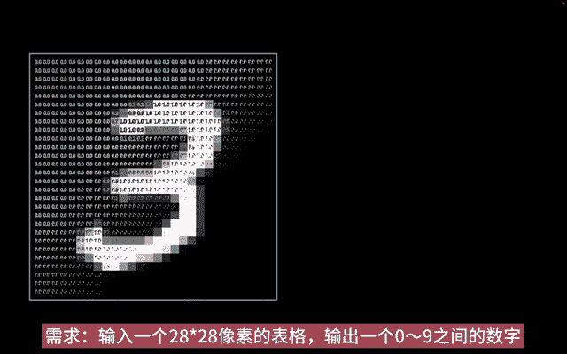
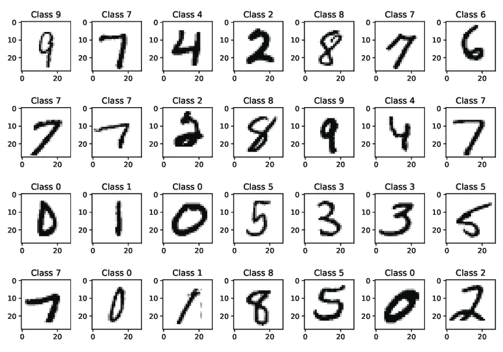
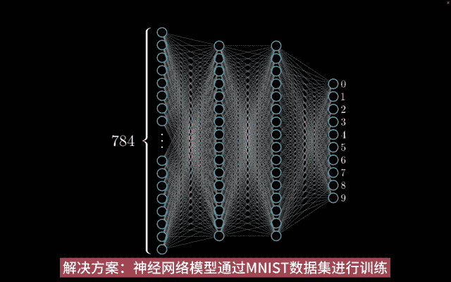
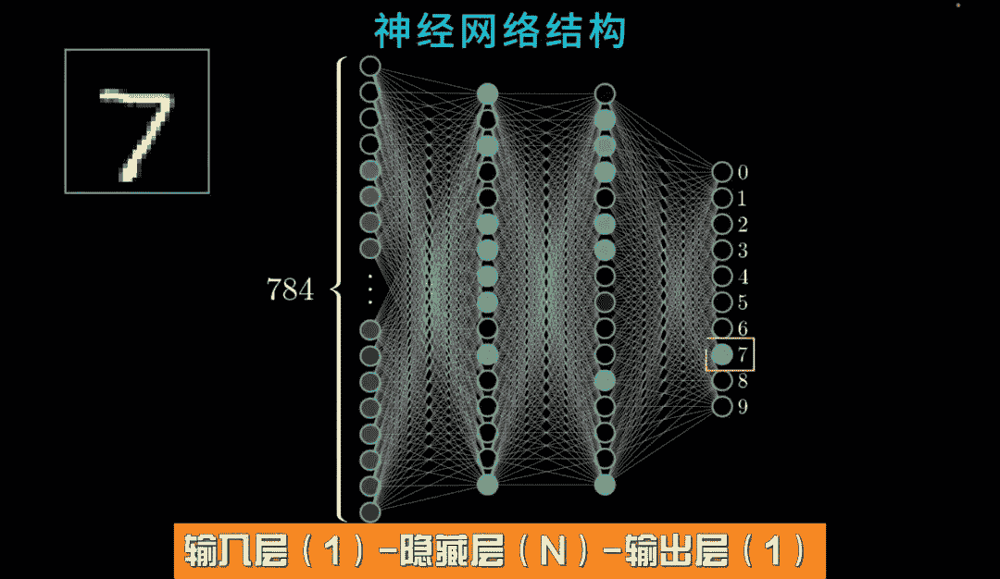
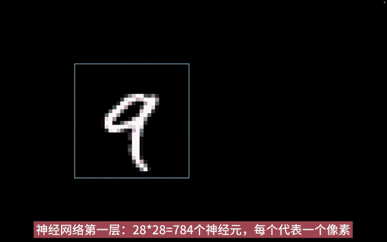
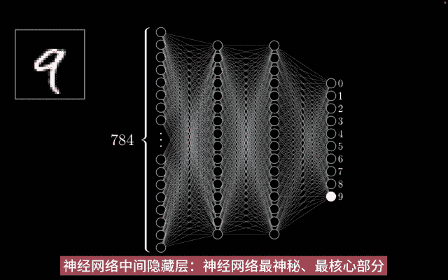
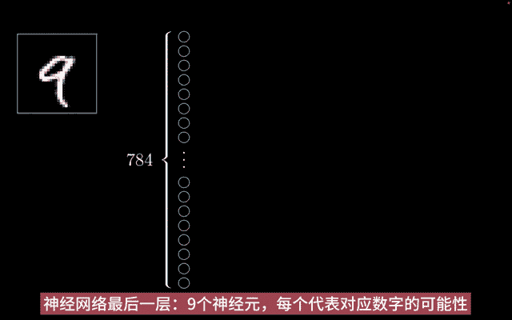

# 神经网络动画讲解 - 神经网络结构

> 来源：[https://geekbang.feishu.cn/docx/DN5LdAWUaoQpNkxLhV3cFWxznZd](https://geekbang.feishu.cn/docx/DN5LdAWUaoQpNkxLhV3cFWxznZd)

> 👨🏻 作者：AllenTang

> 📃 作者介绍：分享人工智能，让所有人玩转AI

> 🛖 公众号：架构师带你玩转AI

> ⏰ 收录时间：2024-05-23 11:28:42

> 🔗 原文链接：h[ttps://mp.weixin.q](https://mp.weixin.qq.com/s/aLbW4zrgF8Z7X1Q4S0hDLw)q.com/s/aLbW4zrg...

关注作者公众号，获取更多AI知识

**动画地址：查看原文，可看动画**

**手写数字识别： ****手写数字识别是 一个经典的机****器学习问****题，输入 一个2 8*****2**8像素的表格 ，输出 一个0～9之间的数字 。

**手写数字识别**

**数据集： ****M**NIST是一个包含大量手写数字图片的数 据集， 每个图片都是一个28x28像素的灰度图像，代表一个0-9之间的数字 。

**MNIST数据集**

**解决方案 ： ****手**写数字识别在直观上很简单，但用传统计算机程序解决却复杂且成功率低。然而，卷积神经网络（CNN）等神经网络模型能轻松应对，实现高准确率识别。

**CNN自动从图像学习特征，无需手动设计，能处理复杂图像变化， 使用M**NIST数据集进行训练和测试，从而 学习图像到数字标签的映射，实现高准确率识别。

**MNIST数据集训练神经网络**

神经网络算法 - 一文搞懂CNN（卷积神经网络）

**神经网络结构： **输入层（1）- 隐藏层（N）- 输出层（1）

**神经网络结构**

+   输入层 ： 输入层是神经网络的第一层，负责接收原始数据。

1.  28*28=784， 每张图片有 784个像素。

1.  第一层有784个神经元，每个神经元代表一个像素。

1.  每个神经元有个激活值，代表每个像素的灰度值。

**神经网络输入层 **

+   隐藏层 ： **隐**藏层是神经网络中的中间层，位于输入层和输出层之间， 负责学习数据的特征表示，并将这些特征传递给输出层以进行最终的预测或分类。

1.  隐藏层的数量可以是任意的 ，层数越多，模型越复杂。

1.  **每个神经元都接收前一层所有神经元的输出（经过**加权和激活函数处理），并产生自己的输出。

1.  隐藏层中的神经元数量是一个超参数，需要根据具体问题进行调整。

**神经网络隐藏层 **** **

+   输出层 ： 输出层是神经网络的最后一层，负责产生最终的预测或分类结果。

+   每个神经元都接收前一层所有神经元的输出（经过加权和激活函数处理），并产生自己的输出。

1.  输出层的神经元接收隐藏层神经元的输出，并产生最终的预测值。

1.  输出层的预测值 用于预测一个连续值或进行二分类（输出为0或1） 。

1.  输出层9个神经元，对应代表0～9数字的可能性。

**神经网络输出层**

神经网络算法 - 一文搞懂ANN（人工神经网络）

** **

****注释****

**神经网络动画素材来源于 3Blue1**Brown，想了解更多查看参考资料网址。

**3B**lue1Brown 是一个由 Grant Sanderson 创建的YouTube 频道。这个频道从独特的视觉角度解说高等数学，内容包括线性代数、微积分、人工神经网络、黎曼猜想、傅里叶变换以及四元数等。

**Grant Sanderson **毕业于斯坦福大学，并获得了数学学士学位。

**参考资料**

+   https://www.3blue1brown.com/