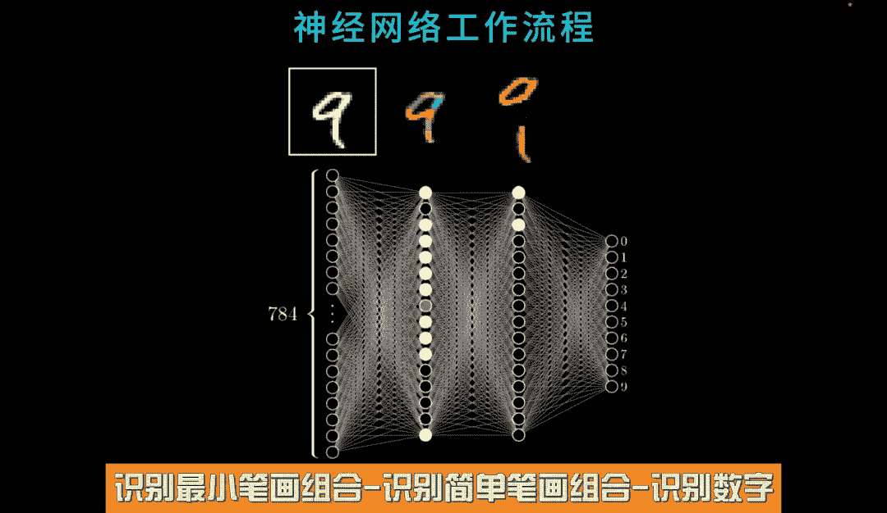
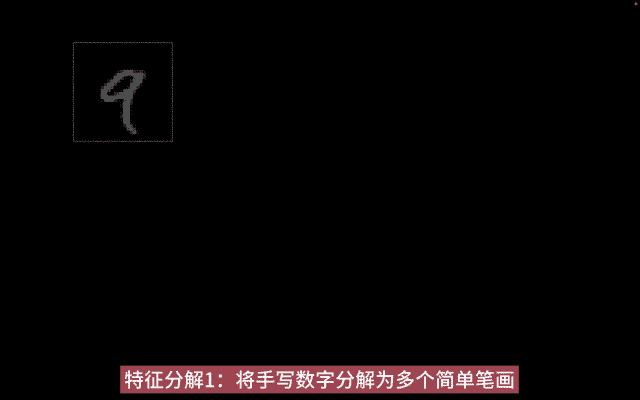
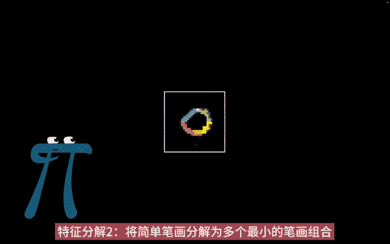
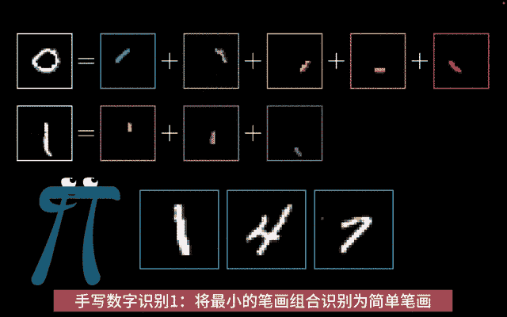
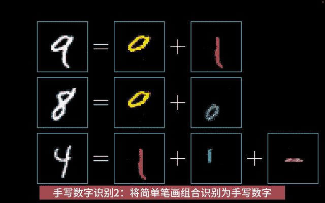

# 神经网络动画讲解 - 神经网络工作流程

> 来源：[https://geekbang.feishu.cn/docx/ZduTd3IGXotzXCx9xywcYm1Cngh](https://geekbang.feishu.cn/docx/ZduTd3IGXotzXCx9xywcYm1Cngh)

> 👨🏻 作者：AllenTang

> 📃 作者介绍：分享人工智能，让所有人玩转AI

> 🛖 公众号：架构师带你玩转AI

> ⏰ 收录时间：2024-05-23 11:28:42

> 🔗 原文链接： h[ttps://mp.weixin.q](https://mp.weixin.qq.com/s/HhiXrwtY6hVGmhHAPu1cBQ)q.com/s/HhiXrwtY...

关注作者公众号，获取更多AI知识

**动画地址：查看原文，可看动画**

**神经网络工作流程： ****特征分解1（手写数字->简单笔画组合）、 特征分解2（简单笔画->最小笔画组合）、 特**征识别1（最小笔画组合->简单笔画）、 特征识别2（简单笔画组合->手写数字）

**神经网络工作流程**

神经网络算法 - 一文搞懂CNN（卷积神经网络）

**特征分解1 ： ** 将手写数字分解为多个简单笔画（基本元素）

**特征分解1**

1.  **数字9分解为0和1： **数字9由一个垂直的直线段和一个向右弯曲的弧线组成。 可以将9的顶部弯曲部分视为一个变形的“0”，而垂直的直线段可以看作是一个“1”。需要注意的是，这种分解并不是严格的数学意义上的0和1，而是从形状上的一种近似。

1.  **数字8分解为两个0： **数字8由两个相互连接的圆 形或椭圆形组成，一个在上，一个在下。  可以将8的上半部分和下半部分各自视为一个变形的“0”。同样，这种分解是基于形状的相似性，而不是数学上的等同。

1.  **数**字4分解为三部分： 数字4 由一个垂直的直线段和一个向右的斜线段组成，斜线段上方有一个小的水平线段。 垂直的直线段： 这是4的主要部分，从上到下贯穿整个数字。 小的水平线段： 位于垂直直线段的上方，与垂直线段相交。 向右的斜线段： 从垂直直线段的顶部开始，向右下方延伸。

** 特征分解2 ： **将简单笔画（基本元素）分解为多个最小的笔画组合

**特征分解2**

1.  **基本元素0： ****数**字0通常被视为一个闭合的圆形或椭圆形。为了将其分解为更小的笔画组合，我们可以考虑将其分解为多个小的直线段或弧线段。 确定圆形的起始点和结束点， 从起始点开始，沿着圆形的轮廓，我们可以将其分解为多个小的弧线段。每个弧线段都是圆形的一部分。

1.  基本元素1： 数字1主要由一个垂直的直线段组成。 将垂直直线段视为由多个小的直线段组成。

** ****特征识别1 ： **将最小的笔画组合识别为简单笔画

**特征识别1 **

**特征识别2 ： ****将简单笔画组合识别为手写数字**

**特征识别2**

** **

****注释****

**神经网络动画素材来源于 3Blue1**Brown，想了解更多查看参考资料网址。

**3B**lue1Brown 是一个由 Grant Sanderson 创建的YouTube 频道。这个频道从独特的视觉角度解说高等数学，内容包括线性代数、微积分、人工神经网络、黎曼猜想、傅里叶变换以及四元数等。

**Grant Sanderson **毕业于斯坦福大学，并获得了数学学士学位。

**参考资料**

+   https://www.3blue1brown.com/