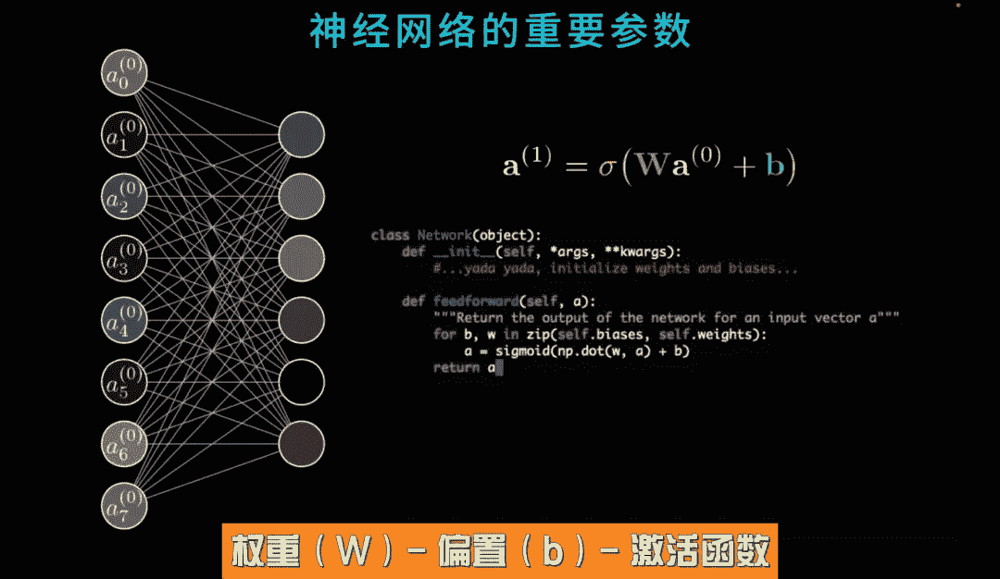
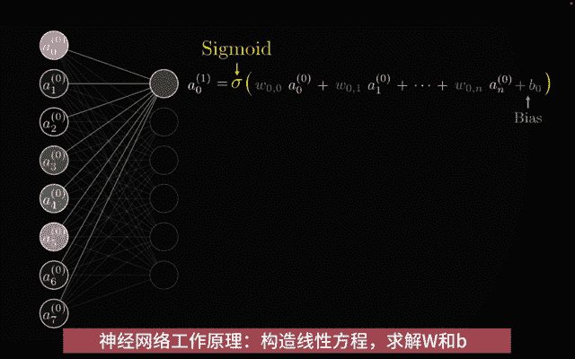
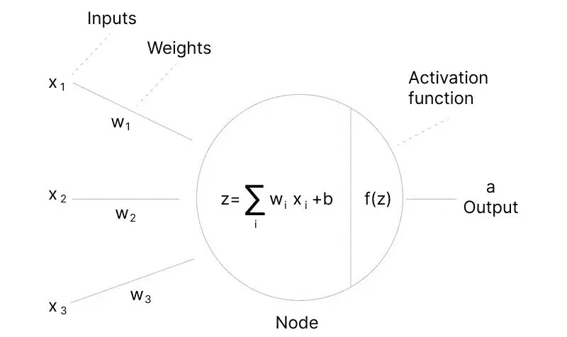
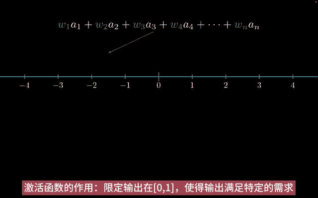
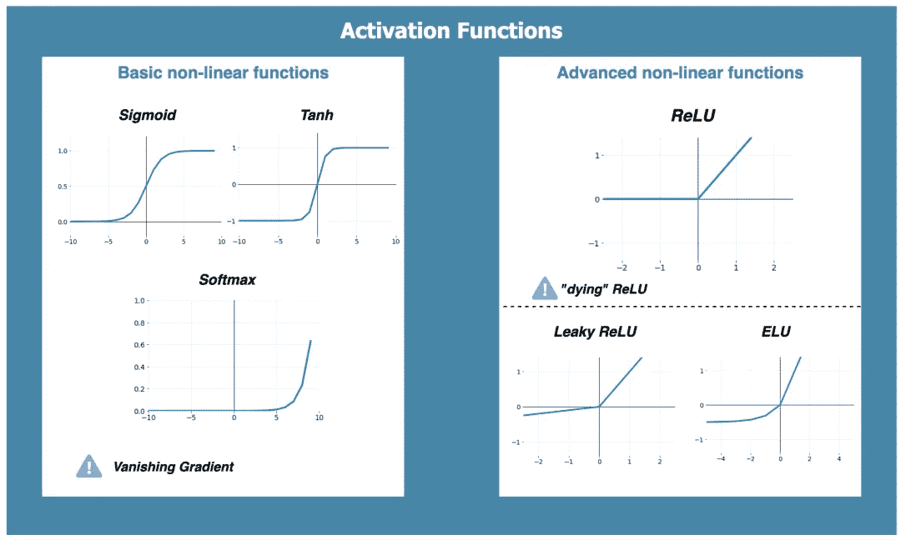
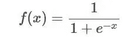
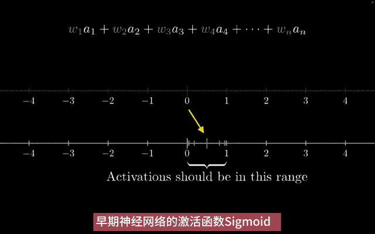
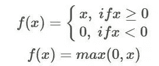
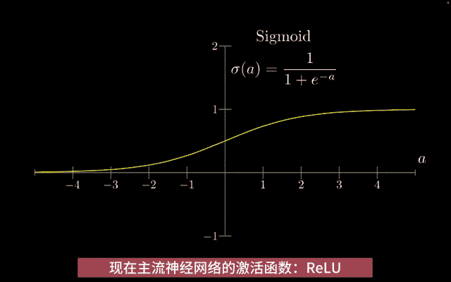

# 神经网络动画讲解 - 权重W、偏置b和激活函数

> 来源：[https://geekbang.feishu.cn/docx/QtbodyL77oOHIDxQ1gYcq7YWnVh](https://geekbang.feishu.cn/docx/QtbodyL77oOHIDxQ1gYcq7YWnVh)

> 👨🏻 作者：AllenTang

> 📃 作者介绍：分享人工智能，让所有人玩转AI

> 🛖 👸号：架构师带你玩转AI

> ⏰ 收录时间：2024-05-23 11:28:42

> 🔗 原文链接： h[ttps://mp.weixin.q](https://mp.weixin.qq.com/s/piC01OawrwyUaXK4_10L6g)q.com/s/piC01Oaw...

关注作者👸号，获取更多AI知识

**动画地址：查看原文，可看动画**

**在神经网络中，无论是处理分类任务还是回归任务，权重（W）****和偏置（b）都扮演着核心角色****。它们通过 加权求和和偏置修正的方式**， 定义了输入特征与输出之间的复杂关系，使得神经网络能够学习并适应各种数据模式。

**神经网络的重要参数 **

神经网络算法 - 一文搞懂回归和分类

**权**重 W和偏置b ： 在神经网络中，权重（W）和偏置（b）是两个非常重要的参数，它们决定了神经元之间的连接强度和神经元的输出。

+   权重（W）： 权重是神经网络中的连接参数，用于描述不同神经元之间的连接强度。在神经网络的前向传播过程中，输入数据会与权重进行加权求和，从而影响神经元的输出。权重的大小和正负决定了输入数据对输出数据的影响程度。

+   偏置（b）： 偏置是神经网络中的一个附加参数，用于调整神经元的输出。偏置的作用类似于线性方程中的截距项，它使得神经元的输出可以偏离原点。偏置的存在使得神经网络能够学习更加复杂的函数关系。

**权重W和偏置b**

**激活函数： **** ****激**活函数（Activation Function） 是在神经网络中用于将神经元的输入映射到输出端的函数。它决定了节点是否应该被激活（即，是否让信息通过该节点继续在网络中向后传播）。

**在**神经网络中，输入通过加权求和（ 权重（W）和偏置（b） ），然后被一个函数作用，这个函数就是激活函数。

**激活函数**

**激活函数的主要作用如下：**

1.  增**加非线性 ：神经网络中，如果只有线性变换，那么无论神经网**络有多少层，输出都是输入的线性组合，与没有隐藏层效果相当。 引入非线性激活函数，使得神经网络逼近任何非线性函数，这样神经网络就可以应用到众多的非线性模型中。

1.  特征转换：把当前特征空间通过一定的线性映射转换到另一个空间 ，让数据能够更好地被分类。

**激活函数的作用**

**常见的激活函数包括： Sigmoid**、Tanh、Softmax、ReLU、 Leaky ReLU

1.  Sigmoid ：将输入的连续实值压缩到0和1之间，特别大的负数映射为0，特别大的正数映射为1。但它存在梯度消失和输出不是以0为中心的问题。

1.  Tanh ：将输入的连续实值压缩到-1和1之间，输出以0为中心。但它同样存在梯度消失的问题。

1.  Softmax ：常用于多分类问题的输出层，将神经元的输出映射到概率分布上。

1.  ReLU (Rectified Linear Unit) ：当输入大于0时，输出等于输入；当输入小于等于0时，输出为0。ReLU解决了梯度消失的问题，但可能会导致神经元“死亡”的问题。

1.  Leaky ReLU ：对ReLU进行了改进，当输入小于0时，给予一个很小的斜率，从而避免神经元“死亡”的问题。

**常见的激活函数**

[**秒懂AI-深度学习四种常用激活函数：Sigmo**](http://mp.weixin.qq.com/s?__biz=MzkzMTEzMzI5Ng==&mid=2247485380&idx=1&sn=cd96a1a9587c7c7cb191f70d737255d3&chksm=c26ee5dbf5196ccdd26105baee647f42a2320bdd6b7aece3c87f7839d59b51748ed7fdaa3164&scene=21#wechat_redirect)id、Tanh、ReLU和Softmax

**传统激活函数 Sigmoid ： Sig**moid 是传统神经网络中常用的一种激活函数，尤其在早期的神经网络结构中。

**SIgmoid函数公式**

### Sigmoid 激活函数的特性：

1.  **输出范围 ：Sigmoid 函数的 输出始终在 0 和 1** 之间，这使得它经常被用于二分类问题中，其中输出可以解释为属于某一类的概率。

1.  连续性和可导性 ：Sigmoid 函数是连续的，并且在整个实数域上都是可导的。这使得基于梯度的优化算法（如反向传播）可以很容易地应用于包含 Sigmoid 激活函数的神经网络。

1.  中心化问题 ：Sigmoid 函数的输出不是零中心的（zero-centered）。这意味着当神经元的输入在训练过程中发生变化时，它们的梯度将总是同号（要么都是正的，要么都是负的）。这可能会导致训练过程中权重的更新在特定方向上持续进行， 从而导致训练速度变慢或陷入局部最小值。

1.  梯度饱和 ：当输入  x **非常大或非常小时，Sigmoi**d 函数的梯度接近于 0。 这被称为梯度饱和或梯度消失。 在反向传播过程中，这可能导致梯度在通过多层网络时迅速减小，从而阻止权重进行有效的更新。

1.  计算复杂性 ：与一些现代激活函数（如 ReLU）相比，Sigmoid 函数需要计算指数函数和除法操作，这可能会增加计算成本。

**激活函数Sigmoid**

**主**流激活函数ReLU ： ReLU（Rectified Linear Unit）是当今深度学习领域中最主流的激活函数之一。

**ReLU函数公式**

### **ReLU 激活函数的特性：**

1.  非线性特性 ：ReLU函数在输入大于0时保持线性关系，而在输入小于等于0时输出为0，这种非线性特性使得神经网络能够学习更复杂的模式和特征。

1.  计算简单 ：ReLU函数的计算非常简单，只需要判断输入是否为正数，这在大规模神经网络中能够显著提高计算效率。

1.  解**决梯度消失问题 ：与传统的Si**gmoid和tanh激活函数相比，ReLU函数在输入为正数时导数为1，在输入为负数时导数为0， 这有效地避免了梯度消失问题。 梯度消失问题在深度神经网络训练中是一个常见问题，它会导致网络难以收敛到最优解。

1.  稀疏性 ：ReLU函数可以使神经网络中的一部分神经元处于非激活状态（即输出为0），这有助于减少神经网络的计算量和内存消耗，并提高模型的泛化能力。

1.  加速收敛 ：由于ReLU函数的非线性特性和计算简单性，它可以帮助神经网络更快地收敛到最优解。

**激活函数ReLU**

** **

****注释****

**神经网络动画素材来源于 3Blue1**Brown，想了解更多查看参考资料网址。

**3B**lue1Brown 是一个由 Grant Sanderson 创建的YouTube 频道。这个频道从独特的视觉角度解说高等数学，内容包括线性代数、微积分、人工神经网络、黎曼猜想、傅里叶变换以及四元数等。

**Grant Sanderson **毕业于斯坦福大学，并获得了数学学士学位。

**参考资料**

+   https://www.3blue1brown.com/