# 神经网络动画讲解 - 神经网络模型训练

> 来源：[https://geekbang.feishu.cn/docx/BtB2dm4KUoTtEhxsXb8caJLfnje](https://geekbang.feishu.cn/docx/BtB2dm4KUoTtEhxsXb8caJLfnje)

> 👨🏻 作者：AllenTang

> 📃 作者介绍：分享人工智能，让所有人玩转AI

> 🛖 公众号：架构师带你玩转AI

> ⏰ 收录时间：2024-05-23 11:28:42

> 🔗 原文链接： h[ttps://mp.weixin.q](https://mp.weixin.qq.com/s/_U5lIN0B-Voj60ExFBw-3A)q.com/s/_U5lIN0B...

关注作者公众号，获取更多AI知识

**动画地址：查看原文，可看动画**

**模型 训练的本质： **通过不断训练、验证和调优，让模型达到最优的一个过程。

**神**经网络训练通过随机初始化参数，利用反向传播算法计算梯度，并采用优化算法如随机梯度下降来迭代更新参数，以最小化损失函数并提升模型性能。

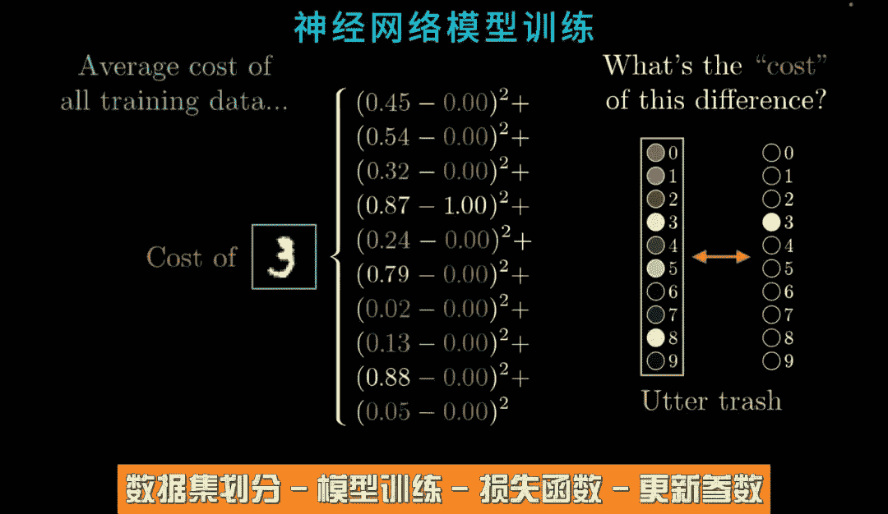

**神经网络模型训练**

1.  **参数初始化 **：神经网络的参数（包括权重和偏置）在训练开始前会被随机初始化。

1.  **前向传播 **：在训练过程中，输入数据通过神经网络进行前向传播，计算出模型的输出。这个过程涉及将输入数据与每一层的权重和偏置进行线性组合，然后应用激活函数来引入非线性。

1.  **反向传播 **：利用反向传播算法来计算损失函数相对于模型参数的梯度。这个过程涉及从输出层开始，逐层计算损失对参数的偏导数，并将这些梯度信息从输出层传播回输入层。

1.  **参数更新 **：得到梯度后，使用优化算法（如随机梯度下降SGD、Adam、RMSprop等）来更新模型的参数。优化算法根据计算出的梯度来调整模型参数，以最小化损失函数。

1.  **迭代训练 **：上述步骤（从前向传播到参数更新）会反复进行，直到模型在验证集上的性能达到满意的水平，或者达到预设的训练轮数（epochs）。

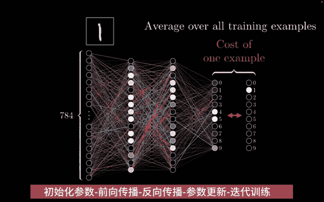

**神经网络模型训练**

神经网络算法 - 一文搞懂模型预训练Pre-training

**M**NIST数据集： MNIST数据集是一个广泛使用的标准数据集， 由杨立昆（Yann LeCun）等人创建 ， 用于训练和测试图像处理。

** **

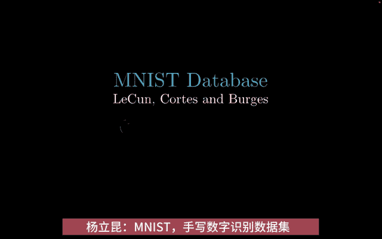

**MNIST数据集**

**MN**IST包含大量的手写数字图片，每张图片都是一个28x28像素的灰度图像，表示一个从0到9之间的数字。 这些图片是由不同人手写而成的，因此它们具有各种书写风格和噪声模式，为模型训练提供了丰富的挑战。

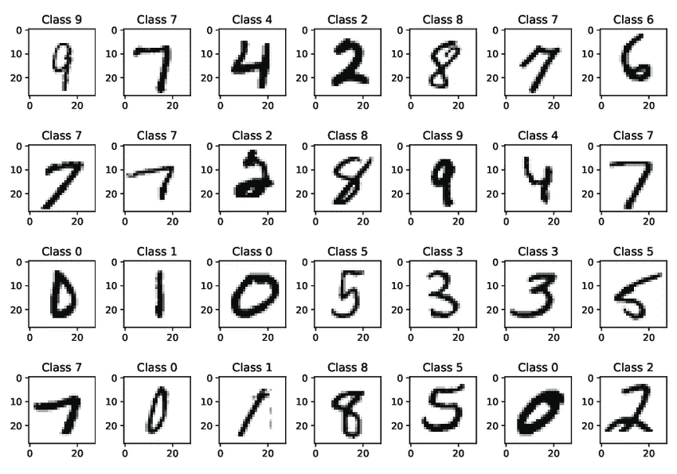

**MNIST数据集**

**数据集划分 ： 为了获得可靠的评估结果**，将数据集划分为训练集、验证集和测试集。

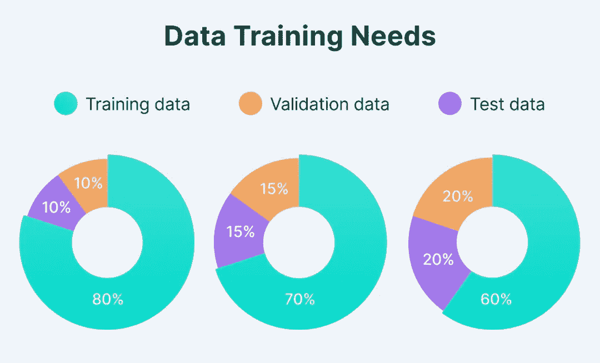

**数据集**

1.  训练集 (Training Set) ：这是模型学习的基础，就像课堂上学习的知识。通过反复学习和实践，模型能够逐渐掌握数据的特征和规律，从而学会如何做出预测。

1.  验证集 (Validation Set) ：在训练过程中，验证集就像**课后的练习题。模型通过完成这些练习题来检验自己的学习成果，并**根据反馈进行调整。 在模型训练中，验证集用于调整超参数、选择最佳模型（如基于验证集上的性能）以及进行早停（防止过拟合）。

1.  测试集 (Testing Set) ：测试集就像期末考试，用于全面检验模型的学习效果。在机器学习中，测试集是在模型训练完成后使用的，它提供了对模型泛化能力的无偏估计。 通过比较模型在测试集上的性能，我们可以了解模型在实际应用中的表现。

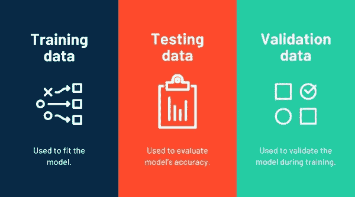

**训练集、测试集、验证集**

**反向传播（Back Prop****agation）： 反向传播算法**利用链式法则， 通过从输出层向输入层逐层计算误差梯度 ，高效求解神经网络参数的偏导数，以实现网络参数的优化和损失函数的最小化。

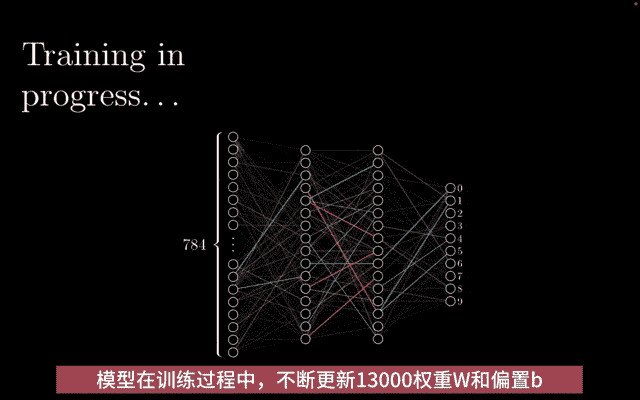

**反向传播 **

+   **利用链式法则 **：反向传播算法基于微积分中的链式法则， 通过逐层计算梯度来求解神经网络中参数的偏导数 。

+   **从输出层向输入层传播 **：算法从输出层开始， 根据损失函数计算输出层的误差，然后将误差信息反向传播到隐藏层 ，逐层计算每个神经元的误差梯度。

+   **计算权重和偏置的梯度 **：利用计算得到的误差梯度， 可以进一步计算每个权重和偏置参数对于损失函数的梯度 。

+   **参数更新 **：根据计算得到的梯度信息， 使用梯度下降或其他优化算法来更新网络中的权重和偏置参数 ，以最小化损失函数。

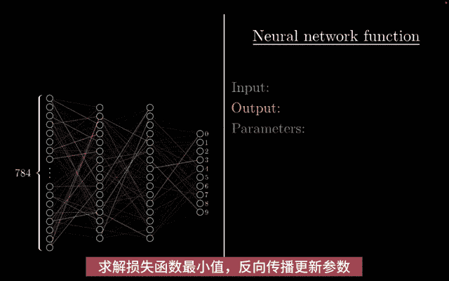

**反向传播**

神经网络算法 - 一文搞懂Back Propagation（反向传播）

**损失函数（Loss Function）**： 用于衡量模型预测值 与真实值 之间的差距。损失函数越小，模型的预测性能就越好。

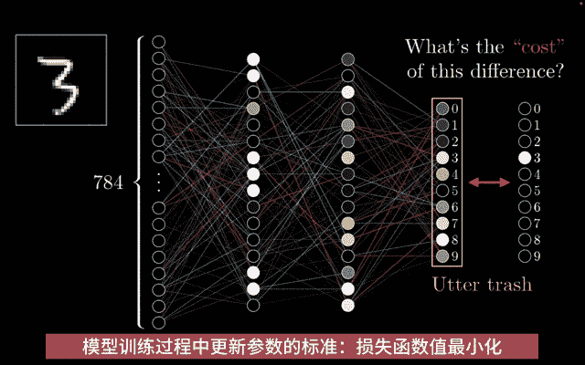

**损失函数 **

**在监督学习中，我们通常有一组带有标签（即真实值）的训练数据，损**失**函数就是用来指导模型学习过程的工具。  在每次**迭代中，模型都会根据损失函数的值来调整其参数，以最小化预测值与真实值之间的差距。

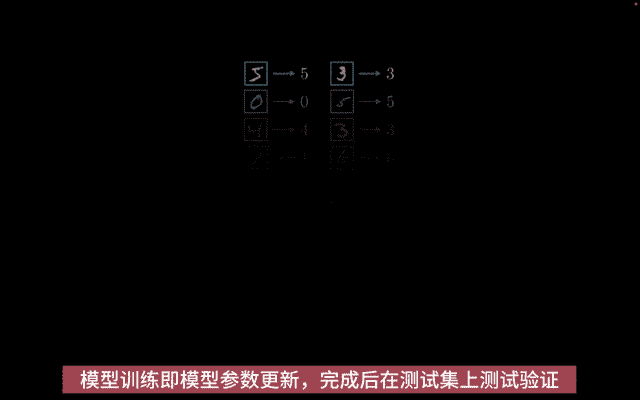

**损失函数调整参数**

神经网络算法 - 一文搞懂Loss Function（损失函数）

**梯度下降（ Gradient Descent ） ： ** 从一个初始点出发，沿着损失函数的负梯度方向不断更新参数，直到达到一个局部最小值或者全局最小值。

1.  **初始化参数： **选择一个初始的参数值。

1.  **计算梯度： **计算损失函数在当前参数值下的梯度。

1.  **更新参数： **沿着梯度的反方向更新参数，通常使用一个学习率（Learning Rate）来控制更新的步长。

1.  **重复迭代： **重复步骤2和3，直到满足停止条件（如达到最大迭代次数、损失函数值小于一个阈值等）。

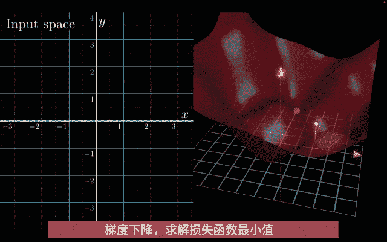

**梯度下降**

**随**机梯度下降（SGD）： 随机梯度下降在每次迭代中仅随机选择一个样本来计算损失函数的梯度，并根据这个梯度来更新模型的一个或多个参数。

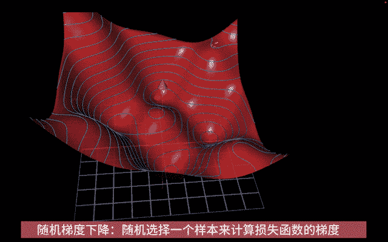

**随机梯度下降**

**批量梯度下降（BGD）： 与随机梯度下降不同， 在每次迭代中， 批量梯**度下降 使用整个数据集来计算损失函数的梯度，并根据这个梯度来更新模型的所有参数。

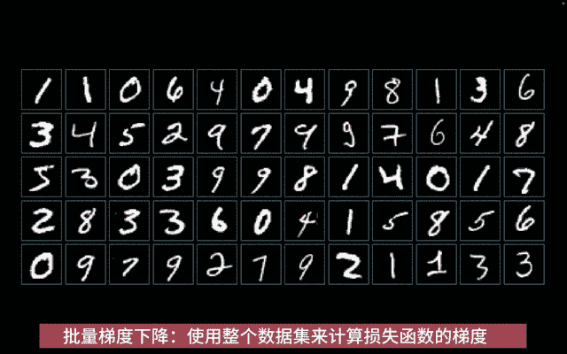

**批量梯度下降 ****    **

神经网络算法 - 一文搞懂Gradient Descent（梯度下降）

****注释****

**神经网络动画素材来源于 3Blue1**Brown，想了解更多查看参考资料网址。

**3B**lue1Brown 是一个由 Grant Sanderson 创建的YouTube 频道。这个频道从独特的视觉角度解说高等数学，内容包括线性代数、微积分、人工神经网络、黎曼猜想、傅里叶变换以及四元数等。

**Grant Sanderson **毕业于斯坦福大学，并获得了数学学士学位。

**参考资料**

+   https://www.3blue1brown.com/