# 一文探秘LLM应用开发【合集更新中】

> 来源：[https://geekbang.feishu.cn/docx/J6KydmrTuoAJuPxSQHlcrbw5nFe](https://geekbang.feishu.cn/docx/J6KydmrTuoAJuPxSQHlcrbw5nFe)

> 👨🏻 作者：ully

> 📃 作者介绍：《AI工程化》主理人，十余年AI平台、推荐、搜索等系统的设计开发经验，先后在头部互联网、AI公司任职架构师及技术总监。长期从事AI平台及AI驱动的应用系统（推荐/搜索/大模型问答等）的架构设计与开发工作，在数据中心AI、大模型AI、边缘AI工程化领域有深刻的认识和实践经验。丰富的理论实战经验，主导企业级机器学习平台等产品设计开发，开源AI编排框架项目，联合编著《MLOps工程实践》。

> ⏰ 收录时间：2024-06-06 17:11:20 (UTC+8)

> 🔗 原文链接：https://mp.weixin.qq.com/mp/


欢迎关注作者👸号

本文旨在让无大模型开发背景的工程师或者技术爱好者无痛理解大语言模型应用开发的理论和主流工具，因此会先从与LLM应用开发相关的基础概念谈起，并不刻意追求极致的严谨和完备，而是从直觉和本质入手，结合笔者调研整理及消化理解，帮助大家能够更容易的理解LLM技术全貌，大家可以基于本文衍生展开，结合自己感兴趣的领域深入研究。若有不准确或者错误的地方也希望大家能够留言指正。

第一部分 基础概念

1.机器学习场景类别

2.机器学习类型(LLM相关)

3.深度学习的兴起

4.基础模型

第二部分 应用挑战：

1.问题定义与基本思路

2.基本流程与相关技术

1）embbeding与tokenization

2）向量数据库

3）finetune（微调）

4）模型部署与推理

5）prompt

6）编排与集成

a. langchain

1.1. models

1.2. prompts

1.3. memory

1.4. indexes

1.5. chains

1.6. agents

1.7. callbacks

b. llama-index

7）预训练

场景案例（语义检索系统）

常用参考（好工具/好网站/好文章）

# **第一部分 基础概念：**

## **1.机器学习场景类别**

AI2.0时代到来，而AI1.0和AI2.0的区别是什么？基于场景类别来看，可以是很好的判别方法。在过去以alphaGo为代表的1.0时代，人工智能场景多以判别式AI为主。而到了2.0时代，以LLM（large language model）为代表的生成式AI有了大的发展。两者各有特点，关注的问题不同，相对于判别式ai需要大量的标注，模型泛化能力差，看起来不那么AI，而生成式AI的不同于判别式AI的技术特点和场景应用，特别是openAI开发的chatgpt惊艳产品效果，让大众认为这一次的技术不再是简单炒概念，而更接近于AGI（通用人工智能），因此也让AI迎来了新的一轮关注。

+   判别式(Discriminative AI)（分类/回归/识别/定位），传统机器学习应用场景，适合决策分析场景。

+   生成式(Generative AI)（LLM兴起），多模态，泛化性，具有创造力，有智能涌现现象。

> 来自ChatGPT：

> 生成式AI（Generative AI）和判别式AI（Discriminative AI）是两种不同的机器学习方法，它们在许多应用中都发挥着重要作用。下面是这两种方法的对比：

1.  **任务定义 **：

+   生成式AI：生成式模型关注数据的概率分布，它试图学习输入数据和输出标签之间的联合概率分布。这使得生成模型可以生成与训练数据类似的新数据。

+   判别式AI：判别式模型关注条件概率，它试图学习输入数据在给定输出标签下的概率分布。这使得判别模型更擅长在给定输入数据的情况下预测输出标签。

1.  **模型示例 **：

+   生成式AI：生成式对抗网络（GANs）、变分自编码器（VAEs）、隐马尔可夫模型（HMMs）和朴素贝叶斯分类器（Naive Bayes）等。

+   判别式AI：支持向量机（SVMs）、逻辑回归（Logistic Regression）、神经网络（Neural Networks）和决策树（Decision Trees）等。

1.  **优缺点 **：

+   生成式AI：

+   优势：生成式模型可以生成新的数据，适用于无监督学习任务。它们还能够处理丢失或不完整的数据。

+   劣势：生成式模型通常需要更多的计算资源和训练时间。在某些任务中，生成式模型的性能可能不如判别式模型。

+   判别式AI：

+   优势：判别式模型在分类和回归任务中通常具有更好的性能。它们往往需要较少的计算资源和训练时间。

+   劣势：判别式模型无法生成新的数据，且在处理丢失或不完整的数据时可能表现不佳。

1.  **应用场景 **：

+   生成式AI：图像生成、自然语言生成、音频合成、数据增强等。

+   判别式AI：图像分类、文本分类、情感分析、语音识别等。

> 总之，生成式AI和判别式AI在不同的任务和应用场景中各有优势。在选择合适的方法时，需要根据具体问题和需求进行权衡。

## **2.机器学习类型(LLM相关)**

大模型应用涉及到以下三类机器学习方法：

+   无监督学习（机器根据一定规则自己构造label）

+   监督学习（人为标注label）

+   强化学习（基于环境反馈）

其中，预训练阶段采用无监督学习的方法，通过在大量无标注语料（多来自于互联网维基百科，github等等）中学习规律，在这一过程中，其并不是真的无监督，而是通过一些设计，如bert采用的句子填空，gpt采用文字接龙的方式来达到机器自我训练的目的。这一过程可以理解为是一个数据压缩的过程，使得海量的数据被压缩到一个模型中，自然可以理解，语料足够多，模型足够大的时候，那么模型可以蕴含语料中暗藏的逻辑和知识。

不进行监督学习的大模型可以认为是个哑巴，它无法完整特定的任务，需要监督学习的方式，给模型一些例子或者步骤（数据集是需要人工标记的），帮助大模型知道如何输出，怎么样思考，从而应对不同的应用场景，如对话，翻译等，这就是“对齐（alignment）”的概念。

强化学习更多是在这个基础上的再完善，不直接给出正确的答案，而是由模型生成，然后对答案进行打分，从而让大模型能够更好的适应按照用户的喜好来工作。

## **3.深度学习的兴起**

1.为什么要用深度学习？

+   深度学习对特征工程要求更低，强调模型架构的设计。

+   经典机器学习如lr等，模型容量有限，存在模型bias，弹性不足。

+   深度学习模块化更好 ，能够以统一的模式更好得搭建复杂的模型结 构。

+   深度学习久来有之，早期算力不足，限制了他 的发展。

2.tranformer源起

发展轨迹：cnn（无记忆） => rnn（串行，短期记忆） => lstm（较长期记忆） => transformer（位置编码，并行，快）

特点：对位置，上下文编码，能够融会贯通。transformer更利于并行计算，算力的提升，使得tranformer的流行。

尽管如此，当前模型输入仍然有token数量限制。所谓token，本质就是输入被拆分的字符，也可以是一个单词、一个标点符号、一个数字、一个符号等，它和切词方法有关，模型再基于token进行embbeding，模型本身的输入决定了token数量的多少（并不完全一致，目前一些模型的token限制更多是处理架构软硬件性能的考虑）。

> 来自ChatGPT：

> 生成式AI

> 大模型的token数量受多个因素的限制，包括硬件和软件方面的限制。

>

> 硬件方面，大模型需要大量的内存和计算资源来训练和运行。随着模型的规模增 加，所需的内存和计算资源也会相应增加。目前，大多数机器学习任务都需要使用分布式计算集群来训练大型模型。

>

> 软件方面，大模型的token数量也受到一些限制。 例如，在自然语言处理任务中，模型的输入文本需要进行分词处理，将文本转换为token序列，这样模型才能理解和处理文本。 如果输入文本过长，导致token序列过长，那么模型的训练和推理速度都会变慢。 此外，大模型的参数数量也会随着token数量的增加而增加，这会导致模型更难以训练和优化。

>

> 因此，大模型的token数量需要在硬件和软件方面进行平衡，以便在可接受的计算资源和时间内完成训练和推理任务。同时，还需要考虑模型的精度和效果，以确定最优的token数量。

3.对抗生成的思想

对于生成式ai来讲，对抗生成的思想尤为重要，这会很方便理解文字生成和图像生成的内在原理，是StableDiffusion等新图片生成方法的源起。对抗生成可以理解为有两个模型，一个生成模型（generator）和一个生成质量的判别模型（discriminater）。generater可以基于用户的提示词生成图片，discriminater来判定这个图片是否满足要求，在这个过程中用到了标记数据（文字-图片-得分），通过它可以训练出一个discriminater 来判别生成的图片怎么样，而训练的过程就是训练一个generater，它生成的图片能够骗过discriminator，discriminater也再不断迭代，努力不让generater骗过，这样的博弈若干轮，变生成了可以满足需要的generator。而从这里看出，增加参数的随机性，便能提升生成的多样性，现在模型的temperature便是这个概念（参考熵增）。

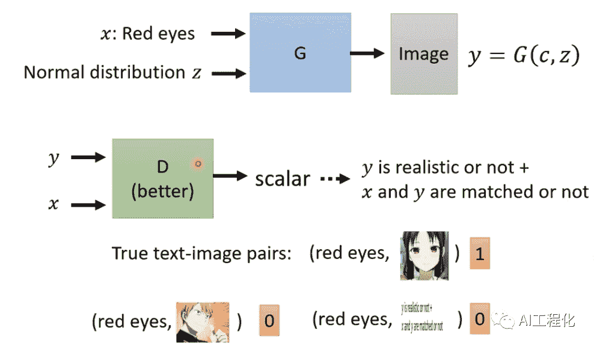

另外，如何做到无标记数据也能做到，可以参考cycle gan的思想，其本质就是自己给自己做标签，训练一个gennerator将图片变成向量，然后再训练一个generater将向量生成图片，然后计算原图和生成图的相似性，通过这样的循环迭代训练，便能训练出我们需要的模型。再使用时我们只需要按需拿其中一个即可。

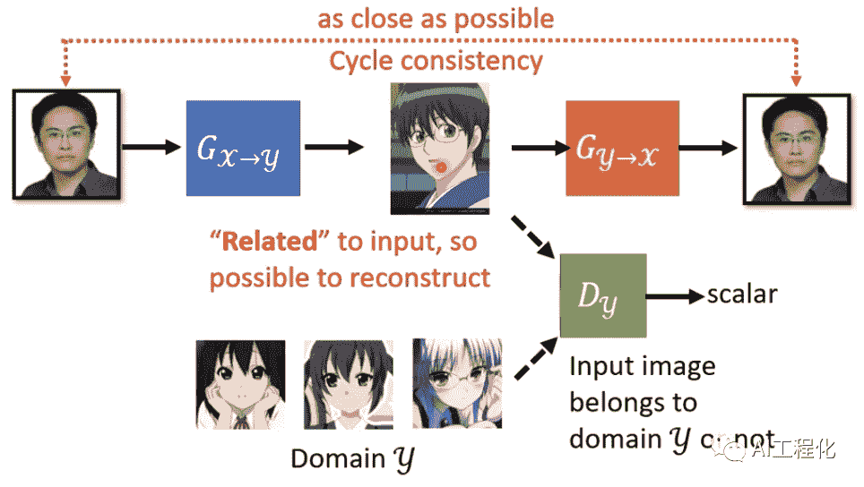

从另一个角度讲，模型训练和推理即压缩与解压缩的过程，比如如何将图片压缩到一个高密度的向量（文字），然后再基于高密度向量（文字）生成图片，其他还有文字->语音，文章->总结，总结->文章等。自编码器的思想与cycle gan类似。通过这样的做法可以做到无监督的效果。

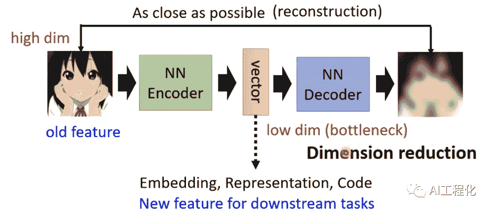

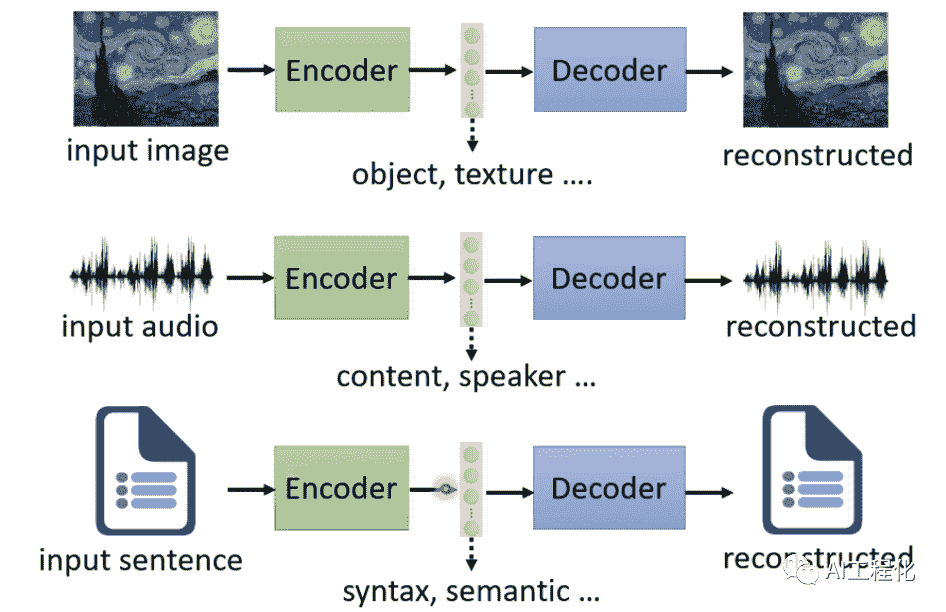

这样 的思想在图片生成，风格转 换，翻译等很多生成式场景有应用。

参考李宏毅机器学习课程： https://speech.ee.ntu.edu.tw/~hylee/ml/ml2021-course-data/gan_v10.pdf

## **4.基础模型**

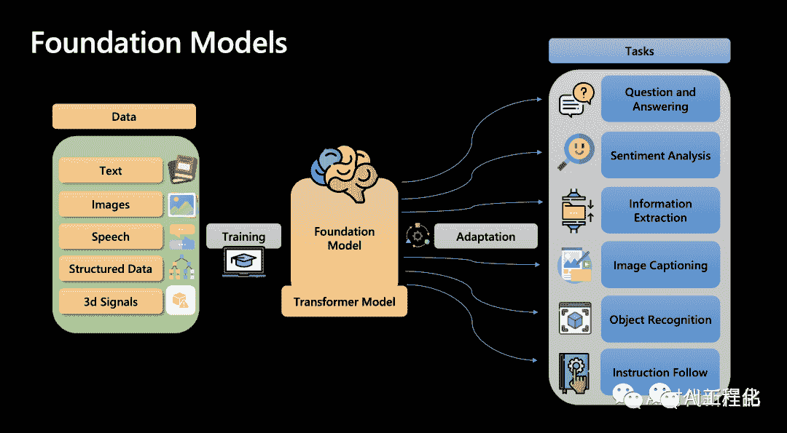

1.常见两类大语言模型:

bert模型：完形填空 创造性不好

gpt模型：文字接龙 创造性好

2.通俗理解：

通过大量的语料训练，将知识进行压缩，而知识中蕴含着深度的哲学，科学，基本推理逻辑，某种意义上，当有数据足够多，模型参数足够多，就能将这些内容压缩储藏在模型中，最终到涌现的效果(>10B)。

预训练大模型本身不具备特定的任务能力，需要结合实际领域能力进行微调（fine-tune），才能让大模型具备具体的能力。

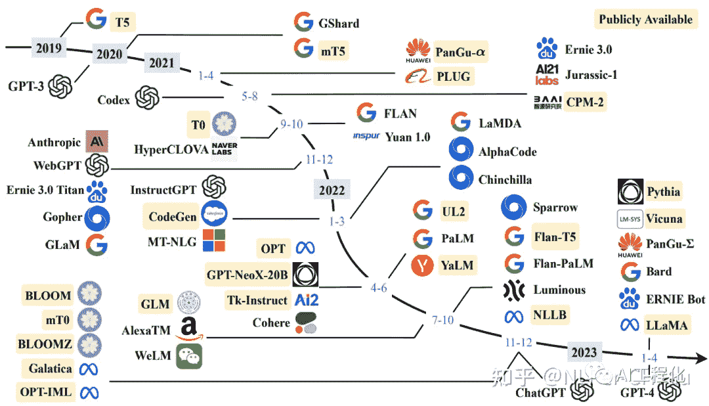

3.常见开源模型：

+   chatGLM6b/chatGLM13b 清华出品

+   https://github.com/THUDM

+   llama meta出品

+   https://github.com/facebookresearch/llama

+   Vicuna-13B 羊驼 基于llama微调

+   Falcon LLM 阿布扎比政府研究院(TII)出品

+   https://huggingface.co/tiiuae

> 更多大模型

> [张腾飞 译，👸号](https://mp.weixin.qq.com/s/BQOJNwfkApiZnFveMDBQ-w)：分布式实验室 开源大语言模型汇总

可商用大模型：https://github.com/eugeneyan/open-llms

4.大模型评测：

+   国内superClue排行榜:https://www.superclueai.com/

+   UC伯克利排行榜：https://chat.lmsys.org/

+   斯坦福排行榜：https://tatsu-lab.github.io/alpaca_eval/

# **第二部分 应用挑战**

# **1.问题定义与基本思路**

对于大模型应用来讲，核心工作围绕这个问题展开：

如何让大模型能够完成具体领域场景的实际工作，并且能够提升和干预效果？

从影响大模型的能力和效果的两个因素入手：

1）模型（内在）

可以将模型理解为知识和能力的混合体，经过微调的模型包含了学到的知识，逻辑，也包含执行具体某个任务的能力。但它有个缺点就是比较重量级，训练和更新需要大量的时间和成本，这也就导致模型知识不够及时，变更困难，黑盒难控制，能力扩展难度高等问题。

2）提示词(prompt)（外在）

可以将其理解为知识和指令的混合体，类比于AI 1.0的判别模型，提示词相当于特征输入，因此AI2.0将特征工程（feature enginering）晋级为提示词工程（prompt enginnering），特征工程决定了模型的上限，从这个角度侧面可见用好提示词的重要性。prompt可以给大模型直接表达需求（zero-shot），也可以给它示例（few-shot）解释需求，也可以一步步教它思考（chain of thought）一起完成需求，还可以给它一些背景信息（context），帮助它理解问题和回顾历史。因此，prompt有很好的灵活性和透明性，能够轻量级地完成一些看似神奇的工作。但prompt也有它的约束，受限于大模型性能和成本考虑，prompt的大小有限，加之每次请求都需要携带大量信息来维持状态，在性能上也有一定缺陷。

那么，针对于这两个因素，我们分别可以做些什么干预模型呢？

1）针对于模型本身的优化为：fine-tune

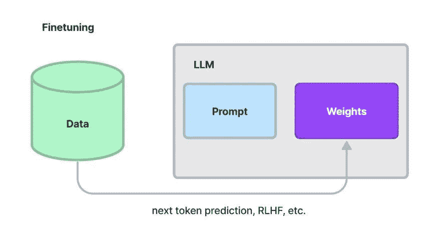

图@jerryjliu0

对于fine-tune来讲，影响的是模型的权重。

2）针对于输入的优化为：in-context learning，即prompt learning

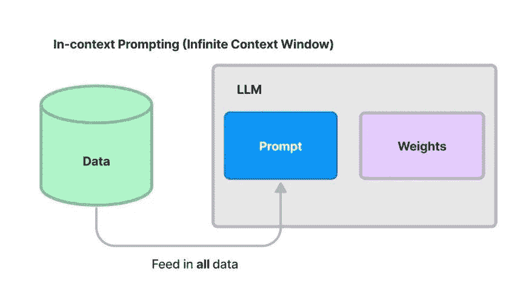

图@jerryjliu0

两者比较：

| 调优方法 | 优势 | 缺点 |
| --- | --- | --- |
| 提示词优化 | 提升效果明显 | 占用token多，影响上下文关联长度 |
| embedding | 扩展GPT知识 | GPT并非真的理解了相关的内容，而是在遇到相关问题时，能够基于给定的知识库回答。 |
| finetune | 搭建真正的私有模型，GPT能理解相关的问题。 | 成本较高，需要大量的“问答对”，训练过程非常消耗token。 |

可以看出，提示词具有相当大的应用优势，具备很明显的成本和灵活性优势，使用门槛也比较低，随着token数量的不断增长及prompt压缩方案的提出，prompt层面的工作将是工程化方案的最重要的内容。

**工程改进：**

如上面分析，目前提示词中需要包含需求，背景，例子，历史等很多内容，就拿常见的检索场景，如何让大模型在海量的文章里总结回答，这不仅受限token的大小，还会导致响应的时间过长，不能满足用户的需要，那么在不能提高token数量，及提升大模型推理的条件下，如何解决这一问题呢？

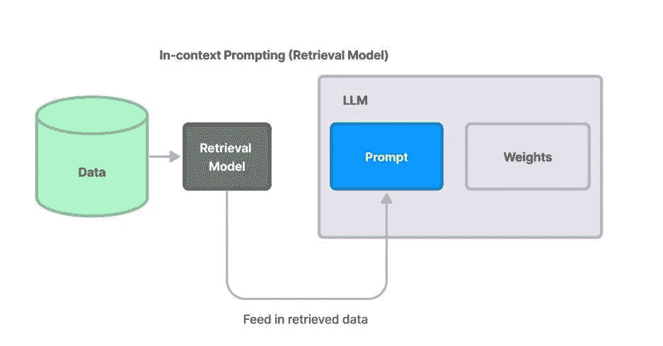

图 @jerryjliu0

那就是对于prompt进行压缩提炼，一个常见做法是外部引入一个检索流程，增加一步粗筛召回的逻辑， 减少候选范围， 便能明显缓解这一问题。而这一过程，还有一个明显的好处，给了大模型一个发挥的范围， 使得大模型能够在更可靠的知识内容基础上总结推理， 一定程度上可以避免模型黑盒条件下的自说自话，提高了输出的 可信度 。另一方面，对于提升模型返回角度考虑，增加检索流程，可以对提示词进行检索增强（retrieval augmentation），比如对接知识图谱，业务知识库等，能够提高输出的质量。

总结一下，增加检索流程，有三个作用：精炼prompt，提高可信度，提高模型输出质量。

**检索方式选择向量检索的原因**

目前业内主流做法是采用向量检索的方式来做检索增强。很多同学有疑问为什么要用向量数据库，原来传统的ElasticSearch这样的文本检索的方案是否可以？

实际上，结合上面的分析来看，也不是不可以，本质上是大模型外围需要一个检索和存储的组件来完成检索过程，只要能满足这样的要求，均可以采纳。那么为什么大家不约而同选择了向量检索？

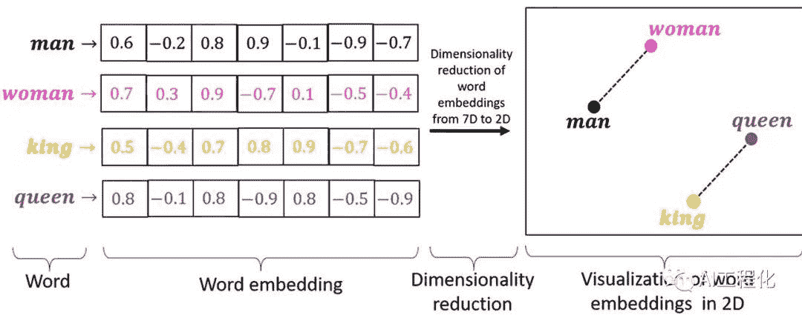

这样的选择本质上是为了获得更好的检索效果，提高相关性。 万物皆可embedding，通过embedding可以将一个维度的问题映射到另外一个维度，在新的维度里能够更准确的表达它们之间的关系。这一过程类似于我们曾经学习的信号处理的知识，将时域的信号通过傅立叶变换转到频域中处理，可以极大地减少复杂度。

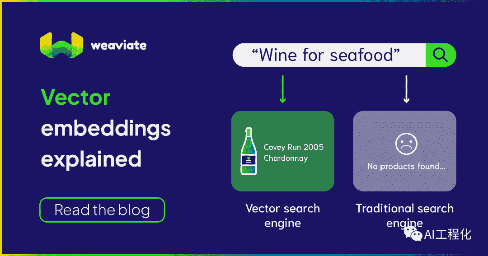

从上图可以看到，向量搜索和普通搜索的差异，它基于内容embedding，在编码时就考虑到了内容的相关性，在检索时不必简单文本匹配，基于语义的检索，自然召回的效果更好。

从这个意义上讲，选择向量检索并不是大模型的要求，而是对召回效果不断提升加之向量检索性能取得不断提升的自然演进，因此，可以看出未来搜索服务面向语义检索发展也是必然趋势。

**小结：**

围绕上面提到的关于内在模型及外在提示词两个LLM应用核心组成，涉及到如下核心技术需要掌握。

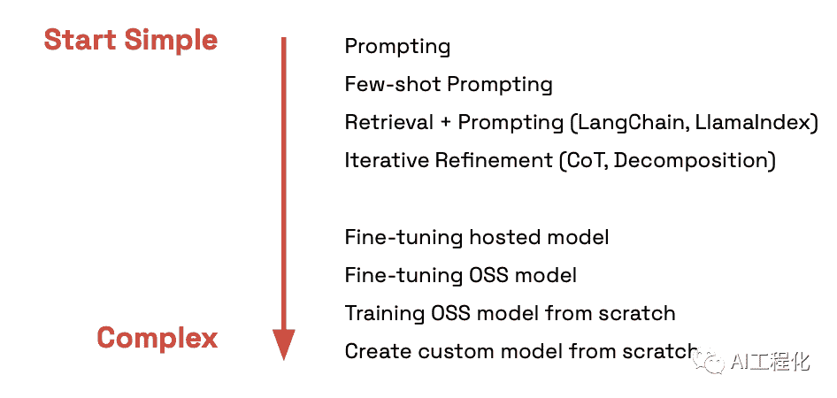

在实际的LLM开发中，也会先从简单入手，只有当简单无法完成需求时才会转而更复杂的方式去干预实现。

本节介绍了目前主流的检索增强的LLM应用的产生原因和基本实现思路，可以帮助构建整体宏观的概念，在 下一节中，对LLM应用开发过程中涉及到的技术展开讨论。

包含:

1.  embedding & t okenization

1.  vectordb

1.  fine-tune

1.  prompt

1.  deploy&inference

1.  编排集成

1.  预训练

# **2. 基本流程与相关技术**

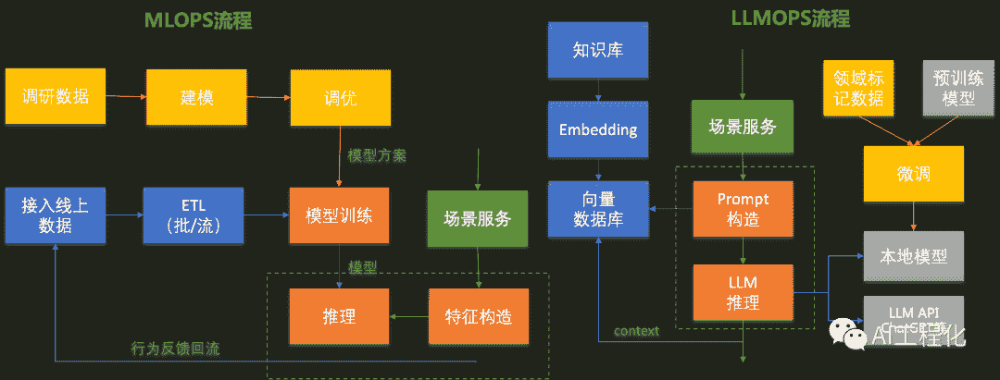

LLM应用 服务的流程，即LLMOPS流程 ，与传统的MLOPS流程比较来看，既有相似的部分，也有不同的部分。核心共同点就是高度依赖数据，整个流程围绕数据展开，从这个角度看，数据的大小和质量很大程度决定了最终效果的好坏。在一般的LLM应用开发中，由于预训练的复杂性，高昂的成本，通常情况下，不会从零训练模型。大多会采用开源的模型再加上本领域内具体的标注数据加以微调获得，或者在社区下载已微调好的模型直接使用，如Huggingface(AI时代的Maven，不仅可以下载模型，还有大量的数据集可供使用，在后续常见参考一节中会介绍其使用)，再或者采取更轻量级的方式直接采用外部的模型服务接口，如ChatGPT，Claude等。值得一提的是，对于LLM应用开发者来讲，早期基于这些开放的云服务接口进行开发，能够大大提升开发效率，避免被一些细枝末节的事情所打扰。

从开发 流程来讲，流程分为三部分，其中微调和向量数据库建库是离线操作，构造prompt和LLM推理是在线操作，并且prompt和LLM推理这两个环节是可以重复工作的，也就是说对于一个实际的场景，构造Prompt然后推理这个过程可能在业务流程中多次发生，其典型的就是智能体(Agent)的构建中。

### 1） Tokenization 与 Embedding

**Tokenization**

token这一概念在LLM应用中是一个最基本的概念，它作为模型的原始输入，语义风格的最小单位，很多问题都是围绕它展开。 对于LLM来讲，对于 外部的输入或者训练的数据 都是 文本或者文档，而 将其token化的过程就叫做 Tokenization，即 将一段文本分割成单个的词语或标记的过程。token可以是一个单词，一个词根，或者一个标点等等， 在openAI的官网上可以很直观的看到一段文本拆分成什么样。

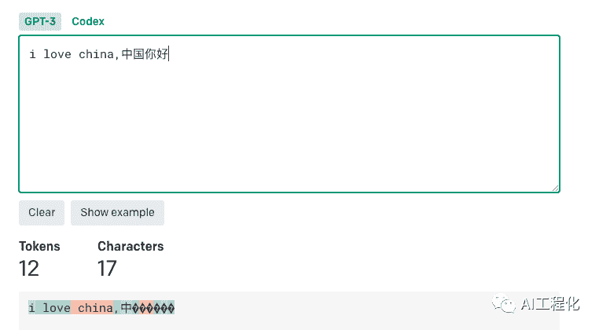

https://platform.openai.com/tokenizer

对于英文输入，一个 token 一般对应4个字符或者四分之三个单词；对于中文输入，一个 token 一般对应一个或半个词。 不同模型有不同的 token 限制，需要注意的是，这里的 token 限制是输入的 prompt 和模型输出( completion )的 token 数之和，因此输入的 prompt 越长，能输出的上限就越低。 ChatGPT3.5 的 token 上限是 4096。这里有一个有趣问题，吴恩达教授在他的课程里提到一个让大模型做字符串翻转的问题：

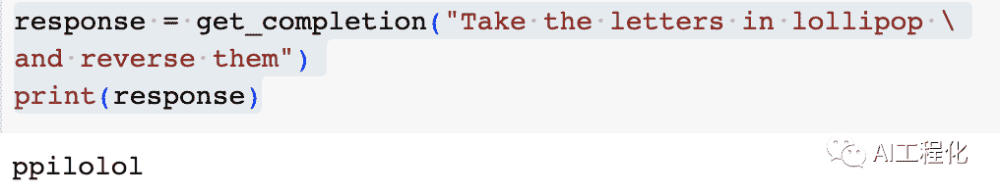

这个返回是不符合预期的，但是如果知道token的拆分原理，通过应用给其加连字符"-",强制拆分的小技巧，最后就能获得正确答案。

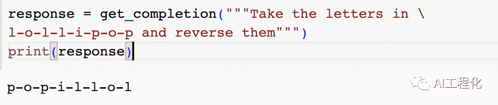

那么，在开发中可以使用openai开发的 tiktoken 的库来进行拆分。

```
import tiktoken
encoding = tiktoken.get_encoding(&quot;cl100k_base&quot;)
encoding = tiktoken.encoding_for_model(&quot;gpt-3.5-turbo&quot;)
#转token
encoding.encode(&quot;AI工程化&quot;)
#将token变成string
[encoding.decode_single_token_bytes(token) for token in [15836, 49792, 39607, 33208]]
```

当然，huggingface上也有很多tokenize的模型可供使用(https://huggingface.co/docs/tokenizers/index#tokenizers)。

temperature和token的关系

就如上提到的，对于GPT模型来讲，它会做“文字接龙”，而其接的就是下一个token，其训练就是在记忆下一token在上文基础上的概率，而推理就是在寻找下一个最大概率的token。而实际上，我们为了使得生成内容能够多样，不一定会选概率最大的token，这时候就需要有一个参数来控制，而temperature就起到这样的作用。常见的场景temperature推荐值：

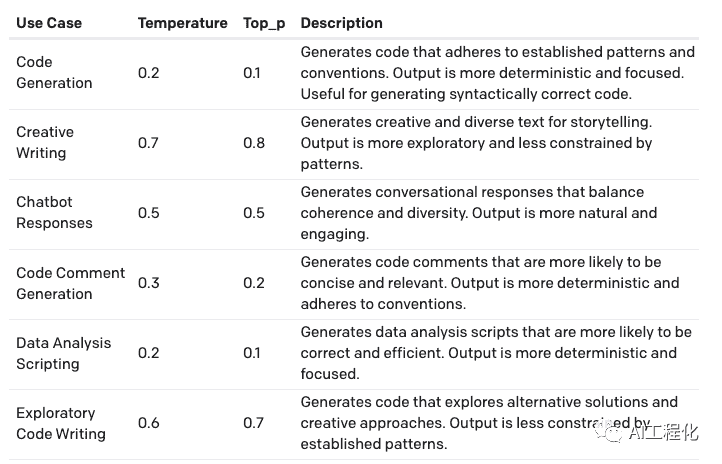

可以在openAI网站体验不同temperature值对于补全的影响：

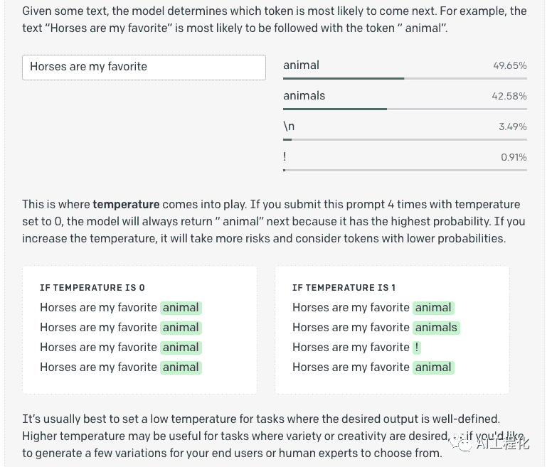

试验: https://platform.openai.com/docs/quickstart/adjust-your-settings

**embedding**

前面提到了“万物皆可embedding”的概念，embedding的核心作用就是将token序列变成向量，并能够使距离相近的向量对应的词有相近的含义，且能够方便机器运算。因此，向量是模型的 “ 沟通语言 ” ，embedding是对数据的压缩，并且压缩的过程参考了语意和领域知识，可方便地进行相似性计算。值得一提的是，在AI 1.0时代，特征embedding已经广泛使用，也取得了很好的效果。word2Vec就是最具代表性的word embedding算法。

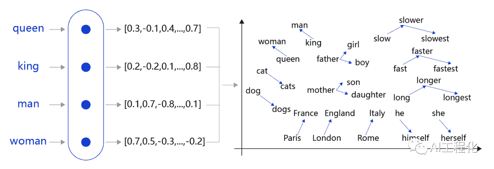

以下来自chatGPT：

> embedding（嵌入）是一种将离散型变量（如单词、类别标签等）映射到连续型向量空间中的技术。这种映射使得原本在离散空间中难以度量的相似度和关系可以在连续空间中找到表示。嵌入在自然语言处理（NLP）、推荐系统和图神经网络等领域有广泛的应用。

>

> 在自然语言处理中，单词嵌入（word embedding）是一种常见的技术。通过单词嵌入，我们可以将词汇表中的每个单词表示为一个定长的连续向量。这些向量可以捕捉单词之间的语义和句法关系。Word2Vec、GloVe 和 FastText 是构建单词嵌入的一些著名方法。

>

> 嵌入的主要优点如下：

>

> 1. **降维 **：嵌入可以将高维的稀疏表示（如 one-hot 编码）映射到低维的连续空间，减少计算复杂度和存储需求。

> 2. **语义关系 **：嵌入可以捕捉到数据中的潜在结构和关系，例如在单词嵌入中，语义相似的单词在向量空间中彼此靠近。

> 3. **可微性 **：嵌入是连续的，因此可以很容易地与其他机器学习模型（如神经网络）相结合，并通过梯度下降等优化算法进行训练。

>

> 需要注意的是，嵌入通常需要大量的数据和计算资源来训练，以捕捉到足够丰富的信息。此外，嵌入表示可能会损失一些原始数据中的信息，因此在某些任务中可能不是最佳选择。

>

在大模型中完成 e mbbeding 的的方式有 下面几种 ：

1）直接使用OpenAI，CoherEmbeddings等云服务的接口。

```
import openaifrom tenacity import retry, wait_random_exponential, stop_after_attempt

@retry(wait=wait_random_exponential(min=1, max=20), stop=stop_after_attempt(6))def get_embedding(text: str, model=&quot;text-embedding-ada-002&quot;) -&gt; list[float]:    return openai.Embedding.create(input=[text], model=model)[&quot;data&quot;][0][&quot;embedding&quot;]

embedding = get_embedding(&quot;Your text goes here&quot;, model=&quot;text-embedding-ada-002&quot;)print(len(embedding))
```

2）从huggingface等网站下载训练好的embedding模型，本地使用。

```
from langchain.embeddings import LlamaCppEmbeddingsllama = LlamaCppEmbeddings(model_path=&quot;/path/to/model/ggml-model-q4_0.bin&quot;)text = &quot;This is a test document.&quot;query_result = llama.embed_query(text)
```

3）自己训练embbeding模型并使用。

刚才提到了embedding是可以反映语义的，而云服务或者是训练好的模型直接使用，在一些垂直的专业领域是效果不佳的，这一些领域知识并没有反映在模型里。这时候提供一个本地训练embedding模型的开源库 Text2vec，它 实现了Word2Vec、RankBM25、BERT、Sentence-BERT、CoSENT等多种文本表征、文本相似度 计算模型，并在文本语义匹配（相似度计算）任务上比较了各模型的效果。

+   text2vec （ https://github.com/shibing624/text2vec ）

+   CoSENT+MacBERT+STS-B， shibing624/text2vec-base-chinese

+   CoSENT+LERT+STS-B，1024的 text2vec-large-chinese ，768的 text2vec-base-chinese

+

可以直接在： https://huggingface.co/spaces/shibing624/text2vec 查看对比

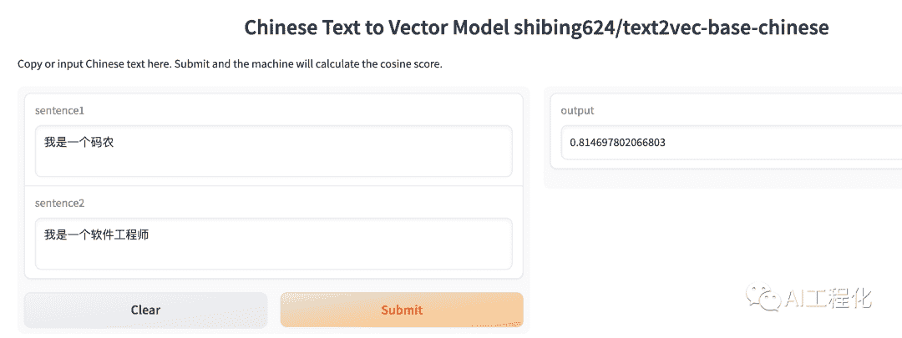

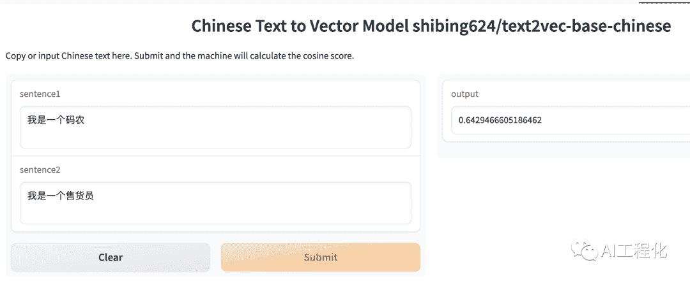

### 2） 向量数据库（VectorDB）

向量是模型世界的沟通语言，不论是文本还是图片，语音，视频都可以将其转化成向量，然后再通过相似的模型算法进行加工处理，这也使得通过一套transformer架构来处理不同  模态的问题。 向量数据的典型结构是一个一维数组，其中的元素是数值（通常是浮点数）。 这些数值表示对象或数据点在多维空间中的位置、特征或属性。 向量数据的长度取决于所表示的特征维度。

> 假设我们有三个水果： 苹果、香蕉和葡萄。 我们想用向量数据表示它们的颜色和大小特征。 我们可以将颜色分为红、绿、蓝三个通道，将大小分为小、中、大三个类别。 因此，我们可以用一个包含 6 个数值的向量表示每个水果的特征。

>

> 苹果（红色，中等大小）：[1, 0, 0, 0, 1, 0]

> 香蕉（黄色，大）：[0, 1, 0, 0, 0, 1]

> 葡萄（紫色，小）：[0.5, 0, 0.5, 1, 0, 0]

>

> 在这个例子中，每个水果都被表示为一个 6 维向量。前三个数值表示颜色信息（红、绿、蓝通道），后三个数值表示大小信息（小、中、大）

> 知乎

相似性计算，是向量计算中最常见的形式，在文本检索时代，通过倒排索引及tf-idf等算法进行相关性检索。 Lucene 就是其中代 表的开源库实现，在此基础上实现的elasticsearch，solr等搜索引擎产品成为传统检索场景服务的核心基础设施。

> 向量的距离可以用来衡量两个向量的相似度，常见的有余弦距离，欧式距离和向量内积几种方式。

> 1. 余弦距离。通过计算两个向量的夹角余弦值来计算相似性。夹角为0时相似度为1，夹角90度时，相似度为0，夹角180时相似度为-1，因此余弦相似度的取值范围为[-1,1]。

>

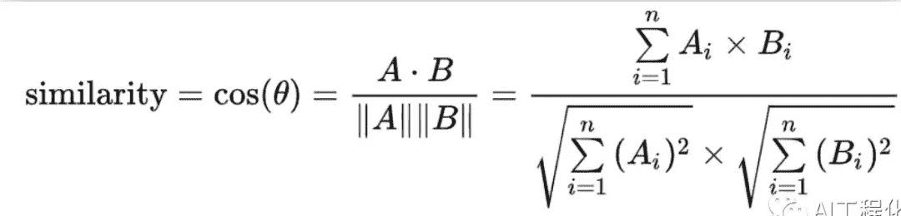

>

> 2. 欧式距离。 欧式距离全称是 欧几里得距离 ，度量的是空间上两个点之间的连线距离，空间上的点都可以看着是从原点出发的向量。

>

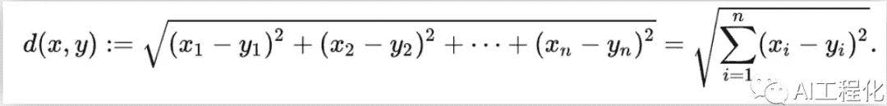

>

> 3. 向量内积。又称数量积，是指接受在 实数 R上的两个 向量 并返回一个实数值标量的二元运算。两个向量a = [a1, a2,…, an]和b = [b1, b2,…, bn]的点积定义为：a·b=a1b1+a2b2+……+anbn。

与之类似，向量相似性算法 也有faiss，等开源库实现，在其上有milvus，pinecone等向量数据库产品。 通过这些产品能够解决向量存储和计算的问题。

在大模型时代，受限于模型的约束，向量数据库迎来了新的热潮。它被称作大模型的“海马体“，赋予了大模型记忆。在实际的使用中，向量数据库起到如下作用：

+   检索增强（retrieval augmentation）

+   为了提升大模型的返回质量，又避免大模型的token限制，以及提升计算速度，需要使用向量数据库做初筛，选择相似度高的候选材料，提供给大模型。

+   增加时效性

+   如前文提到，fine-tune的成本和复杂度高，耗时长，比如chatgpt的模型所用数据是2021年9月，导致之后相关问题得不到准确的答案，为了使得大模型具备更高的实效性，需要借助向量数据库增强，向量数据库可以高频的进行索引更新，从而使得候选数据更为新鲜，从而弥补大模型的信息时效性不足问题。

+   提高可信度和溯源

+   大模型有一个问题就是可能会“自说自话”编造答案，为了让模型输出更可控，以及找到回答的依据，可以让大模型基于向量数据库检索出来的资料进行回答，从而避免大模型妄想的问题。

+   隐私和权限问题

+   不是所有的数据都可以用来训练大模型，大模型也无法解决有的人能看，有的人不能看的问题，因此，作为大模型以外的基础设施，特别是对于调用云端大模型服务的模式，将自己的私有知识放在本地是一个很不错的方式。另外，它也能方便实现类似于数据鉴权的需求，对于不同的人，提供给大模型的候选资料不同，从而避免信息泄漏。

+   多轮会话的context存储

+   大模型没有记忆，导致大模型无法记住历史，可以通过向量数据库保存会话历史及上下文信息，每一次对话时将之前的会话历史或者历史总结提交给大模型，可以间接帮助大模型拥有记忆，避免回答前后无关的问题。更广泛的，基于向量数据库帮助构建智能体，可以作为agent的外部记忆，能够使得大模型能够完成更复杂的任务。

+   天生多模态

+   统一的向量格式存储，能够处理来 自 各种类型的数据源，例如文本、图像、音频、视频等。

面向LLM编程的本质就是通过prompt发指令给大模型，向量数据库的引入主要是受限于token的限制，也就是上下文窗口（context window ）的约束。另一方面，大模型也在不断突破，增长趋势明显。

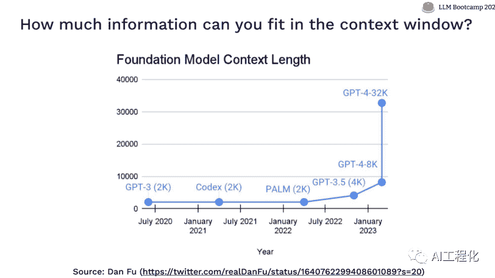

@Josh Tobin

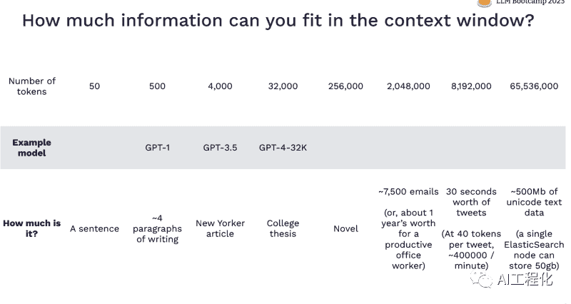

@Josh T obin

最近Claude把上下文窗口直接扩充到100K，大概对应7万5千个单词。一次性可读取300来页的pdf，可以预见未来，context的限制会进一步减少，但从成本和性能等其他角度考虑，向量数据库 还是有充足的发展空间。


参考:https://www.anthropic.com/index/100k-context-windows

当前开发候选的向量数据库很多，大概分为两类：

1）传统数据库通过能力扩展而来，代表是postgresql，elasticsearch，redis等，都在提供向量检索能力的支持。它的好处是简单方便，可以不用引入新的服务依赖，但它并不是完全面向向量检索设计，因此性能，功能层面有一定的缺陷。

> PostgreSQL 可通过扩展 pgvector 实现一些简单的向量计算。

>

> Redis 可通过一些扩展模块，如RedisAI和RediSearch，实现一定程度的向量数据处理和计算功能。RedisAI 偏深度学习模型，支持TensorFlow、PyTorch和ONNX运行时。RediSearch 偏全文检索，支持一些基本的文本相似度度量，如TF-IDF和Levenshtein距离等。

>

> Elasticsearch 本身是一个分布式全文搜索和分析引擎，但增加支持了dense_vector数据类型来存储稠密向量。 通过使用内置的向量函数，如cosineSimilarity、dotProduct和l2norm等，可以实现一些基本的向量计算。

>

2） 面向向量检索甚至面向AI大模型而生的数据库。这里面有openAI御用数据库当红小生PineCone，其定位就是做AI的持久化存储，提供 Cloud 云服务，基于GCP和AWS。也有摸爬滚打多年的代码开源，且可以私有化商用的mil u vs，更有qrant，Weaviate这些新生代。由于向量数据库产品繁多，又十分重要，因此 选型是一个大的问题，下面网上搜集的相关的比较，可以根据实际情况选择。

| 数据库名称 | 是否开源 | 社区影响力 | 编程语言 | 核心特性 |
| --- | --- | --- | --- | --- |
| Pinecone | 否 |  | 未知 | 向量存储与检索、全托管 |
| weaviate | 是 | 5.3k star | Go | 同时支持向量与对象的存储、支持向量检索与结构化过滤、具备主流模式成熟的使用案例。高速、灵活，不仅仅具备向量检索，还会支持推荐、总结等能力 |
| qdrant | 是 | 6.3k star | Rust | 向量存储与检索、云原生、分布式、支持过滤、丰富的数据类型、WAL日志写入 |
| milvus | 是 | 17.7k star | Go | 极高的检索性能: 万亿矢量数据集的毫秒级搜索非结构化数据的极简管理丰富的API跨平台实时搜索和分析可靠：具有很高的容灾与故障转移能力高度可拓展与弹性支持混合检索统一的Lambda架构社区支持、行业认可 |
| Chroma | 是 | 4.1k star | python | 轻量、内存级 |

来自:https://zhuanlan.zhihu.com/p/628148081

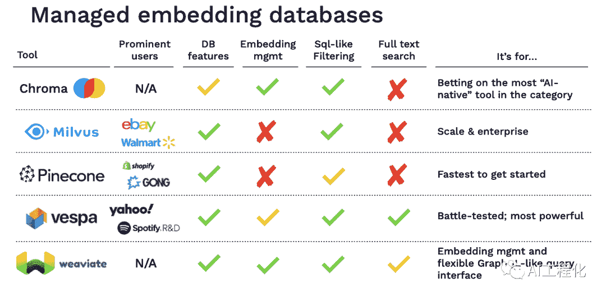

@Josh Tobin

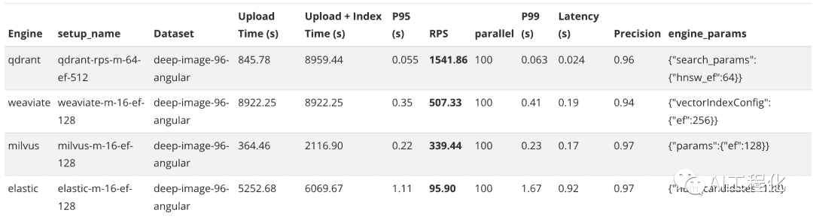

benchmark：

https://qdrant.tech/benchmarks/

更多评测：

https://objectbox.i o/vector-database/

**https://stablecog.com/blog/the-best-vector-**database-for-stablecogs-semantic-search

https://press.ai/best-vector-databases/

综上，企业级比较成熟的选 **milvus ****， 理念更新 **， 使用更简单方便的用 qdrant ，weaviate，vespa，本地LLM应用或者测试验证的用Chroma。

### **3） finetune(微调)**

#### **背景与挑战**

**缘起**

我们前面提到过预训练大语言模型(PLM)，虽然它通过无监督学习已经自学了大量的" 世界知识（universal knowledge）" ，具备了一定的任务技能，如Bert做“完形填空”，GPT做擅长”文字接龙“，在无监督学习时 做的任务叫做上 游任务( upstream task )。

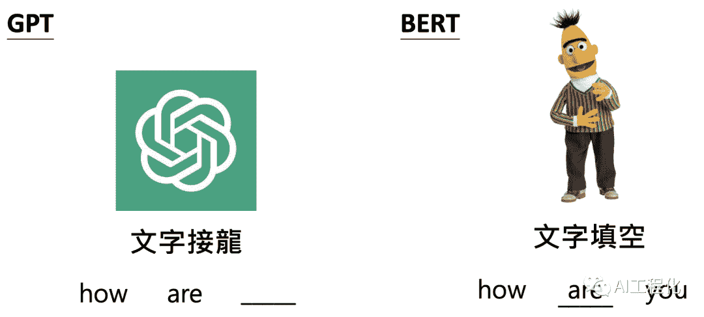

@Hung-yi Lee

虽然它们“博览群书， 学 富五车”，但显然它还无法直接完成具体的下游任务(downstream)，如情感分析，主题分类，文本生成等。

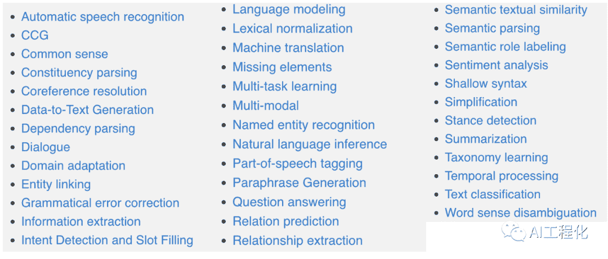

那么，如何弥合上下游任务之间的gap，“对齐”大模型能力和用户实际的需求呢？

**两条路线**

为了解决这样的问题，但又由于大模型的特点，如训练成本高，以及利用到大模型学习到的“世界知识”的初衷，进而有一个比较直接的做法，就是设计不同目标的下游任务来和大模型组合起来一起完成具体的任务。这一过程叫做 目标函数挖掘(Objective Engineering)。 基于此思路收集训练该领域任务需要的标注数据重新学习，从而使得模型具备该领域任务的能力。 当然我们不希望学习特定领域方面的知识时，忘掉自己之前在预训练学习的知识，我们会将大模型的参数作为初始参数来学习，从而使得他在保留历史知识和能力的情况下，又能适配下游任务具体的要求，这一过程就叫做finetune（微调）。 这样的思路相较于从零训练模型有了很大的改进。因此， “预训练（pretrain）+微调（finetune）”对齐模型能力与用户需要的范式也就流行起来。

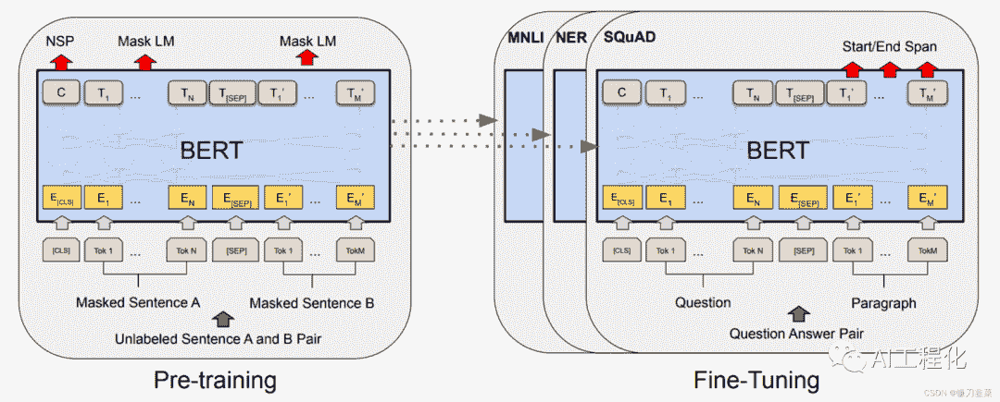

在bert时代，参数还不算非常大,这样的模式似乎也没有什么问题。模型朝着专才如火如荼发展。

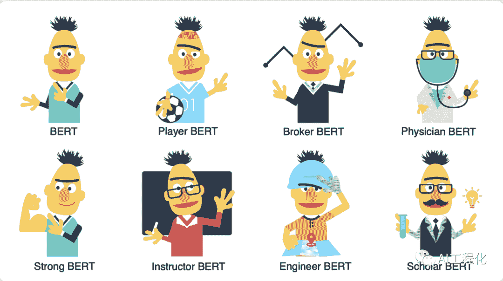

但这种每一种任务都做一个适配任务的模式显然并不能满足人们的对人工智能的期待，那有没有另外一种思路，改变大模型适配下游任务的路线，而是反过来让任务适配大模型，采用统一的模式处理不同任务呢？

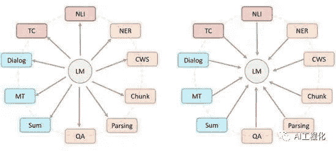

@cw

有，以openAI为代表走了另一条路，通过构造合适的提示词（prompt）来适配大模型做不同的任务，做一个“全才”，以具有创造性的生成式模型（GPT）为例，可以把具体问题变成大模型的文字接龙的方式来激发模型完成任务。例如：一个情感分析问题：給大模型输入：I love this movie. It is [MASK]，它很自然的基于学习到的知识补全为good，这样再将good这样的标签映射（Verbalizer）为“positive”，这样就完成情感分析，整个过程无需修改模型参数，大模型一直在做自己擅长的文字接龙。

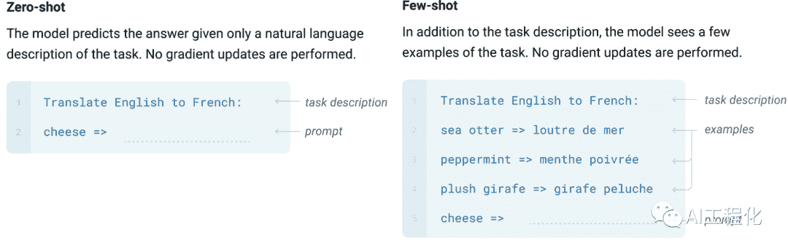

两条路线比较起来，前者直接简单，效果还不错，缺点是需要设计不同的下游任务适配，且需要大量标注数据针对性训练，而后者却希望将下游任务统一为一种模式， 通过提示词学习（prompt learning，也可叫做in-context learning） 仅需少量（几条到几十条）数据（few-shot）或者无需数据（zero-shot）的数据高效的做法（data-efficent） 完成各种下游工作。

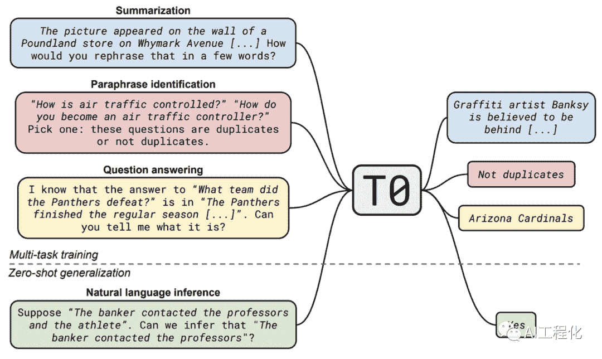

在T0模型 上训练了三类任 务，在执行第四类任务时，它仍然可以给出预期

更为疯狂的是，希望在微调阶段，通过给予任务指令样例进行监督学习（instruct tuning），便事大模型能以zero-shot的方式回答用户，甚至能够读懂样例中未出现的新指令类型（泛化性），并正确生成答案。 早期大家一度对这一想法的实现可能性抱有怀疑，加之早期GPT模型因为参数量不足，表现也不尽如人意，故而，更多人研究前者，后者并不火热。

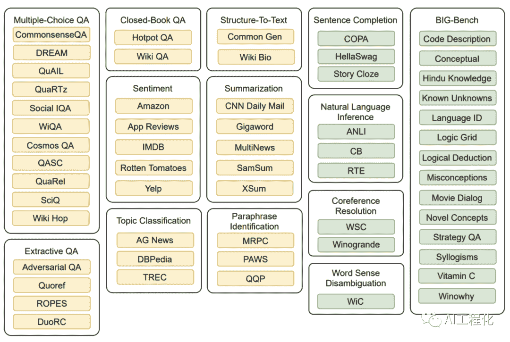

黄色为训练的任务类型，绿色是泛化后可执行的类型

而**今年** chatGPT的出现，之前认为疯狂的想法变成了现实，大家也认识到这一路线的潜力 ，跑步进入 AI 2.0时代。 就微调本身，bert为代表的专才考虑的还是如何解决具体的任务时，而以GPT为代表的通才已经在考虑如何读懂指令和执行，以更符合人类需求，这种理念层次上的差距似乎如“枪炮”与“弓箭”之别 。

**FineTune的挑战**

1750亿参数的chatGPT的到来，还带来了一个 一致的 认知，就是发现把模型越做越大，是有可能让模型产生原来想象不到的智能 涌现 。于是，大模型的军备竞赛拉开帷幕，模型越来越大，原来的全量参数finetune的方式越来越行不通。

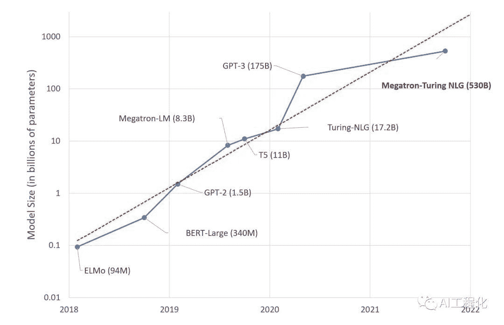

@huggingface

对于bert这类专才路线的大模型随着模型变大，也会出现下面的问题：

1）每一个特定的任务都需要全量更新所有参数，参数量越来越大，需要大量的算力和时间。

2）每一个特定的任务都有一个模型，模型越来越大，太占空间。

3）每一类任务都需要准备大量标注数据用来训练。

**类GPT模型Finetune**

那GPT这样走通才路线的模型，通过prompt learning对齐模型和用户，那finetune还有必要吗？或者finetune能够起什么作用？

如上面所讲，我们的最初目标就是对齐用户期望和模型能力。在finetune阶段，要教给模型的不简单是知识，还要教给他以什么样的模式回复用户，比如，我们常看到chatGPT这类产品在回答时有一定套路和模式。而这种模式就需要在finetune中完成。 因此， 微调在现阶段十分有必要。

尽管对于 经过微调甚至强化学习后的 GPT产品来讲，具备了很多能力，对话，翻译等等，也可以通过prompt tuning来完成大部分工作，但是，对于一些实际场景，大模型的通用能力是不够的。仍然需要它对某个领域的理解并扩展能力，比如对专业问题的回答能力 （ 比如一些行业黑话和输入模式） 。通过指令微调 不仅能够更好地识别输入的意图，达到更泛化的指令遵从性，提升zero-shot条件下的性能（即在不给示例的情况下，一样能够理解用户指令，返回符合预期的答案），还可以将这些领域积累的答案注入到模型，也能够获得更高质量的结果。

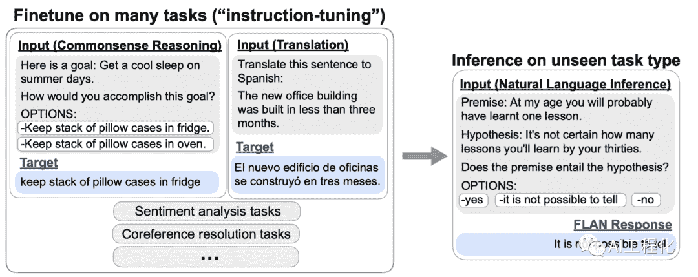

多说一句，一般指令数据集都是手工构造的，为了简化这一工作， 斯坦福大学有一项新的研究，尝试 让AI“自举”。

> 自举

> 在计算机科学中，自举是一种自生成编译器的技术——也就是，某个编程语言的编译器（或汇编器）是该语言编写的。最初的核心编译器（自举编译器）是由其他编程语言生成的（可以是使用汇编语言），之后的编译器版本则是使用该语言的最小子集编写而成。自生成编译器的编译问题被称为编译器设计的先有鸡还是先有蛋问题，而自举则是这个问题的解决方法。

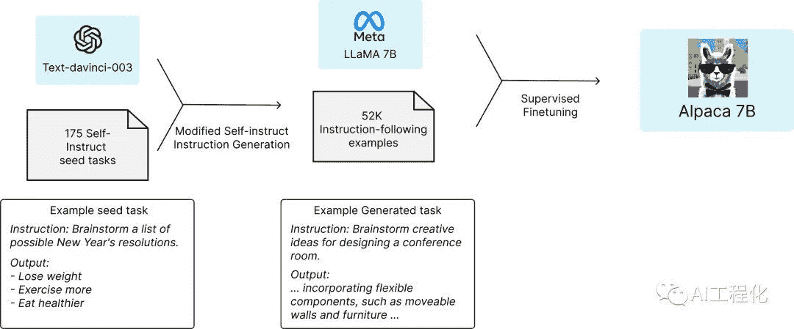

https://arxiv.org/pdf/2212.10560

通过少量种子指令，然后通过openAI的text-davinci-003模型生成指令数据，利用这些机器生成的指令数据基于llama模型（未经指令微调）finetune出Alpaca模型，其效果在少量微调数据的情况下，就获得了很大的性能提升，媲美text-davinci-003模型，不仅体现finetune的价值，而且让人们看到了AI的巨大潜力。

另外，因为finetune时领域背景知识的注入，也使得不用 每次都提交 prompts中携带背景信息，从而解决现阶段token限制问题以及获得更快的模型响应。

finetune对GPT类模型是如何起作用的？个人的猜想是利用instruct tuning改变原本预训练模型中的既有的概率分布，强化了预期格式和内容的影响，从而更好的对齐用户。举一个例子，对于一个普通人“羊驼“对应的就是”草泥马“，而对于大模型开发者来讲脑子里闪现的便是一个”大模型“。当然，这种概率影响也可以通过预训练施加到模型中。但为什么在如此少的样本，这么大参数模型下也依然敏感，确实很神奇，欢迎理解其中原理的朋友留言探讨。

可以看到，不管是通才模型还是专才模型，都有微调模型的需要，在下一节中，我们将介绍在模型规模不断增大的今天，如何微调一个大模型的基本理论-参数高效微调(PEFT)。

#### ** 方案理论**

**参数高效微调（PEFT）**

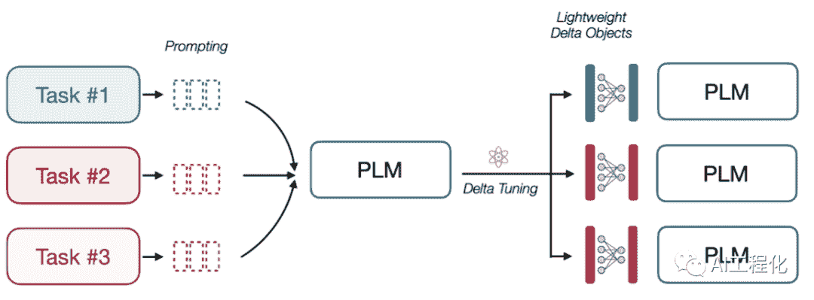

那么，finetune怎们克服之前的问题做到参数高效微调（PEFT）呢？

> 参数高效(Parameter-efficient) 微调 ，希望 使用少量的参数以逼近全量参数微调的效果

> 数据高效(Data-efficient )微调， 希望 使用少量的标记数据(few-shot)以逼近大量数据微调效果

其思路也比较简单直接，那就是区别于原来全量微调**，固定原有模型参数，****只微调变化的部**分， 减少计算成本和时间 ，另一方面，只存储微调部分的参数，而不保存全部模型， 减少存储空间 。基于这两方面的改进，就能克服前面提到的问题（需要大量标签数据问题，采用prompt learning fewshot方案）。因而，采用只改变少量的参数(delta parameters)，达到微调的目的的方法，叫做 参数高效微调（ Parameter-efficient finetuning，PEFT ）， 也叫做 D elta T uning 。

Delta Tuning有三个方向，增量式(Addition-based)、指定式(Specification-based)和重参数化(Reparameterization)。

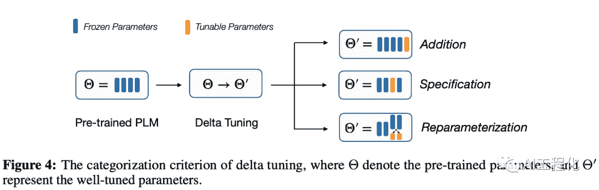

https://arxiv.org/pdf/2203.06904.pdf

1）增量式(Addition-based)

增加一些原始模型中不存在的额外可训练神经模块或参数。从加的内容和位置不同，又可细分为 Adapter-Tuning, Prefix Tuning， Prompt Tuning等等。

+   Adapter-Tuning

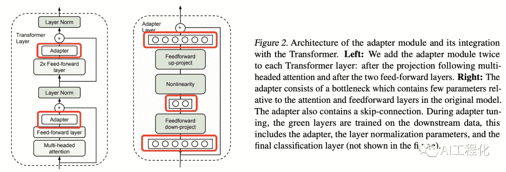

https://arxiv.org/pdf/1902.00751.pdf

2019年，该方法由Houlsby N等人引入,Adapter- Tuning本质上就是在原有模型结构上增加了一些适配器，而这个adapter的维度比原有维度低得多，这样就使得计算量得到很大减少，从而提升微调效率。由于前面是直接加在原有网络结构上，不利于维护，因此在原有adapter 做了一些优化，将 它移到了外面，变成一个外挂，和主模型分离，这样在计算上和维护上都有了进一步提升。

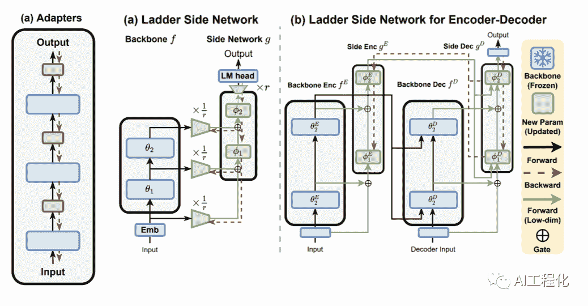

https://arxiv.org/pdf/2206.06522.pdf

+   Prefix Tuning

+

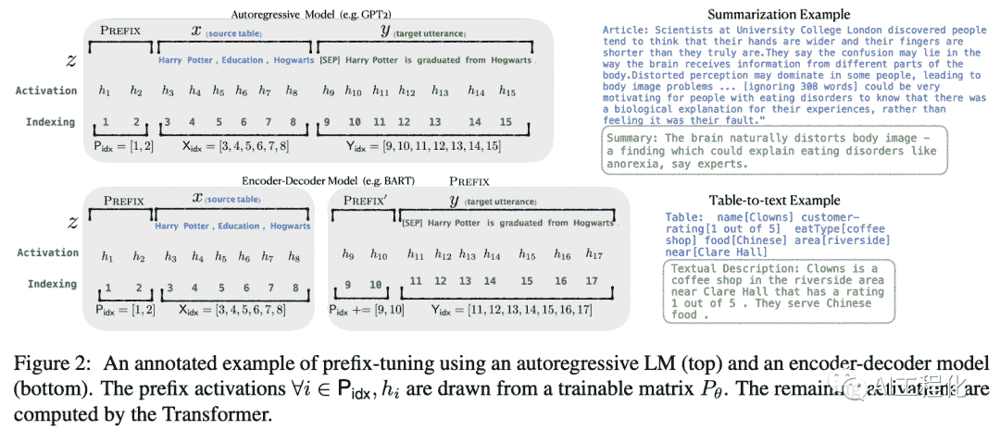

https://arxiv.org/pdf/2101.00190.pdf

由Li和Liang在论文“Prefix-Tuning: Optimizing Continuous Prompts for Generation”（2021）中提出。

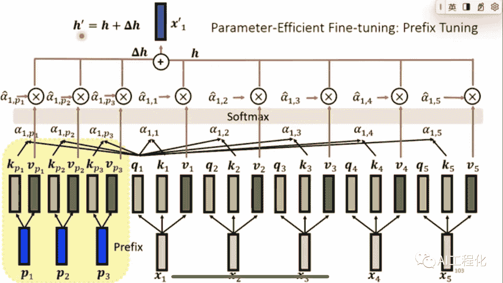

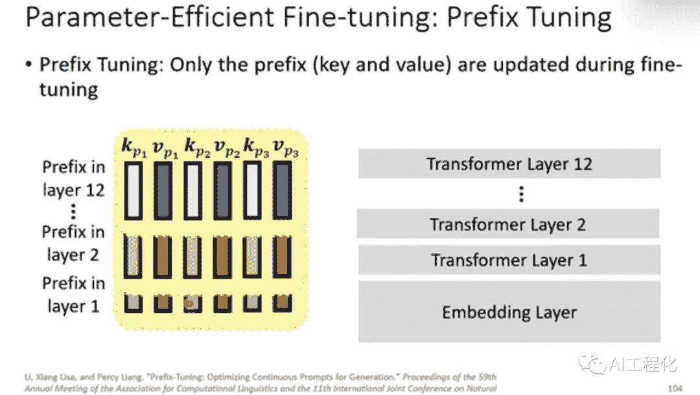

@Hung-yi Lee

它不修改原有模型结构和参数，只通过给模型每一层增加前缀，然后固定模型参数，仅仅训练prefix，从而减少训练成本，实现高效精调。

> NLP有2个核心的任务： 分别是【自然语言理解—NLU】和【自然语言生成— NLG】。

>

> NLU （自然语言 理解 ） 是所有支持机器理解文本内容的方法模型或任务的总称，即能够进行常见的文本分类、序列标注、信息抽取等任 务。 希望 机器人能够像人一样，具备正常的语言理解能力。 意图识别和实体提取的关键技能。

> NLG （自然语言生成）是NLP的另一项核心任务，主要目的是降低人类和机器之间的沟通鸿沟，将非语言格式的数据转换成人类可以理解的语言格式。 通常典型的应用主要有： 自动写新闻（AI编辑新闻）； 聊天机器人（Siri或智能音箱）； 自动生成报告。

把它用来完成NLG任务，仅仅使用了 0.1% 的参数在全数据集上的效果与少量数据集全参数微调相当，并且在未知数据集也有比较好的泛化性。

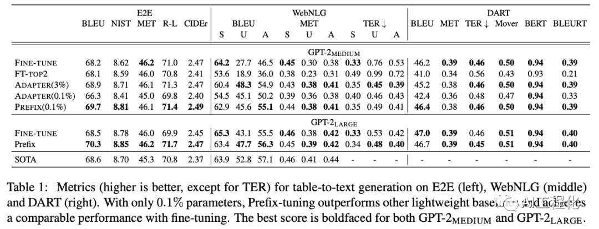

https://arxiv.org/pdf/2101.00190.pdf

+   Prompt Tuning & P-tuning v2

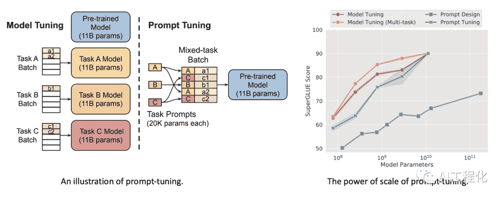

https://arxiv.org/pdf/2104.08691.pdf

> h ard prompt 又称为 Discrete Prompt，人类可读的文本存在

> soft prompt 又称为 Continuous Prompts，pembedding形式存在，连续可微

>

> prompt构造的目的是找到一种方法，使LM能够有效地执行任务，而不是供人类使用，因此没 有必要将prompt限制为人类可解释的自然语言。因此，还有一些 方法叫连续 prompt(也称为软提示)，这些提示 可以直 接在模型的嵌入空间中执 行提示。 具体来说，连续提示消除了两个约束:

> 1）模板词不再是自然语言。

> 2）消除了模板是由预训练LM的参数化的限制。相反，prompt有自己的参数，这些参数可以根据下游任务的训练数据进行调优。

Promp t Tuning 方法（和Prompt Learning注意区别，两者不同）仅在输入层增加soft prompt，相较于的基于每个任务的全参数微调，如图每个任务需要11B参数，而prompt tuning只需要20k参数，小了5个数量级，随着模型参数的增加（达到10B级），Prompt Tuning能与Fine-Tuning效果打平，但其在小模型上性能不佳。 另外，Prompt Tuning只是在一些NLU任务上表现良好，别的方面并未得到验证， 任务缺乏通用性。

为了解决这些问题，提升其在小参数上的性能及任务通用性 ，P-tuning V2（ p- tuning改进得来 ） 借鉴prefix-tuning思想，并将其应用扩展到NLU领域，在每一层都增加soft prompt，增加了可训练的参数量。

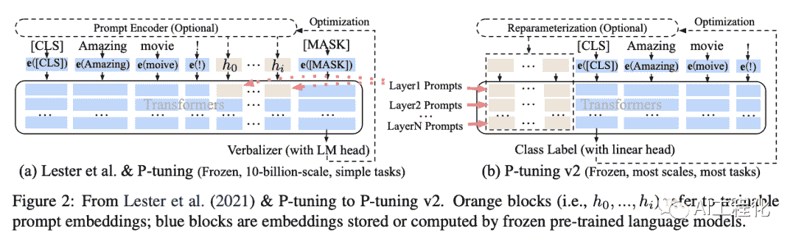

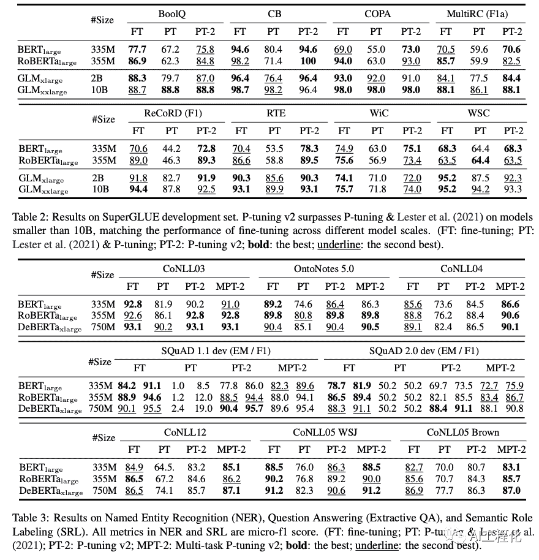

https://arxiv.org/pdf/2110.07602.pdf

在不同规模大小的大模型及不同类型任务上，P-tuning v2能与精调（Fine-tuning）方法的表现比肩，有时甚至更好，值得一提，该方法是清华团队提出的。

2）指定式(Specification-based)

指定原始模型中的特定的某些参数变得可训练，而其他参数则被冻结。最典型的为bitfit，仅仅更新bias，其效果如下：

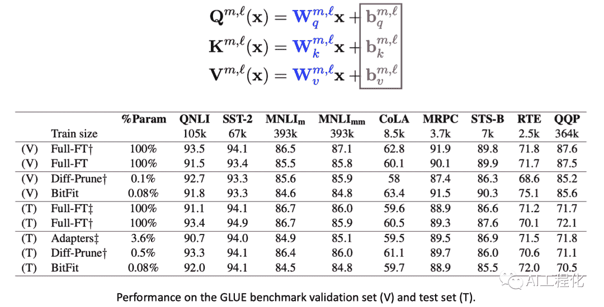

https://arxiv.org/pdf/2106.10199.pdf

3）重参数化(Reparameterization)

重参数化式方法用低维子空间参数来重参数化原来存在的参数，这样就能在保证效果的情况下，减少计算量。重参数化方法往往基于一类相似的假设：即预训练模型的适配过程本质上是低秩或者低维的。大白话讲，就是对它先进行精简计算然后再适配回原有结构并不会对模型影响很大。

+   lora(Low-Rank Adaptation of Large Language Models)


https://arxiv.org/pdf/2106.09685.pdf


@Hung-yi Lee

在大型语言模型上对指定参数（权重矩阵）并行增加额外的低秩矩阵，并在模型训练过程中，仅训练额外增加的并行低秩矩阵的参数。当“秩值”远小于原始参数维度时，新增的低秩矩阵参数量也就很小。在下游任务tuning时，仅须训练很小的参数，但能获取较好的表现结果。如图，原始 (冻结的) 预训练权重 (左) 的输出激活由一个由权重矩阵 A 和 B 组成的低秩适配器 (右) 增强。可以类别adapter tunging，一个是低维串联，一个是并联低秩，最终目的都是为了减少微调参数量，从而提升速度。通过它训练出的lora权重和原始权重merge后，即可获得完整参数。 并且作者证明，低阶适配器的微调取得了与微调完整预训练模型相当的结果，速度更快，使用的内存更少，可以在消费级硬件上运行。

+   QLORA: Efficient Finetuning of Quantized LLMs


https ://arxiv.org/pdf/2305.14314.pdf

在lora基础上，qlora做了进一步改进，可以在保持完整的16位微调任务性能的情况下，将内存使用降低到足以「在单个48GB GPU上微调650亿参数模型」。QLORA通过冻结的4位量化预训练语言模型向低秩适配器(LoRA)反向传播梯度。它采用了两种技术——4位NormalFloat (NF4)量化和Double Quantization。同时，引入了Paged Optimizers，它可以避免梯度检查点操作时内存爆满导致的内存错误。

> 量化是指用于执行计算并以低于浮点精度的位宽存储张量的技术

>

> 单个参数占用的 GPU 内存量取决于其“精度”(或更具体地说是 dtype)。最常见的 dtype 是 float32 (32 位) 、 float16 和 bfloat16 (16 位)。 要在 GPU 设备上加载一个模型，每十亿个参数在 float32 精度上需要 4GB，在 float16 上需要 2GB，在 int8 上需要 1GB 。 为了保证较高的精度，大部分的科学运算都是采用浮点型进行计算，常见的是32位浮点型和64位浮点型，即float32和double6 4，显而易见，适当的降低计算精度，能够减少内存开销，提升计算速度，是大模型微调优化的一个很好思路。

QLORA包含一种低精度存储数据类型（通常为4-bit）和一种计算数据类型（通常为BFloat16）。在实践中，QLORA权重张量使用时，需要将将张量去量化为BFloat16，然后在16位计算精度下进行矩阵乘法运算。与16-bit完全微调基线相比，QLORA 将微调65B参数模型的平均内存需求从 >780GB降低到 <48GB，并且不会降低模型预测性能。

**小结**

下面是常见的参数高效微调方法的比较（注意实际训练参数量占全部参数量比重估计）：


@Hung-yi Lee

值得一提的是，全量微调在大部分情况下还是效果最好的。因此，参数高效优化更多是一种折衷。


https://arxiv.org/pdf/2203.06904.pdf

#### **工具实践篇**

前面大篇幅的介绍了微调相关的理论知识，接下来介绍四款工具或产品，借助它们我们可以比较方便的完成参数高效的finetune。为了让大家能够体验下面的例子，普及了两篇关于colab使用的文章（点👸号查看），不熟悉的朋友可以查看：

开发必备工具-Colab使用介绍

开发必备工具-Colab进阶的21个小技巧

+   **🤗 PEFT（https://github.co**m/huggingface/peft）

它是由huggingface开发的一款开源参数高效微调（Parameter-Efficient Fine-Tuning (PEFT) ）库。它无 缝和🤗 Accelerate集成 ，可用于利用了 DeepSpeed 和 Big Model Inference 的大规模模型。它支持很多刚才提到的方法实现，如下：

1.  LoRA: LORA: LOW-RANK ADAPTATION OF LARGE LANGUAGE MODELS

1.  Prefix Tuning: Prefix-Tuning: Optimizing Continuous Prompts for Generation, P-Tuning v2: Prompt Tuning Can Be Comparable to Fine-tuning Universally Across Scales and Tasks

1.  P-Tuning: GPT Understands, Too

1.  Prompt Tuning: The Power of Scale for Parameter-Efficient Prompt Tuning

1.  AdaLoRA: Adaptive Budget Allocation for Parameter-Efficient Fine-Tuning

简单以lora为例：

+

+

+

+

+

+

+

+

+

+

+

+

+

```
from transformers import AutoModelForSeq2SeqLMfrom peft import get_peft_config, get_peft_model, LoraConfig, TaskTypemodel_name_or_path = &quot;bigscience/mt0-large&quot;tokenizer_name_or_path = &quot;bigscience/mt0-large&quot;
peft_config = LoraConfig(    task_type=TaskType.SEQ_2_SEQ_LM, inference_mode=False, r=8, lora_alpha=32, lora_dropout=0.1)
model = AutoModelForSeq2SeqLM.from_pretrained(model_name_or_path)#get_peft_model会初始化PeftModel把原模型作为base模型，并在各个self-attention层加入lora层，同时改写模型forward的计算方式。model = get_peft_model(model, peft_config)model.print_trainable_parameters()# output: trainable params: 2359296 || all params: 1231940608 || trainable%: 0.19151053100118282
```

可以看到参数量仅占总参数量的0.19%。

因为peftModel重写了原始model的save_pretrained函数，只把lora层的权重进行存储，因此model.save_pretrained只会存储lora权重。所以，当得到 lora model后，需要和原来的basemodel合并，然后才能进行推理，例如（ alpaca-lora中权重合并的）：

```
import os
import torchimport transformersfrom peft import PeftModelfrom transformers import LlamaForCausalLM, LlamaTokenizer  # noqa: F402
BASE_MODEL = os.environ.get(&quot;BASE_MODEL&quot;, None)assert (    BASE_MODEL), &quot;Please specify a value for BASE_MODEL environment variable, e.g. `export BASE_MODEL=huggyllama/llama-7b`&quot;  # noqa: E501
tokenizer = LlamaTokenizer.from_pretrained(BASE_MODEL)
base_model = LlamaForCausalLM.from_pretrained(    BASE_MODEL,    load_in_8bit=False,    torch_dtype=torch.float16,    device_map={&quot;&quot;: &quot;cpu&quot;},)
first_weight = base_model.model.layers[0].self_attn.q_proj.weightfirst_weight_old = first_weight.clone()
lora_model = PeftModel.from_pretrained(    base_model,    &quot;tloen/alpaca-lora-7b&quot;,    device_map={&quot;&quot;: &quot;cpu&quot;},    torch_dtype=torch.float16,)
lora_weight = lora_model.base_model.model.model.layers[    0].self_attn.q_proj.weight
assert torch.allclose(first_weight_old, first_weight)
# merge weights - new merging method from peftlora_model = lora_model.merge_and_unload()
lora_model.train(False)
# did we do anything?assert not torch.allclose(first_weight_old, first_weight)
lora_model_sd = lora_model.state_dict()deloreanized_sd = {    k.replace(&quot;base_model.model.&quot;, &quot;&quot;): v    for k, v in lora_model_sd.items()    if &quot;lora&quot; not in k}
LlamaForCausalLM.save_pretrained(    base_model, &quot;./hf_ckpt&quot;, state_dict=deloreanized_sd, max_shard_size=&quot;400MB&quot;)
```

在硬件（单卡A100 80GB GPU， CPU RAM 64GB）下的 表现对比：

| Model | Full Finetuning | PEFT-LoRA PyTorch | PEFT-LoRA DeepSpeed with CPU Offloading |
| --- | --- | --- | --- |
| bigscience/T0_3B (3B params) | 47.14GB GPU / 2.96GB CPU | 14.4GB GPU / 2.96GB CPU | 9.8GB GPU / 17.8GB CPU |
| bigscience/mt0-xxl (12B params) | OOM GPU | 56GB GPU / 3GB CPU | 22GB GPU / 52GB CPU |
| bigscience/bloomz-7b1(7B params) | OOM GPU | 32GB GPU / 3.8GB CPU | 18.1GB GPU / 35GB CPU |

此外，与基础的bigscience/T0_3B模型的11GB大小相比，lora模型大小仅为19MB。

| Submission Name | Accuracy |
| --- | --- |
| Humanbaseline (crowdsourced) | 0.897 |
| Flan-T5 | 0.892 |
| lora-t0-3b | 0.863 |

因此，这是得使用16GB和24GB GPU等消费级硬件，通过PEFT方法也可以实现与SoTA相媲美的性能。

点此实验：https://colab.research.google.com/drive/1jCkpikz0J2o20FBQmYmAGdiKmJGOMo-o?usp=sharing

+   adapter-transformers


adapter-transformers 也是 HuggingFace 的基于 Transformers 库的一个扩展库。它允许用户在模型中添加适配器，并在不同的语言模型之间共享和重用适配器，并且搭建了AdapterHub使得大家能够更方便的获取或者分享这些adpater。并且这些adapter模块化设计，足够轻量和独立，可扩展，与pretrain大模型分离，可按需装配，且采用了参数高效微调的技术，减少微调的成本。

```
from transformers import RobertaConfig, RobertaModelWithHeadsconfig = RobertaConfig.from_pretrained(    &quot;roberta-base&quot;,    num_labels=2,)model = RobertaModelWithHeads.from_pretrained( &quot;roberta-base&quot;,    config=config,) # Add a new adaptermodel.add_adapter(&quot;rotten_tomatoes&quot;)# Add a matching classification headmodel.add_classification_head(    &quot;rotten_tomatoes&quot;,    num_labels=2,    id2label={ 0: &quot;👎&quot;, 1: &quot;👍&quot;}  )# Activate the adaptermodel.train_adapter(&quot;rotten_tomatoes&quot;)trainer = AdapterTrainer(    model=model,    args=training_args,    train_dataset=dataset[&quot;train&quot;],    eval_dataset=dataset[&quot;validation&quot;],    compute_metrics=compute_accuracy,)trainer.train()
```

点此进入colab试验：https://colab.research.google.com/github/Adapter-Hub/adapter-transformers/blob/master/notebooks/01_Adapter_Training.ipynb#scrollTo=ju-alwbHmKYA

+   **OpenDelta**


清华刘知远团队出品的关于参数高效优化的开源工具包，包含常见的deltatuning方法，如prefix-tuning, adapters, Lora等。还包含一些特色功能，如可视化的查看模型结构及微调模块。


点此体验：https://colab.research.google.com/drive/1uAhgAdc8Qr42UKYDlgUv0f7W1-gAFwGo?usp=sharing

产品级微调体验-OpenAI FineTune

对于基于OpenAI的大模型开发者，如何finetune自己的大模型， OpenAI 提供比较详尽的文档，下面结合其文档，一起来体验，这个过程不仅能够更直观的了解finetune的过程，也能够给开发者一个参考，如何设计一个对开发者友好的大模型开发者产品。

微调的特点就是可以在大量标记的数据集上训练，这比prompt中提供的少量例子的方式（ few shot） 能 够更好的 提升模型效果，从而提高下游任务的表现（内容和风格）。 另外，由于模式已经被学习到模型，因此，prompt上就可以精减一些，不需要再携带例子，从而节省token，并且也能获得更快的响应。


@poe

现在市面上很多个性化聊天机器人，比如poe.com允许你利用定义prompt来实现个性化，但如果提供足够的对话语料，利用openai的finetune来实现，那将能实现效果更好的个性化机器人，比如现在很火的character.ai(基于LaMDA模型，官方的是经过微调的，普通用户也是通过prompt来定义)。

微调的流程简单分为三步：1）准备并上传数据 2）提交训练并等待训练 3）指定finetune好的模型使用

可基于以下四种模型微调（也可在已经微调过的模型上二次微调）：


0）初始准备

安装openai cli（>=0.94）。

+

```
pip install --upgrade openai
```

并且要在openai中获得一个key(这个key需要绑定信用卡才能正常使用),并将其设置为环境变量。

+

```
export OPENAI_API_KEY=&quot;&lt;OPENAI_API_KEY&gt;&quot;
```

1）准备并上传数据

如前面所讲，微调的过程是一个监督学习的过程，是需要标记数据，它不仅要有问题，也要有答案，我们将它“问答对(prompt-competion)”。在openAI中，该数据格式为jsonl，具体参考（https://platform.openai.com/docs/guides/fine-tuning/preparing-your-dataset），内容如下：

+

+

+

+

```
{&quot;prompt&quot;: &quot;&lt;prompt text&gt;&quot;, &quot;completion&quot;: &quot;&lt;ideal generated text&gt;&quot;}{&quot;prompt&quot;: &quot;&lt;prompt text&gt;&quot;, &quot;completion&quot;: &quot;&lt;ideal generated text&gt;&quot;}{&quot;prompt&quot;: &quot;&lt;prompt text&gt;&quot;, &quot;completion&quot;: &quot;&lt;ideal generated text&gt;&quot;}...
```

说明一下，这里的prompt就是我们列举可能的问题以及问法，而completion就是我们的回答内容及格式，最少几百个例子，问答对不能长度有token限制，当然多了更好。有了finetune，那么我们实际推理时，我们就无需很详细的指令和实例，这样就提升了体验。例如，chatGPT立人设的prompt，“你是一个资深的导游...”，这些人设背景可以在finetune中就注入给大模型。 o penAI提供了一个工具可以帮助我们本地校验文件的正确性。

+

```
openai tools fine_tunes.prepare_data -f &lt;LOCAL_FILE&gt;
```

2）提交训练并等待训练

将准备好的文件，放置到某一目录（文件后缀为jsonl），执行下面命令可提交训练。

+

```
openai api fine_tunes.create -t &lt;TRAIN_FILE_ID_OR_PATH&gt; -m &lt;BASE_MODEL&gt;
```

也可以通过api（https://platform.openai.com/docs/api-reference/fine-tunes/create）提交。

训练任务是个异步任务，可以通过这个命令查看任务的状态，对于因为某种原因任务失败了，也可以通过它恢复。待训练完成，它将显示训练好的模型名称。

+

```
openai api fine_tunes.follow -i &lt;YOUR_FINE_TUNE_JOB_ID&gt;
```

也可以使用以下命令查看，取消，删除一个任务。

+

+

+

+

+

+

+

+

+

+

```
# List all created fine-tunesopenai api fine_tunes.list
# Retrieve the state of a fine-tune. The resulting object includes# job status (which can be one of pending, running, succeeded, or failed)# and other informationopenai api fine_tunes.get -i &lt;YOUR_FINE_TUNE_JOB_ID&gt;
# Cancel a jobopenai api fine_tunes.cancel -i &lt;YOUR_FINE_TUNE_JOB_ID&gt;
```

3）指定finetune好的模型使用

有多种方法验证调试训练好的模型，如cli，api，playground等。

+

```
openai api completions.create -m &lt;FINE_TUNED_MODEL&gt; -p &lt;YOUR_PROMPT&gt;
```

其中FINE_TUNED_MODEL便是训练好的模型名称。

比较直接的是利用playground查看。


红框下拉框将出现finetune完成的模型，选择它，即可在playground中填写prompt查看返回结果了。

总的来说，得益于良好的产品设计，openai的finetune流程相对比较简单，可以利用它微调自己摘要生成器，情感分类，文章续写等等场景。

网上实例很多，下面是一个实际机场信息问答实例可供体验（训练有费用），进入colab实验：https://colab.research.google.com/github/PradipNichite/Youtube-Tutorials/blob/main/Youtube_GPT_3_Finetuning.ipynb#scrollTo=g3CienaxTTQN

**小结**

FineTune在大模型中是一个非常重要的领域，但互联网上的信息纷繁复杂，专业性很强，导致很难有一个清晰的脉络，学习成本高昂，希望本文的梳理分析对你有帮助，文章限于篇幅，没有给出太多的案例资料，如果感兴趣，可以关注私聊，我会分享一部分案例，一起探讨摸索。

### 4）**模型部署与推理**

在前面的内容里，我们探讨了微调的作用以及常见监督微调的方法，有了模型，那么下一步就是如何部署并生成推理服务供调用方使用。对于部署推理来讲，从最简单的模型能力演示，到LLM应用集成开发，再到适应不同设备，不同场景的要求，规模化应用部署， 需要面对诸多方面的技术挑战， 本节将基于这一主线，从基本思想和主流工具方案角度整体做一介绍。

从本文讲解的顺序来看，微调模型在部署推理模型之前，但往往实际应用中，我们的前置流程是先把基础模型部署出来看看效果，进而简单开发一个原型应用看看产品可行性，然后才再考虑是否进入实质产品化阶段。

笔者从应用落地角度将其分为DEMO验证，模型适配优化，横向规模扩展三个阶段，第一个阶段为了验证IDEA的可行性，而后两个阶段是为了 工程化 落地。

##### **DEMO验证**

目前业内发布大模型都提供了完整的模型推理脚本，让可以很方便的体验效果，以ChatGLM2 6B为例，它提供了多种demo的形式，以它提供的web demo为例，只需要执行下面命令，便能够生成一个带有web ui的演示窗口：

```
git clone https://github.com/THUDM/ChatGLM2-6B cd ChatGLM2-6B
# 安装依赖pip install -r requirements.txtpip install gradio
$ python web_demo.pyLoading checkpoint shards: 100%|████████████████████████████████████████████████████████████████████████████████████████████████████████████████████████████████████████████████████████████████████████████████| 7/7 [00:12&lt;00:00,  1.79s/it]Running on local URL:  http://127.0.0.1:7860
```


目前 从开发者生态角度来看，形成了一个基本惯例，就是大家会把训练好的模型发布到hugging face上，共享模型，形成生态，类似于docker hub或maven nexus。


开发者利用huggingface提供的包，可以方便 地 进行NLP模型的训练和推理及优化（高效参数微调库（PEFT），就是其中一部分）。 例如通过下面代码就可以拉取ChatGLM2-6B模型，在本地调试 （若网络不畅，可手工下载，关注👸号后续介绍） 。

+

+

+

+

+

+

+

+

+

```
from transformers import AutoTokenizer, AutoModeltokenizer = AutoTokenizer.from_pretrained(&quot;THUDM/chatglm2-6b&quot;, trust_remote_code=True)model = AutoModel.from_pretrained(&quot;THUDM/chatglm2-6b&quot;, trust_remote_code=True, device=&#x27;cuda&#x27;)model = model.eval()response, history = model.chat(tokenizer, &quot;你好&quot;, history=[])print(response)你好👋!我是人工智能助手 ChatGLM2-6B,很高兴见到你,欢迎问我任何问题。response, history = model.chat(tokenizer, &quot;晚上睡不着应该怎么办&quot;, history=history)print(response)
```

在demo阶段，并不需要过多考虑资源和响应速度等工程化落地层面的问题，而是把精力放在模型效果及跑通故事流程上。 我们需要做的是封装模型，对外提供推理接口或者UI界面方便用户或服务查看或者调用即可。 因此，能够快速进行原型开发，并且尽可能减少不同角色和人的参与，能独立完成工作就成了这个阶段最重要的需求。

在快速构建模型原型服务角度，简单介绍目前主流的4个框架，streamlit，gradio，fastAPI，flask，前两个是可以通过编写python代码就能生成带有界面的web服务，后两者可以方便的构建API服务（gradio也是基于fastAPI构建）。如上面ChatGLM6B就是利用这几个框架实现的推理demo服务。

streamlit 与 gradio


对于streamlit（https://streamlit.io/）和gradio（https://gradio.app/）来讲，它们产生的最大原因是因为是纯python库， 机器学习科学家或者工程师可以很方便的使用自己熟悉的语言开发前端服务，并且展示的效果也还不差，特别是对于streamlit来讲，它丰富的图表可以说是很酷炫 。 最重要的是，它们足够简单，可以快速 地 构建一个模型演示程序。 简单什么程度呢，以gradio为例 一行代码便能生成一个模型demo网页：

+

+

```
from transformers import pipelinegr.Interface.from_pipeline(pipeline(&quot;question-answering&quot;, model=&quot;uer/roberta-base-chinese-extractive-qa&quot;)).launch()
```


如果对于界面有自定义需求，也可以编写python代码的方式实现（类似于java中的swing）。


两者比较起来，gradio专为机器学习模型场景演示而生，使用简单,huggingface上的模型演示都使用这个库，notebook也可以原生嵌入，streamlit相对来讲能力更全面，样式更好看，如果有数据可视化需求的可以重点考虑。总体来讲，差别不大可以根据喜好选用。

FastAPI 与Flask


对于推理服务来讲，核心在于将模型变为一个服务（Model as Service），提供API接口，方便前端或者服务调用，当然也有批量推理的需求，但相对比较简单，本文不作讨论。FastAPI与Flask都是两个纯python的web 应用框架，可以快速开发API服务。


Flask（https://flask.palletsprojects.com/）基于WSGI（Web Server Gateway Interface），从成熟度角度以及生态丰富性，总的用户量上占优，是不折不扣的实力派，而FastAPI（https://fastapi.tiangolo.com/）基于 ASGI（Asynchronous Server Gateway Interface），算是站在巨人肩上的新晋网红，大有赶超之势，fastAPI核心亮点，在于原生支持异步，速度快，另外自带数据类型检查，API DOC方便开发，就开发风格上看也和flask差不多，这样使得原来一些flask用户跟风迁移过来，目前作为大模型后端的主流选型，对于笔者来讲，选择哪个都没太大问题。

下面是两个完整案例（ 含代码）可供参考：

FastAPI + Gradio：https://blog.deploif.ai/posts/productionizing_your_model

FastAPI + Streamlit：https://testdriven.io/blog/fastapi-streamlit/

##### **模型适配优化-1**

衡量一个服务是否可以满足生产级使用需要，一般从以下几个方面入手：

1）资源占用合理，首先要能够在有限资源（计算和存储）的设备中部署起来，这里根据场景的不同，包含普通的数据中心服务器或者个人PC设备（GPU环境或者非GPU环境），再或者边缘设备，如手机等。这里的资源占用既包含静态的模型大小，也包含运行时的内存/显存占用大小。

2）达到预期的性能指标，包含吞吐量和延迟。大模型推理服务需要基于场景在吞吐量和延迟上的要求，做模型和代码层面的优化，这包含设备，模型，以及应用，从底到上的多层优化。

3）可扩展，高可用，低成本，能够基于场景规模的不断扩大，可通过加资源的方式水平扩展。在架构上，通过冗余和故障转移等手段提升可用性，通过虚拟化，资源调度等手段提升资源利用率降低成本。

其中，第一，二侧重于模型和代码本身优化，属于白盒优化，第三部分侧重运维和架构，属于黑盒优化。

**GPU的面面观**

做深度学习，绕不开的就是GPU，那么GPU是什么，在模型训练和推理中到底起什么作用，应该选择什么样的GPU，这些问题我们一一探讨。

**GPU与显卡**


显卡


GPU，显卡上的处理芯片

GPU（Graphics Processing Unit）是一种专门用于处理图形和图像的专用处理器，它可以大大提高图形计算性能，从而为用户提供更流畅的图形体验。显卡（VedioCard）是一种由GPU和其他专用集成电路构成的计算机扩展卡，使用显卡，可以使电脑在显示图形和图像时更加流畅。因此，GPU是处理图形和图像的专用处理器，而显卡则是将GPU与其他集成电路集成在一起的计算机扩展卡。GPU其核心地位，导致我们往往用GPU型号，如A100，RTX3090 来指代搭载该型号GPU的显卡。

CPU已经足够快了为什么还需要GPU？


这**个问题要从CPU和**CPU的结构特点和使用场景来分析，CPU是计算机的核心部件之一，其主要功能是执行计算机指令，控制计算机的运行和处理数据。 面向低延时设计的 ，由运算器（ALU，Arithmetic and Logic Unit 算术逻辑 单元）和控制器（CU,Control Unit），以及若干个寄存器和高速缓冲存储器组成，功能模块较多，有 70% 的晶体管用来构建 Cache 和一部分控制单元，计算单元相对少，擅长逻辑控制，串行运算。

随着近年 来 CPU的计算核心，计算频率，功耗都得到了很大的发展。从能力上讲可以算做是一个多才多艺，干活效率超高的“大学生”。但是对于一些并行计算密集的场景，CPU受限于自己的通用处理器定位，需要完成泛化，多样的指令，其核心数无法大幅度提高，一般也在几十一百左右，并行度受限，即使计算频率很高，其最终速度也比较慢。

而GPU结构比较简单， **面向高吞吐设计 **，专注大规模并行计算和图形数据流处理，能力单一，拥有大量的并行处理单元，每个处理单元可以同时执行指令。如NVIDIA的Turing架构具有数千个并行处理单元，也称为CUDA核心，也叫流处理器（Streaming Processor ,SP），多个SP构成一个Warp（不同代次有差别），而若干Warp加上一些资源（存储资源，共享内存，寄储器）组成一个组成一个基本控制指令单元，流多处理器（Streaming Multiprocessor，SM)，拥有独立的指令调度电路，一个SM下所有的SP共享同一组控制指令。一个GPU中包含大量的SM，每个SM又包含大量的SP。


而GPU在执行指令时，每个计算单元就像是成千上万小学生一样，能够同时进行简单工作，具有很高的任务吞吐能力。可以看 出，GPU比CPU的快胜在人海战术，并行化，它的强项在一些需要进行大量无脑并行计算的领域。

关闭

**观看更多**

[🎦 点击观看视频](https://mpvideo.qpic.cn/0bc3oyaawaaa5eaa7n5jozsfa5wdbn3aacya.f10002.mp4?dis_k=c0b7dc1937b1abeaa463fd0a4bbd2d3d&dis_t=1718161387&play_scene=10120&auth_info=S7fJ0OUTUwFxk8Xzz2c4TjVHS2YwT201MBEkN0BhUQd2dxABDh0ObhM7Qx9sQy90Pw==&auth_key=1e7678402309c2ee0895302a98d7e3af&vid=wxv_3006579382687170566&format_id=10002&support_redirect=0&mmversion=false)

视频详情

@直观理解GPU与CPU工作原理

游戏场景涉及到大量的画面渲染，这类计算的 特点是计算同质化，计算量大，但计算逻辑简单，比如实时渲染环境的明暗变化就是在原有画面基础上进行亮度的调节。CPU只能从上到下顺序调整每个像素点的色阶，而GPU可以并行的对画面进行处理，其数独差异自然天壤之别。


@Nvidia

因此，CPU在某些计算密集型场景并不快，需要有专门的处理器来配合，GPU就是基于这一背景而产生，两者是协同关系，CPU可以将密集型计算交给GPU来处理。CPU负责处理串行任务和控制流，而GPU则专注于大规模的并行计算。

**GPU与深度学习**

在第一部分中，我们提到了大模型采用的是Transformer这样的深度神经网络架构，而深度学习有一个特点，就是它拥有大量的向量数据输入，以及多层的神经网络层，每一层都含有海量参数，因而，不论是前向计算还是反向传播阶段，每一层都会涉及到大量的矩阵计算（后续将在模型资源占用和计算量计算小节具体分析）。


以Transformer模型BERT、GPT 3.5为例，矩阵乘法的运行时长约占其总运行时长的45-60%。那么加速深度学习性能的核心入手点就是加速矩阵计算的速度。前面提到了CPU并不适合做大规模的并行计算，它面向低延时设计，提升模型训练和推理速度除了死磕CPU和算法外，寻找一个能够支持大规模并行计算的设备就是一个新思路。

在寻找大规模并行计算设备的路上，GPU并不是唯一选择，它不仅需要和DSP，FPGA这样的通用计算芯片竞争，还需要和面向AI设计的TPU，NPU等AI定制芯片（ASIC）竞争。那么，它拥有什么样的优势，使得它牢牢占据在深度学习加速领域的霸主地位。


其优势归结于两个方面，一个是器件本身的场景匹配度，另一个就是软件配套使用的复杂度及通用性。

对于DSP，专门面向数字信号处理而设计， 功耗敏感、计算位宽对DSP很重要, 定点、浮点, 半精度、单精度、双精度, 16位、24位、32位、40 位等各种数据格式规范， 在寻址上, DSP对于数据对齐方式也最灵活, 设置了大量专门的指令对数据进行对齐操作 。 因此， 能够高效地 执行数据信号处理，使用场景更多是移动等嵌入式计算设备。

对于FPGA，目前是GPU的劲敌（Intel押注），市面上也有基于CPU+FPGA的机器学习方案，FPGA作为一种高性能、低功耗的可编程芯片，可以根据客户定制来做针对性的算法设计，重新编程就可以执行不同类型的任务，并且FPGA通常比GPU功耗更低，只在需要时才执行特定的任务，并且可以根据需要重新配置，因此，适应用于需要高度定制化、低功耗和低延迟的应用，但与此同时，它采用Verilog／VHDL等底层硬件描述语言实现，需要开发者对FPGA的芯片特性有较为深入的了解，有比较高的编程门槛。在性能上， FPGA 在浮点运算中效率相当低，因为浮点单元必须从逻辑块组装，并且需要大量的资源，这对于深度学习需要大量浮点计算的场景来说是一个比较明显的短板。在成本上，量产成本高，存在单个芯片的编译成本，限制其无法大量生产，更适合用于细分、快速变化的垂直行业，在应用面上较为狭窄。

对于TPU，NPU等定制型AI芯片，针对于神经网络，深度学习做了深度优化，甚至是特定的算法，如一些自动驾驶芯片，量产成本低，但是缺点也比较明显，使用门槛比较高，且研发造价昂贵，需要保证量产才能降低成本，并且通用性差，一旦成型就无法更改，场景和算法受限。

最后，来说**说**GPU，得益于其专门的设计，天生具备大吞吐量和并行计算 能力，并且它并不止步于现状，紧跟AI需要，结合机器学习特点，更是设计了更专门的处理核心，称为张量核（Tensor cores），可实现混合精度计算，并能根据精度的降低动态调整算力，在保持准确性的同时提高吞吐量，故而在执行张量/矩阵计算 时，它们更快更有效。再加上其天生结构相对简单，其计算核和RAM也相对容易扩展，最终表现就是算力不断提升。 而GPU胜出的另一个核心因素就是编程门槛问题，甚至可以说是关键，因为一旦用户掌握，这就是难以撼动的用户黏性 。 这里不得不介绍一下CUDA（注意CUDA是英伟达特有的，后面分解）。 通过它，英伟达不断拓展疆土，超越英特尔、AMD、三星、台积电，成为全球市值最高的半导体公司。目前英伟达的开发者超400万，在过去15年里CUDA的下载量是3000万次，而去年一年，其下载量达到了700万次，英伟达黄仁勋甚至说他们公司是一家软件公司，可见其软件在 英 伟达的 地位 。


**Cuda编程**

GPU 编程早期被称为通用GPU编程（General-popuse GPU programing，GPGPU），这一时期的程序员借助 Direct3D 和 OpenGL 的图形 API 通过迷惑图形硬件来执行非图形的计算任务。


GPU计算应用。CUDA被设计为支持各种语言和应用编程接口

直到2006年11月，NVIDIA推出了CUDA，CUDA是一种操作GPU计算的硬件和软件架构，它将GPU视作一个数据并行计算设备，而且无需把这些计算映射到图形API，其作为通用的并行计算平台和编程模型，利用NVIDIA GPU中的并行计算引擎，以比CPU更有效的方式解决许多复杂的计算问题。CUDA带有一个软件环境，允许开发人员使用C++作为高级编程语言。如图上图所示，还支持其他语言、应用编程接口或基于指令的方法，如Python、JAVA、OpenACC等。

它的核心是三个关键的抽象(线程组的层次结构、共享内存和屏障同步),将其作为一组最小的语言扩展简单地暴露给程序员，对上层程序员透明，屏蔽了底层的复杂度，大大简化了并行编程的复杂度。根据摩尔定律GPU的晶体管数量不断增多，硬件结构必然是不断的在发展变化，没有必要每次都为不同的硬件结构重新编码，而CUDA就是提供了一种可扩展的编程模型，使得已经写好的CUDA代码可以在任意数量核心的GPU上运行。如下图所示，只有运行时，系统才知道物理处理器的数量。


自动扩展

另一方面，从编程角度来讲，上层开发者想要使用gpu计算到底有多简单，可以参考下面两个pytorch使用GPU的例子：

1）矩阵乘法：

```
# 使用gpudevice = torch.device(&quot;cuda:0&quot; if torch.cuda.is_available() else &quot;cpu&quot;)a = torch.rand((10000,200),device = device) #可以指定在GPU上创建张量b = torch.rand((200,10000)) #也可以在CPU上创建张量后移动到GPU上b = b.to(device) #或者 b = b.cuda() if torch.cuda.is_available() else b c = torch.matmul(a,b)
```

2）神经网络经典的线性计算：


```
import torchin_row,in_f,out_f = 2,2,3#CPU计算tensor           = torch.randn(in_row,in_f)l_trans           = torch.nn.Linear(in_f,out_f)l_trans(tensor)  #GPU计算tensor = torch.randn(in_row, in_f).cuda()l_trans = torch.nn.Linear(in_f, out_f).cuda()l_trans(tensor)
```

经过上面的分析，我们能够理解为什么GPU如此重要以及为什么在深度学习中选择了GPU。那么，它的出现给深度学习带来了什么样的改变呢？

近十年以来，深度学习蓬勃发展，模型精度越来越高，但模型也是越做越大，支撑起它的是不断增强的GPU算力，两者相辅相成。


大模型之所以能够训练出来，不断提升的GPU运算速度是其中关键


大模型代表OpenAI的GPT-3.5有1750亿个参数，据估算，即使单个机器的显存能装得下，用 8 张 V100 的显卡（一台 DGX-1 的配置），训练时长预计 要 36 年；用 512 张 V100 ，训练也需要将近 7 个月；使用 1024 张 80GB A100（6912 CUDA核心和432张量核心）， 那么完整训练 GPT-3 的时长可以缩减到 1 个月，而使用 3584个最新GPU H100（目前最强，18432个CUDA核心、576个Tensor核心） 能在短短11分钟内就能完成。通过这个数据不难看出，GPU的强大与否，对于深度学习尤为重要，或者甚至十分关键，而另一面，以A100价格为例，国内售价达到了10万元以上，H100更是高达25万元（还买不到），再加上GPU的高能耗，训练一个模型费用是非常高昂的，这也是我们在这一节介绍大模型真实投入生产，不能简单追求快，还要考虑成本因素的原因。

**选择合适的GPU（显卡）**

目前市面上的主流GPU厂商有很多家，如英伟达，AMD，Intel，高通Adreno、景嘉微（国产），芯动（国产）等等。不过目前英伟达和AMD在市场上占居领跑者地位。网上提到的N卡和A卡，就指的是英伟达（NVIDIA）的显卡和ATI的显卡（2006年被AMD收购）。显卡和GPU的关系就像是汽车与发动机的关系，一个显存是由GPU，PCB板，显存颗粒等等部件构成。


另外，还有公卡和非公卡的概念。这里公卡指的是GPU生产厂家生产的，满足产品兼容性问题的最原始版显卡，而非公卡，GPU也是生产厂家提供的，经过各大授权厂家结合自身需求和工艺水平调整集成做出来的显卡。还是以英伟达为例，它就有八个合作伙伴（华硕、技嘉、微星、七彩虹、影驰、索泰、映众、耕升），它们一样的品质一样是可靠的。


一般来讲，同一品牌可以通过显卡命名就能大体判断其性能强弱。以下是NVIDIA和AMD的举例。


品牌间的横向比较，网上也有大量的性能对比信息供普通消费者参考。下图便是各大厂商消费级 GPU各大型号性能天梯图（可以看出各大厂商，特别是 NVI DIA 和AMD在全品类都有对标）。


那么问题来了，从消费级产品来看， AMD与 NVIDIA全系都有对标，那为什么在AI领域英伟达成为了绝对主流选择，那么AMD与之主要差距在什么地方？

**Nvidia vs AMD**

AMD与Nvidia竞争劣势表现在软件，硬件，生态全方面。

前面提到了英伟达的Cuda在某种意义上屏蔽了并行计算的复杂度，统一了计算，到了2011年，NVIDIA在 Cuda 4.0当中加入了GPUDirect2.0、Unified Virtual Addressing（ Cuda UVA）以及Unified Memory Pool的概念，又统一显存使用。

随着计算性能的提升需要，又引入了Nvlink，突破了PCIe的带宽限制，可以将多个 GPU 直接连接起来，无需通过PCIe总线即可访问远程GPU内存， 实现GPU间高速内部通信，提供高达 300 GB/s 的带宽和 1.5 微秒的延迟。在此之上，为了增加互联GPU的数量，以及克服Nvlink点对点通信，存在通信多跳，拓扑规划复杂等问题，又开发了NVSwitch技术配合，提供了高达18路的nvlink接口，让网络中任何两个GPU高效交换，从而组建更大的计算服务。


除能够实现GPU间高速内部通信的NVLink和NvSwitch技术外（nvlink支持网络间连接），还可以用InfiniBand代替Ethernet，为机器之间通信提供更大带宽，减少数据传输延迟造成的瓶颈。而这些特性都使得组建大规模并行计算集群成为了可能。


在支持深度学习层面，Nvidia也具备先发优势，在2017年NVIDIA就在其Volt架构引入了Tensor Core，而AMD到了2020年才有类似的技术 Matrix Core 。

在软件兼容及开发者生态上， NVIDIA 与Pytorch和Tensorflow等软件集成度高，在易用性上也更有优势。并在其之上， NVIDIA 及合作伙伴提供了一系列的软件解决方案，如tensorRT，triton等等，简化开发者进行深度学习应用开发的复杂度，形成了完整的开发者生态。2006年，英伟达就推出了 Cuda ，并且不遗余力的推广和改进， 当前 Cuda 的使用者已经超过400万，而对标 Cuda 的AMD的ROCm在2016年推出时，就已经比英伟达晚了十年,直到2023年4月，ROCm都仅支持Linux平台,其社区完善程度与集成性都和Nvidia有较大的差距。

可以看出，对开发者不论在计算还是存储都提供了统一的编程范式，并且这些优化都是软硬一体的，拥有完善的生态支持，特别是大规模的Cuda用户及构建于Cuda之上的大量应用积累，都具有很强的“马太效应”属性，AMD等别的厂商想要兼容复刻谈何容易。

当然， 近年 来 AMD也在加速追赶，有消息称，AMD的MI250显卡在性能上，大语言模型训练速度方面已经达到了NVIDIA的A100显卡的80%性能。在软件层面，在最近的升级中，AMD的MI250加速卡已经更好地支持了PyTorch 框架，使其在AI领域的水平有了明显提升。但，A100显卡已经是上一代产品，最新顶级产品H100在AI性能上还有数倍到数十倍的提升空间。今年6月，AMD 发布Instinct MI300，将CPU、GPU和内存封装在了一起，晶体管数量高达1460亿个，接近英伟达H100的两倍。其搭载的HBM（高带宽内存）密度也达到了H100的2.4倍。也就是说，MI300在理论上可以运行比H100更大的AI模型，但目前用户寥寥。

因此，目前英伟达在GPU领域是绝对的王者，而AMD等也在不断追赶，目前在深度学习领域优先还是以英伟达GPU为首选。

**英伟达GPU选择**

英伟达GPU型号众多，在实际学习和生产中应该怎么选择具体的型号呢？首先需要依据使用场景选择产品系列，再结合芯片架构，Cuda核/Tensor核数量，显存带宽和位宽，显存类型和大小，计算精度性能（TFLOPS），GPU-GPU 带宽等多个维度选择合适性能要求的GPU型号。

**产品系列**

英伟达将自己的显卡结合实际使用场景，分了四个大的产品系列：Tegra，Quadro，GeForce，Tesla。

Tegra：基于ARM架构通用处理器，既有CPU也有GPU，英伟达称其为为“Computer on a chip”片上计算，主要用在移动嵌入式设备上。

Quadro: 该系列显卡定位为专业级显卡，一般用于专业绘图设计，比如设计、建筑等，图像处理专业显卡，比如CAD、Maya等软件。

GeForce: 该系列显卡官方定位是消费级显卡，用于家庭娱乐，细分为GeForce RTX 系列和 GeForce GTX系列 ，RTX更高端一些，后面四个数字，前两位代表芯片架构代际，后两位代表同一架构下性能的差异，如RTX 4090就比RTX 3090高一代，性能也更强。显卡的性能跟深度学习专业卡Tesla系列比起来相差不太多（显存较低）且支持CUDA，如RTX 3090，在没有Tesla系列时，也可以用它来进行深度学习训练和推理等用途，有一定的性价比，适合学习使用。


Tesla: 该系列显卡定位专业级显卡，命名基于芯片架构首字母开始，如 P100，K80，T4 等，其中P，K，T分别代表Pascal，Kepler，Turing，用于大规模并行计算，不提供视频 输出，甚至没有风扇，一般用于数据中心，主要用于科学计算，深度学习等。Tesla系列显卡针对GPU集群做了优化，像那种4卡、8卡、甚至16卡服务器，Tesla多块显卡合起来的性能不会受很大影响，但是Geforce这种游戏卡性能损失严重，这也是Tesla主推并行计算的优势之一。


因此，对于深度学习 大模型 相关GPU选择上，我们会以GeForce系列和Tesla系列为候选。

**芯片框架**

所谓GPU架构就是指其芯片的设计和实现方式，包括处理器核心的数量、计算单元的组织方式、内存架构、缓存架构、并行处理技术等方面。GPU架构 的设计直接影响着GPU的性能和功能，不同代际的GPU在性能层面都存在比较大阶跃。英伟达GPU芯片的架构从2008到现在架构经历了如下代际，一般采用著名科学家 命名其架构，Tesla系列芯片架构一般可以通过 型号 首字母来判别 ：


1）Tesla（特斯拉），2008年发布的初代架构，第一个实现统一着色器模型的微架构。经典型号T80。目前市面上已无售卖。

2）Fermi（费米），2010年发布，全新的设计方法设计的第一个GPU架构，奠定了英伟达GPU整体的发展方向，2012年的Kepler架构和2014年的Maxwell架构，都在这个基础上增加Cuda Core。代表型号为GeForce 400、500、600、GT-630。

3）Kepler（开普勒），2012年发布，这一代 SM 整体结构上跟之前是一致的，只不过升级完了以后又往里面塞进去了更多的运算单元（包含双精度计算单元），其他部分也没有做太大的改动。代表型号为Tesla K40/K80, GeForce 700, GT-730。

4）Maxwell（麦克斯韦），2014年发布，工艺和频率的提升，Maxwell 每个 CUDA Core 的性能相比 Kepler 提升了 1.4 倍，每瓦性能提升了 2 倍，简化了SM的结构，移除了增加的双精度单元。代表型号为Tesla/Quadro M系列 GeForce 900、GTX-970。

5）Pascal（帕斯卡），2016年发布，进军深度学习方向，在SM内部，除了以往支持单精度的FP32 Cuda Core，双精度的DP Unit（FP64的Cuda Core）。一个SM由64个FP32 Cuda Cores和32个 FP64 Cuda Cores（DP Unit）组成，此外，FP32 Cuda Core也具备处理半精度FP16的能力，以满足当时行业开始对低精度计算的需求。NVLink 1.0问世。代表型号为Tesla P100,GTX 1080, GTX 1070, GTX 1060

6）Volta（伏特），2017年发布，全面转向深度学习，并专门增加了张量核Tensor Core模块。SM在FP64 Cuda Cores和FP32 Cuda Core基础上增加了INT32 Cuda Core。算力相比于Pascal架构快了5倍。Nvlink 2.0发布。代表型号为Tesla V100, GTX 1180。

7）Turing（图灵），2018年发布，对Tensor Core进行了升级，增加了对INT8、INT4、Binary(INT1)的计算能力，性能翻倍。代表型号为T4，GTX 1660 Ti，RTX 2060。

8）Ampere（安培），2020年发布，Tensor Core再升级，nvlink升级到3.0.“超级核弹”A100，就是采用该架构，拥有6912个CUDA核心和432个张量核心。除此之外，消费显卡王者RTX 3090也是其代表显卡。

9）Hopper（赫柏），2022年3月发布，引入了transformer引擎，Tensor Core 能够应用混合的 FP8 和 FP16 精度，以大幅加速 Transformer 模型的 AI 计算。与上一代相比，Hopper 还将 TF32、FP64、FP16 和 INT8 精度的每秒浮点运算 (FLOPS) 提高了 3 倍。nvlink升级到4.0。代表显卡H100。

10）Ada Lovelace（阿达·洛夫莱斯），2022年10月发布，第三代RT core，tensor core再升级，专为深度学习矩阵乘法和累加数学运算而设计，可加速更多数据类型，并支持细粒度结构化稀疏，可将张量矩阵运算的吞吐量提升至前一代产品的 2 倍以上。基于 该架构 的 CUDA 核心能够以两倍的速度处理单精度浮点 (FP32) 运算。代表显卡RTX 4090。


**Cuda核/Tensor核**

Cuda核心和Tensor核心都是GPU内部的计算单元，即流处理器（SP），它们的多少代表了gpu并行计算的能力。Cuda这个名字在英伟达涉及到多个概念，其中 C uda 核心是其物理的流处理器器，它和 C uda 软件的版本有一定的匹配，因此，需要基于芯片架构匹配相应的 C uda 软件版本。 C uda 算力代号描述显卡在不同架构下gpu的计算能力。由架构代号+小型号增量能力构成，比如7.x代表图灵架构，下面是对照表。


这个算力代号与 C uda 版本有一定对应关系，支持的 C uda 算力是与安装的 C uda 的版本有关的， C uda 10.2 仅仅支持 3.7，5.0，6.0，7.0算力，不支持8.0算力。而 C uda 11 是支持8.0算力的。因此在安装Pytorch时需要注意cuda版本及对应的gpu算力版本。


Tensor核心是专门为深度学习等大规模并行计算设计的，在2017年Volta（伏特）架构引入，可实现混合精度计算，并能根据精度的降低动态调整算力，在保持准确性的同时提高吞吐量，它能够高效的进行矩阵乘法。

[🎦 点击观看视频](https://mpvideo.qpic.cn/0bc33uabiaaaeiafl7fwpjsfbxodctoqafaa.f10102.mp4?dis_k=8d60de077153f6651880579385a4298a&dis_t=1718161611&play_scene=10120&auth_info=Sc7MpIFCXw9ywJb6nWtvTWVHFm01FDlhNxEiNk5lV1B0cERSWk0CYBBoEBY+T3h3bw==&auth_key=6646223d3d05787db7ebb1d003bed294&vid=wxv_3021136649310765056&format_id=10102&support_redirect=0&mmversion=false)

视频详情

在CUDA内核，在每一个GPU时钟只能执行一次单值乘法：

+

```
1 x 1 per GPU clock
```

而Tensor核心，在每一个GPU时钟可以执行一次矩阵乘法，也就是说在一个tensor核可以同时执行多次cuda核等价的计算。

+

+

+

```
[1 1 1       [1 1 1 1 1 1   x    1 1 1    per GPU clock 1 1 1]       1 1 1]
```


而矩阵乘法在深度学习中大量存在，也是最耗时的部分，因此tensor核非常重要，如果一个GPU不支持tensor核那基本上就不适合应用于深度学习。


另一方面，结合深度学习场景，在计算精度上，大多数情况下我们并不需要 FP32，FP16 便可以很好地表示大多数权重和梯度，因此动态采用混合精度计算是计算准确性和吞吐量的一个平衡，低精度显然可以让数学计算变的更快快，在tensor核上会加速更明显，可以减少显存使用，从而能够训练部署更大的 神经网络。减少内存带宽占用，从而加快数据传输速度转移操作。在后面的Turing架构下，第二代TensorCore，可以进行多精度的计算（从 FP32 到 FP16 再到 INT8 和 INT4），进一步提高了训练和推理的性能。

[🎦 点击观看视频](https://mpvideo.qpic.cn/0b2epyaa6aaaxeaevz5wrrsfa7wdb57aadya.f10004.mp4?dis_k=f6acee7e92515204045571d171e45fde&dis_t=1718161611&play_scene=10120&auth_info=S5LI2M5GUwJ3wpCnn2RrSWVASTExSms2ZBAiMRxrVFB2I0BUW0wObRVqFks8QHxzbw==&auth_key=6bf21e6f04627a49ca3a868fdc5d58b1&vid=wxv_3021152886937944065&format_id=10004&support_redirect=0&mmversion=false)

视频详情


更多参考：https://www.nvidia.cn/data-center/tensor-cores/

**显存带宽与位宽**

显存带宽（Memory Bandwidth），是指计算单元cuda核心或者tensor核构成的流多处理器器（SM）与显存之间的数据传输速率。有如下计算公式：

显存带宽= 显存数据频率 * 显存位宽（显卡瞬间处理数据的吞吐量） / 8

**显存位宽 **， 是指一个时钟周期内所能传送数据的位数，位数越大则瞬间所 能传输的数据量越大，可以类比于公路的车道宽度，双向四车道、双向六车道，当然车道越多一次能通过的汽车就越大。根据公式可知，在显存频率相当的情况下，显存位宽将决定显存带宽的大小 ，常见显存位宽有128位、192位、256位、384位、512位和1024位六种。而显存位宽大小受显存规格的约束。

**显存规格 **，是指生产显存的材料规格，有DDR、GDDR、HBM等，其中HBM（High Bandwidth Memory），即高带宽存储器，是一种面向需要极高吞吐量的数据密集型应用程序的DRAM， 可以用于生产高位宽显存，性能更佳，但也更贵。 最新的HBM3的带宽最高可以达到819 GB/s，而最新的GDDR6的带宽最高只有96GB/s，CPU和硬件处理单元的常用外挂存储设备DDR4的带宽更是只有HBM的1/10。

GPU的计算单元（流处理器）计算速度非常快，这个和 CPU 和内存关系一样，大多数时候计算单元都在等数据到达。前面可以知道 GPU 中包含大量的并行计算核心，在某种意义上，显存带宽是计算快慢的关键。这一点又和 CPU 存在一定差异， CPU 的缓存一般都比较小，而较大显存带宽的 GPU 允许你在设置较大的 batch_size，也就是你可以同时拿出来较多的数据来一起训练。

有人拿法拉利和卡车车队运送货物来对比CPU和GPU解释为什么GPU在矩阵乘法和卷积计算过程中效率更高，虽然法拉利速度很快，但容量有限，只能频繁多次，而大卡车一次性可以载货很多，尽管频率比较低，单次法拉利很快，但总的搬运效率却更高。再加上他能组成一个车队，这样就能充分的利用并行性，避免中间的等待。

因此，性能的关键在于带宽的大小，GPU寄存器的总大小是CPU的 30多倍，而速度是CPU的两倍，这意味着高达14MB的寄存器内存可以以高达80TB/s的速度运行。相比之下，CPU L1缓存的运行速度仅为5TB/s，相当缓慢，其大小约为1MB；CPU寄存器的大小通常约为64-128KB，运行速度为10-20TB/s。另一方面，也说明显存带宽是计算效率的关键瓶颈。例如，在GPT-3大小的训练中，使用超大的矩阵（对Cuda核心来说越大越好），张量核心TFLOPS利用率也仅约为45-65%，这意味着即使是大型神经网络，也有50%的时间张量核心是空闲的。 这意味着，当比较两个带有Tensor Cores的GPU时，每个GPU性能的最佳指标之一是其内存带宽。例如，A100 GPU的内存带宽为1,555 GB/s，而V100为900 GB/s。因此，A100对V100的基本估计速度是1555/900=1.73倍。

**显存容量**

显存容量即显示卡上显示内存的容量，显存容量决定着显存临时存储数据的多少。比较好理解，模型越来越大，他的大小决定了一个大模型是否能够在一张卡中加载，以及批次训练的大小，进而影响处理数据及训练的效率。因此，显存容量越大自然越好，比如A100就达到了80GB，对于深度学习来讲：

4GB：我认为这是绝对的最小值，只要你不是在处理过于复杂的模型，或者大的图像、视频或音频，这个在大多数情况下能工作，但是达不到日常使用的需要。如果你刚刚起步，想尝试一下又不想全力投入，那么可以从它开始

8GB：这是一个日 常学习很好的开始，可以在不超过RAM限制的情况下完成大多数任务，但在使用更复杂的图像、视频或音频模型时会遇到问题。

12GB：我认为这是科研最基本的的要求。可以处理大多数较大的模型，甚至是那些处理图像、视频或音频的模型。

12GB+ ：越多越好，你将能够处理更大的数据集和更大的批处理大小。超过12GB才是价格真正开始上涨的开始。

结合刚才计算单元的特性来考虑，如果成本相同的话，选择“速度较慢”但内存较大的卡会更好。GPU的优势是高吞吐量，这在很大程度上依赖于可用的RAM来通过GPU传输数据。

**计算精度性能**

GPU 一般在不同精度计算上有不同的指标。如图：


以TFLOPS为单位，越大越好，对于深度学习来说，单精度，半精度即混合精度计算为主，而双精度一般在 HPC 应用中常见，基本上可以忽略。由于计算精度性能通常不是计算瓶颈下来，所以优先级较低。

**GPU-GPU 带宽**

即GPU与GPU之间数据传输的速率，这个是计算在多卡情况下需要关注，前面提到的Nvlink技术就是为了突破PCI-e 的带宽限制而产生的。但通常来讲，gpu不多（>128）的情况下，这种限制基本可以忽略，但对于用于训练大模型的超大计算集群，这一因素就需要考虑。

**挑选结论**

前面介绍了GPU的方方面面，最后到了实际选择的时候。我们对英伟达相关主流产品做一个汇总，可以直观的看到刚才提到的相关参数，结合参数解析，能够大体识别其性能情况，可以看到尽管Geforce产品计算核心虽多，但是位宽和显存较小，最后表现在深度学习层面与Tesla系列存在一定的差距。


国外有人做过一些实际评测，下面是所有GPU的原始相关性能图表。我们可以看到，H100 GPU的8位性能与针对16位性能进行优化的旧显卡存在巨大优势。


再结合售价来看，RTX系列产品性价比更高。下图是所有GPU的每美元性能图表，按照8位推理性能排序。


下图是一个结合场景，选择GPU的指引图。基本逻辑为，如果是数据中心为了训练大模型，不差钱就应该选择Telsa系列的标杆A100或者H100，而预算不足的话，模型规模不大，学习使用，可以采购Geforce系列代替。


最后，我们可以看看实际报价。京东A100价格达到了11万（无货），其替代品A800达到了12万一张，最新架构的Geforce RTX 4090报价1万4。


**结语**

买到合适的GPU是我们进行大模型学习或者投产的第一步，了解GPU的原理及特性，也是为我们后续软件推理优化打基础。这也是我们花大篇幅介绍GPU的原因。

但由于其不便宜的价格和机器原因（比如Mac）在深度学习场景，不一定拥有英伟达显卡。那应该怎么办呢？两种方式可选择：1）采用云厂商资源，比如google colab就提供GPU资源可以使用，按量付费，2）后面内容将会介绍，基于一些模型推理优化技术，也能让CPU或者其他GPU也能跑大模型。

最后，总结GPU有两个最大特点，就是它非常适合深度学习，特别是在训练大模型的场景。另一个特点就是非常的昂贵。因此，如何有效的利用好它，发挥它的最大效用，是大模型工程化的一个重要命题。

##### **模型适配优化-2**

在提升模型推理性能之前，有必要理解衡量模型大小与模型性能的关系，这对于我们进一步理解模型推理优化理论和方法大有帮助。在本节会先介绍通用的模型大小相关指标及对推理性能的影响，然后进一步的分析transformer大模型的具体细节。

**模型大小指标**

模型大小可以从多个维度来评价，包含参数量，计算量，访存量几个维度。

**参数量**

参数量，即模型参数，是模型中的参数的总和，参数多少是由模型结构决定的，分为可学习参数和不学习参数的两类。主要有权重（Weights）和偏置（Biases）。它包含了模型结构中各层参数之和，其中，有参数的层包含卷积、全连接、BatchNorm、Embedding，而一些激活层，池化层等没有参数。具体来说，有参数的层参数量计算逻辑(不考虑偏置bias)：

+   Linear(M->N)：M×N

+   Conv2d(Cin，Cout，K)： Cin×Cout×k×k

+   BatchNorm(N)： 2N

+   Embedding(N，W)：N×W

模型 参数与硬盘 占用，运行 内存 占用都有直接关系。 模型参数 占整个 模型工程 文件的绝大部分（还有配置文件，元数据信息等脚本和信息）， 而其占用的空间是参数数 量 及参数精度共同决定 ：

模型空间 大小 = 参数量 * 参数精度

以pyTorch训练的参数精度为float32（fp32 ，全精度） 的模型为例， 即一个参数占用4个字节 ，故 一个模型1 000万， 那么 其 大小 大概为： 1000万 *32 / 8 / 1024 / 1024 = 约40Mb。


而对于模型运行期内存/显存占用，除参数占用外（ 如果 对于混合精度训练 来讲 ，一般假设为6个字节，内存中同时维护f32和fp16的模型参 数 ），还需要考虑其它因素，包含如模型训练时需要包含优化器占用，激活层信息，梯度信息，以及批次（batch-size）样本占用等，而推理时显存占用（未经优化）就是模型显存(参数)与每一批次的样本大小，以及额外开销（<=20%）之和。


最后，以chatGLM2-6B为例，它有62亿参数，权重参数文件采用半精度存储（fp16），理论计算11.5GB，实际占用12.5GB空间（包含网络结构及部分layer norm等数据会保留源格式fp32）， 因此，想要加载运行该模型至少需要有15 GB左右的显存 。

**计算量**

计算量是指模型进行一次完整的前向传播所发生的浮点运算个数，也即模型的时间复杂度，反映了模型对硬件计算单元的需求。计算量一般用 OPs (Operations) ，即计算次数来表示。由于最常用的数据格式为 float32，因此也常常被写作 FLOPs (Floating Point Operations)，即浮点计算次数。特别注意，FLOPS（Floating Point Operations Per Second），每秒浮点运算次数，是一个衡量硬件计算性能的指标，FLOPS与FlOPs不是一个概念，FLOPS反映的计算速度，而FLOPs是计算的总量。

> MFLOPS（megaFLOPS）等于每秒一百万（=10^6）次的浮点运算

> GFLOPS（gigaFLOPS）等于每秒十亿（=10^9）次的浮点运算

> TFLOPS（teraFLOPS）等于每秒一万亿（=10^12）次的浮点运算

> PFLOPS（petaFLOPS）等于每秒一千万亿（=10^15）次的浮点运算

> EFLOPS（exaFLOPS）等于每秒一百亿亿（=10^18）次的浮点运算

> 如，NVIDIA A100 GPU 频率为 1.41GHZ， CUDA Cores( FP32 )数量为 6912，那么 峰值FLOPS = 1.41G*6912*2（ 乘加视作两次浮点运算 ） = 19.49TFLOPS

除此之外，MACs（Multiply–Accumulate Operations）乘加累积操作数，也 可以用来，1 MAC = 1次加法+1次乘法操作。

参数量和计算量并不是完全正相关，对于卷积之类的运算，它的参数量比较小，但是运算量非常大。而全连接层，它的参数量非常多，但运算量并没有显得那么大。还有很多结构没有参数但存在计算，比如max-pooling和 Dropout 等 。

**访存量**

访存量，也叫内存操作数，一般用MOPs（memory operations）表示，指的是输入单个样本，模型完成一次前向传播过程中所发生的内存交换总量，也即模型的空间复杂度，反映了模型对存储单元带宽的需求。单位是Byte（或者 KB/MB/GB）。


**模型大小对推理性能的影响**

参数量和内存占用是一般对硬盘和内存有直接的关系，影响模型加载速度，但对于模型推理性能来讲，影响比较有限。

计算量和访存量虽然会直接影响推理速度，但需要综合考虑模型本身结构及计算平台性质。

计算密度就是评价模型计算速度的一个指标，也叫计算强度（Arithmetic Intensity），计算访存比，是指程序执行的计算量 与支持这些 计算量计算 所需的访存量的比例，反映一个程序相对于访存来说计算的密集程度，计算密度越大，其内存使用效率越高，反之，越小，受限越受带宽影响，单位是 FLOPs/Byte。


这里介绍一个用于评价性能边界的模型RoofLine，它描述了一个模型/程序在一个计算平台的限制下，到底能达到多快的浮点计算速度 ，如下图：


**计算速度(FLOPs/S) = m**in(计算速度 × 带宽，峰值计算速度)

从图上可以看出，当计算密度在临界点内，计算性能是会受到内存带宽的限制。对于 临界点以内的程序称之为访存密集型（ Memory-Bound或 Memory-bound ）程序，大于临界值的称之为计算密集型（ Compute-Bound ）程序。

而对于模型来讲，也是一个程序，其模型结构中不同算子由于其计算密度不同，会分为 计算密集型算子 和 访存密集型算子。 常见的访存密集型算子有：Concat、Eltwise Add、ReLU、MaxPooling等， 计算密集型算子： Conv、DeConv、FC、MatMul、LSTM等。 但是算子分类并不绝对，它会受到硬件性质和参数的不同而不同。

+


+

比如，计算密度为1.5的程序，由于硬件设备不同，它可能会落到不同区间内。


再比如，上图，算子参数不同，同样也会有类似情况。

而最终的推理计算时间便是：


对于访存密集型算子，推理时间跟访存量呈线性关系，而对于计算密集型算子，推理时间跟计算量呈线性关系。按照 RoofLine 模型，在计算密集区，计算量越小，确实推理时间越小。但是在访存密集区，计算量与推理时间没关系，真正起作用的是访存量，访存量越小，推理的时间才越快。在全局上，计算量和推理时间并非具有线性关系。

对于以transformer为模型结构的大模型，其构成的访存密集型算子占比在在算子数量和执行时间上都超过计算密集型算子，性能瓶颈更多地表现在访存密集型算子上，因此，不能简单只是看计算平台的计算能力，比如GPU的tensor core数量，也更要关注显存带宽大小，往往这一指标更为重要，这与我们前一小节对GPU各个指标对深度学习效率影响的结论也是一致的。

**一些计算工具**

对于参数量和Flops计算，有很多的工具支持。常见的有pytorch_model_summary，thop，ptflops等。

英伟达为开发者提供了 nvprof和nsight Compute等工具，通过它可以分析cuda程序的性能，可以计算运行在英伟达GPU上的计算量，访存量，计算强度等数据，可对模型进行roofline model分析，并提供一些优化建议。


分析案例可参考：

https://developer.nvid ia.com/blog/accelerating-hpc-applications-with-nsight-compute-roofline-analysis/

https://arxiv.org/pdf/2009.02449.pdf

https://gitlab.com/NERSC/roofline-on-nvidia-gpus

##### **大模型分析**

经过上面的介绍，对一般的模型参数量，计算量等相关参数以及性能分析方法有了较为深入的了解。那么，针对于大模型，其相关参数和性能瓶颈又该怎么计算和分析呢？接下来，将围绕这一命题展开，由于当前已GPT3为主流的大模型，都是采用的transfomer模型的 decoder-only结构（未遮盖部分），因此，以下分析都将以此展开。


从图上可以看出，decoder结构由embedding层，主体transformer decoder块和输出层（linear及softmax）构成。而在decoder块又由多头注意力（Multi-head attention，MHA），前馈网络层（Feed-forward network，或FFN）；LayerNorm层构成。假设记transformer模型各参数为：

| 参数名 | 标记符号 | 备注 |
| --- | --- | --- |
| 模型参数量 | P |  |
| transformer decoder  block层数 | N | llama，gpt等大模型每层仅包含一个MHA和FFN |
| 隐藏层维度 | d_model | 嵌入层维度，输出层维度与其一致 |
| 注意力头数 | h |  |
| 词表大小 | V | llama默认词表32000 |
| 批次大小 | b |  |
| 序列长度 | s |  |

**参数量与显存占用**

参数量可以分三部分计算：

1）embedding层

该层包含了词嵌入矩阵（word_embedding）的参数量及位置编码（position_embedding）参数量， 词向量维度通常等于隐藏层维度，词表大小为V，故词嵌入矩阵的参数为V*d_model。

而位置编码， 如果采用可训练式的位置编码，可训练模型参数数量比较少。如果采用相对位置编码，例如RoPE和ALiBi，则不包含可训练的模型参数 。

**故 embeddi**ng层 参数量约为： V*d_model

2） 输出层（Generator），

该层包含一个线性层和softmax， 故参数量为： d_model*d_model+d_model

3）对于transformer核心结构decoder：

a.多头注意力MHA：


根据算法，Q、K、V向量要分别经过一层线性层，然后计算Scaled Dot-Product Attention，公式为：


由于是多头注意力，故需要经过h个这样的计算，然后再将结果concat，再经过线性层输出。


那么，看下这一系列计算里需要用到多少参数。因此，模块参数包含Q,K,V的权重矩阵W_q,W_k,W_v,其shape都为[d_qkv,d_qkv],偏置向量的shape为[d_model]和输出W_o的shape为[d_model,d_model]，偏置向量的shape为[d_qkv]。


这里实现上要保证d_qkv=d_model/h(只有这样才能保证concat正确，在实际实现中，并没有真的拆分，只是逻辑上的“拆分”，从这也能看出头数h并不会影响参数量）。

故MHA的参数量为：

3*h*（d_model* d_qkv + d_qkv ）+ d_model* d_model + d_model ,

即： 4d_model^2+4d_model.

b.前馈网络层（FFN）是由两个全连接层（fully connected layers）组成，其中间有一个 ReLU 激活函数。


故 前馈网络层（FFN，也叫MLP）的 参数量为：

（d_model*d_ff+d_ff）+（d_ff*d_model+d_model）

即： 2*d_model*d_ff+d_model+d_ff


由于d_model,d_ff都是模型里超参数， 原论文中为d_model设置为512时，d_ff为2048，即一般会将d_ff设置为d_model的4倍。 故参数量可以简化为： 8*d_model^2+5d_model

c.最后是LayerNorm层，包含2个可训练参数：缩放参数 和平移参数 ，形状都是[d_model],故**每个Layer N**orm的参数量就是2*d_model。而在decoder中包含2个LayerNorm，故总参数量为: 4*d_model


另外，GPT，llama等大模型对与transformer的Decoder结构做了改动，原本的 Decoder 包含了两个 Multi-Head Attention 结构，只保留了 Mask Multi-Head Attention。


即堆叠结构为Multi-Head Attention和前馈层构成，故包含N层的transformer decoder模型的总参数量为：

N*(( 4d_model^2+4d_model)+ 8*d_model^2+5*d_model+ 4*d_model)

即 ： N*（12d_model^2+13d_model)

那么一个完整的基于transformer decoder-only结构的大模型参数量为：

输入层参数量+输出层参数量+N*transformer-decoder-block

代入前面计算的结果：

V*d_model + d_model^d_model+d_model +N*( 12d_model^2+13d_model )

= **1**2 N*d_model^2+ 13*N*d_model + d_model^2 + V*d_model

当d**_model足够大，故可以省**略掉低次项，约等于(12N+1)*d_model^2+ V*d  _model ，考虑到输出层，输入层和具体任务有关，为了简化计算也可以直接计算decoder本身的参数量即可，即： 12*N*d_model^2

以llama为例，基于以上公式（ 12 N*d_model^ 2+ d_model^2 + V*d_mod el ）可得：

| 实际参数量P | 隐藏层维度d_model | 层数N | 注意力头数h | 参数计算公式 | 估算参数量 | 不含输出层和输入层，参数量 | 显存/硬盘大小（2倍参数量f16） |
| --- | --- | --- | --- | --- | --- | --- | --- |
| 6.7B | 4096 | 32 | 32 | （12*4096*4096）*32+ 4096*4096 + 32000* 4096 | 6590300160 | 6442450944 | ～13GB |
| 13.0B | 5120 | 40 | 40 | （12*5120*5120）*40 +4096*4096 + 32000* 4096 | 12730761216 | 12585574400 | ～24GB |
| 32.5B | 6656 | 60 | 52 | （12*6656*6656）*60 +4096*4096 + 32000* 4096 | 32045531136 | 31902873600 | ～60GB |
| 65.2B | 8192 | 80 | 64 | （12*8192*8192）*80 +4096*4096 + 32000* 4096 | 64572358656 | 64433029120 | ～120GB |

实际上这样的计算只是为了理解其中的参数逻辑，实际计算参数量可以利用上面提到的工具计算。

需要说明的是，上面显存占用仅仅是模型参数内存，下面进一步具体分析训练和推理阶段显存占用。

1）训练显存

训练显存是由 **模型参数 **、 模型梯度信息（gradients） 、 优化器状态（OptimSates） 和 模型中间结果（Activations） 共同构成。假设模型参数为X。

模型梯度，在反向传播时，需要将模型梯度信息存放到显存中，每个参数都会对应1个梯度，故和参数显存大小相当，其数量为P。

优化器状态，以Adam优化器为例，一个参数对应2个优化器状态（Adam优化器梯度的一阶动量和二阶动量），故数量为2P。

中间结果，即前向传递过程中计算得到的中间激活值，需要保存中间激活以便在后向传递计算梯度时使用。激活（activations）指的是：前向传递过程中计算得到的，并在后向传递过程中需要用到的所有张量，简单理解就是临时变量。这里的激活不包含模型参数和优化器状态，但包含了dropout操作需要用到的mask矩阵。该结果与批次大小b，序列长度s有关。分别计算MHA，前馈网络，layerNorm等中间存储的大小，可获得N层transformer模型中间激活层最终显存占用为:

34*b*s*d_model + 5*b*s^2*h

总的显存占用（假设f16存储）即为：

(P+2P+P)*2+N*（34*b*s*d_model + 5*b*s^2*h）

= **8*12*N*d_model^2 + N * (34*b*s***d_model + 5*b*s^2*h)

可以从公式看出，模型和梯度占用的大小是与参数量相关与输入数据无关，而中间激活值与输入数据的大小（批次大小b和序列长度s）是成正相关的，随着批次大小和序列长度的增大，中间激活占用的显存会同步增大。当训练神经网络遇到显存不足OOM（Out Of Memory）问题时，通常会尝试减小批次大小来避免显存不足的问题，这种方式减少的其实是中间激活占用的显存，而不是模型参数、梯度和优化器的显存。

以lllama 13B为例，参数显存占用为2*12B，约为24GB，梯度，优化器等占用36GB，中间激活层占用，如图：

| batchsize | 参数显存占用 | 固定显存占用 | 激活层占用 | 与参数显存比 |
| --- | --- | --- | --- | --- |
| 1 | 24GB | 96GB | 31GB | 1.3 |
| 64 | 24GB | 96GB | 1.9T | 82 |
| 128 | 24GB | 96GB | 3.8T | 165 |

可以看到随着批次大小的增大，中间激活占用的显存远远超过了模型参数显存，呈线性比例增长。如何减少显存占用，提高利用率，是优化的重点。采用激活重计算技术来减少中间激活就是一种办法，代价是增加了一次额外前向计算的时间，本质上是“时间换空间”。

2）推理显存

推理显存不需要存放梯度信息和优化信息，根据经验值大概是模型参数显存占用的1.2倍。由于推理过程是面向延迟优化的，为了加快推理速度，在推理过程中，避免每次采样token时重新计算键值（KV）向量，可以利用预先计算好的k值和v值，将其存储在cache中，这叫做KV cache，它们会存储在GPU的显存中，从而节省计算时间，但同样它会带来显存的消耗。包含两个阶段：

1.  预填充阶段：输入一个prom pt序列，为每个transformer层生成 key cache和value cache，即KV cache。

1.  解码阶段：使用并更新KV cache， 一个接一个地生成词，当前生成的词依赖于之前已经生成的词。

> 采样时，Transformer模型会以给定的prompt/context作为初始输入进行推理（可以并行处理），随后逐一生成额外的token来继续完善生成的序列（体现了模型的自回归性质）。在采样过程中，Transformer会执行自注意力操作，为此需要给当前序列中的每个项目（无论是prompt/context还是生成的token）提取键值（kv）向量。这些向量存储在一个矩阵中，通常被称为kv缓存或者past缓存（开源GPT-2的实现称其为past缓存）。


而这部分的显存占用，大概遵照这样的计算规则：

假设输入序列长度为s, 输出序列长度为n, 以float16来保存KV cache，那么KV cache的峰值显存占用大小为，其中第一个2表示KV cache，第二个2表示float16占2个bytes。其KV cache峰值显存占用为：

**b*(s+n)*d_model*L*2***2 = 4bLd_model(s+n)

仍以llama 13B为例，其kv cache占用显存为：

| 批次大小b | 输入 序 列 长度 s | 输出序列长度 n | 公式 | KV Cache大小 |
| --- | --- | --- | --- | --- |
| 64 | 512 | 32 | 4*64*40*5120*（512+32） | ～26GB |

**计算量**

对于transformer结构的模型来讲，权重矩阵乘法计算相较于其他（Layer Norm，残差，激活函数，softmax，甚至 Attention）都可以忽略不计。当输入变量为X: (input_size, d_model)，权重矩阵为W: (d_model, out)时:

该矩阵计算的FlOPs：2*input_size * d_model。（对于该结果矩阵的每个元素，都是做 h 次乘法（按位相乘），然后再做h次加法，故为2倍）

对于每个step，模型的前向传播 FLOPs = 2 * b * s * P，后向传递的计算量近似是前向传递的2倍（后向传播除了计算梯度之外，还需要存储梯度并进行参数更新），见https://epochai.org/blog/backward-forward-FLOP-ratio。rd-forward-FLOP-ratiord-forward-FLOP-ratio。若一次训练总共需要steps次迭代，那么完整的计算量 ：

6 * steps * b * s * P ，

其中 steps * b * s 就是训练语料的 Tok**en 数量 T， 则**** 训练**的总计算量为 6 * T * P ，单次token的推理计算量为 2P 。


> 另一个较详细的推算解释：

>

> 对于一个层的transformer模型，输入数据形状为的情况下，一次训练迭代计算量为N*（24*b*s*d_model^2 + 4*b*h*s^2）+4b*s*d_model*V。

> 当d_model较大，且远大于序列长度s时，忽略一次项，计算量近似为24*N*b*s*d_model^2，而模型参数量约为12Nd_model^2，输入的tokens数为bs ，存在等式24*N*b*s*d_model^2 / 12* N * d_model^2 = 2, 可近似认为在一次前向传递中，对于每个token，每个模型参数，需要进行2次浮点数运算，即一次乘法运算和一次加法运算。

> 详细推算见：https://mp.weixin.qq.com/s/5zxfwlO-skxZchJ0qtzqAw

**训练时间估计**

训练时间就可以估算：6TP/(n*X*u)， 其中X是计算显卡的峰值FLOPS，n为卡的数量，u为利用率。

以LLaMA-65B为例，在2048张80GB显存的A100上，在1.4TB tokens的数据上训练了65B参数量的模型。80GB显存A100的峰值性能为624TFLOPS，设GPU利用率为0.3，则所需要的训练时间为 ：


从这里可以看出，提高GPU利用率对于模型性能来讲，是非常重要的。

**推理性能分析**

如上一节介绍，根据RoofLine模型，计算性能表现与模型是计算密集和访存密集有关。运算量会随批处理大小和参数量增加而增加，而内存只随参数量增加而增加。如果每个参数需要进行的乘法运算很少，那么可能就更会受到内存带宽的影响。


如图，这里有一个基本结论是，batchsize越大，GPU处理相同请求所需的时间就越短，就能更有效地利用GPU资源，大吞吐。然而，batch size小，低延迟，内存又会受到限制。在这种情况下，应该放弃使用kv cache，节省内存，选择支付计算成本。在足够负载下，倾向于程序是计算密集的，因为基于计算密度公式，这样的计算效率高，但如果是计算密集，那么增大batchsize并不能提高计算速度。下图，为计算密度的公式总结。


以A100芯片为例，每字节通信的浮点运算次数为(312e12/300e9)=1040次。我们希望计算密度（flops/byte）大于硬件计算能力(每秒浮点运算次数FLOPS)，以保持计算密集（假设我们在这里没有内存限制）。对于维度超过1024的模型就能满足条件。

在接口负载较低时，batchsize会比较小，这时可以考虑放弃kv缓存等决策，充分利用计算能力。如果接口需要处理大量批次输入，那么即使还有剩余容量，也可能会希望保持最小的batchsize，以保证较小的请求延迟。

**小结**

前文介绍了模型的推理性能受到多个因素的影响，结合roofline模型对模型进行分析，降低参数量和计算量，提升计算效率是未来推理内存占用和延迟优化的重要优化方向。未来章节将围绕这一方向，给出相关优化理论和方法。

参考：

https://mp.weixin.qq.com/s/5zxfwlO-skxZchJ0qtzqAw

https://towardsdatascience.com/how-to-estimate-the-number-of-parameters-in-transformer-models-ca0f57d8dff0

https://zhuanlan.zhihu.com/p/643950399

https://ychai.uk/notes/2019/10/11/NN/Counting-the-number-of-parameters-in-deep-learning/

https://kipp.ly/transformer-inference-arithmetic/

https://kipp.ly/transformer-param-count/

##### **模型推理优化理论**

前面的内容我们介绍了大模型的结构及相关参数，知道了影响大模型训练 推理阶段需要关注的相关指标，如模型的显存占用量，计算量，访存量等指标。同时，我们也发现随着模型参数量越来越大，要想将一个大模型运行起来，动辄需要高额的计算资源支持，进一步地提高吞吐量和降低访问延是一个非常大挑战，例如，GPT-175B（GPT-3）仅用于存储模型权重就需要 325GB 的内存。要让此模型进行推理，至少需要五块英伟达 A100（80GB）和复杂的并行策略。在 本节里，我们将先从理论角度分析，分析总结当前关于大模型推理优化层面的常见思路。

现在，我们来回顾一下上一节的内容，对于一个transformer结构大模型，参数量，计算量和访存量对于模型的性能影响巨大。其中参数量会直接影响到模型参数权重和KVCache（非必需）的大小，它决定了模型需要多大的显存才能正常运行，计算量和访存量联合构成了计算强度的概念，它受到了roofLine模型的影响，通过它与实际的计算平台一起，能够确定其最大的计算速度，从而影响到模型的吞吐和延迟。


因此，我们想要改善模型推理的性能表现，应该从两个角度切入：

1）降低显存成本，即尽可能地降低模型推理所需显存总量，尽可能充分利用GPU，尽可能降低GPU的规格要求，如显存大小。

2）降低计算成本，即尽可能地减少计算量，尽可能提高计算速度，重点提升模型推理性能。

下面，我们将 介绍当前业内的常见优化思路。 需要说明的是这两个方向并不是完全割裂的，可能同时对这两方面产生影响，比如前面提到的kvcache就是空间换时间的一种做法。 因此，文章阐述结构会从技术方案反向说明他们在这两方面产生如何的影响。

**模型压缩**

显而易见，为了降低模型的显存占用，提升速度，将原本大模型通过一定方法压缩成为相对较小的模型，这样就能够降低模型对资源和算力的要求。


https://arxiv.org/pdf/2308.07633.pdf

模型压缩，早期主要应用场景在边缘AI领域，旨在让模型能够运行在资源有限的嵌入式设备中，然而随着大模型AI对资源的高要求，模型压缩也变成了大模型推理优化的重要方向。模型压缩的方向大致分为剪枝（Pruning），知识蒸馏（Knowledge Distillation，KD），量化（Quantization），低秩分解（Low-Rank Factorization），权重共享（Weight sharing），神经网络架构搜索（NAS）等。下面将介绍几个常见的方向。

**剪枝（Pruning）**


对于一个大模型来讲，结构比较复杂，参数也非常多，那么是不是都发挥着重要的作用呢？研究表明，存在着大量冗余的参数，这些参数对于模型性能来讲并没有什么作用，因此，便可以去除这些不重要的模型权重或连接从而达到减少模型大小，加速推理速度的目的，这个过程可以类比于人类“减肥”，那么，具体怎么给模型“减肥“呢？

基本过程为正常训练模型->判断重要性->剪枝->再训练这样一个迭代的过程。


从修剪的单位粒度来看，常见的可以分为：

1.  细粒度剪枝(fine-grained)：对连接或者神经元进行剪枝，它是粒度最小的剪枝。

1.  向量剪枝(vector-level)：它相对于细粒度剪枝粒度更大，属于对卷积核内部(intra-kernel)的剪枝。

1.  核剪枝(kernel-level)：去除某个卷积核，它将丢弃对输入通道中对应计算通道的响应。

1.  滤波器剪枝(Filter-level)：对整个卷积核组进行剪枝，会造成推理过程中输出特征通道数的改变。


剪枝可以分为非结构化剪枝和结构化剪枝，非结构化剪枝方法中，以参数剪枝为例，只是简单的将参数置零，并没有考虑最终模型结构，会导致不规则的稀疏结构，这样的结构既不好实现，也不利于GPU计算加速。因此，为了避免这样的问题，结构化剪枝剪掉基于特定规则的连接或分层结构，同时保留整体网络结构，避免非结构化剪枝的问题。


对于transformer结构的模型来讲，剪枝过程遵循上面的模式。大致分为三个步骤：


**https://arxiv.or**g/pdf/2305.11627.pdf

1）发现阶段：发现 LLM 中复杂的相互依赖关系，并找到最小可删除的单元、组，如 Attention head 。

2） 评估阶段：估算每个分组对模型整体性能 的贡献，并决定修剪哪个分组。

3) 再训练阶段：快速后训练，恢复模型性能。


以 LLM-Pruner结构化剪枝 为例，对比不同 剪枝后模型的生成文本质量，可以发现微调后的模型依旧维持了较好的生成能力。

知识蒸馏（ Knowledge Distillation，KD ）

知识蒸馏的理论基础和剪枝相同，都是考虑到神经网络中存在着很多的结构和参数权重实际起到的作用不大可以进行某种方式上的“瘦身”，不同于在原有模型上剪除作用不大的结构和参数，它旨在将原有复杂模型学到的知识转移到空间容量小得多的模型中，即“老师教学生“。因此，知识蒸馏是由教师网络和学生网络组成。教师网络通常是一个更复杂的模型，使用整个训练数据集进行训练。网络中的大量参数使得收敛相对简单。然后，应用知识转移模块将教师网络学到的知识提炼到学生网络中。

根据需要转移的知识类型不同，知识转移的方式也多种多样。我们将介绍两种较为常见的知识及其相应的传递方法。

1）基于响应的知识（Response-based knowledge）：基于响应的知识侧重于网络的最终输出。换句话说，目标是让学生学会输出与教师网络类似的预测结果，并非直接从样本学习。因此，进行这种知识转移的典型方法是根据教师和学生的实际真实值的损失，而不是学生和实际真实值之间的比较。这种优化鼓励学生权重更新到与教师权重相似的空间，从而实现知识转移的目标。教师的这种软标签往往比实际真实值更能让学生学得更好，因为这样的软标签本身就包含着有用的信息，而直接使用真实值就丢失了这样的信息，比如，跟着老师在学习分辨数字时，由于老师见过的样本很多，它知道7和1是有相似性的，而学生模型哪怕没有见过真实的7的样子，但它也能通过这样的相似性，知道从1和3中分辨出1。


2）基于特征的知识：与输出相似性不同，基于特征的知识强调教师和学生之间中间表征的差异。因此，转移特征要求在中间表征相似性期间而不是在最终输出时计算损失。这就确保了学生的处理/提取方法也与教师的相似。这种方式显然也是希望尽可能地将老师模型在大量训练数据中学到的真正规律传递给学生模型，从而提升模型本身的泛化性。


对于大模型（LLM）来讲，根据方法是否侧重于将 LLM 的涌现能力（EA）蒸馏到小模型（SLM）进行分类。分为：标准 KD 和基于 EA 的 KD。其中标准蒸馏即前面提到的模式，区别仅在于区别在于教师模型是大模型。


而EA-based KD在原来传递知识到学生模型的同时，还蒸馏了涌现能力。因此，EA-based KD又分为了上下文学习（ICL）、思维链（CoT）和指令跟随（IF）。


知识蒸馏不仅可以用于模型压缩，它还可以将模型能力迁移，香港科技大学提出了一个针对闭源大语言模型的对抗蒸馏框架，成功将 ChatGPT 的知识转移到了参数量 7B 的 LLaMA 模型，在只有 70k 训练数据的情况下，实现了近 95% 的 ChatGPT 能力近似。也就是说，对于一些未开源的模型，通过蒸馏的方式来复刻一个新模型也不失为一个巧妙的思路。

量化（Quantization）

我们前面曾有简单介绍，通过参数精度的降低，可以节约显存的占用。 比如pytorch默 认的模型是采用全精度（fp32）计算存储的，如果我们将其量化成半精度（fp16），显然，其内存存储相较于降精度前减少了一半，又由于精度降低了，相应的计算速度就会变快。


而量化就特指浮点算法转换为定点运算（定点，即小数点的位置是固定的，通常为纯小数或整数）或离散运算，如将fp16存储的模型量化为INT8或者INT4， 因此，量化是一个对降低显存资源要求，提升推理速度非常有效的手段。 当然，需要注意的是，这里 计算的速 度要结合GPU的计算能力综合判断，比如英伟达GPU在不同精度的矩阵计算能力上就有差异，不见得精度越低，计算就越快。

应用量化策略有三种常见的方法：

1）量化感知训练 ( Quantization Aware Training，QAT)：在预训练或进一步微调 期间应用量化。QAT 能够获得更好的性能，但需要额外的计算资源，还需要使用具有代表性的训练数据。

2）动态训练后量化（Post-Training Quantization Dynamic， PTQ-Dynamic）：即精度降低仅发生在模型训练之后，所有模型权重都是提前量化的，只有bias和激活函数 是在推理过程中动态量化；。但是对于不同的输入值来说，其缩放因子是动态计算而来。

3）静态训练后量化（Post-Training Quantization Static， PTQ-Static），同样发生在模型训练之后，它需要使用少量无标签校准数据，采用 KL 散度等方法计算量化比例因子。

静态量化（Static quantization）与动态量化的区别在于其输入的缩放因子计算方法不同，静态量化的模型在使用前有fine-tuning的过程（校准缩放因子），如果在模型推理过程中，加载权重比矩阵乘法本身花费更多的时间，那么 PTQ-动态推理就是最合适的选择。 另一方面，PTQ-static 使用校准数据集提前计算量化参数，计算量比Dynamic quantization明显更小。


此外，将相关工作根据LLM权重中的位数（精度）进行分类，又可以分为8位量化和低位量化。


那么，模型量化对于模型性能有什么样的影响呢？根据论文显示，在使用 4位和2位量化模型进行实验， 4位量化模型仍然保留了比较好的智能涌现能力，而2位量化模型性能严重退化。但通过模型微调进行 性能补偿，可以一定程度提升低位模型的性能。


https://arxiv.org/pdf/2307.08072.pdf

模型压缩除了上面介绍的三种方法外，还有其它方法，但总的来讲，通过它可以有效地减少模型的大小及计算复杂度，在尽可能降低效果损失的情况下，获得运行内存和推理速度的双双改善。

**Offloading**

所谓Offloading就是将GPU中的计算放置到CPU中，这样就能够减少GPU的占用。这里有一个代表性的项目Flexgen，作者专注于高吞吐量生成推理的有效 offloading 策略。当 GPU 显存不够用时，我们需要将其卸载到二级存储，通过部分加载的方式，逐段进行计算。

在研究中，作者展示了就单位算力成本而言，单块消费级 GPU 吞吐量优化的 T4 GPU 效率要比云上延迟优化的 8 块 A100 GPU 的效率高 4 倍。该项目宣传称一块 RTX 3090 跑 ChatGPT 体量模型，可以看出offloading技术可以很好地降低对GPU的要求。


这种方法显而易见有一个问题，就是由于GPU与CPU之间的频繁卸载加载导致了比较大overhead，从而使得其在推理延迟上的巨大劣势，因此它，比较适合对延迟不敏感的批量推理场景。

多GPU并行化（Parallelism）

为了提高模型推理的速度及降低单GPU的内存要求，可以使用通过并行化技术来解决。常见的并行策略有三种：数据并行，张量并行，流水线并行。

1）数据并行（data parallelism, DP），即每张显卡上都完整保存一个模型，将数据分割成多个batch，然后独立计算梯度，最终再将梯度值平均化，作为最终梯度。在推理过程中，本质就是独立并行推理，可增加设备数来增加系统整体吞吐。


2）张量并行，也叫模型并行（model parallelism/tensor parallelism, MP/TP）：模型张量很大，一张卡放不下，将tensor分割成多块，一张卡存一块，让每个卡分别计算，最后拼接（all gather）在一起。在推理过程中，可以将计算任务拆分到多个卡中并行计算,可横向增加设备数，从而提升并行度，以加少延迟。


3) 流水线并行，将网络按层切分，划分成多组，一张卡存一组。下一张显卡拿到上一张显卡计算的输出进行计算，通过纵向增加设备数量可以提高流水线的并行性，减少显卡的等待时间，从而提升设备的利用率。


通过将模型并行和流水线并行联合使用，可以支持更大的模型，并获得最佳的效果。


但需要注意的是，使用多个 GPU 并行推理并不会加快推理速度，而是可以将单个显卡无法运行的模型分片到多个显卡上运行。

**高效的模型结构**

顾名思义，就是通过优化模型结构的方式取得推理性能的提升，曾经google做过一个调研《Efficient Transformers: A Survey》，关于transformer结构上的改进非常繁多，在这里不一一介绍，选择几个常见具有代表性的简单说明。


如前面分析，输入序列长度越长，模型需要的内存和处理能力就越大，并且增长速度呈平方级，这也被称作 二次复杂性（quadratic complexity）。因此，优化的方向都聚焦在自注意力机制的二次复杂性和内存复杂度上，旨在提高计算和内存效率。

**Flash Attention**


该方法 由 斯坦福大学在论文提出，其核心思路就是在传统的transformer pyTorch 计算Attention时，内存（HBM） 用于存储张量（如特征映射/激活），而 SRAM 用于对这些张量执行计算操作，并没有考虑到GPU SRAM与HBM的读写速度上的巨大差距，导致对HBM及其重复读写，从而形成IO瓶颈，无法充分利用计算能力。 而Flash attention提出了IO感知（IO-Awareness）的概念，会关注到这样的差异，在计算精确注意力的同时，通过实现了一个cuda kernel，将所有注意力操作（matmul、mask、softmax 等）融合到一个 GPU 内核中，在计算 softmax 时，既不计算也不存储注意力矩阵，这样就减少内存读写操作的次数。


Flash Attention实现了两个目标：(1) 加快训练推理速度，(2) 支持更长的序列（上下文）。Flash Attention在没有损失准确性的情况下，相较于Huggingface 和 Megatron-LM ， 在GPT -2模型上 端到端速度分别提高了 3 倍和 1.7 倍。 由于闪存注意力计算的是精确注意力，因此这些速度提升并没有牺牲任何准确性。


Flash Attention已经被集成到 PyTorch 2.0 中，可以方便地使用。但需要关注一下GPU型号和CUDA版本。


最近 FlashAttention v2发布，对v1进行了彻底的重构，模型 FLOP 利用率高达 72%，速度是上一代的 2 倍，相较于PyTorch的标准注意力，其运行速度最高可达9倍。


**Page Attention**

在前面我们提到过，为了提升推理性能，避免每次采样token时重新计算键值（KV）向量，可以利用预先计算好的k值和v值，将其存储在cache中，这叫做KV cache。 但 随着 输入序列 长度越来越长， 这些 向量 所消耗的内存就会变得非常大，在 在 LLaMA-13B 中，缓存单个序列最多需要 1.7GB 显存。 另一方面， 这些KV 存储大小 取决于序列长度，这是高度可变和不可预测的 ，为了避免内存爆掉， 这就会 导 致内存过度预留 和碎片化。 这种碎片化会使内存访问变得非常低效，尤 其是对于长标记序列。 至于过度预留，系统这样做是为了确保为张量分配了足够的内存，即使并没有耗尽所有内存 ， 现有系统浪费了 6 0% - 80% 的显存 。

而 PagedAttention 的目标就是如何在 GPU VRAM 的非连续空间中更高效地存储键值张量。算法借鉴操作系统中的虚拟内存和分页概念。与传统的注意力算法不同，PagedAttention 允许在非连续的内存空间中存储连续的键和值。它将每个序列的 KV 缓存划分为多个区块，每个区块包含固定数量标记的键和值。在注意力计算过程中，PagedAttention 内核能有效识别并获取这些块。


由于区块不再需要连续的内存，PagedAttention在管理键和值方面获得了更大的灵活性，类似于操作系统中的虚拟内存。把区块看作页面，标记看作字节，序列看作进程。序列中逻辑上连续的块通过块表映射到物理上不连续的块。随着新标记的生成，物理块会按需分配。


使用 PagedAttention 时，内存浪费只发生在序列的最后一个块。在实践中，这使得内存利用率接近最优，浪费率仅为 4%。这种内存效率的提高带来了显著的好处：如上述性能结果所示，它可以将更多的序列批处理在一起，提高 GPU 的利用率，从而提高吞吐量。 它还有一个优势 ： 高效的内存共享。 例如，在并行采样过程中，会从同一Prompt生成多个输出序列。 在这种情况下，基于Prompt的计算和存储可以在输出序列之间共享。


PagedAttention 在推理过程中采样时可以共享虚拟块。该功能大大降低了并行采样和集束搜索(beam search)等复杂采样算法的内存开销，最多可减少 55% 的内存使用量。在并行任务下，实现了PagedAttention的vLLM要比HF和TGI要快得多，特别是在多输出完成的情况下，并且TGI 和 vLLM 之间的差异随着模型的增大而增大。这是因为更大的模型需要更多内存，因此受内存碎片的影响更大。vLLM 比 Hugging Face Transformers 库快 24 倍。


Continuous batch

就如上面提到的，大模型的的显存占用高是对推理性能的一个非常大的瓶颈。自然而然，如何更充分的利用已经加载到显存中的参数权重和Kvcache，让它们不用频繁换入换出。借鉴批处理的思路，让模型一次性的处理多个输入序列，这样就能有效地共享内存，提高计算的利用率。

在此基础上，进一步地降低延迟，提出了一种新的优化方法叫做连续批处理（Continuous batch），也叫做动态批处理（Dynamic Batch） 。 它 不需要等到批次中的每 个序列都完成生成，而是实施迭代级调度，每次迭代决定批次大小。 这样做的结果是，一旦批 次中的一个序列完成生成，就可以插入一个新序列，从而比静态批次产生更高的 GPU 利用率。


使用连续批处理完成七个序列。左侧显示单次迭代后的批次，右侧显示多次迭代后的批。

可以看到，上面提到的vLLM就利用了这一思路，通过连续批处理和Page Attention使得推理性能得到了很大的提升。

**小结：**

本节主要介绍了当前主流的推理优化方面的理论，它们从降低计算成本和显存成本的角度 入手 ，提升推理的吞吐量和降低延迟，给出的一些系列改进尝试。

在接下来一节将会介绍当下基于这些理论方案的 主流的 工具和推荐使用方法，供大家参考。

参考：

https://lilianweng.github.io/posts/2023-01-10-inference-optimization/

https://neptune.ai/blog/optimizing-models-for-deployment-and-inference

https://zhuanlan.zhihu.com/p/557859725

https://zhuanlan.zhihu.com/p/603908668

https://ahmdtaha.medium.com/flashattention-fast-and-memory-efficient-exact-attention-with-io-awareness-2a0aec52ed3d

https://pub.towardsai.net/meet-vllm-uc-berkeleys-open-source-framework-for-super-fast-and-chearp-llm-serving-23b2f540a756

https://betterprogramming.pub/speed-up-llm-inference-83653aa24c47

##### **主流工具或框架**

在上一节里，我们介绍了很多降低资源要求，提升推理吞吐和降低延迟的一些理论技术，在业内有很多优秀的工具或框架利用到这些技术加速推理过程。在本节中将会架构和工具特点角度切入，让大家能够有一个完整体系化的认识，再结合着自己感兴趣的项目深入研究。

**LLM应用技术分层**


关于大模型推理领域的工具，当下是一个百花齐放的状态，网络上充斥着大量的项目，初学者难以理清其中脉络。为了便于后续介绍，笔者将目前的LLM应用在推理阶段在技术上分为5层，分别是硬件层，资源平台层，模型服务层，中间件层，应用编排层。

1）硬件层

硬件层主要基于设备的硬件情况来区分，这里提两个主要的关注点：

a）GPU或CPU设备，设备是否拥有GPU，GPU的提供商是谁，比如是英伟达的GPU。  基于不同的提供商的 设备 ， 也 会有相应的 构建之上的一整套解决方案。 比如 在推理加速 引擎上 英伟达平台 首推 TensorRT ，而在 Intel平台就是 O penVINO 。

b）设备的类型，即是服务器设备，个人电脑，还是边缘嵌入式设备。这些设备其独特的形态和应用场景决定了上层方案的差异。它们在算力，可靠性，性能要求上通常有很大不同，比如在数据中心集群化方案可能会采用K8S，而到了边缘设备集群，那么K3S或许才是更好的选择。

在大模型领域，很多加速引擎在设计之初就会充分考虑了这一点，它是优化部署优化的出发点和落脚点，选择合适的理论方案，在设备特性和场景要求获得比较好的平衡。

2）资源编排层

和普通的大规模计算系统一样，为了提高可用性和资源利用率，往往都有弹性伸缩，负载均衡，智能调度等需求。 在这一层里数据中心服务资源编排领域k8s是霸主，同时还有一些公有云品牌，如Azure，AWS，GCP，通过这一层的封装，开发者可以很方便的把自己的推理服务扩展为推理集群。这一层里有一些细分解决方案，比如多云管理方案，如karmada，还有提供精细的任务调度策略，如volcano就可以结合大模型任务特点，通过合理调度，提升 GPU 利用率。

3）模型服务层

该层目标就是构建核心模型推理服务，提供高阶服务接口给上层使用。这一层是本章重点，众多的优化方案也均在这一层应用。笔者结合当下工具的封装程度，简单将其分为三类。

1.推理执行引擎（Inference Execute Engine）

2.推理服务（Inference Server）

3.开箱即用的对话服务（Chat Server）

它们的关系是，推理执行引擎结合其场景和设备情况，对模型采用相关技术优化，如量化，并行化等，将其转换并执行，其可以本地调用，也可以与一些web高性能服务框架集成形成推理服务。


但出于简化上层开发者使用复杂度，统一提供模型服务接口，全局优化性能，比如动态批处理，屏蔽底层优化实现细节等目的，业内存在一些项目其目标便是开发一个高性能易用的推理服务，如Triton Server。

更有一些项目，更进一步，把目标定在实现一个类似于ChatGPT这样的产品级服务，做到开箱即用，LLM应用开发者可以很方便的在OPENAI接口和自己部署的服务上切换，甚至实现了插件等功能，这对于普通开发者来讲是个福音，基本不用考虑内部的复杂性，是很好的平替ChatGPT的选择。

这一层相关的工具和框架，本节后面部分将会展开介绍。

4）中间件层

随着 生产级应用的复杂度越来越高，外界环境的复杂性越来越高，需要有一层做一些公共工作，如 拦截，过滤，防御，改写等，提升LLM服务的安全性，可控性等。

基于这些目的，这样的一层就产生了 ，参考python django框架的命名方式，将其叫做“中间件层”。其中，最常见的就是Cache，可以通过一些cache策略减少LLM应用对于模型服务的调用量，不仅可以提升速度还能节约算力成本。除此之外，如prompt漏洞防 御，访问审计，资源及服务监控都是这一层的工作。在这一层里也涌现了大量优秀的框架，比如 Guiduice ，Rebuff，GPTCache等，对于框架开发者来讲，中间件层是一个很新兴的一层，有大量的课题需要研究，与其去推理层和编排层重复造轮子，不如尝试研究这一层 ，或许存在很大的机会。

后续在 编排与集成 一章中会加以介绍这里面典型的一些模式和项目。

5）应用编排层，这一层最受大家熟知，主要负责将业务逻辑的编排实现及底层部件的集成，是整个LLM应用的中枢。在这一层基于场景沉淀了LLM应用常见的编程模式，通过这一层，开发者能够基于简单一致的编程接口，在不了解底层细节的情况下也能写出高质量的LLM应用，前一阶段大火的BabyAGI就是一个例子。在这一层，在框架层面基本形成了三国鼎立的局面，l angchai n，llama-index，Semantic Kernel（SK）， 他们各有所长，都有自己的基本盘，比如langchain开发agent应用，llamaindex开发RAG应用，SK则因为背靠微软，拥有大量的微软技术栈开发者。

这一层技术也将在编排与集成章节中展开讨论。

在本节介绍整个LLM应用分层其目的是希望读者能够有一个全貌，并且每一层并不是割裂的，而是一个有机整体，它 们是从解决问题角度逐层展开的，选择每一层方案都需要考虑其它层的影响，最终选择合适的方案。

**模型服务层相关工具和框架 **

前文对模型服务层做了简单的分类，基于封装程度不同，有大量的框架和工具，笔者结合目前趋势，在每个类别中挑选了几个常见的项目和大家分享，它们各有特点，将从内向外一一介绍，最后最后给出一些选型建议以供参考。


**模型服务层相关工具和框架 **

前文对模型服务层做了简单的分类，基于封装程度不同，有大量的框架和工具，笔者结合目前趋势，在每个类别中挑选了几个常见的项目和大家分享，它们各有特点，将从内向外一一介绍，最后给出一些选型建议以供参考。


推理执行引擎(Inference Execute Engine)

默认的，机器学习框架（如Pytorch）训练出模型后，就可以通过标准能力进行推理，比如在pytorch中使用model.eval()可以将模型设置为评估模式便能切换为前向推理状态。虽然这种方式简单直接，但往往存在一些弊端，简单列举三个：

1）资源要求高，性能差，没有针对目标场景和设备进行针对性优化。

2）不利于模型交换分享，训用分离，训练和推理框架和过程耦合度高

3）与算法细节相关，门槛较高，应用开发者难以使用。

为了解决这些问题，加速推理过程，推理执行引擎应运而生。在大模型时代之前，就已经有tensorRT这样的引擎出现，支持TensorFlow、Caffe、Mxnet、Pytorch等几乎所有的深度学习框架训练的模型优化，并使其在英伟达GPU下，特别是嵌入式场景的推理性能得以提升。


到了大模型时代，资源性能问题突出，原始模型不经过优化难以直接进行用于生产环境推理使用，因此，推理执行引擎就变得尤为重要，大量框架工具雨后春笋产生。从重点优化的目标设备来分大致分为两类：服务器端和个人电脑或边缘端。

HuggingFace Pipelines

该执行引擎在本章第一节就有介绍过，是HuggingFace早期为了简化NLP模型训练推理而开发的transformers库中的一个核心模块，现在该库得到了广泛的应用，并扩展到了计算机视觉，语音等多模态的等任务。利用pipeline功能就能快速实现推理任务，再配合web server框架，如gradio，flask就能快速构建一个推理服务，供下游使用。下面是一个llama2模型使用pipeline进行推理的例子。

```
from transformers import AutoTokenizerimport transformersimport torch
model = &quot;meta-llama/Llama-2-7b-chat-hf&quot;
tokenizer = AutoTokenizer.from_pretrained(model)pipeline = transformers.pipeline(    &quot;text-generation&quot;,    model=model,    torch_dtype=torch.float16,    device_map=&quot;auto&quot;,)
sequences = pipeline(    &#x27;I liked &quot;Breaking Bad&quot; and &quot;Band of Brothers&quot;. Do you have any recommendations of other shows I might like?\n&#x27;,    do_sample=True,    top_k=10,    num_return_sequences=1,    eos_token_id=tokenizer.eos_token_id,    max_length=200,)for seq in sequences:    print(f&quot;Result: {seq[&#x27;generated_text&#x27;]}&quot;)
```

整个执行过程大致如下：


该库提供了各种各样的预置任务类型（具体参看：https://huggingface.co/docs/transformers/main/en/main_classes/pipelines#transformers.pipeline.task），并可以根据任务类型自动加载指定模型及选择合适的预处理类。

在性能优化层面，配合accelerate库使用，支持批处理，cpu offload，模型并行，量化等常见优化手段。

1）批处理

该功能在使用了流能力（如输入参数为List、Dataset 或generator）生效，如：

```
from transformers import pipelinefrom transformers.pipelines.pt_utils import KeyDatasetimport datasets
dataset = datasets.load_dataset(&quot;imdb&quot;, name=&quot;plain_text&quot;, split=&quot;unsupervised&quot;)pipe = pipeline(&quot;text-classification&quot;, device=0)for out in pipe(KeyDataset(dataset, &quot;text&quot;), batch_size=8, truncation=&quot;only_first&quot;):    print(out)    # [{&#x27;label&#x27;: &#x27;POSITIVE&#x27;, &#x27;score&#x27;: 0.9998743534088135}]    # Exactly the same output as before, but the content are passed    # as batches to the model
```

需要说明的是，使用批处理并不意味着性能都会得到提升。这与硬件、数据和实际使用的模型有关，它可能会 让 推理加快也可能会变慢。 下面是一个加速和变慢的例子。

+   加速的例子：

```
from transformers import pipelinefrom torch.utils.data import Datasetfrom tqdm.auto import tqdm
pipe = pipeline(&quot;text-classification&quot;, device=0)

class MyDataset(Dataset):    def __len__(self):        return 5000
    def __getitem__(self, i):        return &quot;This is a test&quot;

dataset = MyDataset()
for batch_size in [1, 8, 64, 256]:    print(&quot;-&quot; * 30)    print(f&quot;Streaming batch_size={batch_size}&quot;)    for out in tqdm(pipe(dataset, batch_size=batch_size), total=len(dataset)):        pass
```

运行结果：

```
# On GTX 970------------------------------Streaming no batching100%|██████████████████████████████████████████████████████████████████████| 5000/5000 [00:26&lt;00:00, 187.52it/s]------------------------------Streaming batch_size=8100%|█████████████████████████████████████████████████████████████████████| 5000/5000 [00:04&lt;00:00, 1205.95it/s]------------------------------Streaming batch_size=64100%|█████████████████████████████████████████████████████████████████████| 5000/5000 [00:02&lt;00:00, 2478.24it/s]------------------------------Streaming batch_size=256100%|█████████████████████████████████████████████████████████████████████| 5000/5000 [00:01&lt;00:00, 2554.43it/s](diminishing returns, saturated the GPU)
```

变慢的例子：

```
class MyDataset(Dataset):    def __len__(self):        return 5000
    def __getitem__(self, i):        if i % 64 == 0:            n = 100        else:            n = 1        return &quot;This is a test&quot; * n
```

与其他句子相比，某些句子偶尔可能会很长。在这种情况下，整个batch需要 400 个token，因此整个batch将是 [64, 400]，而不是 [64, 4]，从而导致速度大大降低。更糟糕的是，如果batch设置太大，程序会直接崩溃。

```
------------------------------Streaming no batching100%|█████████████████████████████████████████████████████████████████████| 1000/1000 [00:05&lt;00:00, 183.69it/s]------------------------------Streaming batch_size=8100%|█████████████████████████████████████████████████████████████████████| 1000/1000 [00:03&lt;00:00, 265.74it/s]------------------------------Streaming batch_size=64100%|██████████████████████████████████████████████████████████████████████| 1000/1000 [00:26&lt;00:00, 37.80it/s]------------------------------Streaming batch_size=256  0%|                                                                                 | 0/1000 [00:00, ?it/s]Traceback (most recent call last):  File &quot;/home/nicolas/src/transformers/test.py&quot;, line 42, in &lt;module&gt;    for out in tqdm(pipe(dataset, batch_size=256), total=len(dataset)):....    q = q / math.sqrt(dim_per_head)  # (bs, n_heads, q_length, dim_per_head)RuntimeError: CUDA out of memory. Tried to allocate 376.00 MiB (GPU 0; 3.95 GiB total capacity; 1.72 GiB already allocated; 354.88 MiB free; 2.46 GiB reserved in total by PyTorch)
```

对于避免这类问题，官方给出一些建议可供参考：

1.  在实际的硬件环境下进行性能测试，进而评估其有效性。

1.  如果有延迟要求（正在进行推理的实时产品），请不要批量处理。

1.  如果使用 CPU，不要批处理。

1.  如果用的是吞吐量优先，那么在 GPU 上：

1.  如果对不清楚实际输入sequence_length 的范围，那么默认情况下不要批处理，实际测试并尝试暂时添加 sequence_length，并且添加 OOM 的检查措施以便失败时能够恢复。

1.  如果sequence_length 非常有规律，那么batch通常会比较有效，可以不断测试增大batch，直到出现 OOM，以获得最佳配置。

1.  GPU 越大，批处理就越有可能更有效。

1.  一旦启用批处理，需要考虑处理可能的OOM带来的问题。

2）利用 accelerate加速大模型推理

该能力依赖huggingface的Accelerate库，利用它可以使得大规模训练和推理变得简单、高效且适应性强。 它能够提供了一系列优化技术使得可以对显卡无法完全容纳的模型进行推理。

高阶使用它也非常容易，在from_pretrained()或 者 pipeline()函数中设置device_map为auto可以自动获得Accelerate的支持。

```
from transformers import AutoModelForSeq2SeqLM
model = AutoModelForSeq2SeqLM.from_pretrained(&quot;bigscience/T0pp&quot;, device_map=&quot;auto&quot;)
```

当 device_map设置为auto时，Accelerate 会自动决定将每一层放在哪里，以最大限度地利用GPU，并将其余部分卸载到 CPU 上，如果没有足够的 GPU RAM（或 CPU RAM），甚至可以卸载到硬盘上。即使模型被分割到多个设备上，它也会像你通常期望的那样运行。也就是说cpu offload和模型并行等策略对开发者透明，极大 地 降低了使用难度。 虽然这会给正在执行的推理增加一些开销，但通过这种方法，只要最大的层能够在 GPU 上运行，就可以在系统上运行任何大小的模型。 当然，低阶使用时，这个参数也可以进行显性的设置，从而自定义device_map：

```
device_map = {    &quot;transformer.wte&quot;: 0,    &quot;transformer.wpe&quot;: 0,    &quot;transformer.drop&quot;: 0,    &quot;transformer.h&quot;: &quot;cpu&quot;,    &quot;transformer.ln_f&quot;: &quot;disk&quot;,    &quot;lm_head&quot;: &quot;disk&quot;,}
```

下面是其工作的基本原理，可以直观 地 理解其工作过程。

[🎦 点击观看视频](https://mpvideo.qpic.cn/0b2epuaauaaaaaaocqikkvsva7odbj6qacqa.f10002.mp4?dis_k=376960fbc3352c76bad30bb38c899ca7&dis_t=1718177536&play_scene=10120&auth_info=eIqYiohZOStIwJPSll5ZS2wXYx0AdmBFWR9hfDsKe09FdVt1JFBkRCpoFT41ek5xZg==&auth_key=4504e586da28c4fced6bd30bcc431e9d&vid=wxv_3114223589999837186&format_id=10002&support_redirect=0&mmversion=false)

视频详情

另外，在from_pretrained()或 者 pipeline()函数中还可以设置加载模型的精度，通过设置合理精度可以进一步 地 降低内存需求。

```
from transformers import AutoModelForSeq2SeqLM
model = AutoModelForSeq2SeqLM.from_pretrained(&quot;bigscience/T0pp&quot;, device_map=&quot;auto&quot;, torch_dtype=torch.float16)
```

更进一步，accelerate对bitsandbytes进行了集成，简单几步就可以对模型进行8位或4位量化，进一步减少显存占用，加速推理过程。

量化模型：

```
# 8-bit quantizationfrom accelerate.utils import BnbQuantizationConfigbnb_quantization_config = BnbQuantizationConfig(load_in_8bit=True, llm_int8_threshold = 6)
# 4-bit quantizationfrom accelerate.utils import BnbQuantizationConfigbnb_quantization_config = BnbQuantizationConfig(load_in_4bit=True, bnb_4bit_compute_dtype=torch.bfloat16, bnb_4bit_use_double_quant=True, bnb_4bit_quant_type=&quot;nf4&quot;)
# quantize modelfrom accelerate.utils import load_and_quantize_modelquantized_model = load_and_quantize_model(empty_model, weights_location=weights_location, bnb_quantization_config=bnb_quantization_config, device_map = &quot;auto&quot;)
```

存储或加载量化后的模型：

```
# save modelfrom accelerate import Acceleratoraccelerate = Accelerator()new_weights_location = &quot;path/to/save_directory&quot;accelerate.save_model(quantized_model, new_weights_location)# load modelquantized_model_from_saved = load_and_quantize_model(empty_model, weights_location=new_weights_location, bnb_quantization_config=bnb_quantization_config, device_map = &quot;auto&quot;)
```

官方提供了一个colab实验可以在线体验：https://colab.research.google.com/drive/1T1pOgewAWVpR9gKpaEWw4orOrzPFb3yM?usp=sharing

huggingface pipeline主要面向服务端设计，但得益于accelerate集成了PyTorch 的 MPS （Apple’s Metal Performance Shaders ）后端，这也意味着huggingFace pipeline能够加速在m1芯片的macbook上大模型推理。

更多能力，可参考文档：

https://huggingface.co/docs/transformers/main/en/main_classes/pipelines

https://huggingface.co/docs/accelerate/main/en/index

总之，huggingface transformers pipeline由于其简单易用的特点，加上accelerate的加成，使得其成为众多推理框架的重要候选之一。

**模型服务层相关工具和框架 **

前文对模型服务层做了简单的分类，基于封装程度不同，有大量的框架和工具，笔者结合目前趋势，在每个类别中挑选了几个常见的项目和大家分享，它们各有特点，将从内向外一一介绍，最后给出一些选型建议以供参考。


Text Generation Inference (TGI)

如果说huggingface transformers pipeline是以统一模型推理流程，简化使用，作为设计目标的话，那么Text Generation Inference（TGI）就是为了大模型高性能文本生成 任务 推理而生，它支持当下流行的开源 LLM（包括 Llama2、Falcon、StarCoder、BLOOM、GPT-NeoX 和 T5）。


受限于设计目标，HF pipelines虽然对于模型推理有一定的优化，但是，对于大模型及文本生成这样的垂直场景缺乏针对性深度优化，举一个例子，比如HF pipeline的批处理是静态批处理（static batch），其随之而来的内存浪费甚至OOM都是难以解决的问题，而我们在前面提到过动态批处理能够很好的解决这类问题，能够进一步提升吞吐，降低延迟。为了这样一个目标，当然也考虑到竞争对手triton server在对Huggingface 模型支持及时性和易用性上的原因，Huggingface设计开发了Text Generation Inference，它是一个使用Rust、Python语言及gRPC技术开发的专门用于大模型文本生成的推理服务，支持张量并行和动态批处理技术。通过架构图也可以看出，请求会被缓冲构造成batch再执行推理。

随着大模型推理技术的不断发展，TGI第一时间集成了当前主流的推理优化技术，包含量化（GPT-Q，bitsandbytes），flashAttention V2（23/7/18），pagedAttention（23/7/1）等技术，还增加了很多体验增强及生产运维层面的功能，可谓是非常的全面。

在使用层面huggingface保持一贯的简单友好的特点，使用比较简单。

1.创建TGI推理服务，可以用通过源码部署，官方建议通过容器化方式启动，注意需要 CUDA 版本>=1.8，并且安装NVIDIA Container Toolkit（https://docs.nvidia.com/datacenter/cloud-native/container-toolkit/install-guide.html）自动配置容器，以确保能够获得GPU加速。

+

+

+

+

+

```
docker run --gpus all --shm-size 1g -p 8080:80 \         -v $volume:/data \         ghcr.io/huggingface/text-generation-inference:latest \        --model-id $model --num-shard $num_shard \        --quantize $quantize
```

2.可以直接使用curl或者TGI Client访问推理服务。

TGI提供推理API：

+

+

+

+

+

```
/ — [POST] — Generate tokens if stream == false or a stream of token if stream == true/info — [GET] — Text Generation Inference endpoint info/metrics — [GET] — Prometheus metrics scrape endpoint/generate — [POST] — Generate tokens/generate_stream — [POST] — Generate a stream of token using Server-Sent Events
```

其请求体parameters属性可选配置比较多，常见的如下：

+   temperature：控制模型的随机性。数值越小，模型的确定性越强，数值越大，模型的随机性越强。默认值为 1.0。

+   max_new_tokens：生成token的最大数量。默认值为 20，最大值为 512。

+   repetition_penalty（重复惩罚）：控制重复的可能性，默认值为空。

+   seed（种子随机生成时使用的种子，默认为空。

+   stop（停止用于停止生成的标记列表。当其中一个token生成后，生成将停止。

+   top_k：要保留用于 top-k 过滤的最高概率词汇的数量。默认值为空，表示禁用 top-k 过滤。

+   top_p：要保留用于核采样的参数最高概率词汇的累积概率，默认值为空

+   do_sample：是否使用采样；否则使用贪婪解码。默认值为 false。

+   best_of：生成 best_of 序列并返回 logprobs 最高的序列，默认值为空。

+   details：详细信息：是否返回生成序列的详细信息。默认值为 false。

+   return_full_text（返回全文是否返回全文或仅返回生成的部分。默认值为 false。

+   truncate（截断是否将输入截断为模型的最大长度。默认值为 true。

+   typ_p：标记的典型概率。默认值为空。

+   watermark：水印：用于生成的水印。默认值为 false。

详细参考swagger：https://huggingface.github.io/text-generation-inference/

使用curl访问的例子

+

```
curl 127.0.0.1:8080/generate \    -X POST \    -d &#x27;{&quot;inputs&quot;:&quot;What is Deep Learning?&quot;,&quot;parameters&quot;:{&quot;max_new_tokens&quot;:20}}&#x27; \    -H &#x27;Content-Type: application/json&#x27;
```

除此之外，TGI还和langchain等编排框架友好集成，开发者可以方便地使用本地或者云端的TGI提供的推理服务。

```
# Wrapper to TGI client with langchain
from langchain.llms import HuggingFaceTextGenInference
inference_server_url_local = &quot;http://127.0.0.1:8080&quot;
llm_local = HuggingFaceTextGenInference(    inference_server_url=inference_server_url_local,    max_new_tokens=400,    top_k=10,    top_p=0.95,    typical_p=0.95,    temperature=0.7,    repetition_penalty=1.03,)
from langchain import PromptTemplate, LLMChain
template = &quot;&quot;&quot;Question: {question}Answer: Let&#x27;s think step by step.&quot;&quot;&quot;
prompt = PromptTemplate(    template=template,     input_variables= [&quot;question&quot;])
llm_chain_local = LLMChain(prompt=prompt, llm=llm_local)

llm_chain_local(&quot;your question&quot;)
```

相比于 HF pipelines一般会被作为其它推理框架的对比基线使用，不直接应用在大规模的生产服务中， TGI现在已经被广泛使用， AWS SageMaker等机器学习平台集成了它，IBM, Grammarly等客户也在使用TGI构建自己的推理服务，还包含后面我们将提到的RayLLM，HuggingChat也都会使用。

**VLLM**


vLLM是由加州大学伯克利分校推出的利用PagedAttention和动态批处理技术开发的推理执行引擎。该项目最初是产生的场景是在今年4月lmsys上线了可切换模型的ChatBot-FastChat及评测对话模型效果擂台服务，用户可以在不知道背后模型是谁的情况下，评价模型的好坏，现在已经发展成为全球模型评价的权威榜单之一，很多新的榜单评价模型的方法也是从这里借鉴而来。


该项目上线后，用户热情很高，峰值流量飙升了数倍，使原来的HuggingFace的transformers Pipeline 模型推理后端成为瓶颈，为了解决这一问题，团队自研了vLLM，将其作为FastChat的新后端，在早期内部微基准测试中，vLLM 服务后端比最初的HuggingFace后端吞吐量高出 30 倍。4月至5月期间，FastChat 将vLLM集成在聊天机器人擂台中提供的请求。事实上，超过一半的聊天机器人擂台请求使用vLLM作为推理后端。vLLM也显著降低了运营成本。使用vLLM，LMSYS能够将用于服务上述流量的GPU数量减少50%。vLLM平均每天处理30K个请求，峰值为60K，这清楚地证明了vLLM的稳健性。

当下，vLLM已经成长为最受业内欢迎的推理执行引擎之一，它提出的pagedAttention可以说是其杀手锏，在LLaMA-7B 使用英伟达A10G GPU，LLaMA-13B 使用英伟达A100 GPU（40GB）。从 ShareGPT 数据集中对请求的输入/输出长度进行了采样。实验结果，vLLM 的吞吐量比 HF 高出 24 倍，比 TGI 高出 3.5 倍。

> 由于该结果是论文发布 （6月20日） 时公布的测试对比，而TGI在7月1日也已经支持pagedAttention和动态批处理，最新版本两者差距如何尚不清楚。


不仅如此，vLLM也具有比较强的易用性，支持当前流行的模型，能够和HuggingFace上的模型无缝集成，具有各种解码算法的高吞吐量服务，包括 parallel sampling、beam search等分布式推理的张量并行性，支持流输出，其接口格式兼容OpenAI的API。

**基本使用**

vLLM默认形态是一个Lib，可以手工配套FastAPI使用，变成一个推理服务，后来为了方便开发者使用，项目默认提供了集成方案，开发者直接部署即可。

1）批量推理

```
$ pip install vllm
from vllm import LLM, SamplingParams
prompts = [    &quot;Hello, my name is&quot;,    &quot;The president of the United States is&quot;,    &quot;The capital of France is&quot;,    &quot;The future of AI is&quot;,]sampling_params = SamplingParams(temperature=0.8, top_p=0.95)

llm = LLM(model=&quot;facebook/opt-125m&quot;)
outputs = llm.generate(prompts, sampling_params)
# Print the outputs.for output in outputs:    prompt = output.prompt    generated_text = output.outputs[0].text    print(f&quot;Prompt: {prompt!r}, Generated text: {generated_text!r}&quot;)
```

2）作为服务部署

+

```
python -m vllm.entrypoints.api_server
```

该接口符合OpenAI的风格，直接使用openai的client lib就能无缝访问。

```
curl http://localhost:8000/v1/completions \-H &quot;Content-Type: application/json&quot; \-d &#x27;{&quot;model&quot;: &quot;facebook/opt-125m&quot;,&quot;prompt&quot;: &quot;San Francisco is a&quot;,&quot;max_tokens&quot;: 7,&quot;temperature&quot;: 0}&#x27;
```

openai client方式访问：

```
import openai# Modify OpenAI&#x27;s API key and API base to use vLLM&#x27;s API server.openai.api_key = &quot;EMPTY&quot;openai.api_base = &quot;http://localhost:8000/v1&quot;completion = openai.Completion.create(model=&quot;facebook/opt-125m&quot;,                                      prompt=&quot;San Francisco is a&quot;)print(&quot;Completion result:&quot;, completion)
```

与Ray和Triton Server集成

vLLM 支持分布式张量并行推理和服务，使用 Ray 管理分布式运行时。 要使用 LLM 类运行多 GPU 推理，可将 tensor_parallel_size 参数设置为要使用的 GPU 数量。例如，在 4 个 GPU 上运行推理：

```
from vllm import LLMllm = LLM(&quot;facebook/opt-13b&quot;, tensor_parallel_size=4)output = llm.generate(&quot;San Franciso is a&quot;)
```

要运行多 GPU 服务，请在启动服务器时输入 --tensor-parallel-size 参数。例如，在 4 个 GPU 上运行 API 服务器：

```
python -m vllm.entrypoints.api_server \--model facebook/opt-13b \--tensor-parallel-size 4
```

要将 vLLM 扩展到单台机器之外，运行 vLLM 之前通过 CLI 启动 Ray 运行时：

```
# On head noderay start --head
# On worker nodesray start --address=&lt;ray-head-address&gt;
```

之后，通过将 tensor_parallel_size 设置为 GPU 数量（即所有机器上 GPU 的总数），在头部节点上启动 vLLM 进程，即可在多台机器上运行推理和服务，再将ray通过kubeRay运行在K8S上，一个生产就绪的部署方案呼之欲出。

另外，不用担心，vLLM和Ray为了简化开发者使用，联合开发了RayLLM项目，在后面部分会介绍到，它整合了这些功能，开发者能够很轻松在分布式环境下进行推理部署。

不仅如此，vLLM还可以运行在Triton Server上，这也进一步体现了其强大的生态适配能力。具体可参考：https://github.com/triton-inference-server/tutorials/blob/main/Quick_Deploy/vLLM/README.md

**TensorRT-LLM**

英伟达作为AI领域超一线的公司，很早就押注深度学习，在2016年11月就推出了TensorRT（原名GPU Inference Engine (GIE)），它是一个深度学习模型优化器和运行时库，它可以将深度学习模型转换为优化的格式，从而在英伟达GPU上实现更快的推断速度。其早期在嵌入式场景有比较广泛的应用。


可以看到，TensorRT本质上是一种Intermediate representation (IR)，通过它可以将面向提升开发者开发效率的语言转换为面向提升目标平台执行效率的语言，LLVM就是其代表之一。


TensorRT可以直接解析某些框架（如PyTorch、TF）的模型或通过 ONNX 格式导入模型，然后通过一系列优化操作来提升模型推理速度。比如，通过自动识别可以合并的连续层，并将它们融合成一个操作。这减少了在 GPU 上的操作数量，从而提高了执行速度。同时，还可以做到与机器学习框架解耦。


另一方面，随着transformer架构的模型越来越流行，英伟达为了提升transformer模型推理的性能，开发了FasterTransformer，并于2019年开源，它包含Transformer块的高度优化版本的实现，其中包含编码器和解码器部分。使用此模块，您可以运行编码器-解码器架构模型（如：T5）、仅编码器架构模型（如：BERT）和仅解码器架构模型（如：GPT）的推理。FT框架是用C++/CUDA编写的，依赖于高度优化的 cuBLAS、cuBLASLt 和 cuSPARSELt 库，可以在 GPU 上进行快速的 Transformer 推理。

但不可否认，虽然英伟达手握推理全栈TensorRT,FasterTransformer,Triton Server，但在新的AI 2.0时代，过去优势并不能持续保持，甚至有被赶超之势，比如HuggingFace的TGI，一方面英伟达拉拢huggingface，并将其集成在自己的开发平台。

> Hugging Face作为开源AI领域的独角兽，在LLM开发工具链和模型生态领域持续领跑。就在前几天英伟达新品发布会上，Hugging Face作为英伟达新产品AI workbench的重要部件被集成，从某种意义上，这是绿色巨人对这家独角兽公司的认可，也反映了Hugging Face在模型开发领域的独到理解。

> ully，👸号：AI工程化 [Hugging Face偷偷放大招了](https://mp.weixin.qq.com/s?__biz=MzA5MTIxNTY4MQ==&mid=2461141343&idx=1&sn=80cc9d01ca15512edfe9edf68334340b&chksm=87396b71b04ee2674f1675a6700d7b473fb41418c50538081375d0e80fe2cf06a34237c5f326&token=239254008&lang=zh_CN#rd)，Rust版本的ML框架Candle曝光

另一方面，也在不断完善自己在大模型层面的技术，特别是大模型推理。最近9月，英伟达将TensorRT的深度学习编译器、FasterTransformer的优化内核、预处理和后处理以及多 GPU/多节点通信，封装在一个简单的开源Python API中并且搭配硬件（GPU H100等）进行了一体优化，形成了产品级的大模型推理的方案TensorRT-LLM。TensorRT-LLM提供了一个易用、开源和模块化的Python应用编程接口，不需要深入的C++或CUDA专业知识，能够部署、运行、调试各种大语言模型，还能获得顶尖性能表现，以及快速定制化的功能，其在GPT-J 6B的推理性能较A100提升了8倍。在LLaMA2上提升了4.6倍。不得不说，软硬一体优化是英伟达独有的优势。


官方给出了如下特点介绍：

+   专为 LLM 设计：与标准的 TensorRT 不同，TensorRT-LLM 针对大型语言模型的特定需求和挑战进行了优化。

+   集成优化：NVIDIA 与多家领先公司合作，将这些优化集成到了 TensorRT-LLM 中，以确保 LLM 在 NVIDIA GPU 上的最佳性能。

+   模块化 Python API：TensorRT-LLM 提供了一个开源的模块化 Python API，使开发者能够轻松定义、优化和执行新的 LLM 架构和增强功能。

+   飞行批处理（In-flight batching）：这是一种优化的调度技术，可以更有效地处理动态负载。它允许 TensorRT-LLM 在其他请求仍在进行时开始执行新请求，从而提高 GPU 利用率。

+   支持新的 FP8 数据格式：在 H100 GPU 上，TensorRT-LLM 支持新的 FP8 数据格式，这可以大大减少内存消耗，同时保持模型的准确性。

+   广泛的模型支持：TensorRT-LLM 包括了许多在今天生产中广泛使用的 LLM 的完全优化、即用版本，如 Meta Llama 2、OpenAI GPT-2 和 GPT-3 等。

+   并行化和分布式推断：TensorRT-LLM 利用张量并行性进行模型并行化，这使得模型可以在多个 GPU 之间并行运行，从而实现大型模型的高效推断。

+   优化的内核和操作：TensorRT-LLM 包括了针对 LLM 的优化内核和操作，如 FlashAttention 和遮蔽多头注意力等。

+   简化的开发流程：TensorRT-LLM 旨在简化 LLM 的开发和部署过程，使开发者无需深入了解底层的技术细节。

+   来自：https://developer.nvidia.com/blog/nvidia-tensorrt-llm-supercharges-large-language-model-inference-on-nvidia-h100-gpus/

从上面可以看到，英伟达将最近的一些优化思路都应用到了TensorRT-LLM中，其获得如此高的性能优化也不能解释。

遗憾的是，目前该工具还处于早期试用阶段，并且需要组织身份才能注册获取资格。按照官方计划，该工具将会被集成到英伟达的 NeMo框架中（一款供开发者构建和训练对话式 AI 模型的开源框架，被集成在NVIDIA的企业级AI平台），普通开发者还需要再等一段时间，未来可通过NGC（英伟达的GPU云服务）上的NeMo框架或github使用到TensorRT LLM。

**DeepSpeed-MII**

该项目背靠AI领域另一个超一流玩家微软，是鼎鼎大名的DeepSpeed的一部分，核心目标便是优化大模型推理性能，降低推理成本和使用门槛。

> DeepSpeed是一个由微软开发的开源深度学习优化库，旨在提高大规模模型训练的效率和可扩展性。它通过多种技术手段来加速训练，包括模型并行化、梯度累积、动态精度缩放、本地模式混合精度等。DeepSpeed还提供了一些辅助工具，如分布式训练管理、内存优化和模型压缩等，以帮助开发者更好地管理和优化大规模深度学习训练任务。此外，deepspeed基于pytorch构建，只需要简单修改即可迁移。DeepSpeed已经在许多大规模深度学习项目中得到了应用，包括语言模型、图像分类、目标检测等等。

据官方介绍中， MII提供了对数千种广泛使用的DL模型的高度优化实现的访问。与模型原始实现相比，MII支持的模型实现了显著更低的延迟和成本。例如，MII将Big Science Bloom 176B模型的延迟降低了5.7倍，同时将成本降低了40倍以上。同样，它将部署Stable Diffusion的延迟和成本降低了1.9倍。在推理优化技术上，为MII利用了DeepSpeed推理的一系列优化，如transformer的深度融合、多GPU推理的自动张量切片、ZeroQuant的动态量化等技术。MII 支持简单快速的本地部署或者Azure云部署。


> DeepSpeed-Inference是DeepSpeed框架在推理方面的扩展。合并了张量、流水线并行以及自定义优化cuda核等并行化技术。DeepSpeed提供了无缝推理模式来兼容DeepSpeed、Megatron和HuggingFace训练的Transformer模型。集成了模型并行技术，从而使得可以在多个GPU上进行大模型的推理。注意：DeepSpeed的代码不能使用 python来执行，需要通过deepspeed命令执行，如：

> deepspeed --num_gpus 4 --master_port 60000 inference.py

在架构层面， MII 由 DeepSpeed-Inference 支持。 根据模型类型、模型大小、批量大小和可用硬件资源，MII 会自动应用来自 DeepSpeed-Inference 的推理优化策略，以最大限度地减少延迟和提高吞吐量。 它通过使用许多预先指定的模型注入策略之一来实现这一目标，这些策略允许 MII 和 DeepSpeed-Inference 识别 PyTorch 模型的基础架构，并将其替换为优化后的实现。 这样，MII 就能自动 地利用 DeepSpeed-Inference 中 的大量优化策略 优化 数千种流行模型 。


MII 架构，显示 MII 如何在使用 GRPC 部署到企业内部或使用 AML Inference 部署到 Microsoft Azure 之前，使用 DS-nference 自动优化OSS模型。

在模型支持上，MII 目前已支持 50,000 多个模型，涵盖文本生成、问题解答、文本分类等一系列任务。由 MII 加速的模型可通过多个开源模型库获得，如 Hugging Face、FairSeq、EluetherAI 等。支持基于 Bert、Roberta 或 GPT 架构的密集模型，规模从数亿参数到数百亿参数不等。未来将支持大规模的千亿参数密集模型和稀疏模型。但遗憾的是，目前尚不支持llama2等流行的模型。

在部署上，MII 有两种不同的推理服务形式。第一种称为ds-public，项目包含大部分DeepSpeed-Inference优化功能，也可通过DeepSpeed库使用。第二种称为ds-azure，与Azure的集成更紧密，通过MII提供给所有微软Azure客户。与开源的 PyTorch 基线相比，两种变体都能显著降低延迟和成本，而后者还能为基于生成的工作负载提供额外的性能优势。


GPT 模型的延迟比较。MII-Azure 比基线快达 3 倍

简单使用例子：

1） 部署运行

```

# DON&#x27;T INSTALL USING pip install deepspeed-mii# git clone https://github.com/microsoft/DeepSpeed-MII.git# git reset --hard 60a85dc3da5bac3bcefa8824175f8646a0f12203# cd DeepSpeed-MII &amp;&amp; pip install .# pip3 install -U deepspeed
# ... and make sure that you have same CUDA versions:# python -c &quot;import torch;print(torch.version.cuda)&quot; == nvcc --versionimport mii
mii_configs = {    &quot;dtype&quot;: &quot;fp16&quot;,    &#x27;max_tokens&#x27;: 200,    &#x27;tensor_parallel&#x27;: 1,    &quot;enable_load_balancing&quot;: False}mii.deploy(task=&quot;text-generation&quot;,           model=&quot;huggyllama/llama-13b&quot;,           deployment_name=&quot;llama_13b_deployment&quot;,           mii_config=mii_configs)
```

2）查询实例

```
import mii
generator = mii.mii_query_handle(&quot;llama_13b_deployment&quot;)result = generator.query(    {&quot;query&quot;: [&quot;Funniest joke ever:&quot;]},   do_sample=True,  max_new_tokens=200)print(result)
```

**模型服务层相关工具和框架 **

前文对模型服务层做了简单的分类，基于封装程度不同，有大量的框架和工具，笔者结合目前趋势，在每个类别中挑选了几个常见的项目和大家分享，它们各有特点，将从内向外一一介绍，最后给出一些选型建议以供参考。


下面介绍三款以端设备为主的推理引擎，分别是ggml、mlc-llm、ollama，其核心便是降低运行门槛，让个人电脑手机等设备也能运行大模型。这也是未来商业化非常有潜力的方向。

**ggml**


没有听说过ggml，那也一定听说过llama.cpp。ChatGPT惊艳的效果让开发者为之惊讶，但大模型训练的高成本和周期让大部分开发者望而却步，今年2月meta开源了llama，让众多开发者和中小企业为之兴奋，然而，其高昂的部署成本仍然将大部分人挡在门外。而这时候，Georgi Gerganov 3月11日悄悄地在github开源了 llama.cpp项目，通过它可以让开发者在没有 GPU 的条件下也能运行 LLaMA 模型，一下子成为当时github最火爆的项目，当前已经获得4万收藏，很多开发者成功的在 MacBook 甚至在树莓派上运行了LLaMA。 Georgi Gerganov也一鼓作气在6月份成立了ggml.ai,并且 近日 凭借其潜在的巨大商业价值进入AIGrant第二批次资助名单。

而ggml可以说是llama.cpp和 whisper.cpp 沉淀内化的产物，现在也成为这两个项目的内核。它是c++实现的张量库，目标是在消费级硬件上高效运行大型模型。核心优化手段就是量化，支持了 2 位、3 位、4 位、5 位、6 位和 8 位整数量化，除此之外，在编译和硬件上也做了针对性的优化，比如面向Apple Silicon的优化等。llama.cpp支持当前主流的模型，包括中文大模型 Baichuan ，且社区非常活跃，配套了很多不同语言的bind，如java，python，go等，开发者可以按照需求选择。

如果想基于ggml开发LLM应用，给大家介绍一个比较常用的python bind——ctransformers，量化模型可以直接使用TheBloke（https://huggingface.co/TheBloke）提供的模型。

下面是一个简单的示例：

1）推理：

+

+

+

+

+

+

+

+

+

+

+

+

+

+

+

+

+

+

+

+

```
# for GPU use!CT_CUBLAS=1 pip install ctransformers --no-binary ctransformers
from ctransformers import AutoModelForCausalLM
# check ctransformers doc for more configsconfig = {&#x27;max_new_tokens&#x27;: 256, &#x27;repetition_penalty&#x27;: 1.1,           &#x27;temperature&#x27;: 0.1, &#x27;stream&#x27;: True}
llm = AutoModelForCausalLM.from_pretrained(      &quot;TheBloke/Llama-2-13B-chat-GGML&quot;,       model_type=&quot;llama&quot;,                                                 #lib=&#x27;avx2&#x27;, for cpu use      gpu_layers=130, #110 for 7b, 130 for 13b      **config      )
prompt=&quot;&quot;&quot;Write a poem to help me remember the first 10 elements on the periodic table, giving eachelement its own line.&quot;&quot;&quot;
```

2.1）pipeline执行：

+

+

+

```
llm(prompt, stream=False)
&#x27;\n\nI. Hydrogen (H)\nII. Helium (He)\nIII. Lithium (Li)\nIV. Beryllium (Be)\nV. Boron (B)\nVI. Carbon (C)\nVII. Nitrogen (N)\nVIII. Oxygen (O)\nIX. Fluorine (F)\nX. Neon (Ne)\n\nEach element has its own unique properties and characteristics,\nFrom the number of protons in their nucleus to how they bond with other elements.\nHydrogen is lightest, helium is second, lithium is third,\nBeryllium is toxic, boron is a vital nutrient,\nCarbon is the basis of life, nitrogen is in the air we breathe,\nOxygen is what makes water wet, fluorine is a poisonous gas,\nNeon glows with an otherworldly light.&#x27;
```

2.2 ） 流式执行：

+

+

+

+

+

+

+

+

+

+

+

+

+

+

+

+

+

+

+

+

+

+

+

+

+

+

+

+

+

+

+

+

+

+

+

+

+

+

+

+

+

```
#tokenizetokens = llm.tokenize(prompt)# LlAMA-2-7b-chat executionimport timestart = time.time()NUM_TOKENS=0print(&#x27;-&#x27;*4+&#x27;Start Generation&#x27;+&#x27;-&#x27;*4)for token in llm.generate(tokens):    print(llm.detokenize(token), end=&#x27;&#x27;, flush=True)    NUM_TOKENS+=1time_generate = time.time() - startprint(&#x27;\n&#x27;)print(&#x27;-&#x27;*4+&#x27;End Generation&#x27;+&#x27;-&#x27;*4)print(f&#x27;Num of generated tokens: {NUM_TOKENS}&#x27;)print(f&#x27;Time for complete generation: {time_generate}s&#x27;)print(f&#x27;Tokens per secound: {NUM_TOKENS/time_generate}&#x27;)print(f&#x27;Time per token: {(time_generate/NUM_TOKENS)*1000}ms&#x27;)


----Start Generation----

I. Hydrogen (H)II. Helium (He)III. Lithium (Li)IV. Beryllium (Be)V. Boron (B)VI. Carbon (C)VII. Nitrogen (N)VIII. Oxygen (O)IX. Fluorine (F)X. Neon (Ne)
I hope this helps me remember the first 10 elements on the periodic table!
----End Generation----Num of generated tokens: 110Time for complete generation: 7.801689863204956sTokens per secound: 14.099509456123355Time per token: 70.92445330186324m
```

**mlc-llm**


在前面 介绍tensorRT时提到了IR， 其暗示了一种 优化推理的一种方式， 那就是 通过编译技术， 将 原本低效的面向开发者效率设计的语言转换为面向设备的 提升执 行效率 的语 言 。 这便是 TVM， 它 是一个深度学习编译器， 初衷是为了让各种训练框架训练好的模型能够在不同的硬件平台上面进行快速的推理。 而 mlc-llm就是这个方向的一种 尝试。

mlc-llm是由 TVM、MXNET、XGBoost 作者，CMU 助理教授，OctoML CTO 陈天奇等多位研究者共同开发的开源项目，旨在在各类硬件上原生部署任意大型语言模型提供了解决方案，可将大模型应用于移动端（例如 iPhone）、消费级电脑端（例如 Mac）和 Web 浏览器，一切都在本地运行，无需服务器支持，并通过手机和笔记本电脑上的本地 GPU 加速。

mlc-llm建立在 Apache TVM Unity之上，并在此基础上进行了进一步 优化，包括：

1) Dynamic shape: 将语言模型转换为具有原生动态形状支持的 TVM IRModule，避免了对最大长度进行额外填充的需要，并减少了计算量和内存使用量，为了优化动态形状输入，首先应用循环切分技术，即将一个大循环切分成两个小循环操作；然后应用张量自动化技术，即TVM中的Ansor或者Meta Scheduler技术。

2) 组合编译优化:进行了许多模型部署优化，例如更好的编译代码转换、融合、内存规划、库卸载和手动代码优化，这些都可以轻松地整合为 TVM 的 IRModule 转换，并以 Python API 的形式公开。

3）量化：利用低位量化来压缩模型权重，并利用 TVM 的循环级 TensorIR 快速定制代码生成，以适应不同的压缩编码方案。

4）运行时：最终生成的库可在本地环境中运行，TVM 运行时的依赖性极低，支持各种 GPU 驱动程序 API 和本地语言绑定（C、JavaScript 等）。

在开发流程上分为三步：


1）用 Python 定义模型。MLC 提供多种预定义架构，如 Llama（如 Llama2、Vicuna、OpenLlama、Wizard）、GPT-NeoX（如 RedPajama、Dolly）、RNNs（如 RWKV）和 GPT-J（如 MOSS）。模型开发人员只需在纯 Python 中定义模型，无需接触代码生成和运行时。

2）用 Python 编译模型。模型由 TVM Unity 编译器编译，编译配置为纯 Python。MLC LLM 将基于 Python 的模型量化并导出为模型库和量化模型权重。可使用纯 Python 开发量化和优化算法，以针对特定用例压缩和加速 LLM。

3） 平台原生运行时。MLCChat 在每个平台上都有不同的版本：用于命令行的 C++、用于 Web 的 Javascript、用于 iOS 的 Swift 和用于 Android 的 Java，可通过 JSON 聊天配置进行配置。应用程序开发人员只需熟悉平台原生运行时，即可将 MLC 编译的 LLM 集成到他们的项目中。


基本使用流程：

1）安装依赖，并编译模型，以macbook上运行llama2模型为例，参考：https://mlc.ai/mlc-llm/docs/compilation/compile_models.html。

+

+

+

+

+

+

+

+

+

```
# clone the repositorygit clone git@github.com:mlc-ai/mlc-llm.git --recursive# enter to root directory of the repocd mlc-llm# install mlc-llmpip install .
# x86 Mac python3 -m mlc_llm.build --model Llama-2-7b-chat-hf --target metal_x86_64 --quantization q4f16_1
```

编译出的libs将放置在./dist/Llama-2-7b-chat-hf-q4f16_1/下，权重和配置在 ./dist/Llama-2-7b-chat-hf-q4f16_1/params下。

也可以不编译直接使用预编译好的模型，将libs放置在 ./dist/prebuilt/lib， 权重和 配置在 ./dist/prebuilt/mlc-chat-Llama-2-7b-chat-hf-q4f16_1

2）在runtime上执行，以python为例

在mlc_chat目录下创建sample_mlc_chat.py。

```
from mlc_chat import ChatModulefrom mlc_chat.callback import StreamToStdout
# From the mlc-llm directory, run# $ python sample_mlc_chat.py
# Create a ChatModule instancecm = ChatModule(model=&quot;Llama-2-7b-chat-hf-q4f16_1&quot;)# You can change to other models that you downloaded, for example,# cm = ChatModule(model=&quot;Llama-2-13b-chat-hf-q4f16_1&quot;)  # Llama2 13b model
output = cm.generate(   prompt=&quot;What is the meaning of life?&quot;,   progress_callback=StreamToStdout(callback_interval=2),)
# Print prefill and decode performance statisticsprint(f&quot;Statistics: {cm.stats()}\n&quot;)
output = cm.generate(   prompt=&quot;How many points did you list out?&quot;,   progress_callback=StreamToStdout(callback_interval=2),)
# Reset the chat module by# cm.reset_chat()
```

执行即可：

+

```
python sample_mlc_chat.py
```

不过据部分开发者反馈，mlc-llm还处于早期阶段，虽然能够正确运行，但效果、性能和稳定性都不尽如人意，可能还需要假以时日，才能真的在终端设备上看到它的身影。

**ollama**


ollama是一个比较新的项目，目标是可以本地运行的LLM的推理服务，目前支持macos，未来将支持windows和linux。该项目在今年八月份刚刚发布，在社区被受欢迎，已获得7k的收藏量，还保持着不错的增长趋势。整体设计新颖简洁，使用也非常简单，类似docker风格，操作比mlc-llm要简单不少，相信很快会被大家所熟知。

[🎦 点击观看视频](https://mpvideo.qpic.cn/0b2egiaa2aaaiaani6qok5svamwdbuzaadia.f10002.mp4?dis_k=ef80d24b9cbeb475fd6836667805cdeb&dis_t=1718177998&play_scene=10120&auth_info=XqS+7IF7c3NZgOrixnUCHAcgO2sRH20xTzxxZxs/eEtjUwUiJHQuHDsobA5lURUmDQ==&auth_key=12a5b007a16f3f29ffcaa802c6e4fd92&vid=wxv_3118544137013755908&format_id=10002&support_redirect=0&mmversion=false)

视频详情

默认模型配置运行：

```
#拉取ollama pull llama2#执行ollama run llama2&gt;&gt;&gt; hiHello! How can I help you today?
```

自定义模型配置 运行 ：

```
ollama pull llama2
#Create a Modelfile:FROM llama2
# set the temperature to 1 [higher is more creative, lower is more coherent]PARAMETER temperature 1
# set the system promptSYSTEM &quot;&quot;&quot;You are Mario from Super Mario Bros. Answer as Mario, the assistant, only.&quot;&quot;&quot;
# create and run the model:
ollama create mario -f ./Modelfileollama run mario&gt;&gt;&gt; hiHello! It&#x27;s your friend Mario.
```

它的设计处处体现了docker风格，也能体现他们想要成为大模型时代的docker的雄心，这里介绍一下它的Modefile，一种类似于Dockerfile的模型定义文件。其结构如图：


指令一览：

| 指令 | 描述 |
| --- | --- |
| FROM (required) | 定义要使用的基础模型。 |
| PARAMETER | 设 置 Ollama 运行模型的参数。 |
| TEMPLATE | 将发送给模型的完整提示模板。 |
| SYSTEM | 指定将在模板中设置的系统提示。 |
| ADAPTER | 定义应用于模型的 (Q)LoRA 适配器。 |
| LICENSE | 指定合法许可证。 |

其中 PARA ME TER 指令可以定义运行模型时的参数。

格式为 ：PARAMETER <参数> <参数值>

| **参数** | **描述** | **参数值类型** | **例子** |
| --- | --- | --- | --- |
| **mirostat** | **启用 Mirostat 采样以控制复杂度。 (缺省: 0, 0 = d**isabled, 1 = Mirostat, 2 = Mirostat 2.0) | **int** | **mirostat 0** |
| **mirostat_eta** | **影**响算法对生成文本的反馈做出反应的速度。学习率越低，算法的调整速度越慢，而学习率越高，算法的反应速度越快。(默认值：0.1） | **float** | mirostat_eta 0.1 |
| **mirostat_tau** | **控制输出的连贯性和多样性之间的平衡。数值越**小，文本越集中、连贯。(默认值：5.0） | **float** | mirostat_tau 5.0 |
| **num_ctx** | 设置用于生成下一个标记的上下文窗口的大小。(默认值：2048） | **int** | **num_ctx 4096** |
| **num_gqa** | **transformer层中 GQA 组的数量。某些模型需要**，例如 llama2:70b 为 8 个 | **int** | **num_gqa 1** |
| **num_gpu** | **要使用的 GPU 数量。在 macOS 上，默认值为 1** 表示启用metal支持，0 表示禁用。 | **int** | **num_gpu 1** |
| **num_thread** | **设**置计算时使用的线程数。默认情况下，Ollama 会检测线程数以获得最佳性能。建议将此值设置为系统的物理 CPU 内核数（而不是逻辑内核数）。 | **int** | **num_thread 8** |
| **repeat_last_n** | **设置模型回溯多远以防止重复。(默认值：64, 0 = dis**abled, -1 = num_ctx) | **int** | repeat_last_n 64 |
| **repeat_penalty** | **设**置对重复的惩罚力度。数值越大（如 1.5），对重复的惩罚力度越大，而数值越小（如 0.9），惩罚力度越轻。(默认值：1.1） | **float** | repeat_penalty 1.1 |
| **temperature** | 模型的温度。温度越高，模型的回答就越有创意。(默认值：0.8） | **float** | **temperature 0.7** |
| **stop** | **设置要使用的停止序列。** | **string** | stop &quot;AI assistant:&quot; |
| **tfs_z** | **尾**部自由采样用于减少输出中可能性较低的标记的影响。数值越大（如 2.0），影响就越小，而数值为 1.0 则会禁用此设置。(默认值：1） | **float** | **tfs_z 1** |
| **top_k** | **降**低产生无意义答案的概率。数值越大（如 100），答案就越多样化，而数值越小（如 10），答案就越保守。(默认值：40） | **int** | **top_k 40** |
| **top_p** | **与** top-k 一起使用。较高的值（如 0.95）会产生更多样化的文本，而较低的值（如 0.5）会产生更集中和保守的文本。(默认值：0.9） | **float** | **top_p 0.9** |

更多指令配置：https://github.com/jmorganca/ollama/blob/main/docs/modelfile.md

Modefile例子：

```
FROM llama2# sets the temperature to 1 [higher is more creative, lower is more coherent]PARAMETER temperature 1# sets the context window size to 4096, this controls how many tokens the LLM can use as context to generate the next tokenPARAMETER num_ctx 4096
# sets a custom system prompt to specify the behavior of the chat assistantSYSTEM You are Mario from super mario bros, acting as an assistant.
```

使用：

1.将其保存为Modelfile

2.ollama create NAME -f <文件位置，如 ./Modelfile>'

3. ollama run NAME

4. enjoying

另外，也支持直接以server模式启动，服务默认端口为11434。

+

```
./ollama serve
```

然后就可以通过API访问：

```
curl -X POST http://localhost:11434/api/generate -d &#x27;{  &quot;model&quot;: &quot;llama2&quot;,  &quot;prompt&quot;:&quot;Why is the sky blue?&quot;}&#x27;
```

在模型支持上，支持常见模型，并且其中包含中文模型（ llama2-chinese ）。

在生态支持上，ollama和langchain无缝集成，两者配合起来很方便可以打造本地版本的LLM应用。

```
from langchain.llms import Ollamafrom langchain.callbacks.manager import CallbackManagerfrom langchain.callbacks.streaming_stdout import StreamingStdOutCallbackHandler                                  llm = Ollama(base_url=&quot;http://localhost:11434&quot;,              model=&quot;llama2&quot;,              callback_manager = CallbackManager([StreamingStdOutCallbackHandler()]))              llm(&quot;Tell me about the history of AI&quot;)   Great! The history of Artificial Intelligence (AI) is a fascinating and complex topic that spans several decades. Here&#x27;s a brief overview:        1. Early Years (1950s-1960s): The term &quot;Artificial Intelligence&quot; was coined in 1956 by computer scientist John McCarthy. However, the concept of AI dates back to ancient Greece, where mythical creatures like Talos and Hephaestus were created to perform tasks without any human intervention. In the 1950s and 1960s, researchers began exploring ways to replicate human intelligence using computers, leading to the development of simple AI programs like ELIZA (1966) and PARRY (1972).    2. Rule-Based Systems (1970s-1980s): As computing power increased, researchers developed rule-based systems, such as Mycin (1976), which could diagnose medical conditions based on a set of rules. This period also saw the rise of expert systems, like EDICT (1985), which mimicked human experts in specific domains.    3.
```

同时，服务也提供本地embeddings服务。

```
from langchain.embeddings import OllamaEmbeddingsoembed = OllamaEmbeddings(base_url=&quot;http://localhost:11434&quot;, model=&quot;llama2&quot;)
oembed.embed_query(&quot;Llamas are social animals and live with others as a herd.&quot;)
```

基于这些，配合chroma，可以轻松本地搭建完整的LLM应用。

**模型服务层相关工具和框架 **

前文对模型服务层做了简单的分类，基于封装程度不同，有大量的框架和工具，笔者结合目前趋势，在每个类别中挑选了几个常见的项目和大家分享，它们各有特点，将从内向外一一介绍，最后给出一些选型建议以供参考。


从架构层面考虑，由于web服务和模型服务，在技术栈和开发者上都存在一定的差异性，所以一般会将二者拆分开，以便各司其职，针对性优化，另一方面，通过引入Inference Server的概念，可以让开发者不需要关心具体执行引擎和模型的细节，下层的引擎和模型对开发者透明，这样可以简化部署模型服务的复杂度。下面我们介绍三个较为流行的Inference Server供大家参考。

**Triton Server**


前面我们提到了tensorRT和tensorRTLLM，而triton早年便是为了运行tensorRT模型而设计的，故曾经的名字叫做TensorRT serving，而随着架构层面的不断优化以及能力的扩展，triton Server不在只是支持tensorRT模型，而是作为一个公共的模型服务后端而存在，能够运行多种深度学习和机器学习框架的模型，如ONNX，Tensorflow，pytorch，openVINO等，甚至前面提到的vLLM。在部署上，支持在英伟达GPU、x86 和 ARM CPU 或 AWS Inferentia 上跨云、数据中心、边缘和嵌入式设备。支持，不同的推理类型，包括批/实时，音频视频流等，以及简单的前后置处理这样的编排能力。得益于英伟达软硬一体优化，以及常见的推理优化手段，如动态批处理，并发执行。作为商业级方案，Triton的性能和稳定性都非常不错，现已经是模型服务的主流选型之一。


在架构上由triton Server和Model Repository构成。Model Repository是一个基于文件系统的模型库，Triton 将提供这些模型供推理使用。推理请求通过 HTTP/REST、GRPC 或 C API 到达服务器，然后被路由到相应的模型调度器。Triton 实现了多种调度和批处理算法，可按模型进行配置。每个模型的调度器可选择对推理请求进行批处理，然后将请求传递给与模型类型相对应的后端。后端使用批处理请求中提供的输入执行推理，生成请求的输出，然后返回输出结果。


架构不仅具备高吞吐的特点，并且具备较强的扩展性和开放性，可以与 Kubernetes 轻松集成，用于编排、metrics 和 autoscaling 等。Triton 还与主流的MLops工具集成，如 Kubeflow 和 KServe 集成以实现端到端的 AI 工作流，并导出 Prometheus 指标以监控 GPU 利用率、延迟、内存使用和推理吞吐量。它支持标准的 HTTP/gRPC 接口来连接负载均衡器（load balancer）等其他应用程序，并且可以轻松扩展到任意数量的服务器，来为任意模型处理日益增长的推理负载。Triton 可以服务数十个、甚至上百个模型。模型可以根据需求变化加载到推理服务中或从推理服务中卸载，以适应 GPU 或 CPU 的内存。同时，支持具有 GPU 和 CPU 的异构集群以实现跨平台推理，并可以动态扩展到任何 CPU 或 GPU 以处理峰值负载。

部署tritonserver一般的流程分两步，第一步创建模型库（Model Repository），模型库是Triton 拉取模型的目录。其格式为：

+

```
  &lt;model-repository-path&gt;/    &lt;model-name&gt;/      [config.pbtxt]      [&lt;output-labels-file&gt; ...]      &lt;version&gt;/        &lt;model-definition-file&gt;      &lt;version&gt;/        &lt;model-definition-file&gt;      ...    &lt;model-name&gt;/      [config.pbtxt]      [&lt;output-labels-file&gt; ...]      &lt;version&gt;/        &lt;model-definition-file&gt;      &lt;version&gt;/        &lt;model-definition-file&gt;      ...    ...
```

其可以使用下面命令指定具体的模型库，其路径可以是本地路径，s3，gcp等：

+

```
tritonserver --model-repository=&lt;model-repository-path&gt;
```

另外，Triton是有模型版本的概念，因此目录里至少要有一个数字子目录，代表着模型的版本。类似：

```
 &lt;model-repository-path&gt;/    &lt;model-name&gt;/      config.pbtxt      1/        model.plan
```

这里面必须包含config.pbtxt，它是triton服务的配置文件，包含了有关模型的相关信息。基本最小配置如：

```
  platform: &quot;tensorrt_plan&quot;  max_batch_size: 8  input [    {      name: &quot;input0&quot;      data_type: TYPE_FP32      dims: [ 16 ]    },    {      name: &quot;input1&quot;      data_type: TYPE_FP32      dims: [ 16 ]    }  ]  output [    {      name: &quot;output0&quot;      data_type: TYPE_FP32      dims: [ 16 ]    }  ]
```

配置文件包含Name，Platform，BackEnd，一些模型策略如Decoupled，max_batch_size等，以及输入输出的定义。

Triton能够自动推导TensorRT，TensorFlow，ONNX和OpenVINO模型配置。对于Python模型，可以在 Python 后端实现 auto_complete_config 函数，使用 set_max_batch_size、add_input 和 add_output 函数提供 max_batch_size、输入和输出属性。这些属性将允许 Triton 在没有配置文件的情况下，使用 "最小模型配置"加载 Python 模型。其他的模型类型都必须提供模型配置文件。

我们下面使用官方的 model repository 来说明：

+

```
$ git clone git@github.com:triton-inference-server/server.git$ cd docs/examples$ ./fetch_models.sh

#拉取后的目录结构model_repository/  -- densenet_onnx      |-- 1      |   -- model.onnx      |-- config.pbtxt      |-- densenet_labels.txt
```

第二步，运行triton：

+

```
docker run --gpus=1 --rm -p8000:8000 -p8001:8001 -p8002:8002 -v/full/path/to/docs/examples/model_repository:/models nvcr.io/nvidia/tritonserver:&lt;xx.yy&gt;-py3 tritonserver --model-repository=/models
```

其中，<xx.yy> 是要使用的 Triton 版本。启动 Triton 后，会在控制台上看到服务器启动并加载模型的输出。当看到如下输出时，Triton 已经准备好接受推理请求了。

检查运行状态：

+

```
$ curl -v localhost:8000/v2/health/ready...&lt; HTTP/1.1 200 OK&lt; Content-Length: 0&lt; Content-Type: text/plain
```

使用客户端发送推理请求：

```
docker pull nvcr.io/nvidia/tritonserver:&lt;xx.yy&gt;-py3-sdkdocker run -it --rm --net=host nvcr.io/nvidia/tritonserver:&lt;xx.yy&gt;-py3-sdk
+----------------------+---------+--------+| Model                | Version | Status |+----------------------+---------+--------+| &lt;model_name&gt;         | &lt;v&gt;     | READY  || ..                   | .       | ..     || ..                   | .       | ..     |+----------------------+---------+--------+.........I1002 21:58:57.891440 62 grpc_server.cc:3914] Started GRPCInferenceService at 0.0.0.0:8001I1002 21:58:57.893177 62 http_server.cc:2717] Started HTTPService at 0.0.0.0:8000I1002 21:58:57.935518 62 http_server.cc:2736] Started Metrics Service at 0.0.0.0:8002
```

docker exec 进入该容器，运行示例图像客户端应用程序，使用示例 densenet_onnx 模型执行图像分类。

```
$ /workspace/install/bin/image_client -m densenet_onnx -c 3 -s INCEPTION /workspace/images/mug.jpgRequest 0, batch size 1Image &#x27;/workspace/images/mug.jpg&#x27;:    15.346230 (504) = COFFEE MUG    13.224326 (968) = CUP    10.422965 (505) = COFFEEPO
```

有了前面的概念，这里介绍一个vllm+triton的大模型推理部署例子。

1）打包一个包含vLLM的triton镜像。

Dockerfile：

+

+

```
FROM nvcr.io/nvidia/tritonserver:23.08-py3RUN pip install vllm==0.1.7
```

打包：

+

```
docker build -t tritonserver_vllm .
```

2）创建模型库

目录结构如下：

```
model_repository/`-- vllm    |-- 1    |   `-- model.py    |-- config.pbtxt    |-- vllm_engine_args.json
```

其中，model.py为python版本的模型文件， 在vllm_engine_args.json中可以设置HuggingFace上的模型。

+

+

+

+

```
{    &quot;model&quot;: &quot;facebook/opt-125m&quot;,    &quot;disable_log_requests&quot;: &quot;true&quot;,    &quot;gpu_memory_utilization&quot;: 0.5}
```

3）启动triton服务

+

```
docker run --gpus all -it --rm -p 8001:8001 --shm-size=1G --ulimit memlock=-1 --ulimit stack=67108864 -v ${PWD}:/work -w /work tritonserver_vllm tritonserver --model-store ./model_repository
```

如果成功有如下输出：

+

+

+

```
I0901 23:39:08.729123 1 grpc_server.cc:2451] Started GRPCInferenceService at 0.0.0.0:8001I0901 23:39:08.729640 1 http_server.cc:3558] Started HTTPService at 0.0.0.0:8000I0901 23:39:08.772522 1 http_server.cc:187] Started Metrics Service at 0.0.0.0:8002
```

4）使用client请求推理服务。

利用triton SDK container发送请求。

+

```
docker run -it --net=host -v ${PWD}:/workspace/ nvcr.io/nvidia/tritonserver:23.08-py3-sdk bash
```

进入容器运行client.py，它会读取镜像中的实例prompt.txt,发送给tritonserver：

```
python3 client.py
prompt.txt
Hello, my name isThe most dangerous animal isThe capital of France isThe future of AI is
```

输出：

+

+

+

```
Loading inputs from `prompts.txt`...Storing results into `results.txt`...PASS: vLLM example
```

完整代码见：https://github.com/triton-inference-server/tutorials/tree/main/Quick_Deploy/vLLM，该代码库中还包含其他tritonserver的例子以及优化方法，值得一看。

**RayLLM**

RayLLM，原名为Aviary，是一个基于 Ray Serve 的 LLM 服务解决方案，可轻松部署和管理各种开源 LLM。可以看出，它是Ray针对于大模型开发的一个新方案，吸取众家之长，在其上搭载了当下领先的推理引擎，包含TGI和vLLM，天然继承它们的推理优化策略，获得更好的吞吐量和更低的延迟，再利用强大的Ray serve能力，原生支持自动扩展和多节点部署。RayLLM 可以扩展到零，并根据需求创建新的模型副本（每个副本由多个 GPU Worker 组成）。因而，它将会是当下重要的候选之一。


它最大特点是集成度高，流程标准化，预置了常见的开源LLM套件，默认开箱即用，Huggingface Hub及本地磁盘上的Transformer模型都可以使用，对整个部署使用流程都做了简化，做到了模型部署统一化，相较于推理引擎来讲，不用关心分布式部署的问题。另外，对外提供的类似OpenAI风格的接口，很方便的进行基础模型切换和评估比较。

rayLLM启动LLM服务时，需要提供模型服务配置文件。并且可以支持多个模型根据path路由。配置文件格式形如：

+

```
# File name: serve/config.yaml
applications:- name: router  route_prefix: /  import_path: aviary.backend:router_application  args:    models:      amazon/LightGPT: ./models/continuous_batching/amazon--LightGPT.yaml      meta-llama/Llama-2-7b-chat-hf: ./models/continuous_batching/meta-llama--Llama-2-7b-chat-hf.yaml- name: amazon--LightGPT  route_prefix: /amazon--LightGPT  import_path: aviary.backend:llm_application  args:    model: &quot;./models/continuous_batching/amazon--LightGPT.yaml&quot;- name: meta-llama--Llama-2-7b-chat-hf  route_prefix: /meta-llama--Llama-2-7b-chat-hf  import_path: aviary.backend:llm_application  args:    model: &quot;./models/continuous_batching/meta-llama--Llama-2-7b-chat-hf.yaml&quot;
```

model文件中定义着具体的模型服务策略，包含deployment_config，engine_config，scaling_config三部分，新建一个model需要新增一个yaml文件，名字符合<organisation-name>--<model-name>-<model-parameters>-<extra-info>.yaml规范，例如：meta-llama--Llama-2-13b-chat-hf.yaml，具体内容可以在这个模版上修改完善：

+

```
# true by default - you can set it to false to ignore this model# during loadingenabled: truedeployment_config:  # This corresponds to Ray Serve settings, as generated with  # `serve build`.  autoscaling_config:    min_replicas: 1    initial_replicas: 1    max_replicas: 8    target_num_ongoing_requests_per_replica: 1.0    metrics_interval_s: 10.0    look_back_period_s: 30.0    smoothing_factor: 1.0    downscale_delay_s: 300.0    upscale_delay_s: 90.0  ray_actor_options:    # Resources assigned to each model deployment. The deployment will be    # initialized first, and then start prediction workers which actually hold the model.    resources:      accelerator_type_cpu: 0.01engine_config:  # Model id  model_id: mosaicml/mpt-7b-instruct  # Id of the model on Hugging Face Hub. Can also be a disk path. Defaults to model_id if not specified.  hf_model_id: mosaicml/mpt-7b-instruct  # TGI and transformers keyword arguments passed when constructing the model.  model_init_kwargs:    trust_remote_code: true  # This is a metadata field that is used to display information about the model in the UI.  model_description: mosaic mpt 7b is a transformer trained from scratch...  # This is a metadata field that is used to display information about the model in the UI.  model_url: https://www.mosaicml.com/blog/mpt-7b  # Optional Ray Runtime Environment configuration. See Ray documentation for more details.  # Add dependent libraries, environment variables, etc.  runtime_env:    env_vars:      YOUR_ENV_VAR: &quot;your_value&quot;  # Optional configuration for loading the model from S3 instead of Hugging Face Hub. You can use this to speed up downloads or load models not on Hugging Face Hub.  s3_mirror_config:    bucket_uri: s3://large-dl-models-mirror/models--mosaicml--mpt-7b-instruct/main-safetensors/  # Parameters for configuring the scheduler. See above for more details.  scheduler:    policy:      max_batch_prefill_tokens: 58000      max_batch_total_tokens: 140000      max_input_length: 2048      max_iterations_curr_batch: 20      max_total_tokens: 4096      type: QuotaBasedTaskSelectionPolicy      waiting_served_ratio: 1.2  generation:    # Default kwargs passed to `model.generate`. These can be overrided by a    # user&#x27;s request.    generate_kwargs:      do_sample: true      max_new_tokens: 512      min_new_tokens: 16      top_p: 1.0      top_k: 0      temperature: 0.1      repetition_penalty: 1.1    # Prompt format to wrap queries in. {instruction} refers to user-supplied input.    prompt_format:      system: &quot;{instruction}\n&quot;  # System message. Will default to default_system_message      assistant: &quot;### Response:\n{instruction}\n&quot;  # Past assistant message. Used in chat completions API.      trailing_assistant: &quot;### Response:\n&quot;  # New assistant message. After this point, model will generate tokens.      user: &quot;### Instruction:\n{instruction}\n&quot;  # User message.      default_system_message: &quot;Below is an instruction that describes a task. Write a response that appropriately completes the request.&quot;  # Default system message.    # Stopping sequences. The generation will stop when it encounters any of the sequences, or the tokenizer EOS token.    # Those can be strings, integers (token ids) or lists of integers.    stopping_sequences: [&quot;### Response:&quot;, &quot;### End&quot;]
# Resources assigned to each model replica. This corresponds to Ray AIR ScalingConfig.scaling_config:  # If using multiple GPUs set num_gpus_per_worker to be 1 and then set num_workers to be the number of GPUs you want to use.  num_workers: 1  num_gpus_per_worker: 1  num_cpus_per_worker: 4  resources_per_worker:    # You can use custom resources to specify the instance type / accelerator type    # to use for the model.    accelerator_type_a10: 0.01
```

如果是私有模型，不在huggingface上，可以在engine_config上修改，如：

+

```
# 本地路径engine_config:  model_id: YOUR_MODEL_NAME  hf_model_id: YOUR_MODEL_LOCAL_PATH
# s3 engine_config:model_id: YOUR_MODEL_NAMEs3_mirror_config:  bucket_uri: s3://YOUR_BUCKET_NAME/YOUR_MODEL_FOLDER
```

在部署层面，rayLLM支持本地和ray cluster。为了避免安装依赖问题，官方建议本地运行也直接使用镜像启动。

```
cache_dir=${XDG_CACHE_HOME:-$HOME/.cache}
docker run -it --gpus all --shm-size 1g -p 8000:8000 -e HF_HOME=~/data -v $cache_dir:~/data anyscale/aviary:latest bash# Inside docker containeraviary run --model ~/models/continuous_batching/amazon--LightGPT.yaml
```

在ray cluster部署，首先需要启动ray集群，它可以是本地集群，也可以是通过kubeRay部署在k8s上。具体可参考：https://github.com/ray-project/ray-llm/blob/master/docs/kuberay/deploy-on-eks.md。 客户端发送推理请求，可以直接参考openAI的风格，也可以直接使用OpenAI的SDK。

RayLLM目前还比较新，在行业上还不算特别热门，但相信随着生产级场景不断增多，加上RAY在大模型上的发力，RayLLM还是会有不错的发展空间。

**OpenLLM**


OpenLLM定位于RayLLM一样，旨在统一整个模型部署推理过程，并且屏蔽基础LLM的差异性，在此技术将复杂的推理技术封装在框架内部，简化整个生产落地LLM的复杂度，进而提升LLM应用构建的复杂度。该项目社区热度及完成度相较于RayLLM来讲都更高，在架构上，OpenLLM更开放，并不耦合具体的底层部署框架，但由于是BentoML发起的，能够无缝的部署到BentoCloud上。同样，它集成了当前流行的LLM，如llama2，ChatGLM，StarCoder等，在生态集成上，与langchain，huggingface，BentoML都有很好的整合，能够方便的构建端到端的LLM应用。在推理优化上，支持长江的量化，流输出，动态批处理等能力。还有一个特色功能，支持以统一的API（LLM.tuning()）finetune模型。


该框架安装使用比较简单。安装使用方法如下：

```
pip install openllm
$ openllm -h
Usage: openllm [OPTIONS] COMMAND [ARGS]...
   ██████╗ ██████╗ ███████╗███╗   ██╗██╗     ██╗     ███╗   ███╗  ██╔═══██╗██╔══██╗██╔════╝████╗  ██║██║     ██║     ████╗ ████║  ██║   ██║██████╔╝█████╗  ██╔██╗ ██║██║     ██║     ██╔████╔██║  ██║   ██║██╔═══╝ ██╔══╝  ██║╚██╗██║██║     ██║     ██║╚██╔╝██║  ╚██████╔╝██║     ███████╗██║ ╚████║███████╗███████╗██║ ╚═╝ ██║   ╚═════╝ ╚═╝     ╚══════╝╚═╝  ╚═══╝╚══════╝╚══════╝╚═╝     ╚═╝.
  An open platform for operating large language models in production.  Fine-tune, serve, deploy, and monitor any LLMs with ease.
Options:  -v, --version  Show the version and exit.  -h, --help     Show this message and exit.
Commands:  build       Package a given models into a Bento.  embed       Get embeddings interactively, from a terminal.  import      Setup LLM interactively.  instruct    Instruct agents interactively for given tasks, from a...  models      List all supported models.  prune       Remove all saved models, (and optionally bentos) built with...  query       Ask a LLM interactively, from a terminal.  start       Start any LLM as a REST server.  start-grpc  Start any LLM as a gRPC server.
Extensions:  build-base-container  Base image builder for BentoLLM.  dive-bentos           Dive into a BentoLLM.  get-containerfile     Return Containerfile of any given Bento.  get-prompt            Get the default prompt used by OpenLLM.  list-bentos           List available bentos built by OpenLLM.  list-models           This is equivalent to openllm models...  playground            OpenLLM Playground.
```

启动LLM服务，服务端口3000：

+

```
openllm start opt       #opt是一个Meta出品的类似于GPT3的开源大模型
```

利用openLLM内置的client即可访问服务：

```
import openllmclient = openllm.client.HTTPClient(&#x27;http://localhost:3000&#x27;)client.query(&#x27;Explain to me the difference between &quot;further&quot; and &quot;farther&quot;&#x27;)
```

也可以直接使用命令行访问：

+

+

```
export OPENLLM_ENDPOINT=http://localhost:3000openllm query &#x27;Explain to me the difference between &quot;further&quot; and &quot;farther&quot;&#x27;
```

OpenLLM 也可以 通过提供 --model-id 选项 指定基础模型的变体， 比如不同的参数量或者微调模型 ：

+

```
openllm start opt --model-id facebook/opt-2.7b
```

在默认情况下，OpenLLM 不包含运行所有模型的依赖项。所以需要使用以下方式安装模型的依赖项。以baichuan为例：

安装依赖：

+

```
pip install &quot;openllm[baichuan]&quot;
```

然后启动验证：

```
openllm start baichuan --model-id baichuan-inc/baichuan-13b-baseexport OPENLLM_ENDPOINT=http://localhost:3000openllm query &#x27;What are large language models?&#x27;
```

baichuan支持的一些变体，可以通过--model-id指定。

+   baichuan-inc/baichuan-7b

+   baichuan-inc/baichuan-13b-base

+   baichuan-inc/baichuan-13b-chat

+   fireballoon/baichuan-vicuna-chinese-7b

+   fireballoon/baichuan-vicuna-7b

+   hiyouga/baichuan-7b-sft

+   其他基于BaiChuanForCausalLM 架构的模型

可以通过--backend设置执行引擎后端：

####

pyTorch（默认）

+

```
openllm start baichuan --model-id baichuan-inc/baichuan-13b-base --backend pt
```

vLLM：

+

+

```
pip install &quot;openllm[baichuan, vllm]&quot;openllm start baichuan --model-id baichuan-inc/baichuan-13b-base --backend vllm
```

另外，使用--workers-per-resource 选项指定每个资源分配的worker数量，在多个 GPU 上启动模型服务器。例如，如果您有 4 个可用的 GPU，您可以将值设为 1 除以数量，这样就只会生成一个 Runner 服务器实例。

+

```
openllm start opt --workers-per-resource 0.25
```

**小结**

目前推理服务器层面，由于长期的积累和沉淀，tritonServer目前是大多数人的选择，然而rayLLM和OpenLLM各有特点，且面向大模型应用设计，在使用上也更加简洁，随着未来功能和稳定性不断加强，想必也会获得更大的开发者青睐。

**FastChat**


FastChat系出名门，源自于加州大学伯克利分校和CMU共建的LMSYS，它是由前文介绍的基于vllm推理引擎后端的打擂平台的ChatServer开源而来，功能覆盖训练，推理，评估的全过程。设计目标也非常明确，就是在性能、功能及风格上全面对标OpenAI ChatGPT，以成为ChatGPT的开源平替。得益于来自于学术界，因此，FastChat最大优势是能够将最新的学术成果应用到产品中。除了vLLM，预置了基于llama二次训练的Vicuna模型，官方号称能达到ChatGPT的90%的能力（2023.3.30），该模型现已更新到1.5。在上下文长度层面应用了LongChat，其特点是将上下文长度扩展到 16K 字节的新水平。评估结果表明，LongChat-13B 的远程检索准确率比其他长语境开放模型（如 MPT-7B-storywriter (84K)、MPT-30B-chat (8K) 和 ChatGLM2-6B (8K)）高出 2 倍。

需要注意的是，FastChat默认的推理后端仍然是huggingface transformer pipeline，要在启动时手工将fastchat.serve.model_worker改为fastchat.serve.vllm_worker。

+

+

+

+

+

```
pip install vllm
python3 -m fastchat.serve.vllm_worker --model-path lmsys/vicuna-7b-v1.3#if you see tokenizer errorspython3 -m fastchat.serve.vllm_worker --model-path lmsys/vicuna-7b-v1.3 --tokenizer hf-internal-testing/llama-tokenizer
```

在评估层面，FastChat的方式比较有新意，它使用 MT-bench（多轮开放式问题集）来评估模型，并使用GPT-4来判断回答质量。

问题例子：

+

+

```
{&quot;question_id&quot;: 1, &quot;category&quot;: &quot;generic&quot;, &quot;turns&quot;: [&quot;How can I improve my time management skills?&quot;]}...
```

下面是评估的prompt模版：

+

+

+

```
{&quot;name&quot;: &quot;pair-v2&quot;, &quot;type&quot;: &quot;pairwise&quot;, &quot;system_prompt&quot;: &quot;Please act as an impartial judge and evaluate the quality of the responses provided by two AI assistants to the user question displayed below. You should choose the assistant that follows the user&#x27;s instructions and answers the user&#x27;s question better. Your evaluation should consider factors such as the helpfulness, relevance, accuracy, depth, creativity, and level of detail of their responses. Begin your evaluation by comparing the two responses and provide a short explanation. Avoid any position biases and ensure that the order in which the responses were presented does not influence your decision. Do not allow the length of the responses to influence your evaluation. Do not favor certain names of the assistants. Be as objective as possible. After providing your explanation, output your final verdict by strictly following this format: \&quot;[[A]]\&quot; if assistant A is better, \&quot;[[B]]\&quot; if assistant B is better, and \&quot;[[C]]\&quot; for a tie.&quot;, &quot;prompt_template&quot;: &quot;[User Question]\n{question}\n\n[The Start of Assistant A&#x27;s Answer]\n{answer_a}\n[The End of Assistant A&#x27;s Answer]\n\n[The Start of Assistant B&#x27;s Answer]\n{answer_b}\n[The End of Assistant B&#x27;s Answer]&quot;, &quot;description&quot;: &quot;Prompt for general questions&quot;, &quot;category&quot;: &quot;general&quot;, &quot;output_format&quot;: &quot;[[A]]&quot;}{&quot;name&quot;: &quot;pair-v2-multi-turn&quot;, &quot;type&quot;: &quot;pairwise&quot;, &quot;system_prompt&quot;: &quot;Please act as an impartial judge and evaluate the quality of the responses provided by two AI assistants to the user questions. You should choose the assistant that follows the user&#x27;s instructions and answers the user&#x27;s questions better. Your evaluation should consider factors such as the helpfulness, relevance, accuracy, depth, creativity, and level of detail of their responses. You should focus on who provides a better answer to the second user question. Begin your evaluation by comparing the responses of the two assistants and provide a short explanation. Avoid any position biases and ensure that the order in which the responses were presented does not influence your decision. Do not allow the length of the responses to influence your evaluation. Do not favor certain names of the assistants. Be as objective as possible. After providing your explanation, output your final verdict by strictly following this format: \&quot;[[A]]\&quot; if assistant A is better, \&quot;[[B]]\&quot; if assistant B is better, and \&quot;[[C]]\&quot; for a tie.&quot;, &quot;prompt_template&quot;: &quot;&lt;|The Start of Assistant A&#x27;s Conversation with User|&gt;\n\n### User:\n{question_1}\n\n### Assistant A:\n{answer_a_1}\n\n### User:\n{question_2}\n\n### Assistant A:\n{answer_a_2}\n\n&lt;|The End of Assistant A&#x27;s Conversation with User|&gt;\n\n\n&lt;|The Start of Assistant B&#x27;s Conversation with User|&gt;\n\n### User:\n{question_1}\n\n### Assistant B:\n{answer_b_1}\n\n### User:\n{question_2}\n\n### Assistant B:\n{answer_b_2}\n\n&lt;|The End of Assistant B&#x27;s Conversation with User|&gt;&quot;, &quot;description&quot;: &quot;Prompt for multi-turn general questions&quot;, &quot;category&quot;: &quot;general&quot;, &quot;output_format&quot;: &quot;[[A]]&quot;}...
```

实际运行的截图：


最终评估结果可以绘制成雷达图展示。


在生态集成上，由于它完全兼容OpenAI的风格，基于ChatGPT的langchain应用，可以无缝地使用FastChat替代。

+

+

```
python3 -m fastchat.serve.model_worker --model-names &quot;gpt-3.5-turbo,text-davinci-003,text-embedding-ada-002&quot; --model-path lmsys/vicuna-7b-v1.3python3 -m fastchat.serve.openai_api_server --host localhost --port 8000
```

FastChat的前端比较简陋，采用的是gradio生成，对于直接面向实际用户使用还有一定的距离，在管理功能层面也有一定的改进空间。

**OpenChat**

[🎦 点击观看视频](https://mpvideo.qpic.cn/0bc3baabaaaajyaiqaassbsvacgdcaeaaeaa.f10002.mp4?dis_k=d0e69aa5fa5da365ebc1f3e9d1100625&dis_t=1718179219&play_scene=10120&auth_info=D+D7j9ADaWdayZvishhlRlY3TEQ/WCM8PhdUNzIcKzYyBG9lXw40CDhhHQ4RPHJ8XA==&auth_key=5e1ff8dbe04d4f80e8b3c62f7d4900a9&vid=wxv_3122662278258032644&format_id=10002&support_redirect=0&mmversion=false)

视频详情

相较于学术产品的专注底层，在功能本身比较简单，而与之对比，OpenChat本质上是一个应用层上的产品，因此，在产品功能层面就更加的完善，更大功夫花在如何更方便的生成和管理ChatBot，从功能体验层面，更面向于终端用户，体现开箱即用的特点。 OpenChat 无需编码，仅通过界面操作就能创建自己的聊天机器人，并且还可以很方便 地 被集成在现有网站中，就像增加一个问卷调查一样简单，轻松完成私域问答。 在此之上，OpenChat可以很好地 将这些Chatbot管理起来，形成自己的ChatBot矩阵。

OpenChat这些特性对于想要在自己网站中快速增加对话问答能力的用户是非常有吸引力的。但 项目目前也有一定潜在弱点，其一是在本地模型及中间件支持上还不够完善，强依赖云能力，现在还无法完全做到私有化（正在实现中）。其二，在底层优化上涉及较少，比较依赖底层引擎本身表现，这对于后期实际使用存在着一定的不可控性。

HuggingChat


HuggingChat是HuggingFace出品的ChatServer产品，定位为ChatGPT的开源替代品。它实际上就是在推理引擎text-generation-inference(TGI)的基础上，增加了前端的UI及对话的历史的存储。所以，其项目名也很明确叫做ChatUI。


在产品能力上，huggingchat也更像是一个演示性产品，产品中并不包含chatbot刚需的对话的context管理，也就是说，它无法进行多轮对话，而chatUi给出的方案是开发者自己绕过。


当然，huggingchat相较于chatGPT有两个特色的功能——搜索和自定义模型。搜索功能是基于RAG架构，框架能够通过google收集更可靠的数据资料，这对于缓解大模型幻觉问题有一定的帮助。具体的SERPAPI，该api支持将google，baidu，bing等搜索的结果进行结构化，简化了网页解析的复杂度。另一方面，huggingchat得益于TGI的加持，支持自定义模型的切换。如下可以自定义传递给模型的参数或者可以通过更新 .env.local 中的 MODELS 变量来使用新模型：

+

```

MODELS=`[  {    &quot;name&quot;: &quot;OpenAssistant/oasst-sft-4-pythia-12b-epoch-3.5&quot;,    &quot;datasetName&quot;: &quot;OpenAssistant/oasst1&quot;,    &quot;description&quot;: &quot;A good alternative to ChatGPT&quot;,    &quot;websiteUrl&quot;: &quot;https://open-assistant.io&quot;,    &quot;userMessageToken&quot;: &quot;&lt;|prompter|&gt;&quot;, # This does not need to be a token, can be any string    &quot;assistantMessageToken&quot;: &quot;&lt;|assistant|&gt;&quot;, # This does not need to be a token, can be any string    &quot;userMessageEndToken&quot;: &quot;&lt;|endoftext|&gt;&quot;, # Applies only to user messages. Can be any string.    &quot;assistantMessageEndToken&quot;: &quot;&lt;|endoftext|&gt;&quot;, # Applies only to assistant messages. Can be any string.    &quot;preprompt&quot;: &quot;Below are a series of dialogues between various people and an AI assistant. The AI tries to be helpful, polite, honest, sophisticated, emotionally aware, and humble-but-knowledgeable. The assistant is happy to help with almost anything, and will do its best to understand exactly what is needed. It also tries to avoid giving false or misleading information, and it caveats when it isn&#x27;t entirely sure about the right answer. That said, the assistant is practical and really does its best, and doesn&#x27;t let caution get too much in the way of being useful.\n-----\n&quot;,    &quot;promptExamples&quot;: [      {        &quot;title&quot;: &quot;Write an email from bullet list&quot;,        &quot;prompt&quot;: &quot;As a restaurant owner, write a professional email to the supplier to get these products every week: \n\n- Wine (x10)\n- Eggs (x24)\n- Bread (x12)&quot;      }, {        &quot;title&quot;: &quot;Code a snake game&quot;,        &quot;prompt&quot;: &quot;Code a basic snake game in python, give explanations for each step.&quot;      }, {        &quot;title&quot;: &quot;Assist in a task&quot;,        &quot;prompt&quot;: &quot;How do I make a delicious lemon cheesecake?&quot;      }    ],    &quot;parameters&quot;: {      &quot;temperature&quot;: 0.9,      &quot;top_p&quot;: 0.95,      &quot;repetition_penalty&quot;: 1.2,      &quot;top_k&quot;: 50,      &quot;truncate&quot;: 1000,      &quot;max_new_tokens&quot;: 1024,      &quot;stop&quot;: [&quot;&lt;|endoftext|&gt;&quot;]  # This does not need to be tokens, can be any list of strings    }  }]`
```

**GPT4ALL**


M1 macOS设备上运行

gpt4all是一个主要面向端设备的大模型ChatServer。该项目相较于llama.cpp这样的底层引擎来比，封装度更高，做到了开箱即用，使用它会有一种本地使用chatGPT的错觉感。GPT4All的模型是一个3GB-8GB的文件，可以下载并插入GPT4All开源生态系统软件。作为Gpt4all的发起者Nomic AI支持并维护这一软件生态系统，以加强质量和安全，同时带头让任何人或企业都能轻松地训练和部署自己的边缘大型语言模型。由于定位在个人pc，覆盖mac，windows，ubuntu，也不要求GPU，一键安装，能够完成常见的问答，个人助理，文章总结，写代码等常见任务场景，受到了很多开发者的青睐，该项目当下已经获得了52.5k收藏，可以看出其受欢迎程度。

gpt4all基于模块定位分为4个项目，分别是gpt4all-backend（内置的经过高度优化推理引擎），gpt4all-bindings(面向不同语言的高阶的编程接口)，gpt4all-api（经过封装的推理服务，对外暴露rest API），gpt4all-chat（客户端UI）。

GPT4ALL在模型上支持Falcon，LLama。Mpt，GPT-J架构下的模型，并对这些模型进行了量化，以便能够在PC上运行。另一方面，gpt4all将GGML，llama.cpp作为其中一个推理后端，因此，llama.cpp支持的模型，gpt4all都可以支持。


除此之外，gpt4all有一个特色功能就是支持插件，通过插件可以极大地扩展LLM的能力，从而使得gpt4all进一步地向chatgpt靠拢。但遗憾的是，可能是受限于LLM的能力，它的插件（ LocalDocs）还仅仅类似于RAG的检索增强，还无法做到采用Re-Act模式根据prompt及返回内容按需调起。


gpt4all也支持server模式部署，对外提供OpenAI风格的推理接口，并且gpt4all与langchain等框架无缝集成，开发者想要使用gpt4all作为后端也是方便的。

**小结**

对于ChatServer来讲，已经是面向场景需求高度产品化后的产物，这也是为什么前面四个产品，功能差异明显，受众各异，这本质是一个“产品选用户”的逻辑，很难做到完全契合每一个业务实际的需求。在这个层面，选择产品并用在正确的地方更重要，因而会有一定的”选择成本“。对于有更高灵活性，个性化的场景，那就需要从推理服务，甚至推理引擎层面来集成，越底层，就越灵活，同时，开发门槛和使用成本就越高，因此，直接选择产品还是底层框架工具，这是结合实际情况平衡的问题。

**选型建议：**

最后，结合前面文章，在框架工具层面，给出 私有化的 服务端通用推理方案选型建议，可总结为两类：

路线1：k8s + triton server+vLLM，或者未来的triton server + tensorRTLLM，绑定英伟达，在软硬一体化优化层有优势。

路线2：k8s + kubeRay + rayLLM（ray serve）+ vLLM/TGI，Ray作为分布式机器学习全链路的基础设施，在统一基建层面上有优势。

#### **5）Prompt**

在前面的内容里，我们提到过要使用模型完成下游任务，有两种方式，一种是通过收集标记样本针对不同的任务进行指令微调，另一种方式便是大模型特有的，可以通过将指令以对话的方式提供给模型，期待模型能够给我们返回预期的结果。相较于前者，后者具有更高的灵活性，使用成本也更低，因此，这一方式成了如今大语言模型区别于传统NLP模型的重要标志。

在本章你将学习到：

1）Prompt，In-Context-Learning等相关概念

2）Prompt engineering（如何写好一个Prompt及相关Prompt调试工具）

3）基于Prompt催生的一些新的编程范式

**认识Prompt**

Prompt，中文翻译为提示（词），在维基百科中，它的定义是这样的：

> A prompt is natural language text describing the task that an AI should perform.

提示是描述人工智能应该执行的任务的自然语言文本。实际上，也很好理解，在原有通过指令微调的方式训练的模型，它要完成什么任务，前期已经通过微调内化到模型里，一个模型干一件事情，因此，在使用时直接使用即可，比如情感分析模型，输入“今天天气很不错”，模型自然就会按照约定回答“正向”。而利用提示的方法，模型本身是通用的，可以做很多任务，这时候，我们就需要告诉它，需要让它做什么，比如：“下面我将给你一个句子，请帮我判断它的情感是正向还是负向，仅回答，无须解释”。


实际上，prompt这个思路并不是近来有之，早在2015年就有人提出这一概念《Ask Me Anything: Dynamic Memory Networks for Natural Language Processing》，因为所有的nlp任务都可以归纳为“问答”这样一种统一模式，那时候prompt还叫做“question”，这种做法叫做Prompt learning。


https://arxiv.org/pdf/1506.07285.pdf

但是，虽然想法很好，实现上却很困难，当下用历史后视镜来看，想要实现统一，一是要选对模型结构（GPT），二是要有足够的参数规模，学到足够多的世界知识，进行有效的指令微调对齐。当时，大部分企业和研究者选择了基于bert来解决nlp任务，相关bert的研究也是非常的多，网络上关于PLM（预训练大模型）的内容，百分之八十都是与此相关的。而OpenAI选择了一个当时看来很难但不一定正确的路线，2018年6月发布了GPT1，参数量1.17亿，模型大小5gb，而bert仅几百M，效果在具体任务上却比GPT好，但他们并没有放弃，也正是如此，在2023年，ChatGPT一炮而红，带领人类进入 AI 2.0时代，众多NLP原本热门的子方向变得前景暗淡。

In-Context Learning

了解了prompt的由来和历史，我们接下来自然要问的问题是，如何让模型更有效的理解指令，并能够高质量的执行。


这一问题如果改为“如何在github上有效提交一个issue？”，可能比较容易理解，那么自然就是首先清晰的描述自己的问题，进一步的提供自己的环境信息，以及你的输入，预期的输出等信息。而这些附加的信息我们叫做“context”，即上下文。对于模型来讲，我们仍然可以以这样人类熟悉的方式与模型进行交互，让它按照我们的预期工作，这就是上下文学习（In-Context-Learning），缩写为ICL。


> 生物学家、物理学家、生态学家和其他科学家使用「涌现」一词来描述当一大群事物作为一个整体时出现的自组织、集体行为。

>

> 比如无生命的原子组合产生活细胞; 水分子产生波浪; 椋鸟的低语以变化但可识别的模式在天空中飞翔; 细胞使肌肉运动和心脏跳动。

通过上面的描述可以知道，上下文学习是一种智能涌现（emergence）， 其发生的前提是它拥有了和人类似的思维模式。虽然当下还无法完全知道智能涌现的原因。 但就目前研究表明，模型发生智能涌现可能的原因是当学习的资料及模型参数规模大到一定程度 （10 B 以上 ） ，引发了质变，从而将模型中本来蕴含的知识和逻辑激发出来，表现出了智能。 另一方面， 近期的研究 也表明涌现和 训练资料的质量也有一定的关系，因此，高质量的数据是 大模型 智 能程度 的一个重要因素 ，其研究 结果表明，综合语言能力的表现在很大程度上取决于训练前语料的来源而不仅仅是规模。 就像人脑也是由一个个的神经元构成，当神经元多到一定程度，脑容量大到一定程度，人就出现了意识。


确切的讲，In-Context learning（ICL）是在大模型发生智能涌现的前提下的一种新的模型学习任务处理的范式，在GPT-3论文发布后，这一方法被广泛被接受。它允许语言模型通过以演示的形式组织若干个示例或者指令来学习任务。


可以看出，In-context-learning作为Prompt Learning的一个部分，通过将上下文信息提供给大模型，能够大大的提升了操纵大模型的方式，从而更好的挖掘大模型的潜力。


In-context Learning在基础形式及例子的数量上分有三类：zero-shot（零示例），one-shot（一个示例），fewshot（一些示例）。

+   zero-shot，实际上在本文最开始例子里就属于这种形式，我并没有提供大模型情感分析的例子的上下文，而是直接问问题。


在zero-shot中，没有提供例子，并不表示不能给它提供一些其他的信息，比如，我不希望它对它的回答进行解释，如前面例子，在提供prompt时，我增加了“ 仅回答，无须解释 ”这样的约束性质的要求，大模型能够很好的遵从。


但假如我们仍然觉得它的回答有点啰嗦，希望对回复格式有要求，就希望它回复“正向”或者“负向”，那又应该怎么做呢？这里就用到了“few-shot和one -shot”。

+   few-shot及one-shot，one-shot可以理解为few-shot的一个特例，它提供给大模型仅一个例子，而few-shot可以是多个。以刚才问题为例：我们提供这样的prompt：


文心一言


ChatGPT

可以看出，大模型一定程度遵从了指令，并且我在例子里并没有完全正确给出结果，如“这本书写的太糟糕了”，例子输出是“正向”，但大模型在实际任务输出过程中，仍然能够正确输出，这体现了大模型的性能具有较强的的鲁棒性和智能性。不过遗憾的是，文心一言未能完全按照例子输出，在后面增加了标点符号，而ChatGPT正确执行了指令。因此，指令遵从的程度也反映了大模型的智能程度。

看到这里，一定会有一个疑问：In-Context learning仅仅是提供给大模型一些上下文输入，并没有修改模型的权重，那么，为什么它会有效呢？


https://arxiv.org/pdf/2212.10559.pdf

Dai 等人的论文【 Why Can GPT Learn In-Context? Language Models Implicitly Perform Gradient Descent as Meta-Optimizers 】 探讨了这一问题的答案，他们在论文中探讨了在 prompt中提供 示例与使用相同示例进行微调之间的数学联系。 作者证明，提示示例会产生元梯度（ meta-gradients ） ，这些元梯度会 在推理时的前向传播过程中反映出来。 而在微调时，示例实际上会产生真正的梯度，用于更新权重。 因此，In-Context Learning能取得与微调类似的效果。

斯坦福大学的一篇文章【How does in-context learning work? A framework for understanding the differences from traditional supervised learning】在论文《 An Explanation of In-context Learning as Implicit Bayesian Inference 》中的理论框架和《Rethinking the Role of D[emonstrations: What Makes ](http://mp.weixin.qq.com/s?__biz=MzA5MTIxNTY4MQ==&mid=2461140233&idx=1&sn=5578e5692fcedd76e7d43f352922f5ef&chksm=87396727b04eee31ad290cf8730f57236b330f5a2e8bfd451fcc73fc904c8b954db164534bce&scene=21#wechat_redirect)In-Context Learning Work? 》中的实验的基础上，给出另一个角度的解释，把In-context learning看作是一种隐式的贝叶斯推理。大模型在进行 进行 In-Context Learning时， 可通过使用Prompt来 "定位 "它在预训练过程中学到的相关概念。从理论上讲，我们可以将其视为以Prompt为条件的潜在概念的贝叶斯推理，而这种能力来自于预训练数据的结构（长期一致性）。从这个角度讲，解释了角色扮演以及夸奖大模型的有效性，因为它影响到了条件概率分布。可参看文章： 夸夸ChatGPT可提升回答质量，原来是有依据的，来看OpenAI创始成员Andrej的解释


这时候，我们不难联想到另一个问题，就是怎么提升In-context learning的能力，这里就要提出Instruct learning的概念。这里面有两个层面提升，一是尽可能提升模型的zero-shot的能力，这很显然，不用提供例子模型能够执行肯定比提供例子要更智能，另一方面，让模型能够识别更多的任务类型，以及回答方式。


而这一切，就需要用到Instruct learning，所谓指令学习，它一般发生在微调阶段，所以通常也叫做指令微调（SFT），我们曾经在微调一章有介绍，区别于传统的模型微调，指令微调的核心不在于学习知识，而在于学习更多的任务类型及回答方式和风格，这里有个细节，如果留心的话，你会发现文心一言，chatgpt等大语言模型在回答不同类型问题时，它们的回答风格是不太一样的，比如让它写诗和写代码，甚至大模型之间在回答同类问题时表述风格也不相同，这本质上是因为指令微调的样本差异导致的。下面是两个指令学习数据样例。

1）llama Stanford Alpaca ：

模版：

+

```
{
    &quot;description&quot;: &quot;Template used by Alpaca-LoRA.&quot;,    &quot;prompt_input&quot;: &quot;Below is an instruction that describes a task, paired with an input that provides further context. Write a response that appropriately completes the request.\n\n### Instruction:\n{instruction}\n\n### Input:\n{input}\n\n### Response:\n&quot;,    &quot;prompt_no_input&quot;: &quot;Below is an instruction that describes a task. Write a response that appropriately completes the request.\n\n### Instruction:\n{instruction}\n\n### Response:\n&quot;,    &quot;response_split&quot;: &quot;### Response:&quot;    }
```

具体的数据：

```
[    {        &quot;instruction&quot;: &quot;Give three tips for staying healthy.&quot;,        &quot;input&quot;: &quot;&quot;,        &quot;output&quot;: &quot;1.Eat a balanced diet and make sure to include plenty of fruits and vegetables. \n2. Exercise regularly to keep your body active and strong. \n3. Get enough sleep and maintain a consistent sleep schedule.&quot;    },    {        &quot;instruction&quot;: &quot;What are the three primary colors?&quot;,        &quot;input&quot;: &quot;&quot;,        &quot;output&quot;: &quot;The three primary colors are red, blue, and yellow.&quot;    },    ....
```

2）法律大模型LaWGPT中文微调数据：

模版：

+

```
{    &quot;description&quot;: &quot;Template used by Law Instruction Tuning&quot;,    &quot;prompt_input&quot;: &quot;你是中国顶尖智能法律顾问 LaWGPT，具备强大的中文法律基础语义理解能力，能够出色地理解和执行与法律问题和指令。你只能回答与中国法律领域相关的问题，其余领域的问题请礼貌地拒绝回答。接下来，请依据中国法律来回答下面这个问题。\n### 问题:\n{instruction}\n### 回答:\n&quot;,    &quot;prompt_no_input&quot;: &quot;你是中国顶尖智能法律顾问 LaWGPT，具备强大的中文法律基础语义理解能力，能够出色地理解和执行与法律问题和指令。你只能回答与中国法律领域相关的问题，其余领域的问题请礼貌地拒绝回答。接下来，请依据中国法律来回答下面这个问题。\n### 问题:\n{instruction}\n### 回答:\n&quot;,    &quot;response_split&quot;: &quot;### 回答:&quot;}

```

具体的数据 ：

```
[  {    &quot;instruction&quot;: &quot;酒驾撞人要判多久？&quot;,    &quot;input&quot;: &quot;&quot;,    &quot;output&quot;: &quot;《刑法》第一百三十三条规定:违反交通运输管理法规，因而发生重大事故，致人重伤、死广或者使公私财产遭受重大损失的，处三年以下有期徒刑或者拘役;交通运输肇事后逃逸，致人重伤的，处三年以上七年以下有期徒刑。交通肇事后逃逸致人死亡的，处七年以上有期徒刑。&quot;  },  {    &quot;instruction&quot;: &quot;偷狗被派出所抓到，会怎么处理？&quot;,    &quot;input&quot;: &quot;&quot;,    &quot;output&quot;: &quot;取决于偷盗的狗的价值，可能按盗窃罪的罪名处理。如果价值达到犯罪标准，就构成盗窃罪，要承担刑事责任；如果不到犯罪标准，就是治安处罚、罚款或者拘留治安处罚这会涉嫌构成盗窃。如果不到一千元，则不会构成犯罪。如果超过一千元，则可能会是构成犯罪的。&quot;  }...
```

通过例子也可以直观看到，通过指令微调和Prompt learning之间的协同关系，可以结合实际情况来灵活应用。

另外，需要注意的是context，并不局限于例子，还可以是一些其他的背景信息，比如一些提供给大模型参考的背景信息，也可以是一些状态信息，这里特别说明一下，常被提到的大模型记忆（Memory）的概念。 大模型的记忆也 是 一种 context，本质上就是将上下文会话信息作为context的一部分拼凑在Prompt中，然后大模型便能够知道前面的内容，进而变相有了记忆。 下面是一个 具体的 例子 ：

```
 The following is a friendly conversation between a human and an AI. The AI is talkative and provides lots of specific details from its context. If the AI does not know the answer to a question, it truthfully says it does not know.    Current conversation:Human: What&#x27;s their issues?AI:  The customer is having trouble connecting to their Wi-Fi network. I&#x27;m helping them troubleshoot the issue and get them connected.Human: Is it going well?AI:  Yes, it&#x27;s going well so far. We&#x27;ve already identified the problem and are now working on a solution.Human: What&#x27;s the solution?AI:
```

以上就是关于Prompt 和 In-Context Learning的一些常见概 念， 在后面将介绍In-context learning的一些高阶方法挖掘大模型潜力，如COT，TOT等，另外也将介绍Prompt的一些局限性。

在前面的内容里，我们提到过要使用模型完成下游任务，有两种方式，一种是通过收集标记样本针对不同的任务进行指令微调，另一种方式便是大模型特有的，可以通过将指令以对话的方式提供给模型，期待模型能够给我们返回预期的结果。相较于前者，后者具有更高的灵活性，使用成本也更低，因此，这一方式成了如今大语言模型区别于传统NLP模型的重要标志。

在本章你将学习到：

1）Prompt，In-Context-Learning，Prompt engineering等相关概念

2）如何写好一个Prompt及相关Prompt调试工具

3）基于Prompt催生的一些新的编程范式

prompt enginering

前面看到了**简单传入一些文本就能够操纵大模型完成原来需要finetune才能做到的任务，让**大家感受到了“智能”。这也吸引了 越来越多的 研究 者及开发者 开始探索通过Prompt 来提升大模型的效果， 这也催生了一门新的工程科学—— prompt enginering （提示工程）。随着研究不断深入， 发现了越来越多的Prompt编写 技巧， 大模型的潜力也得到越来越深入的挖掘。 由于大模型本身运行机理的黑盒性， prompt enginering是一门实证科学，目标是如何利用不同的提示策略来优化 LLM 性能，其研究过程便是假设，验证，再假设，再验证的不断迭代过程。 由于它能够很低成本的提升大模型的效果，被誉为“大模型的魔法杖”，它就和传统模型开发中的特征工程一样被赋予了一个非常高的位置。

下面介绍一些常见的高阶Prompt enginering的理论技术，它为我们后续人工利用大模型解决问题或者基于其构建系统架构如RAG，Agent提供了理论基础。

Chain of Thought(COT)

从刚才的例子看到，我们操纵大模型完成任务，只需要告诉它要完成的问题，并可根据情况提供例子就可以，但是对于一些复杂任务，可能需要多步才能完成的任务，比如一些逻辑推理问题，那么，借鉴人类解决这类问题的方法，让大模型不要急于一次性的完成整个任务，而是一步步的通过分解，推理来完成任务， 这就是Chain of Thought（思维链），简称CO T，它能够使大型语言模型解决算术推理（arithmetic Arithmetic）、常识推理（commonsense Reasoning）和符号推理（ symbolic reasoning ）等类型的复杂任务。


事实上，教大模型“思考”非常有效，通过这样的方法能够显著提升大模型的推理能力，而推理本身也是衡量模型是否具有智能涌现的重要标准。


https://browse.arxiv.org/pdf /2201.11903.pdf

根据笔者的验证，当下大模型不断进化，这类问题chatGPT、claud和文心一言均可以在不使用COT的情况下，甚至无需few-shot正确回答。


对于大模型来讲，研究者发现，触发COT能力，不一定非要提供推理步骤示例，zero-shot同样管用。最简单的做法是，增加prompt片段“Let’s think step by step” 就能够强制大模型生成推理步骤。


Large Language Models are Zero-Shot Reasoners（https://browse.arxiv.org/pdf/2205.11916.pdf）

类似的语句还有：

Let’s think about this logically.

Let’s solve this problem by splitting it into steps.

Let’s think like a detective step by step.

Before we dive into the answer.

在Zero-Shot-CoT领域，最近几天（10.3）刚刚有一个新的研究《 Large Language Models as Analogical Reasoners 》 提出，通过 类比 推理 提示 （Analogical Prompting）可以 让 大模型自己 生成 相似问题 做 为例 子 ，从而再 根据例子 步骤形成思维链 来解决新问题 。


相较于传统做法，这类做法不仅不用开发者自己想例子，而且提升了问题的泛化性，大模型可以根据问题不同生成不同的例子。更进一步，为了避免大模型过分依赖这些具体示例，缺乏变通，导致其在新问题时无法有好的表现。为了解决这个问题，我们让LLM自己生成一些泛化性的要点，论文称作“知识”来辅助生成示例，实际上这一过程类似于人类解决问题的，总结提炼要点， 参考同类问题 ，再解决新问题的一般性方式。而大模型就像是在训练过程中已经学习了足够多的世界知识，通过这样的诱导，可以帮助大模型发挥自己的能力。


自生成示例


自生成示例+知识

该方法在效果上，相较于传统做法来讲，也有明显的提升，在研究中也发现，让大模型生成示例并不是越多越好，数量为3或者5是一个最佳的数量。


https://browse.arxiv.org/pdf/2310.01714.pdf

Self-consistency COT

相较于普通COT，由于大模型生成的随机性本质，并不能保证每一次生成都是正确的，如何提高其鲁棒性，提升其准确率，成了一个大问题。比如：文心一言在回答刚才题目时，第一次回答结果就是错误的。


但多生成了几次，文心一言就回答出了正确答案。基于这样的思路，研究者提出了自 一致 COT的概念， 利用"自一致性"（self-consistency）的解码策略，以取代在思维链提示中使用的贪婪解码策略，也就是说让大模型通过多种方式去生产答案，最后根据多次输出进行加权投票的方式选择一种最靠谱的答案。


https://browse.arxiv.org/pdf/2203.11171.pdf

其实，人类解答问题的时候也用到这样的方法，就是用多种方法解答问题，进而互相印证其结果的可靠性。与其他解码方法相比，自 一致 性避免了困扰贪婪解码的重复性和局部最优性，同时降低了单采样生成的随机性，显著的提升了效果。


显然，它也存在一个明显的缺陷就是太慢且耗费资源，因此，在具体应用时，需要结合实际需要灵活选择。

**Least-to-Most**


相较于Self-C onsistency 简单多次生成，然后选择最自洽的结果来讲，Least-to-Most更为精细。它在解决复杂问题时，先引导模型把问题拆分成子问题；然后再让大模型逐一回答子问题，并把子问题的回答作为下一个问题回答的上文，直到给出最终答案。可以看出，Least-to-Most是一种循序渐进式的引导大模型解决问题的方式。

下面是一个实际的例子：

+

+

+

+

+

+

+

+

+

+

+

+

+

+

```
CUSTOMER INQUIRY:I just bought a T-shirt from your Arnold collection on March 1st. I saw that it was on discount, so bought a shirt that was originally $30, and got 40% off. I saw that you have a new discount for shirts at 50%. I&#x27;m wondering if I can return the shirt and have enough store credit to buy two of your shirts?
INSTRUCTIONS:You are a customer service agent tasked with kindly responding to customer inquiries. Returns are allowed within 30 days. Today&#x27;s date is March 29th. There is currently a 50% discount on all shirts. Shirt prices range from $18-$100 at your store. Do not make up any information about discount policies.Determine if the customer is within the 30-day return window.
```

未使用Least-To-Most方式，text-danvnci-003回答错误。


采用该方法，首先诱导提出子问题：


然后让大模型依次回答这些问题：


可以看到，大模型在引导下，正确的回答了问题：

+

+

+

```
Yes, the customer can purchase two shirts at the current 50% discount rate with their store credit, as $18 of store credit will cover the cost of two shirts at $36.
```

**Self-Ask**

与Least-To-Most类似，对于一个大模型没有在训练时直接见到的问题，通过诱导大模型以自我提问的问题，将问题分解为更小的后续问题，而这些问题可能在训练数据中见到过，这样就可以通过自问自答的方式，最终获得正确答案。


在此基础上，更进一步，对于没有见过的子问题还可以借助外部检索，帮助大模型最终完成问题解答。


**Meta-Prompting**

简单讲，既然自己不知道写什么样的prompt有利于解决问题，那么让大模型帮你写提示，然后使用大模型提供的prompt，再去操纵大模型，从而获得效果改进，这就是元提示。


一个实际的为例：


完整例子见：https://chat.openai.com/share/77c59aeb-a2d6-4df8-abf6-42c8d19aba3d

Knowledge Generation Prompting

通过知识生成来增强prompt，提升大模型的效果。其基本思路就是先基于问题让大模型给出问题相关的知识，再将知识整合到问题中，从而让大模型给予更细致有针对性的回答。它在一些特定领域的任务中有效果，比如问题本身比较笼统，这个时候就可以通过这种方法增强。


https://browse.arxiv.org/pdf/2110.08387.pdf

一个简单的示例，让大模型推荐一份健康、方便制作的早餐食谱：

1）创建一个提示模板，要求模型生成有关健康早餐选项的知识：

Prompt template:

+

```
Generate knowledge about healthy, easy-to-make breakfast recipes that are high in protein and low in sugar.
```

2）该模型可能会提供有关不同成分和配方的信息，例如：

+

```
Healthy breakfast options that are high in protein and low in sugar include Greek yogurt with berries, oatmeal with nuts and seeds, and avocado toast with eggs. These recipes are easy to make and require minimal cooking.
```

3）根据生成的知识，创建一个新的prompt，其中包含大模型提供的信息，并要求基于此提供食谱。

+

```
Based on the knowledge that Greek yogurt with berries, oatmeal with nuts and seeds, and avocado toast with eggs are healthy, high-protein, low-sugar breakfast options, provide a detailed recipe for making oatmeal with nuts and seeds.&quot;
```

4)如此，大模型将会提供一个相对更为细致，有针对性的回答。

Iterative Prompting


迭代型提示，是指和大模型进行交互时，不要把它看作是独立的过程，而是将前一次的回答作为上下文提供给大模型，这样的方式可以有效的提高模型信息的挖掘能力，并消除一些无关的幻觉。上图所示，在上下文的帮助下，大模型顺利的回答出结果，而标准的prompt可能无法回答或者产生幻觉，回答错误。

TOT（Tree of thoughts）


TOT是在 "思维链 "方法的基础上的扩展，并能够探索连贯的子步骤（“思维”），作为解决问题的中间步骤。简单讲，COT是和大模型的一次交互，但复杂问题，并不能一次搞定，那么，可以诱导大模型将复杂问题拆分为多层的树结构，这样每一步选择，都可以以树的模式（广度优先搜索（BFS）和深度优先搜索（DFS））动态选择最合适的路径，它 允许 大模型通过考虑多种不同的推理路径和自我评估选择来决定下一步行动方案，并在必要时进行前瞻或回溯以做出全局选择，从而执行深思熟虑的决策。


https://arxiv.org/pdf/2305.08291.pdf

其基本过程是 首先，系统会将一个问题分解，并生成一个潜在推理“思维”候选者的列表。然后，对这些思维进行评估，系统会衡量每个想法产生所需解决方案的可能性，最后方案进行排序。

基本流程参考这个视频：

对应的prompt参考：

+

+

+

+

+

+

+

+

+

+

+

+

+

+

+

```
Step1 :
Prompt: I have a problem related to [describe your problem area]. Could you brainstorm three distinct solutions? Please consider a variety of factors such as [Your perfect factors]
Step 2:
Prompt: For each of the three proposed solutions, evaluate their potential. Consider their pros and cons, initial effort needed, implementation difficulty, potential challenges, and the expected outcomes. Assign a probability of success and a confidence level to each option based on these factors
Step 3:
Prompt: For each solution, deepen the thought process. Generate potential scenarios, strategies for implementation, any necessary partnerships or resources, and how potential obstacles might be overcome. Also, consider any potential unexpected outcomes and how they might be handled.
Step 4:
Prompt: Based on the evaluations and scenarios, rank the solutions in order of promise. Provide a justification for each ranking and offer any final thoughts or considerations for each solution
```

如果将其过程实现，基本实现架构为：


一个执行的例子：


结果表明，ToT 能显著提高语言模型在需要非繁琐规划或搜索的新任务中解决问题的能力，如：24点游戏、数独等。

github地址：

https://github.com/princeton-nlp/tree-of-thought-llm

https://github.com/jieyilong/tree-of-thought-puzzle-solver

GOT（ Graph-of-Thoughts ）

由于 ToT 方法为思维过程强加了严格的树结构，所以会极大限制 prompt 的推理能力，而GOT则更进一步，将整个结构变成了DAG图，实际上，人类在进行思考时，不会像 CoT 那样仅遵循一条思维链，也不是像 ToT 那样尝试多种不同途径，而是会形成一个更加复杂的思维网。GoT的新颖之处在于它能够对这些想法进行转换，进一步完善推理过程。


https://arxiv.org/pdf/2308.09687v2.pdf

相较于TOT，主要的变化为：

+   聚合，即将几个想法融合成一个统一的想法；

+   精化，对单个思想进行连续迭代，以提高其精度；

+   生成，有利于从现有思想中产生新的思想。

这种转换强调推理路线的融合，相对于之前的CoT或ToT模型，提供了更复杂的问题支持。


此外，GoT引入了一个评估维度-思维容量（the volume of a thought），可用于评估 prompt 设计策略。研究者表示，使用这一指标的目标是更好地理解 prompt 设计方案之间的差异。 对于一个给定的思维 v，v 的容量是指 LLM 思维的数量，用户可以基于此使用有向边得到 v。 直观上说，这些就是有望对 v 做出贡献的所有 LLM 思维。

作者通过研究表明，通过整合聚合等思维变换技术，GoT 能让思维容量比其它方案显著更大。另一方面，GoT 是唯一能做到低延迟 log_k N 和高容量 N 的方案。GoT 之所以能做到这一点，是因为其利用了思维聚合，使其可从图分解中任何其它中间思维得到最终思维。


在具体技术官方实现上，由于GOT的更强泛化能力，因此，其本身也能支持COT或TOT方法。

+

+

+

+

+

+

+

+

+

+

+

+

+

+

+

+

+

+

+

+

+

+

+

+

+

+

+

+

+

+

+

+

+

```
from examples.sorting.sorting_032 import SortingPrompter, SortingParser, utilsfrom graph_of_thoughts import controller, operations
# Problem input
to_be_sorted = &quot;[0, 2, 6, 3, 8, 7, 1, 1, 6, 7, 7, 7, 7, 9, 3, 0, 1, 7, 9, 1, 3, 5, 1, 3, 6, 4, 5, 4, 7, 3, 5, 7]&quot;
# Create the Graph of Operationsgop = operations.GraphOfOperations()gop.append_operation(operations.Generate())gop.append_operation(operations.Score(scoring_function=utils.num_errors))gop.append_operation(operations.GroundTruth(utils.test_sorting))
# Configure the Language Model (Assumes config.json is in the current directory with OpenAI API key)lm = controller.ChatGPT(&quot;config.json&quot;, model_name=&quot;chatgpt&quot;)
# Create the Controllerctrl = controller.Controller(  lm,   gop,   SortingPrompter(),   SortingParser(),  # The following dictionary is used to configure the initial thought state  {    &quot;original&quot;: to_be_sorted,    &quot;current&quot;: &quot;&quot;,    &quot;method&quot;: &quot;cot&quot;  })
# Run the Controller and generate the output graphctrl.run()ctrl.output_graph(&quot;output_cot.json&quot;)
```

github实现：https://github.com/spcl/graph-of-thoughts

Algorithm-of-Thoughts（AoT）


前面了解到TOT和GOT的基本过程，一个很直观的感觉就是会和大模型产生多次的交互，从而导致高昂的算力成本，整体的交互逻辑也比较复杂。那么，怎么样尽可能减少TOT等对大模型查询交互，甚至把迭代的过程直接放在大模型内部完成。而AOT就是旨在解决这一问题而出现。它是由弗吉尼亚 理工大学和微软今年8月刚刚提出的，研究者探究了 LLM 能否实现类似的对想法的分层探索，通过参考之前的中间步骤来筛除不可行的选项 —— 所有这些都在 LLM 的生成周 期内完成。利用 LLM 的递归能力，研究者构建了一种人类 - 算法混合方法。其实现方式是通过使用算法示例（从最初的候选项到经过验证的解决方案）。 与早期的单一查询方法（COT）和最近的多次查询策略（TOT/GOT）相比，该技术表现出更好的性能。在不增加查询请求数量的情况下，通过利用LLM的递归能力，提高其思路探索能力。与其他方法相比，AoT方法具有更高的效率和性能，比TOT高出近10%。


https://browse.arxiv.org/pdf/2308.10379.pdf

官方提供了实现，下面是一个使用的示例：

+

+

+

+

+

+

+

+

+

+

+

+

+

+

+

+

+

+

+

+

+

+

+

+

+

+

+

+

+

+

+

+

+

+

+

+

+

+

+

+

+

```
!pip install aot-xfrom aot.main import AoT
task = &quot;&quot;&quot;
Use numbers and basic arithmetic operations (+ - * /) to obtain 24. Whenconsidering the next steps, do not choose operations that will result in anegative or fractional number. In order to help with the calculations, thenumbers in the parenthesis represent the numbers that are left after theoperations and they are in descending order.Another thing we do is when there are only two numbers left in the parenthesis, wecheck whether we can arrive at 24 only by using basic arithmetic operations(+ - * /). Some examples regarding this idea:(21 2) nosince 21 + 2 = 23, 21 - 2 = 19, 21 * 2 = 42, 21 / 2 = 10.5, none of which is equalto 24.(30 6) 30 - 6 = 24 yes(8 3) 8 * 3 = 24 yes(12 8) no(48 2) 48 / 2 = 24 yesMost importantly, do not give up, all the numbers that will be given has indeed asolution.
14 8 8 2
OBJECTIVE#########5 10 5 2&quot;&quot;&quot;

dfs = AoT(    num_thoughts=2,    max_steps=10,     value_threshold=1,    initial_prompt=task,    openai_api_key=&quot;ENETER IN YOUR API KEY&quot;)
result = dfs.solve()print(result)
```

github地址： https://github.com/kyegomez/Algorithm-Of-Thoughts

从论文报告看，其查询大模型的次数有了明显的下降，效果仅比TOT略低，可能是因为模型的回溯能力未能得到充分的激活，而 相比之下，ToT具有利用外部内存进行回溯的优势。


Program-aided Language Model (PAL)


大模型通常具备一般的任务分解和推理能力，但是它在一些数学计算和逻辑执行上不擅长，一个经典的例子就是，早期大模型对于加减乘除这些小学生的问题都难以稳定准确的回答。而相反，普通的程序却善于逻辑执行和计算，于是就有了一个思路，就是让大模型根据问题生成解决该问题的程序，然后，将程序放在Python等程序解释器上运行，从而产生实际的结果。没错，这就是后来Open Code Interpreter的基本思想。


https://browse.arxiv.org/pdf/2211.10435.pdf

在此技术的支持下，在数理计算上，其性能有了显著提升。


不过从目前大模型的发展情况来看，普通的数学应用题，大模型在不需要外部支持的情况下也能算对，而PAL的使用场景变为复杂的数据分析和工具，API接口调用等场景。

Automatic Prompt Engineer（APE）


既然人写不好prompt也不知道什么样的prompt更好，那么就让模型来写，然后模型来评价。基于这个思路，提出了Automatic Prompt Engineer（APE），这是一个用于自动指令生成和选择的框架。指令生成问题被构建为自然语言合成问题，使用LLMs作为黑盒优化问题的解决方案来生成和搜索候选解。 其过程为， 首先 大模型生成后选的 指令，然后把这些指令提交给大模型打分，然后打分完成后，选择打分高的作为最后的指令。


从效果上看，APE相较于人类设计的prompt来看有比较高的提升，然而，它带来的是大量的算力消耗，其对应的就是成本，因此在使用这种方法时需要注意。

示例程序: https://colab.research.google.com/drive/1oL1CcvzRybAbmeqs--2csaIvSOpjH072?usp=sharing

Github 地址: https://github.com/keirp/automatic_prompt_engineer

**ART（Automatic Rea**soning and Tool-use）

使用 LLM 完成任务时，交替运用 CoT 提示和工具已经被证明是一种即强大又稳健的方法。在PAL中，大模型通过生成程序经过外部执行后，再交给大模型来执行，然而生成的程序的稳定性以及复杂问题的工具使用方法对于大模型来讲并不完全理解， 而 ART （Automatic Reasoning and Tool-use） 可以认为是PAL的增强 ， 这类方法通常需要针对特定任务手写示范 供大模型参考， 还需要精心编写交替使用生成模型和工具的脚本，进而提高准确性。其工作过程如下：

+   接到一个新任务的时候，从任务库中选择多步推理和使用工具的示范。

+   在测试中，调用外部工具时，先暂停生成，将工具输出整合后继续接着生成。

ART 引导模型总结示范，将新任务进行拆分并在恰当的地方使用工具。ART 采用的是零样本形式。ART 还可以手动扩展，只要简单地更新任务和工具库就可以修正推理步骤中的错误或是添加新的工具。这个过程如下：


https://browse.arxiv.org/pdf/2303.09014.pdf (opens in a new tab)

在 BigBench 和 MMLU 基准测试中，ART 在未见任务上的表现大大超过了少样本提示和自动 CoT；配合人类反馈后，其表现超过了手写的 CoT 提示。 下面这张表格展示了 ART 在 BigBench 和 MMLU 任务上的表现：


**RAG（ Retrieval Au**gmented Generation ）

RAG，即 Retrieval Augmented Generation，检索增强生成， 现已成为最为流行的LLM框架模式之一，早在2020年5月就由meta和伦敦学院及纽约大学的研究者在论文《 Augmented Generation for Knowledge-Intensive NLP Tasks 》提出。其核心思路就是通过检索的方式，将问题相关的背景知识作为上下文一并传给大模型，这样能够有效的提供模型的准确性以及减轻幻觉。


其架构的工作流程比较简单清晰，如下图：

整体分为5步，第一步是用户向chatbot（即LLM应用）提出问题，第二步基于问题在数据库中检索相关问题，第三步，将检索结果top n的数据传给chatbot，chatbot基于用户问题以及检索到的相关信息进行合并形成最终的prompt，第四步，将prompt提交给大模型，第五步，大模型产生输出返回给chatbot，进而返回给用户。


采用RAG架构的LLM应用，除了能够破解prompt learning受限context window的问题，它还有以下好处：

1）它能够基于这种模式，尽量减少大模型幻觉带来的问题。

2）它减少了为了微调而准备问答对（带标记的样本数据），大大减少了复杂度。

3）prompt的构造过程，给了我们很大的操作空间，对于我们后续干预模型效果，完成特定业务需求提供了必要的手段。

ReAct（Reasoning and Acting）


ReAct， 由 Shunyu Yao 等人 2022年10月提出，用以解决语言模型语言理解和交互式决策制定等任务中推理（例如思维链提示）和行动（例如行动计划生成）能力结合的问题，现在已经是Agent流行的框架模式。在前面的模式里，虽然大模型具备了任务分解和推理以及使用外部工具的能力，但是它无法有机的将其整合成为一个闭环，类似于PDCA这样的管控模式。而ReAct 框架使用 LLM 以交错的方式生成推理轨迹和特定任务行动，使模型能够诱导、跟踪和更新行动计划，并处理异常情况。通过将模型的功能与外部资源（如知识库或环境）相结合，ReAct 使模型能够与外部工具（文档、搜索、数据库、代码执行等）交互并收集信息，从而做出更可靠、更真实的响应，它是一个多次迭代执行的过程。这种方法使模型能够利用其在自然语言处理和推理方面的优势，同时还能结合外部资源来提高特定任务的准确性和性能。在两个交互式决策基准（ALFWorld 和 WebShop）上，ReAct 的绝对成功率分别为 34% 和 10%，超过了模仿和强化学习方法，同时只需一到两个上下文示例的提示。


https://browse.arxiv.org/pdf/2210.03629.pdf

这一模式 的具体实现和应用 将会在后面的架构部分详细讨论。

**Plan-And-Solve**

这是当前AGent架构中另一个重要的模式，在前面提到的Re-Act的Agent架构里，其整个过程倾向于“走一步看一步”，虽然相较于原来的走一步增加了观察和调整，但是缺少对问题整体的规划，对于复杂问题来讲，这样的模式很容易越走越偏，从而难以解决问题。而Plan-And-Solve就旨在解决这一份问题，将问题分成两部分：

1. Plan（计划模块）：该模块能够制定一个计划将整个任务分解成较小的子任务，然后根据计划执行这些子任务。在论文团队的实验中，他们简单地将Action Agent 中的“让模型逐步思考”替换为“让模型先理解问题并制定解决方案的计划。然后，让模型按步骤执行计划并解决问题”，通过这种方式，论文团队想要解决Missing-step Error 和 Semantic Misunderstanding Error 带来的中间推理步骤遗漏问题

2. Solve（解决模块）: 该模块主要用来解决 Calculation Error 和 Misunderstanding Error 带来的计算结果偏误问题，解决方式是优化向大语言模型输入的Prompt，在Prompt中加入包括让大语言模型“提取相关变量及其对应的数字”和“计算中间结果”的等的说明。

这里plan专注做任务规划和拆解，而solve专注具体的实现，这和人类完成大的项目的模式基本相同。


https://browse.arxiv.org/pdf/2305.04091.pdf

更进一步，还可以在prompt上增加细节的instructions，被称作Plan-And-Solve Prompting accompanied by more detailed instructions，PS+，如图，这样可以进一步的提升执行的准确率。


当下，prompt enginering领域非常热门，每天都会有新的思路和方法以提高模型的性能。这里无法一一列举 ，但通过上面的介绍，已经大体理解，整个prompt enginering就是一个不断探索LLM能力，尝试验证的过程。

**为什么Prompt如此重要**

我们通过大篇幅介绍prompt概念及相关技术，其中核心原因就是它非常重要。但为什么呢？一个核心观点就是它改变了原有使用模型的方式（先根据具体任务finetune模型再进行使用），通过自然语言的方式就能够操纵大模型来完成各种各样的任务，这是对原因模型应用方式的颠覆。其相较于finetune也存在着以下优势：

1）更轻量，从模型的知识角度讲，一个模型的知识来自于它预训练和微调过程，但是由于这两个训练成本比较大，很难做到实时训练，这样就导致了模型知识的过时，比如ChatGPT只知道2021年9月以前的事实，而对于prompt learning来讲，它可以把知识实时传入给模型，这几乎零成本。另一方面，模型微调是需要大量的标记数据，而这样的标记问答对，本身就是很大的负担，相较于精心构造few-shot来讲，更为笨重。

2）更灵活，对于模型应对不同任务来讲，finetune的做法就是每个任务训练一个模型，这就导致了它是否不灵活，虽然从后期改进上有类似adpater机制，但总的来讲，和简单修改prompt来讲，完全不是一个量级。


3）更可控，对于大模型来讲，如何让它理解行业知识，其中做法就是把知识以问答对的方式finetune到模型中，然而这样的做法虽然可以改变模型的概率分布，提升zero-shot的效果，但是并不能直接约束模型是否使用这些知识，也很难很精细的操作。而另一种方式是，将知识以上下文的形式放置到prompt中，只让大模型基于prompt提供的背景发挥，某种意义上它更加可控，也发挥了各自的优势。

4）更经济，这一点很好理解，finetune的成本是远高于推理成本的，加上finetune在流程和技术层面的潜在要求，也更增加了使用的成本。

可以看出，prompt learning将会是未来大模型使用的首选方式，基于它也衍生了众多的大模型应用的架构，可以说prompt是大模型的灵魂，一切应用都是围绕它来衍生构建的。

prompt learning的一些问题

不过，虽然prompt有诸多的优势，但它本身也存在着诸多的缺陷，一方面是结构性的问题，另一方面是发展阶段的问题。

1）prompt受到context window的约束。


受[限于其模型结构本身原因， 这一长度很难快](http://mp.weixin.qq.com/s?__biz=MzA5MTIxNTY4MQ==&mid=2461141182&idx=1&sn=ee8193e3c1d74ae16f7cb9595143ffa3&chksm=87396a90b04ee386aa24f574b9a5c06db590fcba3ff9589ac0e5a42038e0c64a7fcb000b43ee&scene=21#wechat_redirect)速提高，因为它的增长带来的计算量（FLOPS）是呈O(n^2)增长的，具体推算逻辑可以查看： 一文探秘LLM应用开发(12)-模型部署与推理(大模型相关参数计算及性能分析) 。因此，它对算力的消耗是巨大的。目前GPT提供的context大小在8k左右，最大32K。


不过值得openAI的对手，新发布的claud 2支持100k的context window，可以直接上传一个万字长文供它分析。

不过，当下这一问题在领域内有所突破，由麻省理工学院、Meta AI以及卡内基梅隆大学研究人员联手，开发了让语言模型能够处理无限长度流媒体输入的框架StreamingLLM。该方法的工作原理是识别并保存模型固有的“注意力池”（Attention Sinks）锚定其推理的初始Token。结合最近Token的滚动缓存，StreamingLLM的推理速度提高了22倍，而不需要牺牲任何的准确性。


https://browse.arxiv.org/pdf/2309.17453.pdf

经研究团队实验证实，StreamingLLM能够让Llama 2、MPT、Falcon和Pythia可靠地处理高达400万token的文本。而且使用专为注意力下沉设计的token进行预训练时，更可以进一步提高模型的流媒体运算性能。重要的是，由于StreamingLLM让语言模型预训练窗口大小，与实际文本生增长度脱钩，在流媒体应用的语言模型部署方面提供了更多可能性。

2）prompt的技巧性、繁琐性、稳定性问题

经过刚才的介绍，我们了解到了不同的prompt在激发大模型潜在能力上存在着重大差异。而每一次都需要精心的去组织和验证，并且防止可能的不预期失败。这一类问题，预期会随着大模型技术发展会逐步解决，但当下来看，对于用户以及开发者都是一个很大的挑战，如何能够更好的解决这类问题呢？

目前面向用户侧，解决方案是社区提供的prompt模版及写作技巧，而面向开发者是由prompt开发工具及编排框架，如langchain，llamaindex等，通过对于前面提到的一些prompt enginering范式的封装，让普通开发者无需关注具体的prompt写法，而由这些工具内置，以langchain为例，它通过chain，agent等概念将常见的模式封装在这些对象中，普通用户学习langchain用法就能够比较好的使用到前面提到的一些prompt enginering技术。在社区中，针对于稳定性也提供了一些框架的支持，如 Guidance，typechat等。

3）Prompt的安全及权限隔离

在目前大模型技术水平下，大模型的使用安全成了一个阻碍大模型真实场景落地的重要问题。由于prompt是自然文本，构造非常容易，但其基于prompt实际大模型的运作原理又不是很清楚，这就使得，如何保证大模型不被利用和攻击成了一个难题。

当下，提示攻击成了一个非常令模型服务者头疼的问题。在笔者前面的文章中也提到过类似情况，如： 继“奶奶漏洞”之后，ChatGPT又有了新“福利” 。提示攻击通过精心设计的提示，欺骗大模型执行非预期的操作。提示攻击主要分为三种类型：提示注入、提示泄露和越狱。

+   提示注入：是将恶意或非预期内容添加到提示中，以劫持语言模型的输出。提示泄露和越狱实际上是这种攻击的子集；

+   提示泄露：是从LLM的响应中提取敏感或保密信息；

+   越狱：是绕过安全和审查功能。

如何防御提示攻击，有很多可能的做法，如一些关键词的屏蔽和替换，对提示词进行封装改写，如随机序列封装，三明治防御，xml封装防御等。 在前面 文章里也介绍了，业内也有防止提示攻击的中间层框架，如 Rebuff ，可以直接选择使用。

而关于模[型权限，由于大模型无法直接处理权](http://mp.weixin.qq.com/s?__biz=MzA5MTIxNTY4MQ==&mid=2461141608&idx=1&sn=a10ecbf70ee01eb44bb76d9275cfb723&chksm=87396846b04ee150cc0009ca0755eb38d52d96a0d83d8a4ed23e1cf89d034e5280025f032a1d&scene=21#wechat_redirect)限层面问题，需要在外部增加权限粒度的管控，在RAG里就可以通过上下文的方式，将用户有权限的内容提供给大模型，而不需要大模型将其潜在的数据输出，减少可能的敏感数据泄漏。除此之外，在数据源层面做到硬隔离及后续处理上进行二次检查都能一定程度解决数据权限访问的问题。在笔者这篇文章中有相关介绍： 引入元数据(metadata)提升RAG架构下LLM应用的效果和管控精度

**小结**

在本节中，大篇幅的介绍了prompt的概念、当下prompt enginering的相关技术、重要性及潜在问题。在后面的小节中，将从用户使用角度和开发角度来探讨如何更好的利用prompt enginering的相关理论写好用好大模型。

**为什么要学习提示词？**

提示词是大模型的”魔法杖“，是人类与大模型交流的桥梁，大大的简化了使用模型的复杂度，从原本的训练和编程调用进化成为自然语言，而在实际效果上却并不输于面向具体下游任务微调的模型，也正是来自于类似GPT 3.5或者GPT 4这样的优秀模型超预期的感受，让大模型AI备受追捧。 提示词学习并不限于开发者用来构建LLM应用，对于普通用户来讲也十分有必要学习，这样能够更好的让模型理解你的意图，从而给予高质量的回复，这对于利用AI来帮忙解决问题，提升学习工作效率都有非常大的意义。 更进一步，掌握了提示词工程，还可以通过编写合适的提示词，生成一些专门解决某一类问题的领域机器人，分享给需要的朋友，可以进一步 地 放大其价值，而这样的bot不管是在国外还是国内都是非常的受欢迎。


@poe


@文心一言

**应用领域：**


得益于大模型的泛化能力，通过prompt能够完成很多常见的下游处理任务，常见的有：

信息检索:这些 prompt 用于从模型中检索特定信息，如回答问题、提供事实或解释概念。用途包括问答、信息检索、事实核实等。比如“周杰伦写过什么样的歌？”

创意生成：通过prompt激发大模型产生富有想象力和艺术性的内容。这些提示鼓励AI创作故事、诗歌、歌词、编程等。比如，近日百度在其发布会上就演示通过提示词让大模型编写武侠故事。

问题解决：通过prompt来让大模型寻找特定问题或挑战的解决方案。这些提示可能包括询问建议、策略或建议。例如，你可能会问人工智能，“我如何提高我的时间管理技能？ ”

讨论反思：反思性提示鼓励人工智能提供深思熟虑的见解或参与哲学讨论。这些提示包括提出开放式问题，促使人工智能思考抽象概念或发表个人观点。你可以问人工智能："生命的意义是什么？"或 "你对意识的本质有什么看法？"

预测：预测性提示包括要求人工智能根据现有数据或模式进行预测或推测。这些提示可用于预测趋势、分析数据或做出明智决策。预测性提示的一个例子是："根据目前的增长率，到 2050 年全球人口将达到多少？

学习助手：可以利用一些类似于“你是某某方面的专家，我希望你能是我的老师，教我xx技能，给我制定学习计划“等等prompt，让大模型作为你的老师帮助你快速提高某一方面的技能。

陪伴对话：通过一些角色扮演类 prompt模拟对话或聊天，并回应用户提出的问题或评论，比如聊天机器人、虚拟助手等，其中c.ai这样的角色聊天机器人便是这方面的代表产品。

除了这些大模型特有复合任务之外，传统的NLP任务也不再话下，比如：翻译、情感分析、摘要、总结等等。

大模型能做的事情很多，这也是prompt engineering的乐趣之一，有越来越多的能力被挖掘出来，甚至成为一种生态资源。大模型时代，大模型一家独大的当下，区分应用体验如何，很大程度上和prompt的编写质量有关。langchain为了更好的管理这些prompt，方便开发者和用户交流，最近还推出了自己的langchain hub专门用来存放这些优质的prompt。


**编写技巧**

我们以大模型代表chatGPT为例，探索prompt在编写过程需要了解的事情。

通常一个好的prompt应该包含一些关键要素，从重要性高低角度依次为：任务（task）、上下文（context）、范例（exemplar）、角色（persona）、格式（format）和语气（tone）。


这里task是必选的，其次需要提供大模型相关的上下文 及 示例。 而角色、格式和语气[就是在此之上按需添加的修饰，但并不表示没有作用，其中以](http://mp.weixin.qq.com/s?__biz=MzA5MTIxNTY4MQ==&mid=2461140233&idx=1&sn=5578e5692fcedd76e7d43f352922f5ef&chksm=87396727b04eee31ad290cf8730f57236b330f5a2e8bfd451fcc73fc904c8b954db164534bce&scene=21#wechat_redirect)角色为例，参看这篇文章《 夸夸ChatGPT可提升回答质量，原来是有依据的，来看OpenAI创始成员Andrej的解释 》。 下面一一解释这几个构成部分及范例。

1.Task


对于Task部 分 来讲，关键原则是，任务句总是以动作动词（生成（generate）、驱动（drive）、写作（write）、分析（analyze）等）开头，并清楚地说明最终目标，多个任务（Muti-task）应将这些形成一段动作字句，清晰表达其目标。 例如，我们可以生成一个3个月的培训计划或复杂的3 步 任务（包括分析、总结和分类）。

2. Context

对于上下文来讲，可以提供的内容非常多，受限于prompt的长度以及对于大模型完成任务的实际帮助，围绕下面三个问题来提供最有效果。


以健身计划为例，下图在这个例子中，提供了我的背景（1），写出了我想要取得的成功目标（2），最后描述了所有这一切将发生的环境（3）。


正是通过这样的上下文约束，可以避免大模型的自由发挥，避免回答泛泛而谈，似是而非。

3. 示例（Exemplars）

根据前面提到的COT技术可知，在提示语中加入示例可以获得更高质量的答案。 比如：如果想为团队中的某个职位撰写一份职位描述，您可以先向 ChatGPT 提供一份情况描述（上下文），然后再根据已经准备好的描述（示例）提供一份参考。


在这种情况下，您可以使用 招聘网站上 的角色描述，因为 ChatGPT 会模仿其格式和专业语言的表达方式生成符合人力资源专家语气的回复。


+

+

+

+

+

+

+

+

+

```
Prompt:You’re a hiring manager in the marketing team responsible for writing the job description for a B2B product marketing manager job opening
Your team primarily focuses on increasing brand awareness for Netflix’s adverting platform with the goal of acquiring new advertising partners
Please draft the job description using the format of this existing job description below:[put the job description here]

```

输出结果：


可以看到chatGPT的输出质量还是很不错的。但要说明的是，并非每条提示都需要示例，但包含相关示例可大大提高输出质量。

4.角色（persona）

通过给大模型以一个角色定位，甚至夸一夸，比如： 你是一个非常有经验的招聘专家。 能够很好 地 让大模型进入角色从而提升回答质量。


不仅如此，也可以指定一个特定的角色，但前提是这个角色必须足够有名,能够获得独特风格的回答，进而得到的效果会更好，比如：假如你是苏格拉底...。


5. Format


为了便于阅读或者编程使用，也可以增加一些格式要求，让大模型以某种指定的格式输出。比如表格。在本例中，我们要分析即将去秘鲁旅行的典型菜肴的价格，我要求它向我展示一张表格，其中包含游览地点、典型菜肴及其价格等栏目。


输出：


6. Tone

使用不同的语气，对于大模型输出来讲，也有一定作用，可以使得输出的内容风格更符合用户的需求。


还可以通过咨询chatGPT具体任务需要使用的语气，进而提升回答质量。


输出：


最后，通过一个实际例子将所有要素结合起来。下面是一个完整的例子：


以上是关于大模型prompt编写的基本结构介绍。作为大模型的标杆，OpenAI给开发者指出了6个可以提升回答质量的最佳实践（https://platform.openai.com/docs/guides/gpt-best-practices），这些实践经验已经被应用在langchain等应用框架中，是当前大模型的权威实践，值得大家参考。

在介绍之前，先介绍一下OpenAI对话接口的格式，其中，消息必须是一组消息对象，每个对象都有一个角色（“system”、“user”或“assistant”）和内容。对话可以短到一条信息，也可以多次来回，如下：

+

+

+

+

+

+

+

+

+

```
response = openai.ChatCompletion.create(    model=&quot;gpt-3.5-turbo&quot;,    messages=[        {&quot;role&quot;: &quot;system&quot;, &quot;content&quot;: &quot;You are a helpful assistant.&quot;},        {&quot;role&quot;: &quot;user&quot;, &quot;content&quot;: &quot;Who won the world series in 2020?&quot;},        {&quot;role&quot;: &quot;assistant&quot;, &quot;content&quot;: &quot;The Los Angeles Dodgers won the World Series in 2020.&quot;},        {&quot;role&quot;: &quot;user&quot;, &quot;content&quot;: &quot;Where was it played?&quot;}    ])
```

可以看到，实际上openai将一个完整的prompt内容上做了拆分，但本质上还是遵守前面的模式。

以下是具体prompt编写最佳实践的具体内容：

1) 撰写清晰的指令。

GPT无法读懂你的心思。如果输出太长，请要求简短答复。如果输出过于简单，请要求专家级的写作。如果您不喜欢这种格式，请演示您希望看到的格式。GPT对你想要的东西猜测得越少，你得到它的可能性就越大。

技巧1:在询问中包含详细信息，以获得更多相关回答

为了得到高度相关的响应，请确保请求提供任何重要的细节或上下文。不要让大模型猜心。

| **Worse** | **Better** |
| --- | --- |
| How do I add numbers in Excel? | How do I add up a row of dollar amounts in Excel? I want to do this automatically for a whole sheet of rows with all the totals ending up on the right in a column called &quot;Total&quot;. |
| Who’s president? | Who was the president of Mexico in 2021, and how frequently are elections held? |
| Write code to calculate the Fibonacci sequence. | Write a TypeScript function to efficiently calculate the Fibonacci sequence. Comment the code liberally to explain what each piece does and why it&#x27;s written that way. |
| Summarize the meeting notes. | Summarize the meeting notes in a single paragraph. Then write a markdown list of the speakers and each of their key points. Finally, list the next steps or action items suggested by the speakers, if any. |

技巧2:让大模型做角色扮演。

可在open接口的系统消息里指定模型在回复中使用的角色。

| SYSTEM | When I ask for help to write something, you will reply with a document that contains at least one joke or pl ayful comment in every paragraph. |
| --- | --- |
| USER | Write a thank you note to my steel bolt vendor for getting the delivery in on time and in short notice. This made it possible for us to deliver an important order. |

技巧3:使用分隔符清楚地指示输入的不同部分。

利用三引号、XML标记、节标题等分隔符可以帮助划分要区别对待的文本节。

| **USER** | Summarize the text delimited by triple quotes with a haiku. |
| --- | --- |

| **SYSTEM** | You will be provided with a pair of articles (delimited with XML tags) about the same topic. First summarize the arguments of each article. Then indicate which of them makes a better argument and explain why. |
| --- | --- |
| **USER** | &lt;article&gt; insert first article here &lt;/article&gt; |

| **SYSTEM** | You will be provided with a thesis abstract and a suggested title for it. The thesis title should give the reader a good idea of the topic of the thesis but should also be eye-catching. If the title does not meet these criteria, suggest 5 alternatives. |
| --- | --- |
| **USER** | Abstract: insert abstract here |

对于这类简单的任务，使用分隔符可能不会影响输出质量。但是，任务越复杂，明确任务细节就越重要。不要让 GPT 费尽心思去理解您对它们提出的确切要求。

技巧3:指定完成任务所需的步骤

某些任务最好指定为一系列步骤。明确地写出步骤可以使模型更容易地遵循它们。

| **SYSTEM** | Use the following step-by-step instructions to respond to user inputs. |
| --- | --- |
| **USER** | &quot;&quot;&quot;insert text here&quot;&quot;&quot; |

技巧4:提供示例

提供适用于所有示例的通用指令通常比通过示例演示任务的所有排列更有效，但在某些情况下，提供示例可能更容易。例如，如果您打算让模型复制一种很难明确描述的响应用户查询的特定样式。这就是所谓的“few-shot”提示。

| **SYSTEM** | Answer in a consistent style. |
| --- | --- |
| **USER** | Teach me about patience. |
| **ASSISTANT** | The river that carves the deepest valley flows from a modest spring; the grandest symphony originates from a single note; the most intricate tapestry begins with a solitary thread. |
| **USER** | Teach me about the ocean. |

技巧5:制定输出的长度

您可以要求模型生成具有给定目标长度的输出。目标输出长度可以根据单词、句子、段落、项目符号等的数量来指定。但是，请注意，指示模型生成特定数量的单词并不具有高精度。该模型可以更可靠地生成具有特定段落数或项目符号数的输出。

| **USER** | Summarize the text delimited by triple quotes in about 50 words. |
| --- | --- |

| **USER** | Summarize the text delimited by triple quotes in 2 paragraphs. |
| --- | --- |

| **USER** | Summarize the text delimited by triple quotes in 3 bullet points. |
| --- | --- |

2)提供参考内容

GPT 可以自信地编造虚假答案，尤其是在被问及深奥的话题或引用和 URL 时。就像一张笔记能帮助学生在考试中取得更好的成绩一样，为 GPT 提供参考文本也能帮助他们在作答时减少无中生有的情况。

技巧1：指导模型使用参考文本进行回答

如果我们可以为模型提供与当前查询相关的可信信息，那么我们可以指示模型使用所提供的信息来组成其答案。

| **SYSTEM** | Use the provided articles delimited by triple quotes to answer questions. If the answer cannot be found in the articles, write &quot;I could not find an answer.&quot; |
| --- | --- |
| **USER** | &lt;insert articles, each delimited by triple quotes&gt; |

鉴于GPT的上下文窗口有限，为了应用这种策略，我们需要某种方式来动态查找与所问问题相关的信息。实际上这就是RAG。

技巧2：指导模型引用参考文献回答问题

如果输入内容中已经补充了相关知识，那么就可以直接要求模型通过引用所提供文档中的段落来为其答案添加引文。请注意，输出中的引用可以通过所提供文档中的字符串匹配进行编程验证。

| **SYSTEM** | You will be provided with a document delimited by triple quotes and a question. Your task is to answer the question using only the provided document and to cite the passage(s) of the document used to answer the question. If the document does not contain the information needed to answer this question then simply write: &quot;Insufficient information.&quot; If an answer to the question is provided, it must be annotated with a citation. Use the following format for to cite relevant passages ({&quot;citation&quot;: …}). |
| --- | --- |
| **USER** | &quot;&quot;&quot;&lt;insert document here&gt;&quot;&quot;&quot; |

3）将复杂任务拆分成较简单的子任务

技巧1:使用意图分类来识别用户查询的最相关指令

对于需要大量独立指令集来处理不同情况的任务，首先对查询类型进行分类，并利用该分类来确定需要哪些指令，可能会有所帮助。这可以通过定义固定类别和硬编码与处理特定类别任务相关的指令来实现。这一过程也可以递归应用，将任务分解为一系列阶段。这种方法的优势在于，每次查询只包含执行任务下一阶段所需的指令，与使用单次查询执行整个任务相比，错误率更低。这还可以降低成本，因为运行较大的提示需要花费更多的成本

例如，假设对于客户服务应用程序，查询可以有效地分类如下：

| **SYSTEM** | You will be provided with customer service queries. Classify each query into a primary category and a secondary category. Provide your output in json format with the keys: primary and secondary. Primary categories: Billing, Technical Support, Account Management, or General Inquiry. |
| --- | --- |
| **USER** | I need to get my internet working again. |

根据客户查询的分类，可以向 GPT 模型提供一组更具体的指令，以处理下一步工作。例如，假设客户需要 "故障排除 "方面的帮助。

| **SYSTEM** | You will be provided with customer service inquiries that require troubleshooting in a technical support context. Help the user by : |
| --- | --- |
| **USER** | I need to get my internet working again. |

请注意，当对话的状态发生变化时，模型被指示发出特殊的字符串来表示。这样，我们就能把系统变成一个状态机，由状态决定注入哪些指令。通过跟踪状态、与该状态相关的指令以及允许从该状态进行的状态转换，我们可以在用户体验周围设置防护栏，而这是结构化程度较低的方法难以实现的。

技巧2:对于需要长对话的对话应用程序，需要总结或过滤之前的对话

由于 GPT 的上下文长度是固定的，因此用户和助手之间的对话（整个对话都包含在上下文窗口中）不可能无限期地进行下去。

解决这个问题有多种变通方法，其中之一就是总结对话中的前几轮对话。一旦输入的大小达到预定的阈值长度，就会触发一个对部分对话进行总结的查询，而之前对话的总结可以作为系统消息的一部分。或者，也可以在整个对话过程中在后台异步总结之前的对话。

另一种解决方案是动态选择与当前查询最相关的先前对话部分，即RAG的思路。

技巧3：对长文档进行分段摘要，并递归构建完整摘要

由于 GPT 有固定的上下文长度，因此在单次查询中，GPT 无法用于摘要长度超过上下文长度减去生成摘要长度的文本。要总结一本书等超长文档，我们可以使用一系列查询来总结文档的每个部分。章节摘要可以串联起来并进行总结，从而产生摘要的摘要。这个过程可以递归进行，直到整个文档汇总完毕。如果需要使用前面章节的信息来理解后面章节的内容，那么还有一个有用的技巧，那就是在总结书中任何给定内容的同时，对该内容之前的文本进行流水账式总结。OpenAI 在之前的研究中使用 GPT-3 的变体研究了这一程序在总结书籍方面的有效性。

3）让 GPT 有时间 "思考"

技巧1：鼓励模型，避免匆忙得出结论，指导模型找出自己的解决方案

有时，当我们明确指示模型在得出结论之前先从第一性原理进行推理时，我们会得到更好的结果。例如，假设我们想要一个模型来评估学生对数学问题的解答。最明显的方法是直接问模型学生的解法是否正确。

| **SYSTEM** | Determine if the student&#x27;s solution is correct or not. |
| --- | --- |
| **USER** | Problem Statement: I&#x27;m building a solar power installation and I need help working out the financials. |
| **ASSISTANT** | The student&#x27;s solution is correct. |

但实际上学生的解并不正确！我们可以通过提示模型先生成自己的解决方案，让模型成功注意到这一点。

| **SYSTEM** | First work out your own solution to the problem. Then compare your solution to the student&#x27;s solution and evaluate if the student&#x27;s solution is correct or not. Don&#x27;t decide if the student&#x27;s solution is correct until you have done the problem yourself. |
| --- | --- |
| **USER** | Problem Statement: I&#x27;m building a solar power installation and I need help working out the financials. |
| **ASSISTANT** | Let x be the size of the installation in square feet. |

技巧2：使用内心独白或一系列查询来隐藏模型的推理过程

前面的策略表明，在回答具体问题之前，模型有时必须对问题进行详细推理。对于某些应用，模型得出最终答案的推理过程不宜与用户共享。例如，在辅导应用中，我们可能希望鼓励学生自己找出答案，但模型对学生解决方案的推理过程可能会向学生透露答案。

内心独白是一种可以用来缓解这种情况的策略。内心独白的原理是指示模型将输出结果中不对用户公开的部分转化为结构化格式，以便于解析。然后，在向用户展示输出结果之前，先对输出结果进行解析，只让部分输出结果可见。

| **SYSTEM** | Follow these steps to answer the user queries. |
| --- | --- |
| **USER** | Pro blem Statement: &lt;insert problem statement  &gt; |

另外，也可以通过一系列查询来实现这一目标，其中除最后一个查询外，其他查询的输出结果都不对最终用户公开。

首先，我们可以要求模型自己解决问题。由于这个初始查询不需要学生的解决方案，因此可以省略。这样做的另一个好处是，模型的解法不会因学生尝试的解法而产生偏差。

| **USER** | &lt;insert problem statement&gt; |
| --- | --- |

接下来，我们可以让模型利用所有可用信息来评估学生解法的正确性。

| **SYSTEM** | Compare your solution to the student&#x27;s solution and evaluate if the student&#x27;s solution is correct or not. |
| --- | --- |
| **USER** | Problem statement: &quot;&quot;&quot;&lt;insert problem statement&gt;&quot;&quot;&quot; |

最后，我们可以让模型通过自己的分析，以一个乐于助人的导师的角色来构建一个回复。

| **SYSTEM** | You are a math tutor. If the student made an error, offer a hint to the student in a way that does not reveal the answer. If the student did not make an error, simply offer them an encouraging comment. |
| --- | --- |
| **USER** | Problem statement: &quot;&quot;&quot;&lt;insert problem statement&gt;&quot;&quot;&quot; |

技巧3：询问模型在之前的过程中是否有遗漏

假设我们正在使用一个模型来列出与特定问题相关的信息源摘录。在列出每个摘录后，模型需要确定是否应该开始写另一个摘录，还是应该停止。如果源文件很大，模型很容易过早停止，无法列出所有相关摘录。在这种情况下，通常可以通过提示模型进行后续查询来找到之前遗漏的摘录，从而获得更好的性能。

| **SYSTEM** | You will be provided with a document delimited by triple quotes. Your task is to select excerpts which pertain to the following question: &quot;What significant paradigm shifts have occurred in the history of artificial intelligence.&quot; Ensure that excerpts contain all relevant context needed to interpret them - in other words don&#x27;t extract small snippets that are missing important context. Provide output in JSON format as follows: |
| --- | --- |
| **USER** | &quot;&quot;&quot;&lt;insert document here&gt;&quot;&quot;&quot; |
| **ASSISTANT** | [{&quot;excerpt&quot;: &quot;the model writes an excerpt here&quot;}, |
| **USER** | Are there more relevant excerpts? Take care not to repeat excerpts. Also ensure that excerpts contain all relevant context needed to interpret them - in other words don&#x27;t extract small snippets that are missing important context. |

5）使用外部工具

技巧1：利用向量搜索实现高效知识检索（RAG）

如果将外部信息源作为输入的一部分，模型可以利用外部信息源。这可以帮助模型生成更多信息和最新回复。例如，如果用户询问有关特定电影的问题，那么在模型输入中添加有关电影的高质量信息（如演员、导演等......）可能会很有用。嵌入可用于实现高效的知识检索，从而在运行时将相关信息动态添加到模型输入中。

文本嵌入是一个可以衡量文本字符串之间相关性的向量。相似或相关的字符串会比不相关的字符串靠得更近。这一事实以及快速向量搜索算法的存在，意味着嵌入可以用来实现高效的知识检索。特别是，文本语料库可以分割成若干块，每个块都可以嵌入和存储。然后，可以嵌入给定的查询，并执行向量搜索，从语料库中找到与查询最相关的嵌入文本块（即在嵌入空间中最接近的文本块）。

技巧2：使用代码执行来执行更精确的计算或调用外部应用程序接口（code interpreter）

不能依靠 GPT 自行准确执行算术运算或长时间计算。在需要的情况下，可以指示模型编写和运行代码，而不是自己进行计算。特别是，可以指示模型将需要运行的代码放入指定格式（如三重回溯）中。产生输出后，可提取并运行代码。最后，如有必要，可将代码执行引擎（即 Python 解释器）的输出作为下一次查询的模型输入。

| **SYSTEM** | You can write and execute Python code by enclosing it in triple backticks, e.g. ```code goes here```. Use this to perform calculations. |
| --- | --- |
| **USER** | Find all real-valued roots of the following polynomial: 3*x**5 - 5*x**4 - 3*x**3 - 7*x - 10. |

代码执行的另一个良好用例是调用外部应用程序接口。如果一个模型在正确使用 API 方面得到了指导，它就可以编写使用该 API 的代码。可以通过向模型提供说明如何使用 API 的文档和/或代码示例，指导模型如何使用 API。

| **SYSTEM** | You can write and execute Python code by enclosing it in triple backticks. Also note that you have access to the following module to help users send messages to their friends : |
| --- | --- |

技巧3：让模型访问特定函数（function call）

Chat completions API 允许在请求中传递函数描述列表。这样，模型就能根据提供的模式生成函数参数。生成的函数参数由 API 以 JSON 格式返回，可用于执行函数调用。然后，函数调用提供的输出可以在下一个请求中反馈到模型中，以结束循环。这是使用 GPT 模型调用外部函数的推荐方式。

6）系统地测试每一个prompt变更

有时，很难说清一项改变（如新指令或新设计）会使系统变好还是变坏。通过观察一些示例可能会发现哪个更好，但在样本量较小的情况下，很难区分是真正的改进还是随机的运气。也许改变有助于提高某些输入的性能，但会降低其他输入的性能。

评估有助于优化系统设计。好的“评估”包括：

+   能代表真实世界的使用情况（或至少具有多样性）

+   包含许多测试用例 ，以提高统计能力（准则见下表）

+   易于自动化或重复

| DIFFERENCE TO DETECT | **SAMPLE SIZE NEEDE**D FOR 95% CONFIDENCE |
| --- | --- |
| 30% | ~10 |
| 10% | ~100 |
| 3% | ~1,000 |
| 1% | ~10,000 |

对输出结果的评估可以由计算机、人工或混合方式完成。计算机可以根据客观标准（例如只有一个正确答案的问题）以及一些主观或模糊标准自动进行评估，其中模型输出由其他模型查询进行评估。OpenAI Evals 是一个开源软件框架，提供创建自动 evals 的工具。

当存在一系列被认为质量同样高的可能输出时（例如，对于答案较长的问题），基于模型的 evals 就会非常有用。哪些内容可以通过基于模型的评估进行实际评估，哪些内容需要人工评估，这两者之间的界限是模糊的，并且随着模型能力的提高而不断变化。我们鼓励通过实验来了解基于模型的评估在您的使用案例中的效果如何。

技巧1:参照黄金标准答案评估模型输出结果

假设已知问题的正确答案应参考一组特定的已知事实。那么我们就可以使用模型查询来计算答案中包含了多少所需的事实。

例如，使用以下系统信息：

| **SYSTEM** | You will be provided with text delimited by triple quotes that is supposed to be the answer to a question. Check if the following pieces of information are directly contained in the answer : |
| --- | --- |

下面是一个输入示例，两点都满足：

| **SYSTEM** | &lt;insert system message above&gt; |
| --- | --- |
| **USER** | &quot;&quot;&quot;Neil Armstrong is famous for being the first human to set foot on the Moon. This historic event took place on July 21, 1969, during the Apollo 11 mission.&quot;&quot;&quot; |

以下是仅满足一点的示例输入：

| **SYSTEM** | &lt;insert system message above&gt; |
| --- | --- |
| **USER** | &quot;&quot;&quot;Neil Armstrong made history when he stepped off the lunar module, becoming the first person to walk on the moon.&quot;&quot;&quot; |

下面是一个输入示例，没有一个输入是满足的：

| **SYSTEM** | &lt;insert system message above&gt; |
| --- | --- |
| **USER** | &quot;&quot;&quot;In the summer of &#x27;69, a voyage grand, Apollo 11, bold as legend&#x27;s hand. Armstrong took a step, history unfurled, &quot;One small step,&quot; he said, for a new world.&quot;&quot;&quot; |

这种基于模型的评估有许多可能的变体。考虑以下变体，它可以跟踪候选答案和黄金标准答案之间的重叠类型，还可以跟踪候选答案是否与黄金标准答案的任何部分相矛盾。

| **SYSTEM** | Use the following steps to respond to user inputs. Fully restate each step before proceeding. i.e. &quot;Step 1: Reason...&quot; . |
| --- | --- |

下面是一个输入示例，答案不标准，但与专家的答案并不矛盾：

| **SYSTEM** | &lt;insert system message above&gt; |
| --- | --- |
| **USER** | Question: &quot;&quot;&quot;What event is Neil Armstrong most famous for and on what date did it occur? Assume UTC time.&quot;&quot;&quot; |

下面是一个输入示例，其答案与专家答案直接矛盾：

| **SYSTEM** | &lt;insert system message above&gt; |
| --- | --- |
| **USER** | Question: &quot;&quot;&quot;What event is Neil Armstrong most famous for and on what date did it occur? Assume UTC time.&quot;&quot;&quot; |

以下是一个带有正确答案的示例输入，它还提供了比所需更多的细节：

| **SYSTEM** | &lt;insert system message above&gt; |
| --- | --- |
| **USER** | Question: &quot;&quot;&quot;What event is Neil Armstrong most famous for and on what date did it occur? Assume UTC time.&quot;&quot;&quot; |

在openAI的cookbook中还有更多prompt设计的技巧介绍，感兴趣可以查看（https://cookbook.openai.com/）。

**Prompt开发调试工具**

对于大模型应用来讲， prompt 至关重要，前面介绍了prompt的相关技术理论和编写技巧，然而，prompt是一个强实验性的技术，需要多次迭代比对，评估从而找出最适合的提示词。“工欲善其事，必先利其器”，要想更高效的迭代提示词，那么优秀的提示词管理和开发工具就成了关键。


从功能角度讲，一个prompt调试工具最基本的能力就是能够根据通过界面选择不同的模型和参数，能够观察prompt的输出。 在此基础上，能够支持多个模型的比较，并且由于prompt的修改频繁，需要有类似代码变更那样的prompt库,包含prompt版本、历史、收藏、分享等常规功能。 进一步的，提供不同prompt技术的编写模版， 如few-shot 及参数化方法，可以根据前面提到的prompt结构分块迭代优化，进行专业性赋能。 对于一些复杂的场景，还涉及到精心构造prompt调 起 工具或者函数执行等能力的集成调试。 结合最佳实践，能够自动 地 对prompt进行优化，如字符长度，完整性。 为了评估prompt在场景中普遍效果，需要能够有单条及批量的评估能力。 最后，支持将prompt封装为服务或脚本，以便进一步地 编排集成形成LLM场景应用。 其整个过程可以简单理解为是一个手动或自动不断优化的过程，并逐步固化为LLM应用的核心构件的过程。

OpenAI Playground


OpenAI Playground是除了普通chatgpt各种客户端外的另一个面向开发者的调试器。


目前 playground包含三种模式 ： C hat ，C omplete ，Edit。 Chat是目前唯一一个正在更新的，可以访问 最新 版本的模型 GPT-3.5 Turbo和GPT-4。 Complete和Edit都在2023年7月被弃用。


在Chat模式下，非openai 接口付费用户开发者可以选择5个模型选择：

+   GPT-3.5-turbo.GPT-3.5 的最新版本。

+   GPT-3.5-turbo-16k.最新版本的 GPT-3.5，上下文是原来的四倍。

+   GPT-3.5-turbo-0613。2023 年 6 月 13 日的 GPT-3.5 快照。

+   GPT-3.5-turbo-16k-0613.2023 年 6 月 13 日的 GPT-3.5 快照，上下文是原来的四倍。

+   GPT-3.5-turbo-0301.2023 年 3 月 1 日的 GPT-3.5 快照。

要使用 GPT-4 系列模 型，需要 成为 openai 接口付费开发者 才可以使用 。

相对于chatgpt作为面向普通用户的产品，不用特别区分prompt的结构和作用，并且默认已经支持了多轮会话，而对于面向开发者的playground来说，openAI对prompt进行了分解，以便于编程，将提交给服务器的信息分为System Message，User Message和Assistant Message。通常，System Message为与用户输入无关的模型角色定义及上下文信息，User Message为用户的输入，包含问题或者对话信息。Assistant Message为模型的回复。


其他参数含义：

**Temperature **：温度，控制生成的随机性或创造性，取值在0-2之间，默认值为1，越接近0，回答的结果越确定，越集中，简短，自信，temperature越高，创造性越强，更多样，更话痨，设置该值可根据其应用场合来设置。

**Maximum length **：输出的最大token数量，在 GPT-3.5 中，允许的最大长度为 2048 或大约 1,500 个单词。

**Stop sequences **：停止序列用于告诉模型何时停止生成输出。通过它们，您可以隐式地控制生成内容的长度。例如，如果您只想要一个单句的问题答案，可以使用 .作为停止序列。或者，如果想要一个段落的答案，可以使用新行作为停止序列。

**Top P **:另一种 随机因子，温度采样的替代方案，对应机器学习中的核采样，其思路是，将生成的词案概率高低排序，然后选择阈值P以内的候选词，然后再根据temperature进 行采样。

##

Presence penalty 和 Frequency penalty ：这两个参数都是通过影响模型的预测输出的概率分布来控制下一个生成的词，进而控制生成的多样性和质量。这两个参数的范围都在 [-2,2] 之间。值大于 0 表示文本生成将尽量减少出现重复的 token。

+   F requency_penalty （频率惩罚）是通过token 训练时出现的频率来控制高频词输出。值越大，训练过程中看到的高频次词汇被生成出来的概率就越低，从而降低模型逐字重复同一行的可能性。

+   Presence penalty（存在惩罚） 是通过前文 token 是否出现了来控制重复 token 的出现，值越大，在 预测生成的token中出现的词被生成出来的概率就越低，从而增加模型谈论新主题的可能性。

OpenAI Playground是基于GPT 3.5或4.0模型开发的最基础prompt调试工具，里面的功能和参数概念是当前LLM开发的事实标准，值得大家学习掌握。

##

**Dify**

视频详情

dify是国内开源的一个无代码LLMOPS平台，早期从prompt enginering切入，赢得了不少用户，在此基础上进而发展成为一个覆盖LLMOPS全生命周期的LLM应用开发平台。


上图是dify在Prompt Engineering的 核心页面，包含前面提到很多基础功能，如prompt模版，参数化，上下文定义，开篇引导语，模型选择和参数配置等。


在此基础上，具备基于提示词封装到应用发布和托管能力，以及与其相关的上下文数据集管理和插件库功能，支持简单的团队协作开发的能力。但更高阶的prompt仓库，自动评估优化等功能尚未提供。

dify的最大特点是能够提供快速的原型开发能力，能够基于它简单验证基于大模型的场景可行性，能够方便的进行场景demo演示。但从笔者的试用来看，受限于其无代码特性，虽然降低了门槛，但无法直接支持复杂的业务逻辑实现和效果优化。另外，作为产品最大的立足点prompt enginering来讲，功能上还有很多提升和完善之处。

**PromptPerfect**

PromptPerfect是由jina.ai开发的提示词开发工具，覆盖设计、优化、部署全过程。 jina是一家在mlops及llmops领域起步很早的公司，其工具链覆盖了AI应用开发的全过程。


从功能上看，PromptPerfect 支持前面提到的prompt工具的大部分功能， 提供了覆盖prompt开发、优化、评估到外部工具集成及函数调用能力，并能够一键将prompt打包成为服务，供上层服务调用。它提供了一个特色的Prompt优化功能，让普通开发者也能享受到prompt最佳实践的赋能。


可以说，该产品是Prompt Engineering工具开发的一个很好的 研究 案例，不过，遗憾的是，该工具目前尚未开源。

**小结**

除此之外，市场上还有很多prompt相关的工具，如PromptDrive， Promptify ， Fusion ，以及在热门的Prompt Engineering学习网站（https://www.promptingguide.ai/tools）中整理了很多Prompt 相关的工具，感兴趣的读者可以深入了解。

但prompt开发并非LLM应用的全部，因此，在这类工具上都存在一个问题，就是无法完成整个LLM应用的业务流程，这也为后面的编排框架提供了生存的土壤。因此，实际的LLMOPS平台设计中，将prompt作为一个模块嵌入到整个LLMOPS平台中是最佳的方案。

基于Prompt催生的一些新的编程范式

LLM技术的兴起，带来的是AI应用开发范式的改变。而这一切的变化来自于LLM独特的操作模式。通过Prompt可以让大模型完成各种不同的任务，从传统的NLP任务，如情感分析，摘要总结，到大模型特有的逻辑推理不一而足。正是如此，MLOPS到LLMOPS的应用开发方式转变来自于以数据为中心的模型训练推理的闭环构建向以finetune模型为中心的应用构建转变。


在这样的大背景下，业内结合大模型的能力特点及层出不穷的Prompt技术，在此形成了一些工程化应用的架构范式。所谓架构范式，就是一种将一些共性的场景问题用一种共识性的解决框架，在此框架上解决问题可以提高成功率，降低实现难度。最典型的基于Prompt技术构建的LLM应用架构模式为RAG和Agent，在接下来内容中将分别对这两种模式进行介绍。

**RAG**

当前LLM应用最火的实现方式莫过于RAG，RAG最火的核心原因在于做到了大模型的能力与场景需要的结合。受限于大模型的context window大小限制、性能，信息的及时性以及难以克服的幻觉，内容可信等多方面技术要求，加之于大模型的交互可以简化为问答式聊天的场景交互，使得RAG成为知识问答， 任务 辅助（Copilot，使用工具+多轮对话）等的核心架构。


笔者曾经在专栏《LLM应用架构》里对RAG有比较多的介绍，并持续跟进这一领域的进展，欢迎阅读，在本文中就不再赘述。

LLM应用架构之检索增强（RAG）的缘起与架构介绍

[改进召回（Retrieval）和引入重排（Rerank](http://mp.weixin.qq.com/s?__biz=MzA5MTIxNTY4MQ==&mid=2461141577&idx=1&sn=9c392877d8e284f9c749fb240317cdf9&chksm=87396867b04ee171ce3cc46758459938273071b05b3cb2414f510a5c2d7386676ab3a65b800d&scene=21#wechat_redirect)ing）提升RAG架构下的LLM应用效果

[引入元数据(metadata)提](http://mp.weixin.qq.com/s?__biz=MzA5MTIxNTY4MQ==&mid=2461141608&idx=1&sn=a10ecbf70ee01eb44bb76d9275cfb723&chksm=87396846b04ee150cc0009ca0755eb38d52d96a0d83d8a4ed23e1cf89d034e5280025f032a1d&scene=21#wechat_redirect)升RAG架构下LLM应用的效果和管控精度

[L](http://mp.weixin.qq.com/s?__biz=MzA5MTIxNTY4MQ==&mid=2461142326&idx=1&sn=92401102be38299f1858174176cf371a&chksm=87396f18b04ee60e8c6eb8ebd7c44b33f838d754cf4201b05f0d44c3706ee2a20841d0dabb0e&scene=21#wechat_redirect)angchain下利用MutiVector Retriever更好支持RAG架构下表格文字混合内容问答

**Agent**

要说RAG是LLM应用到场景的一种妥协形态，那么Agent就是真正迈向AGI的变革式的新方案。不论是RAG还是进阶的Copilot，其本质是为了提高人类效率，是既有业务模式上的体验增强，其每一步都需要和人类协同完成。


而Agent则是为了替代人而出现，给定一个既有目标或复杂任务，让机器自己去思考如何分解完成，而整个过程无需人类参与，甚至到了Muti-Agent阶段，Agent可以有效分工协作进而替代一个组织，完成更为复杂的任务。公司运营将更多通过使用 AI Agent 和工具进行，而不全是人类员工。这种AI+员工的新模式将对未来组织形式产生深远的影响。


可以看到，Agent与RAG的本质区别在于RAG等LLMChain的解决问题的核心流程是人工确定的，LLM在过程中只起到局部作用，而Agent的整个解决问题的流程都是由AI自主确定的，LLM在此期间起着决定性作用，没有了LLM那么这个应用将无法工作，可以说Agent才是真正的高纯度AI-Native的范式，甚至可以说是真的AI APP的编程范式。

**何为Agent**


Agent并不是一个新概念，早在前人工智能时代就有软件智能体的概念，是人类认知上最符合人类认知的智能形态，比如游戏中的NPC，利用构造行为树，使得NPC能够根据环境自动的完成观察，攻击，回血等动作。就像之前提到的那样，到了AI时代，有了LLM的加持，Agent被当作是走向AGI梦想的一个关键形态。


Agent的智能程度和其采用的技术直接相关，从早期规则，再到状态机，后来的行为树，最后到了大模型，特别是ChatGPT的发布，关于Agent的实现研究有了大规模明显的增长。而其本质在于大模型技术特有的智能涌现，让Agent实现人类预期的智能成为一种可能。

作为基于OpenAI大模型接口，最早实现Agent的框架Langchain，它在其官方文档这么介绍Agent：

> Agent

>

> The core idea of agents is to use an LLM to choose a sequence of actions to take. In chains, a sequence of actions is hardcoded (in code). In agents, a language model is used as a reasoning engine to determine which actions to take and in which order.

> https://python.langchain.com/docs/modules/agents/


可以看出，它的解释是与其Chain做比较，就如前文所讲，一个任务的规划本质上是一个处理流编排的过程，而是不是Agent关键在于这个流程是人定义的，还是大模型来指定的。另一个关键问题是，这样一个流程是根据实际执行的过程结合外界反馈动态执行的，还是一次性的生成静态执行，这体现了Agent的智能程度和处理外界复杂情况的鲁棒性。这里需要区分另一个概念：超自动化（RPA），而他们之间的核心便是AI和人之间主导权的问题，以及整个流程是否能够随着数据反馈自我进化。

> 超级自动化是使用人工智能 (AI)、机器学习 (ML)、自然语言处理 (NLP)、流程挖掘和机器人流程自动化 (RPA) 等先进自动化技术生态系统的过程。它旨在通过自动化业务流程来增强人类知识，使企业从高效的决策和生产中受益。

Agent并不是算法，而是一种基于LLM的工程实现，其核心依托于LLM的能力，通过外在的Prompt来激发大模型的规划推理等智能能力，从而达到一种前所未有的效果，这也是我们将它放在Prompt这一张介绍的原因。但需要明确的LLM并不是全部，Agent是一种工程架构实现系统，包含着其他的构成部分，不能简单割裂看待。

**Agent的架构**


在复旦大学《The Rise and Potential of Large Language Model Based Agents: A Survey》论文中，一个完整的基于LLM的Agents系统，包含了三个模块，大脑（Brain），感知（Perception）和行动（Action）。大脑模块承担着记忆、思考等基本任务，以及决策。感知模块感知和处理来自外部环境的多模式信息，行动模块使用工具和影响周围环境。

一般来说，Agent的工作流程为：首先，感知模块，类似人类的感觉系统，如眼睛和耳朵，感知外部环境，然后将多模式信息转换为可被Agent理解的表达。随后，作为控制中心的大脑模块参与信息处理活动，如思考、决策和记忆和知识的存储操作。最后，动作模块与人体肢体相对应，执行在工具的帮助下执行，并对周围环境产生影响。通过重复上述过程中，Agent可以不断地获得反馈并与环境交互。

1）大脑负责记忆（回话信息及知识）存储，以及决策、推理、规划。

在 这个 框架中，“ 记 忆 ”存储了Agent的相关知识及 过去的观察、想法和行动的序列，可参考人类分为短时记忆和长期记忆，短时记忆以上下文会话为主，一般作为上下文内容提交给大模型，而长时记忆以知识内容为主， 包含于语言知识 、 常识 和专业领域知识，通常存储在外部存储中，如向量数据库中，按需检索 。而在 记忆存储时面临两个挑战，一是记忆容量有限，短时记忆（会话 历史） 的长度 突破了模型的上下文窗口大小导致记忆的截断 ， 二是长期记忆 检索困难， 由于大量的历史信息 导致提取相关主题的 记忆信息变得困难，导致在处理当下任务时无法有效回应。


对于第一个挑战，即提高记忆容量上，可以从提高大模型的上下文长度，总结提炼记忆内容，利用向量等数据结构压缩记忆。对于记忆检索，当Agent与其环境或用户交互时从内存中检索最合适的内容。这样可以确保Agent访问相关且准确的信息以执行特定操作，这里的记忆检索过程是一个自动的行为，而这一行为通常考虑三个指标：近期性，相关性和重要性，而其最终召回的结果由这些指标加权排序获得。另外，也有类似于交互式记忆的方式是，即用户通过操纵记忆信息，从而对齐记忆和用户期待。

推理和规划是Agent大脑的另一个重要能力，它们都是大模型智能涌现的结果，而这些能力的激发方式便是前面提到的prompt技术，特别是以cot为代表的高阶Prompt技术。

除此之外，Agent大脑还应包含“举一反三”的迁移泛化能力。这其中涉及到了微调阶段训练集未见到的任务的处理能力，少量示例的上下文学习以及不断更新迭代技能的持续学习能力。

2)感知负责多种模态的信息输入.


如图可见，一个Agent系统的感知能力包含了文本、图像、声音等输入读取等。

3）行动包含Agent的文本输出、工具使用以及具身智能。


受限于大模型的先天缺陷，且不可能是万能的，将工作作为大模型能力的扩展非常有意义，这和人类使用工具简化问题加速问题解决效率。而大模型对工具的利用包含了学习工具，使用工具和制作工具三个方面，有关工具使用的。比如下面的一段Prompt描述，便是告诉大模型有什么样的工具以及这些工具干什么用，从而让大模型在解决问题时按需选择：


```
Answer the following questions as best you can. You have access to the following tools:
Search: A search engine. Useful for when you need to answer questions about current events. Input should be a search query.Calculator: Useful for when you need to answer questions about math.
Use the following format:...
```

在应用场景层面，主要有三类：单个agent、多个agent的互动和人与agent的互动。单个agent拥有多种能力，可以在各种应用方向上展示出优秀的任务解决能力。当多个agent进行互动时，它们可以通过合作或对抗性互动实现进步。此外，在人与agent交互中，人的反馈可以Agent可以更高效、更安全地执行任务，同时代理还可以为人类提供更好的服务。

在工业界，Agent系统的实现可以更简单的表达为：


@参考lilianweng

其代表性的架构为：


就目前agent的实现来讲，有两类Agent比较常见，一种是Re-Act模式，一种是Plan-Execute模式。这两个模式的理论基础都来自于前面Prompt技术。


Re -Act Agent的基本工作模式就是基于问题一步步的分析推理，每一步思考 （Reasion ） 产生一个动作执行 （Action ） ，获得外部反馈后，进一步思考，得到下一步反馈，直到解决 问题。下面以langchain中re-act agent回答“ Who is Leo DiCaprio's girlfriend? What is her current age raised to the 0.43 power? ”这一问题 为例推演一下 这类agent的执行过程 。

代码如下：

```
from langchain.agents import load_toolsfrom langchain.agents import initialize_agentfrom langchain.agents import AgentTypefrom langchain.llms import OpenAIimport osos.environ[&#x27;OPENAI_API_KEY&#x27;] = &#x27;&#x27;os.environ[&#x27;SERPAPI_API_KEY&#x27;] = &#x27;&#x27;os.environ[&quot;WOLFRAM_ALPHA_APPID&quot;] = &quot;&quot;
llm = OpenAI(temperature=0)
tools = load_tools([&quot;serpapi&quot;, &quot;wolfram-alpha&quot;,&quot;llm-math&quot;], llm=llm)
agent = initialize_agent(tools, llm, agent=AgentType.ZERO_SHOT_REACT_DESCRIPTION, verbose=True)
agent.run(&quot;Who is Leo DiCaprio&#x27;s girlfriend? What is her current age raised to the 0.43 power?&quot;)
```

具体执行过程：

1）agent第一次提交LLM：

```
Answer the following questions as best you can. You have access to the following tools:
Search: A search engine. Useful for when you need to answer questions about current events. Input should be a search query.Calculator: Useful for when you need to answer questions about math.
Use the following format:
Question: the input question you must answerThought: you should always think about what to doAction: the action to take, should be one of [Search, Calculator]Action Input: the input to the actionObservation: the result of the action... (this Thought/Action/Action Input/Observation can repeat N times)Thought: I now know the final answerFinal Answer: the final answer to the original input question
Begin!
Question: Who is Leo DiCaprio&#x27;s girlfriend? What is her current age raised to the 0.43 power?Thought:
```

2）LLM返回：

+

+

+

```
I need to find out who Leo DiCaprio&#x27;s girlfriend is and then calculate her age raised to the 0.43 power.Action: SearchAction Input: &quot;Leo DiCaprio girlfriend
```

3）根据LLM选择的工具，Agent使用Search工具检索：


4）提取搜索结果提交给llm。

```
Action: the action to take, should be one of [Search, Calculator]Action Input: the input to the actionObservation: the result of the action... (this Thought/Action/Action Input/Observation can repeat N times)Thought: I now know the final answerFinal Answer: the final answer to the original input question
Begin!
Question: Who is Leo DiCaprio&#x27;s girlfriend? What is her current age raised to the 0.43 power?Thought: I need to find out who Leo DiCaprio&#x27;s girlfriend is and then calculate her age raised to the 0.43 power.Action: SearchAction Input: &quot;Leo DiCaprio girlfriend&quot;Observation: Helena Christensen: 1997 ... Helena and Leo were linked together in the &#x27;90s, but again...no actual evidence that they dated due to the internet ...Thought:
```

5）LLM得到搜索结果后，再次返回新指令：

+

+

+

```
I need to find out Helena Christensen&#x27;s age.Action: SearchAction Input: &quot;Helena Christensen age&quot;
```

6）agent再次执行search工具，获得检索结果：


7）获得搜索结果，再次提交LLM：

+

```
Answer the following questions as best you can. You have access to the following tools:
Search: A search engine. Useful for when you need to answer questions about current events. Input should be a search query.Calculator: Useful for when you need to answer questions about math.
Use the following format:
Question: the input question you must answerThought: you should always think about what to doAction: the action to take, should be one of [Search, Calculator]Action Input: the input to the actionObservation: the result of the action... (this Thought/Action/Action Input/Observation can repeat N times)Thought: I now know the final answerFinal Answer: the final answer to the original input question
Begin!
Question: Who is Leo DiCaprio&#x27;s girlfriend? What is her current age raised to the 0.43 power?Thought: I need to find out who Leo DiCaprio&#x27;s girlfriend is and then calculate her age raised to the 0.43 power.Action: SearchAction Input: &quot;Leo DiCaprio girlfriend&quot;Observation: Helena Christensen: 1997 ... Helena and Leo were linked together in the &#x27;90s, but again...no actual evidence that they dated due to the internet ...Thought: I need to find out Helena Christensen&#x27;s age.Action: SearchAction Input: &quot;Helena Christensen age&quot;Observation: 54 yearsThought:
```

8）LLM返回：

+

+

```
I need to calculate 54 raised to the 0.43 power.Action: CalculatorAction Input: 54^0.43
```

9）Agent根据大模型要求，调用Calculator，此时llm-math模块利用大模型制造工具的能力，生成一个python脚本充当计算器。

+

```
Translate a math problem into a expression that can be executed using Python&#x27;s numexpr library. Use the output of running this code to answer the question.
Question: ${Question with math problem.}```text${single line mathematical expression that solves the problem}```...numexpr.evaluate(text)...```output${Output of running the code}```Answer: ${Answer}
Begin.
Question: What is 37593 * 67?
```text37593 * 67```...numexpr.evaluate(&quot;37593 * 67&quot;)...```output2518731```Answer: 2518731
Question: 54^0.43
```

10）获得LLM返回后llm-math执行python表达式，获得正确的结果：5.558137888477938

```
&#x27;```text54**0.43```...numexpr.evaluate(&quot;54**0.43&quot;)...&#x27;
def _process_llm_result(        self, llm_output: str, run_manager: CallbackManagerForChainRun    ) -&gt; Dict[str, str]:        run_manager.on_text(llm_output, color=&quot;green&quot;, verbose=self.verbose)        llm_output = llm_output.strip()        text_match = re.search(r&quot;^```text(.*?)```&quot;, llm_output, re.DOTALL)        if text_match:            expression = text_match.group(1)            output = self._evaluate_expression(expression)            run_manager.on_text(&quot;\nAnswer: &quot;, verbose=self.verbose)            run_manager.on_text(output, color=&quot;yellow&quot;, verbose=self.verbose)            answer = &quot;Answer: &quot; + output        elif llm_output.startswith(&quot;Answer:&quot;):            answer = llm_output        elif &quot;Answer:&quot; in llm_output:            answer = &quot;Answer: &quot; + llm_output.split(&quot;Answer:&quot;)[-1]        else:            raise ValueError(f&quot;unknown format from LLM: {llm_output}&quot;)        return {self.output_key: answer}
```

11）agent汇总以上信息后，再次提交LLM：

+

```
....Question: Who is Leo DiCaprio&#x27;s girlfriend? What is her current age raised to the 0.43 power?Thought: I need to find out who Leo DiCaprio&#x27;s girlfriend is and then calculate her age raised to the 0.43 power.Action: SearchAction Input: &quot;Leo DiCaprio girlfriend&quot;Observation: Helena Christensen: 1997 ... Helena and Leo were linked together in the &#x27;90s, but again...no actual evidence that they dated due to the internet ...Thought: I need to find out Helena Christensen&#x27;s age.Action: SearchAction Input: &quot;Helena Christensen age&quot;Observation: 54 yearsThought: I need to calculate 54 raised to the 0.43 power.Action: CalculatorAction Input: 54^0.43Observation: Answer: 5.558137888477938Thought:
```

至此，经过11步的交互，Agent最终获得答案：

+

+

```
Thought: I now know the final answer.Final Answer: Helena Christensen, Leo DiCaprio&#x27;s girlfriend, is 54 years old and her age raised to the 0.43 power is 5.558137888477938.


```

根据上面的推演，我们看到了Agent是如何通过Observation->Thought->Action一步步接近答案并完成任务的，期间制造了工具，也利用了工具，感叹大模型的强大之余，也能感觉到Re-Act模型的一个特点，就是“走到哪算哪”，一旦一步错误，那么可能会越走越偏。另外，由于每一步都需要携带历史会话和所有工具的描述信息，这对于上下文窗口也是一个大的挑战。因此，Re-act只适合一些任务比较简单的情况。

而当前被众多Agent框架采用的是改进版本的“Plan-And-Solve”，它的思维过程更像人类，首先不着急生成下一步动作，而是对问题进行一个拆解，生成待执行任务列表 ，分步执行，并且可以根据实际的情况，不断完善更新整个执行计划，像是一个开车又快又稳的老司机。以babyAGI为例，它的执行过程如图：
核心流程通过运行一个无限循环来驱动：

1）从任务列表中提取第一个任务。

2）将任务发送给执行代理，执行代理根据上下文使用 OpenAI 的 API 完成任务。

3）丰富结果并将其存储在 Chroma/Weaviate 中。

4）根据目标和前一个任务的结果创建新任务，并调整任务列表的优先级。

下面是babyAGI在解决这一问题时的处理过程：

```
OBJECTIVE = “You work for a non profit organization titled Aliens are Real that is trying to find UFOs and aliens among us and give them a warm welcome to Earth. Your goal is to prove Aliens are real through research, first hand accounts, and evidence of extraterrestrial and/or intradimensional life. Your first task in providing evidence that aliens exist is to make a todo list to map out your steps in order to prove aliens are real.”baby_agi({“objective”: OBJECTIVE})


*****TASK LIST*****1: Make a todo list
*****NEXT TASK*****
1: Make a todo list
&gt; Entering new AgentExecutor chain…
Thought: What steps do I need to take to prove aliens exist?
Action: TODO
Action Input: Prove aliens exist
Observation:
Research existing evidence of alien life, such as UFO sightings, crop circles, and other unexplained phenomena.Analyze the evidence to determine if it is credible and could be used to prove the existence of aliens.Develop a hypothesis based on the evidence and research.Design experiments to test the hypothesis.Conduct experiments and analyze the results.Publish the results in a scientific journal.Present the findings to the scientific community.Respond to any criticism or questions from the scientific community.Make any necessary revisions to the findings.Submit the revised findings to the scientific community for review.Thought: I now know the final answer
Final Answer: A todo list has been created to prove aliens exist. The list includes researching existing evidence, analyzing the evidence, developing a hypothesis, designing experiments, conducting experiments, publishing the results, presenting the findings, responding to criticism, making revisions, and submitting the revised findings.
&gt; Finished chain.
*****TASK RESULT*****
A todo list has been created to prove aliens exist. The list includes researching existing evidence, analyzing the evidence, developing a hypothesis, designing experiments, conducting experiments, publishing the results, presenting the findings, responding to criticism, making revisions, and submitting the revised findings.
*****TASK LIST*****
2: Research existing evidence of extraterrestrial and/or intradimensional life.
3: Analyze the evidence to determine its validity.
4: Develop a hypothesis based on the evidence.
5: Design experiments to test the hypothesis.
6: Conduct experiments to test the hypothesis.
7: Publish the results of the experiments.
8: Present the findings to the public.
9: Respond to criticism of the findings.
10: Make revisions to the findings based on the criticism.
11: Submit the revised findings to a scientific journal.
*****NEXT TASK*****
2: Research existing evidence of extraterrestrial and/or intradimensional life.
&gt; Entering new AgentExecutor chain…
Thought: What resources can I use to research?
Action: Search
Action Input: Resources to research extraterrestrial and/or intradimensional life
Observation: SETI Institute’s researchers are in the forefront of this effort. Be part of the search. Our work Meet our scientists. A Nonprofit Research Organization.
Thought: What other resources can I use?
Action: Search
Action Input: Other resources to research extraterrestrial and/or intradimensional life
Observation: List of search terms used in response to requests for information on UFOs and … Alien Abduction(s); Alien Autopsy; Alien Life Form; Animal Mutilations …
Thought: What other steps can I take to prove aliens are real?
Action: TODO
Action Input: Steps to prove aliens are real
Observation:
Research existing evidence of alien life, such as UFO sightings, crop circles, and other unexplained phenomena.Analyze the evidence to determine if it is credible and reliable.Consult with experts in the field of astronomy and extraterrestrial life to gain insight into the possibility of alien life.Investigate potential sites of alien activity, such as Area 51 and other restricted areas.Utilize advanced technology to search for signs of alien life, such as radio signals or other forms of communication.Develop a hypothesis based on the evidence collected and test it.Publish the results of the research and analysis in a scientific journal.Present the findings to the public and other experts in the field.Follow up with additional research and analysis to further support the findings.Thought: I now know the final answer
Final Answer: The final answer is to create a todo list that includes researching existing evidence of extraterrestrial and/or intradimensional life, analyzing the evidence to determine if it is credible and reliable, consulting with experts in the field of astronomy and extraterrestrial life, investigating potential sites of alien activity, utilizing advanced technology to search for signs of alien life, developing a hypothesis based on the evidence collected and testing it, publishing the results of the research and analysis in a scientific journal, presenting the findings to the public and other experts in the field, and following up with additional research and analysis to further support the findings.
&gt; Finished chain.
*****TASK RESULT*****
The final answer is to create a todo list that includes researching existing evidence of extraterrestrial and/or intradimensional life, analyzing the evidence to determine if it is credible and reliable, consulting with experts in the field of astronomy and extraterrestrial life, investigating potential sites of alien activity, utilizing advanced technology to search for signs of alien life, developing a hypothesis based on the evidence collected and testing it, publishing the results of the research and analysis in a scientific journal, presenting the findings to the public and other experts in the field, and following up with additional research and analysis to further support the findings.
*****TASK ENDING*****
{‘objective’: ‘You work for a non profit organization titled Aliens are Real that is trying to find UFOs and aliens among us and give them a warm welcome to Earth. Your goal is to prove Aliens are real through research, first hand accounts, and evidence of extraterrestrial and/or intradimensional life. Your first task in providing evidence that aliens exist is to make a todo list to map out your steps in order to prove aliens are real.’}
```

当然Agent的实现方式不止这两种，下面以一个minecraft游戏agent：

+

```
You are a helpful assistant that writes Mineflayer javascript code to complete any Minecraft task specified by me.
Here are some useful programs written with Mineflayer APIs.
{programs}

At each round of conversation, I will give youCode from the last round: ...Execution error: ...Chat log: ...Biome: ...Time: ...Nearby blocks: ...Nearby entities (nearest to farthest):Health: ...Hunger: ...Position: ...Equipment: ...Inventory (xx/36): ...Chests: ...Task: ...Context: ...Critique: ...
You should then respond to me withExplain (if applicable): Are there any steps missing in your plan? Why does the code not complete the task? What does the chat log and execution error imply?Plan: How to complete the task step by step. You should pay attention to Inventory since it tells what you have. The task completeness check is also based on your final inventory.Code:    1) Write an async function taking the bot as the only argument.    2) Reuse the above useful programs as much as possible.        - Use `mineBlock(bot, name, count)` to collect blocks. Do not use `bot.dig` directly.        - Use `craftItem(bot, name, count)` to craft items. Do not use `bot.craft` or `bot.recipesFor` directly.        - Use `smeltItem(bot, name count)` to smelt items. Do not use `bot.openFurnace` directly.        - Use `placeItem(bot, name, position)` to place blocks. Do not use `bot.placeBlock` directly.        - Use `killMob(bot, name, timeout)` to kill mobs. Do not use `bot.attack` directly.    3) Your function will be reused for building more complex functions. Therefore, you should make it generic and reusable. You should not make strong assumption about the inventory (as it may be changed at a later time), and therefore you should always check whether you have the required items before using them. If not, you should first collect the required items and reuse the above useful programs.    4) Functions in the &quot;Code from the last round&quot; section will not be saved or executed. Do not reuse functions listed there.    5) Anything defined outside a function will be ignored, define all your variables inside your functions.    6) Call `bot.chat` to show the intermediate progress.    7) Use `exploreUntil(bot, direction, maxDistance, callback)` when you cannot find something. You should frequently call this before mining blocks or killing mobs. You should select a direction at random every time instead of constantly using (1, 0, 1).    8) `maxDistance` should always be 32 for `bot.findBlocks` and `bot.findBlock`. Do not cheat.    9) Do not write infinite loops or recursive functions.    10) Do not use `bot.on` or `bot.once` to register event listeners. You definitely do not need them.    11) Name your function in a meaningful way (can infer the task from the name).
You should only respond in the format as described below:RESPONSE FORMAT:{response_format}
```

这是一个电脑销售AI Agent的Prompt：

```
delimiter = &quot;####&quot;system_message = f&quot;&quot;&quot;Follow these steps to answer the customer queries.The customer query will be delimited with four hashtags,\i.e. {delimiter}. 
Step 1:{delimiter} First decide whether the user is \asking a question about a specific product or products. \Product cateogry doesn&#x27;t count. 
Step 2:{delimiter} If the user is asking about \specific products, identify whether \the products are in the following list.All available products: 1. Product: TechPro Ultrabook   Category: Computers and Laptops   Brand: TechPro   Model Number: TP-UB100   Warranty: 1 year   Rating: 4.5   Features: 13.3-inch display, 8GB RAM, 256GB SSD, Intel Core i5 processor   Description: A sleek and lightweight ultrabook for everyday use.   Price: $799.99
2. Product: BlueWave Gaming Laptop   Category: Computers and Laptops   Brand: BlueWave   Model Number: BW-GL200   Warranty: 2 years   Rating: 4.7   Features: 15.6-inch display, 16GB RAM, 512GB SSD, NVIDIA GeForce RTX 3060   Description: A high-performance gaming laptop for an immersive experience.   Price: $1199.99
3. Product: PowerLite Convertible   Category: Computers and Laptops   Brand: PowerLite   Model Number: PL-CV300   Warranty: 1 year   Rating: 4.3   Features: 14-inch touchscreen, 8GB RAM, 256GB SSD, 360-degree hinge   Description: A versatile convertible laptop with a responsive touchscreen.   Price: $699.99
4. Product: TechPro Desktop   Category: Computers and Laptops   Brand: TechPro   Model Number: TP-DT500   Warranty: 1 year   Rating: 4.4   Features: Intel Core i7 processor, 16GB RAM, 1TB HDD, NVIDIA GeForce GTX 1660   Description: A powerful desktop computer for work and play.   Price: $999.99
5. Product: BlueWave Chromebook   Category: Computers and Laptops   Brand: BlueWave   Model Number: BW-CB100   Warranty: 1 year   Rating: 4.1   Features: 11.6-inch display, 4GB RAM, 32GB eMMC, Chrome OS   Description: A compact and affordable Chromebook for everyday tasks.   Price: $249.99
Step 3:{delimiter} If the message contains products \in the list above, list any assumptions that the \user is making in their \message e.g. that Laptop X is bigger than \Laptop Y, or that Laptop Z has a 2 year warranty.
Step 4:{delimiter}: If the user made any assumptions, \figure out whether the assumption is true based on your \product information. 
Step 5:{delimiter}: First, politely correct the \customer&#x27;s incorrect assumptions if applicable. \Only mention or reference products in the list of \5 available products, as these are the only 5 \products that the store sells. \Answer the customer in a friendly tone.
Use the following format:Step 1:{delimiter} &lt;step 1 reasoning&gt;Step 2:{delimiter} &lt;step 2 reasoning&gt;Step 3:{delimiter} &lt;step 3 reasoning&gt;Step 4:{delimiter} &lt;step 4 reasoning&gt;Response to user:{delimiter} &lt;response to customer&gt;
Make sure to include {delimiter} to separate every step.&quot;&quot;&quot;
```

执行过程：

```
user_message = f&quot;&quot;&quot;by how much is the BlueWave Chromebook more expensive \than the TechPro Desktop&quot;&quot;&quot;
messages =  [  {&#x27;role&#x27;:&#x27;system&#x27;,  &#x27;content&#x27;: system_message},    {&#x27;role&#x27;:&#x27;user&#x27;,  &#x27;content&#x27;: f&quot;{delimiter}{user_message}{delimiter}&quot;},  ] 
response = get_completion_from_messages(messages)print(response)
######################Step 1:#### The user is asking a question about two specific products, the BlueWave Chromebook and the TechPro Desktop.Step 2:#### The prices of the two products are as follows:- BlueWave Chromebook: $249.99- TechPro Desktop: $999.99Step 3:#### The user is assuming that the BlueWave Chromebook is more expensive than the TechPro Desktop.Step 4:#### The assumption is incorrect. The TechPro Desktop is actually more expensive than the BlueWave Chromebook.Response to user:#### The BlueWave Chromebook is actually less expensive than the TechPro Desktop. The BlueWave Chromebook costs $249.99 while the TechPro Desktop costs $999.99.


```

可以看出，Agent的关键能力在于大模型，大模型是否能充分发挥作用其关键又在Prompt。之所以将，A I Agent是大模型原生的场景模式，其关键就是这一切都是 围绕模型来层层包装而来 ，所有的实现都以配合LLM而来，这与RAG以及原来的AI应用开发的模式是完全不同的，需要大家适应转变 。

**Agent的面对的挑战**

作为LLM的最原生的应用代表，Agent的广阔前景来自于大模型的能力，同时它的局限性也来自于大模型。Agent的实现方式高度与大模型LLM技术相关，而其能力表现高度取决于大模型本身的表现。从产品需求、技术和商业角度上看，Agent存在着以下挑战需要突破。

1）Agent的核心能力是对于非单步完成的目标任务进行分解和多步执行，然而当下受限于大模型的能力，目前来讲，真正落地于生产环境的典型方案还比较少，大多是概念性的展示，对于业务上的复杂的情况难以很好的满足。以客服Agent为例，普通演示只需要将某个单一简单策略描述统一在prompt中声明，整个处理过程均由GPT模型驱动即可完成。然而，在实际的客服场景中，整个客服流程非常复杂，涉及到到了任务的分发，执行，回溯，多项任务的来回切换等工作，通过定义prompt的纯大模型模式将整个流程图替换掉，这对于当下模型能力水平来讲是不现实的。因此，这也是目前企业级的大模型落地场景大多以解决点上的局部增强的RAG架构为主的原因。

2）Agent是一个技术概念，如何将其能力和达成的目标定义清楚也是一个非常难的事情。似乎什么都可以使用Agent解决，似乎又什么都不可以。在一个业务流程中，原来的用户和Agent之间是一个什么样的关系？是上下游协同还是一个团队辅助或替代，在整个业务生态中将扮演什么样的作用，这都是想把Agent引入到真实业务中，必须要回答的问题。在这些都比较模糊的情况下，做一个Agent的平台，批量试错验证价值结合点或许是一个方式。

3）由于Agent强依赖大模型，因此大模型的弊端会暴露在Agent应用上，在技术层面存在以下一些问题：
首先，context的长度问题，它会直接影响Prompt的大小，这就使得对于复杂业务来讲，就不得不拆分Prompt，这会导致大模型在理解上的割裂，并且，像前面小结案例所示，每一次agent与大模型的交互都需要将前面的相关历史会话信息携带给大模型，这就导致Agent很难处理超长轮次的复杂任务，进而无法在真实的场景中应用。

其次，大模型本身的推理规划能力决定了后续任务解决的可能性，而现有模型很难像人在处理问题那样，能够遇到问题解决问题，并结合外部反馈适当调整思路探索解决，这就导致大模型在解决一些未知的复杂问题，或是外部环境复杂的情况下，agent的稳定性存在较大挑战。

再次，由于大模型独特的自然语言的输入输出，这对于通过代码构建其之上的应用来讲，比较的脆弱，很容易因为多次输出的一致性和格式差异导致构建其上的应用崩溃。最近openAI为了支持Agent的开发，也重点优化了这方面的能力。

另外，一个好的Agent，prompt非常重要，但是一个超长的、表现稳定的、corner case覆盖的prompt非常难以一次写出来，如何能够拆分编排和调试这些Prompt也成了一个关键技术命题。

最后，Agent是一个高度自动化的应用，然而它内部却非常脆弱和黑盒，如何能够更好的观测它，优化它也是一个非常有挑战的问题，这里，可观测性就成了一个很有潜力的技术方向。

4）商业角度看，Agent应用的投入产出比不尽如人意。从目前Agent的投入及产生价值来看，面临着比较大的挑战。我们知道LLM的训练和推理成本是相较于传统的AI及软件应用是明显偏高的，并且难以做到以前软件那种规模化后，边际成本趋近于零的模式。而Agent的特点就是通过频繁和大模型进行交互迭代，进而得到答案，而这里面最直接的token费用便是一个不小的开支，再加上产品和技术的不成熟，也会使得对它需要做出更多兜底备份的投入，而这样的投入往往会占据更大的成本比例。
在当下，在实际的生产场景实施过程中，有一个渐进的思路，就是将LLM和传统编排手段（超自动化）相结合，把一个复杂的问题肢解为多个局部的问题，把确定域的长尾问题交给Agent去解决，而主体的解决计划和任务拆解交给开发者，让开发者基于编排框架来构建领域应用模版，这样不仅弥补了原有方案灵活度和泛化性上的问题，又能够避免当下大模型难以处理复杂业务问题规划和流程回溯的问题。最重要的是可以渐进式的改进现有系统，给新技术以充分的成长耐心。

总的来说，Agent目前具备比较明朗的前景，但是受限于产品、技术和商业层面的约束，导致其实际应用到生产环境中，还存在相当多的问题待解决。

**Agent框架**

在了解了Agent的基本概念，原理之后，我们这一节介绍一些有关Agent的知名框架和项目，通过这些项目可以快速构建自己的Agent应用。

**编排框架类-(L angchain/llamain**dex/Semantic Kernel）

如前面介绍，Agent本质上是一种使用LLM替代人工制定目标任务处理执行流程的应用形态，因此，从RAG应用衍生出来的编排框架，如Langchain，llamaindex，Semantic Kernel都随着应用复杂度的不断提高，有了对agent以及mutiAgent应用的支持。下面以langchain为例重点介绍一下编排框架类的agent应用的相关细节，其他框架更多使用介绍见下一章编排与集成。

在langchain中，agent 应用构建涉及到几个核心概念：

1）Agent

其核心作用是与大模型交互，提供大模型当前可以使用的工具，用户的输入，以及历史过程中的执行动作及相关工具的输出。大模型基于这些输入，进而获得下一步行动或发送给用户的最终响应（AgentActions 或 AgentFinish）。这里的行动可以是指定一个工具和该工具的输入。

+

```
   try:            # Call the LLM to see what to do.            output = self.agent.plan(                intermediate_steps,                callbacks=run_manager.get_child() if run_manager else None,                **inputs,            )        except Exception as e:            if not self.handle_parsing_errors:                raise e            text = str(e).split(&quot;`&quot;)[1]            observation = &quot;Invalid or incomplete response&quot;            output = AgentAction(&quot;_Exception&quot;, observation, text)            tool_run_kwargs = self.agent.tool_run_logging_kwargs()            observation = ExceptionTool().run(                output.tool,                verbose=self.verbose,                color=None,                callbacks=run_manager.get_child() if run_manager else None,                **tool_run_kwargs,            )            return [(output, observation)]
```

不难想到，要和大模型进行沟通，自然需要Prompt，langchain默认内置了若干agent类型（agent type），如： Zero-shot ReAct ，Structured input ReAct，OpenAI Functions，Self-ask with search等，也可以自定义agent。

2）Tools

作为LLM能力的扩展，需要提供可被Agent调起的工具（可以理解为一个函数调用）。这里的工具必须满足两个条件：提供解决该任务合适的工具及一个有效的工具描述，让大模型知道这个工具到底有啥功能，什么时候可以使用它。langchain默认提供了大量的内置工具，包含搜索，查库，计算等，详见：https://python.langchain.com/docs/integrations/tools/。

+

```
return Tool(    name=&quot;Calculator&quot;,    description=&quot;Useful for when you need to answer questions about math.&quot;,    func=LLMMathChain.from_llm(llm=llm).run,    coroutine=LLMMathChain.from_llm(llm=llm).arun,    )
```

3） T oolkits

langchain将一组相关的工具合并在一个toolkits中方便管理，比如对于一个网站的增删改查。同样，langchain提供了大量的toolkits的预置集合。在使用方法上没有太多区别，都会打平成Tools提交给LLM。

+

```

tools = []unwanted_tools = [&quot;Get Issue&quot;, &quot;Delete File&quot;, &quot;Create File&quot;, &quot;Create Pull Request&quot;]
for tool in toolkit.get_tools():    if tool.name not in unwanted_tools:        tools.append(tool)tools += [    Tool(        name=&quot;Search&quot;,        func=DuckDuckGoSearchRun().run,        description=&quot;useful for when you need to search the web&quot;,    )]
```

4）AgentExecutor

Agent执行的运行环境，通过它来串联agent的工作流程，可以认为是一个无限循环，并保证在执行过程中可能出现的一些错误及执行兜底策略。下面是langchain默认的最常见泛化运行时的实现示例：

+

```
next_action = agent.get_action(...)while next_action != AgentFinish:    observation = run(next_action)    next_action = agent.get_action(..., next_action, observation)return next_action
```

除此之外，langchain还提供了一些特定模式的Agent执行环境，比如Plan-and-execute Agent，AutoGPT等，其中 Plan-and-exe cute 的 使用方法如下：

+

```
from langchain.agents.tools import Toolfrom langchain.chains import LLMMathChainfrom langchain.chat_models import ChatOpenAIfrom langchain.llms import OpenAIfrom langchain.utilities import DuckDuckGoSearchAPIWrapperfrom langchain_experimental.plan_and_execute import (    PlanAndExecute,    load_agent_executor,    load_chat_planner,)search = DuckDuckGoSearchAPIWrapper()llm = OpenAI(temperature=0)llm_math_chain = LLMMathChain.from_llm(llm=llm, verbose=True)tools = [    Tool(        name=&quot;Search&quot;,        func=search.run,        description=&quot;useful for when you need to answer questions about current events&quot;,    ),    Tool(        name=&quot;Calculator&quot;,        func=llm_math_chain.run,        description=&quot;useful for when you need to answer questions about math&quot;,    ),]
model = ChatOpenAI(temperature=0)planner = load_chat_planner(model)executor = load_agent_executor(model, tools, verbose=True)agent = PlanAndExecute(planner=planner, executor=executor)
agent.run(    &quot;Who is the current prime minister of the UK? What is their current age raised to the 0.43 power?&quot;)
```

这里关键的planner的prompt如下：

```
SYSTEM_PROMPT = (    &quot;Let&#x27;s first understand the problem and devise a plan to solve the problem.&quot;    &quot; Please output the plan starting with the header &#x27;Plan:&#x27; &quot;    &quot;and then followed by a numbered list of steps. &quot;    &quot;Please make the plan the minimum number of steps required &quot;    &quot;to accurately complete the task. If the task is a question, &quot;    &quot;the final step should almost always be &#x27;Given the above steps taken, &quot;    &quot;please respond to the users original question&#x27;. &quot;    &quot;At the end of your plan, say &#x27;&lt;END_OF_PLAN&gt;&#x27;&quot;)


```

基于以上的分析，想要定义一个自己的Agent应用，就是需要自定义这些关键组件。

OpenAI原生Assistant

在早期，OpenAI仅仅对外提供生成和对话接口，外围的编排框架需要完成输出解析，需要基于应用模式进行检索增强或者调用工具，随着function call，code interperter等能力的增强，OpenAI将这些原本外部实现的Agent需要的核心功能放到了内部，提供了 Assistant接口，基于这个接口大大简化了LLM应用开发的模式，RAG及Agent应用开发变得更加简单。因此，在不久未来基于OpenAI原生的GPTs的Agent应用将会大量出现。
在新的Assistant接口中，有这样一些领域概念。
| **领域对象** | **解释** |
| --- | --- |
| A ssistant | 使用 OpenAI 模型和调用工具的特定目的的Assistant， 它有多个属性，其中包括 tools 和 file_ids，分别对应 Tool 对象和 File 对象。 |
| Thread | 对象表示一个聊天会话，它是有状态的，就像 ChatGPT 网页上的每个历史记录，我们可以对历史记录进行重新对话，它包含了多个 Message 对象。 |
| Message | 表示一条聊天消息，分不同角色的消息，包括 user、assistant 和 tool 等 。Message以列表形式存储在Thread中。 |
| Run | 表示一次指令执行的过程，需要指定执行命令的对象 Assistant 和聊天会话 Thread，一个 Thread 可以创建多个 Run。 |
| Run Step | 对象表示执行的步骤，一个 Run 包含多个 Run Step。查看 &quot;Run Step&quot;可让您了解助手是如何取得最终结果的。 |

其开发过程如下：

1.  创建 Assistant,由于这个 API 是 beta 版本，如果是通过 curl 调用 API 的话，需要在 header 中加上OpenAI-Beta: assistants=v1。

1.

+

```
assistant = client.beta.assistants.create(  name=&quot;Data visualizer&quot;,  description=&quot;You are great at creating beautiful data visualizations. You analyze data present in .csv files, understand trends, and come up with data visualizations relevant to those trends. You also share a brief text summary of the trends observed.&quot;,  model=&quot;gpt-4-1106-preview&quot;,  tools=[{&quot;type&quot;: &quot;code_interpreter&quot;}],  file_ids=[file.id])
```

其中，tool参数可以最多128个，也就是最多支持128个工具调用，其中OpenAI托管code_interpreter and retrieval两种工具，第三方自定义工具采用functioncall。file_ids参数可指定绑定的文件，最多可以绑定20个，单个不超过512MB，最大不能超过100GB。通过file创建接口可获得file.id然后附在assistant创建接口上。 同时也可以 通过 AssistantFile方式与具体 Assitant 关联 ， 并且 注意 删除AssistantFile并不 会删除原始的File对象， 它只是删除该File和Assistant之间的关联。 若要删除文件，还需要 进一步利用file接口删除。

+

```
curl https://api.openai.com/v1/assistants/asst_abc123/files \    -H &#x27;Authorization: Bearer $OPENAI_API_KEY&quot;&#x27; \    -H &#x27;Content-Type: application/json&#x27; \    -H &#x27;OpenAI-Beta: assistants=v1&#x27; \    -d &#x27;{      &quot;file_id&quot;: &quot;file-abc123&quot;    }&#x27;
```

2.创建 Thread 和 Message，可以分开创建也可以一起创建。

+

```
thread = client.beta.threads.create(  messages=[    {      &quot;role&quot;: &quot;user&quot;,      &quot;content&quot;: &quot;Create 3 data visualizations based on the trends in this file.&quot;,      &quot;file_ids&quot;: [file.id]    }  ])
```

虽然thread没有设置Message条数上限，但整体收受到context window限制。在当前thread仍然可以关联上传文件。

3.创建 由 Assistant 和 Thread 组成的 Run，创建完 Run 后会自动执行 Thread 中的指令

+

```
run = client.beta.threads.runs.create(  thread_id=thread.id,  assistant_id=assistant.id,  model=&quot;gpt-4-1106-preview&quot;,  instructions=&quot;additional instructions&quot;,  tools=[{&quot;type&quot;: &quot;code_interpreter&quot;}, {&quot;type&quot;: &quot;retrieval&quot;}])


```

4.轮询 Run 状态，检查是否为 completed，整个流转状态如图：
| **状态** | **定义** |
| --- | --- |
| queued | 新建Run或完成 required_action时会变为queued状态。进而立即变为in_progress。 |
| in_progress | 在in_progress，助手会使用模型和工具来执行指令。可以通过检查 &quot; Run Steps &quot;来查看当前RUN的进度。 |
| comp leted | Run成功执行。可以查看Assistant添加到Thread中所有消息，以及当前RUN的所有步骤。您还可以通过向Thread添加更多用户消息和创建另一个RUN来继续对话。 |
| requires_action | 使用Function calling时，一旦模型确定了要调用的函数名称和参数，运行就会转入 required_action 状态。然后，调用方必须运行这些函数，并在运行继续之前提交输出。如果在过期时间戳（expires_at，大约为创建后 10 分钟）前未提供输出，运行将转入expired状态。 |
| expired | 如果调用方未将Function calling输出在 expires_at 之前提交，运行就会过期。此外，如果运行时间过长，超过了 expires_at 中规定的时间，OpenAI系统就会使运行过期。 |
| cancelling | 可以使用 &quot;取消运行 &quot;接口尝试取消正在进行的RUN。一旦尝试取消成功，RUN的状态将变为cancelled。尝试取消但不保证一定能够取消。 |
| cancelled | RUN成功取消。 |
| failed | 可以通过查看RUN中的 last_error 对象来了解故障原因。失败的时间戳将记录在 failed_at 下。 |

这个过程是个异步过程，可以通过之前生成的assistant_id，thread_id，run_id来轮询来检查执行的进度以及run step，如果有调用自定义工具（Function call），需要提交工具的执行结果，避免RUN任务停留在requires_action或者expired状态。

+   获得Run信息 :

```
curl https://api.openai.com/v1/threads/thread_abc123/runs/run_abc123/steps/step_abc123 \  -H &quot;Authorization: Bearer $OPENAI_API_KEY&quot; \  -H &quot;Content-Type: application/json&quot; \  -H &quot;OpenAI-Beta: assistants=v1&quot;    {  &quot;id&quot;: &quot;step_abc123&quot;,  &quot;object&quot;: &quot;thread.run.step&quot;,  &quot;created_at&quot;: 1699063291,  &quot;run_id&quot;: &quot;run_abc123&quot;,  &quot;assistant_id&quot;: &quot;asst_abc123&quot;,  &quot;thread_id&quot;: &quot;thread_abc123&quot;,  &quot;type&quot;: &quot;message_creation&quot;,  &quot;status&quot;: &quot;completed&quot;,  &quot;cancelled_at&quot;: null,  &quot;completed_at&quot;: 1699063291,  &quot;expired_at&quot;: null,  &quot;failed_at&quot;: null,  &quot;last_error&quot;: null,  &quot;step_details&quot;: {    &quot;type&quot;: &quot;message_creation&quot;,    &quot;message_creation&quot;: {      &quot;message_id&quot;: &quot;msg_abc123&quot;    }  }}
```

+   获得Run Step信息:

```
curl https://api.openai.com/v1/threads/thread_abc123/runs/run_abc123/steps/step_abc123 \  -H &quot;Authorization: Bearer $OPENAI_API_KEY&quot; \  -H &quot;Content-Type: application/json&quot; \  -H &quot;OpenAI-Beta: assistants=v1&quot;   {  &quot;id&quot;: &quot;step_abc123&quot;,  &quot;object&quot;: &quot;thread.run.step&quot;,  &quot;created_at&quot;: 1699063291,  &quot;run_id&quot;: &quot;run_abc123&quot;,  &quot;assistant_id&quot;: &quot;asst_abc123&quot;,  &quot;thread_id&quot;: &quot;thread_abc123&quot;,  &quot;type&quot;: &quot;message_creation&quot;,  &quot;status&quot;: &quot;completed&quot;,  &quot;cancelled_at&quot;: null,  &quot;completed_at&quot;: 1699063291,  &quot;expired_at&quot;: null,  &quot;failed_at&quot;: null,  &quot;last_error&quot;: null,  &quot;step_details&quot;: {    &quot;type&quot;: &quot;message_creation&quot;,    &quot;message_creation&quot;: {      &quot;message_id&quot;: &quot;msg_abc123&quot;    }  }} 
```

5.如果状态是 completed 则可获取最终结果

```
run = client.beta.threads.runs.retrieve( thread_id=thread.id, run_id=run.id)
while run.status != &quot;completed&quot;:   print(run.status)   time.sleep(60)  # 等待60秒   run = client.beta.threads.runs.retrieve(   thread_id=thread.id,   run_id=run.id  )       
messages = client.beta.threads.messages.list( thread_id=thread.id)
print(messages.data)


```

以上整个过程可以在OpenAI的playGround中进行调试开发。
Langchain也第一时间支持了该接口，并提供了新的Agent实现教程。

```
!pip install e2b duckduckgo-searchfrom langchain.tools import DuckDuckGoSearchRun, E2BDataAnalysisTool
tools = [E2BDataAnalysisTool(api_key=&quot;...&quot;), DuckDuckGoSearchRun()]agent = OpenAIAssistantRunnable.create_assistant(    name=&quot;langchain assistant e2b tool&quot;,    instructions=&quot;You are a personal math tutor. Write and run code to answer math questions. You can also search the internet.&quot;,    tools=tools,    model=&quot;gpt-4-1106-preview&quot;,    as_agent=True,)
from langchain.agents import AgentExecutor
agent_executor = AgentExecutor(agent=agent, tools=tools)agent_executor.invoke({&quot;content&quot;: &quot;What&#x27;s the weather in SF today divided by 2.7&quot;})


```

目前该接口处于Beta测试阶段，未来官方将补齐如下功能。

+   支持流式输出（包括 "Message"和 "Run Step"）。

+   支持无需轮询即可共享对象状态更新的通知。

+   支持作为图片生成工具 DALL-E。

+   支持用图片类用户信息。

+

不仅如此，在API的基础上，OpenAI还提供了 面向普通用户 的无代码界面化的Agent开发方法，那就是的GPTs。
可观看此视频学习如何创建(来自 @agisha un的一个简历向导的GPTs )：

相较于当前Beta版本的API构建方式，GPTS的界面操作更为简单直观，提供了更多的内置插件能力，如网页浏览，图片生成等，以及外部的Action调用，能够方便的分享给其它用户，甚至直接获得收益。由于其制作门槛足够低，发布之后短短几天就有上千GPTs上架GPT store。这里提供一些导航网站可以探索和借鉴最新最热的GPTs：
https://gptsdex.com/

Agent专有框架(单agent/MutiAgent)

除了上面这些基本的agent构建的工具外，业内还有一些专门设计旨在更好完成agent构建的项目。 通常 包含单Agent 和多Agent协同两类项目。

**单Agent**

+   **babyAGI**
由Yohei Nakajima开发的babyAGI作为chatGPT横空出世后，是最先利用大模型能力构建的任务驱动型自主Agent的概念性项目之一，在当时获得了巨大的关注，对后面的Agent项目有很大的启发。它使用 OpenAI GPT-4接口和向量数据库（如 Chroma 或 Weaviate）来创建、优先排序和执行任务。其核心实现就在babyagi.py这一个脚本中，在里面可以看到其精华所在来自于prompt，其关键的三个Agent的prompt如下：

1.task_creation_agent：根据目标创建任务

+

```
prompt = f&quot;&quot;&quot; You are a task creation AI that uses the result of an execution agent to create new tasks with the following objective: {objective}, The last completed task has the result: {result}. This result was based on this task description: {task_description}. These are incomplete tasks: {&#x27;, &#x27;.join(task_list)}. Based on the result, create new tasks to be completed by the AI system that do not overlap with incomplete tasks. Return the tasks as an array.&quot;&quot;&quot;
```

2.execution_agent：根据运行历史及当前任务，获得任务返回

+

```
prompt = f&quot;&quot;&quot; You are an AI who performs one task based on the following objective: {objective}\n. Take into account these previously completed tasks: {context}\n. Your task: {task}\nResponse:&quot;&quot;&quot;
```

3.prioritization_agent：基于目标对任务进行排序

+

+

```

prompt = f&quot;&quot;&quot; You are a task prioritization AI tasked with cleaning the formatting of and reprioritizing the following tasks: {task_names}. Consider the ultimate objective of your team:{OBJECTIVE}. Do not remove any tasks. Return the result as a numbered list, like: #. First task #. Second task Start the task list with number {next_task_id}.&quot;&quot;&quot;


```

其工作过程如下：
1. 设定目标，并通过任务生成Agent生成任务列表，从任务列表中提取第一个任务。

2. 将任务发送给执行Agent，Agent根据上下文构建prompt调用OpenAI接口完成任务。

3. 将任务与结果存储在记忆模块中，如Chroma/Weaviate 等向量数据库中。

4. 根据目标和上下文，任务创建Agent创建新的任务。

5. 任务优先级Agent，根据目标和先前任务的结果重新排列任务列表的优先级。

6. 重复步骤2-5，直到任务列表为空，判定结束目标。

该项目项目历经多次迭代，其最初实现参考：https://yoheinakajima.com/task-driven-autonomous-agent-utilizing-gpt-4-pinecone-and-langchain-for-diverse-applications/。不过遗憾的是，作为概念性产品，其核心思想也被langchain等框架吸收替代，项目本身也停止了更新。

+   **AutoGPT**

视频详情

AutoGPT由Toran Bruce Richards开发的开源自主AI代理，于2023年3月发布，与babyAGI齐名，并且其功能更为完善，支持抓取网站、搜索信息、生成图像、创建和运行代码等。

AutoGPT相较于babyAGI来讲，在Prompt engieering层面走的更远，充分发挥大模型能力，让大模型代替编程来控制流程。因此，它的核心在于如何构造prompt，其执行过程分为六步：
1.创建计划，包含agent的名字，角色，以及计划目标。对应的prompt片段如下：

```
You are
AI Name &lt;-(Variable)AI Role &lt;-(Variable)
Your decisions must always be made independently without seeking user assistance. 
Play to your strengths as a LLM and pursue simple strategies with no legal complications.
Golas &lt;-(Variable)
```

2.提供可用的工具列表，如下包含搜索、浏览网站和生成图像。

```
COMMANDS:
1. Google Search: &quot;google&quot;, args: &quot;input&quot;: &quot;&lt;search&gt;&quot;5. Browse Website: &quot;browse_website&quot;, args: &quot;url&quot;: &quot;&lt;url&gt;&quot;, &quot;question&quot;: &quot;&lt;what_you_want_to_find_on_website&gt;&quot;20. Generate Image: &quot;generate_image&quot;, args: &quot;prompt&quot;: &quot;&lt;prompt&gt;&quot;
```

3.提供可用的命令，此部分与工具都在COMMANDS下声明。

```
8. List GPT Agents: &quot;list_agents&quot;, args: &quot;&quot;9. Delete GPT Agent: &quot;delete_agent&quot;, args: &quot;key&quot;: &quot;&lt;key&gt;&quot;10. Write to file: &quot;write_to_file&quot;, args: &quot;file&quot;: &quot;&lt;file&gt;&quot;, &quot;text&quot;: &quot;&lt;text&gt;&quot;11. Read file: &quot;read_file&quot;, args: &quot;file&quot;: &quot;&lt;file&gt;&quot;12. Append to file: &quot;append_to_file&quot;, args: &quot;file&quot;: &quot;&lt;file&gt;&quot;, &quot;text&quot;: &quot;&lt;text&gt;&quot;13. Delete file: &quot;delete_file&quot;, args: &quot;file&quot;: &quot;&lt;file&gt;&quot;
```

4.进入执行计划迭代。框架可基于大模型返回来调用相关工具。下面是框架调用工具的基本逻辑。

```
if command_name == &quot;google&quot;:
            # Check if the Google API key is set and use the official search method            # If the API key is not set or has only whitespaces, use the unofficial search method            if cfg.google_api_key and (cfg.google_api_key.strip() if cfg.google_api_key else None):                return google_official_search(arguments[&quot;input&quot;])            else:                return google_search(arguments[&quot;input&quot;])
```

5.准备上下文信息，这里包含大模型在执行过程中的限制、可以使用的资源及评价方法，执行历史，结果返回格式等，部分Prompt如下：

```
CONSTRAINTS:
1. ~4000 word limit for short term memory. Your short term memory is short, so immediately save important information to files.2. If you are unsure how you previously did something or want to recall past events, thinking about similar events will help you remember.3. No user assistance4. Exclusively use the commands listed in double quotes e.g. &quot;command name&quot;

RESOURCES:
1. Internet access for searches and information gathering.2. Long Term memory management.3. GPT-3.5 powered Agents for delegation of simple tasks.4. File output.
PERFORMANCE EVALUATION:
1. Continuously review and analyze your actions to ensure you are performing to the best of your abilities.2. Constructively self-criticize your big-picture behavior constantly.3. Reflect on past decisions and strategies to refine your approach.4. Every command has a cost, so be smart and efficient. Aim to complete tasks in the least number of steps.
You should only respond in JSON format as described below
RESPONSE FORMAT:{    &quot;thoughts&quot;:    {        &quot;text&quot;: &quot;thought&quot;,        &quot;reasoning&quot;: &quot;reasoning&quot;,        &quot;plan&quot;: &quot;- short bulleted\n- list that conveys\n- long-term plan&quot;,        &quot;criticism&quot;: &quot;constructive self-criticism&quot;,        &quot;speak&quot;: &quot;thoughts summary to say to user&quot;    },    &quot;command&quot;: {        &quot;name&quot;: &quot;command name&quot;,        &quot;args&quot;:{            &quot;arg name&quot;: &quot;value&quot;        }    }}
Ensure the response can be parsed by Python json.loads
```

在Prompt中添加对话历史：

```
memory_to_add = f&quot;Assistant Reply: {assistant_reply} &quot; \                    f&quot;\nResult: {result} &quot; \                    f&quot;\nHuman Feedback: {user_input} &quot;
```

6.将 计划 ，工具，上下文等内容整合为最终 Prompt提交给大模型，等待大模型返回下一步更新后的执行计划。

最后，重复4-6步，不断更新计划，直到计划完成。

AutoGPT也提供了自己的前端UI实现，可在 Web、Android、iOS、Windows 和 Mac 上运行。 作为当下最领先的Agent开发框架，开发者可以基于AutoGPT作为自己Agent，结合自己的垂直场景进行改造完善。

+   **AgentGPT**

视频详情

相较于BabyAGI，AutoGPT，AgentGPT最大的特点就是试用方便，官方提供了试用的网站（ https://agentgpt.reworkd.ai/zh/ ），设置自己的OpenAI key，就可以直接使用。在技术实现上，与其它框架区别不大，核心还是在Prompt和工具使用上。下面是它的一个prompt：

```
start_goal_prompt = PromptTemplate(    template=&quot;&quot;&quot;You are a task creation AI called AgentGPT. You answer in the &quot;{language}&quot; language. You have the following objective &quot;{goal}&quot;. Return a list of search queries that would be required to answer the entirety of the objective. Limit the list to a maximum of 5 queries. Ensure the queries are as succinct as possible. For simple questions use a single query.
Return the response as a JSON array of strings. Examples:
query: &quot;Who is considered the best NBA player in the current season?&quot;, answer: [&quot;current NBA MVP candidates&quot;]query: &quot;How does the Olympicpayroll brand currently stand in the market, and what are its prospects and strategies for expansion in NJ, NY, and PA?&quot;, answer: [&quot;Olympicpayroll brand comprehensive analysis 2023&quot;, &quot;customer reviews of Olympicpayroll.com&quot;, &quot;Olympicpayroll market position analysis&quot;, &quot;payroll industry trends forecast 2023-2025&quot;, &quot;payroll services expansion strategies in NJ, NY, PA&quot;]query: &quot;How can I create a function to add weight to edges in a digraph using {language}?&quot;, answer: [&quot;algorithm to add weight to digraph edge in {language}&quot;]query: &quot;What is the current weather in New York?&quot;, answer: [&quot;current weather in New York&quot;]query: &quot;5 + 5?&quot;, answer: [&quot;Sum of 5 and 5&quot;]query: &quot;What is a good homemade recipe for KFC-style chicken?&quot;, answer: [&quot;KFC style chicken recipe at home&quot;]query: &quot;What are the nutritional values of almond milk and soy milk?&quot;, answer: [&quot;nutritional information of almond milk&quot;, &quot;nutritional information of soy milk&quot;]&quot;&quot;&quot;,    input_variables=[&quot;goal&quot;, &quot;language&quot;],)


```

其更多prompt可查看： https://github.com/reworkd/AgentGPT/blob/c2084e4faa46ecd91621be17574ef9532668cbfc/platform/reworkd_platform/web/api/agent/prompts.py

**Muti-Agent**
https://arxiv.org/pdf/2304.03442.pdf

对于一个复杂系统，如何让Agent之间协同，共同完成更为复杂的系统性工作，自然而然有了多Agent的概念。 相较于单Agent，多Agent更为早期，更多是一种概念性的展示，还需要很长的路要走。 而被广大同行关注的是来自于斯坦福小 镇的项目（ Generative Agents: Interactive Simulacra of Human Behavior ），也得益于它的启发，大量的多Agent项目出现 。

> 在这个虚拟的小镇里，每个角色都是一个单独的智能体，每天依据制定的计划按照设定的角色去活动和做事情，当他们相遇并交谈时，他们的交谈内容会被存储在记忆数据库中，并在第二天的活动计划中被回忆和引用，这一过程中就能涌现出许多颇有趣味性的社会学现象。

下面我们介绍几个比较知名的MutiAgent项目。

+   MetaGPT & ChatDev

视频详情

MetaGPT是一个开源多智能体框架，模拟一家软件公司，让Agent协同起来完成开发工作，它可以仅凭一行软件需求就能生成 API、用户故事、数据结构、竞争分析等。
MetaGPT符合人类软件开发的标准流程。Agent可以充当产品经理、软件工程师和架构师等角色协同起来完成开发流程。
在线试用：https://huggingface.co/spaces/deepwisdom/MetaGPT

与该项目类似，清华大学等国内机构发起的一个多智能体项目ChatDev，它虚拟一个由多智能体协作运营的软件公司，在人类“用户”指定一个具体的任务需求后，不同角色的Agent将进行交互式协同，以生产一个完整软件（包括源代码、环境依赖说明书、用户手册等）。

+   **AutoGen**
Autogen 是微软开发的一款通用的多代理框架。它提供可定制和可对话的代理，将 LLM、工具和人类整合在一起。通过自动处理多个有能力的代理之间的聊天，人们可以轻松地让它们共同自主地或在人类反馈下执行任务，包括需要通过代码使用工具的任务。相较于MetaGPT，AutoGen是通用的，利用它可以构建各种不同形式的多Agent应用。

该框架具有以下特点：

+   多代理对话：AutoGen 代理可以相互交流，共同完成任务。

+   定制：可以对 AutoGen 代理进行定制，以满足应用程序的特定需求。这包括选择要使用的 LLM、允许的人工输入类型以及要使用的工具。

+   人可参与：AutoGen 可以人无缝对接。这意味着人类可以根据需要向代理提供输入和反馈。
AutoGen框架使我们能够协调编排多智能体工作流，相较于传统流程驱动的任务流，这种消息驱动的任务流程显得更为灵活，对处理复杂流程以及解耦领域逻辑有一定的帮助。它提供了一些通用的代理类，还提供了一个“Group Chat”的上下文，以促进跨Agent协作。以下是一些常用到的Agent类。

+   User Proxy Agent：用户代理可以执行我们在python脚本中定义的功能。相当于对外声明了function，可供框架调用，如下面声明了查询wiki的函数。

```
user_proxy.register_function(    function_map={        &quot;search_and_index_wikipedia&quot;: search_and_index_wikipedia,        &quot;query_wiki_index&quot;:query_wiki_index,    })
```

+   Assistant Agent：由 大模型能力的支持 ，使其能够完成特定的任务，可扮演不同的AI角色。比如，设置一个分析师角色。

```
analyst = autogen.AssistantAgent(    name=&quot;analyst&quot;,    system_message=&#x27;&#x27;&#x27;    As the Information Gatherer, you must start by using the `search_and_index_wikipedia`     function to gather relevant data about the user&#x27;s query. Follow these steps:    1. Upon receiving a query, immediately invoke the `search_and_index_wikipedia`     function to find and index Wikipedia pages related to the query. Do not proceed without completing this step.    2. After successfully indexing, utilize the `query_wiki_index` to extract detailed     information from the indexed content.    3. Present the indexed information and detailed findings to the Reporter,     ensuring they have a comprehensive dataset to draft a response.    4. Conclude your part with &quot;INFORMATION GATHERING COMPLETE&quot; to signal that you have     finished collecting data and it is now ready for the Reporter to use in formulating the answer.    Remember, you are responsible for information collection and indexing only.     The Reporter will rely on the accuracy and completeness of your findings to generate the final answer.    &#x27;&#x27;&#x27;,    llm_config=llm_config,)
```

+   Group Chat Manager：向群聊提供初始查询，并管理所有代理之间的交互。其协调和任务分发能力受大模型能力的支持。如下：

+

```
# Define the group chat manager.manager = autogen.GroupChatManager(    groupchat=groupchat,     llm_config=llm_config,     system_message=&#x27;&#x27;&#x27;You should start the workflow by consulting the analyst,     then the reporter and finally the moderator.     If the analyst does not use both the `search_and_index_wikipedia`     and the `query_wiki_index`, you must request that it does.&#x27;&#x27;&#x27;    )
```

下面是一个利用AutoGen实现类似于MetaGPT或chatDev项目软件开发场景的小例子：

+

```
# %pip install pyautogen~=0.2.0b4
import autogenconfig_list_gpt4 = autogen.config_list_from_json(    &quot;OAI_CONFIG_LIST&quot;,    filter_dict={        &quot;model&quot;: [&quot;gpt-4&quot;, &quot;gpt-4-0314&quot;, &quot;gpt4&quot;, &quot;gpt-4-32k&quot;, &quot;gpt-4-32k-0314&quot;, &quot;gpt-4-32k-v0314&quot;],    },)
llm_config = {&quot;config_list&quot;: config_list_gpt4, &quot;cache_seed&quot;: 42}user_proxy = autogen.UserProxyAgent(   name=&quot;User_proxy&quot;,   system_message=&quot;A human admin.&quot;,   code_execution_config={&quot;last_n_messages&quot;: 2, &quot;work_dir&quot;: &quot;groupchat&quot;},   human_input_mode=&quot;TERMINATE&quot;)coder = autogen.AssistantAgent(    name=&quot;Coder&quot;,    llm_config=llm_config,)pm = autogen.AssistantAgent(    name=&quot;Product_manager&quot;,    system_message=&quot;Creative in software product ideas.&quot;,    llm_config=llm_config,)groupchat = autogen.GroupChat(agents=[user_proxy, coder, pm], messages=[], max_round=12)manager = autogen.GroupChatManager(groupchat=groupchat, llm_config=llm_config)
user_proxy.initiate_chat(manager, message=&quot;Find a latest paper about gpt-4 on arxiv and find its potential applications in software.&quot;)# type exit to terminate the chat


```

更多例子：https://microsoft.github.io/autogen/docs/Examples/AgentChat

**总结**

**Prompt**是人类与大模型交互的语言，通过本章从概念，理论到应用的介绍，对于其价值已经有了较为深刻的理解。而Agent就是prompt应用的巅峰典范，从某种意义上讲，它将向声明式编程又向前推进了一步，传统的我们只能在某些细分领域采用独特的dsl才可能实现，如SQL，而现在我们只需要利用自然语言，描述我们想要达成的目标，Agent系统就将帮我们实现。另一方面，RAG/Copilot应用到Agent应用的过渡，也体现了“以人为主，AI辅助”向“以AI为主，人为辅助”的模式跃变。

实际上，对于一个LLM应用，不论是Rag或是Agent，仅有一些要素组件，如大模型，Prompt，向量数据库等是不够的，怎么让他们有效整合集成起来形成一个应用系统才是最终的目标，这也是众多LLM应用框架首先切入编排集成领域的关键原因。

在接下来内容中，将进入编排与集成新章节，介绍编排与集成面临的挑战，以及当下最流行的三款框架langchain，llamaindex，Semantic Kernel，敬请关注。

#### **6）编排与集成**

经过前面的介绍，我们对大模型应用开发的通常涉及到的重要构成组件都有了介绍，然而这些零散的组件需要有一根”线“将它们串联起来，最终变成用户可以感受到的LLM应用。 这里编排集成服务 便 起到了这样的“线“的作用，它作为粘合剂和应用骨架，在整个应用构成中起到了提纲挈领的作用。

在本章你将学习到：

1）相关理论和应用开发范式

2）Langchain框架介绍

3）LlamaIndex框架介绍

4） Semantic Kernel框架介绍

5） 技术展望

**相关理论和应用开发范式**

在本节中，我们关注两个问题，首先是编排集成框架在LLM应用中的定位，解决的痛点、核心价值 及 功能构成 。第二，对于LLM应用来讲，它的开发范式和传统开发有何不同，好的编排框架是如何帮助开发者 正确 构建LLM应用的。

**相关理论 **

**定位**
过去的移动互联网时代，一个移动APP其功能特性以及核心依赖与其操作系统有一定关系，但关系不大，操作系统不再是关键约束，其投入成本和APP价值点都集中在APP本身，而到了大模型应用时代，核心的能力受限于大模型本身，当前呈现了类似“卷心菜”的应用结构，APP本身的形态价值萎缩、投入成本占比也急剧下降。这一现象足以引起广大广大开发者的关注，原来的应用开发惯性需要改变。而这一改变也使得过去充当“胶水”作用的编排框架获得了前所未有关注，从结构上看，它起到了呈上启下的重要作用，某种意义上讲，学习LLM应用开发就是在学习这些编排集成框架的使用方法。
更有甚者，业内现在流行一个这样的发展推测，那就是会构建出以LLM为核心的新的操作系统，未来的LLM应用都可以运行在这样的操作系统上。这里LLM就是CPU，而大模型的上下文窗口就是内存，向量数据库等存储就是其硬盘，浏览器就是其网络。而在这里编排框架就可以看作是其总线和接口，它能有效的对接外部设备以及提供信息处理通道。它的设计好坏，直接决定了应用的处理的正确性和效率。更重要的是，它形成了一套标准，在这样的标准下，开发者可以采用一种模式构建应用，而无需关心具体的组件提供者，这样的解耦可加速应用的开发和更新过程，对认知本身也是一种减负。

**解决的痛点 **

在前面的Prompt章节有介绍，LLM有Rag，Agent等应用模式，虽然核心在于Prompt的设计，然而，如何才能让它们从理论或者手工变成一个应用，是众多开发者的痛点。他们在开发过程中，通常面临如下挑战：

1）不知晓、不理解LLM的prompt的写作方法以及复杂范式的工程实现方法。通常一些高阶的Prompt技术通常有比较复杂的写作技巧和交互流程，普通开发者如果不深入了解，且不具备比较强的工程实现能力，是很难将论文中提到的模式落地的。即便是能够做到，这也对开发者的认知要求有比较高的要求，其开发的效率，和正确性也难以得到保证。

2）分散长尾的组件集成。在LLM应用开发过程中，存在着大量的构件，比如向量数据库，不同格式，不同模态的数据文件，不同的大模型等。开发者难以有精力做到全部掌握，并了解其中细节，而这样的工作又呈现着高频却又长尾的特点，成为不得不面对的低价值工作。

3）开发模式的差异化带来的维护困难。由于AI应用特有的组件繁多，流程链路漫长，角色众多的特点，很容易造成开发上的差异化，这就会给工程师带来认知上的负担，进而导致后续开发维护困难，问题难以排查处理的窘境。

4）大模型领域特有的高速迭代带来的工作负担和焦虑。近一年来，大模型技术日新月异，很多大模型和prompt工程以及相关组件都在快速迭代，如何能够快速跟进就变得具有挑战。

**核心价值**

经过上面的痛点分析，我们很直觉 地 认为，需要有一个角色去处理这些问题，而作为“总线和接口”的编排集成框架就是充当这样的角色。 因此，不难想到，其核心价值体现在如下几个方面：

1）LLM应用开发的最佳实践载体，它可以将目前最佳的应用范式封装在自己的框架中，开发者只需要使用即可，比如langchain中的各种chain实现。在这chain中，它不仅完成了对外部组件接口的定义，还预置了高质量的prompt以及与大模型的交互逻辑。这样做的好处就是这些框架可以极大降低编码过程中可能带来的错误和不一致，降低了开发者的门槛以及犯错概率。

2）由于有了总线的存在，对于外部想要接入的设备就不得不按照总线接口的设计标准来设计，对接，它很大程度上避免了底层组件的碎片化，提升了行业的标准，使得底层组件能够专注在核心能力的提高，而无需关注与其他设备的兼容性。另一方面，对于应用开发者也无需亲自对接这些设备，一一编写“设备驱动”，这对于开发者本身是非核心工作的减负，并且也不必再绑定具体设备，让开发者有更强的自主权。

3）有了编排集成框架，也就是给开发者提供了一个通用的开发板，其开发的方式有了明确的约束，就好比springboot在web领域发挥的作用一样，使得开发者具备了较强的迁移性，其知识积累本身也更有价值。

4）得益于独立的框架提供商和统一的社区生态效应，他们能够更快 地 跟进业务技术的变化。 开发者从跟进每一个底层供应商到仅关注编排框架本身即可，这显然可以降低很大的负担。 由于分工的存在，这使得整个效率和总的成本负担得以降低。

**功能构成**

通过前面的介绍，不难分析对于一个编排集成框架应该具备哪些功能和能力。下面是最基本的功能列举（随着框架能力的不断发展功能远超下面）：

1）数据对接

大模型应用通常涉及到数据对接，它们可能会用于RAG架构下构建知识库，也可能用于模型微调。总之，编排集成框架需要能够对接不同数据源（，如mysql，文件系统等），不同模态（如文本，表格，图片等）的数据，并能够对数据进行不同形式的加工处理，如文本拆分，embedding等。

2）模型对接

编排框架能够对接不同的模型，需要对齐不同模型的推理接口差异，提供统一的模型使用方法，比如能够从本地或者huggingface上下载模型。这类还包含着预置的必要的模型参数配置和调优适配。

3）存储 对接

由于受限于大模型的上下文窗口及模型本身知识的不足，这里的知识不足可能来自于两个方面，一是公域知识的新鲜度和完备度，二是私域知识在模型中不存在。这就需要向量数据库这样的存储支持，用来存放模型记忆或者是检索知识使用。编排集成框架需要能够对接这些存储的提供商，另外值得说明的是存储并不一定是向量数据库，这和知识的存在形式有关，比如llamaindex的某些索引，普通文本或者常见数据库也是可以作为存储的一部分使用。

4）工具对接

作为大模型能力的补充，工具尤为重要，它能够将自己不擅长的事情交给专业的工具去执行，这对于提升整个LLM应用的效果至关重要。因此，编排集成框架就需要能够支持对接常见的工具，如搜索，计算器等等，甚至提供工具箱或者开放的工具接口，供开发者基于统一标准自定义实现。

5）应用骨架
应用骨架是编排框架的核心，它就像是总线的走向一样，决定了每个信号的处理过程。这里编排框架一般需要实现外部检索增强的数据链路，微调链路，以及应用执行流程。其中应用执行流程包含了各种Prompt技术的实现，让普通用户简单几行代码就能完成应用流程构建。其构建的易用性以及质量，决定了框架的好坏，以及功能范畴。比如llamaxindex就专注于RAG流程，而langchain就涉猎面更广，包含agent等应用骨架实现。
总之，编排集成在LLM应用中的发挥着非常重要的作用，如A16Z发布的LLM应用架构图可以直观 地 看到，编排处在整个LLM应用开发中的中心位置，它的设计好坏直接决定了LLM应用的质量。

**应用开发范式 **

在前面我们指出了移动互联网时代APP与大模型时代APP在产品价值形态上的不同，我们也不难想到大模型应用开发相较于传统的软件开发也会有比较大的变化。
而这种 核心原因在于 传统的软件开发只和 代码有关， 一个传统的软件开发过程，只需要产品经理定义好 需求 ，开发人员按照需求 编码实现即可， 而保证APP是否达到预期 质量 的方式也比较简单，就 是严格全面的 测试 ，做到了 这 样，就能保证 发 布 到生产的 应用是可靠的。 另外， 传统应用的特性不会随着外界的变化而变化，它的逻辑都被固化在代码中，只要代码（包含环境 ） 正确，应用就正常 。 因此，在那个DevOPS的 年代， 开发质量的核心就 是保证 开发代码到生产代码 的 一致性，相关技术也是围绕这一目的展开，经典的就是docker的出现 。

到了AI 1.0时代，一个AI应用就由单纯的代码变成了代码，模型及数据构成。因此，一个AI应用是否达到预期质量不仅与代码实现相关，更受到模型和数据的影响。另外，由于传统小模型本身的特性，其能力是单一稳定的，因此代码与模型的能力边界是相对清晰的。另一方面，由于小模型无法做到一次训练多次使用的目标，因为存在概念和数据的drift（详见： 新书推荐:《MLOps工程实践》 ）需要高频训练，因此在这一阶段除了传统软件开发关注的问题外，需要做到模型训练到推理的正确性，消除其中的不一致，而这正是MLOPS关注的重点。

现在，进入了LLM应用时代，大模型其具备了几个核心特点，导致了开发范式的再度迭代。大模型相较于传统小模型最大的特点在于它具备了一定的通用性，通过Prompt就可以操纵大模型完成不同的任务。另一方面，大模型的性能表现以及训练微调成本，都使得模型训练变成了一个低频的动作，普通开发者无需自己训练模型，可能只需要不断升级替换更强大模型即可。而这样的结果都指向了一个问题，那就是代码和模型的能力边界是不稳定的。每一次大模型的更新都将会是外围代码的灾难。另一方面，操纵大模型实现某个功能成本极低，可能只是Prompt（自然语言）的调整，而对于通过代码实现相应功能来讲，落后了一个时代。而更重要的是， 随着整个应用的 闭环化， 一些固定 策略 代码效果远远不 如不断自我完善的 模型 。但大模型有大模型的问题，比如其输入输出的自然语言特征，带来的天然不精确的问题，其带来的就是系统可能的不稳定。
因此，当下LLMOPS 其关注重点不 再 是模型训练推理本身，而更多朝着如何更好 地 围绕模型构建应用展开。 而这个时候，如何 处理好代码做什么， 模型做什么这一边界问题就变 得 尤为重要 ，将有限的精力投入到正确的地方 以及充分理解大模型的特点，扬长避短，如 此这样才能开发出一款优质的LLM应用。

那么，具体怎么做才能达到这一目标呢？微软的CVP , Deputy CTO Sam Schillace曾在今年5月份发表了一篇博客：Early Lessons From GPT-4: The Schillace Laws，探讨了大模型开发的可能的最佳实践，且把它当作semantic-kernel的设计原则。它有9条内容：

1.如果模型能够完成某项任务，就不要编写相应的代码；模型会变得越来越好，而代码则不会。这个系统的总体目标是利用语言模型的能力来规划和理解意图，以构建具有极高效益的程序。很容易滑入更多命令式思维的状态，为程序的各个方面编写代码。要抵制这种诱惑 - 在你能够让模型可靠地完成某项任务的程度上，随着模型的发展，它会变得更好、更健壮。

2.牺牲代码实现的精确性换取通用性、再利用与大模型交互来弥补。在使用 LLM 进行编码时，正确的心态不是 "看看我们能让这只跳舞的熊做什么"，而是尽可能多地利用系统。例如，我们可以建立非常通用的模式，如 "从数据库中建立一份报告 "或 "教授一年的课程"，这些模式可以通过纯文本提示进行参数化，从而轻松产生极具价值和差异化的结果。

3.代码负责处理语法和流程，模型负责语义和意图。有很多不同的说法，但从根 本上说，模型更强于对意义和目标进行推理，而弱于执行具体的计算和流程。例如，高级模型编写代码来解决一般的数独问题很容易，但它们自己解决数独问题却很难。每种代码都有不同的优势，重要的是要针对正确的问题使用正确的代码。语法和语义之间的界限是这些程序的难点所在。

4.系统的脆弱性取决于其最脆弱的部分。无论哪种代码都是如此。因为我们追求的是灵活性和高利用率，所以最重要的是不要硬编码。尽可能的在Prompt中加入推理和灵活性，尽量少用命令式代码来使用 LLM。

5.聪明的问题，才能获取聪明的答案。LLM非常强大且“受过良好教育”，但它们缺乏上下文和主动性。如果你问他们一个简单或开放式的问题，你会得到一个简单或通用的答案。如果你想获得更多细节和改进，就必须更聪明的提问。这是对AI时代的“Garbage in, Garbage out”的回声。

6.存在不确定性时需要异常抛出。因为我们是在用精确性换取通用性，所以当模型的意图不确定时，我们需要依赖与用户的交互补偿。因此，当我们在程序中嵌套了一组提示，而其中一个提示的结果不确定（一种可能的方式）时，正确的做法是类似于异常抛出（Exception Throw）处理--将不确定性向上传递，直到可以澄清或与用户交互的层级。

7.文本是通用的传输协议。由于 LLM 擅长解析自然语言、意图和语义，因此文本是在Prompt、模块和基于 LLM 的服务之间传递指令的自然格式。自然语言在某些情况下上不够精确，也可以少量使用 XML 等结构化语言，但一般来说，在提示符之间传递自然语言的效果非常好，而且在大多数用途上也没有结构化语言那么脆弱。随着时间的推移，随着这些基于模型的程序越来越多，这是一种自然的 "未来证明（future proofing）"，它将使不同的Prompt能够像人类一样相互理解。

8.你[难，模型也难。在给模型布置一项具有挑](http://mp.weixin.qq.com/s?__biz=MzA5MTIxNTY4MQ==&mid=2461142292&idx=1&sn=bead068edcb74bcfe2c22ff6d87c5cb0&chksm=87396f3ab04ee62c5777f09b94b528e35c754335d1ece5e60ee0c9b7a29b6663393aaf972652&scene=21#wechat_redirect)战性的任务时，一个常见的模式就是让它 "大声推理（reason out loud）（一步步带步骤输出）"。这很有趣，但如果把提示作为程序的一部分来使用，就会出现问题，因为程序只需要推理的结果。不过，使用 meta prompt（参看： 一文探秘LLM应用开发(21)-Prompt(提示工程技术、重要性与挑战) ），将问题和详细答案给出，并要求提取答案，这样做效果相当好。这是一项对人来说更容易的认知任务 （可以想象只需要给某人一个通用任务：“阅读这个并找到答案”，并且在用户没有专业知识的情况下，这项任务可以在许多领域中完成，因为自然语言非常强大）。因此，在编写程序时，请记住，对人来说困难的事情很可能对模型也很困难，将模式分解成更容易的步骤通常会得到更稳定的结果。

9.注意“意识幻觉”，模型可以被用来对付它自己。我们很容易把 LLM 想象成 "大脑 "。但是，人类思维与模型之间存在着很大的差异。其中一个可以被利用的差异是，模型目前无法记住记住这一分钟到下一分钟的交互。因此，虽然我们永远不会要求人类在他们刚刚亲自编写的东西中查找错误或恶意代码，但我们可以对模型这么做。它可能会在两个地方犯同样的错误，但它不会对我们 "撒谎"，因为它不知道这些代码从何而来。这意味着我们可以在某些地方 "利用模型来对付自己"--它可以用作代码的安全监控器、测试策略的组成部分、生成内容的内容过滤器等。

当然，LLM应用开发的最佳实践不仅限于这9条，它会在开发实践过程中不断丰富，而作为舞台中央的集成编排框架， 就更需要总结和沉淀，并将其体现在自己的框架中，从而 帮助 开发者正确高效构建LLM应用 ，继而赢得自己的成功。

**Langchain框架介绍**

2022年11月30日，OpenAI低调发布了现在看起来具有划时代意义的AI产品ChatGPT，短短5天，注册用户数就超过100万。2023年1月末，ChatGPT的月活用户已突破1亿，一度成为史上增长最快的消费者应用。在普通用户快速增长的同时，一个基于OpenAI大模型接口打造LLM应用的框架也迅速在开发者社区出圈，它便是今天要介绍的框架Langchain。

**简介 **

LangChain是哈里森-蔡斯（Harrison Chase）于2022年10月业余发起的一个开源项目，当时他还在机器学习初创公司Robust Intelligence工作。他本人嗅觉非常敏锐，也非常的勤奋，他充分抓住了这一时代机遇。在那个时候，很多开发者都在寻求基于大模型开发应用的基本方法，也想快速验证产品原型，而langchain就充当了这样的教科书作用，给了很多入门大模型应用开发者启蒙。在早期，langchain的更新非常活跃，其项目的Discord讨论区也非常热闹。那个时候，大模型能力本身并不像现在这么强大，从模型到应用这之间的gap很大，而langchain就充当这样的桥梁，快速让开发者完成了产品原型构建，进而拿到创业投资。而langchain自身也获得了非常大的发展，2023 年 4 月，LangChain 作为公司注册成立，这家新创公司以至少 2 亿美元的估值从风投公司红杉资本（Sequoia Capital）筹集了超过 2 千万美元的资金，而在此之前一周，Benchmark 还宣布了 1 千万美元的种子投资。

随着大模型的发展，大模型能力不断增强，一方面大模型能做的事情越来越多，langchain从一个简单的python/js sdk向平台框架层面发展，从单模态到多模态，从RAG到Agent，不断有新的技术概念添加进来，另一方面，大模型不断在侵占原有langchain的空间，这使得langchain在发展方向上朝着范围越来越大，内容越来越多发展。这使得它给了一些聚焦垂直领域的框架，如llamaindex机会，再加上成长太快，不断堆砌能力，也给自己埋下了潜在复杂，概念繁多的问题。

Langchain到了现在，还在不断的扩展自己的边界，面向生态化发展，面对生产落地LLM应用的诉求， 2023年7月，Langchain 发布了大模型应用开发平台 LangSmith， 可让您调试、测试、评估和监控基于任何 LLM 框架构建的链， 期望让开发者能够快速的构建一个可以投入实际生产环境的 LLM 应用。2023年10月，又进一步推出了LangServe以及LangChain Templates，在开放性和工程复杂性上做了增强，进一步的强化了从原型到产品的全链路。

> LangServe提供了将 LCEL 原型部署成产品服务的完整解决方案。它可以将 LCEL 应用链接入到一系列成熟到 Python 的 Web 框架（例如 FastAPI、Pydantic、uvloop、asyncio）中并生成一套 RESTful API，开发者无需自己编写这部分逻辑就可以直接得到生产可用的 API，并得以保证 API 在高并发场景下的稳定性与性能。它同时也提供了输入输出数据结构校验、并发请求处理、流式响应等服务化所需的各种功能。有了 LangServe，开发者可以“从零到一”无缝地实现 LLM 应用从原型到产品的过渡。

[关](http://mp.weixin.qq.com/s?__biz=MzA5MTIxNTY4MQ==&mid=2461142632&idx=1&sn=0b427ef5898e10c5f51788aaeb5fb6f9&chksm=87396c46b04ee55052cd1de3037be907cf5e760fcced87f7e499c6135f3e8c5b21a865a7eef8&scene=21#wechat_redirect)于langchainTemplate介绍见： Langchain发布Langchain templates，提升RAG、Agent等LLM架构应用开发的正确性和效率

不得不说，langchain从最初的原型构建框架，到统一的LLM应用框架，再到面向生产的LLM应用开发平台，来自于langchain独特的产品规划，更来自于大模型发展的需求推动。
最近来自langchain官方博客披露的RoadMap[1]来看，为了更好的解决日益堆砌带来的功能复杂性以及配合生态化战略，langchain v0.1(预计2024/1/9发布)将核心的liberary分成了三个部分langchain-core、langchain-community 和 langchain。其中，langchain-core属于核心的LLM应用领域抽象，Langchain-community是能和langchain进行集成的生态伙伴，现拥有近 700 个集成，从文件加载器到 LLM，从向量存储到工具包，是langchain-core的具体实现。而原有的langchain包下，是Chain、RAG、Agent以及相关通用的编排组件，是当前LLM应用架构实现模式的载体。可以预见，随着大模型发展，以及场景落地需要，langchain还将不断丰富它在LLM应用开发层面的功能，降低开发的门槛，提升开发效率及应用的质量。

在未来的内容里，我们专注在Langchain框架本身，在它其上外延的产品概念将不在本书中介绍。

**langchain的定位和构成**

如前面介绍，LLM应用是呈现着“卷心菜”的结构，其典型的RAG等应用，涉及到了向量数据库，大模型等相关组件，以及特定的数据处理和对话流程，那么就需要将这些部件编排起来，形成一个可用的应用。在早期模型能力不够强大，周边工具不成熟的条件下，langchain可以说是包打天下，它从与大模型简单的Prompt交互开始，一直到高阶的RAG流程构建，Langchain逐渐成为进入舞台中央，奠定了编排集成框架的地位。而其核心使命便成了总结了常见的模式，沉淀在框架中，使得开发者能够开箱即用，从而简化了大模型应用开发的复杂度以及屏蔽底层复杂性和不稳定性。

langchain发展极快，虽然都定位为大模型开发框架，其重心、代码组织方式以及官方文档的构成也方式过较大的变化，但在早期langchain的定位重心看，它强调数据感知（Data-aware）和代理性 （Agentic），其中，数据感知，强调可以将数据源和大模型连接起来，而代理性强调可以帮助大模型完成与环境的交互。从结构组织讲，它将其liberary分为七大模块：

+   Models: 提供了标准的模型集成的接口，包含了很多常见的LLMs,Text Embedding Models以及相关的常用功能，如cache等。

+   Prompts: 提示词管理、优化和序列化。

+   Memory: 内存是指在一个链/代理之间持久化的状态。LangChain 提供了一个标准的内存接口、一组内存实现及使用内存的链/代理示例。

+   Indexes: 语言模型在结合特定于应用程序的数据时变得更为强大 - 这个模块包含加载、查询和更新外部数据的接口和集成。

+   Chains: 链不仅仅是单个 LLM 调用，还包括一系列调用（无论是调用 LLM 还是不同的实用工具）

+   Agents: 代理也是一种链，代理涉及 LLM 做出行动决策、执行该行动、查看一个观察结果，并重复该过程直到完成。LangChain 提供了一个标准的代理接口，一系列可供选择的代理，以及端到端代理的示例。

+   Callbacks: 回调允许记录和流式传输任何链的中间步骤，从而轻松观察、调试和评估应用程序的内部。

而到了后期版本，原来那种多一个模块加一个模块的组织模式导致开发者认知困难，加上大模型能力的增强及应用范式的逐渐清晰，其重心变为：上下文感知（Are context-aware）和推理（Reason）。所谓上下文感知，强调的是langchain可以提供丰富的输入模式，将语言模型与多样的上下文来源（prompt指令、few-shot、背景资料等）联系起来，这实际上是大模型如何得到输入。而推理归纳了大模型可以根据所提供的上下文如何输出，这包括回答问题或是基于目标规划如何行动等，而这实际上就是大模型形成的输出。而，langchain便是围绕大模型，结合RAG、Agent这样的架构模式要求，编排与大模型的交互。因此，langchain对其模块也进行了重新组织，从场景应用架构角度出发，形成了核心的三大模块：

+   Model I/O ：围绕大模型交互的相关组件，包括各种大模型，Prompt管理，输出解析器（Output parsers）等。

+   Retrieval ：围绕构建RAG应用，从简单到复杂的一整套组件支持，包含文档加载器，文档检索器，向量数据库等等。

+   Agents ：围绕构建各类Agent应用的相关组件，包含各种类型 Agent，运行器 的实现及配套工具。

进一步的，为了提升langchain的生态地位，对用户侧简化使用复杂度，对生态方提供统一的接入标准，langchain还推出了自己的表达式（ LCEL ） ， 它 是 一种声明式语言 ，可以轻松地将链组合在一起。之所以在后期规划（>v0.1）里将LCEL提到了一个比较高的位置，作为langchain-core的核心构成，其关键在于langchain希望能够成为LLM应用开发的事实标准，通过这套声明式的抽象语言，配合langchain相关LLMOPS工具链，做到LLM应用的高效落地，摆脱对于langchain只能充当LLM学习教科书，无法实际生产落地的固有印象。 它从设计之初就支持将原型投入生产，从最简单的 "prompt + LLM "链到最复杂的链（现已有人在生产中成功运行了包含 100 多个步骤的 LCEL 链），无需修改代码。

通过langchain框架不断的架构演进，一方面体现了LLM领域的快速发展，另一方面也体现了langchain在LLM应用开发领域的认知迭代速度以及高度的勤奋。虽然，在它成长的同时，出现越来越多的被人诟病的地方，以及大模型能力日益强大对其空间的压缩担忧，但这并不影响其强大生态影响力，以及在LLM应用开发领域的前沿领导地位。

参考：

[1]:https://blog.langchain.dev/the-new-langchain-architecture-langchain-core-v0-1-langchain-community-and-a-path-to-langchain-v0-1/

**Langchain主要模块介绍**

当前LangChain版本是由Langchain-core，Langchain-commuity，Langchain三部分组成，其中Langchain-core的核心是由LCEL构成的，专注于给开发者提供一个灵活、简单的声明式大模型链的构开发协议，而Langchain和Langchain-commuity是构建LLM应用的核心模式及生态实现，其重点是提供标准的，可扩展的接口实现和生态集成的基础模块，包含Models， Retriev al，Agents三类。

**LCEL **
在langchain项目早期，这一模块是不存在的，但随着应用模式的复杂化，以及具体实现越来越多样，langchain越来越表现的复杂和僵化。为了解决这一问题，以及奠定langchain的标准地位，langchain core的概念逐渐形成，其核心是LCEL（Langchain Expression Language），它在langchain整体架构中定位为协议层。基于它可以有效的构造LLM应用链（Chains），在不用代码变更的情况下，完成从原型开发到生产应用。

官方列举的有关LCEL的一些特点：

1）流式支持：当您使用 LCEL 构建链时，您将获得最佳的 "time-to-first-token"（直到输出第一chunk内容所需的时间）。对于某些链来说，这意味着，例如，我们直接将 LLM 中的token流传输到流式输出解析器，您将以与 LLM 提供者输出原始token相同的速度获得已解析的增量输出 chunk 。

2）异步支持：使用 LCEL 构建的任何链都可以通过同步 API（例如在 Jupyter 笔记本中进行原型开发时）和异步 API（例如在 LangServe 服务器中）进行调用。这样就能在原型和生产中使用相同的代码，并获得极佳的性能，还能在同一服务器中处理多个并发请求。

3）优化并行执行：只要你的 LCEL 链中有可以并行执行的步骤（例如，从多个检索器中获取文档），我们就会在同步和异步接口中自动执行，以尽可能减少延迟。

4）重试和回退：为 LCEL 链的任何部分配置重试和回退。这是提高链可靠性的好方法。我们目前正在努力为重试/回退添加流支持，这样您就可以在不增加延迟成本的情况下获得更高的可靠性。

5）访问中间结果：对于更复杂的链来说，在生成最终输出之前访问中间步骤的结果往往非常有用。这可以用来让最终用户了解正在发生的事情，甚至只是用来调试链。你可以在每个 LangServe 服务器上对中间结果进行流式处理。

6）输入和输出模式：输入和输出模式为每个 LCEL 链提供了根据链结构推断出的 Pydantic 和 JSONSchema 模式。这可用于验证输入和输出，是 LangServe 不可分割的一部分。

7）无缝的 LangSmith 跟踪集成：随着链变得越来越复杂，了解每一步到底发生了什么变得越来越重要。有了 LCEL，所有步骤都会自动记录到 LangSmith 中，从而实现最大程度的可观察性和可调试性。

8）无缝的 LangServe 部署集成：使用 LCEL 创建的任何链都可以使用 LangServe 轻松部署。

LCEL相较于早期langchain实现方法，最大的优势是更加标准化，原子化，流程化，通过统一的对象接口（都实现Runnable接口）以及对象之间的自由组合，能够更容易应对需求的变化。

使用方法也比较简单，LCEL采用声明式的结构，通过类似linux管道的形式表达chain的逻辑。

```
from langchain.chat_models import ChatOpenAIfrom langchain.prompts import ChatPromptTemplatefrom langchain_core.output_parsers import StrOutputParser
prompt = ChatPromptTemplate.from_template(&quot;tell me a short joke about {topic}&quot;)model = ChatOpenAI()output_parser = StrOutputParser()
chain = prompt | model | output_parser
chain.invoke({&quot;topic&quot;: &quot;ice cream&quot;})
```

通过LCEL将组件构造成一个链：

+

```
chain = prompt | model | output_parser


```

“|” 符号类似于 unix 管道操作符，它将不同的组件链在一起，将一个组件的输出作为下一个组件的输入。其pipeline结构如下：
对于相对复杂的RAG来讲，LCEL表达式一样可以完成，如下：

+

```
# Requires:# pip install langchain docarray tiktoken
from langchain.chat_models import ChatOpenAIfrom langchain.embeddings import OpenAIEmbeddingsfrom langchain.prompts import ChatPromptTemplatefrom langchain.vectorstores import DocArrayInMemorySearchfrom langchain_core.output_parsers import StrOutputParserfrom langchain_core.runnables import RunnableParallel, RunnablePassthrough
vectorstore = DocArrayInMemorySearch.from_texts(    [&quot;harrison worked at kensho&quot;, &quot;bears like to eat honey&quot;],    embedding=OpenAIEmbeddings(),)retriever = vectorstore.as_retriever()
template = &quot;&quot;&quot;Answer the question based only on the following context:{context}
Question: {question}&quot;&quot;&quot;prompt = ChatPromptTemplate.from_template(template)model = ChatOpenAI()output_parser = StrOutputParser()
setup_and_retrieval = RunnableParallel(    {&quot;context&quot;: retriever, &quot;question&quot;: RunnablePassthrough()})chain = setup_and_retrieval | prompt | model | output_parser
chain.invoke(&quot;where did harrison work?&quot;)
```

其中，核心的RAG流程同样可以用下面表达式表达：

```
setup_and_retrieval = RunnableParallel(    {&quot;context&quot;: retriever, &quot;question&quot;: RunnablePassthrough()})chain = setup_and_retrieval | prompt | model | output_parser


```

最终形成的Pipeline结构如下：
虽然，LCEL的初衷是为了简化LLM应用构建的复杂度，但它的一些框架概念和约定，比如接口实现和回调钩子会在用户不熟悉的情况下带来一些学习和排错成本。
好处是，Langchain官方 给出了很多常见的LLM应用通过LCEL实现的例子，大家在实现过程中可以对照参考。地址： https://python.langchain.com/docs/expression_language/cookbook。

**基础模块**

大模型技术栈和工具百花齐放，但上层的应用模式相对比较统一，为了更好的让开发者避免与底层差异性打交道，因此langchain提供了基础模块的协议实现，第三方可以根据该协议进行适配，这样对于开发者来讲就无须过度关注底层供应商，而只需专注应用本身即可。

1）Model I/O
Model I/O是有关模型输入输出交互的相关模块，包含Prompts，Chat Models，LLMs，OutParsers。

+   Prompts

在前面介绍里，Prompt的好坏很大程度上决定了大模型输出结果的好坏，但又不是所有开发者都能熟练的掌握Prompt enginering的各种基础，并且，对于应用来讲，它和简单和大模型进行对话也是不同的，为了适配大模型的接口要求以及便于编程，因此langchain针对于LLM应用本身，对围绕Prompt的常见操作进行了一些增强和封装。比如PromptTemplate提供了prompt的模版，可以自动的进行变量的替换，应用开发者无需专门进行处理。

```
from langchain.prompts import PromptTemplate
prompt_template = PromptTemplate.from_template(    &quot;Tell me a {adjective} joke about {content}.&quot;)prompt_template.format(adjective=&quot;funny&quot;, content=&quot;chickens&quot;)
```

在针对于COT few-shot场景，为了提高例子选择的有效性，还提供了 Example selectors可以方便的自定义示例的添加。

+   Chat Models/LLMs

langchain提供了大量的基座模型的适配，基本上涵盖当下主流的所有模型，可以采用一致的方法添加使用。以OpenAI的LLM为例：

```
from langchain.llms import OpenAI
llm = OpenAI()
```

即langchain.llms中选择要导入的模型提供商，初始化使用即可。

除此之外，langchain还提供了请求cache，监控token使用量等常见功能支持，避免开发者从零开始。

+   Output parsers

由于大模型的默认输出是非结构化的文本内容。然而，对于程序来讲，更倾向于处理结构化的数据，从而提升应用程序的鲁棒性。而Output Parser便是针对这一需求产生的，它可以将大模型的输出变得结构化。可以说，它是function calling的一个早期兼容实现。官方实现了很多种Parser，常见的有List Parser、Datetime Parser、Enum Parser、Pydantic Parser等等。

下面是一个使用Pydantic Parser解析json对象输出的例子：

+

```
from langchain.llms import OpenAIfrom langchain.output_parsers import PydanticOutputParserfrom langchain.prompts import PromptTemplatefrom langchain_core.pydantic_v1 import BaseModel, Field, validator
model = OpenAI(model_name=&quot;gpt-3.5-turbo-instruct&quot;, temperature=0.0)

# Define your desired data structure.class Joke(BaseModel):    setup: str = Field(description=&quot;question to set up a joke&quot;)    punchline: str = Field(description=&quot;answer to resolve the joke&quot;)
    # You can add custom validation logic easily with Pydantic.    @validator(&quot;setup&quot;)    def question_ends_with_question_mark(cls, field):        if field[-1] != &quot;?&quot;:            raise ValueError(&quot;Badly formed question!&quot;)        return field

# Set up a parser + inject instructions into the prompt template.parser = PydanticOutputParser(pydantic_object=Joke)
prompt = PromptTemplate(    template=&quot;Answer the user query.\n{format_instructions}\n{query}\n&quot;,    input_variables=[&quot;query&quot;],    partial_variables={&quot;format_instructions&quot;: parser.get_format_instructions()},)
# And a query intended to prompt a language model to populate the data structure.prompt_and_model = prompt | modeloutput = prompt_and_model.invoke({&quot;query&quot;: &quot;Tell me a joke.&quot;})parser.invoke(output)


```

2）Retrieval
Retrieval类的模块专注于检索增强应用（RAG）的构建，包含了建库和检索两部分。具体包含Document loaders、 Document transformers 、 Text embedding models 、 Vector stores 、 Indexing 、 Retrievers 模块构成。

+   Document loaders

Document loaders，即文档加载器，负责从不同的类别的外部介质中将文档读取到内存中。LangChain提供了100多种不同的文档加载程序，并与该领域的其他主要提供商（如AirByte和Unstructured）集成。LangChain提供集成，可从所有类型的位置（私有S3存储桶、公共网站）加载所有类型的文档（HTML、PDF、代码）。比如，加载本地json格式文件：

+

```
from langchain.document_loaders import JSONLoader
import jsonfrom pathlib import Pathfrom pprint import pprint

file_path=&#x27;./example_data/facebook_chat.json&#x27;data = json.loads(Path(file_path).read_text())
```

#

+   Document transformers

Document transformers，即文档转换器。langchain内置的或者集成的文档转换器，可以轻松地拆分、组合、过滤和以其他方式操作文档。其核心目标是负责将读取的文档根据一定的策略切分成chunk，添加metadata等信息。langchain提供了很多算法策略来优化chunking的效果，并且还针对于不同的文档类型，比如code，markdown等做了优化。

+

```
# This is a long document we can split up.with open(&#x27;../../state_of_the_union.txt&#x27;) as f:    state_of_the_union = f.read()
from langchain.text_splitter import RecursiveCharacterTextSplitter
text_splitter = RecursiveCharacterTextSplitter(    # Set a really small chunk size, just to show.    chunk_size = 100,    chunk_overlap  = 20,    length_function = len,    add_start_index = True,)
texts = text_splitter.create_documents([state_of_the_union])print(texts[0])print(texts[1])
```

+

+

```
    page_content=&#x27;Madam Speaker, Madam Vice President, our First Lady and Second Gentleman. Members of Congress and&#x27; metadata={&#x27;start_index&#x27;: 0}    page_content=&#x27;of Congress and the Cabinet. Justices of the Supreme Court. My fellow Americans.&#x27; metadata={&#x27;start_index&#x27;: 82}
```

+   Text embedding models

为了完成向量检索，需要将拆分好的chunk写入到向量数据库中以以及检索阶段召回有用的chunk，这时候就需要embeding model。langchain提供了大量的embedding model实现。优秀的embeding模型对于RAG整体效果有非常重要的作用，甚至在某些场合下我们还需要和大模型一样对embedding模型进行微调以便提升效果。

+

```
from langchain.embeddings import OpenAIEmbeddings
embeddings_model = OpenAIEmbeddings()
embeddings = embeddings_model.embed_documents(    [        &quot;Hi there!&quot;,        &quot;Oh, hello!&quot;,        &quot;What&#x27;s your name?&quot;,        &quot;My friends call me World&quot;,        &quot;Hello World!&quot;    ])
len(embeddings), len(embeddings[0])


```

为了避免重复的进行embedding计算，提高性能降低成本，还提供了CacheBackedEmbeddings的实现。

+   Vector stores
作为RAG应用的关键构成，向量数据库对于提升检索召回效果尤为重要。langchain提供了众多向量数据库的集成，开发者可以采用相对统一的方式，结合实际的场景选择不同的实现，比如本地、云等。

+

```
import osimport getpass
os.environ[&#x27;OPENAI_API_KEY&#x27;] = getpass.getpass(&#x27;OpenAI API Key:&#x27;)
from langchain.document_loaders import TextLoaderfrom langchain.embeddings.openai import OpenAIEmbeddingsfrom langchain.text_splitter import CharacterTextSplitterfrom langchain.vectorstores import Chroma
# Load the document, split it into chunks, embed each chunk and load it into the vector store.raw_documents = TextLoader(&#x27;../../../state_of_the_union.txt&#x27;).load()text_splitter = CharacterTextSplitter(chunk_size=1000, chunk_overlap=0)documents = text_splitter.split_documents(raw_documents)db = Chroma.from_documents(documents, OpenAIEmbeddings())
```

+   Indexing

为了方便将文档写入到向量数据库中，langchain提供了标准的建库的API，可以帮助源文档与向量数据库内容保持同步。关键的是，就算前面经过了文档转换，建库的API仍然能够正常工作。这得益于，LangChain建库使用记录管理器（RecordManager）来跟踪写入向量存储的文档。索引内容时，会对每个文档计算哈希值，并在记录管理器中存储以下信息：

+   文档哈希值（页面内容和元数据的哈希值）

+   写入时间

+   源 id - 每份文档都应在元数据中包含信息，以便确定该文档的最终来源

```
from langchain.embeddings import OpenAIEmbeddingsfrom langchain.indexes import SQLRecordManager, indexfrom langchain.schema import Documentfrom langchain.vectorstores import ElasticsearchStore
Initialize a vector store and set up the embeddings:
collection_name = &quot;test_index&quot;
embedding = OpenAIEmbeddings()
vectorstore = ElasticsearchStore(    es_url=&quot;http://localhost:9200&quot;, index_name=&quot;test_index&quot;, embedding=embedding)

namespace = f&quot;elasticsearch/{collection_name}&quot;record_manager = SQLRecordManager(    namespace, db_url=&quot;sqlite:///record_manager_cache.sql&quot;)

record_manager.create_schema()
doc1 = Document(page_content=&quot;kitty&quot;, metadata={&quot;source&quot;: &quot;kitty.txt&quot;})doc2 = Document(page_content=&quot;doggy&quot;, metadata={&quot;source&quot;: &quot;doggy.txt&quot;})
```

+   retriever

retriever，检索器，它作为RAG应用的核心模块，是整个检索过程的载体，是langchain实现的重点，同时，检索器实现了 Runnable 接口，这是 LangChain 表达式语言（LCEL）的基本构件。这意味着它们支持 invoke、ainvoke、stream、astream、batch、abatch、astream_log 调用，其中一个典型应用就是可以更好的观察调试。retriever有大量的实现，比如MultiQueryRetriever、MultiVectorRetriever、self-query retriever等等，它们都是langchain结合生产实际需求不断沉淀的精华所在。

```
from langchain.chat_models import ChatOpenAIfrom langchain.retrievers.multi_query import MultiQueryRetriever
question = &quot;What are the approaches to Task Decomposition?&quot;llm = ChatOpenAI(temperature=0)retriever_from_llm = MultiQueryRetriever.from_llm(    retriever=vectordb.as_retriever(), llm=llm)


```

3）Agents

Agents应用作为langchain区别于其它框架的一大亮点，是langchain重点关注的领域。Langchain提供了主流的自主agent构建的模式和方法，包括Re-Act、Plan-and-execute 、Self-ask with search、OpenAI assistants等等。

在前面的文章里，我们提到过Agents相较于RAG等LLM Chains应用最大的不同是在Agents中，原本人来规划任务流程和操作变成了由大模型来完成。

[有](http://mp.weixin.qq.com/s?__biz=MzA5MTIxNTY4MQ==&mid=2461142953&idx=1&sn=d79187137d548231b7f3d90f3f463521&chksm=87396d87b04ee49109fb124e0251ecbb3799fb6a1bc3112040197b3430a9a5d64079e6d5b7d3&scene=21#wechat_redirect)关langchain构建agents的相关细节内容在《 一文探秘LLM应用开发(26)-Prompt(架构模式之Agent框架AutoGPT、AutoGen等) 》，这里就不再赘述。在其官方文档中还有更多的使用案例，这里不再一一介绍。

4）其它

除了前面提到的Model I/O、Retrieval、Agents外，langchain还提供了一些公共的组件支持，比如 Chains、memory和callbacks。

Chains是在LCEL出现之前的应用编排的方法，在更标准、更简单LCEL出现后，官方更推荐使用LCEL，然而，chains中遗留了很多历史实现的一些模式还很有价值，因此开发者也可以直接使用它们。
大模型本身是无记忆的，为了让应用有状态，形成多轮的交互，即支持记忆。langchain提供了Memory模块，它能够帮助应用维持会话信息，自动的将对话历史追加到Prompt中，继而透明的完成大模型记忆的构建，在langchain中还提供了很多优化的手段，如对与历史进行摘要减少历史会话内容过多，导致token消耗或者context window超限的问题。

最后，callbacks是为了提高LLM应用的灵活性，langchain在LLM应用生命周期的各个阶段增设了一些钩子，利用它们用来自定义实现一些逻辑，这对于日志记录、监控、流式传输和其他任务非常有用。

```
class BaseCallbackHandler:    &quot;&quot;&quot;Base callback handler that can be used to handle callbacks from langchain.&quot;&quot;&quot;
    def on_llm_start(        self, serialized: Dict[str, Any], prompts: List[str], **kwargs: Any    ) -&gt; Any:        &quot;&quot;&quot;Run when LLM starts running.&quot;&quot;&quot;
    def on_chat_model_start(        self, serialized: Dict[str, Any], messages: List[List[BaseMessage]], **kwargs: Any    ) -&gt; Any:        &quot;&quot;&quot;Run when Chat Model starts running.&quot;&quot;&quot;
    def on_llm_new_token(self, token: str, **kwargs: Any) -&gt; Any:        &quot;&quot;&quot;Run on new LLM token. Only available when streaming is enabled.&quot;&quot;&quot;
    def on_llm_end(self, response: LLMResult, **kwargs: Any) -&gt; Any:        &quot;&quot;&quot;Run when LLM ends running.&quot;&quot;&quot;
    def on_llm_error(        self, error: Union[Exception, KeyboardInterrupt], **kwargs: Any    ) -&gt; Any:        &quot;&quot;&quot;Run when LLM errors.&quot;&quot;&quot;
    def on_chain_start(        self, serialized: Dict[str, Any], inputs: Dict[str, Any], **kwargs: Any    ) -&gt; Any:        &quot;&quot;&quot;Run when chain starts running.&quot;&quot;&quot;
    def on_chain_end(self, outputs: Dict[str, Any], **kwargs: Any) -&gt; Any:        &quot;&quot;&quot;Run when chain ends running.&quot;&quot;&quot;
    def on_chain_error(        self, error: Union[Exception, KeyboardInterrupt], **kwargs: Any    ) -&gt; Any:        &quot;&quot;&quot;Run when chain errors.&quot;&quot;&quot;
    def on_tool_start(        self, serialized: Dict[str, Any], input_str: str, **kwargs: Any    ) -&gt; Any:        &quot;&quot;&quot;Run when tool starts running.&quot;&quot;&quot;
    def on_tool_end(self, output: str, **kwargs: Any) -&gt; Any:        &quot;&quot;&quot;Run when tool ends running.&quot;&quot;&quot;
    def on_tool_error(        self, error: Union[Exception, KeyboardInterrupt], **kwargs: Any    ) -&gt; Any:        &quot;&quot;&quot;Run when tool errors.&quot;&quot;&quot;
    def on_text(self, text: str, **kwargs: Any) -&gt; Any:        &quot;&quot;&quot;Run on arbitrary text.&quot;&quot;&quot;
    def on_agent_action(self, action: AgentAction, **kwargs: Any) -&gt; Any:        &quot;&quot;&quot;Run on agent action.&quot;&quot;&quot;
    def on_agent_finish(self, finish: AgentFinish, **kwargs: Any) -&gt; Any:        &quot;&quot;&quot;Run on agent end.&quot;&quot;&quot;
```

具体实现也比较简单，开发者只需要覆盖实现相应的方法即可，例如 StdOutCallbackHandler，它 将所有事件记录到stdout ：

```
class StdOutCallbackHandler(BaseCallbackHandler):    &quot;&quot;&quot;Callback Handler that prints to std out.&quot;&quot;&quot;
    def __init__(self, color: Optional[str] = None) -&gt; None:        &quot;&quot;&quot;Initialize callback handler.&quot;&quot;&quot;        self.color = color
    def on_chain_start(        self, serialized: Dict[str, Any], inputs: Dict[str, Any], **kwargs: Any    ) -&gt; None:        &quot;&quot;&quot;Print out that we are entering a chain.&quot;&quot;&quot;        class_name = serialized.get(&quot;name&quot;, serialized.get(&quot;id&quot;, [&quot;&lt;unknown&gt;&quot;])[-1])        print(f&quot;\n\n\033[1m&gt; Entering new {class_name} chain...\033[0m&quot;)
    def on_chain_end(self, outputs: Dict[str, Any], **kwargs: Any) -&gt; None:        &quot;&quot;&quot;Print out that we finished a chain.&quot;&quot;&quot;        print(&quot;\n\033[1m&gt; Finished chain.\033[0m&quot;)
    def on_agent_action(        self, action: AgentAction, color: Optional[str] = None, **kwargs: Any    ) -&gt; Any:        &quot;&quot;&quot;Run on agent action.&quot;&quot;&quot;        print_text(action.log, color=color or self.color)
    def on_tool_end(        self,        output: str,        color: Optional[str] = None,        observation_prefix: Optional[str] = None,        llm_prefix: Optional[str] = None,        **kwargs: Any,    ) -&gt; None:        &quot;&quot;&quot;If not the final action, print out observation.&quot;&quot;&quot;        if observation_prefix is not None:            print_text(f&quot;\n{observation_prefix}&quot;)        print_text(output, color=color or self.color)        if llm_prefix is not None:            print_text(f&quot;\n{llm_prefix}&quot;)
    def on_text(        self,        text: str,        color: Optional[str] = None,        end: str = &quot;&quot;,        **kwargs: Any,    ) -&gt; None:        &quot;&quot;&quot;Run when agent ends.&quot;&quot;&quot;        print_text(text, color=color or self.color, end=end)
    def on_agent_finish(        self, finish: AgentFinish, color: Optional[str] = None, **kwargs: Any    ) -&gt; None:        &quot;&quot;&quot;Run on agent end.&quot;&quot;&quot;        print_text(finish.log, color=color or self.color, end=&quot;\n&quot;)
```

调用：

```
from langchain.callbacks import StdOutCallbackHandlerfrom langchain.chains import LLMChainfrom langchain.llms import OpenAIfrom langchain.prompts import PromptTemplate
handler = StdOutCallbackHandler()llm = OpenAI()prompt = PromptTemplate.from_template(&quot;1 + {number} = &quot;)
# Constructor callback: First, let&#x27;s explicitly set the StdOutCallbackHandler when initializing our chainchain = LLMChain(llm=llm, prompt=prompt, callbacks=[handler])chain.run(number=2)
# Use verbose flag: Then, let&#x27;s use the `verbose` flag to achieve the same resultchain = LLMChain(llm=llm, prompt=prompt, verbose=True)chain.run(number=2)
# Request callbacks: Finally, let&#x27;s use the request `callbacks` to achieve the same resultchain = LLMChain(llm=llm, prompt=prompt)chain.run(number=2, callbacks=[handler])
```

输出：

```
    &gt; Entering new LLMChain chain...    Prompt after formatting:    1 + 2 =
    &gt; Finished chain.

    &gt; Entering new LLMChain chain...    Prompt after formatting:    1 + 2 =
    &gt; Finished chain.

    &gt; Entering new LLMChain chain...    Prompt after formatting:    1 + 2 =
    &gt; Finished chain.

    &#x27;\n\n3&#x27;


```

**小结**

Langchain作为当前最热的LLM 应用编排框架，虽然受到了大模型能力增强对其空间的压缩，但它仍然是LLM应用不可或缺的重要支撑。它不断的在扩展着LLM应用的边界，给很多后来的框架和应用开发者以启发，其生态也最为完善，对于想要入门大模型应用开发的朋友来讲，langchain不管未来会不会实际在生产环境使用，但都是值得学习参考的重要案例。

**llama-index概述**
如果说langchain是编排框架里的全能王者，那么llama-index就是RAG类LLM应用构建的单项冠军。 llama-index最早定位 与 langchain相似，但随着这一领域框架的不断发展，llama-index选择了一条与langchain不太相同的路，langchain强于应用流程编排与集成，而它将重点放在了数据摄取、转换、索引等数据处理方面，专注于构建RAG应用，并且它也可作为数据层面的框架被集成在langchain中，增强基于langchain构建的应用的效果。 虽然近来也在向Agent领域探索，但其核心的亮点还是围绕着数据展开，其agent也是专注于Data Agent领域。  下面是两者 更 多 层面的比较：
在前面的文章里我们知道，对于一个RAG应用来讲，其核心在于如何建库及检索，进而提升检索的召回率和准确率。起初，在构建原型应用时，我们并没有足够其生成的效果及系统的效率，然而，随着不断深入，我们会发现制约一个RAG应用的关键除了大模型本身外，数据层面的复杂性才是RAG应用的难点。比如，如何有效的从不同存储中读取文档，进行转换，生成相应的索引，在检索阶段采用何种策略进行检索，这些方方面面都有很多的最佳实践需要总结沉淀。而llamaindex其中一个亮点就是它拥有一种面向大规模文本数据集的索引技术，可为结构化和非结构化数据提供索引支持。它将庞大的文本数据集划分为多个小块，并通过索引表快速定位目标文档，以加快检索和处理速度。
通过官方介绍可知，目前llamaindex在以下几方面面向各类初中高级开发者提供支持覆盖不同场景复杂度（从开箱即用到低阶模块定制）的LLM RAG应用：

1）数据连接器（Data connectors）从原始数据源和格式中摄取您的现有数据。这些数据可以是 API、PDF、SQL 以及（更多）其他数据。

2）数据索引（Data indexes）将您的数据结构化为便于 LLM 使用且性能良好的中间表示形式。

3）引擎（Engines）提供对数据的自然语言访问。例如：查询引擎（QueryEngine）是功能强大的检索界面，可用于知识扩充输出。聊天引擎（ChatEngine）是与数据进行多信息 "来回 "交互的对话界面。

4）数据代理（Data agents ）是由 LLM 驱动的知识工作者，通过工具（从简单的辅助功能到 API 集成等）进行增强。

5）应用程序集成（ Application integrations ）将 LlamaIndex 与LLM生态系统的其他部分如 LangChain、Flask、Docker、ChatGPT连接起来。

可以利用llama-index很方便地构建一个RAG应用，也能结合实际需求个性化定制增强。
代码如下：

```
import os.pathfrom llama_index import (    VectorStoreIndex,    SimpleDirectoryReader,    StorageContext,    load_index_from_storage,)
# check if storage already existsPERSIST_DIR = &quot;./storage&quot;if not os.path.exists(PERSIST_DIR):    # load the documents and create the index    documents = SimpleDirectoryReader(&quot;data&quot;).load_data()    index = VectorStoreIndex.from_documents(documents)    # store it for later    index.storage_context.persist(persist_dir=PERSIST_DIR)else:    # load the existing index    storage_context = StorageContext.from_defaults(persist_dir=PERSIST_DIR)    index = load_index_from_storage(storage_context)
# either way we can now query the indexquery_engine = index.as_query_engine()response = query_engine.query(&quot;What did the author do growing up?&quot;)print(response)
```

在此基础上，结合实际的需要还可以进行定制，比如想要更换向量数据库。只需要定义storage_context并指定即可，它负责存储文档、embedding和索引的存储后端。

```
import chromadbfrom llama_index.vector_stores import ChromaVectorStorefrom llama_index import StorageContext
chroma_client = chromadb.PersistentClient()chroma_collection = chroma_client.create_collection(&quot;quickstart&quot;)vector_store = ChromaVectorStore(chroma_collection=chroma_collection)storage_context = StorageContext.from_defaults(vector_store=vector_store)
from llama_index import VectorStoreIndex, SimpleDirectoryReader
documents = SimpleDirectoryReader(&quot;data&quot;).load_data()index = VectorStoreIndex.from_documents(    documents, storage_context=storage_context)
query_engine = index.as_query_engine()response = query_engine.query(&quot;What did the author do growing up?&quot;)print(response)


```

**领域概念及生命周期**
llamaindex结合RAG架构应用的特点，将RAG整个生命周期分成了五步。

1）加载（Loading）：这是指将数据从其所在的位置（无论是文本文件、PDF、其他网站、数据库还是 API）导入您的管道。LlamaHub 提供了数百种连接器供您选择。

2）索引（Indexing）：这意味着创建一种数据结构，以便查询数据。对于 LLM 而言，这几乎总是意味着要创建向量嵌入、数据意义的数字表示，以及许多其他元数据策略，以便轻松准确地查找上下文相关数据。

3）存储（Storing）：一旦为数据编制了索引，您几乎总是希望存储索引以及其他元数据，以避免重新编制索引。

4）查询（Querying）：对于任何给定的索引策略，您都可以通过多种方式利用 LLM 和 LlamaIndex 数据结构进行查询，包括子查询、多步骤查询和混合策略。

5）评估（Evaluating）：任何管道中的一个关键步骤都是检查其相对于其他策略的有效性，或者当你进行更改时的有效性。评估可以客观地衡量查询响应的准确性、忠实性和快速性。

其中有一些关键的概念需要了解：

1）节点和文档（Node和Document）：文档是任何数据源的容器--例如，PDF、API 输出或从数据库中检索数据。节点是 LlamaIndex 中数据的原子单位，代表源文档的一个 "块（chunk）"。节点具有元数据，这些元数据将节点与其所在的文档以及其他节点相关联。

2）连接器（Connector）：数据连接器（通常称为Reader）可将不同数据源和数据格式的数据导入文档和节点。

3）索引（Index）：一旦摄取了数据，LlamaIndex 就会帮你将数据索引为易于检索的结构。这通常涉及生成embedding，并将其存储在称为矢量存储的专用数据库中。索引还可以存储有关数据的各种元数据。

4）Embbeding: 数据的向量化表示，称为embbeding。在过滤相关性数据时，LlamaIndex 会将查询转换为embedding，而向量数据库会查找与查询的嵌入在数值上相似的数据。

5）检索器（Retriever）：检索器定义了在给定查询时如何从索引中高效检索相关上下文。检索策略是检索数据相关性和检索效率的关键。

6）路由器（Router）：路由决定使用哪种检索器从知识库中检索相关上下文。更具体地说，RouterRetriever 类负责选择一个或多个候选检索器来执行查询。它们使用选择器，根据每个候选检索器的元数据和查询选择最佳选项。

7）节点后处理器（node postprocessor ）：节点后处理器接收一组检索到的节点，并对其应用转换、过滤或重新排序逻辑。

8）响应合成器（response synthesizer ）：响应合成器利用用户查询和给定的检索文本块集从 LLM 生成响应。

9）查询引擎（query engine）：查询引擎是一个端到端的管道，可让您对数据提出问题。它接收自然语言查询并返回响应，同时检索参考上下文并将其传递给 LLM。

10）对话引擎（chat engine）：聊天引擎是一种端到端管道，用于与数据进行对话（多个来回对话，而不是单一的问答）。

11）Agent： Agent 是由 LLM 驱动的自动决策者，通过一系列工具与世界互动。 Agent 可以采取任意数量的步骤来完成给定任务，动态决定最佳行动方案，而不是遵循预先确定的步骤。这使它在处理更复杂的任务时更具灵活性。

**框架特色**

llama-index早期得以出圈的一个很大原因是它在数据处理，特别是索引结构上的创新。对于一个RAG应用来讲，召回的数据是否准确关乎大模型最终生成的答案是否准确的关键，而简单的固定长度的向量索引并不能很好的满足实际的需求，比如将一段完整的语义拆分到多个chunk中，又或者简单的chunk块缺少上下文、元数据等等。
llama-index切入到这一领域，提出了很多的索引结构以及对应索引的存储以便适应不同的业务场景。下面是一些常见的索引结构：

+   VectorStoreIndex
这是最基本，也是最常见的索引结构，它将文档分割成节点（chunk及元数据）。然后，它会为每个节点的文本创建embedding，存储在向量数据库中，以便向量检索使用。在检索时，查询输入转换为一个embeding，然后计算输入和数据库中embeding的相似性，最终取得Top-K个候选的embedding作为召回的有效chunk。

+   Su m mary Index
原来也叫“List-Index”，摘要索引以顺序链的形式存储节点。查询时，如果没有指定其他查询参数，LlamaIndex 会将列表中的所有节点召回，以便后续大模型生成。除此之外，摘要索引还提供了多种查询摘要索引的方法，包括基于embedding的查询（将获取前 k 个相邻索引），或添加关键词过滤器：
+   Tree Index
树形索引从一组节点（成为树中的叶节点）构建出一棵分层树，每个节点是子节点的摘要，在索引构建期间，树以自下而上的方式构建，直到我们最终得到一组根节点。查询树索引需要从根节点向下遍历到叶节点。默认情况下（child_branch_factor=1），查询会在给定父节点的情况下选择一个子节点。如果child_branch_factor=2，查询会在每一级选择两个子节点。
+   Keyword Table Index
关键字表索引从每个节点中提取关键字，并建立每个关键字到该关键字对应节点的映射。在查询期间，我们从查询中提取相关关键词，并将这些关键词与预先提取的节点关键词进行匹配，以获取相应的节点。提取的节点将被传递给我们的响应合成模块。
除此之外，llamaindex还提供更多的索引类型，它包括知识图谱索引、SQL索引、Document Summary Index、ObjectIndex等，它也同时提供索引组合使用的能力，这样能够发挥更强大的作用。比如下面是官方提供的将树索引和摘要索引组合使用的案例。
```
from llama_index import TreeIndex
storage_context = storage_context.from_defaults()
index1 = TreeIndex.from_documents(doc1, storage_context=storage_context)index2 = TreeIndex.from_documents(doc2, storage_context=storage_context)index3 = TreeIndex.from_documents(doc3, storage_context=storage_context)
...
from llama_index.indices.composability import ComposableGraph
graph = ComposableGraph.from_indices(    SummaryIndex,    [index1, index2, index3],    index_summaries=[index1_summary, index2_summary, index3_summary],    storage_context=storage_context,)
...
custom_query_engines = {    index.index_id: index.as_query_engine(child_branch_factor=2)    for index in [index1, index2, index3]}query_engine = graph.as_query_engine(custom_query_engines=custom_query_engines)response = query_engine.query(&quot;Where did the author grow up?&quot;)


```

提升RAG应用的性能和效果，将其从一个原型应用变成生产级应用，Index只是其中一个方面，llamaindex在这方面做出了很多有意义的探索，这其中包含Embedding、chunksize、metadata filter，高级的检索策略（混合检索、递归检索、查询路由等）、可观测性、效果评估，笔者之前文章中也有过一些介绍：

[改进召回（Retrieval）和引入重排（Rerank](http://mp.weixin.qq.com/s?__biz=MzA5MTIxNTY4MQ==&mid=2461141577&idx=1&sn=9c392877d8e284f9c749fb240317cdf9&chksm=87396867b04ee171ce3cc46758459938273071b05b3cb2414f510a5c2d7386676ab3a65b800d&scene=21#wechat_redirect)ing）提升RAG架构下的LLM应用效果

[引入元数据(metadata)提](http://mp.weixin.qq.com/s?__biz=MzA5MTIxNTY4MQ==&mid=2461141608&idx=1&sn=a10ecbf70ee01eb44bb76d9275cfb723&chksm=87396846b04ee150cc0009ca0755eb38d52d96a0d83d8a4ed23e1cf89d034e5280025f032a1d&scene=21#wechat_redirect)升RAG架构下LLM应用的效果和管控精度

由于本文为概要性介绍，对生产级RAG感兴趣的可以关注后续专门的文章。

**小结**

llama-index当下已经成为最热门的RAG应用构建的框架之一，除了传统的单一文本模态也在向多模态方向发展，另一方面，llama-index也在尝试向数据Agent方向发展，这些不仅对于llama-index项目本身有利，也是顺应未来趋势的一个很好的探索。作为llama-index的创始人jerryWU非常乐于分享，在他的blog里有大量的有关LLM应用开发的文章值得学习。

Semantic Kernel概述

**设计理念**

作为编排领域的“三国杀”之一的Semantic Kernel，是含着金钥匙出生的贵族，唯一一个巨头公司发布的LLM应用编排框架。2023年3月17日，微软宣布了轻量级SDK Semantic Kernel，其定位编排领域（Prompt Orchestration Engine），在整个微软大模型战略里承担着关键C位。
在微软的Office全系产品Copilot都采用了Semantic Kernel作为底层的实现框架，其作为桥梁连接应用到基座模型。
Semantic Kernel从它的名字可以看出，它强调了语法向语义的转变，它将大型语言模型（LLM）与C#、Python和Java等传统编程语言融合在一起，将自然语言（Prompt）也变成了程序语言的一部分，混合编程，最终完成软件目标。
Semantic Kernel的定位与langchain等集成框架一致，通过编排Pipeline的方式构建AI应用。但Semantic Kernel的设计一开始便面向构建AI Agents展开，旨在通过插件轻松地将现有传统代码添加到AI Agent中。有了插件，就可以通过调用现有的应用程序和服务，让Agent具备与现实世界交互的能力。这样，插件就像AI应用的 "手和臂"。此外，Semantic Kernel的接口允许它灵活地集成任何人工智能服务。这是通过一组连接器来实现的，这些连接器可以轻松添加记忆和人工智能模型。通过这种方式，Semantic Kernel能够为应用添加一个模拟 "大脑"，当更新更好的LLM出现时，可以轻松地替换。由于Semantic Kernel利用连接器和插件提供的可扩展性，几乎可以用它来协调现有的任何代码，而不必被锁定在特定的人工智能模型提供商。例如，如果开发者为OpenAI的ChatGPT构建了大量插件，那么通过使用Semantic Kernel一样可以将它们与Azure或Hugging Face等其他提供商的模型进行切换。

微软官方在其发布会上列出他们认为的四大优势：

+   快速集成：SK旨在嵌入任何类型的应用程序中，使您可以轻松测试和运行LLM AI。

+   扩展：借助 SK，您可以连接外部数据源和服务，使其应用程序能够将自然语言处理与实时信息结合使用。

+   更好的提示：SK的模板化提示可让您使用有用的抽象和机制快速设计语义函数，以释放LLM AI的潜力。

+   新奇但熟悉：传统编程语言代码始终可供您作为一流的合作伙伴，帮助您快速完成工程设计，可以两全其美。

在笔者看来，SK最大的亮点是一开始就采用了规划器（ Planner ）的设 计 ，封装了各种常见的LLM应用模式（也可以定制 ） ， 可以要求LLM生成一个能够实现用户独特目标的规划并基于 该计 划执行， 而这样的编排理念 langchain和llamaindex到项目中后期才明确提出，这也体现了微软与其他创业公司的不同，前者是先规划后实施，而后者是先实现再沉淀拔高，本章第一节就引用了微软在编排框架设计上的一些最佳实践原则（ S chillace Laws ） 。另一方面，微软在 SK 生态定位上也突出差异化， 这样的结果也导致了当下 LLM应用编排 开发框架的竞争格局，langchain具备先发优势、吸引了大量的尝鲜 用 户，目标通用框架，平台生态 ， llamaindex小而美， 切入 垂直领域，将RAG做深做优 。 而微软  Sem antic Kernel目标传统应用开发者， 立足 .net生态，辐射java生态，不断补齐自己的能力短板，并和同宗项目Prompt flow，AutoGen一道构建LLM应用开发的生态壁垒。
如图可以直观地看到SK的工作流程，首先用户提出问题，kernel构建运行环境（包括共享的上下文），通过Planner生成任务计划，将知识和工具组织起来形成流水线（Pipeline）流程，再驱动执行从而获得输出结果或者完成任务。

**功能与构成**
接下来，简单介绍SK的组件，了解每个模块具体承担的作用。

1）内核（Kernel）顾名思义，它是SK的方案生成和运行的载体，注册所有的连接器和插件，并进行必要的配置以运行应用程序。此外，还可以提供必要的日志、可观测性支持，从而方便开发者调试和监控应用的状态和性能。

2）记忆体（Memory）用于存储应用的上下文，比如大模型的对话历史，常见的实现是利用向量存储，但实际上也可以使用简单的KV存储甚至是本地文件。以下是 Semantic Kernel 支持的存储服务：
3）连接器，顾名思义，它连接各种组件，实现组件之间的信息交换。它在Semantic Kernel中扮演着非常重要的角色，因为它们是连接不同组件的桥梁，可以实现组件之间的信息交换。既可以对接模型也可以对接一些组件如向量数据库等。微软提供了很多开箱即用的连接器，其中不乏很多微软特有的组件，同时也支持开发者自定义连接器。

4）插件（Plugins），也叫技能（Skill），它是一组可以暴露在人工智能应用程序和服务中的功能。从插件的设计上讲，SK采用了OpenAI的插件标准，这意味着您构建的任何插件都可以导出，以便在 ChatGPT、必应和 Microsoft 365 中使用。这样，可以在不重写代码的情况下扩大人工智能功能的覆盖范围。这还意味着，为 ChatGPT、必应和 Microsoft 365 构建的插件可以无缝导入 Semantic Kernel。
插件中的功能可由AI进行协调，以完成用户请求。在Semantic Kernel中，可以通过函数调用或规划器手动或自动调用这些函数。然而，仅仅提供函数还不足以构成一个插件。为了利用规划器实现自动协调，插件还需要提供从语义上描述其行为方式的细节。从函数的输入、输出到副作用，都需要以人工智能能够理解的方式进行描述，否则，规划器将会提供意想不到的结果。例如，在 WriterPlugin 插件中，每个函数都有一个语义描述，说明该函数的作用。然后，规划器可以使用这些描述来选择要调用的最佳函数，以满足用户的要求。
插件的构成角度就是一组函数（function）实现的功能，如图：
在SK中构成的插件函数分为两类：

1. 语 义函数（ Semantic Functions ），也叫 prompts ： 这些功能会聆听用户请求，并使用自然语言 提供响应。 为此，语义函数需要连接器来实现其目的。 定义一个语义函数 需要 两个文件 ： 一个用于配置函数，另一个用于定义提示。
例如以下是一个总结插件的函数，包含配置文件和Prompt定义 。 该函数的配置文件，即 JSON 文件，将如下所示：

```
{  &quot;schema&quot;: 1,  &quot;description&quot;: &quot;Summarize given text or any text document&quot;,  &quot;execution_settings&quot;: {    &quot;default&quot;: {      &quot;max_tokens&quot;: 512,      &quot;temperature&quot;: 0.0,      &quot;top_p&quot;: 0.0,      &quot;presence_penalty&quot;: 0.0,      &quot;frequency_penalty&quot;: 0.0    }  },  &quot;input_variables&quot;: [    {      &quot;name&quot;: &quot;input&quot;,      &quot;description&quot;: &quot;Text to summarize&quot;,      &quot;default&quot;: &quot;&quot;,      &quot;is_required&quot;: true    }  ]}
```

可以看到，配置中有三个主要部分。第一部分定义函数名称和描述，内核稍后将使用它们来决定何时使用此函数。接下来是输出定义，规定 LLM 的操作，例如最大Token数或温度。最后是输入定义，指定函数运行所需的参数。

现在是定义函数提示的部分，我们在名为 skprompt.txt 的文本文件中进行定义。

```
[SUMMARIZATION RULES]DONT WASTE WORDSUSE SHORT, CLEAR, COMPLETE SENTENCES.DO NOT USE BULLET POINTS OR DASHES.USE ACTIVE VOICE.MAXIMIZE DETAIL, MEANINGFOCUS ON THE CONTENT
[BANNED PHRASES]This articleThis documentThis pageThis material[END LIST]
Summarize:Hello how are you?+++++Hello
Summarize this{{$input}}+++++
```

其中prompt的模版变量符会用前面的文件进行替换，从而变成完整的prompt被提交给LLM。为防止 Prompt Injection 技术，最好对希望模型工作的内容进行分隔，以避免出现意想不到的结果。

2. 原生函数（Native Functions）：这些函数用 C#、Python 和 Java 编写。它们处理LLM不擅长的操作，例如数学操作、调用API等。 原生 函 数 是一种执行更基本任务的函数，如本例MathPlugin中的原生函数，包含计算平方根等操作。

+

```
//sk_native_function.pyimport mathfrom semantic_kernel.skill_definition import (    sk_function,    sk_function_context_parameter,)from semantic_kernel.orchestration.sk_context import SKContext

class MathPlugin:    @sk_function(        description=&quot;Takes the square root of a number&quot;,        name=&quot;Sqrt&quot;,        input_description=&quot;The value to take the square root of&quot;,)    def square_root(self, number: str) -&gt; str:        return str(math.sqrt(float(number)))
    @sk_function(        description=&quot;Adds two numbers together&quot;,        name=&quot;Add&quot;,)    @sk_function_context_parameter(        name=&quot;input&quot;,        description=&quot;The first number to add&quot;,)    @sk_function_context_parameter(        name=&quot;number2&quot;,        description=&quot;The second number to add&quot;,)    def add(self, context: SKContext) -&gt; str:        return str(float(context[&quot;input&quot;]) + float(context[&quot;number2&quot;]))
    @sk_function(        description=&quot;Subtract two numbers&quot;,        name=&quot;Subtract&quot;,)    @sk_function_context_parameter(        name=&quot;input&quot;,        description=&quot;The first number to subtract from&quot;,)    @sk_function_context_parameter(        name=&quot;number2&quot;,        description=&quot;The second number to subtract away&quot;,)    def subtract(self, context: SKContext) -&gt; str:        return str(float(context[&quot;input&quot;]) - float(context[&quot;number2&quot;]))
    @sk_function(        description=&quot;Multiply two numbers. When increasing by a percentage, don&#x27;t forget to add 1 to the percentage.&quot;,        name=&quot;Multiply&quot;,)    @sk_function_context_parameter(        name=&quot;input&quot;,        description=&quot;The first number to multiply&quot;,)    @sk_function_context_parameter(        name=&quot;number2&quot;,        description=&quot;The second number to multiply&quot;,)    def multiply(self, context: SKContext) -&gt; str:        return str(float(context[&quot;input&quot;]) * float(context[&quot;number2&quot;]))
    @sk_function(        description=&quot;Divide two numbers&quot;,        name=&quot;Divide&quot;,)    @sk_function_context_parameter(        name=&quot;input&quot;,        description=&quot;The first number to divide from&quot;,)    @sk_function_context_parameter(        name=&quot;number2&quot;,        description=&quot;The second number to divide by&quot;,)    def divide(self, context: SKContext) -&gt; str:        return str(float(context[&quot;input&quot;]) / float(context[&quot;number2&quot;]))
```

为了向内核暴露这个 原生 函 数 ，供模型调起，在函数中使用了三个装饰器来描述该函数：

+   SKFunction：用于提供功能描述。

+   SKParameter：说明函数每个参数的用途（如果参数不止一个）。

+   Description：与 SKParameter 类似，但只有一个参数。

有了语义函数和原生函数后，下面是手工调用的例子。

```
import semantic_kernel as skfrom plugins import MathPlugin

async def main():    # Initialize the kernel    kernel = sk.Kernel()    # Add a text or chat completion service using either:    # kernel.add_text_completion_service()    # kernel.add_chat_service()
    # Import the MathPlugin.    math_plugin = kernel.import_skill(MathPlugin(), skill_name=&quot;MathPlugin&quot;)
    # Run the Sqrt function with the context.    result = await kernel.run_async(        math_plugin[&quot;Sqrt&quot;],        input_str=&quot;12&quot;,    )
    print(result)

# Run the main functionif __name__ == &quot;__main__&quot;:    import asyncio
    asyncio.run(main())


```

SK内置提供了很多常用的插件，包括：
引入Microsoft.SemanticKernel.CoreSkills即可使用：

```
using Microsoft.SemanticKernel.CoreSkills;
// Instantiate a kernel and configure it
kernel.AddFromType&lt;TimePlugin&gt;();
const string promptTemplate = @&quot;Today is: {{time.Date}}Current time is: {{time.Time}}
Answer to the following questions using JSON syntax, including the data used.Is it morning, afternoon, evening, or night (morning/afternoon/evening/night)?Is it weekend time (weekend/not weekend)?&quot;;
var results = await myKindOfDay.InvokePromptAsync(promptTemplate);Console.WriteLine(results);


```

5）规划器（Planners）: 它是框架的核心，规划器是一个函数，它接受用户的请求并返回有关如何完成请求的计划。它通过使用AI混合和匹配内核中注册的插件来实现，以便可以将它们重新组合成一系列完成目标的步骤。给定一个问题，SK Planner可以根据您指定的功能创建分步计划，然后执行它们。以下是SK默认提供的规划器实现：

+   顺序计划器（SequentialPlanner）：创建一个包含多个函数的计划，这些函数相互连接，每个函数都有自己的输入和输出变量。

+   BasicPlanner：SequentialPlanner 的简化版，可将多个函数串联在一起。

+   ActionPlanner：使用单个函数创建计划。

+   StepwisePlanner：逐步执行每一步，在执行下一步之前观察结果。
以前面例子为例，我们了解了如何手工地调用某一个函数，但不够聪明，而规划器可以理解用户的需求，并在我们的插件中找到必要的函数来执行任务。传递给规划器的是一个Prompt，即用户的需求，规划器负责理解用户的需求，并在我们的插件中找到合适的函数来执行任务。这样的模式体现了Agent的理念，通过一些既定的流程或者LLM自动规划的流程，依靠它完成包含复杂的工作流程的任务，例如，如果您有任务和日历事件插件，计划员就可以将它们组合起来，创建 "提醒我去商店买牛奶 "或 "提醒我明天给妈妈打电话 "这样的工作流，而无需明确为这些场景编写代码。

下面是一个使用规划器的例子：

```
// Create plannervar planner = new SequentialPlanner(kernel);
// Create a plan for the askvar ask = &quot;Get statistics for the file located at /Users/adolfo/Documents/Proyectos/Labs/SemanticKernel/Program.cs and convert the code from C# to Swift&quot;;var plan = await planner.CreatePlanAsync(ask);
// Execute the planvar plannerResult = await kernel.RunAsync(plan);
Console.WriteLine($&quot;Plan results:\n{plannerResult.Result}&quot;);


```

虽然，规划器的功能十分强大，能够自动组合已经定义的函数，但是，官方提示，受限于当前的大模型技术发展情况和特点，在使用之前需要考虑以下因素带来的影响并采取一些措施缓解。

| 考虑因素 | 描述 | 改善方法 |
| --- | --- | --- |
| 性能 | 如果在用户提供输入后才依赖规划器，那么在等待计划的过程中，用户界面可能会无意中挂起。 | 在构建用户界面时，必须向用户提供反馈，让他们知道加载体验正在发生变化。您还可以使用 LLM，在计划程序完成计划时为用户生成初始响应，从而拖延时间。最后，可以针对常见场景使用预定义计划，以避免等待新计划。 |
| 成本 | 提示和生成的计划都会消耗很多token。要生成非常复杂的计划，可能需要消耗模型提供的所有token限额。如果不小心，这可能会导致服务成本高昂，尤其是规划通常需要 GPT 3.5 或 GPT 4 等更高级的模型。 | 函数的原子性越强，需要的token就越多。通过编写高阶函数，可以为规划程序提供更少的函数，使用更少的token。最后，可以针对常见场景使用预定义计划，以避免在新计划上花钱。 |
| 正确性 | 规划器可能会生成错误的计划。例如，它可能会错误地传递变量、返回畸形模式或执行不合理的步骤。 | 为使规划器更加稳健，应提供错误处理功能。某些错误，如模式畸形或模式返回不当，可以通过要求计划器 &quot;修复 &quot;计划来恢复。 |

**其它特色**

当前的很多框架都采用了python作为实现语言，这对于机器学习工程师比较友好，但是受众较窄，对于广大的后端程序员来讲，java，.n[et才是主体受众，微软Semantic Kernel在这](http://mp.weixin.qq.com/s?__biz=MzA5MTIxNTY4MQ==&mid=2461141624&idx=1&sn=008b38ad8fddf51abd45d13075beed29&chksm=87396856b04ee140c70b3f66fc788071248d1a710b044d59b2e54a50db7aca2e34457c9ae4d7&scene=21#wechat_redirect)方面关注较多，挖掘了潜在的客户群。并且其在开发效率和质量上也有一定的优势，在过去的文章里也有介绍，如： Langchain危矣？微软Semantic Kernel（SK）来抢人了，剑指大模型应用开发 。

更进一步，广大应用程序员更关注的还是如何在正式环境落地LLM，因此，微软还开发了PromptFlow，用来处[理常规的数据任务并将其和大模型连接起来，致力于解决LLM应用从](http://mp.weixin.qq.com/s?__biz=MzA5MTIxNTY4MQ==&mid=2461141703&idx=1&sn=6bf2552d53a76b603a095393036a09e5&chksm=873968e9b04ee1ff4f2cb51d451f7f4b26413319e0ad0f9366040122d0e7ff06ba787d1f3a84&scene=21#wechat_redirect)开发到生产的全过程。在笔者过去文章里有对该项目做过介绍： 两个有趣的项目Open Interpreter及Prompt Flow，让你的LLM应用开发如虎添翼 ，更多内容可以参考：https://learn.microsoft.com/en-us/semantic-kernel/agents/planners/evaluate-and-deploy-planners/
**总结**

虽然，微软相较于其它两个项目处于后发状态，但SK的发展异常迅速，其版本已经迭代到V1.1.0，进入了稳定迭代期，能力也已覆盖了当前AI应用的常见形态。
随着大模型应用开发热潮的持续，作为有广阔应用场景、以及排他的特有开发群体和强大开发团队支持，以SK为代表的微软系工具链将会持续在大模型领域发力，我们拭目以待，期待大模型应用开发生态圈更加繁荣。

参考：https://learn.microsoft.com/en-us/semantic-kernel/

#### **7）其它技术**

在前面的文章里，我们介绍了当前业内LLM应用开发经常遇到的、也需要掌握的技术，但仍然有一些这些相对低频，启用成本高的技术需要了解，比训练阶段的预训练、基于人类反馈的强化学习的指令微调（RLHF）。
在本章你将学习到：

1）预训练（Pre-Train）的概念与相关技术

2） 基于人类反馈的强化学习的指令微调（RLHF） 的概念与相关技术

在 之前的内容基础上 再结合这些内容以便对整个以GPT模型为代表大模型技术全貌有更深理解。

预训练（Pre-Training）

**概念与理论**

预训练对于大模型来讲是获取知识和智能的关键阶段，通过在大规模语料中进行预训练，LLM就可以获得基本的语言理解和生成能力，其进一步的推理能力也是在此环境习得。一般情况下，对于大模型应用开发者来讲，在既有的预训练模型上进行微调，就可以达到注入领域知识以及对齐指令的目的。但是，这样做的前提是，预训练模型内涵的知识与下游任务需要的内容差距不大。但对于以下一些情况就变得不那么有效，需要进行预训练。

首先是语言问题，众所周知，llama系列的模型在中文语料稀少，在llama2中仅占0.13%[1]。因此，虽然llama2在英文场景下表现很不错，但直接用在中文场景下表现并不好。
其次是领域知识问题，对于一些专业垂直领域，比如法律、医学等，通常有大量的概念和名词在一般的通用语料中并不存在。因此，为了使得模型能够在这些领域表现更好，就有必要加入一些领域内的语料，从而提升其在垂直领域的表现。

对于一个预训练过程，大体分为如下几个阶段：

1）数据收集。要开发一个优秀的大语言模型，第一步就是能够找到大量的语料库，这些数据包括两类：通用文本数据和专用文本数据。其中通用文本主要是一些网页，对话文本，书籍等。而专用文本指的是一些多语言文本，如不同的语言，科学文本，比如论文、教材、数学公式等，还有代码，比如github上的大量代码，这样多样的数据对于后期多样的下游任务有帮助，比如让大模型写代码、做翻译，并且有研究表明代码语料可能是大模型复杂推理能力（如COT）的来源。下图是一些大模型的各类型内容占比。
2）数据预处理。有了大量的语料后，并不能直接用于训练，需要进行一些数据预处理，比如消除噪声、冗余、无关以及潜在有害的数据，它对于模型质量有非常重要的作用，直接影响到模型的性能。
如图，是预处理的基本流程，包含了质量过滤、去重、隐私信息过滤和分词。其中分词是预处理的关键步骤，它核心目的是将原始的文本分割成词序列，作为LLM的输入。在传统的 NLP 研究中，基于词的切分是主要方法，它更符合人类的语言认知。然而，基于词的切分会对某些语言的相同输入产生不同的分词结果（例如，中文分词），生成包含许多低频词的巨大词词汇表，还会受到“词典外”问题的困扰。因此，一些深度学习模型使用字符作为最小单位来推导出词的表征。虽然可以使用现有通用分词器，但使用专门针对预训练语料库设计的分词器更好，尤其是对于由不同领域、语言和格式组成的语料库，如专门用于预训练分词的SentencePiece库。预训练时代表性分词方法有以下三种：

+   字节对编码分词（Byte-Pair Encoding (BPE) tokenization）BPE 最初于 1994 年被提出，作为一种通用数据压缩算法 ，后来被改造用于 NLP 分词。它从一组基本符号（例如字母和边界字符）开始，并迭代地将语料库中连续的两个标记的频繁对组合为新token（称为合并）。对于每次合并，选择标准基于两个连续标记的共现频率：将选择最频繁的对。合并过程一直持续到达到预定义的大小。此外，BPE 已被用于通过将字节视为合并的基本符号来提高多语言语料库（例如包含非 ASCII 字符的文本）的标记化质量。采用这种标记化方法的代表性语言模型包括 GPT-2、BART 和 LLaMA。

+   WordPiece 分词。WordPiece 是谷歌内部的一个词内分词算法。它最初由谷歌在开发语音搜索系统时提出 。然后，它被用于 2016 年的神经机器翻译系统中，并于 2018 年被采纳为 BERT 的词分词器。WordPiece 与 BPE 的思想非常相似，都是通过迭代合并连续的token来实现的，但合并的选取标准略有不同。为了进行合并，它首先训练一个语言模型，并用它对所有可能的对进行评分。然后，在每次合并中，它选择导致训练数据似然性增加最多的对。

+   一元分词（Unigram tokenization.）。与 BPE 和 WordPiece 不同，一元分词 从语料库中足够大的可能子字符串或子token集合开始，并反复删除当前词表中的token，直到达到预期的词表大小。作为选择标准，它计算出假设从当前词表中删除某个token后，训练语料库似然度增加的幅度。此步骤基于训练好的一元分词模型进行。为了估计一元分词模型，它采用了期望最大化 (EM) 算法：在每次迭代中，我们首先根据旧的语言模型找到单词的当前最优标记化，然后重新估计单字的概率以更新语言模型。在此过程中，动态规划算法（即Viterbi算法）用于根据语言模型有效地找到单词的最优分解方式。采用此分词方法的代表性模型包括 T5 和 mBART。

实际上，对于开发者来讲，解决中文问题或者领域专有词就是在这个环节通过构建自己的分词器(tokenizer)完成。比如：

+

+

+

+

+

+

+

+

+

+

+

+

+

+

```
 #词表格式：案件受理费按揭按揭贷款案卷澳门特别行政区基本法颁布法律办公室搬迁合同版权版权侵权行为版权转让版权转让合同版式权
```

+

+

+

+

+

+

+

+

+

```
# Load custom vocabulary    new_tokens = open(VOC_PATH, &quot;r&quot;).read().split(&quot;\n&quot;)        for token in new_tokens:        if token not in llama_spm_tokens_set:            new_token = model.ModelProto().SentencePiece()            new_token.piece = token            new_token.score = 0            llama_spm.pieces.append(new_token)    print(f&quot;Size of merged llama&#x27;s vocabulary: {len(llama_spm.pieces)}&quot;)


```

比如Chinese-LLaMA-Alpaca就对llama增加了中文词表从32000扩展到49953，并在此基础上在中文语料（20GB+）上做了二次训练。。
https://arxiv.org/pdf/2304.08177.pdf

3）数据策略（Data Scheduling），准备好数据后，下一步就是确定每个数据源的比例（数据混合（data mixture））以及每个数据源被安排用于训练的顺序（数据课程（data curriculum））。研究表明设置一个合适的数据混合比例对于LLM的能力有很大作用，在预训练期间，将根据混合比例选择来自不同来源的数据样本：来自权重较大的数据源的数据将被更多地采样。比如：LLaMA的预训练数据主要由网页（超过 80%）组成，此外还有来自 GitHub 和 StackExchange 的 6.5% 的大量代码数据，来自书籍的 4.5%，以及来自 arXiv 的 2.5% 的科学数据，作为代表模型，其他模型也会参考它配比。 此外，可以使用特殊数据混合来促进不同的目的。例如，Falcon在纯网页上训练，CodeGen 大大增加了代码数据量。在实践中，数据混合通常是凭经验确定的，常见的数据混合策略有增加数据源的多样性、优化优化数据混合的比例和专注特定的目标能力，如提高特定数据源的比例来增强某些模型能力。

另一方面，除了数据混合的比例外，数据用于训练的顺序也对模型性能有影响。结果表明，在某些情况下，为了学习某种技能，按照技能集顺序（例如，基本技能 → 目标技能）进行学习优于直接从仅关注目标技能的语料库中学习 。这就和大学学生学习安排课程的逻辑一样，先学基础课再学专业课，也是被称作数据课程的原因之一。
为了确定数据课程，一种实用方法是根据专门构建的评估基准来监控 LLM 的关键能力的发展，然后在预训练期间自适应地调整数据混合。

为了确定这两个设置，一种实用方法是首先使用多个候选方案训练几个小型语言模型，然后从中选择一个好的方案。在实践中，人们可以监控特定评估基准上的中间模型检查点的性能，并在预训练期间动态调整数据混合和分布。在此过程中，探索数据源与模型能力之间的潜在关系（ grokking）对于指导数据课程的设计也很有帮助。因此也催生了一个新的热点领域——大语言模型数据工程(LLM Data Engineering)。

4）训练架构。有了数据接下来就是选择合适的模型架构及超参数配置。大模型的模型架构是基于Transformer的。
在此基础上主流的大模型的架构可分为四类：

+   Encoder-decoder（编码解码器）架构，采用该架构的大模型有T5和BART。但到了当下，这类架构由于其泛化性、推理性能等因素已经少有使用。

+   Causal Decoder（因果解码器）架构，即decoder-only架构，所谓因果采用单向的注意力掩码，以确保每个token只关注过去的token和它本身。输入和输出token通过编码器以相同的方式进行处理。因此基于此KVcache的设计可以大大加速推理的速度。并且研究表明，因果解码器架构可以实现更优越的zero-shot和few-shot的泛化能力，即使在没有进行多任务微调的情况下，它一样能够比别的架构（ Encoder-decoder、 Prefix Decoder ）表现出更好的zero-shot性能。代表模型有GPT系列模型。

+   Prefix Decoder（前缀解码器）架构，也称非因果解码器架构，修正了因果解码器的掩码机制，使其能够对前缀token执行双向注意力，并仅对生成的token执行单项注意力。代表模型有GLM系列模型。

+   Mixture-of-Experts（混合专家 ）架构，在此基础上，也可以通过专家混合MoE扩展它们，其中每个输入的神经网络权重的一个子集被稀疏激活，如Switch Transformer 和 GLaM。MoE 的主要优点是它是一种灵活的方法，可以在保持恒定计算成本的同时扩展模型参数。结果表明，通过增加专家数量或总参数大小，可以观察到实质性的性能改进 。尽管有优点，但由于路由操作的复杂性和硬切换特性，训练大型 MoE 模型可能会遇到不稳定问题。为了增强基于 MoE 的语言模型的训练稳定性，已经引入了诸如在路由模块中选择性地使用高精度张量或使用较小范围初始化模型等技术。代表模型有当红开源模型mistral以及GPT-4 （未证实）。

除了上面四类架构外，也有一些新兴架构尝试，解决因为传统的 Transformer 架构的二次计算复杂度带来的效率问题。

为提升 Transformer模型 训练的稳定性，业内提出了各种改进措施来增强其训练稳定性、性能和计算效率。这里涉及到确定 相应组件的超参数等配置，包括 归一化方法（LayerNorm，RMSNorm,DeepNorm）、归一化位置(Post Norm、Pre Norm、Sandwich Norm)、激活函数（ReLu，GeLU，Swish，SwiGLU，GeGLU）、Attention（Full attion、Sparse attention、Multi-query/grouped-query attention、FlashAttention、PagedAttention）以及位置embedding（Absolute，Relative，RoPE，ALiBi）。
除了确定模型架构和超参数外，还有其它一些任务需要设置，比如语言建模和去噪自动编码。随着LLM的实际应用，对其上下文长度的要求越来越高，也会确定长上下文建模（Long Context Modeling）相关配置，其包含扩展位置嵌入（Scaling Position Embeddings）和调整上下文窗口。另外，预训练完成的LLM，采用何种解码策略也是非常重要的，这里涉及到Greedy Search的策略（如Beam search设置和Length penalty系数）及Random Sampling的设置，（如常见温度采样或Top-k采样）。

5）模型训练。有了数据，并且确定了模型架构、超参数配置以及其它相关配置后，就可以进入正式的训练。在此阶段，仍然有以下训练参数需要配置以优化训练速度和模型性能，包括：

+   批量训练大小（Batchsize），对于语言模型预训练，现有工作通常将批大小设置为一个大数字（例如，2,048 个示例或 4M 个 token ）以提高训练稳定性和吞吐量。对于诸如 GPT-3 和 PaLM 之类的 LLM，它们引入了一种新的策略，即在训练期间动态增加批大小，最终达到百万级。具体来说，GPT-3 的批大小从 32K 逐渐增加到 3.2M 个token。经验结果表明，批大小的动态调度可以有效地稳定 LLM 的训练过程 。

+   学习率（Learning Rate），现有的 LLM 通常在预训练期间采用具有热身和衰减策略的类似学习率计划。具体来说，在训练步骤的初始 0.1% 到 0.5% 中，采用线性热身计划来逐渐将学习率增加到最大值，该值范围约为 5 × 10−5 到 1 × 10−4（例如，GPT-3 为 6 × 10−5）。然后，在后续步骤中采用余弦衰减策略，逐渐将学习率降低到其最大值的约 10%，直到训练损失收敛。

+   优化器（Optimizer），Adam 优化器和 AdamW 优化器 被广泛用于训练 LLM（例如，GPT-3），这些优化器基于一阶梯度优化的一阶矩的自适应估计。通常，其超参数设置为：β1 = 0.9、β2 = 0.95 和 ϵ = 10−8。同时，Adafactor 优化器也已被用于训练 LLM（例如，PaLM 和 T5），它是 Adam 优化器的变体，专为在训练期间节省 GPU 内存而设计。Adafactor 优化器的超参数设置为：β1 = 0.9 和 β2 = 1.0 − k−0.8，其中 k 表示训练步骤数。

+   稳定训练（Stabilizing the Training）。在 LLM 的预训练过程中，它经常会遇到训练不稳定问题，这可能会导致模型崩溃。为了解决这个问题，权重衰减和梯度裁剪已被广泛使用，其中现有研究通常将梯度裁剪的阈值设置为 1.0，权重衰减率设置为 0.1。然而，随着 LLM 的扩展，训练损失峰值也更容易发生，从而导致训练不稳定。为了减轻这个问题，PaLM 和 OPT 使用了一个简单的策略，即在峰值发生之前从较早的检查点重新启动训练过程，并跳过可能导致问题的数据。此外，GLM发现嵌入层的异常梯度通常会导致峰值，并提出收缩嵌入层梯度以缓解它。

+   下图是常见的模型的训练配置总结：
随着数据量和模型的参数规模越来越大，单机训练已经变得不可能，因此，大模型的并行训练变成了关键问题。当前主流的方法有以下几种：

+   3D 并行训练、即三种维度的并行技术，包括数据并行、流水线并行和张量并行。
1）数据并行（data parallelism, DP），即每张显卡上都完整保存一个模型，将数据分割成多个batch，然后独立计算梯度，最终再将梯度值平均化，作为最终梯度。在推理过程中，本质就是独立并行推理，可增加设备数来增加系统整体吞吐。
2）张量并行，也叫模型并行（model parallelism/tensor parallelism, MP/TP）：模型张量很大，一张卡放不下，将tensor分割成多块，一张卡存一块，让每个卡分别计算，最后拼接（all gather）在一起。在推理过程中，可以将计算任务拆分到多个卡中并行计算,可横向增加设备数，从而提升并行度，以加少延迟。
3) 流水线并行，将网络按层切分，划分成多组，一张卡存一组。下一张显卡拿到上一张显卡计算的输出进行计算，通过纵向增加设备数量可以提高流水线的并行性，减少显卡的等待时间，从而提升设备的利用率。
通过将模型并行和流水线并行联合使用，可以支持更大的模型，并获得最佳的效果。
但需要注意的是，使用多个 GPU 并行推理并不会加快推理速度，而是可以将单个显卡无法运行的模型分片到多个显卡上运行。

+   Zero训练
Zero Redundancy Optimizer（零冗余优化器）由 DeepSpeed 库提出的 ZeRO 技术侧重于数据并行中的内存冗余问题。如前所述，数据并行性要求每个 GPU 存储相同的大语言模型副本，包括模型参数、模型梯度和优化器参数。然而，并非上述所有数据都需要保留在每个 GPU 上，这会导致内存冗余问题。为了解决这个问题，ZeRO 技术旨在在每个 GPU 上只保留一小部分数据，而其余数据可以在需要时从其他 GPU 检索。具体来说，ZeRO 提供了三种解决方案，根据这三部分数据的存储方式，分别是优化器状态分区、梯度分区和参数分区。实证结果表明，前两种解决方案没有增加通信开销，第三种解决方案增加了大约 50% 的通信开销，但节省的内存与 GPU 的数量成正比。PyTorch 实现了与 ZeRO 类似的技术，称为 FSDP。

+   混合精度训练（Mixed Precision Training）
为了减少显存占用，在训练时不必采用全精度训练，而是部分采用半精度 （FP16） 训练。此外，由于流行的 NVIDIA GPU（例如 A100）的 FP16 计算单元数量是 FP32 的两倍，因此 FP16 的计算效率可以进一步提高。然而，现有工作发现 FP16 可能会导致计算精度的损失，从而影响最终的模型性能，为了缓解它，称为大脑浮点 (Brain Floating Point ，BF16) 的替代方法已用于训练，与 FP16 相比，它分配了更多的指数位和更少的有效位。对于预训练，BF16 在表示精度上通常比 FP16 表现更好。

**框架与工具**

单GPU训练使用PyTorch及Huggingface Transformers等就可以完成，对于分布式大模型训练场景，代表性工具与平台有Megatron-LM、 DeepSpeed和Accelerate等方案，其中Megatron-LM是英伟达开发的一款专门针对大语言模型开发的分布式训练工具，包含了数据并行，模型并行混合精度训练和FlashAttention等优化技术。 DeepSpeed则是由微软开发的深度学习优化库，它提供了各种分布式优化技术支持，包括前面提到的ZeRO及pipeline并行等，微软结合Megatron-LM与DeepSpeed的优势开发了Megatron-DeepSpeed，提供了大量的优化技术和策略，实现大规模模型的高效训练，被众多开发者选用。 Accelerate是 由 huggingface出品的深度学习模型训练的优化库，支持常见的优化策略，轻松支持多GPU/TPU/fp16下的训练，Accelerate同样整合了Megatron-LM 的特性，还能进一步跑在DeepSpeed或者MPI集群上，由于huggingface transformers的流行，这个框架也被越来越多人使用。
https://github.com/hiyouga/LLaMA-Factory

在此基础上，给读者介绍一个国内相对集成度高，便于使用的开源分布式低代码大模型训练框架LLaMA-Factory，它的前身是ChatGLM-Efficient-Turning，旨在为开发者提供可视化训练、推理平台及一键配置模型训练，可支持单机或利用Huggingface Accelerate或者DeepSpeed集群训练。
基于LLaMA-Factory, 用户可轻松选择业界最全面的微调方法和优化技术，通过使用私域数据，或是LLaMA-Factory内置的中文数据集（GPT-4优化后的alpaca中文数据集、ShareGPT数据集和llama-factory提供的模型认知数据集），对常见的基座大模型进行进一步的训练和微调，在复杂的算力基础设施下完成领域大模型的定制开发。
https://huggingface.co/spaces/hiyouga/LLaMA-Board

基于人类反馈的强化学习的指令微调（RLHF）

RLHF（Reinforcement Learning from Human Feedback）是一种通过人类反馈来训练强化学习模型的方法。它允许人类专家通过提供奖励或惩罚来指导模型的学习过程。这使得强化学习模型能够学习人类期望的行为，而无需明确地指定这些行为。其基本原理是将强化学习模型与人类专家结合起来，共同完成一个任务。人类专家通过提供奖励或惩罚来指导模型的学习过程。模型根据这些奖励或惩罚来调整自己的行为，从而逐渐学习到人类期望的行为，重点表现在有用性，诚实性，无害性等，比如希望回答更礼貌，幽默风趣以及对齐一些价值观。
在前面的内容里，我们了解到大模型在预训练和指令微调阶段已经学到了知识和以及如何遵从用户指令完成具体下游任务的能力。2022 年 3 月OpenAI发布一篇论文，为了更好的对齐用户意图，提出了人类反馈的强化学习的指令微调（RLHF）技术。其中提到的InstructGPT就是在GPT-3基础上采用了该技术训练得到，也是ChatGPT 3.5背后的模型。
RLHF 系统主要包括三个关 键组件：要对齐的预训练模型（PLM）、由高质量的标记样本学习的奖励模型（RM），以 及训练 LM 的 RL 算法 （例如，近端策略优化（Proximal Policy Optimization, PPO） 。
指令数据的示例
标注员打分排序
结果对比

对比之前的 GPT-3模型，从效果上看RLHF为模型带来了以下能力：

+   详实的回应：InstructGPT 的生成通常比 GPT-3长。ChatGPT 的回应则更加冗长，以至于用户必须明确要求“用一句话回答我”，才能得到更加简洁的回答。

+   公正的回应：ChatGPT 通常对涉及多个实体利益的事件（例如种族等）给出非常平衡的回答。

+   拒绝不当问题：这是内容过滤器和由 RLHF 触发的模型自身能力的结合，过滤器过滤掉一部分，然后模型再拒绝一部分。

+   拒绝其知识范围之外的问题：例如，拒绝在2021 年 6 月之后发生的新事件（因为它没在这之后的数据上训练过）。这是 RLHF 最神奇的部分，因为它使模型能够隐式地区分哪些问题在其知识范围内，哪些问题不在其知识范围内。

RLHF在实际应用时，高质量经过标注的的数据集是关键，在实现上可通过huggingface transformers实现自己的奖励模型及利用PPO算法对齐模型[3]。另外，前面提到的LLaMA-Factory也支持RLHF微调。

**总结**

本节介绍了在大模型应用开发过程中虽然不是很高频应用，但十分重要的两个阶段的技术，预训练和RLHF。至此，我们对整个LLM应用开发涉及到的主要领域（ 不含评估 ）都有了完整的认识。在下一部分中，将结合实际的案例进行实战的介绍，完整经历整个大模型应用开发的全过程。

**参考**

[1]https://scontent-xsp1-1.xx.fbcdn.net/v/t39.2365-6/10000000_662098952474184_2584067087619170692_n.pdf?_nc_cat=105&ccb=1-7&_nc_sid=3c67a6&_nc_ohc=PCPX3Lee5ooAX9oyh2x&_nc_ht=scontent-xsp1-1.xx&oh=00_AfC7FjkjZmdpysqUC0sFwlmugXuQVmCmZcl9St5AHMv0UQ&oe=65ABB4FF

[2]:https://arxiv.org/pdf/2303.18223.pdf

[3]https://pub.towardsai.net/rlhf-training-pipeline-for-llms-using-huggingface-205ebdbee6d4

#### **8）补充**

> 本文作为《探秘大模型应用开发》的补充篇，介绍文档处理的第一步——分块（chunking），陆续会有更多章节进行补充勘误，欢迎关注。

[**点图片查看全书**](https://mp.weixin.qq.com/mp/appmsgalbum?__biz=MzA5MTIxNTY4MQ==&action=getalbum&album_id=2959126655292211206#wechat_redirect)

通常 ，在大段文本进行处理时，受限于大模型接受的 Prompt长度的限制，以及召回内容的有效信息密度，我们需要对分块（chunking），所谓分块就是为了分块是将文本拆分为更小、更同质的单元，称为块（chunk），确保嵌入的内容尽可能少地包含噪音，并且具有语义相关性，从而帮助优化向量数据库返回内容的相关性 ，以便更好地被大语言模型 （ LLM） 处理。例如，在语义搜索中，我们会索引一个文档语料库，每个文档都包含特定主题的有价值信息。通过采用有效的分块策略，我们可以确保搜索结果准确捕捉到用户查询的实质内容。如果我们的分块过小或过大，都可能导致搜索结果不精确或错过浮现相关内容的机会。根据经验，如果没有周围上下文的文本块对人来说是有意义的，那么对语言模型来说也是有意义的。

### **chunking 的作用 **

从检索相关性角度看，直接embedding大段的文章内容，是更有利于召回更相关的内容，这是因为它不仅可以考虑词组句子字面的意思，更能够关注到其上下文的信息，也要考虑文本中句子和短语之间的关系从而产生更全面的向量表征，捕捉文本更广泛的含义和主题。但同时，较大的文本又可能会引入噪音或削弱单个句子或短语的重要性，使得在查询索引时更难找到精确的匹配项。查询的长度也会影响embedding之间的关系。一个较短的查询，如一个句子或短语，将集中于具体内容，可能更适合与句子级向量匹配。跨度超过一个句子或段落的较长查询可能更适合与段落或文档级别的向量匹配，因为它可能在寻找更广泛的上下文或主题。可以看出，它和人类理解是有相似之处，背景信息既不能太少也不能太多。

同时，索引也可能是非同质的，包含不同大小的块的embedding。这可能会给查询结果的相关性带来挑战，但也可能会产生一些积极的影响。一方面，由于长内容和短内容的语义表征之间存在差异，查询结果的相关性可能会出现波动。另一方面，非同质索引有可能捕捉到更广泛的上下文和信息，因为不同的块大小代表了文本中不同的粒度。这可以更灵活地适应不同类型的查询。

除此之外，chunking对于简化工程实现复杂度，提升处理效率，比如可以减少内存消耗和提高并行度，以及结果可解释性等方面都有很重要的作用。

因此，为语料库中的文档找到最佳块大小对于确保搜索结果的准确性和相关性至关重要。

### **chunking 策略 **

常见的分块策略选择取决于多个因素，如：

1）文本类型及大小，比如是一篇文章博客还是一个推文，是markdown格式还是网页格式。

2）检索查询的长度和复杂程度，比如，是简短的问题，还是包含复杂的背景信息的描述。

3）具体使用的嵌入模型在何种大小的文本块上表现最佳。比如， sentence-transformer 上模型在单个句子上效果很好，但像 text-embedding-ada-002 这样的模型在包含 256 或 512 个标记的块上效果更好。

4）具体使用场景，比如，是用于语义搜索、问题解答、摘要还是其他目的，以及最终检索的chunk会提交给大模型，其大模型的上下文窗口与之匹配情况

5）资源的限制，比如在进行chunking时，算力及内存的一些约束，也会对chunking大小有限制。

分块策略有很多，每种策略都可能适用于不同的情况。 常见的文本分块方法有：

1）固定大小分块（FSC），这是最常见、最直接的分块方法：我们只需决定分块中token的数量，并选择它们之间是否应该有任何重叠。一般来说，我们会希望在分块之间保留一些重叠，以确保语义上下文不会在分块之间丢失。在大多数情况下，固定大小的分块是最佳选择。与其他形式的分块法相比，固定大小的分块法计算成本低，使用简单，因为它不需要使用任何 NLP 库。比如，下面使用langchain对文本进行分块，分块大小为256：

```
text = &quot;...&quot; # your text
from langchain.text_splitter import CharacterTextSplitter
text_splitter = CharacterTextSplitter(
separator = &quot;\n\n&quot;,
chunk_size = 256,
chunk_overlap = 20
)
docs = text_splitter.create_documents([text])
```

在此基础上，结合它们的优劣势衍生了内容定义分块算法（CDC）、滑动窗口分块算法（SWC）和两阈值两除法分块算法（TTTD）。FSC 将文本分割成大小相同的块，而不考虑内容。这种方法简单快捷，但由于边界偏移问题，重复数据删除效率较低。CDC 根据内容的某些特征（如标点符号或哈希值）分割文本。这种方法可以实现更高的重复数据删除效率，但需要更多的计算和存储。SWC 在文本上滑动一个窗口，并在窗口内满足特定条件时标记一个块边界。这种方法可以适应不同的数据特征，但可能会生成不同大小的块。TTTD 使用两个不同的阈值和除数将文本分成两个层次：粗粒度块和细粒度块。这种方法可以在重复数据删除效率和计算成本之间取得平衡。

2）句子级分块，以句子的粒度进行拆分，最简单的方法是用句号（"."）和新行分割句子。虽然这种方法既快又简单，但却没有考虑到所有可能的边角问题。为了解决这一情况可以使用一些NLP的技术感知到文本内容语义，从而更好地保留所产生的语块的上下文。langchain中内置了很多句子拆分的工具包。比如NLTK和spaCy。在langchain中的使用方法：

```
text = &quot;...&quot; # your text
from langchain.text_splitter import NLTKTextSplitter
text_splitter = NLTKTextSplitter()
docs = text_splitter.split_text(text)
```

3）递归分块，递归分块法使用一组分隔符，以分层和迭代的方式将输入文本分成较小的块。如果初次尝试分割文本时没有产生所需的大小或结构的分块，该方法就会使用不同的分隔符或标准对产生的分块进行递归调用，直到达到所需的分块大小或结构。这意味着，虽然分块的大小不会完全相同，但它们仍会倾向于达到相似的大小。在langchain中的使用方法：

```
text = &quot;...&quot; # your text
from langchain.text_splitter import RecursiveCharacterTextSplitter
text_splitter = RecursiveCharacterTextSplitter(
# Set a really small chunk size, just to show.
chunk_size = 256,
chunk_overlap = 20
)
docs = text_splitter.create_documents([text])
```

4.）特定格式的分块：针对特定格式的文本，如Markdown和LaTeX，保留内容的原始结构，例如识别Markdown语法或解析LaTeX命令和环境。

```
from langchain.text_splitter import MarkdownTextSplitter
markdown_text = &quot;...&quot;
markdown_splitter = MarkdownTextSplitter(chunk_size=100, chunk_overlap=0)
docs = markdown_splitter.create_documents([markdown_text])
```

除上面常见的分块方法之外，还有一些其它方法在探索，比如语义聚类方法分块方法，利用文本中蕴含的内在含义来指导分块。这些方法可能会利用机器学习算法来辨别上下文并推断文本的自然划分。

### **策略选择 **

刚才我们了解到分块有很多的方法，每种方法也有很多策略可以设置，那么什么样的策略最适合，就需要进行评估，从而找到最佳答案。以最常见的固定分块方法找出合适分块大小为例，整个过程大致分为三步：

1）预处理数据，在确定应用程序的最佳块大小之前，您需要先预处理数据以确保质量。例如，如果数据是从网络上获取的，就可能需要移除 HTML 标记或只会增加噪音的特定元素。

2）选择一定范围的块大小，数据预处理完成后，下一步就是选择一定范围的潜在块大小进行测试。如前所述，选择时应考虑内容的性质（如短信息或长文档）、将使用的嵌入模型及其功能（如标记限制）。目的是在保留上下文和保持准确性之间找到平衡。首先要探索各种块的大小，包括用于捕获更细粒度语义信息的较小块（如 128 或 256 token）和用于保留更多上下文的较大块（如 512 或 1024 token）。

3）评估每种分块大小的性能，为了测试各种分块大小，可以在向量数据库中使用多个索引或具有多个命名空间的单个索引。使用具有代表性的数据集，为要测试的数据块大小创建embeddings，并将其保存在索引（或多个索引）中。然后，您可以运行一系列可以评估质量的查询，并比较不同块大小的性能。这是一个迭代的过程，在这个过程中，你会针对不同的查询测试不同的块大小，直到你能根据内容和预期查询确定性能最好的块大小。

Chunking为后续步骤保证检索质量起奠基作用，但经过上面的介绍，可以看出，chunking本身是一个权衡的产物，再好的策略也无法做到百利无一害，为了克服因为chunking带来的负面影响，需要一些全局化、系统化策略协同起来才能进一步提高生成质量，比如，llamaindex等框架为chunk增加描述性metadata，以及精心设计索引结构，比如treeindex等，进而解决因为chunking导致的跨chunk的上下文丢失问题，也因此成为大模型应用研究的热点之一。