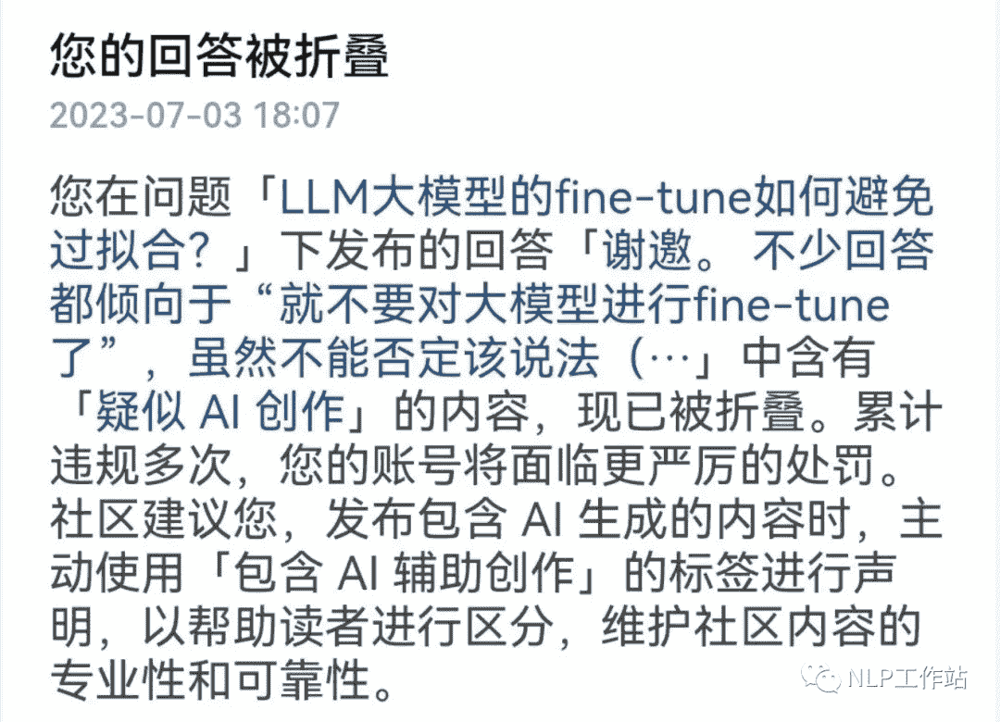
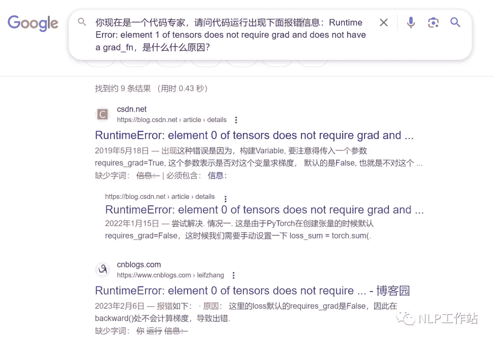
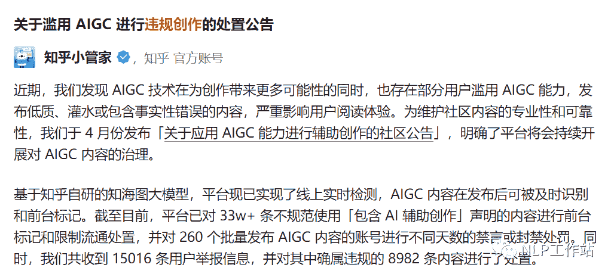

# 是我们在训练大模型，还是大模型在训练我们？

> 来源：[https://geekbang.feishu.cn/docx/MbC9dY2amoY19Yx8OwbcLZYDnXb](https://geekbang.feishu.cn/docx/MbC9dY2amoY19Yx8OwbcLZYDnXb)

> 👨🏻 作者：刘聪NLP

> 📃 作者介绍：AIGC前沿知识分享&落地经验总结

> 🛖 知乎主页：https://www.zhihu.com/people/LiuCongNLP

> ⏰ 收录时间：2024-05-23 11:28:42

> 🔗 原文链接：h[ttps://mp.weixin.q](https://mp.weixin.qq.com/s/EflkdGbKyiavs2klxPuVLg)q.com/s/EflkdGbK...


关注作者公众号，获取更多AI知识

## ** 写在前面**

大家好，我是刘聪NLP。

不知道大家有没有发现一个问题，我们越来越ChatGPT化了。引发了我的思考“是我们在训练大模型，还是大模型在训练我们？”

起因是我在知乎上的一个回答被检测出包含AI辅助创造内容，因此答案被折叠。



虽然我及时联系知乎小管家进行了恢复，但我深深意识到了一个问题，由于一直在构建大模型所需的训练数据，一直在训练大模型，一直在对大模型进行测试。我已经被同化了，在我的潜意识中已经形成了一套创造框架。我对行文的审美已经固定在具有强逻辑的模型内容上。

当在检索框里输入“你现在是一个代码专家，请问代码运行出现下面报错信息：Runtime Error: element 1 of tensors does not require grad and does not have a grad_fn，是什么原因？”时，我现在已经被大模型深度同化了。



从思维到行事，从内在到外在，完全大模型化。

## ** 从何开始**

当我们依赖某一个或者某一些模型的时候，我们就正在改变我们的习惯。比如这是我用SD画的末日+机器人：


这是别人用SD画的末日+机器人：


因为我不会写一个好的prompt，所以我很有个性，但当为了通过大模型获取更好的效果，我们会参考最优的提问方式。渐渐我们对相同问题的提问、思考、获取答案的内容也越来越趋同。

**「那么你是否已被AI模型同化，更深层次的哲学问题，人类**思维、风格差异如果趋同后会有哪些影响？」

## ** 造成影响**

目前存在一些AI生成内容的检测工具，例如GPT-Zero、DetectGPT、中英双语ChatGPT检测器等。一般通过机器通过判断回复的困惑度、高频词组合、表达方式等特征来判断。

```
GPT-Zero: https://gptzero.me
DetectGPT: https://arxiv.org/abs/2301.11305
中英双语ChatGPT检测器: https://zhuanlan.zhihu.com/p/598395917
```

中英双语ChatGPT检测器的论文中指出：

+   ChatGPT的回答通常严格地集中在给定的问题上，而人类的回答是发散的，很容易转移到其他话题。

+   ChatGPT提供客观的答案，而人类更喜欢主观的表达。

+   ChatGPT的回答通常是正式的，而人类的回答则更口语化。

+   ChatGPT在回应中表达的情感较少，而人类在语境中选择了许多标点和语法特征来传达自己的情感。

但可以想想，如果人类与大模型内容输出极其相似，那么检测器就将更难区分是由AI创作还是人类创作，对于未来内容审核会带来严重影响，并且人类对于互联网上内容的真实性将更难判别。

苏神的“当生成模型肆虐：互联网将有“疯牛病”之忧？”也指出，人类生成模型的频率越来越高，将会导致互联网上模型创作的内容越来越多；但生成模型也在进行着迭代更新，所用数据一般来自于互联网，那么就会出现以后的训练集中模型创作的部分占比将会越来越高。由于模型生成结果往往为了保证数据质量来减少多样性，最终数据内容会越发单一，所用词汇越发集中。

```
当生成模型肆虐：互联网将有“疯牛病”之忧？
https://kexue.fm/archives/9687
```

随着人们对大模型的依赖逐渐增加，恶性循环就出现了，甚至会出现人类语言退化。

「那么大模型继续发展之后，2022年是否将成为AI数据元年？」

## ** 如何应对**

现在各大厂已经进行对AI创作进行了部分处理，比如，知乎对AI创作打上一定的标签，如若不然，将会被给予一定的违规处罚；百度对检索出AI创作内容，会对其排序进行权重降低处理，等等等。并且OpenAI、谷歌等七家 AI 头部企业承诺，将为人工智能内容添加水印。

```
OpenAI、谷歌等七家 AI 头部企业承诺，将为人工智能内容添加水印
https://www.zhihu.com/question/613301491
```



这样，大模型制造者可以知道哪些数据是AI创作的，普通人也可以知道哪些内容由AI生成。可能规避一些同化信息吧。

PS：本人在3月份写ChatGPT-所见、所闻、所感一文时，就对AI检测给予厚望。但目前还是任重而道远。

```
ChatGPT-所见、所闻、所感
https://zhuanlan.zhihu.com/p/605331104
```

「如何更好地利用魔法打败魔法，AIGC的高效检测。」

## ** 总结**

目前是我们在训练大模型，还是大模型在训练我们？欢迎大家讨论！

+   你是否已被AI模型同化，更深层次的哲学问题，人类思维、风格差异如果趋同后会有哪些影响？

+   大模型继续发展之后，2022年是否将成为AI数据元年？

+   如何更好地利用魔法打败魔法，AIGC的高效检测。

往期推荐：

+   [**Llama2技术细节&开源影响**](https://mp.weixin.qq.com/s?__biz=Mzg5MTU1NTE1OQ==&mid=2247486512&idx=1&sn=73d2b6dd73051e85bf6b9f630919f3d9&scene=21#wechat_redirect)

+   [**大模型时代-行业落地再思考**](https://mp.weixin.qq.com/s?__biz=Mzg5MTU1NTE1OQ==&mid=2247486493&idx=1&sn=d58830d103a21e141a20d308f2ad3a83&scene=21#wechat_redirect)

+   [**大模型幻觉问题调研**](https://mp.weixin.qq.com/s?__biz=Mzg5MTU1NTE1OQ==&mid=2247486489&idx=1&sn=a74f92ab19a3d7f82cf2cd527c5c8df4&scene=21#wechat_redirect)

+   垂直领域大模型的一些思考及开源模型汇总

+   如何评估大模型-LLMs的好坏？

+   阿里「通义千问」大模型-内测分享

+   CORGI-PM：首个中文性别偏见探索和缓解数据集

+   AAAI2023 | 基于统一语义匹配的通用信息抽取框架-USM

+   [**IJCAI2022 | DictBert：采用对**](https://mp.weixin.qq.com/s?__biz=Mzg5MTU1NTE1OQ==&mid=2247486029&idx=1&sn=59cd696629d406cf45637482a7b134df&scene=21#wechat_redirect)比学习的字典描述知识增强的预训练语言模型

+   [**ACL2022|NoisyTune：**](https://mp.weixin.qq.com/s?__biz=Mzg5MTU1NTE1OQ==&mid=2247485803&idx=1&sn=5acb654c6fa67a5f041d60461037eda3&scene=21#wechat_redirect)微调前加入少量噪音可能会有意想不到的效果

+   ACL2022论文分类汇总-Prompt、句子表征、检索排序&摘要

+   总结|Prompt在NER场景的应用

+   NAACL2022-Prompt相关论文&对Prompt的看法

+   PolyLoss：一种将分类损失函数加入泰勒展开式的损失函数

+   PERT：一种基于乱序语言模型的预训练模型