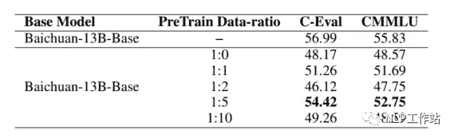
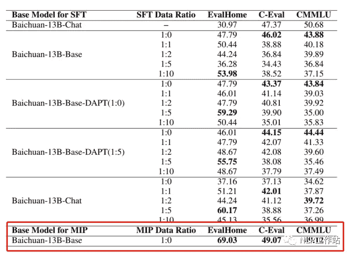
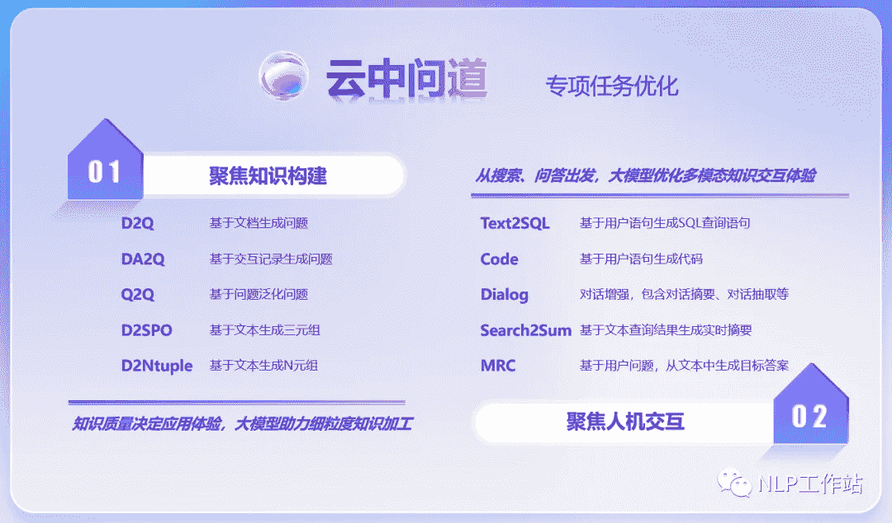

# 领域大模型-训练Trick&落地思考

> 来源：[https://geekbang.feishu.cn/docx/X91KdS4L8otM2IxmXiUcLYrBnXg](https://geekbang.feishu.cn/docx/X91KdS4L8otM2IxmXiUcLYrBnXg)

> 👨🏻 作者：刘聪NLP

> 📃 作者介绍：AIGC前沿知识分享&落地经验总结

> 🛖 知乎主页：https://www.zhihu.com/people/LiuCongNLP

> ⏰ 收录时间：2024-05-23 11:28:42

> 🔗 原文链接：h[ttps://mp.weixin.q](https://mp.weixin.qq.com/s/yhBMgmoJ2uzqc3JERrUhAw)q.com/s/yhBMgmoJ...

关注作者👸号，获取更多AI知识

## ** 写在前面**

大家好，我是刘聪NLP。

**领域大模型一直**是大家关注的内容，恰逢我司也做了“ 「云中问道」 ”领域知识大模型，借此机会聊一聊领域大模型训练Trick以及领域大模型落地想法。

但有些并没有什么理论依据，全是自己的实验经验&结论，可能跟大家有所不同，欢迎大家讨论，交流分享。

## ** 领域大模型训练Trick**

**一、领域技术标准文档或领域相关数据是领域模型C**ontinue PreTrain的关键。

现有大模型在预训练过程中都会加入书籍、论文等数据，那么在领域预训练时这两种数据其实也是必不可少的，主要是因为这些数据的数据质量较高、领域强相关、知识覆盖率（密度）大，可以让模型更适应考试。当然不是说其他数据不是关键，比如领域相关网站内容、新闻内容都是重要数据，只不过个人看来，在领域上的重要性或者知识密度不如书籍和技术标准。

**二、领域数据训练后，往往通用能力会有所下降，**需要混合通用数据以缓解模型遗忘通用能力。

如果仅用领域数据进行模型训练，模型很容易出现灾难性遗忘现象，通常在领域训练过程中加入通用数据。那么这个比例多少比较合适呢？目前还没有一个准确的答案，BloombergGPT（从头预训练）预训练金融和通用数据比例基本上为1:1，ChatHome（继续预训练）发现领域：通用数据比例为1:5时最优。个人感觉应该跟领域数据量有关，当数据量没有那多时，一般数据比例在1:5到1:10之间是比较合适的。

**三、领域模型Continue PreTrain时可以同步加入SFT数据，**即MIP，Multi-Task Instruction PreTraining。

预训练过程中，可以加下游SFT的数据，可以让模型在预训练过程中就学习到更多的知识。例如：T5、ExT5、Glm-130b等多任务学习在预训练阶段可能比微调更有帮助。并且ChatHome发现MIP效果在领域上评测集上绝群。

**四**、 仅用SFT做领域模型时，资源有限就用在Chat模型基础上训练，资源充足就在Base模型上训练。（资源=数据+显卡）

跟很多人讨论过一个问题，就是我们在SFT的时候是在Base模型上训练还是在Chat模型上训练。

其实很简单，如果你只有5k数据，建议你在Chat模型上进行微调；如果你有10w数据，建议你在Base模型上进行微调。因为你不知Chat模型在SFT时的数据质量如何，当自己有能力时，靠人不如靠己。

**五、在Chat模型上进行SFT时，请一定遵循C**hat模型原有的系统指令&数据输入格式。

如果你在Chat模型上进行SFT的时候，请跟Chat模型的输入格式一致，否则当你数据量不足时，可能会导致训练效果不明显。并且建议不采用全量参数训练，否则模型原始能力会遗忘较多。

**六、领域评测集时必要内容，建议有两份，一份选**择题形式自动评测、一份开放形式人工评测。

一定要有自己的领域数据集来验证模型效果，来选择最好的checkpoint。选择题形式可以自动评测，方便模型进行初筛；开放形式人工评测比较浪费时间，可以用作精筛，并且任务形式更贴近真实场景。

七、领域模型词表扩增是不是有必要的。

个人感觉，领域词表扩增真实解决的问题是解码效率的问题，给模型效果带来的提升可能不会有很大。（这里领域词表扩充是指在同语言模型上扩充词表，而不是英文模型的中文汉化）

八、所谓的领域大模型会更新的越来越快，越来越多。

由于很多人&公司并没有资源搞底座，因此需要在现有底座模型上进行增量预训练、微调等。而以目前各厂（ChatGLM、BaiChuan、Qwen、Llama）抢占开源社区占比的架势，感觉会有很多7B、13B级别模型开源。

请等待一言、ChatGPT开源小模型的一天，说不定GPT5出来的时候，Openai会开源个GPT3.5的小版本模型。

## ** 领域大模型落地的想法**

**一、常说通用模型的领域化可能是伪命题**，那么领域大模型的通用化是否也是伪命题。

自训练模型开始，就一直再跟Leader Battle这个问题，领域大模型需不需要有通用化能力。就好比华为盘古大模型“只做事不作诗”的slogan，是不是训练的领域大模型可以解决固定的几个任务就可以了。

个人的一些拙见是，如果想快速的将领域大模型落地，最简单的是将系统中原有能力进行升级，即大模型在固定的某一个或某几个任务上的效果超过原有模型。

以Text2SQL任务举例，之前很多系统中的方法是通过抽取关键要素&拼接方式来解决，端到端解决的并不是很理想，那么现在完全可以用大模型SQL生成的能力来解决。在已有产品上做升级，是代价最小的落地方式。就拿我司做的“云中问道”来说，在解决某领域某场景SQL任务上效果可以达到90%+，同比现有开源模型&开放API高了不少。

当然还有很多其他任务可以升级，例如：D2QA、D2SPO、Searh2Sum等等等。

二、领域大模型落地，任务场景要比模型能力更重要。

虽说在有产品上做升级，是代价最小的落地方式，但GPT4、AutoGPT已经把人们胃口调的很高，所有人都希望直接提出一个诉求，大模型直接解决。但这对现有领域模型是十分困难的，所以在哪些场景上来用大模型是很关键的，并且如何将模型进行包装，及时在模型能力不足的情况下，也可以让用户有一个很好的体验。

现在很多人的疑惑是，先不说有没有大模型，就算有了大模型都不知道在哪里使用，在私有领域都找不到一个Special场景。

**所**以最终大模型的落地，拼的不是模型效果本身，而是一整套行业解决方案，“Know How”成为了关键要素。

三、大多数企业最终落地的模型规格限制在了13B。

由于国情，大多数企业最终落地的方案应该是本地化部署，那么就会涉及硬件设备的问题。我并不绝的很有很多企业可以部署的起100B级别的模型，感觉真实部署限制在了10B级别。即使现在很多方法（例如：llama.cpp）可以对大模型进行加速，但100B级别的模型就算加速了，也是庞大资源消耗。

**我**之前说过“没有体验过33B模型的人，只会觉得13B就够”，更大的模型一定要搞，但不影响最后落地的是10B级别。

## ** 做大模型的心路历程**

一开始ChatGPT刚刚爆火的时候，根本没想过我们也配做大模型。但当国内涌现出了许多中文大模型，并Alpaca模型证明70亿参数量的模型也有不错效果的时候，给了我很大的信心，当然也给很多人和很多企业更多的信心。

在中小企业做大模型，经常被质问的是“没有100张卡也可以做大模型”，我只想说需要看对“大”的定义，175B的模型确实没有资格触碰，但33B的模型还是可以玩耍的。真正追赶OpenAI是需要一批人，但模型落地还是需要另外一批人的。

赶上大模型是我们的幸运，可以在领域大模型上发声是我幸运。

## ** 总结**

最后共勉：BERT时代况且还在用TextCNN，难道13B的模型就不叫大模型吗？

往期推荐：

+   大模型LLM微调经验总结&项目更新

+   [**浅谈LLM的长度外推**](https://mp.weixin.qq.com/s?__biz=Mzg5MTU1NTE1OQ==&mid=2247486596&idx=1&sn=b329fe7aa5b0cead6900175fd0663594&scene=21#wechat_redirect)

+   [**打造LLM界的Web UI**](https://mp.weixin.qq.com/s?__biz=Mzg5MTU1NTE1OQ==&mid=2247486578&idx=1&sn=8fc505e81e2a479bfaf9b5b15d120808&scene=21#wechat_redirect)

+   是我们在训练大模型，还是大模型在训练我们？

+   [**Llama2技术细节&开源影响**](https://mp.weixin.qq.com/s?__biz=Mzg5MTU1NTE1OQ==&mid=2247486512&idx=1&sn=73d2b6dd73051e85bf6b9f630919f3d9&scene=21#wechat_redirect)

+   [**大模型时代-行业落地再思考**](https://mp.weixin.qq.com/s?__biz=Mzg5MTU1NTE1OQ==&mid=2247486493&idx=1&sn=d58830d103a21e141a20d308f2ad3a83&scene=21#wechat_redirect)

+   [**大模型幻觉问题调研**](https://mp.weixin.qq.com/s?__biz=Mzg5MTU1NTE1OQ==&mid=2247486489&idx=1&sn=a74f92ab19a3d7f82cf2cd527c5c8df4&scene=21#wechat_redirect)

+   垂直领域大模型的一些思考及开源模型汇总

+   如何评估大模型-LLMs的好坏？

+   阿里「通义千问」大模型-内测分享

+   总结|Prompt在NER场景的应用

+   NAACL2022-Prompt相关论文&对Prompt的看法