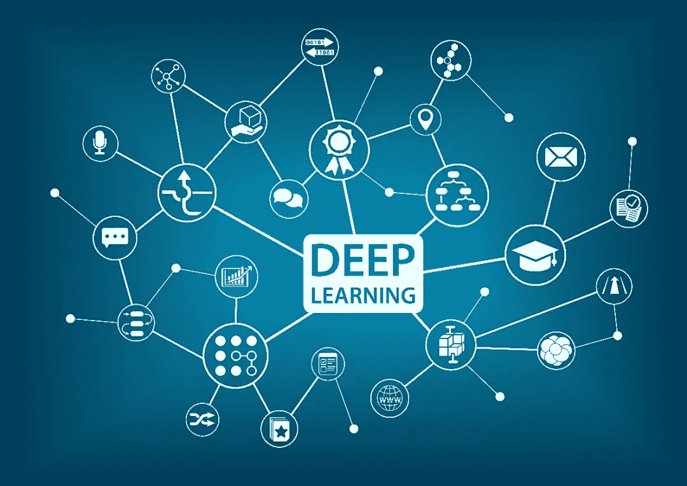

# 秒懂AI-深度学习五大模型：RNN、CNN、Transformer、BERT、GPT简介

> 来源：[https://geekbang.feishu.cn/docx/KK4LdnOXwocI2uxZS96cm5Uvnne](https://geekbang.feishu.cn/docx/KK4LdnOXwocI2uxZS96cm5Uvnne)

> 👨🏻 作者：AllenTang

> 📃 作者介绍：分享人工智能，让所有人玩转AI

> 🛖 公众号：架构师带你玩转AI

> ⏰ 收录时间：2024-05-23 11:28:42

> 🔗 原文链接：h[ttps://mp.weixin.q](https://mp.weixin.qq.com/s?__biz=MzkzMTEzMzI5Ng==&mid=2247485087&idx=1&sn=3f12204a346651351d6908d35a266d39&chksm=c26ee480f5196d96d1a026a751fa340846315352496666b18ab70447d90aab724abc4cf67ce2&scene=21#wechat_redirect)q.com/s?__biz=Mz...

关注作者公众号，获取更多AI知识

深度学习是人工智能领域的一个重要分支，近年来取得了显著的发展。其中，RNN、CNN、Transf**ormer**、BERT和GPT是五种常用的深度学习模型，它们在计算机视觉、自然语言处理等领域都取得了重要的突破。本文将从 关键技术 、 处理 数据 、 应用场景、 经典案例 4个 维度来简 要介绍这五种模型。

**1、RNN（循环神经网络）**

**时间： 20世纪90年代**

**关键技术： 循环结构和记忆单元**

处理 数据 ： 适合处理 时间 序列数据

应用场景 ： 自然语言处理、语音识别、时间序列预测等

RNN是一种神经网络模型，它的基本结构是一个循环体，可以处理序列数据。RNN的特点是能够在处理当前输入的同时，记住前面的信息。这种结构使得RNN非常适合用于自然语言处理、语音识别等任务，因为这些任务需要处理具有时序关系的数据。

**经典案例：文本分类**

**2、 CNN（卷积神经网络） **

时间： 20世纪90年代末至21世纪初

关键技术： 卷积运算和池化操作

处理 数据 ： 适合处理图像数据

应用场景 ： 计算机视觉、图像分类、物体检测等

CNN是一种神经网络模型，它的基本结构是由多个卷积层和池化层组成的。 卷积层可以提取图像中的局部特征，而池化层则可以减少特征的数量，提高计算效率。 CNN的这种结构使得它非常适合用于计算机视觉任务，如图 像分类、物体检测等。 与RNN相比，CNN更擅长处理图像数据，因为它可以自动学习图像中的局部特征，而不需要人工设计特征提取器。

**经典案例：猫狗识别**

3、 Transformer

**时间： 2017年**

关键技术： 自注意力机制和多头注意力机制

处理 数据 ： 适合处理长序列数据

应用场景 ： 自然语言处理、机器翻译、文本生成等

Transformer是一种基于自注意力机制的神经网络模型，它的基本结构是由多个编码器和解码器组成的。 编码器可以将输入序列转换为向量表示，而解码器则可以将该向量表示转换回输出序列。 Transformer的最大创新之处在于引入了自注意力机制，这使得模型可以更好地捕捉序列中的长距离依赖关系。 Transformer在自然语言处理领域取得了很大的成功，如机器翻译、文本生成等任务。

**经典案例：机器翻译**

**4**、 BERT （Bidirectional Encoder Representations from Transformers）

**时间： 2018年 **

关键技术：双向Transformer编码器和预训练微调

处理 数据 ： 适合处理双向上下文信息

应用场景：自然语言处理、文本分类、情感分析等

BERT是一种基于Transformer的预训练语言模型，它的最大创新之处在于引入了双向Transformer编码器，这使得模型可以同时考虑输入序列的前后上下文信息。BERT通过在大量文本数据上进行预训练，学习到了丰富的语言知识，然后在特定任务上进行微调，如文本分类、情感分析等。BERT在自然语言处理领域取得了很大的成功，被广泛应用于各种NLP任务。

**经典案例：情感分析**

**5、GPT （Generative Pre-**trained Transformer）

**时间：2018年 **

关键技术：单向Transformer编码器和预训练微调

处理 数据 ： 适合生成连贯的文本

应用场景：自然语言处理、文本生成、摘要等

GPT也是一种基于Transformer的预训练语言模型，它的最大创新之处在于使用了单向Transformer编码器，这使得模型可以更好地捕捉输入序列的上下文信息。GPT通过在大量文本数据上进行预训练，学习到了丰富的语言知识，然后在特定任务上进行微调，如文本生成、摘要等。GPT在自然语言处理领域也取得了很大的成功，被广泛应用于各种NLP任务。

**经典案例：文本生成 **