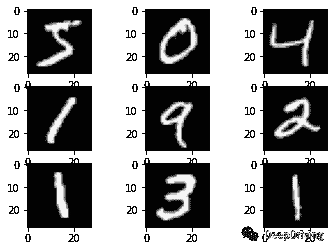
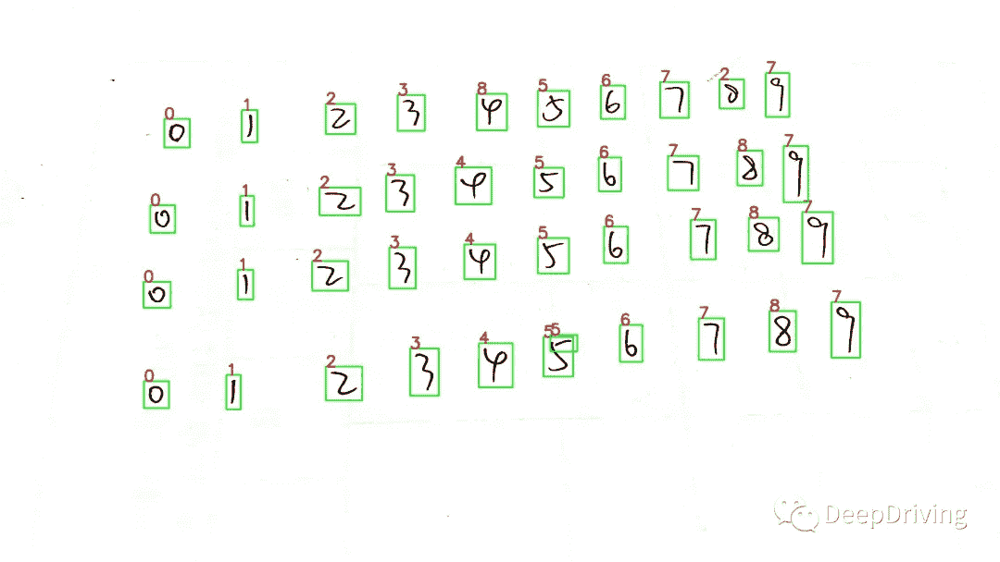

# 机器学习实战 | 用HOG+SVM实现手写数字识（附代码）

> 来源：[https://geekbang.feishu.cn/docx/GRjCdD4L6o1NoaxIJaecGHKannf](https://geekbang.feishu.cn/docx/GRjCdD4L6o1NoaxIJaecGHKannf)

> 👨🏻 作者：一天到晚潜水的鱼

> 📃 作者介绍：分享计算机视觉、机器学习、深度学习、无人驾驶等内容

> 🛖 👸号：DeepDriving

> ⏰ 收录时间：2024-05-27 11:20:58 (UTC+8)

> 🔗 原文链接： h[ttps://mp.weixin.q](https://mp.weixin.qq.com/s?__biz=MzkwNjE2ODMyMQ==&mid=2247484959&idx=1&sn=0b2a31303b60f42e5fb5cc46d4fc1028&chksm=c0edd771f79a5e671246aee564908306db007bdef6965c12b7f4806e2974ab570a5346e6c90f&token=1923064180&lang=zh_CN#rd)q.com/s?__biz=Mz...


关注作者，获取更多AI知识

## ** ****前言**

手写数**字识别是机器学习和深度学习中**一个非常著名的入门级图像识别项目，很多人都是从这个项目开始进入图像识别领域的。虽然现在深度学习在图像识别领域已经风靡一时，取得了令人瞩目的成就，但是不可否认的是经典的机器学习方法依然是不过时并且有用武之地的。本文将带大家用经典的 提取HOG特征+SVM分类 方法来实现手写数字识别。

## ** ****下载数据集**

手写数字识别数据集采用的是 MNIST 数据集，该数据集可以从官方网站上下载： http://yann.lecun.com/exdb/mnist/ ，也可以从格物钛的网站上下载： https://gas.graviti.cn/dataset/data-decorators/MNIST 。数据集包括以下4个压缩文件：

+   train-images-idx3-ubyte.gz : 训练集图像数据

+   train-labels-idx1-ubyte.gz : 训练集标签数据

+   t10k-images-idx3-ubyte.gz : 测试集图像数据

+   t10k-labels-idx1-ubyte.gz : 测试集标签数据

其中训练集包含 60000 个样本，测试集包含 10000 个样本，每个样本都是 28x28 的灰度图像。数据集下载好以后我们可以取几个样本进行可视化，看一下这些样本是什么样的。



samples

## ** ****提取HOG特征**

与深度学习不同的是，在机器学习中我们需要手动去提取和处理特征，然后再将这些处理好的特征送入分类器进行训练或预测。HOG(Histogram of Oriented Gradient，方向梯度直方图)是一种在计算机视觉和图像处理中常用的特征描述子。在 OpenCV 中，我们可以调用 cv2.HOGDescriptor() 来创建一个 HOGDescriptor 类对象：

```
def CreateHOGDescriptor():
    winSize = (28, 28)
    blockSize = (14, 14)
    blockStride = (7, 7)
    cellSize = (7, 7)
    nbins = 9
    derivAperture = 1
    winSigma = -1.
    histogramNormType = 0
    L2HysThreshold = 0.2
    gammaCorrection = 1
    nlevels = 64
    signedGradient = True

    hog = cv2.HOGDescriptor(winSize, blockSize, blockStride, cellSize, nbins, derivAperture,
                            winSigma, histogramNormType, L2HysThreshold, gammaCorrection, nlevels, signedGradient)
    return hog
```

创建 HOGDescriptor 对象时有些参数需要进行设置：

+   winSize: 这里设置为样本图像的大小。

+   cellSize: 该值决定了提取的特征向量的大小，越小的cellSize值得到的特征向量越大。

+   blockSize: block主要用来解决光照变化问题，大的blockSize值可以使得算法对图像的局部变化不那么敏感，通常blockSize设置为2*cellSize。

+   blockStride: 确定相邻块之间的重叠度并控制对比归一化的程度，通常blockStride设置为 blockSize的1/2。

+   nbins: 设置梯度直方图中bin的数量，HOG论文的作者推荐值为9，这样可以以20度为增量捕获0~180度之间的梯度。

+   signedGradients: 梯度是有符号的还是无符号的。

创建 HOGDescriptor 对象后，就可以调用 compute() 方法来计算图像的HOG特征了。

## ** ****训练SVM模型**

在OpenCV中，我们可以直接调用机器学习库中的 SVM_create() 函数创建一个SVM分类器模型，创建模型的时候需要设置一些参数，比如分类模型类型、核函数类型、正则化系数等。

```
def InitSVM(C=12.5, gamma=0.50625):
    model = cv2.ml.SVM_create()
    model.setGamma(gamma)
    model.setC(C)
    model.setKernel(cv2.ml.SVM_RBF)
    model.setType(cv2.ml.SVM_C_SVC)
    return model
```

要选择合适的SVM超参数是比较难的，不过比较好的是，OpenCV为我们提供了一个 trainAuto() 函数，该函数会通过K折交叉验证来寻找最优的参数。模型创建好后，我们可以调用该函数对模型进行训练。

```
def TrainSVM(model, samples, responses, kFold=10):
    model.trainAuto(samples, cv2.ml.ROW_SAMPLE, responses, kFold)
    return model
```

因为需要进行K折交叉验证，所以调用 trainAuto() 函数训练模型所需要的时间比较长。如果不想花那么多时间训练模型，可以减少K折交叉验证的K值，或者直接不用该函数而是用 train() 函数来训练模型。

模型训练完以后，我们可以将HOG和SVM模型保存到XML文件中，以便后续使用。

```
svm_model.save(&#x27;svm.xml&#x27;)
hog.save(&#x27;hog_descriptor.xml&#x27;)
```

## ** ****测试模型**

模型训练好以后，我们可以在测试集上测试一下模型的准确率。首先提取测试集中每个图像的HOG特征，然后将特征送入SVM分类模型进行预测并统计出模型的准确率。

```
def EvaluateSVM(model, samples, labels):
    predictions = SVMPredict(model, samples)
    accuracy = (labels == predictions).mean()
    print(&#x27;Accuracy: %.2f %%&#x27; % (accuracy*100))

    confusion = np.zeros((10, 10), np.int32)
    for i, j in zip(labels, predictions):
        confusion[int(i), int(j)] += 1
    print(&#x27;confusion matrix:&#x27;)
    print(confusion)
```

我训练的模型在测试集上的准确率为 99.46% ，得到的混淆矩阵如下：

```
confusion matrix:
[[ 978    0    0    0    0    0    1    1    0    0]
 [   0 1132    1    0    0    0    1    0    1    0]
 [   1    0 1027    0    0    0    0    4    0    0]
 [   0    0    2 1006    0    1    0    0    1    0]
 [   0    0    0    0  976    0    1    0    0    5]
 [   1    0    0    2    0  888    1    0    0    0]
 [   4    2    1    0    0    1  949    0    1    0]
 [   0    2    3    0    0    0    0 1022    0    1]
 [   2    0    0    1    0    1    0    1  967    2]
 [   0    1    0    1    3    0    0    1    2 1001]]
```

## ** ****使用模型**

训练好一个模型后，我们当然希望能够把它应用到实际生活中来帮我们解决一些问题。既然训练了一个手写数字识别模型，那么我们就让它来识别一下手写的数字，看看效果到底怎么样。

首先，我们拿一张白纸写上一些数字，然后用图像处理的方法将纸上的每个数字的区域提取出来，再执行前文所述的提取HOG特征+SVM分类的识别流程。下面是我的一些测试结果：



recognition

从上图中可以看到，前面从 0~8 这几列的识别准确率还是比较高的，但是 9 这列数字全部识别成了7，可能是我写的数字“9”与训练集中的数字7更相似而与数字9的差异比较大吧，读者有兴趣的话可以试一下。

## ** ****参考资料**

+   https://towardsdatascience.com/mnist-handwritten-digits-classification-from-scratch-using-python-numpy-b08e401c4dab

+   https://learnopencv.com/handwritten-digits-classification-an-opencv-c-python-tutorial/

+   https://opencv24-python-tutorials.readthedocs.io/en/latest/py_tutorials/py_ml/py_svm/py_svm_opencv/py_svm_opencv.html