# SpikingResformer：ResNet + Transformer 结合创新

> 来源：[https://geekbang.feishu.cn/docx/ZJzjdflG0oj8CexpnmOcblEEn24](https://geekbang.feishu.cn/docx/ZJzjdflG0oj8CexpnmOcblEEn24)

> 👨🏻 作者：AllenTang

> 📃 作者介绍：分享人工智能，让所有人玩转AI

> 🛖 👸号：架构师带你玩转AI

> ⏰ 收录时间：2024-05-23 11:28:42

> 🔗 原文链接： h[ttps://mp.weixin.q](https://mp.weixin.qq.com/s/r1pTxPLZNnS7mw_ooEannw)q.com/s/r1pTxPLZ...

关注作者👸号，获取更多AI知识

# **本文将从 ****模型背景、模型介绍、模型应用 ****三**个方面，带 您一文搞懂 SpikingResformer：ResNet + Transformer 结合创新。

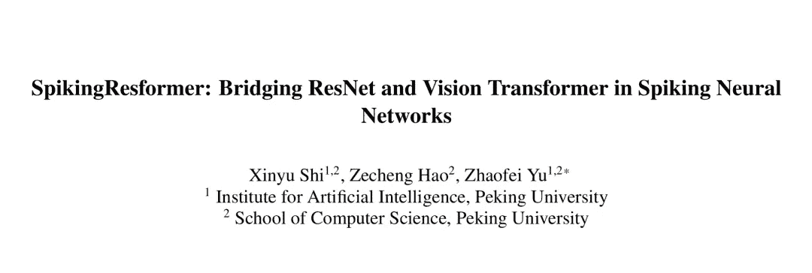

SpikingResformer

# **— ****1 ****—**

# **模型背景**

**Vi**sion Transformer在人工神经网络（ANN）中的显著成功，引起了将自注意力机制和基于Transformer的架构整合到脉冲神经网络（SNN）中的日益增长的兴趣。

### **脉冲神经网络**

**脉**冲神经网络（SNN）是一种受生物神经元启发的新一代人工神经网络模型， 其独特之处在于信息以脉冲的形式传递，每个脉冲都代表一个特定的信息。

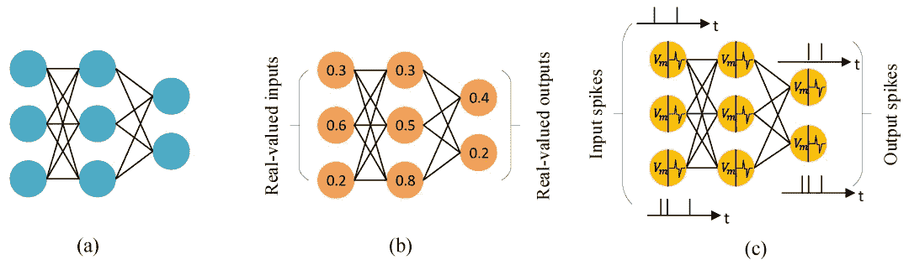

**脉冲神经网络（SNN）**

**SNN的简介：**

**论文《 Deep Learning in Spiki**ng Neural Networks 》

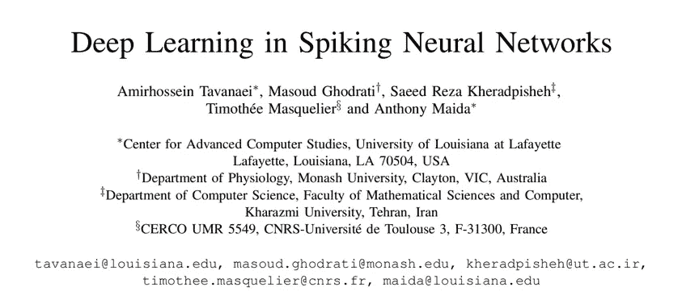

**脉冲神经网络中的深度学习**

**脉冲**神经网络 (SNN) 属于第三代神经网络模型，实现了更高级的生物神经模拟水平。 脉冲神经网络是一种模拟生物神经元脉冲发放和信息传递过程的神经网络。在SNN中，神经元通过发放脉冲来传递信息。

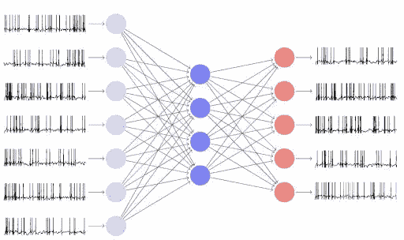

**脉冲神经网络（SNN）**

**SNN的架构组成：**

**模拟生物神经元通过脉冲传递信息的方式，包括神经元模**型、突触模型、网络结构， 如下图所示：

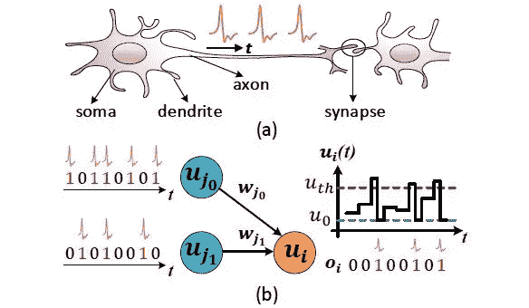

**SNN的架构**

1.  **神经元模型 **：SNN中的神经元模型用于模拟生物神经元的脉冲产生和传递过程。这些模型通常包括膜电位、阈值、脉冲发放等参数。

1.  **突触模型 **：突触是神经元之间连接的结构，负责传递信息。在SNN中，突触模型可以模拟不同类型的突触（如兴奋性突触和抑制性突触），以及突触的可塑性（即突触权重可以随着时间的推移而改变）。

1.  **网络结构 **：SNN的网络结构可以包括多层前馈网络、递归网络等。这些网络结构可以模拟生物神经系统中不同层次的神经元之间的连接关系。

**研**究人员提出了多种基于脉冲神经网络的深度学习架构，如脉冲卷积神经网络（S-CNN）、脉冲循环神经网络（S-RNN）等。

+   **S-CNN **：C NN 与SNN的结合 ， 通过脉冲编码方式传递信息，利用卷积操作捕捉局部特征，并利用脉冲神经元的时序特性进行特征整合和分类。

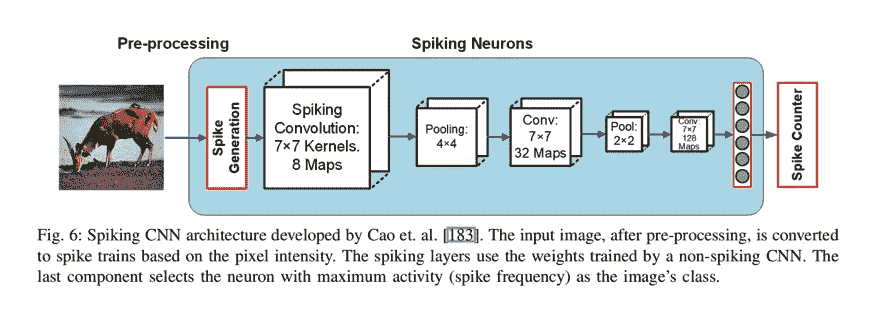

**S-CNN**

+   **S-RNN **： RNN与SNN的结合，通过脉冲编码传递信息，能够捕捉神经元间的脉冲发放模式和时间依赖关系，从而在处理长序列数据时具有更高的效率和更低的能耗。

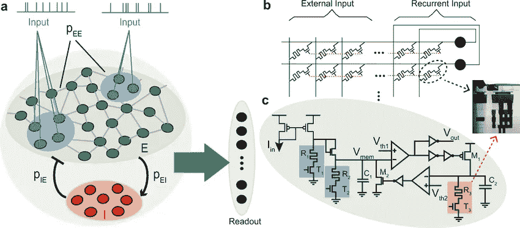

**S-RNN**

** ****SNN的工作流程： **

**SNN 神经元之间的交流通过离散的脉冲（Binar**y Spike），而不是连续的激活值。

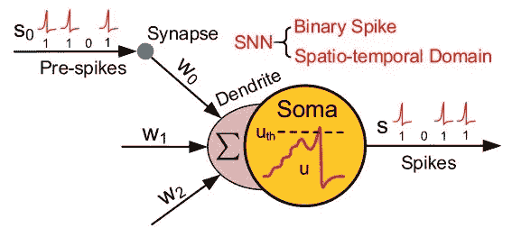

**SNN神经元的工作原理**

SNN神经元处理脉冲方式如下 ：

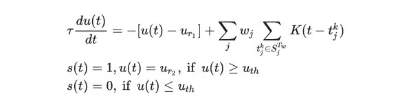

1.  **脉冲编码 ****：在SNN中，神经元之间的通信是通**过离散的脉冲序列来完成的。 当某个神经元的膜电位超过阈值时，它会发放一个脉冲，并将膜电位重置为初始值。

1.  **动态行为 **：SNN的神经元状态是随时间变化的，这使其能够处理时序数据。 在每个时间步，神经元的膜电位会根据其输入脉冲和突触权重进行更新。

**详细了解脉冲神经网络SNN： **神经网络算法 - 一文搞懂SNN（脉冲神经网络）

### Vision Transformer（ViT）

**V**ision Transformer（ViT）将Transformer架构从自然语言处理领域引入到计算机视觉中，用于处理图像数据。

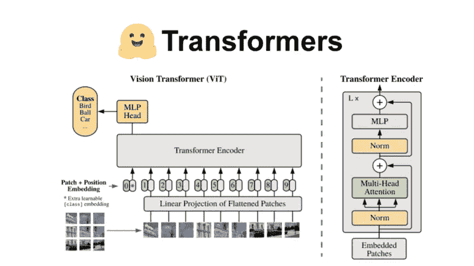

Vision Transformer（ViT）

**ViT的简介：**

**论文《 AN IMAGE IS WORTH 16X16 WORDS: TRANS**FORMERS FOR IMAGE RECOGNITION AT SCALE 》

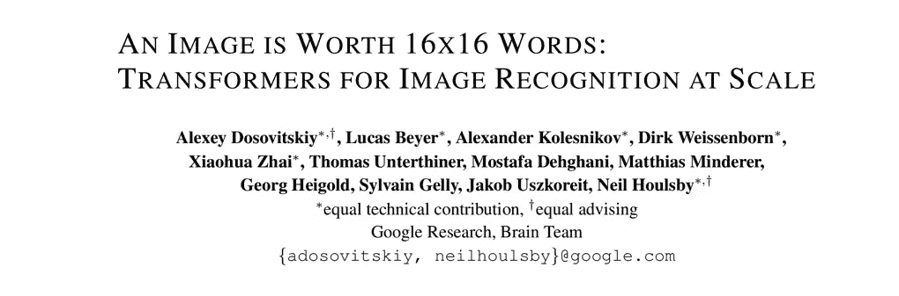

**一张图片胜过16x16个文字：用**于大规模图像识别的Transformer

**ViT的核心思路是将图像视为一系列图像块（“视觉单词”或“**tokens”），而不是连续的像素数组。

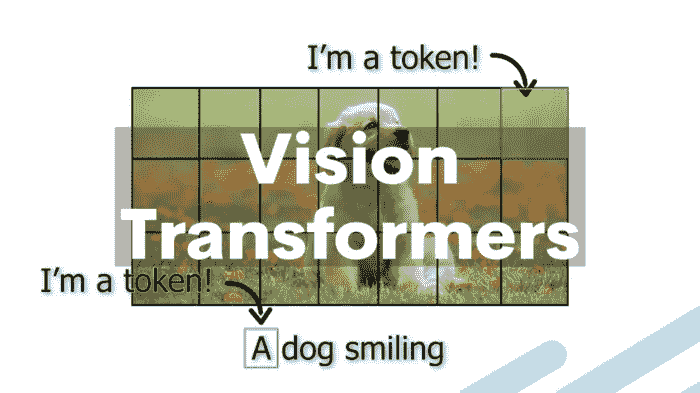

**ViT的核心思路**

图像块（Image Patches）：

+   ViT首先将输入图像切分为多个固定大小的图像块（patches）。

+   这些图像块被线性嵌入到固定大小的向量中，类似于NLP中的单词嵌入。

+   **每**个图像块都被视为一个独立的“视觉单词”或“tokens”，并用于后续的Transformer层中进行处理。

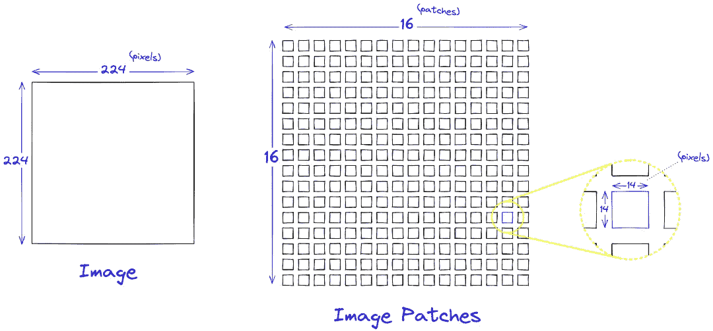

图像块（Image Patches）

**ViT的 架构图：**

**ViT 的架构如图所示：**

** **

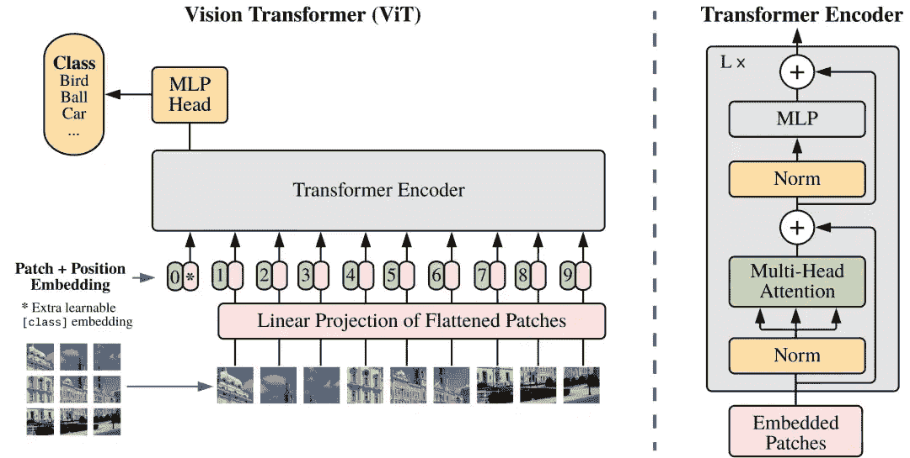

**ViT 的架构图**

**ViT 的核心模块：**

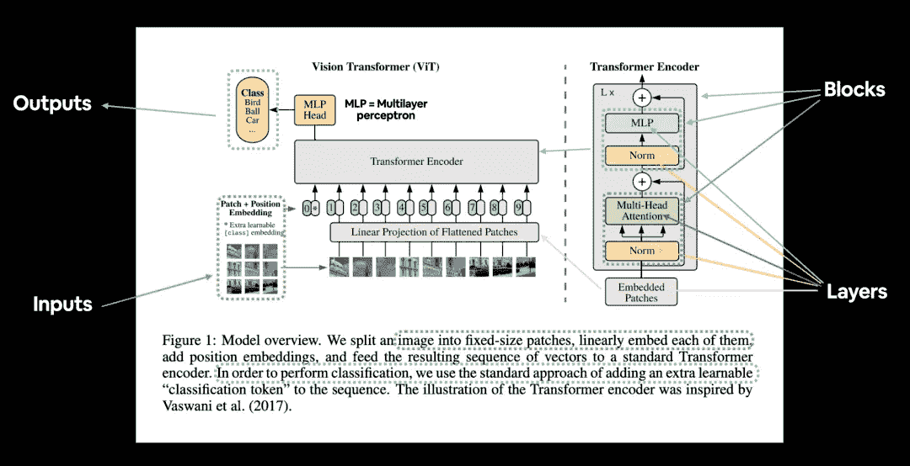

**ViT 的核心模块**

**ViT**的核心组件分为5部分：Patch Embeddings，Position Embeddings，Classification Token， Linear Projection of Flattened Patches， 以及Transformer Encoder。

1.  **Patch Embed**dings： 如上图虚线的左半部分，我们将图片分成固定大小的 图像块patches （如图左下9×9的图像），将它们线性展开。

1.  **Position Embeddi**ngs： Position embeddings加到图像块中是为了保留位置信息的。

1.  **Classification Token ： 为**了完成分类任务，除了以上九个图像块，我们还在序列中添加了一个*的块0，叫额外的学习的 分类标记Classification Token。

1.  ** ****Linear Projection of**** F**lattened Patches： 图像分割为固定大小的图像块（patches）后，将每个图像块展平（flatten）为一维向量，并通过一个线性变换（即线性投影层或嵌入层）将这些一维向量转换为固定维度的嵌入向量（patch embeddings）。

1.  **Transformer Encoder： 由多个堆叠的层组成，**每层包括多头自注意力机制（MSA）和全连接的前馈神经网络（MLP block）。

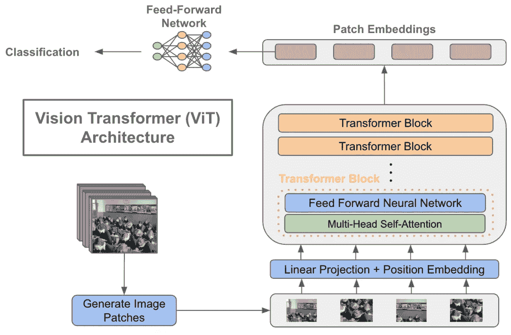

ViT的Transformer Encoder

**ViT 的工作流程：**

**ViT将图像分割为固定大小的图像块（patches），将其转换为Patch Embeddings，添加位置编码**信息，通过包含多头自注意力和前馈神经网络的Transformer编码器处理这些嵌入，最后利用分类标记进行图像分类等任务。

**ViT的工作流程**

[**详细了解Vision Trans**](http://mp.weixin.qq.com/s?__biz=MzkzMTEzMzI5Ng==&mid=2247488514&idx=1&sn=a5a1a1c0a39958e794f07383d7ed1725&chksm=c26ef61df5197f0bc9eae8b24d0b8f36d50710148fdc71a8845095609caae357e85454d975eb&scene=21#wechat_redirect)former（ViT）： 神经网络算法 - 一文搞懂ViT（Vision Transformer）

# **— ****2 ****—**

# **模型介绍**

**Re****s**Net因其深层结构和残差连接，能够有效地从图像中提取出丰富的局部特征。同时，Transformer的自注意力机制能够捕捉图像中的长 距离依赖关系，为模型提供全局上下文信息。 高性能低参数的SpikingResformer采用了ResNet + Transformer结合的策略。

**这种策略结合了两者分别在处理空间、序列数据上的优势，强化了模型特征提取和全局理解方面的能**力,让模型在保持强大的局部分析能 力的同时,也能够利用全局信息来进一步提升性能。

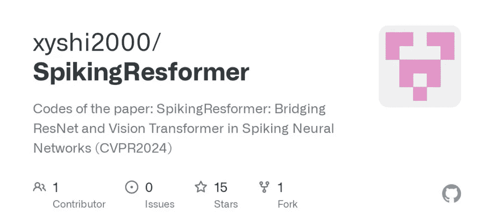

**SpikingResformer： ResNet **+ Vision Transformer

### **模型思路**

**脉冲自注意力机制 的局限：**

** **尽管现有方法提出了与SNN兼容的脉冲自注意力机制，但它们缺乏合理的缩放方法，且这些方法所提出的整体架构在有效提取局部特征方面存在瓶颈。

+   **原因一：缺乏合理的缩放方法。**

+   **原因二：未能有效提取局部特征。**

** ****双脉冲自注意力（DSSA） ：**

**为**了应对这些挑战，提出了一种名为双脉冲自注意力（DSSA）的新型脉冲自注意力机制，并附带一种合理的缩放方法。

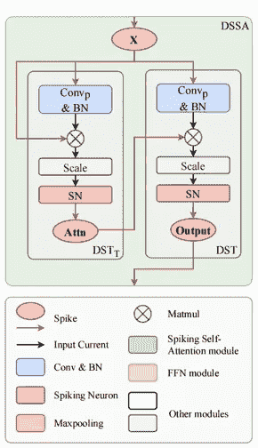

Dual Spike Self-Attention（双脉冲自注意力）

SpikingResformer ：

**论文《 SpikingResformer: Bridging ResNet and Vision Transformer in Spiking Neural Ne**tworks 》 基于DSSA， 提出了一种新颖的脉冲视觉变换器架构，称为SpikingResformer，它将基于ResNet的多阶段架构与我们提出的DSSA相结合，以提高性能和能效，同时减少参数。

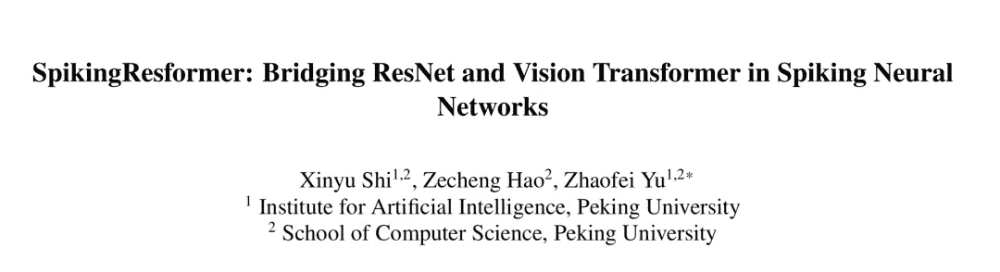

**S**pikingResformer：在脉冲神经网络中连接ResNet和Vision Transformer

### **模型架构 **

SpikingResformer 的 架构图：

SpikingResformer 的框架如图所示：

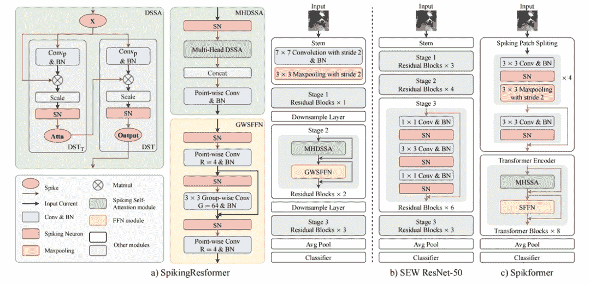

SpikingResformer 的架构图

SpikingResformer 的核心组件 ：

**SpikingResformer 与基于ResNet的脉冲神经网络（SNN）类似，开始于一个stem架**构，该架构由一个7×7的卷积和一个3×3的最大池化层组成，用于预先提取局部特征，并采用多阶段的主干来生成多尺度的特征图。

**在每**个阶段中，多个Spiking Resformer块被顺序堆叠。每个Spiking Resformer块由两个模块组成，分别是多头双脉冲自注意力（MHDSSA）块和分组脉冲前馈网络（GWSFFN）。

**在每个阶段之前（除了第一个阶段），都会应用一个下采样层来减小特征**图的大小并将其投影到更高的维度（分辨率降为原来的1/2，维度扩大为原来的2倍）。

最后，模型以一个全局平均池化层和一个分类层结束。

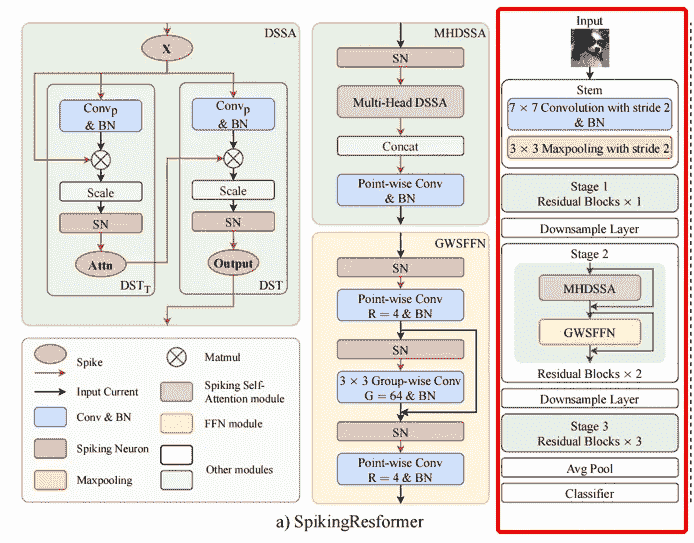

SpikingResformer 的核心组件

以下是 SpikingResformer 这些核心组件的简要说明：

1.  **Stem架构 **：由7×7的卷积和3×3的最大池化层组成，用于从输入数据中提取低级特征。

1.  **多阶段主干 **：包含多个阶段，每个阶段都包含多个Spiking Resformer块，用于提取和转换特征。

1.  Spiking Resformer块 ：

1.  **（1）MHDSSA块 **：这是一个多头双脉冲自注意力机制，它结合了自注意力机制和脉冲神经网络的特性，用于捕捉特征图中的依赖关系。

1.  **（2）GWSFFN **：分组脉冲前馈网络，类似于ResNet中的瓶颈块，它首先减小特征图的维度，然后通过一个非线性层进行转换，最后再次增加维度。这有助于在保持计算效率的同时提高模型的表示能力。

1.  **下采样层 **：在每个阶段之间（除了第一个阶段），都会有一个下采样层来减小特征图的空间分辨率并增加其通道数。这有助于捕获不同尺度的特征，并提高模型的感受野。

1.  **全局平均池化层 **：将特征图的空间维度转换为1，以便将其输入到分类层中。

1.  **分类层 **：通常是一个全连接层，用于根据提取的特征进行分类。

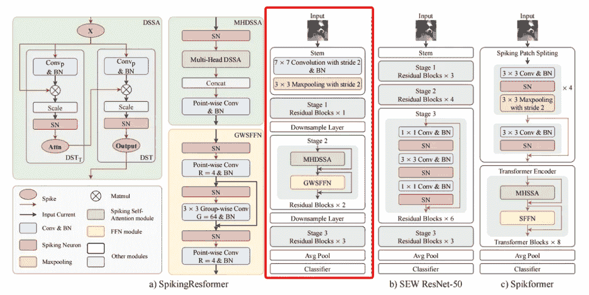

SpikingResformer 的核心组件

Spiking Resformer Block ：

**Spiking Resformer Block 包括三部分**：DSSA、MHDSSA、GWSFFN。

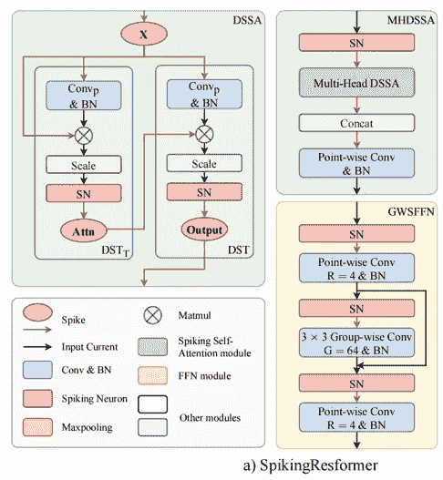

Spiking Resformer Block

1.  Dual Spike Self-Attention (DSSA)

1.  （1）DSSA 是 SpikingResformer 的关键组件之一，它是对传统 Transformer 中的自注意力机制的改进。

1.  （2）DSSA 引入了双脉冲流：一个用于正值（兴奋性）的脉冲流和一个用于负值（抑制性）的脉冲流。这允许 DSSA 同时捕获输入序列中的正负相关性，从而生成更具区分性的表示。

1.  （3）DSSA 的脉冲事件是根据激活值触发的，类似于生物神经网络中神经元的放电行为。

1.  Multi-Head DSSA (MHDSSA)

1.  （1）MHDSSA 是 DSSA 的多头版本，类似于 Transformer 中的多头注意力机制。

1.  （2）它将输入分割成多个部分，每个部分都由一个独立的 DSSA 头处理。这允许 MHDSSA 并行地关注输入序列的不同方面，从而增强模型捕获复杂依赖关系的能力。

1.  （3）所有 DSSA 头的输出随后被拼接起来，并通过一个线性变换进行融合。

1.  **Group-Wise Spiking Feed-Forw**ard Network (GWSFFN)

1.  （1）GWSFFN 是 SpikingResformer 中的前馈网络组件，它对传统的 Transformer 前馈网络进行了改进。

1.  （2）GWSFFN 将输入分为几个组，并在每个组内应用脉冲机制。这种分组处理策略使得 GWSFFN 能够以更局部化和高效的方式处理输入，潜在地减少计算成本。

1.  （3）类似于 DSSA，GWSFFN 中的脉冲事件也是根据激活值触发的。

# **— ****3 ****—**

# **模型应用**

### **ImageNet图像分类**

**ImageNet数据集：**

**ImageNet是用于图像分类的最典型的**静态图像数据集之一。 它包含了数百万张来自数千个不同类别的图像，被广泛用于计算机视觉领域的研究和开发。

**ImageNet 的数据集规模和多样性使其成为评估图像分类算法性能**的重要基准。研究者们经常在这个数据集上测试他们的模型，以验证其有效性和泛化能力。

**此外，ImageNet 还为其他计算机视觉任务，如目标**检测、图像分割等，提供了丰富的标注数据。

**ImageNet**

ImageNet数据集的评估结果 ：

**如**表2所示，SpikingResformer在同时实现了更高的准确率、更少的参数和更低的能耗方面，相比于现有方法具有优势。

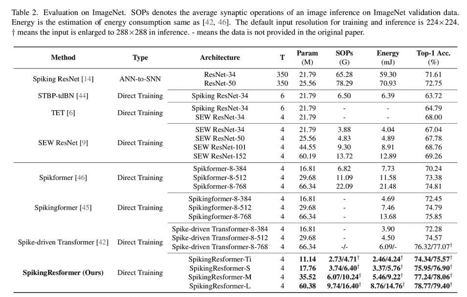

Table 2. Evaluation on ImageNet

+   **Spi**kingResformer-Ti： SpikingResformer-Ti以仅11.14M的参数和2.73G SOPs（2.46mJ的能耗）达到了74.34%的准确率，比Spike-driven Transformer-8-384高出2.06%的准确率，同时节省了5.67M的参数和1.44mJ的能耗。

+   **SpikingResformer-M： SpikingResformer-M以35.52M的参数和6.07G SOPs（5.**46mJ的能耗）达到了77.24%的准确率，比Spike-driven Transformer-8-768高出0.92%的准确率，同时节省了30.82M的参数。

+   **S**pikingResformer-L： 特别是，当输入大小增加到288×288时，SpikingResformer-L的准确率高达79.40%，这是SNN领域中最先进的结果。

### **迁移学习**

Transfer Learning ：

**迁**移学习是一种机器学习技术，它利用在一个任务上学到的知识来帮助改进另一个任务的学习过程，即使这两个任务的输入和/或输出可能并不相同。

Transfer Learning

**传**统机器学习从特定任务的标记数据中学习，而迁移学习则利用来自相关任务的知识来提高在目标任务上的性能，尤其是当目标任务的标记数据有限时。

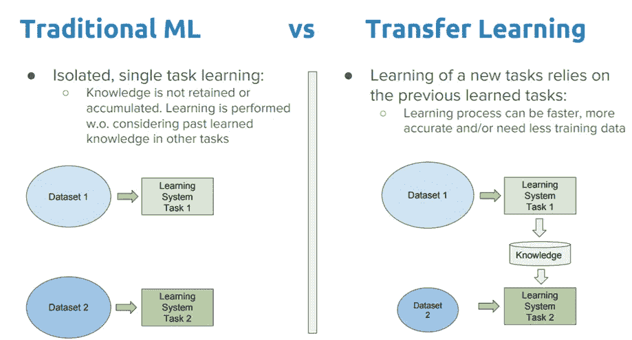

Traditional ML vs Transfer Learning

静态数据集 CIFAR10和CIFAR100 ：

**CIFAR10和 CIFAR100 这两个数据**集常用于计算机视觉领域的研究和算法测试。

**CIFAR10是一个包含10个类别共60000张**32x32像素彩色图像的小型静态数据集。

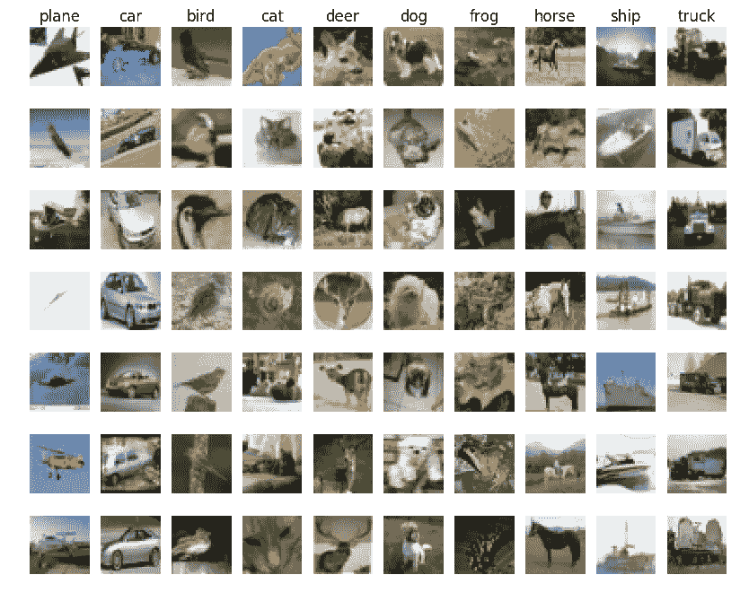

**CIFAR10**

**而**CIFAR100是其扩展版本，包含100个类别共60000张相同尺寸的图像，每个类别都有更细分的子类。

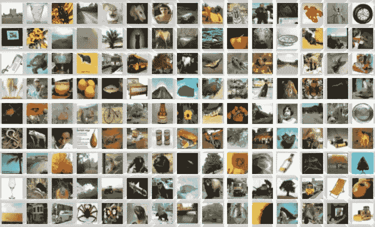

**CIFAR100 **

神经形态数据集CIFAR10-DVS和DVSGesture：

**神经**形态数据集CIFAR10-DVS和DVSGesture是基于CIFAR10数据集转换或创建的，分别用于处理动态视觉传感器数据和手势识别任务，以研究具有时间信息的神经形态数据。

**CI**FAR10-DVS是将标准的CIFAR10图像数据集转换为事件驱动的神经形态数据集，用于模拟动态视觉传感器（如DVS相机）捕获的数据，以便在神经形态计算系统中研究事件驱动的图像分类任务。

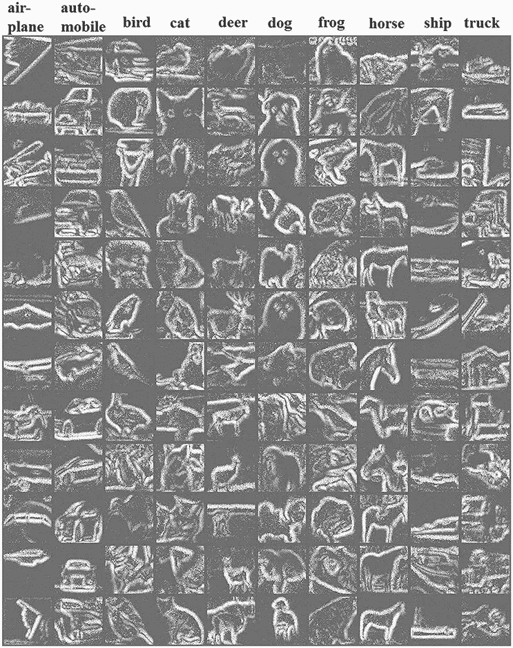

**CIFAR10-DVS**

**DVSGesture是一个包含多种手势类别的数据集，旨在支持基于事件驱动的视觉传感器（如DV**S相机）的手势识别研究，通过捕捉手势的动态变化信息来提高手势识别的准确性和效率。

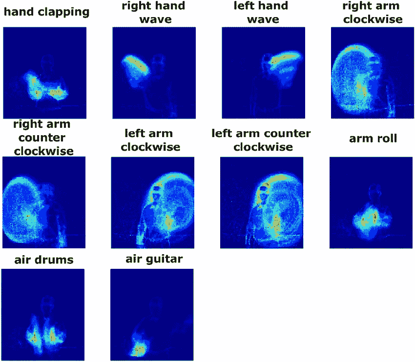

**DVSGesture**

**迁移学习结果 ：**

**迁**移学习能力是Vision Transformer的一个重要特性，特别是在处理新任务或新数据集时能够显著加速模型训练和提高性能。

**为了**评估所提出的SpikingResformer的迁移学习能力，模型在静态数据集CIFAR10和CIFAR100 以及 神经形态数据集CIFAR10-DVS 和DVSGesture上进行了实验 。

**通**过微调在ImageNet上预训练的模型来实现迁移学习，并与现有的直接训练方法和迁移学习方法进行了比较。

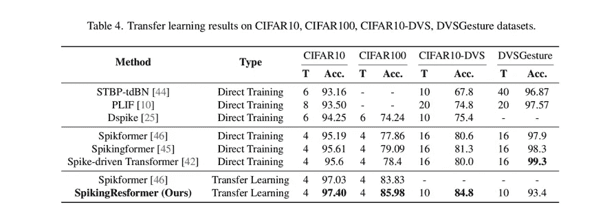

Transfer learning results

+   **CIFAR10： SpikingResformer在CIFAR10数据集上取得了97.40%的准**确率， 这是目前已知的最好结果。 与Spikformer的迁移学习结果相比，在CIFAR10上提高了0.37%的准确率。

+   **CIFA**R100： SpikingResformer在在CIFAR100数据集上取得了85.98%的准确率。 与Spikformer的迁移学习结果相比， SpikingResformer的表现比直接训练的Spikingformer高出6.89%，这体现了迁移学习的优势。 与直接训练方法相比，SpikingResformer通过迁移学习获得的性能显著更优。

+   **CIFAR10-DVS： ****S**pi kingResformer在CIFAR10-DVS上实现了84.8%的准确率，比直接训练的Spikingformer高出3.5%。

+   **DVSGesture： ****在DVSGesture数据集上，迁移学习的结果未能达到与直接训练相当的性能。 SpikingResformer在DVSGesture上仅达到了93.4**%的准确率，落后于最先进的方法Spike-driven Transformer 5.9%。可能是由于CIFAR10-DVS和DVSGesture的构建方式不同。

**相关论文**

+   《 SpikingResformer: Bridging ResNet and Vision Transformer in Spiking Neural Networks》

+   《 AN IMAGE IS WORTH 16X16 WORDS: TRANSFORMERS FOR IMAGE RECOGNITION AT SCALE》

+   《Deep Residual Learning for Image Recognition》

+   《Deep Learning in Spiking Neural Networks》