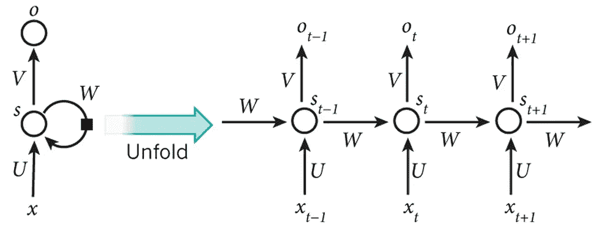
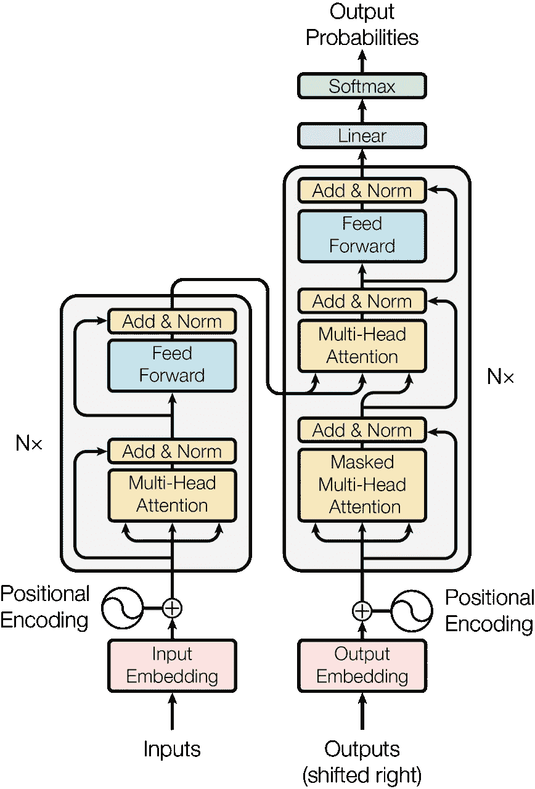
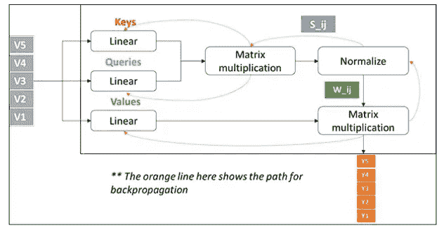
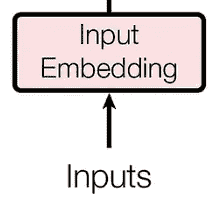
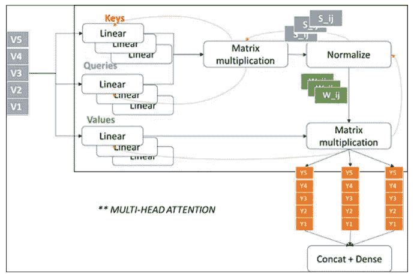

# （一）ChatGPT背后强大而神秘的力量：用最简单的语言讲解Transformer架构之概览

> 来源：[https://geekbang.feishu.cn/docx/TvfodbVdQoRnp1xrX4ncbdeJnah](https://geekbang.feishu.cn/docx/TvfodbVdQoRnp1xrX4ncbdeJnah)

> 👨🏻 作者：加里

> 📃 作者介绍：目前就职于金融银行AI部门，资深解决方案架构师。

> 🛖 👸号：AIWithGary

> ⏰ 收录时间：2024-05-27 11:20:58 (UTC+8)

> 🔗 原文链接：  h[ttps://mp.weixin.q](https://mp.weixin.qq.com/s?__biz=MzU3OTgyMjM3MA==&mid=2247484435&idx=1&sn=eeb8d952a4695211be575d7ef92d4166&chksm=fd61725eca16fb48b25ab8be527c4986d581f5f29e41989408362145c93ee1068264f78fbaef#rd)q.com/s?__biz=Mz...

关注作者，获取更多AI知识

2017年，谷歌的研究团队发表了具有里程碑意义的论文《Attention is All You Need》，首次提出了Transformer模型。这一创新架构极大地推动了自然语言处理（NLP）技术的发展，成为后续如Generative Pre-trained Transformer（ GPT ），Pathways Language Model（ PaLM ）等大型语言模型（LLM）开发的基石，彻底改变了之前依赖传统神经网络，比如Recurrent Neural Network（ RNN ）及其变种Long Short-Term Memory（ LSTM ）和Gated Recurrent Unit（ GRU ）的研究方向。

本系列文章致力于用最简单的语言讲解Transformer架构，帮助朋友们理解它的强大之处，本文是第一篇： 概览 。

# 01

RNN的挑战

循环神经网络 （RNN）是 神经网络 （NN）的一种特别设计，专门用于处理按顺序排列的数据，比如文本、音频、时间序列等。 它的独到之处在于引入了“记忆”功能，让网络能记住之前输入的信息 。这种记忆功能在处理需要理解上下文的任务时显得尤为重要，比如在NLP中，语义的理解和生成过程。

如果从视觉角度描述，一个标准的RNN结构看起来就像是一个计算单元，它通过一个自连接的隐藏状态进行信息循环，让信息能够跨 时间步 （S t ）传递：

随着数据在RNN中的流动，之前时间步的激活状态会作为输入参与到当前数据的处理中，让模型能够动态地融合时间上下文和序列的历史信息。这一点对于很多 序列到序列 （Seq2Seq）的预测任务尤为关键。

RNN及其变种LSTM和GRU曾是序列模型的核心，专为顺序处理数据和捕捉时间序列依赖而设计。不过，它们面临几个关键挑战，这些挑战限制了其效能和效率：

难以理解长期关联 ：

+   梯度消失问题 ：在反向传播时，RNN面临梯度逐渐减小直至消失的问题，这使得模型难以学习序列中远距离元素间的关系。

+   梯度爆炸问题 ：另一方面，梯度可能会急剧增加，引发梯度爆炸问题，这会破坏学习过程的稳定性。

顺序处理的局限 ：

+   固有的顺序处理机制限制了并行处理的可能性，导致处理长序列时训练和推理速度缓慢。

计算和内存负担 ：

+   高计算需求 ：RNN，LSTM和GRU因其复杂结构而计算量巨大，这些结构旨在解决梯度消失问题。

+   内存限制 ：维护长序列的隐藏状态需要大量内存，这对扩展性构成了挑战。

想象一个简单的任务，RNN需要预测句子中的下一个单词。如果RNN在尝试预测之前只看到了一个词，那么它猜对的可能性不高。如果我们通过让它观察更多之前的词来提高其预测能力，我们就需要更多的计算资源。但即使有了更多资源和数据，RNN依然面临困难，因为它需要完整理解整个句子乃至整篇文章来准确预测。仅依赖观察前几个词是不够的，它需要全面理解上下文。

# 02

Transformer的解决方案

Transformer 模型的推出，正是Vaswani在其里程碑式的论文《Attention is All You Need》中所做的工作，这一创新不仅突破了传统限制，还为解决RNN面临的问题提供了解决方案。

Transformer架构包括编码器和解码器两部分，每部分都含有多个层，这些层集成了多头自注意力机制和前馈神经网络，共同工作以提升处理效率和性能。

Transformer的工作方式是同时处理句子中的全部词序，而不是像RNN那样，一次只处理一个词。这种处理机制让Transformer在捕捉句子内词语之间的上下文关系和相互作用方面更为出色，对于理解人类语言来说，这一点极为关键。

此外，Transformer采用了一种名为 自注意力 （self-attention）的技术，能够对句中各词赋予不同的权重，并集中关注对完成特定任务最关键的词语。正是这种机制，使得Transformer能够灵活应对各种任务，并且达到非常高的准确度。

RNN vs Transformer

Transformer解决了RNN的几个关键问题，并提供了更高效和更强大的解决方案：

并行处理与效率提升 ：

+   自注意力机制 ：与RNN不同，Transformer通过自注意力机制评估输入数据各部分的重要性，实现对序列更加精细的理解。

+   并行化能力 ：Transformer架构支持数据的并行处理，大幅提高了训练和推理速度。

解决长期依赖问题 ：

+   全局上下文感知 ：得益于自注意力机制，Transformer能够同时处理整个序列，有效地捕捉长期依赖，避免了顺序处理的限制。

可伸缩性与灵活性 ：

+   降低内存需求 ：通过去除循环连接的需求，Transformer减少了内存使用，提高了模型的可伸缩性和效率。

+   高度适应性 ：Transformer的架构包含了 堆叠的编解码器 ，这种设计使其不仅在自然语言处理领域，在计算机视觉和语音识别等多个领域也能发挥出色的适应性。

|  | RNN | Transformer |
| --- | --- | --- |
| 处理方式 | 顺序处理 | 并行处理 |
| 长上下文理解 | 难以捕捉长依赖 | 通过自注意力机制捕捉长依赖 |
| 可伸缩性 | 差 | 好 |
| 应用领域 | 自然语言处理 | 自然语言处理、计算机视觉、语音识别等 |
| 训练速度 | 慢 | 快 |

自注意力机制

注意力机制的精髓在于，它让模型能够在执行任务时专注于输入序列的不同部分，正如人们在处理信息时会更加关注某些特定的词或物体。这一机制极大地提升了模型把握数据上下文和内在联系的能力。

注意力机制基于 查询 （Queries）， 键 （Keys）， 值 （Values）三个向量运作，这些向量源自输入数据， 查询和键的相互作用决定了模型对输入的各个部分的关注程度，而值则承载了实际要处理的信息 。

注意力权重用来评估输入数据各部分之间的相关性，指导模型应更多关注哪些部分。

自注意力，作为一种特殊的注意力机制，让模型能够评估输入数据各部分之间的相对重要性。它是Transformer架构的基础，使得模型能够高效地并行处理数据序列，这是之前按顺序处理数据的模型所不具备的。

自注意力实现了输入数据所有部分的同时处理，显著提升了训练速度和效率。而且，它能够无视位置距离，捕捉序列元素间的关系，克服了如RNN和LSTM这类早期模型的主要局限 。

模型不仅关注每个单词，还会评估每个单词与其他单词之间的关系，并对这些关系赋予注意力权重，从而学习每个单词与其他单词之间的相关性。

注意力及其映射

假设你在看一张公园里有许多狗和人的图片，如果要你找出所有黄色的球，你的大脑会自动聚焦于可能有黄色球的地方，忽略掉大部分狗和人。这种聚焦机制类似于机器学习中的注意力机制，它帮助模型专注于对当前任务（本例中为黄色球）重要的数据部分，而忽略不相关的信息（如狗和人）。

注意力图 类似于一个展示你在寻找黄色球时关注点的地图，它会突出显示黄色球的区域并淡化其他部分。在机器学习中，注意力图直观地显示了模型在数据中的关注焦点，以做出决策或预测。因此，在上述示例中，注意力图会突出显示模型认为对找到黄色球重要的输入部分，帮助我们理解模型做出决策的逻辑。

机器学习模型把数字视为语言，但不直接理解文字，因此我们需要通过标记化过程将文字转换为数字，即 为每个单词分配一个基于模型已知的所有单词列表的唯一数字 ，使模型能够理解和处理文本。

文本输入被数字化后，就可以传递给嵌入层，将每个单词（或Token）转换为一个称为 向量 的数字列表。这些向量通过训练过程调整，随着模型从数据中学习，调整这些数字以提高其任务执行能力，这个过程称为“可训练的向量嵌入（Embedding）”，是使计算机能够理解和从中学习的文字表示方式。

一旦得到嵌入，就可以将其传递给自注意力层，该层分析输入序列中标记之间的关系，优化模型对数据的处理和理解能力。

多头自注意力

设想你在一个拥挤的公交车上，努力听朋友讲故事，你的大脑能自动关注到他所说的关键词，同时留意周围的环境声，譬如有人叫你的名字或是公交车到站播报声。

多头自注意力机制在计算机中实现了类似的功能。它使得模型能够同时关注句子或图像的多个部分，不仅抓住主旨，同时也能从多角度捕捉上下文和微妙之处。

这种技术仿佛为机器学习模型装配了一系列专业的“透镜”，每个“透镜”或“头”关注数据的不同维度。因此，在Transformer模型中，多头自注意力赋予了模型深入理解输入信息的能力。

这项技术的作用远不止于识别句子中的下一个词汇；它涉及到把握整个句子的含义，理解各个词汇间的关联，甚至识别讽刺或强调等语言细节。这让Transformer在执行语言翻译、文章摘要编写或生成逼真文本等任务上展现出了强大的能力。

在训练期间，模型通过学习并储存在各层的自注意力权重来识别输入序列中每个词对于序列中其他所有词的重要性。这个过程不止进行一次。实际上，模型会并行地学习多组自注意力权重，也就是所谓的“头”，而这些头彼此之间是独立的。

预测过程

在机器学习模型中，自注意力机制负责捕捉语言的各种特性，每个部分关注不同的语言特征。比如，某部分可能探寻句子中字符间的关系，另一部分关注动作发生的情况，还有的部分可能识别单词的发音相似性。有趣的是，这些自注意力“头”的关注点并非预设，而是 从随机开始，通过处理大量数据并自我学习，自然而然地识别出各种语言特征 。它们学习到的一些特征我们能够理解，如前所述的例子，但有些则更加难以捉摸。

模型对输入数据应用了所有这些注意力机制后，接下来会通过一个 全连接层 进行处理，生成一个与模型词汇表中每个词作为下一词出现的可能性相关的数值列表（即logits）。随后，这些数值通过softmax层转换成概率，给模型词汇表中的每个单词一个表示其作为下一词出现概率的分数。虽然会有成千上万个这样的分数，但通常情况下，某个单词的分数会比其他单词高，成为模型预测下一词的首选。

# 03

总结

Transformer模型极大地推动了自然语言处理（NLP）的发展，它为处理语言提供了一种更加高效和有效的架构，使得开发像GPT和PaLM这样强大的大型语言模型成为可能。

不仅如此，Transformer模型还展示了机器学习模型在处理序列数据方面的强大能力，为其他相关领域如语音识别、图像字幕和推荐系统等提供了新的思路和工具。因此，Transformer模型在人工智能和机器学习领域具有深远的影响，它为更智能、更高效和更准确的模型开发铺平了道路。