# （二）ChatGPT背后强大而神秘的力量：用最简单的语言讲解Transformer架构之Embedding

> 来源：[https://geekbang.feishu.cn/docx/JcDUd16gNoPagMxOtZscogMAntf](https://geekbang.feishu.cn/docx/JcDUd16gNoPagMxOtZscogMAntf)

> 👨🏻 作者：加里

> 📃 作者介绍：目前就职于金融银行AI部门，资深解决方案架构师。

> 🛖 👸号：AIWithGary

> ⏰ 收录时间：2024-05-27 11:20:58 (UTC+8)

> 🔗 原文链接：   h[ttps://mp.weixin.q](https://mp.weixin.qq.com/s?__biz=MzU3OTgyMjM3MA==&mid=2247484599&idx=1&sn=7a7707295fb751aef0693c32d2d56137&chksm=fd6172faca16fbec2c226137bd31d0b64ac8c6b3a7c266c2890ef03cf88d501437d41f6376bb#rd)q.com/s?__biz=Mz...


关注作者，获取更多AI知识

本系列文章致力于用最简单的语言讲解Transformer架构，帮助朋友们理解它的强大力量。

本文是第二篇： 词嵌入， 它是Transformer的初始输入形式。

点击这里 [看第一篇：概览 ](http://mp.weixin.qq.com/s?__biz=MzU3OTgyMjM3MA==&mid=2247484435&idx=1&sn=eeb8d952a4695211be575d7ef92d4166&chksm=fd61725eca16fb48b25ab8be527c4986d581f5f29e41989408362145c93ee1068264f78fbaef&scene=21#wechat_redirect)。

词嵌入（Word embedding）也有人叫做词向量，本文统一称做词嵌入。

目录

1. 词嵌入介绍

2. 词嵌入的实现方法

2.1 稀疏表示法

2.1.1 词袋模型

2.1.2 词频-逆文档频率（TF-IDF）

2.2 密集向量表示法

2.2.1 Word2Vec

2.2.2 GloVe

2.2.3 OpenAI Transformer嵌入

3. 词嵌入相似度计算方法

3.1 欧几里得距离（L2）

3.2 曼哈顿距离（L1）

3.3 点积

3.4 余弦距离

4. 总结

# 01

词嵌入介绍

众所周知，计算机是“ 用数字来思考 ”的，无法自动掌握单词和句子的意义，如果我们想让计算机理解自然语言，就需要把这些信息转换成计算机能够处理的格式，即 数字向量 。

人类很早以前就学会了怎样把文本转换为机器能理解的格式，其中最早的一种格式是ASCII，这种方式虽然在文本渲染和传输方面有效，但却无法传递词汇的深层含义，那个时代，标准的搜索技术是基于 关键词 的搜索，即查找包含特定单词或词组的所有文档。

词嵌入技术的出现彻底改变了这一格局， 通过将单词、句子甚至图像转化为数字向量，它不仅仅改善了文本的表示方式，更重要的是，它捕捉到了语言的本质和丰富的语义； 这一创新使得 语义搜索 成为可能，让我们能够精准地理解和分析不同语言的文档，通过探索这些高级的数值表示形式，我们能够洞察计算机是如何开始理解人类语言的细微差别的，这一进步正在改变我们在数字时代处理信息的方式。

今天，词嵌入技术也是LLM的核心技术之一，也是Transformer的初始输入形式。

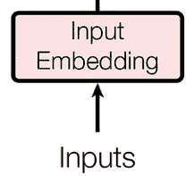

# 02

词嵌入的实现方法

稀疏表示法（Sparse Representations）

词袋模型

文本转换成向量的一种基础方法是词袋模型，它将文档视为一组不考虑顺序的单词集合。

词袋模型中，每个单词都被视为一个“词元”，文档中的每个词元都被赋予一个唯一的数字ID，然后，我们可以使用一个向量来表示文档，其中向量的每个维度代表一个词元，向量的每个元素表示该词元在文档中出现的次数。

我们可以利用 NLTK Python库来完成这一任务，如下是费曼的一句著名引语生成的词袋模型的词嵌入，”We are lucky to live in an age in which we are still making discoveries“（我们很幸运生活在一个仍在不断发现新事物的时代）。

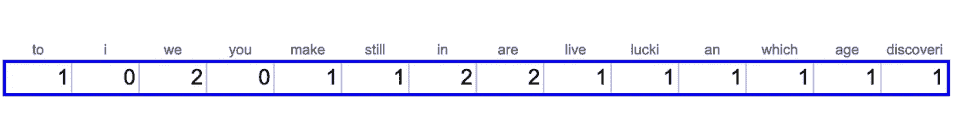

代码实现：

from nltk.stem import SnowballStemmer

from nltk.tokenize import word_tokenize

import collections

text = 'We are lucky to live in an age in which we are still making discoveries'

# tokenization - splitting text into words

words = word_tokenize(text)

print(words)

# ['We', 'are', 'lucky', 'to', 'live', 'in', 'an', 'age', 'in', 'which',

#  'we', 'are', 'still', 'making', 'discoveries']

stemmer = SnowballStemmer(language = "english")

stemmed_words = list(map(lambda x: stemmer.stem(x), words))

print(stemmed_words)

# ['we', 'are', 'lucki', 'to', 'live', 'in', 'an', 'age', 'in', 'which',

#  'we', 'are', 'still', 'make', 'discoveri']

bag_of_words = collections.Counter(stemmed_words)

print(bag_of_words)

# {'we': 2, 'are': 2, 'in': 2, 'lucki': 1, 'to': 1, 'live': 1,

# 'an': 1, 'age': 1, 'which': 1, 'still': 1, 'make': 1, 'discoveri': 1}

词频-逆文档频率（TF-IDF）

相比词袋方法，TF-IDF（词频-逆文档频率）是一种略有改进的版本，它通过两个指标的乘积来实现。


词频（TF）是衡量一个词在文档中出现频率的基本指标，它是评价单词在 文档内 重要性的简单方法；计算词频时，我们会计算特定词汇在文档中出现的次数，并将其除以文档中的总词数，这样做的目的是为了消除不同文档长度带来的影响。

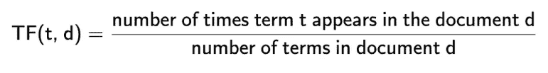

逆文档频率（IDF）是一个用来评估一个词在 整个文档集或语料库 中重要性的指标，它帮助我们了解一个词在所有文档中是常见的还是罕见的。

计算这个指标时，我们会用语料库中的文档总数除以含有该词的文档数，然后取这个比值的对数；这样的计算方法 降低了那些在众多文档中频繁出现的词的重要性 ，认为这些词相对不太重要；这个计算过程有助于我们更好地理解和评估不同词汇在文档集中的独特性和重要性。

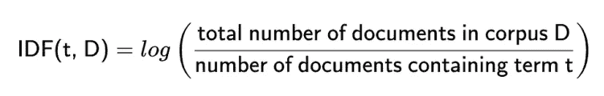

代码实现：

from sklearn.feature_extraction.text import TfidfVectorizer

def compute_tfidf(documents):

vectorizer = TfidfVectorizer()

return vectorizer.fit_transform(raw_documents=documents)

if __name__ == "__main__":

docs = [

"I love natural language processing",

"In natural language processing, the sentences are represented as embeddings or vectors",

"The distance between the embedding vectors gives the contextual meaning between them"

]

result = compute_tfidf(documents=docs)

print(result.toarray()

密集向量表示法（Dense Vector Representations）

Word2Vec

Word2Vec是一种划时代的技术，它通过神经网络生成词嵌入，能够捕捉单词间的语义关系，更真实地反映出单词在语言中的使用和意义。

它通过在大规模文本语料库上的训练，能够理解单词间复杂的关系，如同义词、反义词和关联词， 这些都是通过向量空间的几何属性来实现的 。

Word2Vec使用一个简单的双层神经网络来从大量文本中学习单词之间的联系，其设计基于假设 出现在相似语境中的单词在语义上是相似的 ，这一原则主要通过两种训练算法实现： 连续词袋 （ CBOW ）和 Skip-Gram ，它们主要在处理单词上下文的方法上有所区别。

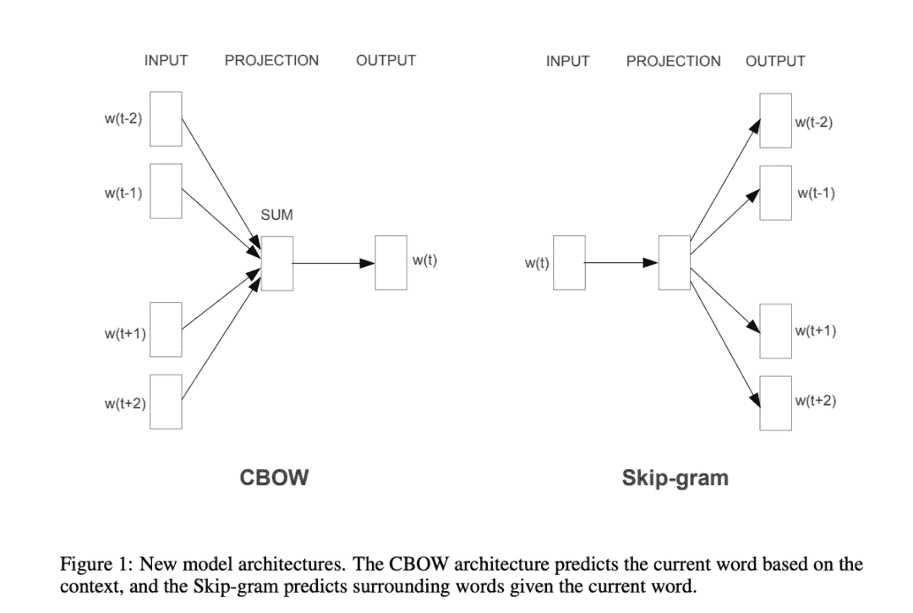

CBOW通过给定的上下文来预测目标单词。上下文是指目标单词周围的单词窗口，例如，在句子“The cat sits on the mat”中，若以“sits”为目标词，并选择周围各2个单词作为窗口，上下文就是[“The”, “cat”, “on”, “the”, “mat”]。

它以上下文中的单词为输入，合并它们的向量，然后使用这个综合向量来预测目标单词，并通过调整单词向量来减少预测目标单词时的误差。

Skip-Gram采取与CBOW相反的逻辑，它使用目标单词来预测周围的上下文单词，以“sits”为目标单词，其目标是预测[“The”, “cat”, “on”, “the”, “mat”]这样的上下文单词。

它针对每一个目标单词，使用它的向量来预测特定范围内的上下文单词向量，其目标是调整单词向量，以提高上下文单词预测的准确率。

从性能方面来说，CBOW运行更快，对常见词的准确性略优于Skip-Gram；而Skip-Gram虽然运行较慢，但对于不常见的词汇和小型数据集来说，表现更佳，因为它为每个单词提供了更多的训练样本。

从训练目标来说，CBOW通过平均上下文单词向量，模糊了一些分布信息，这对于表示高频词汇较为有利；而Skip-Gram将每一对上下文-目标视为独立的观察，因此它能够更好地捕捉各种关系，尤其是对于低频词汇。

代码实现：

from gensim.utils import simple_preprocess

from gensim.models import Word2Vec

from sklearn.manifold import TSNE

import matplotlib.pyplot as plt

def compute(documents):

# preprocessing the text by tokenization, stemming

processed_docs = [simple_preprocess(document) for document in documents]

# train using Word2Vec, sg=0 is CBoW model

model_cbow = Word2Vec(sentences=processed_docs, window=5, vector_size=100, workers=5, min_count=1, sg=0)

# train using Skip-Gram, sg=1 is Skip-Gram model

model_skip_gram = Word2Vec(sentences=processed_docs, window=5, vector_size=100, workers=5, min_count=1, sg=1)

# Get the vector for a word from the CBOW model

vector_cbow = model_cbow.wv['language']

# Get the vector for a word from the Skip-Gram model

vector_skipgram = model_skip_gram.wv['language']

return model_cbow, model_skip_gram

def visualize(model: Word2Vec):

# Retrieve word vectors and corresponding word labels from the model

word_vectors = model.wv.vectors

words = model.wv.index_to_key  # List of words in the model

# Use t-SNE to reduce word vectors to 2 dimensions for visualization,

# this is like dimensionality reduction, similar to PCA

tsne = TSNE(n_components=2, random_state=0)

word_vectors_2d = tsne.fit_transform(word_vectors)

# Plotting the 2D word vectors with annotations

plt.figure(figsize=(10, 10))

for i, word in enumerate(words):

plt.scatter(word_vectors_2d[i, 0], word_vectors_2d[i, 1])

plt.text(word_vectors_2d[i, 0] + 0.03, word_vectors_2d[i, 1] + 0.03, word, fontsize=9)

plt.show()

if __name__ == "__main__":

# Sample dataset: Expressing liking, love, and interest in NLP

sentences = [

"The brilliant data scientist loves exploring the depths of NLP techniques.",

"I find immense joy in unraveling the mysteries behind language models.",

"NLP enthusiasts are fascinated by the way algorithms understand human language.",

"There's a certain beauty in teaching machines to interpret the nuances of words.",

"Discovering new applications for text embeddings fills me with excitement.",

"The passion for semantic analysis drives researchers to innovate.",

"She adores the challenge of making computers comprehend linguistic subtleties.",

"Our team is dedicated to advancing the frontiers of NLP with each project.",

"The breakthrough in sentiment analysis has captured the interest of many.",

"Witnessing the evolution of NLP technologies sparks a profound sense of wonder."

]

cbow_model, skip_gram_model = compute(documents=sentences)

visualize(cbow_model

词嵌入可视化：

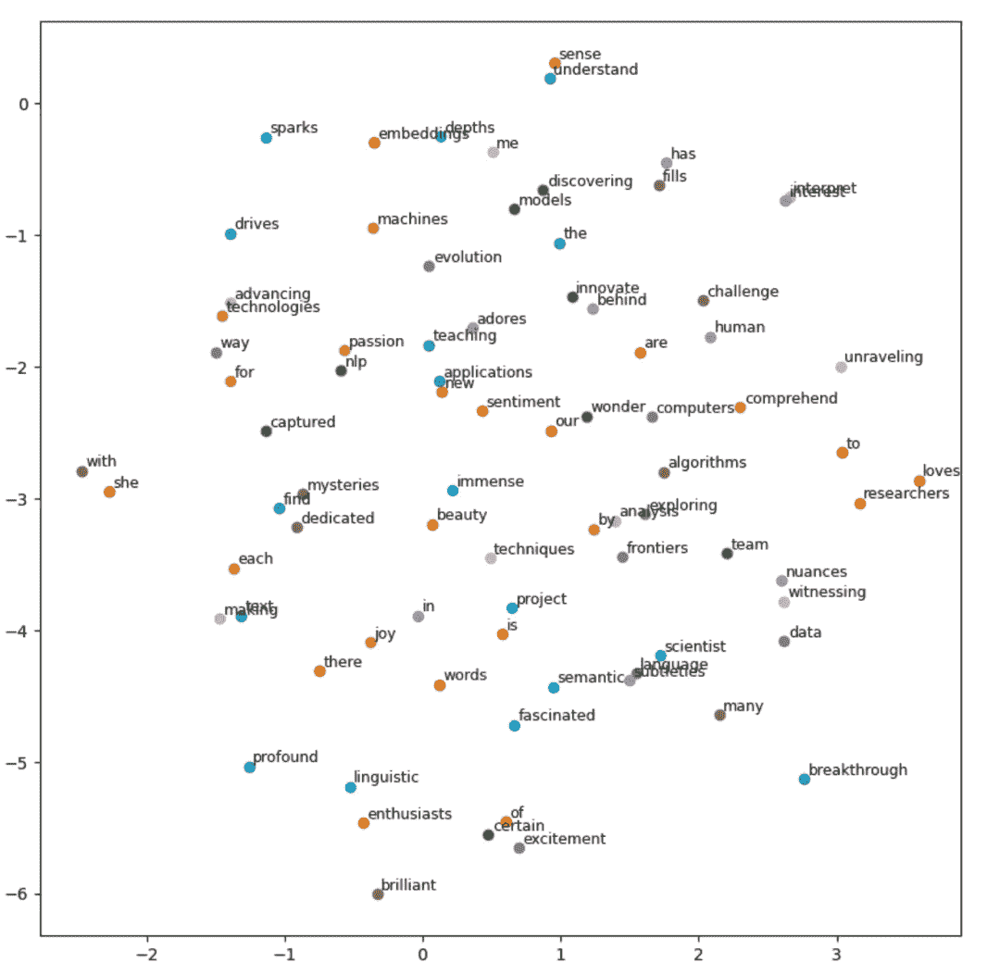

GloVe

GloVe（全局词向量表示）是斯坦福大学研究人员开发的一种 无监督学习模型 ，专门用于创建单词的向量表示；不同于传统模型那样仅仅基于单词共现次数，GloVe模型通过考虑这些次数的比率来揭示单词之间的语义联系，这一点使其能够同时捕捉语言的局部和全局统计特性。

GloVe的核心优势在于它能够通过分析词共现的概率来识别语义关系，采用一种混合方法结合了全局矩阵分解和局部上下文窗口技术，为词汇提供全面的表示。

此外，其可扩展性强，能够处理大规模语料库和庞大的词汇量，非常适合于分析网络级别的数据集。

代码实现：

```
from gensim.scripts.glove2word2vec import glove2word2vec
from gensim.models import KeyedVectors
# Path to the downloaded GloVe file (change as needed)
glove_input_file = &#x27;glove.6B.100d.txt&#x27;
# Output file in Word2Vec format
word2vec_output_file = &#x27;glove.6B.100d.word2vec.txt&#x27;
# Convert GloVe format to Word2Vec format
glove2word2vec(glove_input_file, word2vec_output_file)
# Load the converted model
model = KeyedVectors.load_word2vec_format(word2vec_output_file, binary=False)
# Example: Retrieve the vector for the word &#x27;computer&#x27;
word_vector = model[&#x27;language&#x27;]
print(word_vector)
# Perform similarity operations
print(model.most_similar(&#x27;language&#x27;))
```

OpenAI Transformer嵌入

OpenAI能够生成信息丰富的密集向量（Dense Vector），并成为现代语言模型的主流技术。

OpenAI允许你使用同一个“核心”模型，并根据不同的使用案例进行微调，无需重新训练核心模型（这会耗费大量时间和成本），这促成了预训练模型的兴起；这些模型属于GPT系列，包括GPT-3及其最新迭代， 这些都可以通过OpenAI的API获得 。

Google AI的BERT（Bidirectional Encoder Representations from Transformers）是首批流行模型之一，text-embedding-3-small和text-embedding-3-large是最新也是性能最强的嵌入模型，它们引入新的参数，允许用户控制模型的整体大小。

代码实现：

```
from openai import OpenAI
client = OpenAI()

def get_embedding(text, model=&quot;text-embedding-3-small&quot;):
   text = text.replace(&quot;\n&quot;, &quot; &quot;)
   return client.embeddings.create(input = [text], model=model)\
       .data[0].embedding

get_embedding(&quot;We are lucky to live in an age in which we are still making discoveries.&quot;)
```

# 03

词嵌入相似度计算方法

词嵌入本质上是向量，因此，如果我们想了解两个单词或句子在语义上的接近程度，我们可以计算向量之间的距离，距离越小，语义意义上越接近。

有几种不同的度量方法可以用来衡量两个向量之间的距离：

+   欧几里得距离（L2）

+   曼哈顿距离（L1）

+   点积

+   余弦距离

下面我们将讨论这些方法，作为一个简单的例子，我们将使用两个二维向量A=(1,4)和B=(2,2)。

欧几里得距离（L2）

定义两点（或向量）之间距离的最标准方法是欧几里得距离，也称为L2范数，它是我们日常生活中最常用的度量方法，例如，当我们谈论两个城镇之间的距离时。

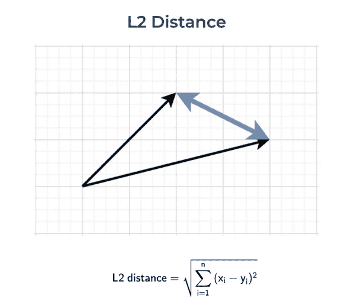

代码实现：

```
import numpy as np
sum(list(map(lambda x, y: (x - y) ** 2, vector1, vector2))) ** 0.5
# 2.2361
np.linalg.norm((np.array(vector1) - np.array(vector2)), ord = 2)
# 2.2361
```

曼哈顿距离（L1）

曼哈顿距离,也称为L1范数。这个名称来源于纽约的曼哈顿，因为这个岛有一个街道网格布局，而在曼哈顿两点之间的最短路线将是L1距离，因为你需要遵循街道网格。

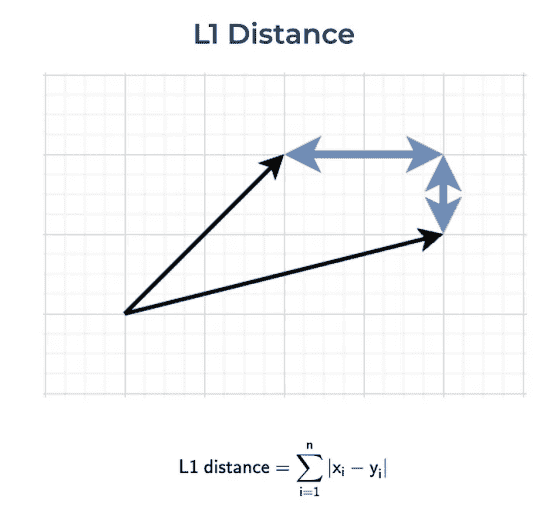

代码实现：

```
sum(list(map(lambda x, y: abs(x - y), vector1, vector2)))
# 3
np.linalg.norm((np.array(vector1) - np.array(vector2)), ord = 1)
# 3.0
```

点积

点积或标量积，它的公式如下。


这个度量有点难以解释，一方面，它表明了向量是否指向同一方向；另一方面，结果很大程度上依赖于向量的大小；

例如，让我们计算两对向量之间的点积：

+   对于向量A=(1,1)和B=(1,1)，它们的点积计算结果是1∗1+1∗1=2。

+   当我们考虑另一对向量C=(1,1)和D=(10,10)时，点积为1∗10+1∗10=20。

尽管这两对向量在方向上保持一致，但由于它们的大小存在差异，导致它们的点积有很大的不同。这就解释了为什么在进行向量比较时，点积并非总是最合适的选择。

代码实现：

```
sum(list(map(lambda x, y: x*y, vector1, vector2)))
# 11
np.dot(vector1, vector2)
# 11
```

余弦距离

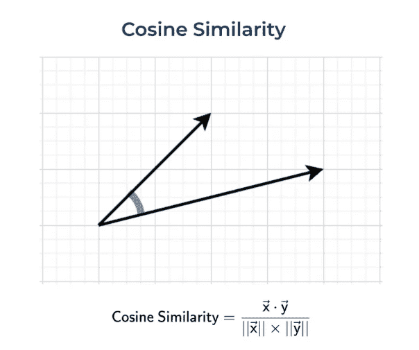

余弦距离，不同于点积，它衡量的是两个向量之间的角度差异，而非它们的长度，这使得它特别适用于比较文档或句子的相似性，因为它不会受到文档长度的影响。

余弦相似度的值范围是从-1到1，值越接近1，表示两个向量的方向越相似；值为0，则表示它们是正交的；而值为-1，则表示它们方向完全相反。

通过计算向量之间的余弦相似度，我们可以更精确地评估它们在语义上的相似度，而不仅仅是比较它们的数值大小或直线距离。

代码实现：

```
dot_product = sum(list(map(lambda x, y: x*y, vector1, vector2)))
norm_vector1 = sum(list(map(lambda x: x ** 2, vector1))) ** 0.5
norm_vector2 = sum(list(map(lambda x: x ** 2, vector2))) ** 0.5

dot_product/norm_vector1/norm_vector2
# 0.8575

from sklearn.metrics.pairwise import cosine_similarity

cosine_similarity(
  np.array(vector1).reshape(1, -1), 
  np.array(vector2).reshape(1, -1))[0][0]
# 0.8575
```

# 04

总结

总的来说，从基本的频率统计演变到深度学习的上下文表征，无论是TF-IDF的统计见解，Word2Vec和GloVe捕捉的语义深度，还是OpenAI提供的先进的、有上下文感知的词嵌入技术，都逐步提升了语义分析工具，为自然语言处理开辟了新道路。

这一系列进展不仅凸显了词嵌入技术在文本理解中的重要性，也彰显了自然语言处理技术不断的创新，为我们处理更加复杂和精细的语言应用提供了可能，如聚类、分类、异常检测和检索式生成网络（RAG）等。

点击关注👸号👇

感谢您阅读完

推荐阅读：

+   [ChatGPT背后强大而神秘的力量：用最简单的语](http://mp.weixin.qq.com/s?__biz=MzU3OTgyMjM3MA==&mid=2247484435&idx=1&sn=eeb8d952a4695211be575d7ef92d4166&chksm=fd61725eca16fb48b25ab8be527c4986d581f5f29e41989408362145c93ee1068264f78fbaef&scene=21#wechat_redirect)言讲解Transformer架构之概览

+   [要真正入门AI，OpenAI的官方Prompt工程指南](http://mp.weixin.qq.com/s?__biz=MzU3OTgyMjM3MA==&mid=2247484249&idx=1&sn=7238ba9f25af92b399dd5e347fc88592&chksm=fd617514ca16fc025579e6f48b6e87a1fd2368fbd4e725ac835c76d42f490c06c2a6d23a6e82&scene=21#wechat_redirect)肯定还不够，您必须了解的强大方法论和框架

+   [第二篇：要真正入门AI，OpenAI的官方Prompt工程指南](http://mp.weixin.qq.com/s?__biz=MzU3OTgyMjM3MA==&mid=2247484303&idx=1&sn=24ff092b3defd643d568b531a08ca47d&chksm=fd6175c2ca16fcd4353391182c9ecb188dbdd24c7fa7ed7e52827772db138471033ef200f08d&scene=21#wechat_redirect)肯定还不够，您必须了解的强大方法论和框架

+   [第三篇：要真正入门AI，OpenAI的官方Prompt工程指南](http://mp.weixin.qq.com/s?__biz=MzU3OTgyMjM3MA==&mid=2247484353&idx=1&sn=452b5e450b9eba799ba9b024099a2e87&chksm=fd61758cca16fc9aab3f99af1ce9662f1e029799f90e9f5fc30feff2a038bbca9a9c5298c47b&scene=21#wechat_redirect)肯定还不够，您必须了解的强大方法论和框架

+   机器学习的平衡艺术：如何驾驭偏差与方差

+   机器学习的平衡艺术：如何驾驭偏差与方差(Part 2)

+   [4元奇迹：我如何利用MetaGPT与GPT-4技](http://mp.weixin.qq.com/s?__biz=MzU3OTgyMjM3MA==&mid=2247484152&idx=1&sn=17cd37bf879a2e447bd7dafe96fa78e6&chksm=fd6174b5ca16fda3f1a3ec8ca5826797aa72660fe97852506f61044d9972f622b05c42e79c83&scene=21#wechat_redirect)术开创软件公司，并轻松交付首个惊艳项目

👸号回复口令，领取资料，一起学习吧！🏃

“ 1 ”：领取开源书籍《动手实战人工智能》

” 2 “：领取 50G+的免费AI视频课程

“ 3 ”：领取ChatGPT4访问码

“ 2024 ”：领取吴恩达的书《Machine Learning Yearning》

点击文末“阅读原文”，访问ChatGPT4，输入上面领取的访问码免费体验。

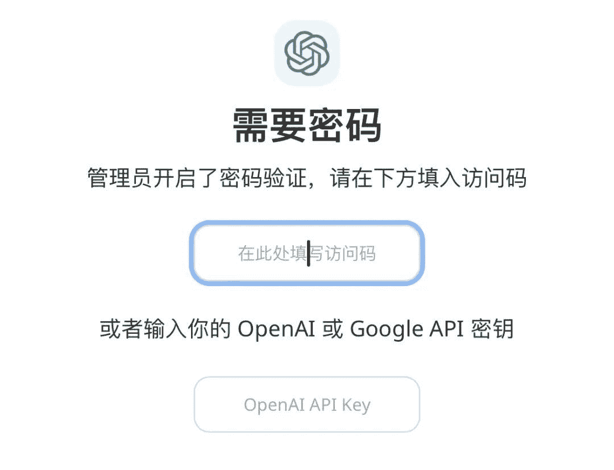


觉得内容还不错的话，“分享”一下，点个“在看”呗

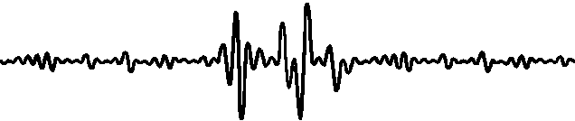

