# Transformer架构的三种注意力机制

> 来源：[https://geekbang.feishu.cn/docx/N6mOdczLIo5g9MxNKB3cccdhnFc](https://geekbang.feishu.cn/docx/N6mOdczLIo5g9MxNKB3cccdhnFc)

> 👨🏻 作者：加里

> 📃 作者介绍：目前就职于金融银行AI部门，资深解决方案架构师。

> 🛖 👸号：AIWithGary

> ⏰ 收录时间：2024-05-27 11:20:58 (UTC+8)

> 🔗 原文链接：h[ttps://mp.weixin.q](https://mp.weixin.qq.com/s?__biz=MzU3OTgyMjM3MA==&mid=2247484768&idx=1&sn=f8b459221381b5b4842f9824fb1ed86e&chksm=fd61732dca16fa3bb6c753699bc6cf07682b969e6da98c14ec2a55eb27dffd4554f8e783e1f5#rd)q.com/s?__biz=Mz...

关注作者，获取更多AI知识

本系列文章致力于用最简单的语言讲解Transformer架构，帮助朋友们理解它的强大力量，本文是第四篇： 注意力机制 ， 它是Transformer的核心组件。

大家对注意力机制多少都有所耳闻，毕竟在自然语言处理（NLP）和大型语言模型（LLM）领域，2017年，《Attention Is All You Need》这篇论文是里程碑式的存在；几乎所有的LLM都是基于注意力机制构建的，甚至最新的多模态或基于视觉的模型也在某种程度上都运用了它；今天，我们将深入探讨注意力机制。

目录

1. 什么是注意力

2. Transformer的注意力层

2.1 注意力机制基础

2.2 理解Q，K，V

2.3 交叉注意力层

2.4 全局自注意力层

2.5 因果注意力层

3. 位置编码

4. 多头注意力机制

5. 总结

# 01

什么是注意力

当人类的视觉机制察觉到一个物体时，通常不会从头到尾地扫视整个场景；一般会根据个人的需求集中关注特定的部分。

比如下面这张图，我们第一眼应该是看到一只动物，然后，眼睛会先注意到动物的脸，然后得出初步结论，这应该是一只狼；就像右边注意力图所示，颜色更深的部分表示一般是我们人类最先看见（注意）的。

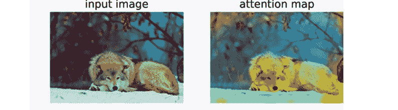

注意力最早应用在机器视觉领域（CV，Computer Vision），后来才应用到NLP和LLM领域。

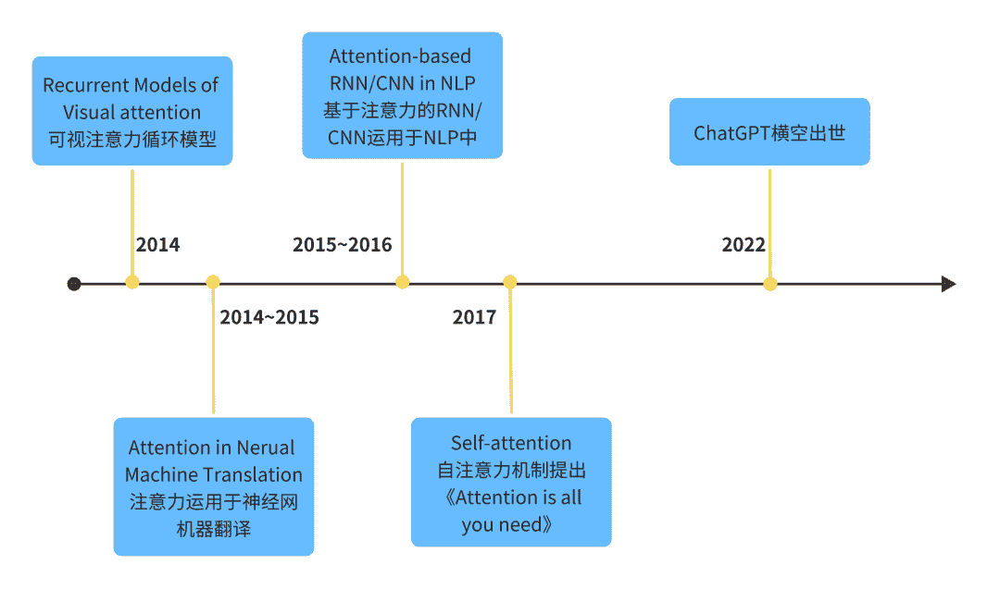

多头（2头）自注意力可视化：

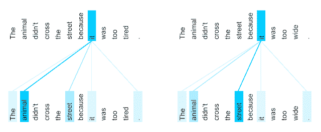

如下动画所示，注意力在Transformer中，被应用于机器翻译：

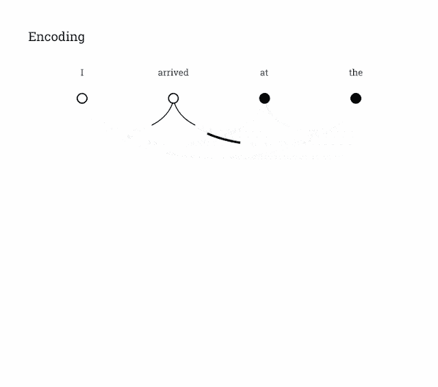

# 02

Transformer的注意力层

在Transformer架构中，有两大的组件,分别是编码器（Encoder）和解码器（Decoder）， 编码器主要是将 输入序列 映射到潜在语义空间（ 注意力 向量，也叫上下文向量，但其实上下文向量是注意力机制内部对输入向量的叫法，本文中编码器输出向量都只叫作注意力向量，以示区分 ），而解码器则是将潜在语义空间（ 注意力 向量 ）映射到 输出序列。

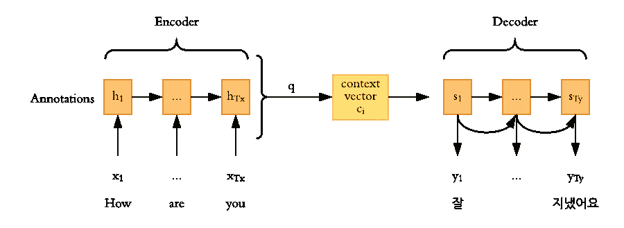

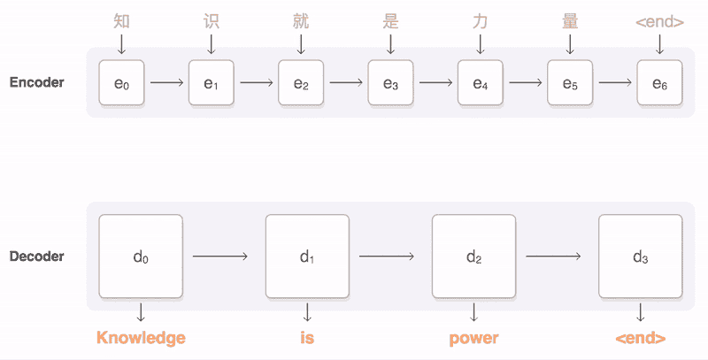

在Transformer架构中，有3种不同的注意力层：

+   解码器中的交叉注意力层 （Cross attention layer）

+   编码器中的全局自注意力层 （Global self attention layer）

+   解码器中的因果自注意力层 （Causal attention layer）

如下图所示：

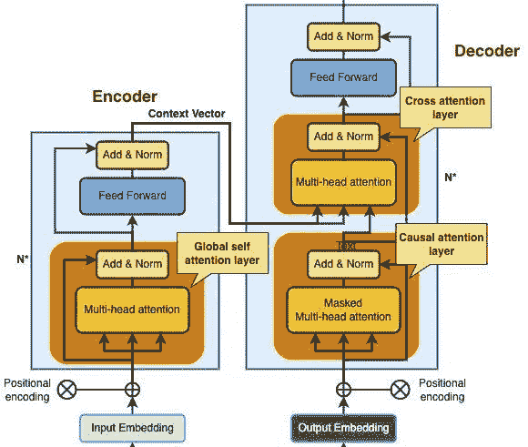

注意力机制基础

注意力机制的数学表示如下：

表达式中，Q，K和V分别指的是查询（Query），键（Key）以及值（Value）矩阵；这三种矩阵中，每一行都对应了输入文本中的一个分词，每一列则对应了这个分词的某一个特性（Feature）或者维度；简单来说，查询矩阵里的数据代表了我们关注的词，键矩阵里的数据用来帮我们计算这些词之间的相似度（ 即注意力分数：attention score，向量点乘可以计算相似度 ），而值矩阵里的数据则用来根据这些相似度计算出最终的输出结果；为了确保计算过程中的数据不会因为维度（即键的大小）太大而爆炸，或者太小而消失，注意力分数会通过键的维度的平方根来进行调整；接着，通过softmax函数把这些分数转化成权重，最后这些权重会和值矩阵相乘，得到最后的输出（ 注意力向量 ）。

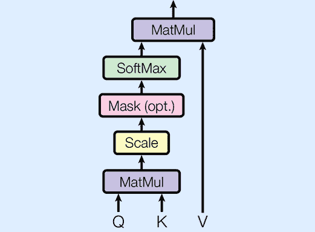

注意力分数可视化为热力图后，能清晰地显示出，在序列中哪些单词，对于预测每个输出单词更重要。（下图是在机器翻译中的例子，纵轴是英语原文，横轴是对应的葡萄牙语翻译）

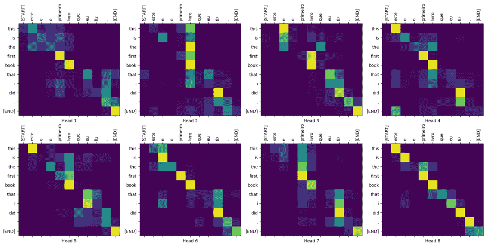

以下是计算 自注意力机制 输出注意力向量的过程。（不包括Scale和SoftMax）

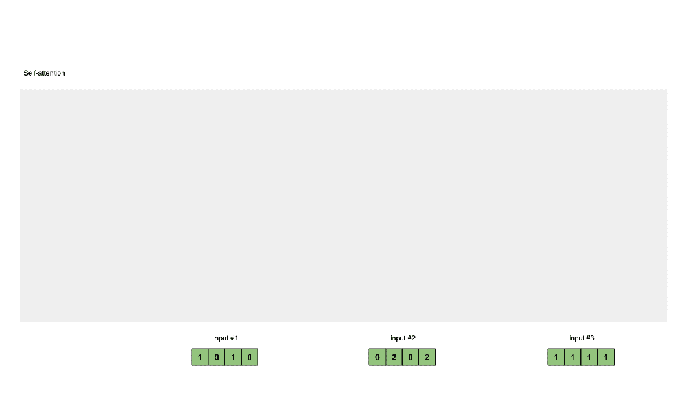

理解Q，K，V

注意力机制中有两个输入：

+   查询序列 （Q）：正在处理的序列（在底部）。

+   上下文序列 （K，V）：被关注的序列（在左侧）。

输出序列的维度与查询序列相同。

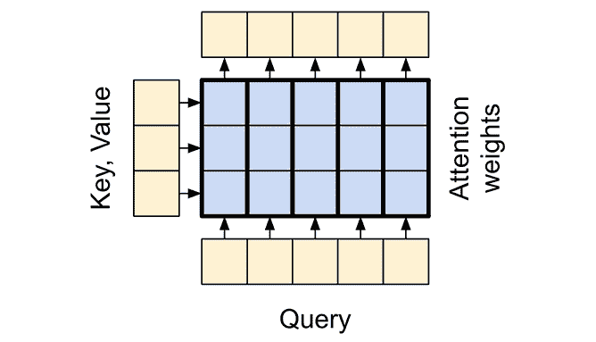

这个操作常常被比作字典查找，但是，是一个模糊的，可微分的，向量化的字典查找。

举个例子，假设有一个普通的Python字典，有 3 个键和 3 个值，被传递了一个单独的查询：

d = {'color': 'blue', 'age': 22, 'type': 'pickup'}

result = d['color']

这里，查询（Q）是你要找的内容，键（K）表示字典里有什么样的信息，而值（V）则是对应的信息；在普通的字典查找中，字典会找到匹配的键，并返回其对应的值；如果查询找不到完全匹配的键，也许你会期望返回最接近的值，比如在上面的例子中，如果你查找 `d["species"]`，你可能会期望返回 "pickup"，因为它是最接近查询的匹配。

一个注意力层就像是这样的一个模糊查找，但它不仅仅是寻找最佳键；它结合了查询（Q）和键（K）向量，来确定它们匹配的程度，也就是“注意力分数”。然后，根据“注意力分数”对所有值进行加权平均；在注意力层中，每个位置的查询（Q）序列都提供一个查询向量，而上下文序列则充当了一个字典，每个位置提供一个键和值向量；在使用这些向量之前，注意力层会用一个全连接层对输入向量进行投影。

交叉注意力层

在 Transformer 中，交叉注意力层位于字面上的中心位置；它连接了编码器和解码器，是在模型中使用注意力最直接的方式。

要实现这一点，需要将 目标序列 作为查询，将 上下文序列 作为键/值传递。

Q = 解码器中因果注意力层的输出向量

K = 编码器输出的注意力向量

V = 编码器输出的注意力向量

如下所示，每一列代表了对上下文序列的加权求和。

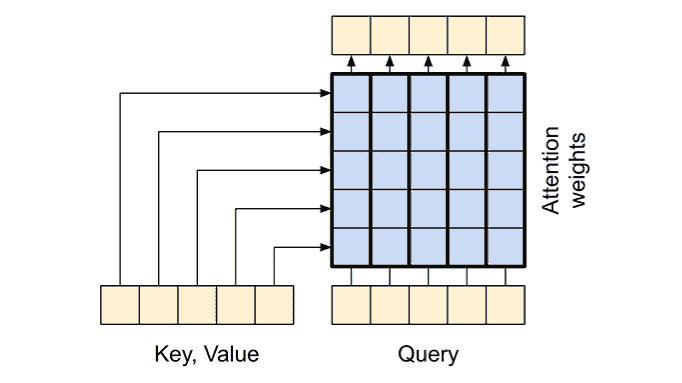

为了简化起见，没有显示残差连接。

全局自注意力层

全局自注意力层是Transformer编码器的一部分，它的作用是负责处理整个输入序列。

它允许每个序列元素直接访问其他所有序列元素，只需将整个输入序列作为 Q，K，V即可，所有输出可以并行计算。

Q = 输入序列中的当前位置词向量

K = 输入序列中的所有位置词向量

V = 输入序列中的所有位置词向量

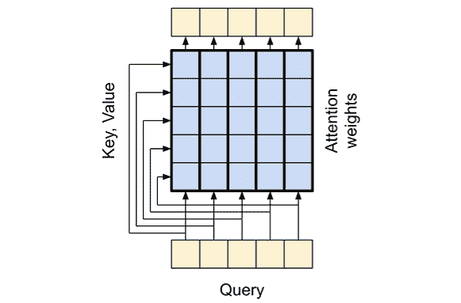

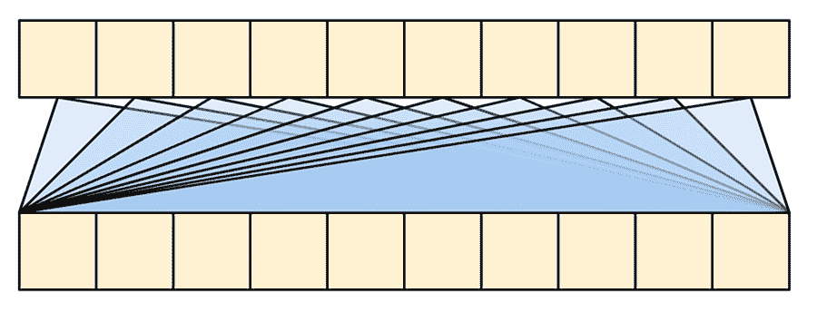

因果注意力层

因果注意力层对解码器中 输出序列 执行类似于全局自注意力层的工作；但 与编码器的全局自注意力层有不同的处理方式。

Transformer 是一个“ 自回归 ”模型，它 逐个标记地生成文本，并将输出反馈到输入中；为了使这个过程高效，这些模型确保每个序列元素的输出只依赖于前面的序列元素；这些模型是“因果”的。

要构建一个因果自注意力层，在计算注意力分数和求和注意力值时需要使用适当的掩码，因为输出序列也是一次性输入的，但在计算前面分词的时候是不希望它后面的分词也参与计算的。

Q = 输出序列中的当前位置词向量

K = 输出序列中的所有位置词向量

V = 输出序列中的所有位置词向量

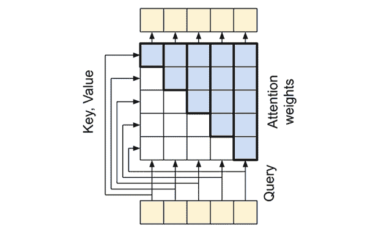

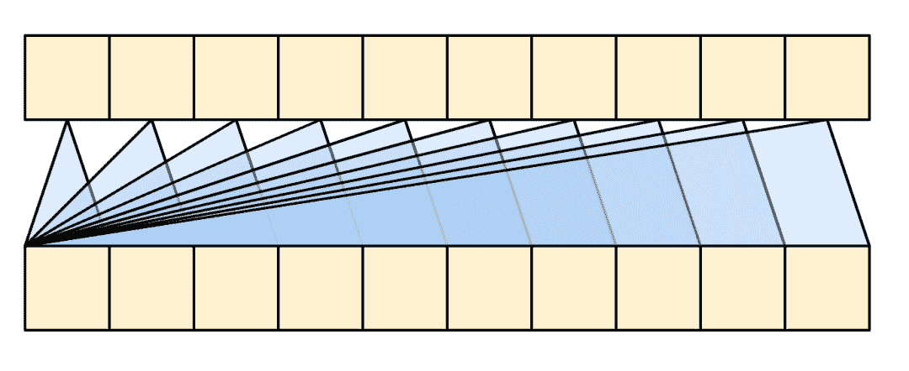

# 03

位置编码

与RNN，LSTM等按顺序逐个接收输入分词，计算天然就带有位置信息不同，Transformer是一次性处理所有输入分词，虽然这使得 Transformer更快，但是会丢失与分词顺序相关的信息；然而，位置信息对于大多数信息处理是至关重要的，比如，“我爱你”和“你爱我”是完全不一样的语义；为了解决这个问题，需要把位置编码加入输入序列，使得最终的注意力向量是包含位置信息的。

位置编码可以通过多种方式实现，包括使用学习分词（在Bert中使用），正弦函数或相对位置；我们将重点介绍正弦定位编码，这也是Vaswani等人在原始论文中采用的方法。

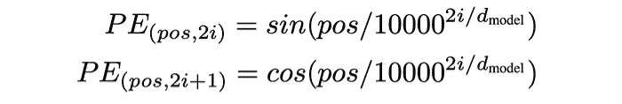

正弦定位编码是一个将Token的位置映射到大小为d的向量的函数，其中d是输入和输出向量的维度。

其中pos表示token所在的位置，而i代表向量的维数；正弦位置编码对每一个维度使用不同频率，这样就为每一个位置创造了一个既独特又有规律的模式；与学习得到的嵌入方式相比，正弦位置编码有几个明显的优点：它是固定的、可以泛化到未见过的数据、以及易于扩展。

位置编码应与输入序列应有相同的维度，以便两个向量可以相加（本质上是将位置信息注入到输入嵌入表示中）

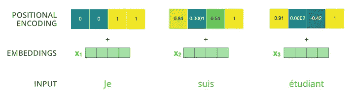

# 04

多头注意力机制

多头注意力机制是在注意力机制基础上的一个创新，它让模型能同时关注输入和输出序列的多个不同特征或维度；简单来说，它通过把查询（Q），键（K），值（V）这三个矩阵分成好几个小块，每一块称为一个“头”；每个“头”都会独立进行自注意力运算，然后把所有“头”的结果拼接在一起，再进行一次特定的变换，得到最终的输出。

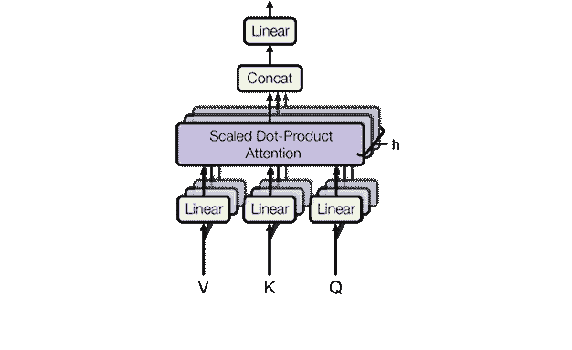

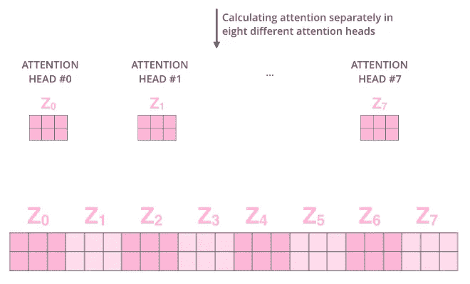

数学表示如下：

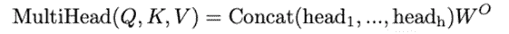

与传统的单头自注意力相比，多头注意力有几大优点；比如，它能辨识出分词之间的各种关系，无论是主谓、动宾还是名形关系；同时，多头注意力还能提升模型的能力和表现力，因为模型能从序列的多种表现形式中同时学习；此外，多头注意力还能让模型在运算时更高效、更便于并行处理，因为它将每个头的维度降低了，从而可以同时处理多个头。

另外，Transformer还可以叠加多个层，进一步提升模型的能力和表现力。

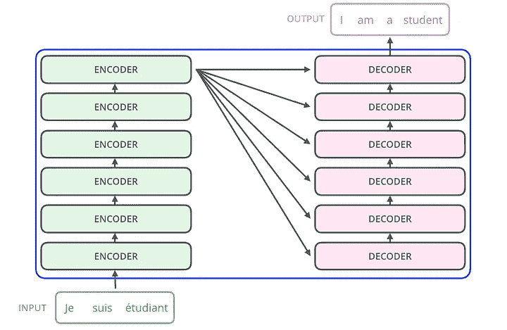

# 05

总结

我们介绍了Transformer中的三种不同的注意力层，以及注意力的实现方法，位置编码和多头注意力机制，涵盖了大部分注意力相关的知识点，希望朋友们对它有了近一步的了解。

Transformer利用注意力机制做出了更好的预测，从ChatGPT的成功，已经得到了验证；尽管循环神经网络RNN也试图实现类似的功能，但由于它们受到短期记忆的限制，因此在处理长序列时，特别是在编码或生成长序列时，Transformer更为出色；由于Transformer架构，自然语言处理（NLP）行业取得了前所未有的成果。

点击关注👸号👇

感谢您阅读完

推荐阅读：

+   [ChatGPT背后强大而神秘的力量：用最简单的语](http://mp.weixin.qq.com/s?__biz=MzU3OTgyMjM3MA==&mid=2247484435&idx=1&sn=eeb8d952a4695211be575d7ef92d4166&chksm=fd61725eca16fb48b25ab8be527c4986d581f5f29e41989408362145c93ee1068264f78fbaef&scene=21#wechat_redirect)言讲解Transformer架构之概览

+   [ChatGPT背后强大而神秘的力量：用最简单的语言讲解Tra](http://mp.weixin.qq.com/s?__biz=MzU3OTgyMjM3MA==&mid=2247484599&idx=1&sn=7a7707295fb751aef0693c32d2d56137&chksm=fd6172faca16fbec2c226137bd31d0b64ac8c6b3a7c266c2890ef03cf88d501437d41f6376bb&scene=21#wechat_redirect)nsformer架构之Embedding

+   [ChatGPT背后强大而神秘的力量，用最简单的语言讲解Tra](http://mp.weixin.qq.com/s?__biz=MzU3OTgyMjM3MA==&mid=2247484650&idx=1&sn=4025bc4d1a14ea345589a26a335ce41f&chksm=fd6172a7ca16fbb1b8f0458f78a8e49eba145a84aeccefc33e0b288e5ca9647fdd6ba018fe71&scene=21#wechat_redirect)nsformer架构之Tokenizer

+   [要真正入门AI，OpenAI的官方Prompt工程指南肯定还](http://mp.weixin.qq.com/s?__biz=MzU3OTgyMjM3MA==&mid=2247484249&idx=1&sn=7238ba9f25af92b399dd5e347fc88592&chksm=fd617514ca16fc025579e6f48b6e87a1fd2368fbd4e725ac835c76d42f490c06c2a6d23a6e82&scene=21#wechat_redirect)不够，您必须了解的强大方法论和框架！！！

+   [第](http://mp.weixin.qq.com/s?__biz=MzU3OTgyMjM3MA==&mid=2247484303&idx=1&sn=24ff092b3defd643d568b531a08ca47d&chksm=fd6175c2ca16fcd4353391182c9ecb188dbdd24c7fa7ed7e52827772db138471033ef200f08d&scene=21#wechat_redirect)二篇：要真正入门AI，OpenAI的官方Prompt工程指南肯定还不够，您必须了解的强大方法论和框架！！！

+   [第](http://mp.weixin.qq.com/s?__biz=MzU3OTgyMjM3MA==&mid=2247484353&idx=1&sn=452b5e450b9eba799ba9b024099a2e87&chksm=fd61758cca16fc9aab3f99af1ce9662f1e029799f90e9f5fc30feff2a038bbca9a9c5298c47b&scene=21#wechat_redirect)三篇：要真正入门AI，OpenAI的官方Prompt工程指南肯定还不够，您必须了解的强大方法论和框架！！！

+   机器学习的平衡艺术：如何驾驭偏差与方差

+   机器学习的平衡艺术：如何驾驭偏差与方差(Part 2)

+   [4元奇迹：我如何利用MetaGPT与GPT-4技](http://mp.weixin.qq.com/s?__biz=MzU3OTgyMjM3MA==&mid=2247484152&idx=1&sn=17cd37bf879a2e447bd7dafe96fa78e6&chksm=fd6174b5ca16fda3f1a3ec8ca5826797aa72660fe97852506f61044d9972f622b05c42e79c83&scene=21#wechat_redirect)术开创软件公司，并轻松交付首个惊艳项目

👸号回复口令，领取资料，一起学习吧！🏃

“ 1 ”：领取开源书籍《动手实战人工智能》

” 2 “：领取 50G+的免费AI视频课程

“ 3 ”：领取ChatGPT4访问码

“ 2024 ”：领取吴恩达的书《Machine Learning Yearning》

扫码加入学习群：

觉得内容还不错的话，“分享”一下，点个“在看”呗

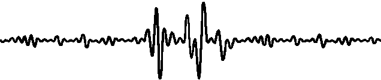

