# Transformer的输入（附代码）

> 来源：https://geekbang.feishu.cn/docx/VBnvdNkFuoK913x0leQcR3bQn0g  
> 👨🏻 作者：加里  
> 📃 作者介绍：目前就职于金融银行AI部门，资深解决方案架构师。  
> 🛖 👸号：AIWithGary  
> ⏰ 收录时间：2024-05-27 11:20:58 (UTC+8)  
> 🔗 原文链接：<https://mp.weixin.qq.com/s?__biz=MzU3OTgyMjM3MA==&mid=2247484802&idx=1&sn=eec0fd1e743f29e12765f35529c1f3de&chksm=fd6173cfca16fad9167681207636cbc55aa5619f49de8f6962c6f85c336461d4e5900b945b87#rd>


关注作者，获取更多AI知识

本系列文章致力于用最简单的语言讲解Transformer架构，帮助朋友们理解它的强大，本文是 第五篇 ： Transformer输入详解 。

接下来，我们将逐层剖析Transformer如何接收并处理输入数据，从定义数据集到计算位置编码，每一步都至关重要；通过本文，朋友们将深刻理解Transformer输入处理流程，并学会如何准备数据以供模型学习；我们将使用一个简化的数据集来直观展示数值计算过程，帮助朋友们更好地理解这一复杂但强大的架构。

## 目录

1. 定义数据集（语料库）  
2. 定义词汇表  
3. 分词编码（Tokenization）  
3.1 代码实现  
4. 计算分词嵌入（Embedding）  
4.1 代码实现  
5. 计算位置编码（Positional Encoding）  
6. 连接位置编码和分词嵌入  
6.1 代码实现  
7. 总结  

## 01 定义数据集

ChatGPT创建时使用的数据集大小大概是570GB的资料，为了能简单直观地讲解，今天我们将使用一个非常小的数据集来进行数值计算的可视化。


## 02 定义词汇表

词汇量指的是数据集中唯一分词（`Token`）的总数，它可以使用以下公式计算，其中`N`表示数据集中的`Token`总数。

本文之后都把这里的唯一分词表述为`Token`。


为了能找到`N`，我们需要将数据集拆分为`Token`，也就是我们本系列文章 第三篇Tokenization 。

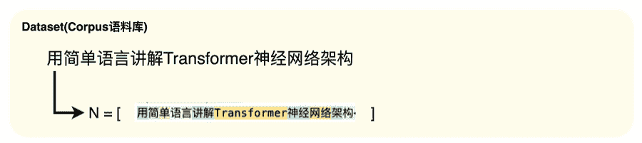

在获取到`N`后，我们进行一个集合操作来去除重复的单词，然后就可以统计唯一`Token`的数量，确定词汇量的大小。

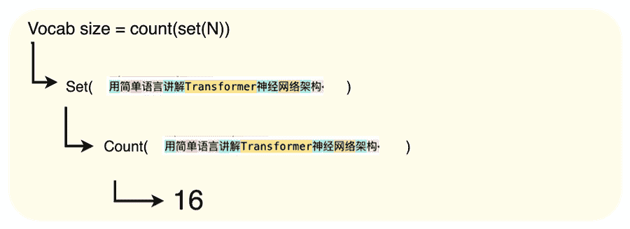

因此，词汇量大小为16，即数据集中有16个唯一`Token`。

## 03 分词编码

现在，我们需要为每个唯一的`Token`分配一个唯一的数字。

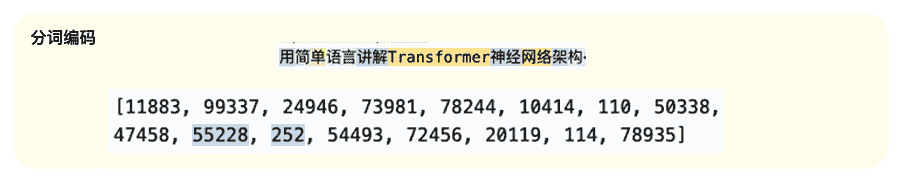

简单来说，我们将一个`Token`视为一个单词，并为其分配一个数字，而ChatGPT不一定是一个单词一个`Token`，有可能单词的一部分视为一个`Token`，比如，本文数据集中的讲，神，架三个字都是被分成了2个`Token`；在ChatGPT中，平均大概1`Token` = 0.75个单词。

### 代码实现

```python
import tiktoken

def num_tokens_from_string(string: str, encoding_name: str) -> int:
    """Returns the number of tokens in a text string."""
    encoding = tiktoken.get_encoding(encoding_name)
    num_tokens = len(encoding.encode(string))
    return num_tokens

input_str = "用简单语言讲解Transformer神经网络架构"
print(f"input_str: {input_str}")
# input_str: 用简单语言讲解Transformer神经网络架构

encoding = tiktoken.encoding_for_model("gpt-3.5-turbo")
tokens = encoding.encode(input_str)
print(f"tokens: {tokens}")
# tokens: [11883, 99337, 24946, 73981, 78244, 10414, 110, 50338, 47458, 55228, 252, 54493, 72456, 20119, 114, 78935]

num_tokens = num_tokens_from_string("用简单语言讲解Transformer神经网络架构", "cl100k_base")
print(f"num_tokens: {num_tokens}")
# num_tokens: 16

decode_input_str = encoding.decode(tokens)
print(f"decode_input_str: {decode_input_str}")
# decode_input_str: 用简单语言讲解Transformer神经网络架构

bytes_list = [encoding.decode_single_token_bytes(token) for token in tokens]
print(f"bytes_list: {bytes_list}")
# bytes_list: [b'\xe7\x94\xa8',
# b'\xe7\xae\x80',
# b'\xe5\x8d\x95',
# b'\xe8\xaf\xad',
# b'\xe8\xa8\x80',
# b'\xe8\xae\xb2', 讲
# b'\xe8\xa7\xa3',
# b'Transformer',
# b'\xe7\xa5\x9e', 神
# b'\xe7\xbb\x8f',
# b'\xe7\xbd\x91\xe7\xbb\x9c',
# b'\xe6\x9e\xb6', 架
# b'\xe6\x9e\x84']

pre_bytes = b''
for i, bytes in enumerate(bytes_list):
    # Attempt to decode the current bytes
    string = (pre_bytes + bytes).decode("utf-8", "ignore")
    print(f"bytes_list{i}: {(pre_bytes + bytes)} -> {string}")
    if string:
        # If successful, print the result and reset pre_bytes
        pre_bytes = b''
    else:
        # If not successful, append the current bytes to pre_bytes for the next iteration
        pre_bytes += bytes
# bytes_list0: b'\xe7\x94\xa8' -> 用
# bytes_list1: b'\xe7\xae\x80' -> 简
# bytes_list2: b'\xe5\x8d\x95' -> 单
# bytes_list3: b'\xe8\xaf\xad' -> 语
# bytes_list4: b'\xe8\xa8\x80' -> 言
# bytes_list5: b'\xe8\xae\xb2' ->
# bytes_list6: b'\xe8\xae\xb2' -> 讲
# bytes_list7: b'\xe8\xa7\xa3' -> 解
# bytes_list8: b'Transformer' -> Transformer
# bytes_list9: b'\xe7\xa5\x9e' ->
# bytes_list10: b'\xe7\xa5\x9e' -> 神
# bytes_list11: b'\xe7\xbb\x8f' -> 经
# bytes_list12: b'\xe7\xbd\x91\xe7\xbb\x9c' -> 网络
# bytes_list13: b'\xe6\x9e\xb6' ->
# bytes_list14: b'\xe6\x9e\xb6' -> 架
# bytes_list15: b'\xe6\x9e\x84' -> 构
```

## 04 计算分词嵌入

在[对整个数据集进行编码后，现](http://mp.weixin.qq.com/s?__biz=MzU3OTgyMjM3MA==&mid=2247484599&idx=1&sn=7a7707295fb751aef0693c32d2d56137&chksm=fd6172faca16fbec2c226137bd31d0b64ac8c6b3a7c266c2890ef03cf88d501437d41f6376bb&scene=21#wechat_redirect)在是选择输入并开始使用Transformer架构进行分词处理的时候了，也就是我们本系列文章 第二篇Embedding 。

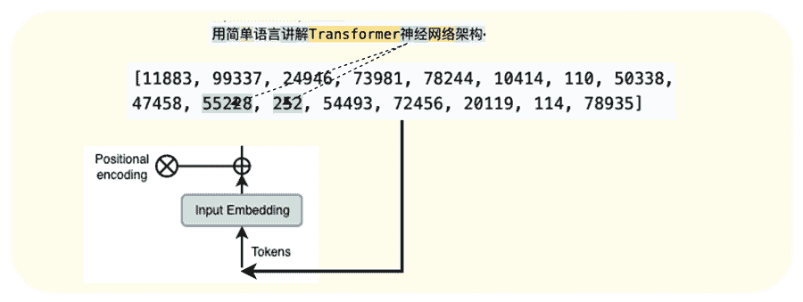

我们已经选择了输入，并且需要为其找到一个嵌入向量；原始论文中将每个输入`Token`用一个512维的嵌入向量表示。

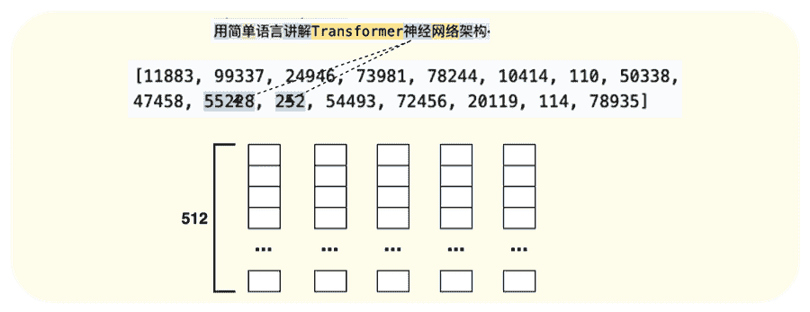

由于我们需要用较小的维度来可视化计算的过程，所以我们将使用一个维度为6的嵌入向量。

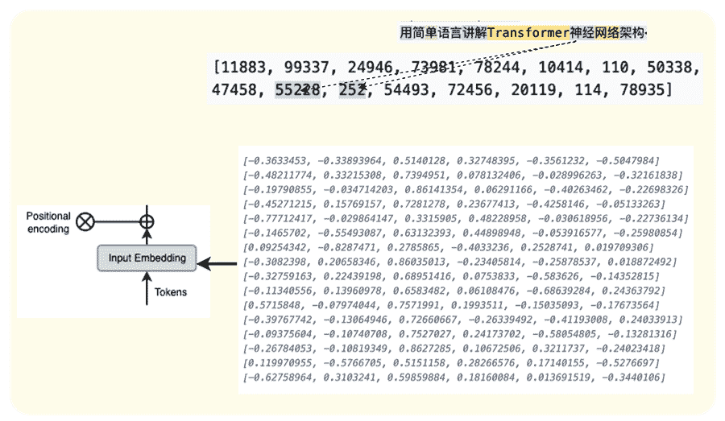

这些嵌入向量的值在0到1之间，并在开始时以随机方式填充；随着我们的Transformer开始理解`Token`之间的含义，这些值将会被更新。

### 代码实现

```python
from openai import OpenAI

client = OpenAI()

# tokens of "用简单语言讲解Transformer神经网络架构"
tokens = [11883, 99337, 24946, 73981, 78244, 10414, 110, 50338, 47458, 55228, 252, 54493, 72456, 20119, 114, 78935]
tokens_as_strings = [str(token) for token in tokens]
response = client.embeddings.create(
    model="text-embedding-3-small", input=tokens_as_strings, encoding_format="float", dimensions=6)

print(f"length of tokens: {len(response.data)}")
# length of tokens: 16

for i in range(len(response.data)):
    embedding_dim = response.data[i].embedding
    print(f"embedding_dim[{i:02}]: {embedding_dim}")
# embedding_dim[00]: [-0.3633453, -0.33893964, 0.5140128, 0.32748395, -0.3561232, -0.5047984]
# embedding_dim[01]: [-0.48211774, 0.33215308, 0.7394951, 0.078132406, -0.028996263, -0.32161838]
# embedding_dim[02]: [-0.19790855, -0.034714203, 0.86141354, 0.06291166, -0.40263462, -0.22698326]
# embedding_dim[03]: [-0.45271215, 0.15769157, 0.7281278, 0.23677413, -0.4258146, -0.05133263]
# embedding_dim[04]: [-0.77712417, -0.029864147, 0.3315905, 0.48228958, -0.030618956, -0.22736134]
# embedding_dim[05]: [-0.1465702, -0.55493087, 0.63132393, 0.44898948, -0.053916577, -0.25980854]
# embedding_dim[06]: [0.09254342, -0.8287471, 0.2785865, -0.4033236, 0.2528741, 0.019709306]
# embedding_dim[07]: [-0.3082398, 0.20658346, 0.86035013, -0.23405814, -0.25878537, 0.018872492]
# embedding_dim[08]: [-0.32759163, 0.22439198, 0.68951416, 0.0753833, -0.583626, -0.14352815]
# embedding_dim[09]: [-0.11340556, 0.13960978, 0.6583482, 0.06108476, -0.68639284, 0.24363792]
# embedding_dim[10]: [0.5715848, -0.07974044, 0.7571991, 0.1993511, -0.15035093, -0.17673564]
# embedding_dim[11]: [-0.39767742, -0.13064946, 0.72660667, -0.26339492, -0.41193008, 0.24033913]
# embedding_dim[12]: [-0.09375604, -0.10740708, 0.7527027, 0.24173702, -0.58054805, -0.13281316]
# embedding_dim[13]: [-0.26784053, -0.10819349, 0.8627285, 0.10672506, 0.3211737, -0.24023418]
# embedding_dim[14]: [0.119970955, -0.5766705, 0.5151158, 0.28266576, 0.17140155, -0.5276697]
# embedding_dim[15]: [-0.62758964, 0.3103241, 0.59859884, 0.18160084, 0.013691519, -0.3440106]
```

## 05 计算位置编码

现在我们需要为输入找到位置编码；根据每个分词嵌入向量中的第`i`个值的位置，有两个公式可用于计算位置编码。

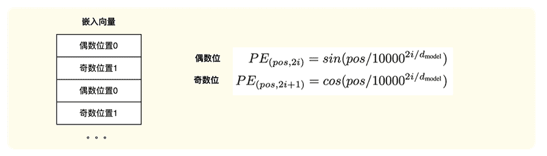

正如你看到的，我们的输入句子是 " 用简单语言讲解Transformer神经网络架构 "，第二个字是 " 简 "，它的索引（`POS`）是1，起始索引值为0，维度（`d`）为6；对于`i`，是0到5，我们要计算输入句子的第二个字“ 简 ”的位置编码。

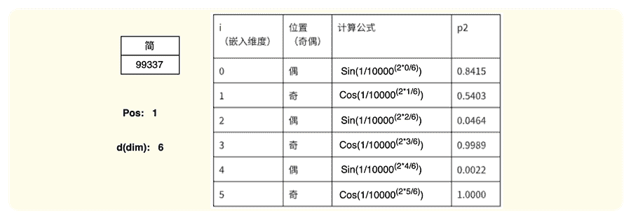

同样地，我们可以计算输入句子中所有`Token`的位置编码。

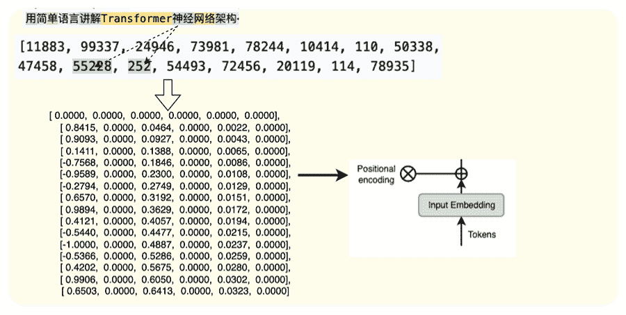

## 06 连接位置编码和分词嵌入

计算完位置编码后，我们需要将分词嵌入和位置编码相加。

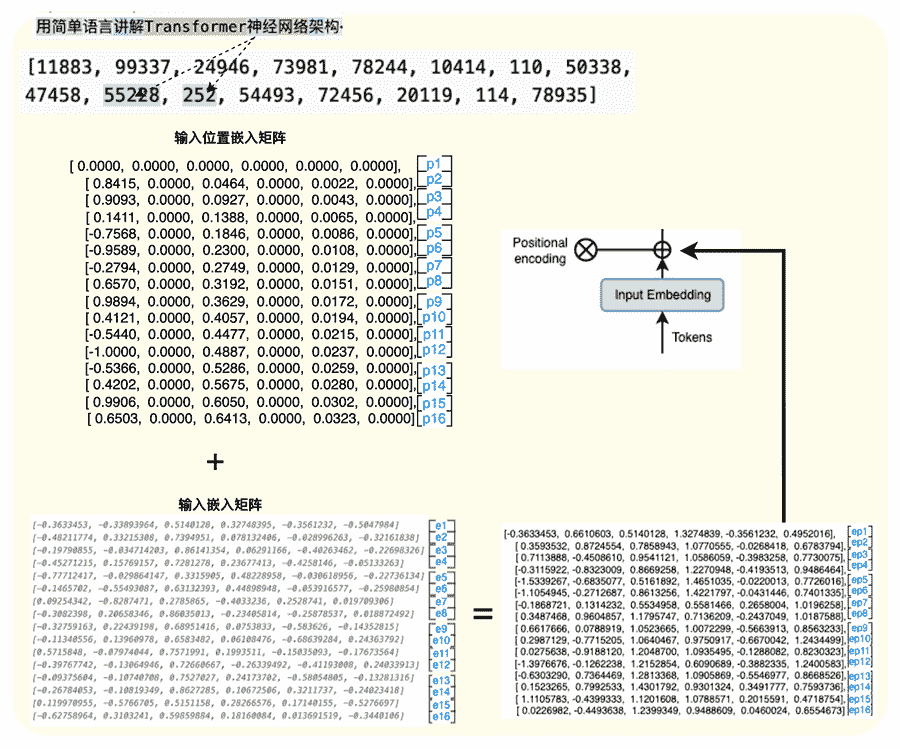

将这两个矩阵（分词嵌入矩阵和位置编码矩阵）合并后得到的矩阵将作为编码器部分的输入。

### 代码实现


```python
import torch
import math

d_model = 6
seq_len = 16

# Create a matrix of shape (seq_len, d_model)
pe = torch.zeros(seq_len, d_model)
# Create a vector of shape (seq_len)
position = torch.arange(0, seq_len, dtype=torch.float).unsqueeze(1) # (seq_len, 1)
# Create a vector of shape (d_model)
div_term = torch.exp(torch.arange(0, d_model, 2).float() * (-math.log(10000.0) / d_model)) # (d_model / 2)
# Apply sine to even indices
pe[:, 0::2] = torch.sin(position * div_term) # sin(position * (10000 ** (2i / d_model))
# Apply cosine to odd indices
pe[:, 1::2] = torch.cos(position * div_term) # cos(position * (10000 ** (2i / d_model))
print(f"positional embedding: {pe}")
# positional embedding: tensor([[ 0.0000, 1.0000, 0.0000, 1.0000, 0.0000, 1.0000],
# [ 0.8415, 0.5403, 0.0464, 0.9989, 0.0022, 1.0000],
# [ 0.9093, -0.4161, 0.0927, 0.9957, 0.0043, 1.0000],
# [ 0.1411, -0.9900, 0.1388, 0.9903, 0.0065, 1.0000],
# [-0.7568, -0.6536, 0.1846, 0.9828, 0.0086, 1.0000],
# [-0.9589, 0.2837, 0.2300, 0.9732, 0.0108, 0.9999],
# [-0.2794, 0.9602, 0.2749, 0.9615, 0.0129, 0.9999],
# [ 0.6570, 0.7539, 0.3192, 0.9477, 0.0151, 0.9999],
# [ 0.9894, -0.1455, 0.3629, 0.9318, 0.0172, 0.9999],
# [ 0.4121, -0.9111, 0.4057, 0.9140, 0.0194, 0.9998],
# [-0.5440, -0.8391, 0.4477, 0.8942, 0.0215, 0.9998],
# [-1.0000, 0.0044, 0.4887, 0.8725, 0.0237, 0.9997],
# [-0.5366, 0.8439, 0.5286, 0.8488, 0.0259, 0.9997],
# [ 0.4202, 0.9074, 0.5675, 0.8234, 0.0280, 0.9996],
# [ 0.9906, 0.1367, 0.6050, 0.7962, 0.0302, 0.9995],
# [ 0.6503, -0.7597, 0.6413, 0.7673, 0.0323, 0.9995]])

torch.set_printoptions(precision=7)
x = torch.tensor([
[-0.3633453, -0.33893964, 0.5140128, 0.32748395, -0.3561232, -0.5047984],
[-0.48211774, 0.33215308, 0.7394951, 0.078132406, -0.028996263, -0.32161838],
[-0.19790855, -0.034714203, 0.86141354, 0.06291166, -0.40263462, -0.22698326],
[-0.45271215, 0.15769157, 0.7281278, 0.23677413, -0.4258146, -0.05133263],
[-0.77712417, -0.029864147, 0.3315905, 0.48228958, -0.030618956, -0.22736134],
[-0.1465702, -0.55493087, 0.63132393, 0.44898948, -0.053916577, -0.25980854],
[0.09254342, -0.8287471, 0.2785865, -0.4033236, 0.2528741, 0.019709306],
[-0.3082398, 0.20658346, 0.86035013, -0.23405814, -0.25878537, 0.018872492],
[-0.32759163, 0.22439198, 0.68951416, 0.0753833, -0.583626, -0.14352815],
[-0.11340556, 0.13960978, 0.6583482, 0.06108476, -0.68639284, 0.24363792],
[0.5715848, -0.07974044, 0.7571991, 0.1993511, -0.15035093, -0.17673564],
[-0.39767742, -0.13064946, 0.72660667, -0.26339492, -0.41193008, 0.24033913],
[-0.09375604, -0.10740708, 0.7527027, 0.24173702, -0.58054805, -0.13281316],
[-0.26784053, -0.10819349, 0.8627285, 0.10672506, 0.3211737, -0.24023418],
[0.119970955, -0.5766705, 0.5151158, 0.28266576, 0.17140155, -0.5276697],
[-0.62758964, 0.3103241, 0.59859884, 0.18160084, 0.013691519, -0.3440106],
])
print(f"input words embedding: {x}")
# input words embedding: tensor([[-0.3633453, -0.3389396, 0.5140128, 0.3274840, -0.3561232, -0.5047984],
# [-0.4821177, 0.3321531, 0.7394951, 0.0781324, -0.0289963, -0.3216184],
# [-0.1979086, -0.0347142, 0.8614135, 0.0629117, -0.4026346, -0.2269833],
# [-0.4527121, 0.1576916, 0.7281278, 0.2367741, -0.4258146, -0.0513326],
# [-0.7771242, -0.0298641, 0.3315905, 0.4822896, -0.0306190, -0.2273613],
# [-0.1465702, -0.5549309, 0.6313239, 0.4489895, -0.0539166, -0.2598085],
# [ 0.0925434, -0.8287471, 0.2785865, -0.4033236, 0.2528741, 0.0197093],
# [-0.3082398, 0.2065835, 0.8603501, -0.2340581, -0.2587854, 0.0188725],
# [-0.3275916, 0.2243920, 0.6895142, 0.0753833, -0.5836260, -0.1435281],
# [-0.1134056, 0.1396098, 0.6583482, 0.0610848, -0.6863928, 0.2436379],
# [ 0.5715848, -0.0797404, 0.7571991, 0.1993511, -0.1503509, -0.1767356],
# [-0.3976774, -0.1306495, 0.7266067, -0.2633949, -0.4119301, 0.2403391],
# [-0.0937560, -0.1074071, 0.7527027, 0.2417370, -0.5805480, -0.1328132],
# [-0.2678405, -0.1081935, 0.8627285, 0.1067251, 0.3211737, -0.2402342],
# [ 0.1199710, -0.5766705, 0.5151158, 0.2826658, 0.1714015, -0.5276697],
# [-0.6275896, 0.3103241, 0.5985988, 0.1816008, 0.0136915, -0.3440106]])

x = x + pe
print(f"input words embedding with positional info: {x}")
# input words embedding with positional info: tensor([[-0.3633453, 0.6610603, 0.5140128, 1.3274839, -0.3561232, 0.4952016],
# [ 0.3593532, 0.8724554, 0.7858943, 1.0770555, -0.0268418, 0.6783794],
# [ 0.7113888, -0.4508610, 0.9541121, 1.0586059, -0.3983258, 0.7730075],
# [-0.3115922, -0.8323009, 0.8669258, 1.2270948, -0.4193513, 0.9486464],
# [-1.5339267, -0.6835077, 0.5161892, 1.4651035, -0.0220013, 0.7726016],
# [-1.1054945, -0.2712687, 0.8613256, 1.4221797, -0.0431446, 0.7401335],
# [-0.1868721, 0.1314232, 0.5534958, 0.5581466, 0.2658004, 1.0196258],
# [ 0.3487468, 0.9604857, 1.1795747, 0.7136209, -0.2437049, 1.0187588],
# [ 0.6617666, 0.0788919, 1.0523665, 1.0072299, -0.5663913, 0.8563233],
# [ 0.2987129, -0.7715205, 1.0640467, 0.9750917, -0.6670042, 1.2434499],
# [ 0.0275638, -0.9188120, 1.2048700, 1.0935495, -0.1288082, 0.8230323],
# [-1.3976676, -0.1262238, 1.2152854, 0.6090689, -0.3882335, 1.2400583],
# [-0.6303290, 0.7364469, 1.2813368, 1.0905869, -0.5546977, 0.8668526],
# [ 0.1523265, 0.7992533, 1.4301792, 0.9301324, 0.3491777, 0.7593736],
# [ 1.1105783, -0.4399333, 1.1201608, 1.0788571, 0.2015591, 0.4718754],
# [ 0.0226982, -0.4493638, 1.2399349, 0.9488609, 0.0460024, 0.6554673]])
```

# 07

## 总结

在这篇文章中，我们详细探讨了Transformer模型的输入部分；通过一步步的解析和代码实现，我们深入理解了如何定义数据集，创建词汇表，进行分词编码（Tokenization），计算分词嵌入（Embedding）以及位置编码（Positional Encoding），并最终将位置编码添加到输入序列中。

首先使用一个小型数据集来可视化数值计算过程，并确定了词汇量大小；接着，为每个唯一的Token分配了一个唯一的数字ID，并通过代码示例展示了如何在Python中实现这一过程。

随后，介绍了嵌入向量的概念，并且使用了一个较小的维度来便于理解和可视化；还看到了如何利用OpenAI提供的API来获取嵌入向量，并打印出了结果。

位置嵌入是Transformer模型的另一个关键组成部分，它允许模型理解单词在句子中的顺序；通过公式和代码实现了位置嵌入的计算，并将其与词嵌入相结合，形成了编码器的输入。

最后，通过代码示例展示了如何将位置嵌入和词嵌入相加，以及如何准备好编码器的输入。

通过本文的学习，相信朋友们能够对Transformer模型的输入有一个清晰的认识，并能够自己动手实现相关的预处理步骤；为进一步理解Transformer模型的其他部分，如编码器和解码器，奠定坚实的基础。

点击关注👸号👇

感谢您阅读完

推荐阅读：

+ [ChatGPT背后强大而神秘的力量：用最简单的语言讲解Transformer架构之概览](http://mp.weixin.qq.com/s?__biz=MzU3OTgyMjM3MA==&mid=2247484435&idx=1&sn=eeb8d952a4695211be575d7ef92d4166&chksm=fd61725eca16fb48b25ab8be527c4986d581f5f29e41989408362145c93ee1068264f78fbaef&scene=21#wechat_redirect)
+ [ChatGPT背后强大而神秘的力量：用最简单的语言讲解Transformer架构之Embedding](http://mp.weixin.qq.com/s?__biz=MzU3OTgyMjM3MA==&mid=2247484599&idx=1&sn=7a7707295fb751aef0693c32d2d56137&chksm=fd6172faca16fbec2c226137bd31d0b64ac8c6b3a7c266c2890ef03cf88d501437d41f6376bb&scene=21#wechat_redirect)
+ [ChatGPT背后强大而神秘的力量：用最简单的语言讲解Transformer架构之Tokenizer](http://mp.weixin.qq.com/s?__biz=MzU3OTgyMjM3MA==&mid=2247484650&idx=1&sn=4025bc4d1a14ea345589a26a335ce41f&chksm=fd6172a7ca16fbb1b8f0458f78a8e49eba145a84aeccefc33e0b288e5ca9647fdd6ba018fe71&scene=21#wechat_redirect)
+ [ChatGPT背后强大而神秘的力量：一文搞懂Transformer架构的三种注意力机制](http://mp.weixin.qq.com/s?__biz=MzU3OTgyMjM3MA==&mid=2247484768&idx=1&sn=f8b459221381b5b4842f9824fb1ed86e&chksm=fd61732dca16fa3bb6c753699bc6cf07682b969e6da98c14ec2a55eb27dffd4554f8e783e1f5&scene=21#wechat_redirect)
+ [要真正入门AI，OpenAI的官方Prompt工程指南肯定还不够，您必须了解的强大方法论和框架！！！](http://mp.weixin.qq.com/s?__biz=MzU3OTgyMjM3MA==&mid=2247484249&idx=1&sn=7238ba9f25af92b399dd5e347fc88592&chksm=fd617514ca16fc025579e6f48b6e87a1fd2368fbd4e725ac835c76d42f490c06c2a6d23a6e82&scene=21#wechat_redirect)
+ [第二篇：要真正入门AI，OpenAI的官方Prompt工程指南肯定还不够，您必须了解的强大方法论和框架！！！](http://mp.weixin.qq.com/s?__biz=MzU3OTgyMjM3MA==&mid=2247484303&idx=1&sn=24ff092b3defd643d568b531a08ca47d&chksm=fd6175c2ca16fcd4353391182c9ecb188dbdd24c7fa7ed7e52827772db138471033ef200f08d&scene=21#wechat_redirect)
+ [第三篇：要真正入门AI，OpenAI的官方Prompt工程指南肯定还不够，您必须了解的强大方法论和框架！！！](http://mp.weixin.qq.com/s?__biz=MzU3OTgyMjM3MA==&mid=2247484353&idx=1&sn=452b5e450b9eba799ba9b024099a2e87&chksm=fd61758cca16fc9aab3f99af1ce9662f1e029799f90e9f5fc30feff2a038bbca9a9c5298c47b&scene=21#wechat_redirect)

👸号回复口令，领取资料，一起学习吧！🏃

“1”：领取开源书籍《动手实战人工智能》

“2”：领取 50G+的免费AI视频课程

“3”：领取ChatGPT4访问码


# “2024”：领取吴恩达的书《Machine Learning Yearning》

扫码加入学习群：


觉得内容还不错的话，“分享”一下，点个“在看”呗

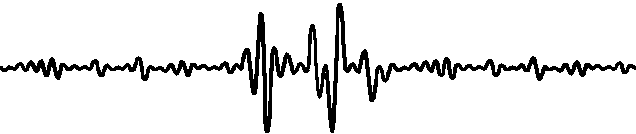


