# Transformer自注意力机制（图文代码详解）

> 来源：<https://geekbang.feishu.cn/docx/SPJXdE7d9oaCcWxEE3UcOdt5nsh>
> 👨🏻 作者：加里
> 📃 作者介绍：目前就职于金融银行AI部门，资深解决方案架构师。
> 🛖 👸号：AIWithGary
> ⏰ 收录时间：2024-05-27 11:20:58 (UTC+8)
> 🔗 原文链接：<https://mp.weixin.qq.com/s?__biz=MzU3OTgyMjM3MA==&mid=2247484886&idx=1&sn=288e12ca051537f40fb57b691cf7bab2&chksm=fd61739bca16fa8d829c0c42968a99226bbd87c676f9ab6d2aff6cec3c075b6697dd664d6cb4#rd>


关注作者，获取更多AI知识

本系列文章致力于用最简单的语言讲解Transformer架构，帮助朋友们理解它的强大，本文是第六篇： Transformer自注意力机制图文详解 。

接下来，我们将用图示和代码的形式，更直观地讲解Transformer架构Encoder的自注意力机制，包括多头注意力，加法和归一化，前馈网络等步骤，如果您熟悉本系列之前的一篇文章： Transformer输入详解 ，再与本文结合，我们已经完成了用图示和代码形式讲解Transformer架构的Encoder部分。

## 目录

1. 多头注意力（Multi Head Attention）
2. 加法和归一化（Adding and Normalizing）
3. 前馈网络（Feed Forward Network）
4. 再次加法和归一化（Adding and Normalizing Again）
5. 总结

## 01 多头注意力

多头注意力由多个单头注意力组成，我们可以决定需要将多少个单头注意力结合在一起；例如，Meta公司的LLaMA大语言模型在编码器架构中使用了32个单头注意力，下面是单头注意力的示意图。

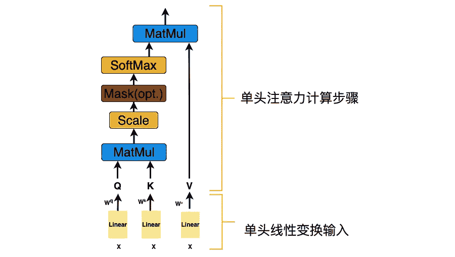

可以看到，注意力层有三个输入：查询（`query`），键（`key`）和值（`value`），每个矩阵都是通过将之前计算得到的分词嵌入矩阵和位置嵌入矩阵相加后，与不同组的权重矩阵的转置相乘得到的，而且权重是用一个线性神经网络层学习到的。

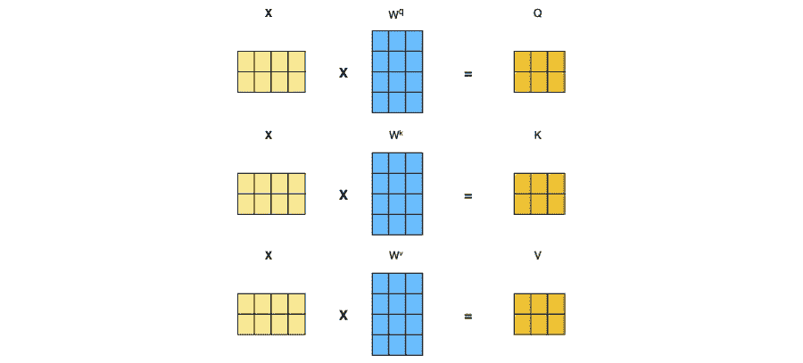

在计算查询矩阵时，权重矩阵的行数必须与转置矩阵的列数相同，而权重矩阵的列数可以是任意的；例如，我们假设权重矩阵有4列；权重矩阵中的值是在0和1之间随机的，当我们的Transformer开始学习这些单词的含义时，这些值将会被更新。

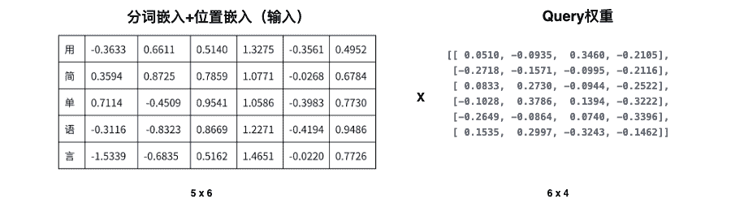

类似地，我们可以使用相同的过程计算键（`key`）矩阵和值（`value`）矩阵，但权重矩阵中的值对这两者必须是不同的。

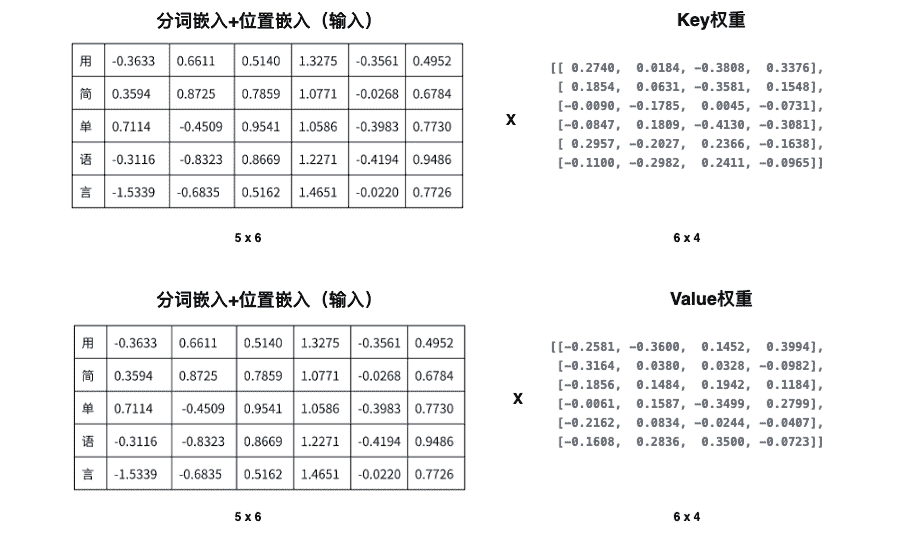

因此，在矩阵相乘后，我们得到了查询（`query`），键（`key`）和值（`value`）的结果：

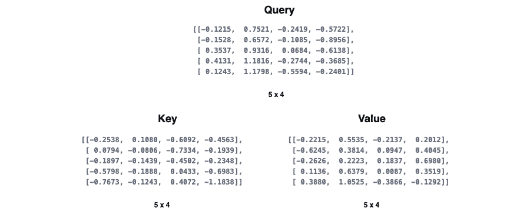

### 代码实现

```python
input_d_model = 6 # 输入向量维度
d_model = 4 # QKV向量维度
h = 1 # 注意力“头”数
# d_model需要可以被h整除
assert d_model % h == 0, "d_model is not divisible by h"
d_k = d_model // h  # 每个注意力“头”的维度
w_q = nn.Linear(input_d_model, d_model, bias=False) # Wq
print(f"Wq: \n{w_q}")
# Wq:
# Linear(in_features=6, out_features=4, bias=False)
w_k = nn.Linear(input_d_model, d_model, bias=False) # Wk
print(f"Wk: \n{w_k}")
# Wk:
# Linear(in_features=6, out_features=4, bias=False)
w_v = nn.Linear(input_d_model, d_model, bias=False) # Wv
print(f"Wv: \n{w_v}")
# Wv:
# Linear(in_features=6, out_features=4, bias=False)
w_o = nn.Linear(d_model, input_d_model, bias=False) # Wo
print(f"Wo: \n{w_o}")
# Wo:
# Linear(in_features=4, out_features=6, bias=False)
# 输入分词嵌入+位置嵌入，这里只包括前5个字“用简单语言”
input_x = torch.tensor([[-0.3633,  0.6611,  0.5140,  1.3275, -0.3561,  0.4952],
[ 0.3594,  0.8725,  0.7859,  1.0771, -0.0268,  0.6784],
[ 0.7114, -0.4509,  0.9541,  1.0586, -0.3983,  0.7730],
[-0.3116, -0.8323,  0.8669,  1.2271, -0.4194,  0.9486],
[-1.5339, -0.6835,  0.5162,  1.4651, -0.0220,  0.7726]])
print(f"输入分词嵌入+位置嵌入（用简单语言）: \n{input_x}")
# 输入分词嵌入+位置嵌入（用简单语言）:
# tensor([[-0.3633,  0.6611,  0.5140,  1.3275, -0.3561,  0.4952],
#         [ 0.3594,  0.8725,  0.7859,  1.0771, -0.0268,  0.6784],
#         [ 0.7114, -0.4509,  0.9541,  1.0586,  -0.3983,  0.7730],
#         [-0.3116, -0.8323,  0.8669,  1.2271, -0.4194,  0.9486],
#         [-1.5339, -0.6835,  0.5162,  1.4651, -0.0220,  0.7726]])
query = w_q(input_x) # (seq_len, d_model) --> (seq_len, d_model)
key = w_k(input_x) # (seq_len, d_model) --> (seq_len, d_model)
value = w_v(input_x) # (seq_len, d_model) --> (seq_len, d_model)
print(f"Query权重张量: \n{w_q.weight.data}\nKey权重张量: \n{w_k.weight.data}\nValue权重张量: \n{w_v.weight.data}")
# Query权重张量:
# tensor([[ 0.0510, -0.0935,  0.3460, -0.2105],
#         [-0.2718, -0.1571, -0.0995, -0.2116],
#         [ 0.0833,  0.2730, -0.0944, -0.2522],
#         [-0.1028,  0.3786,  0.1394, -0.3222],
#         [-0.2649, -0.0864,  0.0740, -0.3396],
#         [ 0.1535,  0.2997, -0.3243, -0.1462]])
# Key权重张量:
# tensor([[ 0.2740,  0.0184, -0.3808,  0.3376],
#         [ 0.1854,  0.0631, -0.3581,  0.1548],
#         [-0.0090, -0.1785,  0.0045, -0.0731],
#         [-0.0847,  0.1809, -0.4130, -0.3081],
#         [ 0.2957, -0.2027,  0.2366, -0.1638],
#         [-0.1100, -0.2982,  0.2411, -0.0965]])
# Value权重张量:
# tensor([[-0.2581, -0.3600,  0.1452,  0.3994],
#         [-0.3164,  0.0380,  0.0328, -0.0982],
#         [-0.1856,  0.1484,  0.1942,  0.1184],
#         [-0.0061,  0.1587, -0.3499,  0.2799],
#         [-0.2162,  0.0834, -0.0244, -0.0407],
#         [-0.1608,  0.2836,  0.3500, -0.0723]])
print(f"Query张量: \n{query}\nKey张量: \n{key}\nValue张量: \n{value}")
# Query张量:
# tensor([[-0.1215,  0.7521, -0.2419, -0.5722],
#         [-0.1528,  0.6572, -0.1085, -0.8956],
#         [ 0.3537,  0.9316,  0.0684, -0.6138],
#         [ 0.4131,  1.1816, -0.2744, -0.3685],
#         [ 0.1243,  1.1798, -0.5594, -0.2401]], grad_fn=<MmBackward0>)
# Key张量:
# tensor([[-0.2538,  0.1080, -0.6092, -0.4563],
#         [ 0.0794, -0.0806, -0.7334, -0.1939],
#         [-0.1897, -0.1439, -0.4502, -0.2348],
#         [-0.5798, -0.1888,  0.0433, -0.6983],
#         [-0.7673, -0.1243,  0.4072, -1.1838]], grad_fn=<MmBackward0>)
# Value张量:
# tensor([[-0.2215,  0.5535, -0.2137,  0.2012],
#         [-0.6245,  0.3814,  0.0947,  0.4045],
#         [-0.2626,  0.2223,  0.1837,  0.6980],
#         [ 0.1136,  0.6379,  0.0087,  0.3519],
#         [ 0.3880,  1.0525, -0.3866, -0.1292]], grad_fn=<MmBackward0>)
```

关注👸号获取完整代码 ，回复口令”6“

现在我们有了这三个矩阵，让我们逐步计算单头注意力。

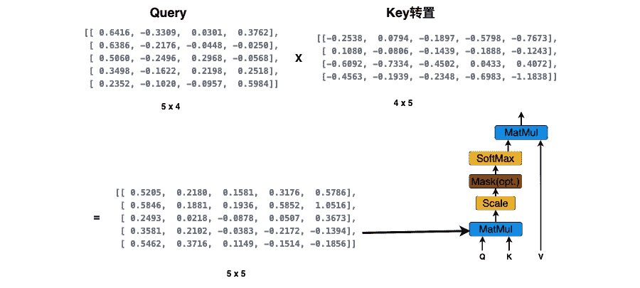

为了对结果矩阵进行缩放，我们需要使用嵌入向量的维度，即 4。

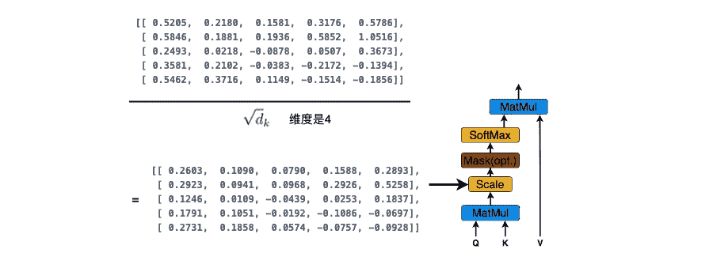

接下来，掩码处理是可选的，我们不会进行计算；掩码处理的作用类似于告诉模型只关注某个特定点之前发生的事情，不要在计算句子中不同单词的重要性时提前窥探未来；这有助于模型逐步理解事物，而不通过提前查看来作弊。

现在，我们将对缩放后的结果矩阵应用`softmax`操作。

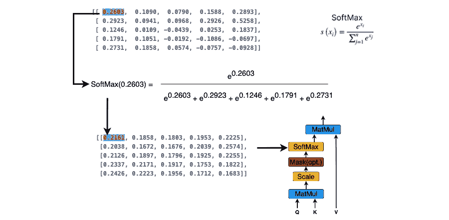

进行最后的乘法运算，得到来自单头注意力的结果矩阵。

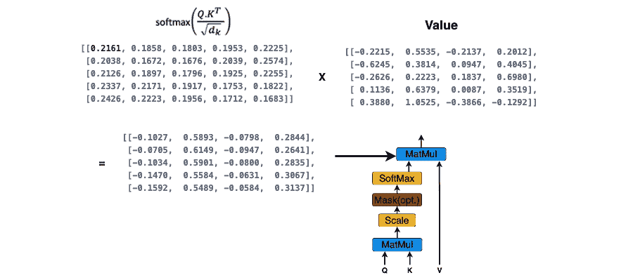

### 代码实现

```python
def attention(query, key, value):
d_k = query.shape[-1] # 运用论文里的公式计算注意力权重和输出
# torch.Size([1, 5, 4])Query: tensor([[[ 0.6416, -0.3309,  0.0301,  0.3762],
#      [ 0.6386, -0.2176, -0.0448, -0.0250],
#      [ 0.5060, -0.2496,  0.2968, -0.0568],
#      [ 0.3498, -0.1622,  0.2198,  0.2518],
#      [ 0.2352, -0.1020, -0.0957,  0.5984]]], grad_fn=<TransposeBackward0>)
key_transpose = key.transpose(-2, -1)
print(f"Key转置张量大小：\n{key_transpose.shape}\nKey转置张量: \n{key_transpose}")
# Key转置张量大小：
# torch.Size([1, 4, 5])
# Key转置张量:
# tensor([[[-0.2538,  0.0794, -0.1897, -0.5798, -0.7673],
#         [ 0.1080, -0.0806, -0.1439, -0.1888, -0.1243],
#         [-0.6092, -0.7334, -0.4502,  0.0433,  0.4072],
#         [-0.4563, -0.1939, -0.2348, -0.6983, -1.1838]]],
#     grad_fn=<TransposeBackward0>)
attention_scores_before_scale = query @ key_transpose
print(f"缩放之前的注意力分数大小：\n{attention_scores_before_scale.shape}\n缩放之前的注意力分数：\n{attention_scores_before_scale}")
# 缩放之前的注意力分数大小：
# torch.Size([1, 5, 5])
# 缩放之前的注意力分数：
# tensor([[[ 0.5205,  0.2180,  0.1581,  0.3176,  0.5786],
#         [ 0.5846,  0.1881,  0.1936,  0.5852,  1.0516],
#         [ 0.2493,  0.0218, -0.0878,  0.0507,  0.3673],
#         [ 0.3581,  0.2102, -0.0383, -0.2172, -0.1394],
#         [ 0.5462,  0.3716,  0.1149, -0.1514, -0.1856]]],
#     grad_fn=<UnsafeViewBackward0>)
attention_scores = attention_scores_before_scale / math.sqrt(d_k)
print(f"缩放之后的注意力分数: \n{attention_scores}")
# 缩放之后的注意力分数:
# tensor([[[ 0.2603,  0.1090,  0.0790,  0.1588,  0.2893],
#         [ 0.2923,  0.0941,  0.0968,  0.2926,  0.5258],
#         [ 0.1246,  0.0109, -0.0439,  0.0253,  0.1837],
#         [ 0.1791,  0.1051, -0.0192, -0.1086, -0.0697],
#         [ 0.2731,  0.1858,  0.0574, -0.0757, -0.0928]]],
#     grad_fn=<DivBackward0>)
attention_scores = attention_scores.softmax(dim=-1) # (h, seq_len, seq_len) # 运用softmax
print(f"softmax之后的注意力分数: \n{attention_scores}")
# softmax之后的注意力分数:
# tensor([[[0.2161, 0.1858, 0.1803, 0.1953, 0.2225],
#         [0.2038, 0.1672, 0.1676, 0.2039, 0.2574],
#         [0.2126, 0.1897, 0.1796, 0.1925, 0.2255],
#         [0.2337, 0.2171, 0.1917, 0.1753, 0.1822],
#         [0.2426, 0.2223, 0.1956, 0.1712, 0.1683]]],
#     grad_fn=<SoftmaxBackward0>)
```


`(h, seq_len, seq_len) --> (h, seq_len, d_k)`

### 返回权重值和值权重

```
return (attention_scores @ value), attention_scores
```

### Calculate attention

`x, attention_scores = attention(query, key, value)`

`print(f"注意力分数张量大小：\n{attention_scores.shape}\n注意力分数张量: \n{attention_scores}")`

注意力分数张量大小：

`torch.Size([1, 5, 5])`

注意力分数张量：

```
tensor([[[0.2161, 0.1858, 0.1803, 0.1953, 0.2225],
         [0.2038, 0.1672, 0.1676, 0.2039, 0.2574],
         [0.2126, 0.1897, 0.1796, 0.1925, 0.2255],
         [0.2337, 0.2171, 0.1917, 0.1753, 0.1822],
         [0.2426, 0.2223, 0.1956, 0.1712, 0.1683]]],
       grad_fn=<SoftmaxBackward0>)
```

`print(f"注意力张量大小：\n{x.shape}\n注意力张量：\n{x}")`

注意力张量大小：

`torch.Size([1, 5, 4])`

注意力张量：

```
tensor([[[-0.1027,  0.5893, -0.0798,  0.2844],
         [-0.0705,  0.6149, -0.0947,  0.2641],
         [-0.1034,  0.5901, -0.0800,  0.2835],
         [-0.1470,  0.5584, -0.0631,  0.3067],
         [-0.1592,  0.5489, -0.0584,  0.3137]]], grad_fn=<UnsafeViewBackward0>)
```

关注👸号获取完整代码，回复口令”6“

我们已经计算了单头注意力，而多头注意力则由多个单头注意力组成，正如我之前所述；下面是一个视觉示意图：

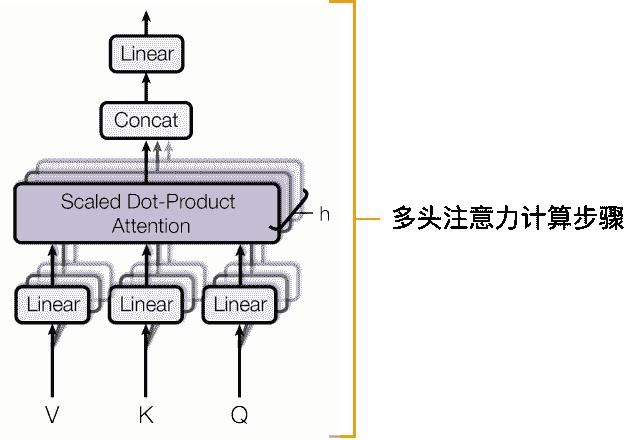

每个单头注意力都有三个输入：查询（`query`），键（`key`）和值（`value`），每个输入都有一个不同的权重矩阵；一旦所有单头注意力输出了它们的结果矩阵，这些矩阵将被连接在一起，并通过与一组初始化为随机值的权重矩阵相乘进行线性变换；这些权重在Transformer开始训练时将会被更新。

虽然目前我们只考虑了单头注意力，但这是多头注意力的工作原理。

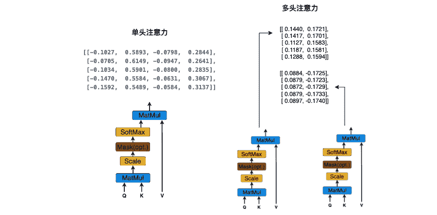

无论是单头注意力还是多头注意力，结果矩阵都需要通过与一组权重矩阵相乘进行线性变换。

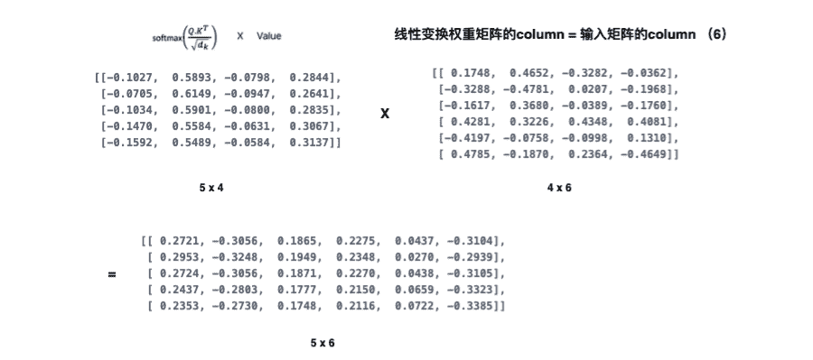

如上图所示，线性权重矩阵的列数与之前计算的（单词嵌入 + 位置嵌入）矩阵的列数相同，因为下一步，我们将把归一化的结果矩阵与（单词嵌入 + 位置嵌入）矩阵相加。

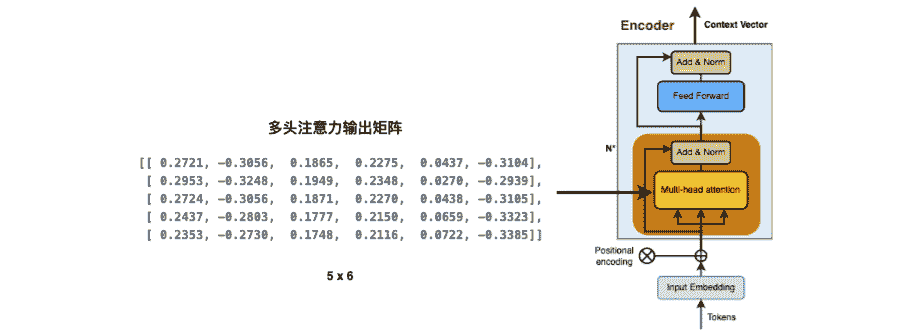

目前为止，我们已经计算了多头注意力的结果矩阵，接下来我们将进行加法和归一化的步骤。

### 代码实现

```
h = 1 # 注意力“头”数

# (seq_len, d_model) --> (seq_len, h, d_k) --> (h, seq_len, d_k)

query = query.view(query.shape[0], h, d_k).transpose(0, 1)

key = key.view(key.shape[0], h, d_k).transpose(0, 1)

value = value.view(value.shape[0], h, d_k).transpose(0, 1)
```

`print(f"多头Query张量大小：\n{query.shape}\n多头Key张量大小：\n{key.shape}\n多头Value张量大小：\n{value.shape}")`

多头Query张量大小：

`torch.Size([1, 5, 4])`

K多头ey张量大小：

`torch.Size([1, 5, 4])`

多头Value张量大小：

`torch.Size([1, 5, 4])`

`print(f"Query张量: \n{query}\nKey张量: \n{key}\nValue张量: {value}")`

Query权重张量：

```
tensor([[[-0.1215,  0.7521, -0.2419, -0.5722],
         [-0.1528,  0.6572, -0.1085, -0.8956],
         [ 0.3537,  0.9316,  0.0684, -0.6138],
         [ 0.4131,  1.1816, -0.2744, -0.3685],
         [ 0.1243,  1.1798, -0.5594, -0.2401]]], grad_fn=<TransposeBackward0>)
```

Key权重张量：

```
tensor([[[-0.2538,  0.1080, -0.6092, -0.4563],
         [ 0.0794, -0.0806, -0.7334, -0.1939],
         [-0.1897, -0.1439, -0.4502, -0.2348],
         [-0.5798, -0.1888,  0.0433, -0.6983],
         [-0.7673, -0.1243,  0.4072, -1.1838]]], grad_fn=<TransposeBackward0>)
```

Value权重张量：

```
tensor([[[-0.2215,  0.5535, -0.2137,  0.2012],
         [-0.6245,  0.3814,  0.0947,  0.4045],
         [-0.2626,  0.2223,  0.1837,  0.6980],
         [ 0.1136,  0.6379,  0.0087,  0.3519],
         [ 0.3880,  1.0525, -0.3866, -0.1292]]], grad_fn=<TransposeBackward0>)
```

组合所有“头”的注意力

`(h, seq_len, d_k) --> (seq_len, h, d_k) --> (seq_len, d_model)`

```
x = x.transpose(0, 1).contiguous().view(-1, h * d_k)
```

`print(f"组合所有头之后的张量大小：\n{x.shape}\n组合所有头之后的张量：\n{x}")`

组合所有头之后的张量大小：

`torch.Size([5, 4])`

组合所有头之后的张量：

```
tensor([[-0.1027,  0.5893, -0.0798,  0.2844],
        [-0.0705,  0.6149, -0.0947,  0.2641],
        [-0.1034,  0.5901, -0.0800,  0.2835],
        [-0.1470,  0.5584, -0.0631,  0.3067],
        [-0.1592,  0.5489, -0.0584,  0.3137]])
```

线性变换回输入一样的维度

`(seq_len, d_model) --> (seq_len, input_d_model)`

```
attention_ouput_x = w_o(x)
```

`print(f"线性变换的权重矩阵：\nw_o.weight.data")`

线性变换的权重矩阵：

```
tensor([[ 0.1748,  0.4652, -0.3282, -0.0362],
        [-0.3288, -0.4781,  0.0207, -0.1968],
        [-0.1617,  0.3680, -0.0389, -0.1760],
        [ 0.4281,  0.3226,  0.4348,  0.4081],
        [-0.4197, -0.0758, -0.0998,  0.1310],
        [ 0.4785, -0.1870,  0.2364, -0.4649]])
```

`print(f"线性变换回输入向量维度的张量大小：\n{attention_ouput_x.shape}\n线性变换回输入向量维度的张量：\n{attention_ouput_x}")`

线性变换回输入向量维度的张量大小：

`torch.Size([5, 6])`

线性变换回输入向量维度的张量：

```
tensor([[ 0.2721, -0.3056,  0.1865,  0.2275,  0.0437, -0.3104],
        [ 0.2953, -0.3248,  0.1949,  0.2348,  0.0270, -0.2939],
        [ 0.2724, -0.3056,  0.1871,  0.2270,  0.0438, -0.3105],
        [ 0.2437, -0.2803,  0.1777,  0.2150,  0.0659, -0.3323],
        [ 0.2353, -0.2730,  0.1748,  0.2116,  0.0722, -0.3385]], grad_fn=<MmBackward0>)
```

关注👸号获取完整代码，回复口令”6“

## 02

### 加法和归一化

一旦我们获得了多头注意力的结果矩阵，我们需要将其添加到我们的原始矩阵中，如下所示：

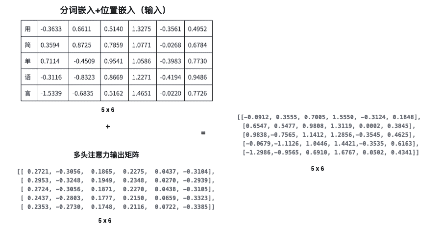

为了对上述矩阵进行归一化，我们需要逐行计算每行的均值和标准差。

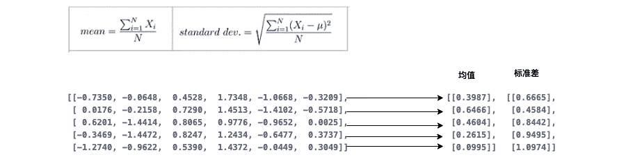

添加一个很小的误差值可以防止分母为零，并避免使整个项变为无穷大。

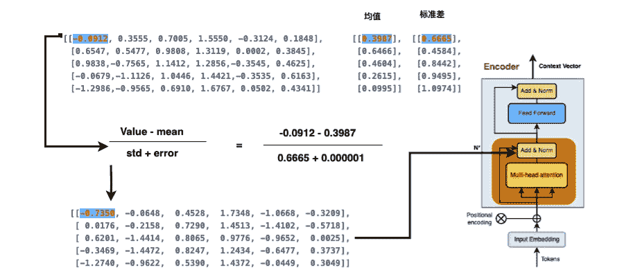

### 代码实现

```
def norm(x):

# x: (seq_len, input_d_model)

# Keep the dimension for broadcasting

eps=10**-6

alpha = nn.Parameter(torch.ones(input_d_model)) # alpha is a learnable parameter

bias = nn.Parameter(torch.zeros(input_d_model)) # bias is a learnable parameter

mean = x.mean(dim = -1, keepdim = True) # (batch, seq_len, 1)

# Keep the dimension for broadcasting

std = x.std(dim = -1, keepdim = True) # (batch, seq_len, 1)

# eps is to prevent dividing by zero or when std is very small

normalized_x = alpha * (x - mean) / (std + eps) + bias

return normalized_x, mean, std, alpha, bias
```

```
torch.set_printoptions(precision=4, sci_mode=False)

attention_ouput_x = input_x + attention_ouput_x
```

`print(f"Add之后的output：\n{attention_ouput_x}")`

Add之后的output：

```
tensor([[-0.0912, 0.3555, 0.7005, 1.5550, -0.3124, 0.1848],
        [0.6547, 0.5477, 0.9808, 1.3119, 0.0002, 0.3845],
        [0.9838,-0.7565, 1.1412, 1.2856,-0.3545, 0.4625],
        [-0.0679,-1.1126, 1.0446, 1.4421,-0.3535, 0.6163],
        [-1.2986,-0.9565, 0.6910, 1.6767, 0.0502, 0.4341]])
```

`normalized_x, mean_matrix, std_matrix, alpha_matrix, bias_matrix = norm(attention_ouput_x)`

`print(f"Norm之后的ouput: \n{normalized_x}\nMean矩阵：\n{mean_matrix}\nStd矩阵：{std_matrix}\nalpha矩阵：{alpha_matrix}\nbias矩阵：{bias_matrix}")`

Norm之后的ouput：

```
tensor([[-0.7350, -0.0648,  0.4528,  1.7348, -1.0668, -0.3209],
        [ 0.0176, -0.2158,  0.7290,  1.4513, -1.4102, -0.5718],
        [ 0.6201, -1.4414,  0.8065,  0.9776, -0.9652,  0.0025],
        [-0.3469, -1.4472,  0.8247,  1.2434, -0.6477,  0.3737],
        [-1.2740, -0.9622,  0.5390,  1.4372, -0.0449,  0.3049]], grad_fn=<AddBackward0>)
```

Mean矩阵：

```
tensor([[0.3987],
        [0.6466],
        [0.4604],
        [0.2615],
        [0.0995]])
```

Std矩阵：

```
tensor([[0.6665],
        [0.4584],
        [0.8442],
        [0.9495],
        [1.0974]])
```

关注👸号获取完整代码，回复口令”6“

## 03

### 前馈网络

在对矩阵进行归一化后，它将通过一个前馈网络进行处理；我们将使用一个非常简单的网络，它只包含一个线性层和一个ReLU激活函数层，如下所示：

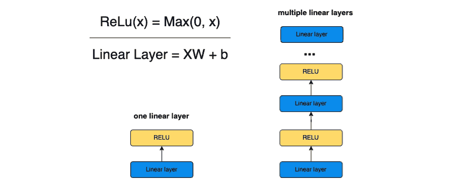

首先，我们需要通过将最后计算得到的矩阵与一组随机权重矩阵相乘来计算线性层，这些权重矩阵将在Transformer开始学习时更新，然后将结果矩阵与一个包含随机值的偏置（`Bias`）矩阵相加。

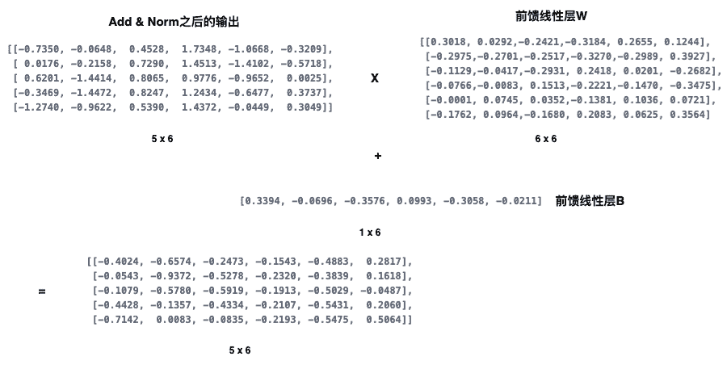

在计算完线性层之后，我们需要将其通过ReLU层，并使用ReLU函数对其进行处理。

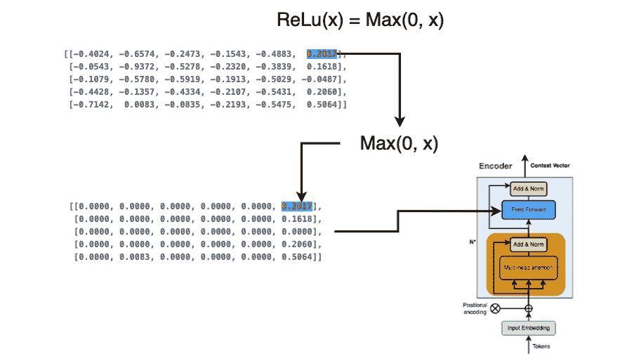

### 代码实现

```
linear_ff = nn.Linear(input_d_model, input_d_model)
```

`print(f"前馈线性w矩阵: {linear_ff.weight}\n前馈线性b矩阵: {linear_ff.bias}")`

前馈线性w矩阵:

```
Parameter containing:

tensor([[0.3018, 0.0292,-0.2421,-0.3184, 0.2655, 0.1244],
        [-0.2975,-0.2701,-0.2517,-0.3270,-0.2989, 0.3927],
        [-0.1129,-0.0417,-0.2931, 0.2418, 0.0201, -0.2682],
        [-0.0766,-0.0083, 0.1513,-0.2221,-0.1470, -0.3475],
        [-0.0001, 0.0745, 0.0352,-0.1381, 0.1036, 0.0721],
        [-0.1762, 0.0964,-0.1680, 0.2083, 0.0625, 0.3564]], requires_grad=True)
```

前馈线性b矩阵:

```
Parameter containing:

tensor([0.3394, -0.0696, -0.3576, 0.0993, -0.3058, -0.0211],
  requires_grad=True)
```

```
linear_ff_output = linear_ff(normalized_x)
```

`print(f"前馈线性层输出：\n{linear_ff_output}")`

前馈线性层输出：

```
tensor([[-0.4024, -0.6574, -0.2473, -0.1543, -0.4883,  0.2817],
        [-0.0543, -0.9372, -0.5278, -0.2320, -0.3839,  0.1618],


```
[-0.1079, -0.5780, -0.5919, -0.1913, -0.5029, -0.0487],
        [-0.4428, -0.1357, -0.4334, -0.2107, -0.5431,  0.2060],
        [-0.7142,  0.0083, -0.0835, -0.2193, -0.5475,  0.5064]],
       grad_fn=<AddmmBackward0>)
```

`relu_output = torch.relu(linear_ff_output)`

`print(f"relu输出：\n{relu_output}")`

```
tensor([[0.0000, 0.0000, 0.0000, 0.0000, 0.0000, 0.2817],
        [0.0000, 0.0000, 0.0000, 0.0000, 0.0000, 0.1618],
        [0.0000, 0.0000, 0.0000, 0.0000, 0.0000, 0.0000],
        [0.0000, 0.0000, 0.0000, 0.0000, 0.0000, 0.2060],
        [0.0000, 0.0083, 0.0000, 0.0000, 0.0000, 0.5064]],
       grad_fn=<ReluBackward0>)
```

关注👸号获取完整代码，回复口令”6“

# 04 再次加法和归一化

一旦我们从前馈网络中获得了结果矩阵，我们需要将其与之前从加法（`Add`）和归一化（`Norm`）步骤获得的矩阵相加，然后使用逐行的均值和标准差对其进行归一化处理。

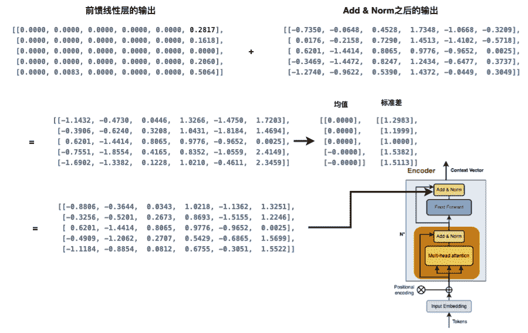

加法和归一化步骤的输出矩阵将用作解码器部分中一个多头注意力机制的查询和键矩阵，你可以从这个输出矩阵开始追踪，一直到解码器部分，就可以清楚地理解这一点。

### 代码实现

`ff_output, mean_matrix, std_matrix, alpha_matrix, bias_matrix = norm(relu_output)`

`print(f"最后的norm输出: \n{ff_output}\nMean矩阵：\n{mean_matrix}\nStd矩阵：{std_matrix}\nalpha矩阵：{alpha_matrix}\nbias矩阵：{bias_matrix}")`

```
tensor([[-0.4082, -0.4082, -0.4082, -0.4082, -0.4082,  2.0412],
        [-0.4082, -0.4082, -0.4082, -0.4082, -0.4082,  2.0412],
        [ 0.0000,  0.0000,  0.0000,  0.0000,  0.0000,  0.0000],
        [-0.4082, -0.4082, -0.4082, -0.4082, -0.4082,  2.0412],
        [-0.4162, -0.3760, -0.4162, -0.4162, -0.4162,  2.0410]],
       grad_fn=<AddBackward0>)
```

```
tensor([[0.0469],
        [0.0270],
        [0.0000],
        [0.0343],
        [0.0858]])
```

```
tensor([[0.1150],
        [0.0661],
        [0.0000],
        [0.0841],
        [0.2061]])
```

```
Parameter containing:
tensor([1., 1., 1., 1., 1., 1.], requires_grad=True)
```

```
Parameter containing:
tensor([0., 0., 0., 0., 0., 0.], requires_grad=True)
```

`encoder_attention_ouput_x = normalized_x + ff_output`

`print(f"Encoder最后的Add之后的output：\n{encoder_attention_ouput_x}")`

```
tensor([[-1.1432, -0.4730,  0.0446,  1.3266, -1.4750,  1.7203],
        [-0.3906, -0.6240,  0.3208,  1.0431, -1.8184,  1.4694],
        [ 0.6201, -1.4414,  0.8065,  0.9776, -0.9652,  0.0025],
        [-0.7551, -1.8554,  0.4165,  0.8352, -1.0559,  2.4149],
        [-1.6902, -1.3382,  0.1228,  1.0210, -0.4611,  2.3459]],
       grad_fn=<AddBackward0>)
```

`encoder_normalized_x, mean_matrix, std_matrix, alpha_matrix, bias_matrix = norm(encoder_attention_ouput_x)`

`print(f"Encoder最后的Norm之后的ouput: \n{encoder_normalized_x}\nMean矩阵：\n{mean_matrix}\nStd矩阵：{std_matrix}\nalpha矩阵：{alpha_matrix}\nbias矩阵：{bias_matrix}")`

```
tensor([[-0.8806, -0.3644,  0.0343,  1.0218, -1.1362,  1.3251],
        [-0.3256, -0.5201,  0.2673,  0.8693, -1.5155,  1.2246],
        [ 0.6201, -1.4414,  0.8065,  0.9776, -0.9652,  0.0025],
        [-0.4909, -1.2062,  0.2707,  0.5429, -0.6865,  1.5699],
        [-1.1184, -0.8854,  0.0812,  0.6755,  -0.3051,  1.5522]],
       grad_fn=<AddBackward0>)
```

```
tensor([[     0.0000],
        [     0.0000],
        [     0.0000],
        [    -0.0000],
        [    -0.0000]], grad_fn=<MeanBackward1>)
```

```
tensor([[1.2983],
        [1.1999],
        [1.0000],
        [1.5382],
        [1.5113]], grad_fn=<StdBackward0>)
```

```
Parameter containing:
tensor([1., 1., 1., 1., 1., 1.], requires_grad=True)
```

```
Parameter containing:
tensor([0., 0., 0., 0., 0., 0.], requires_grad=True)
```

关注👸号获取完整代码，回复口令”6“

# 05 总结

本文我们深入探讨了Transformer架构的核心组成部分自注意力机制，通过图示和代码的形式，我们详细阐述了Encoder部分的工作原理，包括多头注意力、加法和归一化、前馈网络以及再次加法和归一化等关键步骤。

多头注意力是Transformer的创新之处，它允许模型同时从不同的表示子空间获取信息；每个头部都独立地学习到不同的特征，然后将这些特征聚合起来，形成一个全面的输出；这种机制增强了模型对输入数据的理解能力，使其能够捕捉到更加复杂的模式。

加法和归一化则确保了网络中的信息流动得以平滑进行，同时避免了梯度消失或爆炸的问题；这些步骤通过归一化层的输出，为模型提供了稳定性，并有助于加速训练过程。

前馈网络进一步处理了注意力机制的输出，通过引入非线性激活函数，增加了模型的表达能力；这一层简单而有效，证明了即便是基础的神经网络结构也能在复杂的架构中发挥重要作用。

最后，再次加法和归一化为整个Encoder的输出做好了准备，使其可以无缝地连接到Decoder部分；这种设计体现了Transformer架构的精妙之处，即通过一系列精心设计的操作，实现了高效且强大的序列到序列的转换。

总的来说，自注意力机制是Transformer成功的关键因素之一，它不仅提高了模型的性能，还为后续的研究者和开发者提供了灵感，促进了自然语言处理领域的发展；随着对这一机制理解的深入，我们期待未来会有更多创新的变体出现，推动人工智能技术向前发展。

点击关注👸号👇

感谢您阅读完

推荐阅读：

+   [ChatGPT背后强大而神秘的力量：用最简单的语言讲解Transformer架构之概览](http://mp.weixin.qq.com/s?__biz=MzU3OTgyMjM3MA==&mid=2247484435&idx=1&sn=eeb8d952a4695211be575d7ef92d4166&chksm=fd61725eca16fb48b25ab8be527c4986d581f5f29e41989408362145c93ee1068264f78fbaef&scene=21#wechat_redirect)

+   [ChatGPT背后强大而神秘的力量：用最简单的语言讲解Transformer架构之Embedding](http://mp.weixin.qq.com/s?__biz=MzU3OTgyMjM3MA==&mid=2247484599&idx=1&sn=7a7707295fb751aef0693c32d2d56137&chksm=fd6172faca16fbec2c226137bd31d0b64ac8c6b3a7c266c2890ef03cf88d501437d41f6376bb&scene=21#wechat_redirect)

+   [ChatGPT背后强大而神秘的力量，用最简单的语言讲解Transformer架构之Tokenizer](http://mp.weixin.qq.com/s?__biz=MzU3OTgyMjM3MA==&mid=2247484650&idx=1&sn=4025bc4d1a14ea345589a26a335ce41f&chksm=fd6172a7ca16fbb1b8f0458f78a8e49eba145a84aeccefc33e0b288e5ca9647fdd6ba018fe71&scene=21#wechat_redirect)

+   一文搞懂Transformer架构的三种注意力机制

+   一文彻底搞懂Transformer的输入（附代码）

+   [要真正入门AI，OpenAI的官方Prompt工程指南肯定还不够，您必须了解的强大方法论和框架！！！](http://mp.weixin.qq.com/s?__biz=MzU3OTgyMjM3MA==&mid=2247484249&idx=1&sn=7238ba9f25af92b399dd5e347fc88592&chksm=fd617514ca16fc025579e6f48b6e87a1fd2368fbd4e725ac835c76d42f490c06c2a6d23a6e82&scene=21#wechat_redirect)

+   [第二篇：要真正入门AI，OpenAI的官方Prompt工程指南肯定还不够，您必须了解的强大方法论和框架！！！](http://mp.weixin.qq.com/s?__biz=MzU3OTgyMjM3MA==&mid=2247484303&idx=1&sn=24ff092b3defd643d568b531a08ca47d&chksm=fd6175c2ca16fcd4353391182c9ecb188dbdd24c7fa7ed7e52827772db138471033ef200f08d&scene=21#wechat_redirect)

+   [第三篇：要真正入门AI，OpenAI的官方Prompt工程指南肯定还不够，您必须了解的强大方法论和框架！！！](http://mp.weixin.qq.com/s?__biz=MzU3OTgyMjM3MA==&mid=2247484353&idx=1&sn=452b5e450b9eba799ba9b024099a2e87&chksm=fd61758cca16fc9aab3f99af1ce9662f1e029799f90e9f5fc30feff2a038bbca9a9c5298c47b&scene=21#wechat_redirect)

👸号回复口令，领取资料，一起学习吧！🏃

“ 1 ”：领取开源书籍《动手实战人工智能》

” 2 “：领取 50G+的免费AI视频课程

“ 3 ”：领取ChatGPT4访问码

“ 2024 ”：领取吴恩达的书《Machine Learning Yearning》

扫码加入学习群：


觉得内容还不错的话，“分享”一下，点个“在看”呗

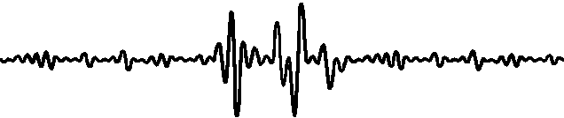


