# Transformer解码器（图文详解）

> 来源：[https://geekbang.feishu.cn/docx/U6qEdm8nAoqCKixnDVIcQj9HnFg](https://geekbang.feishu.cn/docx/U6qEdm8nAoqCKixnDVIcQj9HnFg)

> 👨🏻 作者：加里

> 📃 作者介绍：目前就职于金融银行AI部门，资深解决方案架构师。

> 🛖 👸号：AIWithGary

> ⏰ 收录时间：2024-05-27 11:20:58 (UTC+8)

> 🔗 原文链接：h[ttps://mp.weixin.q](https://mp.weixin.qq.com/s?__biz=MzU3OTgyMjM3MA==&mid=2247485008&idx=1&sn=c90e27448021d2d2073752e862788621&chksm=fd61701dca16f90bf1e567b49296757993d8117da3509a03f84084f5bb140dff528b9fbfceb4#rd)q.com/s?__biz=Mz...

关注作者，获取更多AI知识

本系列文章致力于用最简单的语言讲解Transformer架构，帮助朋友们理解它的强大，本文是第七篇： Transformer解码器图文详解 。

本系列之前的两篇文章： Transformer输入详解 和 Transformer自注意力机制图文详解 ，我们已经用图示和代码形式讲解了Transformer架构的编码器部分，接下来，我们开始讲解解码器部分。

目录

1. 解码器（Decoder）

2. 掩码多头注意力（Masked Multi Head Attention）

3. Token预测（Token Prediction）

4. 总结

# 01

解码器（Decoder）

到目前为止，通过前面的两篇文章，我们已经完成了编码器部分的所有计算步骤，从对数据集进行编码到通过前馈网络传递矩阵；接下来的步骤，我们将讲解Transformer的编码器，如下是在GPT中Transformer编码器预测Token的演示动图。

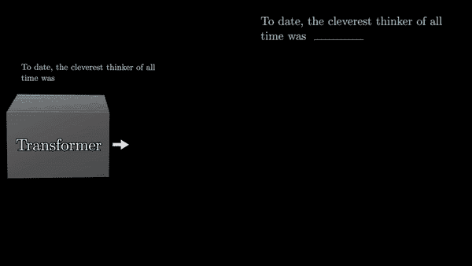

我们看一下到目前为止我们已经完成了哪些内容，以及我们还需要完成哪些内容：

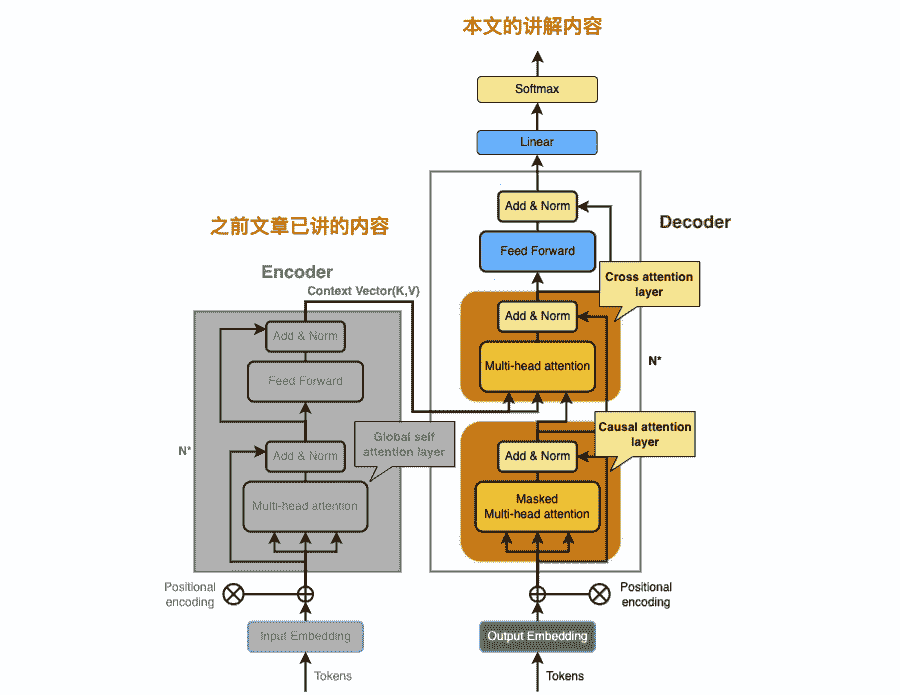

我们不会计算整个解码器，因为它的大部分已经在编码器中完成了类似的计算，详细计算解码器只会使文章变得冗长，因为重复的步骤很多；下面，我们会更多关注解码器输入和输出的计算。

解码器有两个输入，一个输入来自编码器，顶层编码器的输出转换为一组注意力向量K和V；这些向量将在每个解码器的“交叉注意力”层中使用，用于帮助解码器集中注意力于输入序列中的适当位置；第二个输入是预测文本，假设我们输入给编码器的是 " 用简单语言讲解Transformer "，解码器的输入是预测的文本" 太棒了 "。

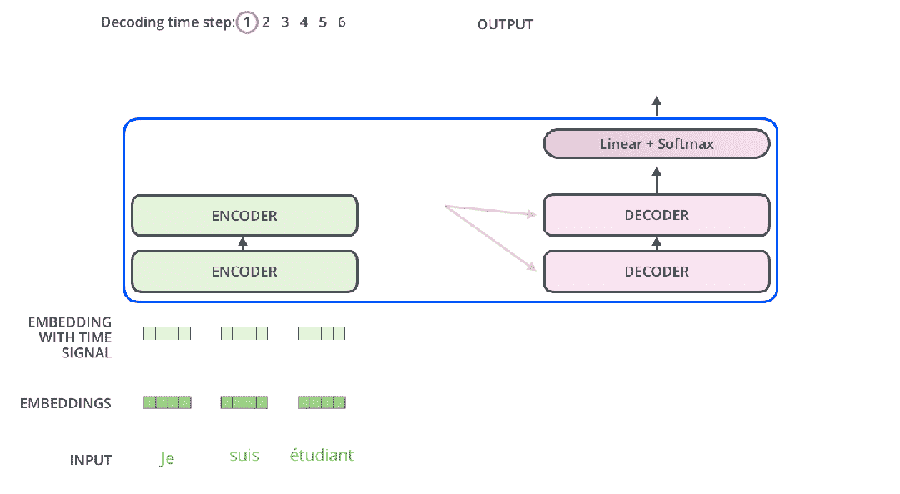

以上动图展示了Transformer解码器训练过程在机器翻译任务中的运用。

接下来的步骤会重复这个过程，直到达到一个特殊的结束符，表示Transformer解码器已经完成了输出；每个步骤的输出都会在下一个时间步骤中被传递给底层解码器，解码器们会像编码器一样层层传递解码结果，并且，就像我们对编码器输入所做的那样，我们对这些解码器输入进行嵌入和添加位置编码，以指示每个单词的位置。

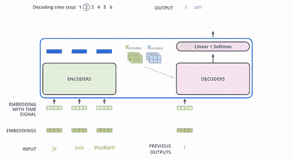

以上动图展示了Transformer解码器训练过程在机器翻译任务中的运用。

但是训练的目标输入文本需要遵循一种标准的token封装方式，这样Transformer就知道从哪里开始和结束。

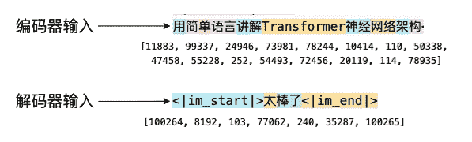

在这里，引入了两个新的token，分别是<|im_start|>和<|im_end|>，此外，解码器一次只能接受一个token作为输入，也就是说，<|im_start|>会被作为一个输入，而"太”就是下一个预测token。

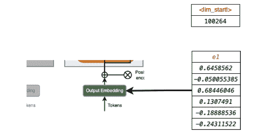

正如我们所知，这些词嵌入是有随机权重值的，这些权重将在训练过程中进行更新。

如下图所示，以之前在编码器部分计算的相同方式计算剩余的块。

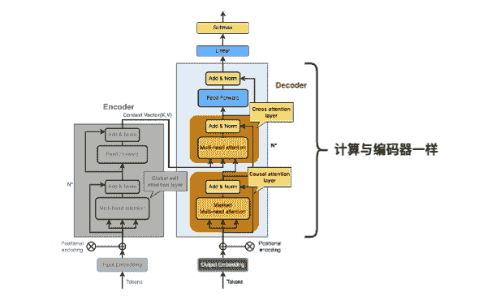

在深入了解之前，我们需要通过一个简单的例子来理解什么是掩码多头注意力（masked multi-head attention）的概念。

# 02

掩码多头注意力

在Transformer中，掩码多头注意力就像是模型用来聚焦句子不同部分的灯光，它的特殊之处在于，它不允许模型查看句子中后面的单词，避免了作弊；这有助于模型逐步理解和生成句子，在对话或将单词翻译成其他语言等任务中尤为重要。

我们以上面的目标输入（”太棒了“）矩阵为例，其中每一行代表序列中的一个位置，每一列代表一个特征，如下所示为7 * 6的矩阵（d_model为6）。

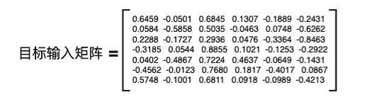

现在，让我们来了解具有两个头的掩码多头注意力组件的构成：

1.  线性投影（Q，K，V） ：假设每个头的线性投影为 Head 1: Wq1，Wk1，Wv1 和 Head 2: Wq2，Wk2，Wv2。

1.  计算注意力分数 ：对于每个头，通过Q和K的点积计算注意力分数，并应用掩码以防止关注未来位置。

1.  应用Softmax函数 ：将注意力分数应用于softmax函数，获得注意力权重。

1.  加权求和（V） ：将注意力权重与值相乘，获得每个头的加权和。

1.  加法和线性变换 ：将两个头的输出连接起来，并应用线性变换。

进行如下简化的计算：

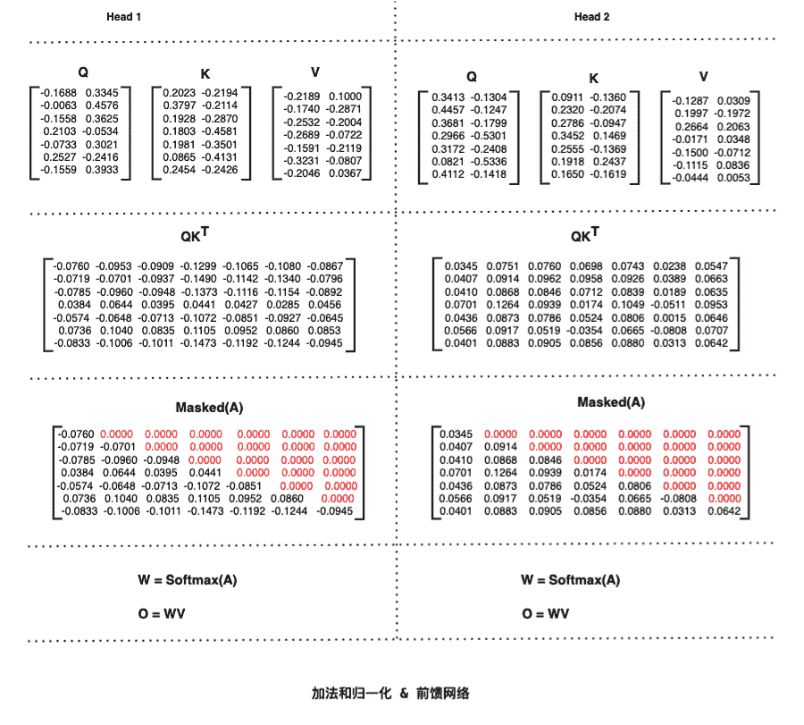

加法和线性变换步骤将两个注意力头的输出合并为一组信息，这一步骤有助于从多个角度捕捉输入数据的不同方面，并提供一个更丰富的表示，供模型进一步处理使用。

# 03

预测(Token Prediction)

解码器最后一个加法和归一化层的输出矩阵必须具有与输入矩阵相同的行数，而列数可以是任意的。在这里，我们使用6列。

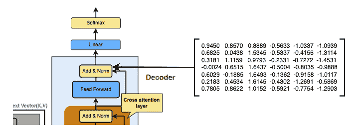

为了将解码器最后一个加法和归一化层的结果矩阵与一个线性层匹配，必须将其展平，以求得语料库中每个唯一Token的预测概率。

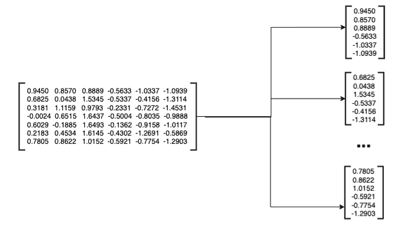

展平的层将通过一个线性层来计算语料库中每个唯一Token的逻辑值（分数）。

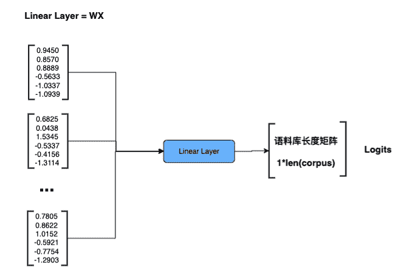

一旦我们获得逻辑值，我们可以使用softmax函数对它们进行归一化，并找到概率最高的Token。

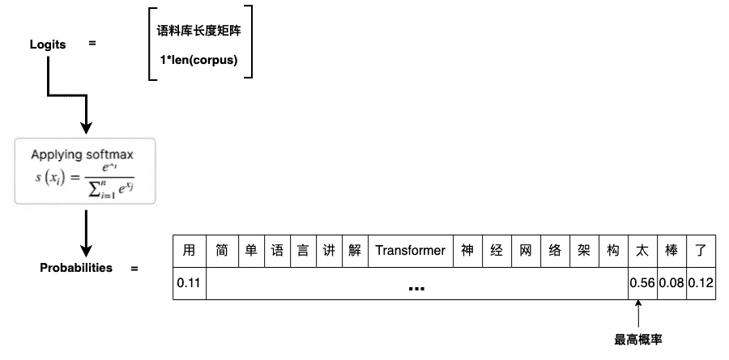

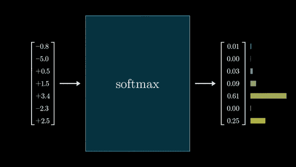

并且，用户可以用temperature参数来控制softmax函数的输出分布，以增加或减少随机性。

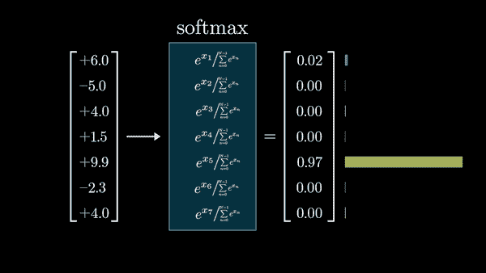

根据我们的计算，解码器预测的单词是"太"，它的Token是8192和103。

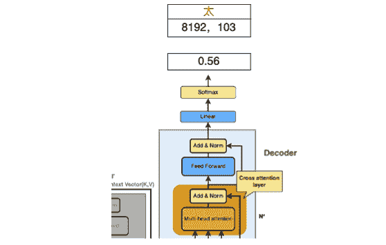

这个预测的单词"太"将被视为解码器的输入单词，并且这个过程会一直持续，直到预测到<|im_end|>标记。

# 04

总结

本文详细讲解了Transformer架构的解码器部分，阐述了其基于编码器输出和已生成Token进行预测的工作机制。

通过图解和动画形式展示了掩码多头注意力机制和Token预测过程，并解释了如何使用解码器预测的Token作为下一个输入，以实现自动生成文本的功能。

希望本文能够帮助你更好地理解Transformer模型中解码器的工作原理。

点击关注👸号👇

感谢您阅读完

推荐阅读：

+   [ChatGPT背后强大而神秘的力量：用最简单的语](http://mp.weixin.qq.com/s?__biz=MzU3OTgyMjM3MA==&mid=2247484435&idx=1&sn=eeb8d952a4695211be575d7ef92d4166&chksm=fd61725eca16fb48b25ab8be527c4986d581f5f29e41989408362145c93ee1068264f78fbaef&scene=21#wechat_redirect)言讲解Transformer架构之概览

+   [ChatGPT背后强大而神秘的力量：用最简单的语言讲解Tra](http://mp.weixin.qq.com/s?__biz=MzU3OTgyMjM3MA==&mid=2247484599&idx=1&sn=7a7707295fb751aef0693c32d2d56137&chksm=fd6172faca16fbec2c226137bd31d0b64ac8c6b3a7c266c2890ef03cf88d501437d41f6376bb&scene=21#wechat_redirect)nsformer架构之Embedding

+   [第](http://mp.weixin.qq.com/s?__biz=MzU3OTgyMjM3MA==&mid=2247484650&idx=1&sn=4025bc4d1a14ea345589a26a335ce41f&chksm=fd6172a7ca16fbb1b8f0458f78a8e49eba145a84aeccefc33e0b288e5ca9647fdd6ba018fe71&scene=21#wechat_redirect)三篇：ChatGPT背后强大而神秘的力量，用最简单的语言讲解Transformer架构之Tokenizer

+   一文搞懂Transformer架构的三种注意力机制

+   一文彻底搞懂Transformer的输入（附代码）

+   一文搞懂Transformer自注意力机制（图文代码详解）

👸号回复口令，领取资料，一起学习吧！🏃

“ 1 ”：领取开源书籍《动手实战人工智能》

” 2 “：领取 50G+的免费AI视频课程

“ 3 ”：领取ChatGPT4访问码

“ 2024 ”：领取吴恩达的书《Machine Learning Yearning》

扫码加入学习群：

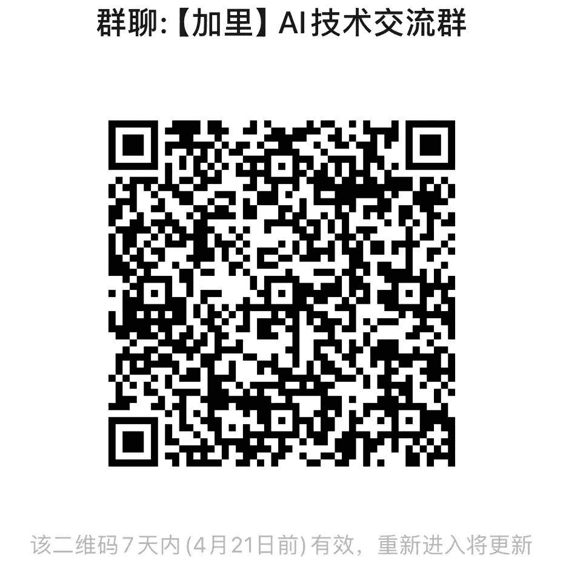

觉得内容还不错的话，“分享”一下，点个“在看”呗

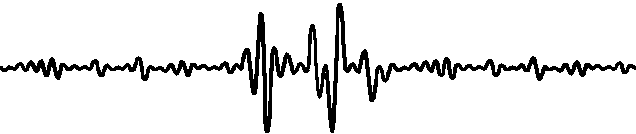

