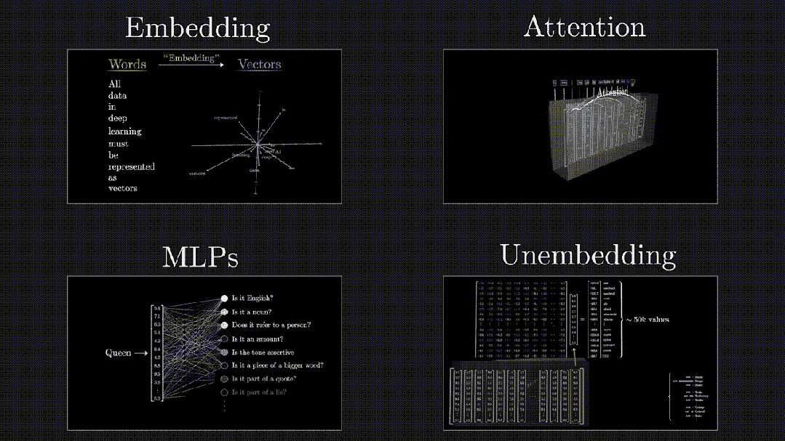
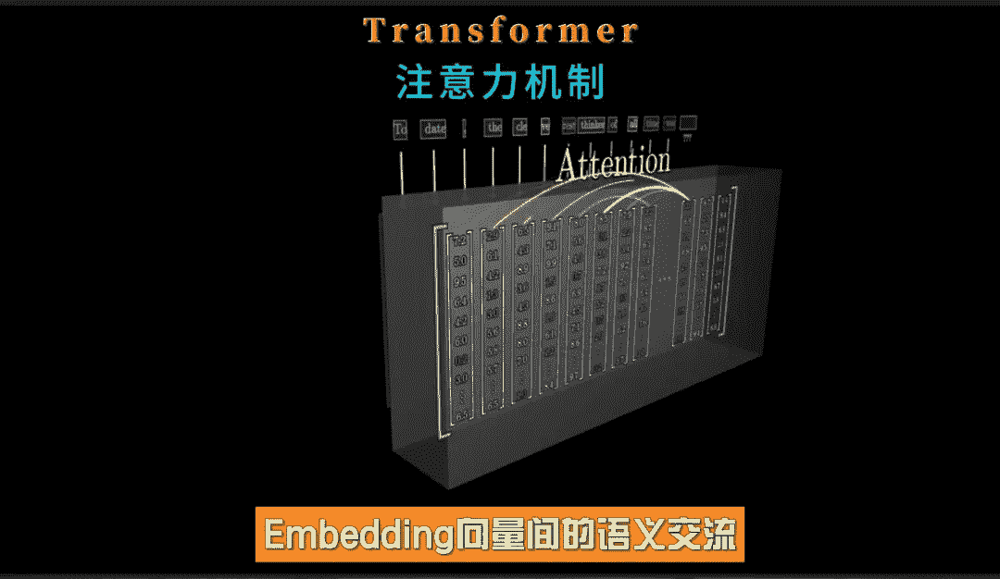
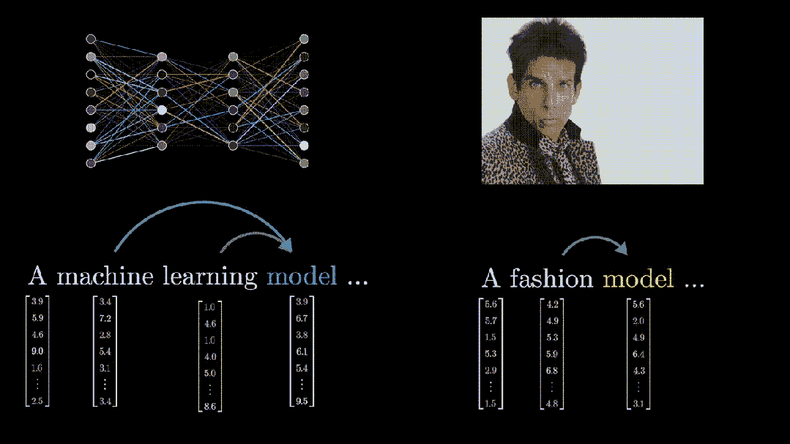

# Transformer动画讲解 - 注意力机制

> 来源：[https://geekbang.feishu.cn/docx/VlindwyqdozEJRxuX7Oc3d1Anvd](https://geekbang.feishu.cn/docx/VlindwyqdozEJRxuX7Oc3d1Anvd)

> 👨🏻 作者：AllenTang

> 📃 作者介绍：分享人工智能，让所有人玩转AI

> 🛖 👸号：架构师带你玩转AI

> ⏰ 收录时间：2024-05-23 11:28:42

> 🔗 原文链接：h[ttps://mp.weixin.q](https://mp.weixin.qq.com/s/roWwv7-dtkyOgQKkQ_XhZw)q.com/s/roWwv7-d...

关注作者👸号，获取更多AI知识

**动画地址：查看原文，可看动画**

Transformer注意力机制

**从端**到端的角度来看，数据在Transformer中的流转可以概括为四个阶段：Embedding（嵌入）、Attention（注意力机制）、MLPs（多层感知机）和Unembedding（ 从模型表示到最终输出 ）。

**Embedding -> Attention ->** MLPs -> Unembedding

下面对第二个阶段Attention（注意力机制）进行详细介绍：

Attention（注意力机制）的目的：

+   **在**自然语言处理（NLP）中，嵌入向量（Embedding Vector）是单词或文本片段的数值表示，它们捕捉了这些单词或文本片段的语义信息。

+   **嵌入向量作为输入传递给 Transformer的 Attention模块时，Attention模块会通**过Q、K、V计算注意力权重，从而分析这些向量， 使得Embedding向量间能够相互"交流"并根据彼此信息更新自身的值。

+   **A**ttention模块的主要作用是确定在给定上下文中哪些嵌入向量与当前任务最相关，并据此更新或调整这些嵌入向量的表示。

+   **这种“相关性”通常基于单词之间的语义关系，即它们**如何相互关联以形成有意义的句子或段落。

**Attention的目的 **

神经网络算法 - 一文搞懂Attention（注意力）机制

Attention（注意力机制）的工作流程 ：

+   **生成Q、K、V向量： ****对于输入序列中的每个单词，都会生成对应的 Query（查询）、****Key（键）和Value（值） 向量。 这些向量通常是通过**将单词的嵌入向量（Embedding Vector）输入到一个线性变换层得到的。

+   **计****算Q、K的点积（注意力分数）： Attention机制**会计算Query向量与序列中所有单词的Key向量之间的点积（或其他相似度度量），得到一个分数。 这个分数反映了Query向量与每个Key向量之间的相似度，即每个单词与当前位置单词的关联程度。

+   **So**ftmax函数归一化（注意力权重）： 这些分数会经过一个Softmax函数进行归一化，得到每个单词的注意力权重。 这些权重表示了在理解当前单词时，应该给予序列中其他单词多大的关注。

+   **注意**力权重加权求和 （加权和向量 ）： 这些注意力权重与对应的Value向量进行加权求和，得到一个加权和向量。 这个加权和向量会被用作当前单词的新表示，包含了更丰富的上下文信息。

+   **在处**理每个单词时，模型都能够考虑到整个输入序列的信息，并根据单词之间的语义关系来更新单词的表示。 这使得Transformer模型能够能够更准确地理解单词在当前上下文中的含义，进而解决上下文依赖问题。

**Attention的工作流程**

[**神经网络算法 - 一文搞懂Self-Attention和M**](http://mp.weixin.qq.com/s?__biz=MzkzMTEzMzI5Ng==&mid=2247485973&idx=1&sn=79be10a2fccf09e5fac2cb5cc6be5810&chksm=c26ee80af519611c0eaf666a17a9ab161ba9071d3cd16647e28a3ef5c5db955b94caddee08c9&scene=21#wechat_redirect)**ulti-Head A**ttention （第二部分：工作流程）

神经网络算法 - 一文搞懂 Softmax 函数

Attention（注意力机制）的实际案例 ：

+   **以单**词“model”为例，在“machine learning model”（机器学习模型）和“fashion model”（时尚模特）这两个不同的上下文中，它的含义是不同的 。

+   **当A**ttention模块处理包含“model”的句子时，它会查看句子中的其他单词（如“machine learning”或“fashion”），并确定这些单词与“model”之间的语义关系。

+   **At**tention模块会计算一个权重，该权重表示其他单词对理解“model”在当前上下文中的含义的重要性。 这些权重被用来更新“model”的嵌入向量，以便更好地反映其在当前上下文中的意义。

+   **A**ttention模块的作用就是确定上下文中哪些词之间有语义关系，以及如何准确地理解这些含义，更新相应的向量。

**Attention的实际案例**

** **[**神经网络算法 - 一文搞懂Self-Attention和M**](http://mp.weixin.qq.com/s?__biz=MzkzMTEzMzI5Ng==&mid=2247485973&idx=1&sn=79be10a2fccf09e5fac2cb5cc6be5810&chksm=c26ee80af519611c0eaf666a17a9ab161ba9071d3cd16647e28a3ef5c5db955b94caddee08c9&scene=21#wechat_redirect)**ulti-Head At**tention （ 第三部分：案例对比）

**参考资料**

+   https://www.3blue1brown.com/lessons/gpt