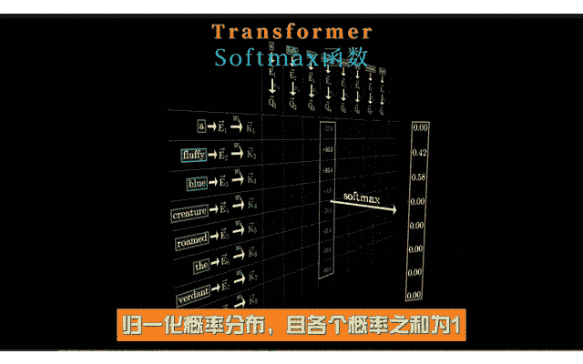
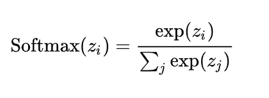
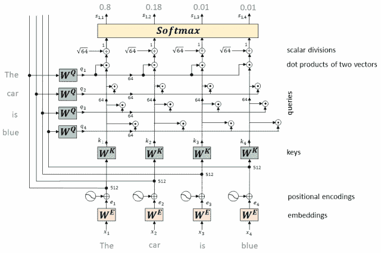
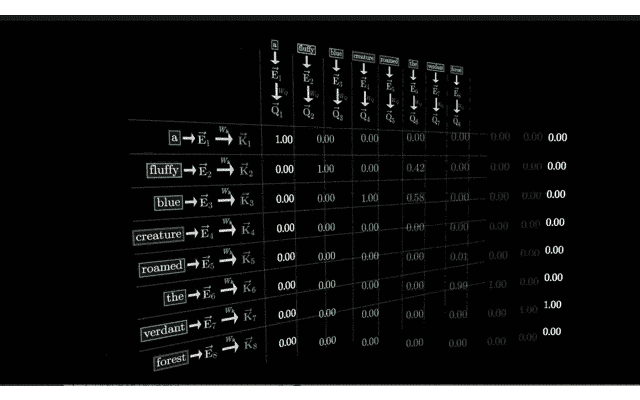

# Transformer动画讲解 - Softmax函数

> 来源：[https://geekbang.feishu.cn/docx/KnxddY28NoGjMgx1VTxc5ZkMnyg](https://geekbang.feishu.cn/docx/KnxddY28NoGjMgx1VTxc5ZkMnyg)

> 👨🏻 作者：AllenTang

> 📃 作者介绍：分享人工智能，让所有人玩转AI

> 🛖 公众号：架构师带你玩转AI

> ⏰ 收录时间：2024-05-23 11:28:42

> 🔗 原文链接：h[ttps://mp.weixin.q](https://mp.weixin.qq.com/s/EhZbHOTqwqk7lBzYizvbrA)q.com/s/EhZbHOTq...

关注作者公众号，获取更多AI知识

**动画地址：查看原文，可看动画**

**T****ransformer的Softmax函数： 用于将原始注意**力分数转换为输入标记的概率分布。这种分布将较高的注意力权重分配给更相关的标记，并将较低的权重分配给不太相关的标记。 Transformers通过Softmax在生成输出时，使用注意力机制来权衡不同输入标记的重要性。

Transformer的Softmax函数

### **Softmax的数学原理： ****对**于一个给定的实数向量，它首先计算每一个元素的指数（e的幂），然后每个元素的指数与所有元素指数总和的比值，就形成了softmax函数的输出。 这种计算方式不仅使输出值落在0到1之间，还保证了所有输出值的总和为1。

**Softmax的数学原理**

神经网络算法 - 一文搞懂 Softmax 函数

### Softmax在Transformer的位置：

**在Transformer模型中，So**ftmax函数主要在两个关键位置被使用：

1.  自注意力机制（Self-Attention Mechanism） ：

1.  （1）自注意力机制是Transformer模型中的核心组件之一，它允许模型处理输入序列中的依赖关系，而不需要考虑序列中元素的顺序。

1.  （2）在自注意力机制中，模型首先计算输入序列中每个位置（token）与其他所有位置的 的相似度分数（也称为注意力分数） 。这些分数通常通过点积、缩放点积或其他相似度函数计算得到。

1.  （3） **使用Softmax函数对这些相似度分数进行归一化，生成一个权重分布，该分布表示了**在计算当前位置（query）的表示时，应赋予其他位置（keys）多大的关注程度。

1.  （4）这些权重最终被用来计算加权和，生成当前位置的上下文向量，该向量将作为该位置在后续层中的输入。

1.  输出层（Output Layer） ：

1.  （1）在Transformer的解码器部分，输出层负责根据解码器的状态生成目标序列。

1.  （2）当进行词汇预测或生成任务时（如机器翻译中的下一个词预测），解码器的最后一层通常会产生一个未经归一化的分数向量（logits），其中每个元素对应于词汇表中一个词的概率。

1.  （3） **Softmax函数被应用于这个分数向量，将其转换为概率分布，其中每个元素表示生**成对应词汇的概率。这使得模型可以生成一个分布，并从中选择最可能的词作为预测结果。

Softmax在Transformer的位置

大模型开发 - 一文搞懂Transformer工作原理

### Softmax在Transformer的作用：

+   **归一化： ****Softmax函数将原始分数转换为概率分布，确保所有概**率之和为1，使得输出结果可以解释为概率。

+   **平滑化： ****通过指数函数，Softmax能够将大的分数差距转换为相对平滑的概率分布**，从而避免了“赢家通吃”的情况，即一个分数远大于其他分数时，其他分数几乎被忽略。

+   **可解释性： ****输出的概率分布使得模型预测结果更加直观和可解释，我们可**以直接查看模型为每个可能输出分配的概率。

+   **稳定性： ****在训练过程中，Softmax有助于保持梯度的稳定性，因**为概率分布的变化通常比原始分数更加平滑。

Softmax在Transformer的作用

** **

****注释****

**Transformer动画素材来源于 3Blue1**Brown，想了解更多查看参考资料网址。

**3B**lue1Brown 是一个由 Grant Sanderson 创建的YouTube 频道。这个频道从独特的视觉角度解说高等数学，内容包括线性代数、微积分、人工神经网络、黎曼猜想、傅里叶变换以及四元数等。

**Grant Sanderson **毕业于斯坦福大学，并获得了数学学士学位。

**参考资料**

+   https://www.3blue1brown.com/

+   https://www.3blue1brown.com/lessons/attention