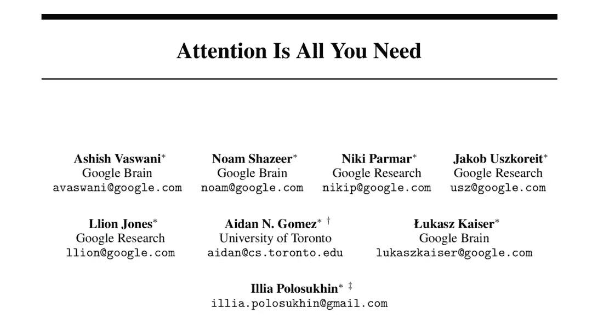
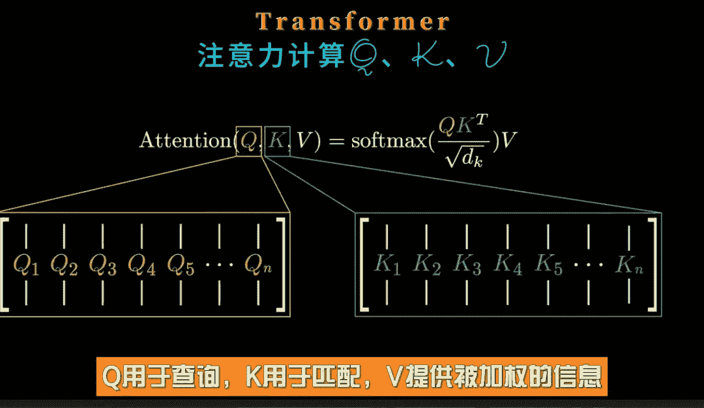
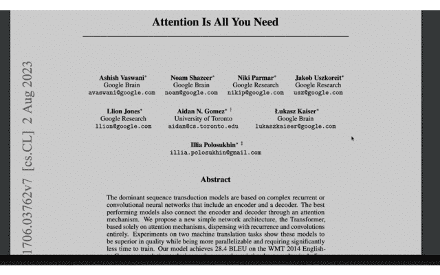
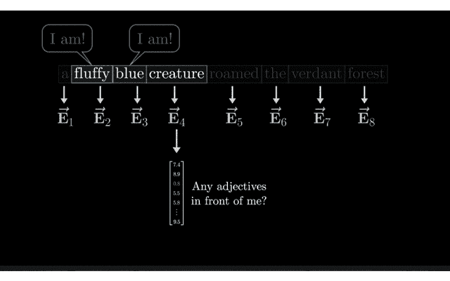
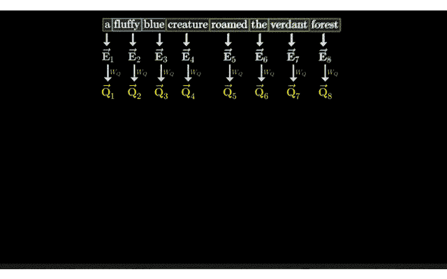
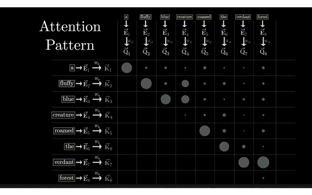
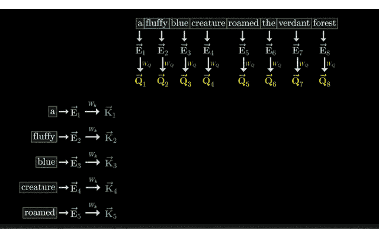

# Transformer动画讲解 - 注意力计算Q、K、V

> 来源：[https://geekbang.feishu.cn/docx/RFhpdfLfYotKNnxlmoOcS3gGnPb](https://geekbang.feishu.cn/docx/RFhpdfLfYotKNnxlmoOcS3gGnPb)

> 👨🏻 作者：AllenTang

> 📃 作者介绍：分享人工智能，让所有人玩转AI

> 🛖 👸号：架构师带你玩转AI

> ⏰ 收录时间：2024-05-23 11:28:42

> 🔗 原文链接：h[ttps://mp.weixin.q](https://mp.weixin.qq.com/s/oSXYQSxgMyss1jxmk3oCLQ)q.com/s/oSXYQSxg...

关注作者👸号，获取更多AI知识

**动画地址：查看原文，可看动画**

**T**ransformer的起源： Google Brain 翻译团队通过论文《Attention is all you need》 提出了一种全新的简单网络架构— — Transformer，它完全基于注意力机制，摒弃了循环和卷积操作。

**注意力机制是全部所需**

**正**如论文标题所言“注意力机制是全部所需”，强调了注意力机制是Transformer架构的核心要素，就如同人的心脏一样，充当着发动机的作用。

**注意力计算Q、K、V **

神经网络算法 - 一文搞懂Transformer

[**神经网络算法 - 一文搞懂 Transf**](http://mp.weixin.qq.com/s?__biz=MzkzMTEzMzI5Ng==&mid=2247488594&idx=1&sn=05e9b57c9538d6a6c5c358627e97279b&chksm=c26ef64df5197f5b57400417d2be68020464167192c5d98aa13af2fac99a9489c618132bbf27&scene=21#wechat_redirect)ormer（总体架构 & 三种注意力层）

神经网络算法 - 一文搞懂Transformer中的三种注意力机制

**注意力计算Q、K、V： **在注意力机制中，Q（Query）、K（Key）、V（Value）通过映射矩阵得到相应的向量，通过计算Q与K的点积相似度并经过softmax归一化得到权重，最后使用这些权重对V进行加权求和得到输出。

Transformer注意力计算公式

### **权重矩阵 W： ****W_Q、W_K和W_V**

+   **权****重矩阵W是可训练的参数，其维度为(d_model,** d_k)，其中d_model是输入嵌入的维度，d_k是Q/K/V向量的维度。 通过训练，模型会学习到如何从输入数据中提取出对任务有用的特征，并将其映射到Q、K、V向量中

+   **初**始时，这些权重矩阵的值通常是随机初始化的。经过训练后，它们会学习到如何从输入数据中提取出对任务有用的特征。

+   **模型会通过反向传播算法和梯度下降来更新这些权重矩阵W的值**，以最小化某个损失函数（如交叉熵损失）。

### 权重矩阵 W_Q计算Query（Q） ： 在Transformer模型中，Query（Q）是通过将输入数据的嵌入矩阵E与权重矩阵W_Q相乘得到的。

###

+   权重矩阵 W_Q 的定义：

+   在Transformer模型中，权重矩阵W是用于将输入数据（如词嵌入）映射到Q、K、V（Query、Key、Value）向量的线性变换矩阵。对于Query（Q），有一个专门的权重矩阵W_Q。

+   **W****_Q的维度通常是(d_mo**del, d_k)，其中d_model是输入嵌入的维度（也是模型的维度），而d_k是Q/K/V向量的维度。 假设d_k被设定为128。

+   计算Query（Q）：

+   给定输入序列的嵌入矩阵E（形状为(batch_size, sequence_length, d_model)），Query矩阵Q是通过将X与权重矩阵W_Q相乘得到的。

+   具体地，对于Q中的每一个嵌入向量q_i（形状为(d_model)），Q中的一个向量q_i可以通过q_i = e_i * W_Q计算得到。

+   因此，整个Query矩阵Q（形状为(batch_size, sequence_length, d_k)）可以通过E * W_Q计算得到。

**计算Q（Query）**

### **权重矩阵 W_K计算Key（K） ： 在Transforme**r模型中，Key（K）是通过将输入数据的嵌入矩阵E与权重矩阵W_K相乘得到的。

+   **权重矩阵 W_K 的定义：**

+   **在**Transformer模型中，权重矩阵 W_K也是一个可训练的权重矩阵，用于将输入数据的嵌入映射到Key向量（K）。

+   **W_K的维度通常是(d_model, d_k)，其中d_model是输入****嵌入的维度（也是Trans**former模型的维度），d_k是Key向量的维度。 假设d_k被设定为128。

+   **计算Key（K）：**

+   **给定输入序列的嵌入矩阵E（形状为(batch_size, sequence_len**gth, d_model)），Key矩阵K是通过将E与权重矩阵W_K相乘得到的。

+   **具**体地，对于K中的每一个嵌入向量k_i（形状为(d_model)），K中的一个向量k_i可以通过k_i = e_i * W_K计算得到。

+   **因**此，整个Key矩阵K（形状为(batch_size, sequence_length, d_k)）可以通过X * W_K计算得到。

**计算K（Key） **

### **权**重矩阵 W_V计算Value（V） ： 在Transformer模型中，Value（V）是通过将输入数据的嵌入矩阵E与权重矩阵W_V相乘得到的。

+   **权重矩阵 W_V 的定义：**

+   **在**Transformer模型中，权重矩阵 W_V也是一个可训练的权重矩阵，用于将输入数据的嵌入映射到Value向量（V）。

+   **W_V的维度通常是(d_model, d_v)，其中d_model是输入嵌入****的维度（也是Transfo**rmer模型的维度），d_v是Value向量的维度。 假设d_k被设定为128。

+   **计算Value（V）：**

+   **给定输入序列的嵌入矩阵E（形状为(batch_size, sequence_lengt**h, d_model)），Value矩阵V是通过将E与权重矩阵W_V相乘得到的。

+   **具**体地，对于E中的每一个嵌入向量e_i（形状为(d_model)），V中的一个向量v_i可以通过v_i = e_i * W_V计算得到。

+   **因**此，整个Value矩阵V（形状为(batch_size, sequence_length, d_v)）可以通过E * W_V计算得到。

**计算V（Value）**

### **Q**、K、V计算 ： Q用于查询，K用于匹配，V提供被加权的信息。 通过计算Q和K的点积来衡量注意力分数，进而决定V的加权方式。

Q（query）、K（Key）、V（Value）计算

** **

****注释****

**Transformer动画素材来源于 3Blue1**Brown，想了解更多查看参考资料网址。

**3B**lue1Brown 是一个由 Grant Sanderson 创建的YouTube 频道。这个频道从独特的视觉角度解说高等数学，内容包括线性代数、微积分、人工神经网络、黎曼猜想、傅里叶变换以及四元数等。

**Grant Sanderson **毕业于斯坦福大学，并获得了数学学士学位。

**参考资料**

+   https://www.3blue1brown.com/

+   https://www.3blue1brown.com/lessons/attention

+   《Attention Is All You Need》